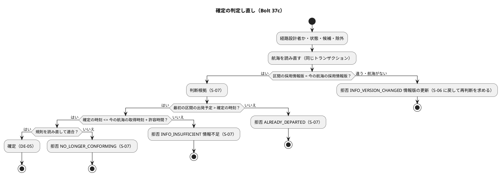

# Bolt 37c 計画 - US-07 AC3 確定のときの情報版の照合と鮮度（承認中に航海の情報が更新されたら確定を拒否し再判断を求める）

## 基本情報

| 項目 | 内容 |
| :--- | :--- |
| Bolt | 第 37c 回（W6 の 5 本目） |
| 予定 | W6（2026-11-09 の週。前倒しで着手できる）。作業は約 3.8 時間（`check`・`uiTest`・SonarQube・CI の待ちを除く） |
| 対象 | 経路設計のドメイン: 確定 `RoutingCase.confirm`（航海を読み直して情報版を照合し、確定の時刻で鮮度を判定し直す）、版の違う区間を返す部品（`RouteCandidate`）、情報鮮度の判定（取得時刻で判定するメソッド）、確定の拒否の理由 `RouteConfirmationRejectionReason`、入力ポート `RoutingCaseCommandService.confirm`、S-07 の拒否の扱いと文言（`RoutingCaseController`）、テストの `InMemoryVoyageRepository`（航海の置き換え）。受入シナリオ `features/routing/confirm_route.feature` とステップ定義、画面の層のシナリオ `features/ui/confirm_route_ui.feature` |
| GitHub | [#16](https://github.com/k2works/practical-domain-driven-design-in-enterpris-application/issues/16)（US-07 の残り。閉じるのは Bolt 37e） |
| SP | 0（US-07 の 2 SP は Bolt 37e で数える） |
| 承認ゲート | 計画と終了報告（W6 節の 37c の行。W6 の確認ポイント 6）。スキーマ・認可・層の構造・環境変数は変えない。新しいファイルは作らない（確認ポイント 4） |
| アプローチ | アウトサイドイン（受入シナリオ → 集約の確定 → 入力ポート → 画面）。W6 節の 37c の行のとおり |
| マニュアル・デモ | マニュアル 8 章の 8.3（注意・補足に、情報版が更新されたときは確定できず候補の比較に戻り判断根拠を入れ直すこと、情報不足のときも確定できないこと）と 8.2（Bolt 37b2 で書いた「確定の前に再算出する」の注意を直す）、マニュアルの用語集の「情報不足」。キャプチャは撮り直さない（確認ポイント 8）。デモの動画 `@demo-bolt-37c/info-version-changed` |
| 前の Bolt | [Bolt 37b2 終了報告](bolt_37b2_report.md)（承認済み）、W6 節（[リリース計画](release_plan.md)） |

## Bolt ゴール

経路設計者が候補を確定するとき、候補を算出した後に区間の航海の情報が更新されていれば（情報版が違う）、確定は拒否され、候補の比較に戻って再算出して判断し直すよう示される（US-07 AC3、R-INV-03）。確定の時刻に区間の航海の情報が許容時間を過ぎていれば（情報不足）、確定できず、航海の情報の取込を確かめて再算出するよう示される（Bolt 37b2 から持ち込んだ穴を閉じる）。

### 確かめたい仮説

| # | 仮説 | この Bolt で分かること |
| :--- | :--- | :--- |
| H1 | 確定の判定に照合と鮮度を足しても、既存の確定のテストは航海を読み直す引数を足す直しのほかに期待値を変えずに緑のまま。既存のテストの航海の情報版は算出のときと同じ。取得時刻が確定の時刻の 24 時間を超えるのは「出発した後には確定できない」のシナリオ（取得 10-07T01:00Z、確定 10-12）だけで、鮮度を出発済みの後に判定するので理由は出発済みのまま | 引数を足した後の `check` と `uiTest` の件数と結果。入力ポートを通るテスト（受入のステップ、`RouteConfirmedAssignmentIntegrationTest`、画面の層）も数える |
| H2 | 航海の読み直しは今の `VoyageRepository.findAll()` で足り、保存とスキーマは変えずに済む（拒否は経路版を変えないので保存しない） | 保存の層の差分がない |

### 開始準備で確かめたこと

（行番号は 2026-10-22 の develop の `203e8a1d6`。パスは `apps/cargo-tracker/src/` からの相対）

- **要求**: US-07 AC3 は「Given 承認中に候補の情報版が更新済み、When 確定する、Then 承認は無効となり再判断が要求される」（user_story の US-07）。R-INV-03（domain_model :704）は「確定は承認の commit 時点で再検証し、参照した情報版が承認中に更新されていれば確定を拒否する」。US-07 の決定は「情報版の更新による拒否は AC3」。W6 の確認ポイント 6 で「確定と同じトランザクションで航海を読み直して比べるだけにする。航海の行のロックは書き手ができる W7 で決める」と決めた。
- **画面遷移**（ui_design :438）: 「経路確定の確認 --> 候補の比較 : 情報版が更新済み（再判断を要求）」。情報版の更新は S-07 にとどまらず S-06 に戻す設計になっている。
- **確定**（`main/java/.../routing/domain/model/aggregates/RoutingCase.java:207-271`）: 判定の順は、経路設計者か → 確定できる状態か → 候補があるか → 除外の候補でないか → 判断根拠 → 最初の区間が出発済みでないか（:248） → 規則を読み直して判定し直す（:251）。S-06 に戻す理由（状態・候補・除外）を判断根拠より前に、S-07 にとどまる理由（根拠・出発済み・規則）を後に確かめている。引数は 6 つ（`@SuppressWarnings("java:S107")`）。航海は読み直していない。区間は算出のときの航海の採用情報版 `infoVersion` と取得時刻 `infoAcquiredAt` を写して持つ（`valueobjects/Leg.java`）。
- **拒否の理由**（`valueobjects/RouteConfirmationRejectionReason.java`）: 8 つ（経路設計者でない、確定できない状態、候補がない、除外の候補、判断根拠がない・長すぎる、出発済み、条件を満たさなくなった）。
- **入力ポート**（`application/internal/commandservices/RoutingCaseCommandService.java`）: 確定は規則だけを読み直す（`connectionRuleRepository.findAll()`）。航海のリポジトリと情報鮮度の判定（Bolt 37b2）はすでに持っている。
- **航海**: `Voyage` は航海番号・寄港・採用情報版・取得時刻を持つ。`VoyageRepository` は `findAll()` だけ（データベースの航海番号は主キーで重ならない）。テストの `InMemoryVoyageRepository` は `add` と `clear` だけで、同じ航海番号を足すと `findAll()` が 2 件を返す。航海を書き換えるのは外部原本の取込（W7、US-14）で、今は開発データとテストだけが入れる。開発データの航海 7 本は情報版がどれも `PROVISIONAL-1` で、取得時刻は起動の時刻（Bolt 37b）。
- **画面**（`interfaces/web/RoutingCaseController.java:51-57`）: S-07 にとどまって示す拒否は、判断根拠の 2 つ・経路設計者でない・出発済み・条件を満たさなくなった（ui_design :175 は「入力や再算出で直す理由は S-07」）。ほかは S-06 に戻して示す。文言は `message`（:190-202。`default` のない網羅の switch なので、拒否の理由を足すとコンパイルできなくなる）。`RoutingCaseControllerTest:445-449` の名前は「入力で直せない拒否は比較の画面に戻して」。
- **受入シナリオ**: `confirm_route.feature` は 8 シナリオ（AC1・AC2・R-INV-03・R-INV-06・D-64）。AC3 はない。ステップ `RouteConfirmationSteps.java:44-46` の理由の表に出発済み・条件を満たさなくなった。航海の情報版を変えるステップはない。
- **画面の層**: `confirm_route_ui.feature` は 3 シナリオ（`@demo-bolt-19/confirm-route`・`confirm-route-without-rationale`、幅 320 px）。
- **情報鮮度の判定**（`rules/InfoFreshnessPolicy.java`）: `evaluate(List<Leg>, 判定時刻)` は区間に写した取得時刻で判定する。読み直した航海の取得時刻では判定できない。
- **データモデル**: `referenced_info_version`（data_model :446・:498 に「承認時の再検証に使う」）は作った表の一覧（:505）になく、照合は `candidate_leg.info_version`（区間の写し）で行う。
- **マニュアル**: 8.3 の注意・補足（08-経路設計.md :127）は「最初の区間が出発済みだったり、候補を算出した後に登録・変更された接続時間規則に合わなくなっていたりすると確定できません」。8.2 の注意・補足に Bolt 37b2 で「④ の最も古い情報の取得時刻から 24 時間を過ぎていたら、確定の前に『候補を再算出』してください」を書いた。
- **テスト戦略**: 「Release 1.0 の受入条件（照合の表の前の対応）」（test_strategy :550 付近）に US-07 AC3 の行はない。
- **確定の呼び出し**: 集約の `confirm` を直接呼ぶのは 37 か所（テスト 36: `RoutingCaseConfirmationTest` 28、`MyBatisRoutingRepositoriesIntegrationTest` 5、`RoutingCaseControllerTest` 2、`RoutingCaseFixture` 1。本体は入力ポートの 1）。入力ポートを通るテストも確定のときに照合と鮮度の判定を受ける（ステップ 1 で数える。T-148）。
- **デモ環境の手順書**（`heroku_demo_setup.md:318`）: 起動から 24 時間を超えたら算出の前に再起動する注はあるが、確定のことは書いていない。
- **Bolt 37b2 から持ち込んだこと**: 確定のときに鮮度を見ていない（算出のときに適合だった候補を、情報が古くなった後も確定できる。デモ環境が起動から 24 時間を超えて動くと見本の候補でも起こる）。除外理由の閾値を区分ごとの型にするか・`threshold` の列を分けるか、制約適合判定の値の名前は 37c の開始準備で決める（Bolt 37b2 終了報告の既知の課題）。

## 設計の決定（案）

| 事項 | 決定（案） | 反映 |
| :--- | :--- | :--- |
| 情報版の照合 | 確定のときに航海を読み直し、選んだ候補の区間ごとに、区間の採用情報版と、同じ航海番号の今の航海の採用情報版を比べる。1 つでも違うか、航海がなくなっていれば拒否する（新しい理由 `INFO_VERSION_CHANGED`「情報版の更新」。R-INV-03・AC3 の語）。照合は「版の違う区間を返す」部品として候補（`RouteCandidate`）に置き、Bolt 37d の確定した経路版の評価でも使う（確認ポイント 1） | US-07 の Bolt 37c の決定、domain_model の Bolt 37c で決めたこと、R-INV-03 の注 |
| 確定のときの鮮度 | 確定の時刻が、読み直した航海の取得時刻と許容時間の和より後なら拒否する（新しい理由 `INFO_INSUFFICIENT`「情報不足」。除外理由の区分と同じ語で、Javadoc に関係を書く）。情報鮮度の判定に「取得時刻と判定時刻から情報不足かを返す」メソッドを足し、算出の判定もそれを使う（ちょうど許容時間は足りる）。確定のときの鮮度は確定の操作だけで見る（Bolt 37d の評価は鮮度を見ない）（確認ポイント 2） | 同上 |
| 判定の順 | 経路設計者か → 状態 → 候補 → 除外 → **情報版の照合** → 判断根拠 → 出発済み → **鮮度** → 規則の判定し直し。S-06 に戻す理由を判断根拠より前に、S-07 にとどまる理由を後に確かめる今の並びを保つ。情報版を先に確かめるので、区間に写した出発予定は正しいとして出発済みを判定できる（確認ポイント 3） | 同上 |

## ふりかえりと前の Bolt からの引き継ぎ

| 入力 | 内容 | この Bolt での扱い |
| :--- | :--- | :--- |
| T-173（Bolt 37b2） | 直しを当てるスクリプトは 1 本ずつ流し、当たった数を出力で確かめてから次に進む（`&&` でつながない） | 呼び出しの直し（36 か所）は 1 本のスクリプトで当て、直した数を出力で確かめてからコンパイルする。航海の一覧は呼び出しの場所ごとの定数（`RoutingCaseFixture` などにまとめる）で渡す |
| T-174（Bolt 37b2） | 開発レビューの直しで振る舞いを足すときも、テストを先に書いて Red を見る | ステップ 6 の直しで振る舞いが変わるものは、テストを先に書く |
| T-171・T-172 | 時刻に依るテストは判定と同じ時計で作る。画面の確かめを省く前に開発用の利用者で済むかを確かめる | 設計の約束の「時計」。ステップ 5 のローカルの dev の確かめ |
| T-148・T-152 | 共通の部品と写しは全体を検索して数えてから変える | `confirm` の呼び出し、拒否の理由の文言・表（コントローラー・受入シナリオ・画面の層・マニュアル）を数える（ステップ 1） |
| T-106・T-119 | 「ないこと」を確かめる前に、対象があり条件が成り立つことを確かめる | 情報版が同じなら同じ候補を確定できることを、拒否のシナリオと同じ前提で確かめる |
| T-164・T-166・T-167・T-168・T-125・T-104・T-147・T-139・T-151 | 変異の差し込みを出力で確かめる、規則に当たったら止める、SonarQube の時機、テストのラムダ、件数は XML で数える | 確認ポイント 9 |
| Bolt 37b2 の既知の課題 | 確定のときの鮮度、除外理由の閾値の型と列、制約適合判定の値の名前。S-06 が古い候補を「適合」と示したままになること | 確認ポイント 2・6。S-06 の表示は入れないもの |

## スコープ

### 入れるもの・入れないもの

| 入れる | 入れない |
| :--- | :--- |
| 確定のときに航海を読み直して情報版を照合し、違えば拒否して S-06 に戻す（AC3） | 航海の行のロック（W7。W6 の確認ポイント 6）、航海の照会の絞り込み（D-65 の残り。W7） |
| 確定の時刻で鮮度を判定し直し、古ければ拒否する（Bolt 37b2 の穴） | 確定した経路版の評価と再設計要（AC4。Bolt 37d） |
| 拒否の文言、情報版の更新の S-06 への戻し、マニュアル 8.2・8.3・用語集、画面の層のシナリオとデモの動画、axe | 除外理由の閾値の型・`threshold` の列の変更、制約適合判定の値の改名（確認ポイント 6）。S-06 が算出の後に古くなった候補を「適合」と示したままになること（確定で拒否するので誤って確定はされない。表示の直しは S-06 を開いた時刻で判定する別の振る舞いになるので、要るかを業務担当者に確かめてから） |

### 設計の約束

- **集約**: `RoutingCase.confirm` が、読み直した航海の一覧と情報鮮度の判定を受け取る（引数は 8 つ。確認ポイント 4）。除外の候補でないことを確かめた後で、`RouteCandidate` の「版の違う区間」（区間ごとに航海番号で今の航海を引き、採用情報版が違うか航海がない区間を区間の順に返す）が空でなければ `INFO_VERSION_CHANGED` で拒否する。判断根拠と出発済みを確かめた後で、区間ごとに今の航海の取得時刻（区間の写しではない。同じ版で取り込み直されて新しくなった取得時刻を拾う）を情報鮮度の判定にかけ、確定の時刻で情報不足なら `INFO_INSUFFICIENT` で拒否する。その後は今のとおり規則の判定し直し
- **情報鮮度の判定**: `InfoFreshnessPolicy` に「取得時刻と判定時刻から情報不足かを返す」メソッドを足し、`evaluate` もそれを使う（境界を 1 か所にする）
- **テストの航海**: `InMemoryVoyageRepository` に同じ航海番号の航海を置き換えるメソッドを足す（データベースの航海番号は主キーなので、本体の照合は航海番号が重ならない前提でよい）
- **入力ポート**: 確定のときに `voyageRepository.findAll()` を読み、規則と一緒に集約に渡す（同じトランザクション。ロックしない）
- **画面**: S-06 に戻すか S-07 にとどめるかの基準を「参照した情報そのものが置き換わった（AC3 の再判断。古い情報に基づく判断根拠は残さない）なら S-06、情報は同じだが確定の時点で合わないなら S-07」とし、ui_design の S-07 の行（:175）とコントローラーの注に書く。`INFO_VERSION_CHANGED` は S-06 に戻し、問題の通知に「候補を算出した後に航海の情報が更新されたため確定できません。候補を再算出して判断し直してください。」の趣旨を示す（ui_design :438）。`INFO_INSUFFICIENT` は S-07 にとどめ、「航海の情報が取得から許容時間を過ぎているため確定できません（情報不足）。航海の情報の取込を確かめ、候補を再算出してください。」の趣旨を示す（許容時間の値は設定なので文言に固定で書かない）。文言は数えてから（T-148）
- **時計**（T-171）: 確定の時刻は入力ポートの `Clock`。受入シナリオは `MutableClock`、画面の層は JVM の時計で航海の取得時刻と確定の時刻を作る

## 設計（この Bolt の範囲）

ER は変えないので省く（スキーマを変えない。拒否は保存しない）。画面遷移は ui_design :438 のとおり（情報版の更新は S-07 → S-06）で、変えないので省く。ドメインモデルは確定の入力と判定の順だけを示す。

状態遷移: 拒否しても経路版は候補提示済みのまま（状態を変えない）。

## ステップ計画

各ステップの終わりに対象のテストを流し、最後に `check` と `uiTest` を流して XML の結果から件数を数える（T-151）。コミットは pathspec で行い（T-110）、push してアプリの CI を確かめる（T-26）。

- [ ] **1. 設計の文書と数え上げ**: US-07 に Bolt 37c の決定（照合の範囲、確定のときの鮮度、判定の順、S-06 に戻す基準）、domain_model の Bolt 37c で決めたこと・R-INV-03 の注・拒否の理由の一覧と順（:738）・用語集、ui_design の S-07（:175 の基準と拒否の文言）、data_model の `referenced_info_version` の注（照合は区間の写しで行い、この表は Bolt 37d の評価で決める）、UC-07 の 4a、test_strategy の Release 1.0 の表に US-07 AC3 の行、W6 節の 37c の行（「S-07 の文言」の注）と確認ポイントの決着、Bolt 37b2 の宿題の送り先（確認ポイント 6）。`confirm` の呼び出しと拒否の理由の写し（コントローラーの表と文言、受入シナリオの理由の表、マニュアル 8.3）を全体で数える（T-148）（完了の判定: 文書の差分と、直す箇所の一覧）
- [ ] **2. 受入シナリオ（Red）**: `confirm_route.feature` に `@US-07-AC3 @R-INV-03` を足す。
  - (a) 候補を算出した後に区間の 2 区間目の航海の情報版が更新されたら、確定は拒否され「情報版の更新」が理由で、経路版は確定されない
  - (b) 情報版が同じなら同じ前提で確定できる（T-106）
  - (c) 確定の時刻が、区間の航海の取得から 24 時間の 1 秒後（取得 10-07T01:00Z なら確定 10-08T01:00:01Z）なら「情報不足」で拒否、同時刻は確定できる
  - (d) 情報版が更新され、かつ出発済みの候補（確定 10-12 以降）は「情報版の更新」で拒否される（判定の順）
  - ステップ定義: 航海の情報版を更新するステップ（同じ航海番号で版と取得時刻を変える。`InMemoryVoyageRepository` に置き換えのメソッドを足す）、理由の表に 2 つの理由（「情報版の更新」「情報不足」）。`confirm_route.feature` の説明（:5-6）を直す。落ちる理由が「確定された」であることを確かめる（完了の判定: 足したシナリオが期待した理由で落ちる）
- [ ] **3. 集約（Green）**: `RoutingCaseConfirmationTest` に、2 区間目だけ版が違う、航海がなくなった、版が同じで取得時刻が新しくなっていれば足りる（区間の写しでは古い）、鮮度の境界の 3 点、判定の順（版の違いと判断根拠の不足、版の違いと出発済み、出発済みと鮮度、鮮度と規則の不適合）を、`RouteCandidate` の版の違う区間と `InfoFreshnessPolicy` の新しいメソッドのテストとあわせて足し、Red を見てから実装する。拒否の理由を足すとコントローラーの `message` がコンパイルできなくなるので、文言もこのステップで入れる（S-06 に戻すかはステップ 4）。呼び出しの 36 か所は今の航海と既定の情報鮮度の判定で直す（T-173。H1: 期待値を変えない）。Javadoc（`RoutingCase.confirm`・`RouteConfirmationRejectionReason`・入力ポート・`RouteConfirmationSteps`）を直す（完了の判定: 単体テストと 2 (a)〜(d) が緑）
- [ ] **4. 入力ポートと画面（Green）**: 入力ポートの確定で航海を読み直して渡す。`RoutingCaseControllerTest` に、`INFO_VERSION_CHANGED` は S-06 に戻して問題の通知を示し、`INFO_INSUFFICIENT` は S-07 にとどめて示すことを足して Red を見てから、`SHOWN_ON_CONFIRMATION` と注を直す（`:445-449` のテストの名前と `names` も基準に合わせる）（完了の判定: コントローラーのテストと受入シナリオが緑）
- [ ] **5. 画面の層とマニュアルとデモ**: `confirm_route_ui.feature` に、S-07 を開いた後に候補の航海の情報版が更新され、確定すると S-06 に戻って「再算出して判断し直す」が示されるシナリオ（`@US-07-AC3 @demo @demo-bolt-37c/info-version-changed`）を足し、axe を当てる（航海の更新は JVM の時計で入れる。T-171）。マニュアル 8.3 の注意・補足に 2 つの拒否（情報版の更新は S-06 に戻り判断根拠を入れ直す、情報不足は S-07 で示す）を書き、8.2 の「確定の前に再算出」の注意を確定で拒否されることに合わせて直す。マニュアルの用語集の「情報不足」に「確定もできない」を足す。ローカルの dev で開発用の利用者で S-07 から見本の候補を確定できることを確かめる（T-172）（完了の判定: 画面の層のシナリオが緑、マニュアルの差分）
- [ ] **6. 品質ゲートと開発レビューと終了報告**: 変異（確認ポイント 9）を当て、落ちたテストを出力で確かめる。`check`・`uiTest`・SonarQube（ほかの Gradle が終わってから。T-147）、開発レビュー、デモの動画（開発レビューの直しの後。T-105）、push して CI と MkDocs とデモ環境の配備を確かめる。#16 にコメントを残す。終了報告で release_plan（W6 の 37c の行と主なタスク）・開発の索引・mkdocs を完了に直し、デモ環境の手順書（:318）に「起動から 24 時間を超えると見本の候補の確定も情報不足で拒否される。確定のデモの前にも再起動する」を足す

### 時間の配分と打ち切り

| # | 目安 | 打ち切り |
| :--- | :--- | :--- |
| 1 | 25 分 | — |
| 2 | 35 分 | — |
| 3 | 65 分 | 引数を足す直しのほかに、既存のテストの期待値が変わるなら止めて扱いを諮る（H1 が外れる） |
| 4 | 25 分 | 保存やスキーマに手が要ると分かったら止める（H2 が外れる） |
| 5 | 45 分（動画を除く） | — |
| 6 | 35 分（`check`・`uiTest`・SonarQube・CI の待ちを除く） | — |

合計 230 分（約 3.8 時間）。半日に届かないので分けない。

## 確認ポイント（計画の承認の場でまとめて確認する。Try T-6）

| # | 確認すること | 場所 | 推奨 |
| :--- | :--- | :--- | :--- |
| 1 | **照合の範囲と置き場所** | ステップ 2・3 | 選んだ候補の区間ごとに、区間の採用情報版と今の航海の採用情報版を比べ、版の違う区間を返す部品を `RouteCandidate` に置く（Bolt 37d の評価で旧情報版を残すときにも使う）（寄港の時刻は比べない。時刻が変われば版が変わる前提。外部原本の取込（W7）で版の付け方を決めるときに確かめる）。航海がなくなっていれば「更新された」と同じに拒否する。拒否しても経路版・候補は変えない（「承認は無効」は確定しないこと。候補を算出し直すのは利用者） |
| 2 | **確定のときの鮮度（Bolt 37b2 の穴）と名前** | ステップ 2・3 | 確定で拒否する。判定は算出と同じ情報鮮度の判定（許容時間は設定、ちょうどは足りる）に「取得時刻で判定する」メソッドを足して使い、取得時刻は区間の写しではなく読み直した航海のものを使う。理由は情報版の更新と分ける（利用者のすること（再算出だけか、取込を確かめるか）が違うため）。名前は `INFO_VERSION_CHANGED`「情報版の更新」（R-INV-03・AC3 の語）と `INFO_INSUFFICIENT`「情報不足」（除外理由の区分と同じ語。同じ事実を算出では除外、確定では拒否として扱う、と Javadoc と用語集に書く）。文言に許容時間の値を固定で書かない。確定の鮮度は確定の操作だけで見る（37d の評価は鮮度を見ない） |
| 3 | **判定の順** | ステップ 2・3 | 状態・候補・除外 → 情報版の照合 → 判断根拠 → 出発済み → 鮮度 → 規則の判定し直し。S-06 に戻す理由を判断根拠より前に置く今の並び（根拠を入れ直させない）を保つ。版を先に確かめるので、区間に写した出発予定で出発済みを判定できる。鮮度を出発済みより前にする案は、既存の受入シナリオ「出発した後には確定できない」（取得から 24 時間を超えて確定する）の理由を変えてしまう |
| 4 | **集約の引数（`java:S107`）と新しいファイル** | ステップ 3 | `confirm` に航海の一覧と情報鮮度の判定を足して 8 つにし、今の `@SuppressWarnings` の理由を直す（算出と同じ形）。判定の部品（規則・航海・制約適合判定・情報鮮度の判定）を 1 つの値にまとめる案は、算出と確定の呼び出し約 60 か所を直す構造の変更になるので、この Bolt ではしない。Bolt 37d で 3 つ目の使い手（確定した経路版の評価）ができるので、まとめるかは 37d の開始準備で決める。新しいファイルは作らない |
| 5 | **画面の扱い** | ステップ 4・5 | 基準は「参照した情報そのものが置き換わったら S-06（AC3 の再判断。ui_design :438）、情報は同じだが確定の時点で合わないなら S-07」。`INFO_VERSION_CHANGED` は S-06 に戻し（入れた判断根拠は残さない。マニュアルに入れ直すと書く）、`INFO_INSUFFICIENT` は出発済み・条件を満たさなくなったと同じく S-07 にとどめる。基準を ui_design の S-07 の行とコントローラーの注に書く |
| 6 | **Bolt 37b2 から送った設計の宿題** | ステップ 1 | 除外理由の閾値を区分ごとの型にすること、`threshold` の列を分けること（データベースの承認ゲート）、制約適合判定の値の改名は、この Bolt では除外理由の判定を足さないので行わない。`CARGO_NOT_SUPPORTED`（区分はあるが判定していない）の判定を入れる Bolt（D-65 の残り、W7）の開始準備で決める。記録先は W6 節の D-65 の残りと domain_model の Bolt 37c で決めたこと |
| 7 | **航海の読み直しの範囲** | ステップ 4 | 今の `findAll()` を使う（航海は開発データの 7 本だけ）。照会の絞り込みと行のロックは W7（D-65 の残り、W6 の確認ポイント 6） |
| 8 | **マニュアルとキャプチャとデモ** | ステップ 5 | マニュアル 8.2・8.3 の本文を直す。キャプチャは撮り直さない（拒否の後は S-06 の問題の通知で、`08-candidates.png` は拒否を写さないが本文で足りる）。画面の層のシナリオでデモの動画を撮る（開発データの情報版は更新されないので、デモ環境では情報版の拒否は起こらない。鮮度の拒否は起動から 24 時間を超えたときだけ） |
| 9 | **規則と SonarQube と変異（T-125・T-104・T-147・T-139・T-164・T-166・T-168）** | ステップ 6 | 層の規則に当たったら止めて諮る。SonarQube は開発レビューの前に、ほかの Gradle が終わってから流す。変異は 6 つ: 照合を最初の区間だけにする、航海がないときに照合を通す、鮮度を区間の写しの取得時刻で判定する、確定の鮮度で同時刻を情報不足にする、照合を判断根拠の後にする、情報版の更新を S-07 にとどめる。落ちたテストを出力で確かめる。手で直した後は `spotlessApply` |
| 10 | **アプローチと承認ゲートと時間** | 全体 | アウトサイドイン（受入シナリオ → 集約 → 入力ポートと画面）。承認ゲートは計画と終了報告。スキーマ・認可・層の構造・環境変数は変えない。約 3.8 時間 |

## 完了条件

- [ ] 候補を算出した後に区間の航海の情報版が更新されていると、確定は拒否され、S-06 に戻って再算出して判断し直すよう示される。情報版が同じなら確定できる（AC3、R-INV-03）
- [ ] 確定の時刻に区間の航海の情報が許容時間を過ぎていると情報不足で確定できず（S-07 で示す）、ちょうどは確定できる。判定は読み直した航海の取得時刻による
- [ ] 判定の順（情報版 → 判断根拠 → 出発済み → 鮮度 → 規則）が単体テストと受入シナリオで確かめられている
- [ ] US-07 の決定・domain_model・ui_design・data_model・UC-07・test_strategy・W6 節を直した。マニュアル 8.2・8.3・用語集を直した。画面の層のシナリオと axe が緑で、デモの動画を撮った
- [ ] 変異で落ちるテストがある。`check` と `uiTest` が緑で件数が減っていない。SonarQube の Quality Gate が PASS、`okf:check` ERROR 0、CI が緑
- [ ] release_plan（W6 の 37c の行と主なタスク）・開発の索引・mkdocs のナビが合っている。デモ環境の手順書に確定の注を足した。MkDocs とデモ環境の配備を確かめた。#16 にコメントを残した
- [ ] 開発レビュー、終了報告

## 更新履歴

| 日付 | 更新内容 | 更新者 |
| :--- | :--- | :--- |
| 2026-10-22 | 計画を承認した（確認ポイント 2 は確定のときに情報不足を拒否する、3 は情報版を先に、ほかは推奨のとおり） | anthropic/claude-opus-5-5、承認 human:kakimomokuri |
| 2026-10-22 | 整合性検証の指摘を反映した（承認待ち）。判定の順を「情報版 → 判断根拠 → 出発済み → 鮮度 → 規則」に（S-06 に戻す理由を根拠の前に、既存の出発済みのシナリオの理由を変えない）。情報不足の拒否は S-07 にとどめ、S-06 に戻す基準を書いた。照合を候補の部品に、鮮度は取得時刻で判定するメソッドを足す形に。拒否の名前を「情報版の更新」「情報不足」に。テストの航海の置き換え、宿題の送り先、データモデル・UC-07・手順書の注、行番号と呼び出しの数、時間（約 3.8 時間）を直した | anthropic/claude-opus-5-5 |
| 2026-10-22 | 初版作成（承認待ち） | anthropic/claude-opus-5-5 |

## 関連ドキュメント

- [リリース計画](release_plan.md)（W6 節の確認ポイント 6、37c の行）
- [Bolt 37b2 計画](bolt_37b2_plan.md)、[Bolt 37b2 終了報告](bolt_37b2_report.md)（既知の課題）
- [Bolt 19 計画](bolt_19_plan.md)（確定の判定し直し）、システムユースケース UC-07（4a）、[Bolt 37 計画](bolt_37_plan.md)（D-90）
- [ドメインモデル](../../design/cargo-tracker/domain_model.md)、[UI 設計](../../design/cargo-tracker/ui_design.md)、[テスト戦略](../../design/cargo-tracker/test_strategy.md)
- [ユーザーマニュアル 8 章](../../manual/08-経路設計.md)
