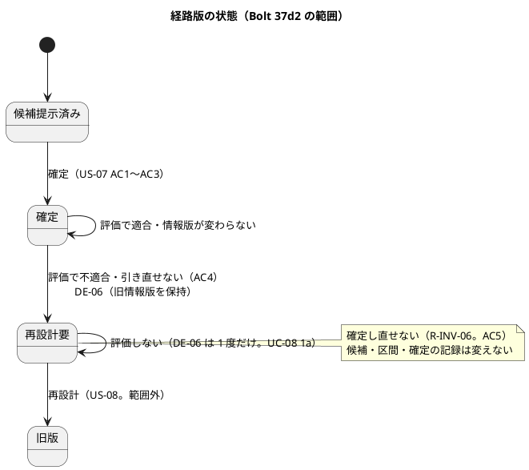
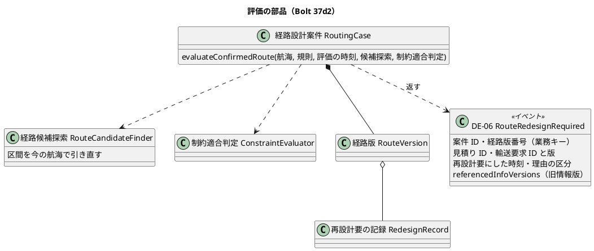
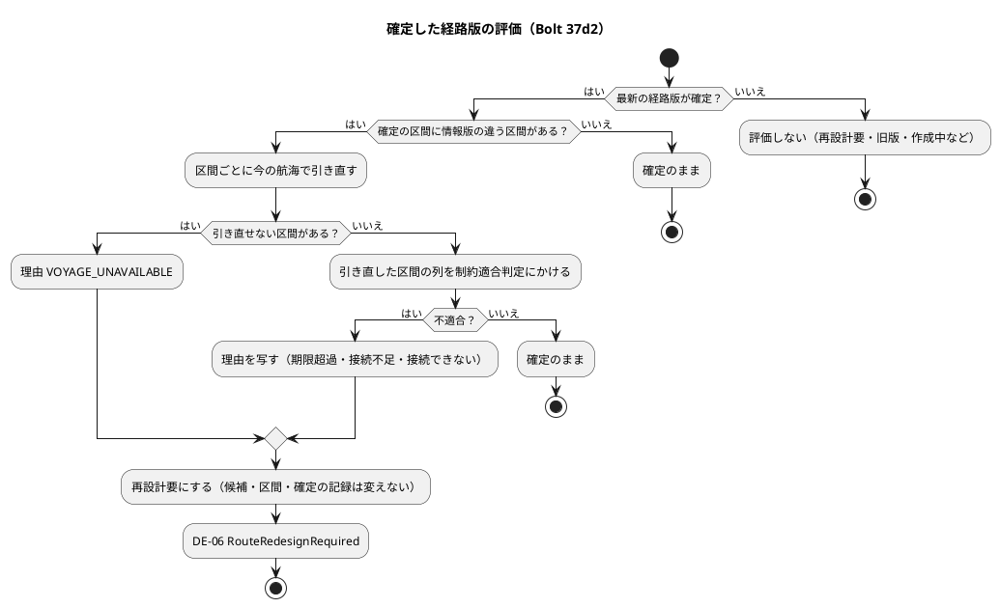

# Bolt 37d2 計画 - US-07 AC4 の経路設計の側（確定した経路版を外部情報の更新で評価して再設計要にし、旧情報版を保持して DE-06 を出す）

## 基本情報

| 項目 | 内容 |
| :--- | :--- |
| Bolt | 第 37d2 回（W6 の 7 本目） |
| 予定 | W6（2026-11-09 の週。前倒しで着手できる）。作業は約 3.8 時間（`check`・`uiTest`・SonarQube・CI の待ちを除く） |
| 対象 | 経路設計のドメイン: 確定した経路版の評価（`RoutingCase` の新しい操作）、区間を今の航海で引き直す部品（`RouteCandidateFinder`）、DE-06 `RouteRedesignRequired`（`domain.events`）、入力ポートの評価の操作（`RoutingCaseCommandService`。コマンドと結果の型）、保存の操作者の扱い（`touchRoutingCase`）、S-06 の再設計要の表示（`RoutingCaseViews`・`show.html`）。受入シナリオ `features/routing/evaluate_confirmed_route.feature`（新規）とステップ定義 |
| GitHub | [#16](https://github.com/k2works/practical-domain-driven-design-in-enterpris-application/issues/16)（閉じるのは Bolt 37e） |
| SP | 0（US-07 の 2 SP は Bolt 37e で数える） |
| 承認ゲート | 計画と終了報告。新しいファイル（イベント、コマンド、結果の型、受入シナリオの feature とステップ、入力ポートのテスト、テスト）を作る。スキーマ・認可・層の構造・環境変数は変えない（保存の文の `updated_by` の扱いだけを変える。確認ポイント 5） |
| アプローチ | アウトサイドイン（状態の組み合わせの表を先に書く。T-161・T-163 → 受入シナリオ → 集約と引き直し → 入力ポート → 画面）。W6 節の 37d2 の行のとおり |
| マニュアル・デモ | マニュアル 8 章（8.1 の案件の状態「再設計要」、8.2 の再設計要の案件の見え方と、確定し直せず再設計は後の版で行うこと）、マニュアルの用語集「再設計要」。キャプチャは撮り直さない（W6 節 :783 の「振る舞いの変わる Bolt はキャプチャも」から外れる。再設計要の状態は開発データでもキャプチャの生成のシナリオでも起こせないため。確認ポイント 8）。評価を画面から起こせず、外部原本の取込（W7）もないので、画面の層のシナリオ・デモの動画・axe は足さない |
| 前の Bolt | [Bolt 37d 終了報告](bolt_37d_report.md)（承認済み）、[Bolt 37d 計画](bolt_37d_plan.md) の「Bolt 37d2 の開始準備に送る材料」（1〜12） |

## Bolt ゴール

確定した経路の航海の情報が外部原本の取込で更新され、日時の制約（期限・接続時間）を満たさなくなったとき、経路設計の評価の操作で経路版が「再設計要」になり、確定のときの区間と旧情報版をそのまま保持して DE-06（経路が再設計要になった）を出す（US-07 AC4、R-INV-07）。予約は自動で取り消さない。S-06 で再設計要と理由が分かり、確定し直せない（R-INV-06）。見積り・予約への伝え方は Bolt 37e。

### 確かめたい仮説

| # | 仮説 | この Bolt で分かること |
| :--- | :--- | :--- |
| H1 | 確定の記録の候補の区間を今の航海で引き直し、Bolt 37 の制約適合判定にかけ直せば、「日時制約を満たさなくなった」を新しい判定を書かずに決められる（規則は接続の時刻で選ぶ。D-90） | 状態の組み合わせの表の期限超過・接続不足・接続できない・理由の重なりの行が、制約適合判定の理由の写しだけで決まる |
| H2 | Bolt 37d の保存（確定の行だけを書く文と記録の往復）のまま、評価の操作を入れても保存の層の直しは操作者の扱いだけで済む | 保存の層の差分が `touchRoutingCase` の `updated_by` だけ |

### 開始準備で確かめたこと

（2026-10-22 の develop の `e71edde7f`。パスは `apps/cargo-tracker/src/` からの相対）

- **要求と設計**: US-07 AC4「Given 確定経路の外部情報が更新され日時制約を満たさなくなる、When 更新を評価する、Then 予約は自動取消しされず経路が再設計要となり旧情報版が保持される」。R-INV-07。DE-06（domain_model :1478）は経路設計案件 ID・経路版番号・不適合理由・旧情報版を運び、購読者は追跡（有人案件。W8）と予約（再設計中の表示。US-08）。見積りへの伝え方は ADR-014 :43 と domain_model :1495 のとおり、DE-05 の前例（`routing.application.internal.eventhandlers.QuotationRouteAssignmentEventHandler` が ACL を通して見積りの公開 API を呼ぶ）と同じ形で、経路設計の中の listener が受ける（Bolt 37e。ADR-016 :35 の「見積りの側が DE-06 を受けて」は ADR-014 とずれていて、37e で直す）。UC-07 5b「確定後の外部情報更新で到着期限または接続時間を満たさない」。DE-12 の受け取りは W7。W6 の設計の決定（release_plan :715）「確定した経路版を評価して再設計要にするアプリケーションサービスの操作…外部情報の更新からの自動の評価は W7（US-14）でつなぐ。画面の操作は作らない」。
- **Bolt 37d で用意したもの**: `RouteVersion` の再設計要の記録（`RedesignRecord`: 時刻と `RedesignReasonCode` の 1 つ以上、重ねない）。再設計要は確定の記録と再設計要の記録を持つ。保存は確定から再設計要への更新で状態と記録だけを書き、0 件なら例外。`confirmedCandidateOf` は確定の記録で引くので再設計要でも確定のときの区間を返す。再構成した再設計要の案件は確定し直せず候補も算出できない（テスト済み）。
- **候補探索**（`main/java/.../routing/domain/model/rules/RouteCandidateFinder.java:111-132`）: `legsFromCall` は航海の寄港 `from` から後の寄港までの区間を作る（積地の出発予定・揚地の到着予定・採用情報版・取得時刻）。`legsFrom`（:94-105）は積地に寄るすべての寄港から区間を作るので、A→B→A→C の航海では A→C の区間が 2 つでき、確定した区間がどちらかは `Leg` から分からない。`Leg` は到着が出発より後でなければ例外（`Leg.java:38-40`）だが、`Voyage` は寄港の時刻の並びを検査しない。`PortCall` の出発予定・到着予定は null になり得る。区間を今の航海で引き直すメソッドはない。
- **制約適合判定**（`rules/ConstraintEvaluator.java:37-61`）: 接続ごとに理由を足すので、区間 3 で 2 つの接続がどちらも足りないと接続不足が 2 つ出る。`ExclusionReasonCode` の貨物種別・情報不足には `RedesignReasonCode` の対応がない（評価は鮮度と貨物種別を見ないので出ない）。
- **照合の部品**: `RouteCandidate.legsWithChangedInfo(Map<String, String>)` は今の航海の全件を受け取る前提（ない航海番号は「なくなった」とみなす）。
- **イベントの前例**: `domain/events/RouteConfirmed.java`（`@DomainEvent` の record。ドメインの型を持たない。`referencedInfoVersions`）。
- **入力ポート**: `RoutingCaseCommandService` に評価の操作はない。確定・算出は案件の版を期待版として受け取る（利用者の画面から）。確定は今の航海の採用情報版の対応表を組み立てる（`RoutingCase.confirm`）。保存のポート `RoutingCaseRepository.update(RoutingCase, UUID operatorId)` は `touchRoutingCase` で `updated_by` を書く（列のコメントは「最後に候補を算出・確定した経路設計者の利用者 ID」）。本番の呼び出しは入力ポートの 2 か所で、どちらも null を渡さない。null は MyBatis の既定の型（`jdbcTypeForNull` は未設定）で渡り、H2 では型を解決できないことがある。
- **画面**（`templates/routing/staff/routing-cases/show.html:35-49`・:70、`interfaces/web/RoutingCaseViews.java:114-150`）: 確定の欄は確定の記録から作り、見出しは「確定した経路（候補 n）」、候補のバッジは「確定した経路」。算出のフォームは確定の記録がないときだけ出る。候補の行は確定のときの判定（「適合」）をそのまま示す。状態の文言「再設計要」はある（`RoutingCaseViews.java:188`）。ui_design の S-05 の行と S-06 の画面イメージ（:1060〜）に再設計要はない。
- **マニュアル**: 8.1 の ⑤ に案件の状態の例「候補の算出待ち」。再設計要の説明はない。

## 設計の決定（案）

| 事項 | 決定（案） | 反映 |
| :--- | :--- | :--- |
| 評価の入口 | 入力ポートの「案件番号で確定した経路版を今の外部情報で評価する」操作（確認ポイント 1）。DE-12 の受け取りと航海番号から案件を引く照会は W7 | US-07 の Bolt 37d2 の決定、domain_model の Bolt 37d2 で決めたこと |
| 不適合の判定 | 最新の経路版が確定のときだけ評価する。確定の記録の候補の `legsWithChangedInfo`（今の航海の全件）が空なら評価しない（接続時間規則だけが変わったときも評価のきっかけにしない）。保存した判定は使わず、区間ごとに今の航海で引き直し、引き直した区間の列を制約適合判定にかけ直す。不適合なら理由の区分を写して再設計要（確認ポイント 2） | 同上 |
| 引き直し | 同じ航海番号の航海で、区間の積地の寄港（出発予定がある）と、その後で最初に区間の揚地に寄る寄港（到着予定がある）の組を探す。航海がない、組がない、組が 2 つ以上ある（同じ港に 2 度寄る）、到着が出発より後でないなら引き直せない（`VOYAGE_UNAVAILABLE`。選ばずに失敗に倒す）。揚地が積地より前にも寄る（B→A→B）場合は、積地の後ろだけを見るので引き直せる（確認ポイント 2） | domain_model の Bolt 37d2 で決めたこと |
| 理由の写し | 制約適合判定の理由の区分を、期限超過・接続不足・接続できないは同じ名前の再設計要の理由の区分に写し、同じ区分は 1 つにまとめて最初に出た順に並べる。貨物種別・情報不足が出たら評価の前提が崩れているので `IllegalStateException`（評価は貨物種別と鮮度を見ない）。写しは 5 分岐の switch（T-175 に数える） | 同上 |
| 旧情報版の保持と DE-06 | 候補・区間・確定の記録は変えない。DE-06 `RouteRedesignRequired` は案件 ID・案件番号・経路版番号・見積り ID（依頼元）・輸送要求 ID と版・再設計要にした時刻・理由の区分の名前・旧情報版（`referencedInfoVersions`。確定の区間の採用情報版）を運ぶ。業務キーと冪等のキーは（案件 ID・経路版番号）。Bolt 37e は見積り ID ではなく（案件 ID・経路版番号）で、その経路版を割り当てた見積り（再見積りでできた新しい見積りを含む。W6 の確認ポイント 8）を引く。すでに再設計要なら何もせず DE-06 も出さない（確認ポイント 3） | domain_model の DE-06 の行 |

## ふりかえりと前の Bolt からの引き継ぎ

| 入力 | 内容 | この Bolt での扱い |
| :--- | :--- | :--- |
| T-176（Bolt 37d） | 値オブジェクトやエンティティに検査を足すときは、コンストラクターの分岐を数え、10 を超えそうならメソッドに切り出してから足す | 評価の操作（集約）は判定の段（状態・照合・引き直し・判定）をメソッドに分けて書く。イベントの record は検査を持たない |
| T-177（Bolt 37d） | `record` を変数名に使わない | 再設計要の記録の変数は `redesign` |
| T-175 | 列挙型に値を足すときは switch を数える | 列挙型の値は足さない。switch は 2 つ: 理由の写し（`ExclusionReasonCode` の 5 分岐）と、画面の理由の文言（`RedesignReasonCode` の 4 分岐）。どちらも上限（10）に当たらない |
| T-161・T-163 | 状態の組み合わせの表を書き、行ごとにテストを 1 本置く | 下の表 |
| T-173・T-174 | 直しのスクリプトは 1 本ずつ流す。振る舞いを足すときはテストを先に書く | ステップ 3〜5 |
| T-171・T-172 | 時刻に依るテストは判定と同じ時計で作る。画面の確かめは開発用の利用者で | 評価の時刻は入力ポートの `Clock`。ステップ 5 で dev の S-06 を確かめる |
| T-148・T-152・T-106・T-119・T-164・T-166・T-125・T-104・T-147・T-139・T-151 | 写しを数える、「ないこと」の前に条件を確かめる、変異、規則、SonarQube の時機、件数 | 各ステップと確認ポイント 9 |
| Bolt 37d の材料 1〜12 | 評価の入口、判定、表の行、DE-06、操作者、DE-05 の再配信、S-06、受入シナリオ、区間の拒否、確定の記録、旧版への移行、理由の並び | 設計の決定・状態の組み合わせ・設計の約束・確認ポイント。材料 6（DE-05 の再配信）は Bolt 37e の確認ポイント 7 に引き継ぐ。材料 9（拒否の理由に区間を持たせる）は入れないもの。材料 11（旧版への移行）は US-08 に送る |

## 状態の組み合わせ（T-161。行ごとにテストを 1 本置く。T-163）

| # | 案件の経路版 | 今の航海 | 評価の結果 | DE-06 |
| :--- | :--- | :--- | :--- | :--- |
| 1 | 最新が確定 | 区間の情報版が変わらない（接続時間規則だけが変わったときも） | 確定のまま | 出さない |
| 2 | 最新が確定 | 情報版が変わり、今の予定でも期限と接続を満たす | 確定のまま（区間は確定のときのまま） | 出さない |
| 3 | 最新が確定 | 情報版が変わり、到着が期限を過ぎる | 再設計要（`DEADLINE_EXCEEDED`） | 出す |
| 4 | 最新が確定 | 情報版が変わり、接続時間が足りない | 再設計要（`CONNECTION_TOO_SHORT`） | 出す |
| 5 | 最新が確定 | 情報版が変わり、接続の時刻が動いて有効な規則がなくなる | 再設計要（`NOT_CONNECTABLE`） | 出す |
| 6 | 最新が確定 | 接続不足と期限超過が重なる | 再設計要（制約適合判定の理由の順） | 出す |
| 6b | 最新が確定（区間 3） | 2 つの接続がどちらも足りない | 再設計要（接続不足を 1 つにまとめる） | 出す |
| 7 | 最新が確定 | 区間の航海がなくなった | 再設計要（`VOYAGE_UNAVAILABLE`） | 出す |
| 8 | 最新が確定 | 区間の積地か揚地に寄らなくなった、寄る順が逆になった、積地の出発予定か揚地の到着予定がない、到着が出発より後でない、同じ港に 2 度寄って組が 2 つある | 再設計要（`VOYAGE_UNAVAILABLE`） | 出す |
| 9 | 最新が再設計要 | （何でも。原因が解消しても戻さない。UC-08 1a） | 再設計要のまま | 出さない |
| 10 | 最新が作成中・候補提示済み・要専門家判断 | （何でも） | 変えない | 出さない |
| 11 | 最新が旧版の後の新しい版（確定の記録を持つ旧版がある） | （何でも） | 旧版は評価しない | 出さない |

## スコープ

### 入れるもの・入れないもの

| 入れる | 入れない |
| :--- | :--- |
| 案件番号で確定した経路版を評価し、不適合なら再設計要にして DE-06 を出す入力ポートの操作 | DE-12 の受け取りと、航海番号から評価する案件を引く照会（W7、US-14） |
| 区間を今の航海で引き直す部品、DE-06 のイベント | DE-06 の購読（見積り・予約は Bolt 37e、追跡の有人案件は W8） |
| S-06・S-05 の再設計要の表示、マニュアル 8.1・8.2・用語集 | 画面から評価を起こす操作、画面の層のシナリオ、デモの動画、キャプチャ、再設計要の表示の axe（W6 の画面の確認のタスクに送る）。拒否の理由に区間を持たせること（Bolt 37d の材料 9。利用者の声を聞いてから）。予約を自動で取り消さないことの確かめ（AC4 の予約の側。予約は DE-06 を購読しないので取り消されない。見積り・予約の拒否とあわせて Bolt 37e で確かめる） |
| 再設計要の後の確定の拒否（R-INV-06）の受入シナリオ | 再設計（新しい経路版と旧版への移行。US-08、W13） |

### 設計の約束

- **集約**: `RoutingCase.evaluateConfirmedRoute(航海, 規則, 評価の時刻, 候補探索, 制約適合判定)` が `Optional<RouteRedesignRequired>` を返す。最新の経路版が確定でなければ空。確定の記録の候補の `legsWithChangedInfo` が空なら空。区間ごとに候補探索の引き直しで今の区間を作り、引き直せない区間があれば `VOYAGE_UNAVAILABLE`、なければ引き直した区間の列を制約適合判定にかけ、理由の区分（期限超過・接続不足・接続できない）を重ねずに順に写す。理由がなければ空。理由があれば最新の経路版を再設計要（確定の記録・候補はそのまま、`RedesignRecord(評価の時刻, 理由)`）にして DE-06 を返す。判定の段はメソッドに分ける（T-176）
- **引き直し**: `RouteCandidateFinder` に「区間と今の航海の一覧から、同じ航海番号の積地から揚地までの区間を作り直す」メソッド（`Optional<Leg>`。設計の決定の「引き直し」のとおり）を足す。区間の作り方（出発予定・到着予定・採用情報版・取得時刻）は `legsFromCall` と共通の私的なメソッドにする（T-148）。今の航海の採用情報版の対応表の組み立ては、確定と評価で共通にする
- **DE-06**: `domain.events.RouteRedesignRequired`（`@DomainEvent` の record。案件 ID・案件番号・経路版番号・見積り ID・輸送要求 ID・輸送要求の版・再設計要にした時刻・理由の区分の名前の一覧・`referencedInfoVersions`）。ドメインの型を持たない。一覧は `List.copyOf` で持つ（`RouteConfirmed` の前例）。Spring Modulith のイベントの発行記録は listener がいるときだけ残るので、37e の listener ができる前に出た DE-06 は残らない（本番で評価を起こす入口がないので失うものはない）
- **入力ポート**: `RoutingCaseCommandService.evaluateConfirmedRoute(EvaluateConfirmedRouteCommand)`（案件番号）。案件を読み、航海と規則を読み直して評価し、再設計要になったら保存して DE-06 を発行する（同じトランザクション。読み込んだ案件の版で競合を検知）。結果 `ConfirmedRouteEvaluationOutcome` は「見つからない・変わらない・再設計要・競合」。最新が確定の案件を書くのは今は評価だけ（算出は例外、確定は拒否で書かない。適合のときは保存しない）なので、競合したときは先の評価がすでに再設計要にして DE-06 を出していて、再試行は要らない。W7 の listener は競合を受けたら読み直して評価し直す（例外にしない）。US-08 の再設計で書き手が増えたら見直す。見つからない・競合は入力ポートのテスト（受入テストのメモリ上のリポジトリで、評価の前に案件の版を進める）で確かめる
- **保存の操作者**: 評価は利用者の操作ではないので、`update(routingCase, null)` とし、`touchRoutingCase` は `<if test="updatedBy != null">` で操作者があるときだけ `updated_by` を書く（最後の経路設計者を残す。null の型を H2 と PostgreSQL で解決させない）。`RoutingCaseRepository.update` と `RoutingCaseMapper.touchRoutingCase` の Javadoc に「null は最終更新者を変えない（システムの操作）」と書く（確認ポイント 5）
- **画面**: 再設計要の経路版では、確定の欄の見出しを「再設計要の経路（候補 n）」にし、「外部情報の更新で条件を満たさなくなったため再設計要です（理由: 期限超過など。再設計要にした時刻）。候補の判定は確定のときのものです。この経路では確定し直せません。再設計は後の版で行います。」の趣旨の案内を示す。候補のバッジは「再設計要の経路」。算出・確定の操作は出さない（今のまま）。S-05 の状態は「再設計要」（今の文言）。表示のテストは `RoutingCaseControllerTest`（確定の欄の前例）に置く。文言は数えてから（T-148）
- **時計**（T-171）: 評価の時刻は入力ポートの `Clock`。受入シナリオは `MutableClock`

## 設計（この Bolt の範囲）

ER は変えないので省く（Bolt 37d で列を足した）。画面遷移は変えないので省く（S-06 の表示だけ）。

## ステップ計画

各ステップの終わりに対象のテストを流し、最後に `check` と `uiTest` を流して XML の結果から件数を数える（T-151）。コミットは pathspec で行い（T-110）、push してアプリの CI を確かめる（T-26）。

- [ ] **1. 設計の文書と数え上げ**: US-07 に Bolt 37d2 の決定（評価の入口、判定・引き直し・理由の写し、旧情報版の保持、DE-06、再設計要の拒否）、domain_model の Bolt 37d2 で決めたこと・DE-06 の行（項目、業務キー、見積りへは経路設計の中の listener が公開 API を呼ぶ形（37e。DE-05 の行にそろえる）、予約は US-08・追跡は W8）・状態遷移の注、ui_design の S-05 の行と S-06 の行と画面イメージ（:1060〜）、test_strategy の Release 1.0 の表の US-07 AC4（37d2）と AC5（再設計要の再確定の拒否は 37d2、見積り・予約は 37e）の行、UC-07 5b の注（`VOYAGE_UNAVAILABLE` は「到着期限または接続時間」の外の欠航・寄港の取りやめ）、W6 節の 37e の行に DE-05 の再配信の扱い（材料 6）と ADR-016 :35 の言い回しの直し。Javadoc（`RoutingCase` のクラス、`RoutingCaseCommandService` のクラスの「経路設計者が使う」、`legsWithChangedInfo`）。画面の「確定した経路」の文言の写しを数える（T-148）（完了の判定: 文書の差分と、直す箇所の一覧）
- [ ] **2. 受入シナリオ（Red）**: `features/routing/evaluate_confirmed_route.feature`（`@US-07`）に、確定した後に区間の航海が更新され、(a) 到着が期限を過ぎると評価で再設計要になり、旧情報版と確定の記録が残り、DE-06 が理由と旧情報版を運ぶ（`@US-07-AC4 @R-INV-07 @DE-06`）、(b) 今の予定でも期限と接続を満たせば確定のまま DE-06 は出ない（`@US-07-AC4`）、(c) 航海がなくなれば `VOYAGE_UNAVAILABLE` で再設計要（`@US-07-AC4`）、(d) 再設計要の経路版は確定し直せず、もう一度評価しても DE-06 は出ない（`@US-07-AC5 @R-INV-06`）。ステップ定義: 評価の操作、DE-06 の確かめ、航海の情報版・取得時刻・寄港の時刻を表で 1 つのステップで変える「航海 X が次の内容に更新される」（情報版を変えずに時刻だけを変えると評価されないため）、「航海 X がなくなる」と `InMemoryVoyageRepository.remove`。寄る順が逆・同じ港に 2 度寄る場合は背景の航海が 2 寄港なので単体テストだけで確かめる。落ちる理由が「評価の操作がない」であることを確かめる（完了の判定: 足したシナリオが期待した理由で落ちる）
- [ ] **3. 集約と引き直し（Green）**: 状態の組み合わせの表の行ごとに `RoutingCase` のテストを 1 本（T-163）と、`RouteCandidateFinderTest` に引き直しのテスト（航海がない・積地に寄らない・揚地に寄らない・寄る順が逆・積地の出発予定がない・到着が出発より後でない・同じ港に 2 度寄る・揚地が積地より前にも寄る・情報版と時刻と取得時刻が今のもの）、理由の写しのテスト（同じ区分を 1 つに、写せない区分は例外）を足して Red を見てから、評価の操作・引き直し・理由の写し・DE-06 を作る（H1）（完了の判定: 単体テストと 2 の集約に関わる部分が緑）
- [ ] **4. 入力ポートと保存の操作者（Green）**: 入力ポートのテスト（受入テストのメモリ上のリポジトリで、見つからない・変わらない・再設計要・競合）を書いて Red を見てから、入力ポートの評価の操作とコマンド・結果の型を作る。`MyBatisRoutingRepositoriesIntegrationTest` に、操作者を渡さない更新で `updated_by` が残ることを足して Red を見てから `touchRoutingCase` と Javadoc を直す（H2。dev の H2 でも起動と評価の保存を確かめる）（完了の判定: 統合テストと受入シナリオが緑）
- [ ] **5. 画面とマニュアル**: `RoutingCaseControllerTest`（または `RoutingCaseViewsTest`）に、再設計要の案件の S-06 が「再設計要の経路（候補 n）」・理由・時刻・確定し直せない案内を示し、算出・確定の操作を出さないことを足して Red を見てから `RoutingCaseViews`・`show.html` を直す。マニュアル 8 章の 8.1（案件の状態「再設計要」）と 8.2（再設計要の案件の見え方）、用語集の「再設計要」を書く。ローカルの dev で開発用の利用者で見本の確定した案件の S-06 が変わらないことを確かめる（T-172）（完了の判定: コントローラーのテストが緑、マニュアルの差分）
- [ ] **6. 品質ゲートと開発レビューと終了報告**: 変異（確認ポイント 9）を当て、落ちたテストを出力で確かめる。`check`・`uiTest`・SonarQube（ほかの Gradle が終わってから。T-147）、開発レビュー、push して CI と MkDocs とデモ環境の配備を確かめる。#16 にコメントを残す。終了報告で release_plan（W6 の 37d2 の行と主なタスク）・開発の索引・mkdocs を完了に直す

### 時間の配分と打ち切り

| # | 目安 | 打ち切り |
| :--- | :--- | :--- |
| 1 | 35 分 | — |
| 2 | 35 分 | — |
| 3 | 60 分 | 引き直しで候補探索の区間の作り方を変える必要が出たら、止めて範囲を諮る |
| 4 | 30 分 | 保存にスキーマの変更が要ると分かったら止める（データベースの承認ゲート） |
| 5 | 30 分 | — |
| 6 | 35 分（`check`・`uiTest`・SonarQube・CI の待ちを除く） | — |

合計 225 分（約 3.8 時間）。

## 確認ポイント（計画の承認の場でまとめて確認する。Try T-6）

| # | 確認すること | 場所 | 推奨 |
| :--- | :--- | :--- | :--- |
| 1 | **評価の入口** | ステップ 2・4 | 入力ポートに「案件番号で確定した経路版を評価する」操作を足す（期待版は取らず、読み込んだ案件の版で競合を検知する。システムの操作で、利用者が画面を開いた版はない）。DE-12 の受け取りと航海番号から評価する案件を引く照会は W7 |
| 2 | **「日時制約を満たさなくなる」の判定と引き直し** | ステップ 3 | 最新の経路版が確定のときだけ評価する。情報版の違う区間がなければ評価しない（接続時間規則だけの変更はきっかけにしない）。区間ごとに今の航海で引き直し（積地の寄港の後で最初に揚地に寄る組。組がない・2 つ以上ある・時刻が逆なら選ばずに `VOYAGE_UNAVAILABLE`）。理由は同じ区分を 1 つにまとめて写す。引き直した区間の列を制約適合判定（期限・接続。規則は接続の時刻）にかけ、理由を写す。鮮度は見ない（Bolt 37c の決定）。出発済みの区間も評価に含める（実行済みの区間を変えない再設計は US-08） |
| 3 | **DE-06 の項目と 2 度目と購読の形** | ステップ 3 | `RouteRedesignRequired` に案件 ID・案件番号・経路版番号・見積り ID・輸送要求 ID と版・再設計要にした時刻・理由の区分の名前・旧情報版（`referencedInfoVersions`）。業務キーは（案件 ID・経路版番号）で、37e は経路設計の中の listener（DE-05 の前例）がこのキーで見積りを引く。理由の詳細（不適合の時刻・閾値）は載せない（保存も詳細を持たない。Bolt 37d の決定）。すでに再設計要なら評価しないので DE-06 は 1 度だけ |
| 4 | **判定の部品をまとめない** | ステップ 3 | 評価の操作は航海・規則・評価の時刻・候補探索・制約適合判定の 5 つを受け取る（`java:S107` に当たらない）。使い手が算出・確定・評価の 3 つになったが、それぞれ受け取るものが違い、まとめても呼び出しの直しが増えるだけなので、まとめない（Bolt 37c の宿題の決着） |
| 5 | **評価の操作者と競合** | ステップ 4 | 評価は外部情報の更新を受けたシステムの操作で、利用者ではない。保存のポートに操作者を渡さず（null）、`touchRoutingCase` は操作者があるときだけ `updated_by` を書く（最後に候補を算出・確定した経路設計者を残す。列のコメントのとおり）。案件の版は上げる。競合したときは先の評価が再設計要にしているので再試行は要らない |
| 6 | **DE-05 の再配信と旧版への移行（Bolt 37d の材料 6・11）** | ステップ 1 | DE-05 が再設計要の後に再配信されると、見積りへの割当ては再設計要の経路版を割り当てる（確定の記録で引くため）。37d2 では DE-06 の購読者も評価を起こす本番の入口もないので害は出ない。DE-05 と DE-06 の届く順の扱いを W6 節の 37e の行（確認ポイント 7）に書く。再設計要から旧版への移行と記録の引き継ぎは US-08 に送る |
| 7 | **受入シナリオの置き場所** | ステップ 2 | 新しい `features/routing/evaluate_confirmed_route.feature`（確定のシナリオと同じ背景。写しは Bolt 37f の #50 でまとめる）。航海の更新は Bolt 37c のステップ「航海 … の情報版が … に、取得時刻が … に更新される」を使い、寄港の時刻を変えるステップを足す |
| 8 | **画面・マニュアル・デモ** | ステップ 5 | S-06 の確定の欄を、再設計要では「再設計要の経路（候補 n）」と理由・時刻・案内にする（確定の記録は示し続ける。候補の判定は確定のときのものと示す）。評価を画面から起こせず、開発データでもキャプチャの生成のシナリオでも起こらないので、画面の層のシナリオ・デモの動画・キャプチャ・axe は足さない（WebMvc のテストで表示を確かめる。W6 節 :783 のキャプチャの規律から外れる。axe は W6 の画面の確認のタスクに送る）。W6 のデモ項目「再設計要の経路の拒否」は Bolt 37e（荷主の承認・本予約の拒否）で見せる。マニュアル 8.1・8.2・用語集を書く |
| 9 | **規則と SonarQube と変異（T-125・T-104・T-147・T-139・T-164・T-166・T-168）** | ステップ 6 | 層の規則に当たったら止めて諮る。変異は 7 つ: 情報版が変わらなくても評価する、引き直せない区間を通す、引き直しで寄る順を見ない、不適合でも確定のままにする、2 度目にも DE-06 を出す、評価で `updated_by` を書き換える、理由の同じ区分をまとめない。落ちたテストを出力で確かめる |
| 10 | **アプローチと承認ゲートと時間** | 全体 | アウトサイドイン（状態の組み合わせの表 → 受入シナリオ → 集約 → 入力ポート → 画面）。承認ゲートは計画と終了報告。新しいファイル（イベント、コマンド、結果の型、受入シナリオとステップ、テスト）を作る。スキーマ・認可・層の構造・環境変数は変えない。約 3.5 時間 |

## 完了条件

- [ ] 確定した経路版を評価すると、区間の航海の情報が更新されて期限・接続を満たさなくなったとき、または航海・寄港がなくなったとき再設計要になり、候補・区間・確定の記録（旧情報版）は残り、DE-06 が 1 度だけ出る。満たし続けるときと情報版が変わらないときは確定のまま（状態の組み合わせの表の行ごとのテスト）
- [ ] 再設計要の経路版は確定し直せない（受入シナリオ）。評価は `updated_by` を変えない
- [ ] S-06 が再設計要の経路と理由と案内を示す。US-07 の決定・domain_model・ui_design・test_strategy・W6 節を直した。マニュアル 8.1・8.2・用語集を直した
- [ ] 変異で落ちるテストがある。`check` と `uiTest` が緑で件数が減っていない。SonarQube の Quality Gate が PASS、`okf:check` ERROR 0、CI が緑
- [ ] release_plan（W6 の 37d2 の行と主なタスク）・開発の索引・mkdocs のナビが合っている。MkDocs とデモ環境の配備を確かめた。#16 にコメントを残した
- [ ] 開発レビュー、終了報告

## 更新履歴

| 日付 | 更新内容 | 更新者 |
| :--- | :--- | :--- |
| 2026-10-22 | 整合性検証の指摘を反映した（承認待ち）。理由の写し（同じ区分を 1 つに、写せない区分は例外）と引き直しの仕様（組がない・2 つ以上・時刻が逆は失敗に倒す）を決め、状態の組み合わせの表に行を足した。DE-06 は経路設計の中の listener が受ける形（ADR-014）と業務キー、購読者がいない間の扱い、競合で再試行が要らないこと、`updated_by` は操作者があるときだけ書く形にした。受入シナリオの AC5 のタグと寄港の時刻を変えるステップ、状態遷移図とドメインモデル図、キャプチャの規律から外れることとデモ項目と axe の送り先、文書と Javadoc の漏れ、行番号を直した。約 3.8 時間 | anthropic/claude-opus-5-5 |
| 2026-10-22 | 初版作成（承認待ち） | anthropic/claude-opus-5-5 |

## 関連ドキュメント

- [Bolt 37d 計画](bolt_37d_plan.md)（Bolt 37d2 の開始準備に送る材料）、[Bolt 37d 終了報告](bolt_37d_report.md)
- [Bolt 37c 計画](bolt_37c_plan.md)（照合の部品）、[Bolt 37 計画](bolt_37_plan.md)（D-90）
- [リリース計画](release_plan.md)（W6 節の確認ポイント 7〜9、37d2・37e の行）
- [ドメインモデル](../../design/cargo-tracker/domain_model.md)、[UI 設計](../../design/cargo-tracker/ui_design.md)、[テスト戦略](../../design/cargo-tracker/test_strategy.md)
- [ユーザーマニュアル 8 章](../../manual/08-経路設計.md)
