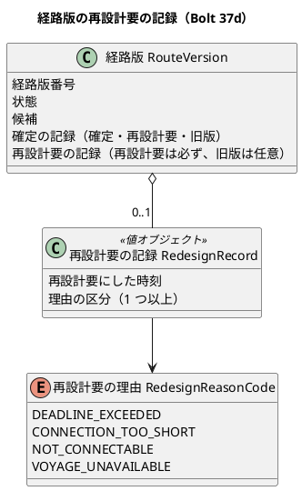
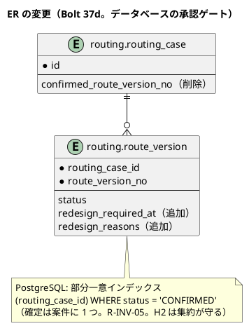

# Bolt 37d 計画 - US-07 AC4 の準備（経路版の再設計要の記録と保存、`confirmed_route_version_no` の削除と部分一意インデックス。評価の操作は 37d2）

## 基本情報

| 項目 | 内容 |
| :--- | :--- |
| Bolt | 第 37d 回（W6 の 6 本目） |
| 予定 | W6（2026-11-09 の週。前倒しで着手できる）。作業は約 2.5 時間（`check`・`uiTest`・SonarQube・CI の待ちを除く） |
| 対象 | 経路設計のスキーマ（`routing_case.confirmed_route_version_no` と外部キーの削除、`route_version` の再設計要の記録の列、PostgreSQL の部分一意インデックス）、経路版 `RouteVersion` の再設計要の記録（値オブジェクト）、再設計要の理由の区分（列挙型）、保存 `MyBatisRoutingCaseRepository`・`RoutingCaseMapper.xml`（確定から再設計要への状態の更新、記録の往復、`touchRoutingCase` の直し）、再構成した状態（再設計要・旧版）での確定と候補の算出の拒否のテスト（R-INV-06） |
| GitHub | [#16](https://github.com/k2works/practical-domain-driven-design-in-enterpris-application/issues/16)（閉じるのは Bolt 37e） |
| SP | 0 |
| 承認ゲート | 計画と終了報告。**データベース**（共通のマイグレーションで外部キーと列の削除・記録の列の追加、PostgreSQL のマイグレーションで部分一意インデックス）と**新しいファイル**（マイグレーション 2 つ、値オブジェクトと列挙型、テスト）。振る舞い・認可・層の構造・環境変数は変えない |
| アプローチ | 技術タスク（振る舞いを変えない準備。Bolt 37b の前例）。W6 節の 37d の行の「アウトサイドイン」は、振る舞いを入れる 37d2 で行う |
| マニュアル・デモ | 振る舞い・画面を変えないので、マニュアルとデモの動画は直さない（37d2 で 8 章を直す） |
| 前の Bolt | [Bolt 37c 終了報告](bolt_37c_report.md)（承認済み）、W6 節（[リリース計画](release_plan.md)） |

## Bolt ゴール

Bolt 37d2 で確定した経路版を評価して再設計要にする前に、経路版が再設計要の記録（再設計要にした時刻と不適合の理由）を持って保存と読み戻しができ、確定は案件に 1 つを表（PostgreSQL の部分一意インデックス）と集約で守る状態にする。読まれていない `confirmed_route_version_no` を消す（D-72 を解消する）。振る舞いは変えない。

### 開始準備で分けた理由

W6 節の 37d の行（評価の操作・DE-06・再設計要の拒否・リポジトリの直し・列の削除と部分一意インデックス）を 1 つの Bolt にすると、2 つの検証の指摘（状態の組み合わせの表の行の追加、保存のポートの形、新しい型、文書の写し、既存のテストの直し）を足して約 4.5 時間になり、半日の目安を超える（W6 節 :772 は 37d を開始準備で分ける候補に挙げている）。そこで、振る舞いを変えない準備（この Bolt）と、評価の操作と DE-06 と画面（Bolt 37d2）に分けた（2026-10-22、human:kakimomokuri）。再設計要にした時刻と不適合の理由は、経路版に保存する（W6 節 :746 の「記録（再設計要にした時刻・不適合の理由・旧情報版を保持すること）」。2026-10-22、human:kakimomokuri）。

### 確かめたい仮説

| # | 仮説 | この Bolt で分かること |
| :--- | :--- | :--- |
| H1 | `confirmed_route_version_no` を読むのは統合テストの 2 か所（:293-297 の値の確かめ、:443 の外部キーの違反）だけで、ほかの既存のテストは列の削除の後も期待値を変えずに緑のまま | 2 か所を直したほかに期待値を変えずに `check` と `uiTest` が緑（件数は足した分だけ増える） |
| H2 | 確定から再設計要への状態の更新は、今の `updateRouteVersion`（作成中・候補提示済みの行だけを書く）とは別の、確定の行だけを書く文で足り、候補と確定の記録は書き直さずに済む | 再構成した再設計要の案件を保存して読み戻すと、状態と記録だけが変わり、候補・区間・確定の記録が残る |

### 開始準備で確かめたこと

（2026-10-22 の develop の `96a99367b`。パスは `apps/cargo-tracker/src/` からの相対）

- **要求**: US-07 AC4「Given 確定経路の外部情報が更新され日時制約を満たさなくなる、When 更新を評価する、Then 予約は自動取消しされず経路が再設計要となり旧情報版が保持される」、AC5「Given 旧版または再設計要の経路版、When 再確定または新規予約へ割り当てる、Then 操作は拒否され新しい経路版の作成が要求される」。R-INV-05（確定は案件に 1 つ）、R-INV-06（旧版・再設計要の経路版は再確定・新規予約への割当てに使えない）、R-INV-07（再設計要にするだけで予約を取り消さない。旧情報版を保持する）。W6 の設計の決定（release_plan :715）「旧版はドメインのテストで再構成した状態で確かめる」。W6 節 :746「再設計要にする評価の操作と記録（再設計要にした時刻・不適合の理由・旧情報版を保持すること）」。確認ポイント 9（列と外部キーを消し、確定は案件に 1 つを集約と PostgreSQL の部分一意インデックスで守る。data_model :495・:501 と test_strategy :236 を直す）。
- **列の写し**: 保存の `update` の `touchRoutingCase`（`MyBatisRoutingCaseRepository.java:82-91`、`RoutingCaseMapper.xml:147-152`）、作成の `insertRoutingCase`（XML :104）、`RoutingCaseMapper.java:34` の引数、作成のマイグレーション（`V20261007100000:19`・:161 の COMMENT）、外部キー（`V20261007140000`）、開発データの見本 3 つ（`V20261007120900`・`V20261009110900`・`V20261020150900`。どれも削除のマイグレーションより前の版で流れる。開発データの最後の版は `V20261021170900`）、統合テスト（`MyBatisRoutingRepositoriesIntegrationTest.java:293-297`・:443）、文書（data_model :386 の ER 図・:495・:501・:507・:510、domain_model :739「案件は確定した経路版の番号を 1 つだけ持つ」、test_strategy :236）。
- **保存**: `updateRouteVersion` は `status IN ('DRAFT', 'CANDIDATES_PRESENTED')` の行だけを書く（XML :161）。確定した経路版の候補は書き直さない（`MyBatisRoutingCaseRepository.java:97-101`）。保存は最新の経路版だけを書く。保存のポートは `RoutingCaseRepository.update(RoutingCase, UUID operatorId)` で、`updated_by`（NULL を許す。`V20261007130000`）を書く。
- **集約**: `RouteVersion` は確定・再設計要・旧版で確定の記録を持てる（:33-35）。`confirmedCandidateOf` は状態ではなく確定の記録で候補を引く（見積りへの割当てと追跡の予定の公開 API が使う。Javadoc は「確定していなければ空」で、再設計要でも引けることと合わない）。`confirmable()` はいまの経路版が候補提示済みで確定した経路版がないとき。`calculateCandidates` は作成中・候補提示済みでなければ拒否。再構成した再設計要・旧版の経路版での拒否を確かめるテストはない。
- **画面**: `RoutingCaseViews.detail` は確定の欄を `version.confirmation()` から作るので、再設計要になっても欄は消えない。状態の文言に「再設計要」はある（:188）。経路版の状態で分岐する switch は 1 つで 6 分岐（T-175）。
- **部分一意インデックスの前例**: `migration/postgresql/V20261005170100`（見積り）。H2 は部分インデックスを持たない（開発環境とデモ環境は集約の `validated` が守る）。統合テストは Testcontainers の PostgreSQL で動くので、インデックスの違反を確かめられる。

## 設計の決定（案）

| 事項 | 決定（案） | 反映 |
| :--- | :--- | :--- |
| 再設計要の記録 | 経路版に、再設計要にした時刻（`redesign_required_at`）と不適合の理由（`redesign_reasons`。理由の区分の名前を空白で区切る）の列を足す。ドメインは経路版が「再設計要の記録」（時刻と理由の区分の一覧）を持つ。記録を持てるのは再設計要と旧版だけ（確認ポイント 1） | domain_model の Bolt 37d で決めたこと、data_model |
| 理由の区分 | 新しい列挙型「再設計要の理由」: 期限超過・接続不足・接続できない（制約適合判定の除外理由の区分と同じ名前）と、航海を引き直せない（航海がなくなった・区間の港に寄らなくなった）。DE-06 の理由の語彙にもする（確認ポイント 2） | domain_model の DE-06、用語集 |
| `confirmed_route_version_no` | 列と外部キーを消し、確定は案件に 1 つを集約と PostgreSQL の部分一意インデックス（`route_version (routing_case_id) WHERE status = 'CONFIRMED'`）で守る（W6 の確認ポイント 9。D-72 を解消する） | data_model、test_strategy :236 |
| `referenced_info_version` | 表は作らない。旧情報版は確定の記録の候補の区間（`candidate_leg.info_version`）に残る。航海番号から評価する案件を引く照会（data_model :1166）は W7 で決める（確認ポイント 3） | data_model :498・:1166・:1187 |

## ふりかえりと前の Bolt からの引き継ぎ

| 入力 | 内容 | この Bolt での扱い |
| :--- | :--- | :--- |
| T-175（Bolt 37c） | 列挙型に値を足す Bolt は、その値で分岐する switch の数を開始準備で数える | 経路版の状態の値は足さない。新しい列挙型（再設計要の理由）で分岐する switch はこの Bolt では作らない（保存は名前で書き読みする） |
| T-161・T-163 | 状態の組み合わせの表を書き、行ごとにテストを 1 本置く | 下の「再構成した状態の表」。行ごとに集約のテストを 1 本 |
| T-173・T-174 | 直しのスクリプトは 1 本ずつ流して当たった数を確かめる。振る舞いを足すときはテストを先に書く | ステップ 2〜4 |
| T-148・T-152 | 共通の部品と写しは全体を検索して数えてから変える | 列の写し（上の一覧）を数えてから消す（ステップ 1） |
| T-164・T-166・T-125・T-104・T-147・T-139・T-151 | 変異、規則、SonarQube の時機、テストのラムダ、件数は XML で数える | 確認ポイント 6 |

## 再構成した状態の表（T-161。行ごとにテストを 1 本置く。T-163）

| # | 案件の経路版（再構成） | 確かめること |
| :--- | :--- | :--- |
| 1 | 経路版 1 が再設計要（確定の記録と再設計要の記録を持つ） | 確定は「確定できない状態」で拒否、候補の算出も拒否（R-INV-06） |
| 2 | 経路版 1 が旧版（確定の記録を持つ）、経路版 2 が候補提示済み | 経路版 1 の候補は確定できない（いまの経路版は 2）。確定の記録の候補は引ける |
| 3 | 経路版 1 が再設計要 | `confirmedRouteVersion()` は空、`confirmedCandidateOf(1)` は確定の記録の候補を返す（旧情報版の保持。見積りへの割当てと追跡の予定が使う） |
| 4 | 確定の経路版が 2 つ | 集約は作れない（今の `validated`）。PostgreSQL では表が拒む（部分一意インデックス） |
| 5 | 確定の経路版に再設計要の記録がある、または再設計要の経路版に記録がない | 経路版は作れない（記録を持てるのは再設計要と旧版だけ。再設計要は記録を持つ） |

## スコープ

### 入れるもの・入れないもの

| 入れる | 入れない |
| :--- | :--- |
| 列と外部キーの削除、再設計要の記録の列、部分一意インデックス | 評価の操作、DE-06、引き直しの部品（Bolt 37d2） |
| 経路版の再設計要の記録（値オブジェクト）と理由の区分（列挙型） | S-06 の再設計要の案内、マニュアル 8 章（Bolt 37d2） |
| 保存（確定から再設計要への状態と記録の更新、読み戻し） | DE-06 の購読（Bolt 37e）、DE-12 の受け取りと航海番号から案件を引く照会（W7） |
| 再構成した状態の表の行ごとのテスト（R-INV-06） | 再設計（新しい経路版。US-08） |

### 設計の約束

- **値オブジェクト**: `RedesignRecord`（再設計要の記録。時刻と理由の区分の一覧。理由は 1 つ以上）と `RedesignReasonCode`（期限超過 `DEADLINE_EXCEEDED`・接続不足 `CONNECTION_TOO_SHORT`・接続できない `NOT_CONNECTABLE`・航海を引き直せない `VOYAGE_UNAVAILABLE`）を `domain.model.valueobjects` に置く。`RouteVersion` が記録を任意で持ち、再設計要は記録を持ち、確定・候補提示済み・作成中は持たない（旧版は持っても持たなくてもよい。確定から直接旧版になる US-08 の流れがあるため）
- **保存**: `route_version` に `redesign_required_at`（TIMESTAMP WITH TIME ZONE）と `redesign_reasons`（VARCHAR(200)。区分の名前を空白で区切る）を足し、2 つはそろって NULL かそろって値を持つ（CHECK）。経路版の状態が確定から再設計要に変わるときは、`status = 'CONFIRMED'` の行だけを書く文で状態と記録だけを書く（候補・確定の記録は書き直さない）。`touchRoutingCase` と `insertRoutingCase` から `confirmed_route_version_no` を外す。保存のポートの形（操作者を変えない更新）は Bolt 37d2 で決める（この Bolt では `update` のまま、操作者は今のとおり書く）
- **スキーマ**: 共通のマイグレーション 1 つ（外部キーの削除 → 列の削除 → 記録の列の追加と CHECK と COMMENT）と、PostgreSQL のマイグレーション 1 つ（部分一意インデックス）。版は `V20261022…`（開発データの最後の `V20261021170900` より後）。開発データは変えない
- **Javadoc**: `confirmedCandidateOf`（確定の記録を持つ経路版。再設計要・旧版でも引ける）、`RouteVersionStatus` の再設計要（記録を持つ）、`RouteVersionLegQuery` の `confirmedLegsOf`

## 設計（この Bolt の範囲）

状態遷移・画面遷移は変えないので省く（振る舞いを変えない）。ドメインモデルと ER の変更だけを示す。

## ステップ計画

各ステップの終わりに対象のテストを流し、最後に `check` と `uiTest` を流して XML の結果から件数を数える（T-151）。コミットは pathspec で行い（T-110）、push してアプリの CI を確かめる（T-26）。

- [ ] **1. 設計の文書と数え上げ**: domain_model の Bolt 37d で決めたこと（記録と理由の区分、`referenced_info_version` を作らない、部分一意インデックス）・:739・用語集（再設計要の記録、再設計要の理由）、data_model（:386 の ER 図、:495・:498・:501・:507・:510・:1166・:1187）、test_strategy :236、W6 節の確認ポイント 9 の決着と 37d・37d2 の行（開始準備で分けた）。列の写し（上の一覧）を全体で数え直す（T-148）（完了の判定: 文書の差分と、直す箇所の一覧）
- [ ] **2. 値オブジェクトと経路版（Red → Green）**: `RouteVersion` と `RedesignRecord` のテストで、再構成した状態の表の行 5（記録を持てる状態）を書いて Red を見てから、値オブジェクト・列挙型・経路版の項目を足す。行 1〜3 の集約のテスト（`RoutingCaseConfirmationTest`・`RoutingCaseTest` に再構成した案件で）を足す（今のコードで通るはずなので、通ることと、確定の判定を外す変異で落ちることを確かめる）。`confirmedCandidateOf` などの Javadoc を直す（完了の判定: 単体テストが緑）
- [ ] **3. 保存とスキーマ（データベースの承認ゲート）**: `MyBatisRoutingRepositoriesIntegrationTest` に、再設計要の経路版を保存して読み戻すと状態と記録だけが変わり候補・区間・確定の記録が残ること、確定の経路版を 2 つ持つ行を表が拒むこと（部分一意インデックス）を足して Red を見てから、マイグレーション 2 つと保存（状態と記録の更新の文、読み戻し、`touchRoutingCase`・`insertRoutingCase` の直し）を作る。:293-297 は `updated_by` だけを確かめる形に、:443 の外部キーの違反は部分一意インデックスの違反に置き換える（H1）（完了の判定: 統合テストが緑、ローカルの dev が起動する）
- [ ] **4. 品質ゲートと開発レビューと終了報告**: 変異（確認ポイント 6）を当て、落ちたテストを出力で確かめる。`check`・`uiTest`・SonarQube（ほかの Gradle が終わってから。T-147）、開発レビュー、push して CI と MkDocs とデモ環境の配備（H2 のデモ環境でマイグレーションが流れて起動すること）を確かめる。#16 にコメントを残す。終了報告で release_plan・開発の索引・mkdocs を完了に直し、Bolt 37d2 の開始準備に送る材料（下の表）を引き継ぐ

### 時間の配分と打ち切り

| # | 目安 | 打ち切り |
| :--- | :--- | :--- |
| 1 | 30 分 | — |
| 2 | 40 分 | — |
| 3 | 50 分 | 2 か所のほかに既存のテストの期待値が変わるなら止める（H1 が外れる）。部分一意インデックスが既存のデータで作れないなら止める（データベースの承認ゲート） |
| 4 | 30 分（`check`・`uiTest`・SonarQube・CI の待ちを除く） | — |

合計 150 分（約 2.5 時間）。

## Bolt 37d2 の開始準備に送る材料（2 つの検証で見つけたこと）

Bolt 37d2（評価の操作と DE-06 と画面）の計画は、この Bolt の終了報告の承認の後に `opening-iteration` で作る。次の材料を計画の入力にする。

| # | 材料 |
| :--- | :--- |
| 1 | 評価の入口は入力ポートの「案件番号で確定した経路版を評価する」操作（DE-12 の受け取りと航海番号から案件を引く照会は W7）。新しい Command と Outcome の型（見つからない・変わらない・再設計要・競合）。競合したときは W7 の listener が再試行する前提 |
| 2 | 不適合の判定: 確定の記録の候補の区間を今の航海で引き直し（`RouteCandidateFinder` の区間の作り方 `legsFromCall` と共通にして写しを作らない。`Voyage` の class 化は W7 の D-65 の残り）、制約適合判定にかけ直す。航海がない・区間の積地か揚地に寄らない・寄る順が逆なら `VOYAGE_UNAVAILABLE`。情報版が変わっていなければ評価しない（`legsWithChangedInfo` に今の航海の全件を渡す）。鮮度は見ない |
| 3 | 状態の組み合わせの表に足す行: 情報版が変わらない、変わって適合、期限超過、接続不足、接続できない（接続の時刻が動いて有効な規則がなくなる）、理由が重なる、航海を引き直せない、再設計要で 2 度目（DE-06 を出さない）、作成中・候補提示済み・要専門家判断（評価しない）、確定した版の後ろに新しい版がある（評価の対象は最新の版が確定のときだけ、と決める。保存は最新の版だけを書く）、旧版 |
| 4 | DE-06 の型の名前は `RouteRedesignRequired`（`RouteConfirmed` と用語集の RedesignRequired にそろえる）。項目は案件 ID・案件番号・経路版番号・見積り ID・輸送要求 ID と版・再設計要にした時刻・理由の区分・旧情報版（`RouteConfirmed` にそろえて `referencedInfoVersions`）。domain_model の DE-06 の購読者に見積り（37e）を足す。受入シナリオに `@DE-06` |
| 5 | 評価の操作者は利用者ではないので `updated_by`（最後に候補を算出・確定した経路設計者）を変えない。保存のポートの形（操作者を任意にするか、状態と記録だけを書く操作を足すか）を決める。案件の版は上げる |
| 6 | DE-05 が再設計要の後に再配信されると、`QuotationRouteAssignmentEventHandler` は確定の記録の候補で再設計要の経路版を見積りに割り当てる（`confirmedCandidateOf` は記録で引く）。37d2 の範囲では DE-06 の購読者も評価を起こす本番の入口もないので害は出ないが、DE-05 と DE-06 の届く順の扱いを Bolt 37e の確認ポイント 7 に引き継ぐ |
| 7 | S-06 の再設計要の表示: 見出し「確定した経路」と候補のバッジの文言、再設計要の記録（時刻と理由）の示し方、算出・確定の操作を出さないこと。表示のテストの置き場所（`RoutingCaseViewsTest` か `RoutingCaseControllerTest`）。ui_design の S-06 の行、マニュアル 8.1・8.2・用語集、UC-07 の代替の流れ、W6 節のマニュアルの割り当て（:782 に 37d2 を足す） |
| 8 | 受入シナリオは新しい `features/routing/evaluate_confirmed_route.feature`（背景の写しは Bolt 37f の #50 でまとめる）。評価を画面から起こせないので、画面の層のシナリオ・デモの動画・キャプチャは足さない |
| 9 | 拒否の理由に区間を持たせる（Bolt 37c の宿題）はこの範囲でも行わない（利用者の声を聞いてから） |

## 確認ポイント（計画の承認の場でまとめて確認する。Try T-6）

| # | 確認すること | 場所 | 推奨 |
| :--- | :--- | :--- | :--- |
| 1 | **再設計要の記録の持ち方** | ステップ 2・3 | 経路版の列 2 つ（時刻と、理由の区分の名前を空白で区切った文字列）にする。理由の詳細（不適合の時刻・閾値・参照情報版）は保存しない（表を足すとスキーマが増え、旧情報版は確定の区間に残るため。詳細は DE-06 で運ぶかを 37d2 で決める）。記録は再設計要で必ず持ち、旧版は持っても持たなくてもよい |
| 2 | **理由の区分** | ステップ 2 | 新しい列挙型（期限超過・接続不足・接続できない・航海を引き直せない）にする。除外理由の区分（`ExclusionReasonCode`）に値を足す案は、除外理由の CHECK・保存の switch・画面の文言（T-175）に広がるので採らない。名前は除外理由の区分と同じにして、制約適合判定の理由から写せるようにする |
| 3 | **`referenced_info_version` を作らない** | ステップ 1 | 作らない。旧情報版は確定の記録の候補の区間に残り、照合は区間で行う（Bolt 37c）。航海番号から評価する案件を引く照会（data_model :1166 の索引）は W7 で `candidate_leg.voyage_number` の索引として決める |
| 4 | **部分一意インデックスとスキーマの順** | ステップ 3 | 共通のマイグレーションで外部キーを消してから列を消し、記録の列を足す。PostgreSQL のマイグレーションで部分一意インデックスを作る（`migration/postgresql` の前例）。H2（開発環境・デモ環境）は集約の `validated` が守る。開発データは変えない（列に値を入れる見本は削除より前の版で流れる） |
| 5 | **既存のテストの 2 か所の直し（H1）** | ステップ 3 | :293-297 の `confirmed_route_version_no` の値の確かめを消し、`updated_by` だけを確かめる形にする。:443 の「確定の記録と確定した経路版の番号は表が守る」は、外部キーの違反の代わりに部分一意インデックスの違反（同じ案件に確定の行を 2 つ）を確かめる。このほかに期待値が変わるなら止める |
| 6 | **規則と SonarQube と変異（T-125・T-104・T-147・T-139・T-164・T-166・T-168）** | ステップ 4 | 層の規則に当たったら止めて諮る。SonarQube は開発レビューの前に、ほかの Gradle が終わってから流す。変異は 4 つ: 状態の更新の文が確定以外の行も書く、再設計要の更新で候補を書き直す、記録の理由を読み戻さない、部分一意インデックスを作らない（統合テストで落とす）。落ちたテストを出力で確かめる |
| 7 | **アプローチと承認ゲートと時間** | 全体 | 振る舞いを変えない技術タスク（Bolt 37b の前例）。承認ゲートは計画と終了報告で、データベース（マイグレーション 2 つ）と新しいファイル（マイグレーション、値オブジェクト、列挙型、テスト）を含む。振る舞い・認可・層の構造・環境変数は変えない。約 2.5 時間 |

## 完了条件

- [ ] 経路版が再設計要の記録（時刻と理由の区分）を持ち、記録を持てる状態が守られる。再構成した状態の表の行ごとのテストが緑（R-INV-06 の拒否を含む）
- [ ] 再設計要の経路版を保存して読み戻すと、状態と記録だけが変わり、候補・区間・確定の記録が残る
- [ ] `confirmed_route_version_no` の列と外部キーを消し、PostgreSQL の部分一意インデックスで確定は案件に 1 つ。2 か所のほかに既存のテストの期待値は変わらない（H1）
- [ ] domain_model・data_model・test_strategy・W6 節（37d・37d2 の行、確認ポイント 9 の決着）を直した。Javadoc を直した
- [ ] 変異で落ちるテストがある。`check` と `uiTest` が緑で件数が減っていない。SonarQube の Quality Gate が PASS、`okf:check` ERROR 0、CI が緑。デモ環境がマイグレーションの後に起動する
- [ ] release_plan・開発の索引・mkdocs のナビが合っている。MkDocs とデモ環境の配備を確かめた。#16 にコメントを残した
- [ ] 開発レビュー、終了報告（Bolt 37d2 の開始準備に送る材料を引き継ぐ）

## 更新履歴

| 日付 | 更新内容 | 更新者 |
| :--- | :--- | :--- |
| 2026-10-22 | 整合性検証の指摘を反映した（承認待ち）。約 4.5 時間で半日を超えるため、振る舞いを変えない準備（37d）と評価の操作・DE-06・画面（37d2）に分けた。再設計要にした時刻と理由は経路版に保存する（human:kakimomokuri）。既存のテストの 2 か所の直し、再構成した状態の表、列の写し、`referenced_info_version` を作らないことを書き、37d2 に関わる指摘は「Bolt 37d2 の開始準備に送る材料」に移した | anthropic/claude-opus-5-5、分け方と記録の決定 human:kakimomokuri |
| 2026-10-22 | 初版作成（承認待ち） | anthropic/claude-opus-5-5 |

## 関連ドキュメント

- [リリース計画](release_plan.md)（W6 節の確認ポイント 7〜9、37d・37e の行、:715・:746・:772）
- [Bolt 37c 計画](bolt_37c_plan.md)、[Bolt 37c 終了報告](bolt_37c_report.md)、[Bolt 37b 計画](bolt_37b_plan.md)（準備と振る舞いに分けた前例）
- [ドメインモデル](../../design/cargo-tracker/domain_model.md)、[データモデル](../../design/cargo-tracker/data_model.md)、[テスト戦略](../../design/cargo-tracker/test_strategy.md)
