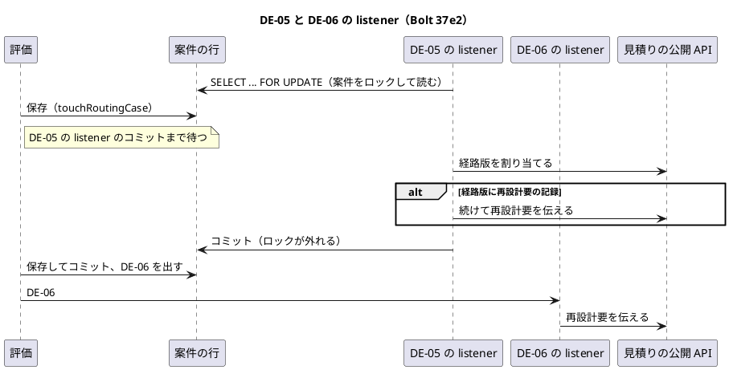
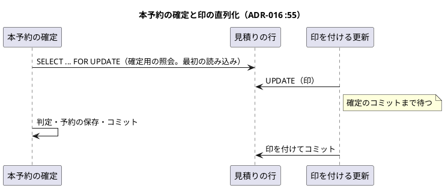
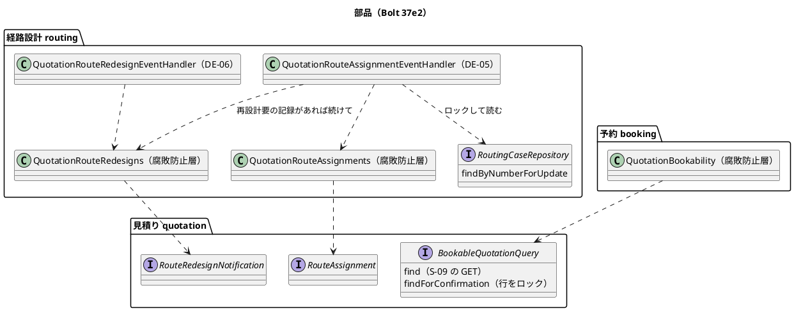

# Bolt 37e2 計画 - US-07 AC5 の経路設計の側（DE-06 の listener、DE-05 と DE-06 の届く順、本予約の確定との競合の守り）

## 基本情報

| 項目 | 内容 |
| :--- | :--- |
| Bolt | 第 37e2 回（W6 の 9 本目） |
| 予定 | W6（2026-11-09 の週。前倒しで着手できる）。作業は約 4.3 時間（`check`・`uiTest`・SonarQube・CI の待ちを除く。確認ポイント 9） |
| アプローチ | アウトサイドイン（受入シナリオを外側の Red にし、届く順の表と状態の組み合わせの表を先に書く。T-161・T-163・T-179） |
| 対象 | 経路設計: DE-06 の listener と腐敗防止層、DE-05 の listener（案件の行をロックして読み、再設計要なら続けて伝える）、案件をロックして読むリポジトリの操作（`RoutingCaseRepository`・`RoutingCaseMapper`）、組み立て。見積り: 本予約の確定用の照会（公開 API `BookableQuotationQuery` の操作、見積りの行をロックするリポジトリの操作と `QuotationMapper` の照会）。予約: 腐敗防止層 `QuotationBookability` の確定の側。テストの補助 `OverlappingTransactions` を共通の場所へ移す。ADR-016・ADR-018 の改訂。受入シナリオの追加 |
| GitHub | [#16](https://github.com/k2works/practical-domain-driven-design-in-enterpris-application/issues/16)（閉じるのは Bolt 37e3） |
| SP | 0（US-07 の 2 SP は Bolt 37e3 で数える） |
| 承認ゲート | 計画と終了報告。新しいファイル（listener と腐敗防止層、受入シナリオ、テスト）。構造（ADR-016・ADR-018 の改訂、テストの補助の置き場所の移動。確認ポイント 5・7）。公開 API に操作を足す（確認ポイント 4）。スキーマ・認可・環境変数は変えない |
| 開始準備で決めたこと | 2026-10-23、human:kakimomokuri: (1) listener はそのままつなぐ（本番とデモには評価の入口が W7 までないので見える変化は起きない。画面の文言とマニュアルは 37e3 のまま）、(2) DE-06 が DE-05 より先に届く穴は、DE-05 の listener が割り当てた後に続けて再設計要を伝えて塞ぐ（公開 API の契約は変えない）、(3) 本予約の確定と印の競合は、確定の照会で見積りの行をロックして守る。2 つの整合性検証の後に: (4) DE-05 の listener が案件の行をロックして読み、評価と直列にして並行の残りを塞ぐ、(5) ロックは `FOR UPDATE` にし、ADR-018 の採らなかった理由も直す、(6) 行 20 の特性テストは入力ポートの振る舞いとして残し、穴は listener の層で Red を見てから塞ぐ（Bolt 37e の終了報告の約束から変える） |

## Bolt ゴール

経路設計が経路版を再設計要にしたら（DE-06）、経路設計の中の listener が見積りの公開 API を呼んで、その経路版を割り当てた見積りに印を付ける。DE-06 が DE-05 より先に届いても、2 つの listener が並んで走っても、本予約の確定と重なっても、印のない見積りで荷主が承認したり本予約が確定したりしないようにする。

### 確かめたい仮説

| # | 仮説 | この Bolt で分かること |
| :--- | :--- | :--- |
| H1 | DE-05 の listener が案件の行をロックして読み、再設計要の記録があれば割り当てた後に続けて伝えれば、公開 API の契約を変えずに、DE-06 が先に届く穴も 2 つの listener が並ぶ残りも塞げる（評価は同じ行を書くので直列になる） | listener の単体テスト、PostgreSQL の並行の統合テスト |
| H2 | 本予約の確定の照会で見積りの行を最初に `FOR UPDATE` で読めば、印を付ける更新と本予約の確定が直列になる。H2 でも同じ構文で動く | PostgreSQL の並行の統合テスト、dev の H2 の起動と本予約 |

### 開始準備で確かめたこと

- **DE-05 の前例**（`routing/application/internal/eventhandlers/QuotationRouteAssignmentEventHandler.java:37-64`、`routing/application/internal/outboundservices/acl/QuotationRouteAssignments.java:31-46`、`routing/infrastructure/config/RoutingConfiguration.java:48-59`）: `@ApplicationModuleListener`（新しいトランザクション）が案件を引き、確定の記録の候補で見積りの公開 API を呼ぶ。業務の理由は警告のログだけで例外にしない（例外で戻ると発行記録が未完了のまま残り、配り直すのは再起動のときだけ。`application.properties:52-54`。定期の再配信は W10）。楽観ロックの競合だけは例外にして戻す
- **DE-05 と DE-06 の届く順**: `RoutingCase.confirmedCandidateOf`（`RoutingCase.java:484-500`）は確定の記録で引くので、再設計要の経路版でも候補を返し、印のない経路を割り当てる。見積りがまだ詳細設計依頼済みのときに DE-06 が届くと `NotMarked(QUOTATION_NOT_FOUND)` になる（Bolt 37e の行 20）。DE-06 は 1 度しか出ない（もう一度評価しても出ない。domain_model の Bolt 37d2 で決めたこと）ので、印が付き損なうと直らない
- **評価と案件の行**: 評価の保存は案件の行を書く（`RoutingCaseMapper.xml:150-154` の `touchRoutingCase`、版の照合）。DE-05 の listener が案件の行を `FOR UPDATE` で押さえれば、評価の保存はそのコミットまで待つ
- **本予約の確定の照会**（`BookingCommandService.java:72-138`、`BookableQuotationQueryService.java:48-66`、`QuotationMapper.xml:84-93`）: 本予約の確定は 1 つのトランザクションで照会し、照会はロックしない。S-09 の GET（`BookingQueryService.confirmation`）は `@Transactional(readOnly = true)` で同じ照会を使う（read-only では `FOR UPDATE` が使えないので、GET は今のまま）。ロックの前例は identity の `PasswordResetTokenMapper.xml:20-23`（`FOR UPDATE`。H2 と PostgreSQL の両方で流れている）。ADR-018 :29・:58 は、DE-24 の listener で見積りの行を `FOR UPDATE` で読む案を「方言」と「2 つの集約の行を押さえる」を理由に採らなかった。採番の mapper（`TransportRequestNumberCounterMapper.xml:5`）の注も「`SELECT ... FOR UPDATE` の方言は使わない」としている
- **MyBatis のセッションのキャッシュ**: 既定のまま（`localCacheScope` の設定なし）。同じトランザクションで同じ引数の select の 2 度目はキャッシュから返る。Bolt 37e で経路版の照会に `flushCache="true"` を付けた
- **ロックの待ちを確かめるテストの補助**: `src/test/java/com/example/cargotracker/identity/OverlappingTransactions.java`（後の接続が先の接続を待っていることを `pg_blocking_pids` で確かめる。Bolt 32d）。identity のパッケージにある
- **見える変化**: 印が付くと C-04 の承認の操作が消え、C-17 は既定の文言、S-09 は「荷主の承認がまだ」と誤って出し、S-02 に印のある見積りが残る（37e3 で直す）。本番の評価の入口は W7 まで本番になく、開発データにも再設計要の見本がないので、本番とデモでは起きない

## 設計の決定（案）

| 項目 | 決めること | 根拠 |
| :--- | :--- | :--- |
| DE-06 の listener | `routing.application.internal.eventhandlers.QuotationRouteRedesignEventHandler`（`@ApplicationModuleListener on(RouteRedesignRequired)`）。腐敗防止層 `QuotationRouteRedesigns.notifyRedesignRequired(案件番号, 経路版番号, 再設計要にした時刻)` が見積りの公開 API を呼び、付けなかった理由（`Optional<String>`）を返す。値は DE-06 の項目から取る（案件を読まない）。`NotMarked` は警告のログだけ（例外にしない）。楽観ロックの競合の例外は握りつぶさず上げる（DE-05 の前例）（確認ポイント 1） | ADR-014、DE-05 の前例 |
| DE-05 の listener | 最初に案件の行を `FOR UPDATE` で読んで集約を組み立てる（リポジトリの新しい操作）。見積りの公開 API で割り当てた（`Assigned`・`AlreadyAssigned`）後、その経路版が再設計要の記録を持てば（状態ではなく記録の有無で見る。旧版も記録を持てる）、同じトランザクションで腐敗防止層から続けて伝える。時刻は再設計要の記録の時刻（DE-06 の `requiredAt` と同じ値）。読み直しはしない（確認ポイント 2・3） | 開始準備の決定 (2)・(4) |
| 案件をロックして読む操作 | `RoutingCaseRepository.findByNumberForUpdate(RoutingCaseNumber)`。mapper は案件の行だけを単表から `SELECT ... FOR UPDATE` で読み（`flushCache="true"`、待ちの上限あり）、そのあと今の読み込みで組み立てる。呼び手のトランザクションの中でだけ意味を持つ | Bolt 37e の学び（キャッシュ） |
| 本予約の確定用の照会 | 見積りの公開 API `BookableQuotationQuery.findForConfirmation(BookableQuotationRequest)`。見積りの行を（輸送要求 ID・見積り番号）で単表から最初に `SELECT ... FOR UPDATE` で読み（`flushCache="true"`、待ちの上限あり）、そのあと今の `find` と同じ判定と写しを返す。入力ポートの操作は `@Transactional(propagation = MANDATORY)`（呼び手のトランザクションの外では落とす。ロックは呼び手のトランザクションが終わるまで持つ）。リポジトリの操作は目的の名前 `lockForBooking`（`PasswordResetTokenRepository.lockForIssue` の前例）。予約の腐敗防止層は本予約の確定（POST）でこの操作を使い、S-09 の GET は今の `find` のまま（確認ポイント 4） | 開始準備の決定 (3)・(5) |
| 待ちの上限 | 2 つのロックの照会に `timeout`（秒。JDBC の問い合わせの時間切れで、H2 と PostgreSQL の両方で効く）を付ける。時間切れは例外のまま上げる（listener は発行記録を未完了に残す。本予約の確定は既存の例外の画面）。値はステップ 5 で決めて ADR-016 に書く | 検証の指摘 |
| ADR-016・ADR-018 | ADR-016 :55 に決定（確定の照会で見積りの行を `FOR UPDATE` で読む。排他にする理由: 同じ見積りの確定どうしも直列になり、H2 で共有ロック `FOR SHARE` が使えるかを確かめていない）と、期待版の案を採らない理由、:54 の再見積りとの競合もこのロックで待つこと、:33 の commit 時刻はロックの待ちの前に取ること、境界をまたぐロックであること（統治分割のときは置き換える）、ロックの順の規則（確定は見積りの 1 行を単表から、複数の行を書く側は ORDER BY の順）を書く。ADR-018 の代替案の理由（方言・2 つの集約）を、identity の前例で両方の DB で流れること、押さえるのは見積りの 1 行で書くのは予約の集約であることに直す。採番の mapper の注も直す（確認ポイント 5） | 検証の指摘 |
| 見える変化 | 本番とデモでは起きない（評価の入口が W7）。release_plan の W6 節の 37e3 の行と、W7 の評価の入口をつなぐ Bolt の行の開始条件に「Bolt 37e3 を終えてから」を書き、リスク台帳に載せる。画面の文言とマニュアルは 37e3 のまま（確認ポイント 6） | 開始準備の決定 (1) |

### 届く順（DE-05 と DE-06。T-179）

| # | 順 | 結果 |
| :--- | :--- | :--- |
| A | DE-05 の割当てがコミットされてから DE-06 | DE-06 の listener が印を付ける |
| B | DE-06 が先（見積りはまだ詳細設計依頼済み）、その後に DE-05 | DE-06 は `QUOTATION_NOT_FOUND`（警告）。DE-05 の listener は再設計要の記録を読み、割り当てた後に続けて伝えて印を付ける |
| C | 割当てと印の後に DE-05 が再配信 | `AlreadyAssigned` の後に続けて伝え、`AlreadyMarked` |
| D | 印の後に DE-06 が再配信 | `AlreadyMarked` |
| E | 確定のまま（再設計要の記録なし）で DE-05 | 続けて伝えない |
| F | 再見積りの後に DE-06 | 旧版と新しい見積りの両方に付ける（Bolt 37e の届く順 B） |
| G | DE-05 の listener が案件の行を押さえている間に評価が保存しようとする | 評価は DE-05 のコミットまで待ち、その後に保存して DE-06 を出す（A になる） |
| G' | 評価の保存のコミットの後に DE-05 の listener が案件の行を読む | 再設計要の記録を読み、続けて伝える（B と同じ） |

DE-05 の listener は案件の行を押さえてから読むので、「DE-05 が確定を読んだ後に評価がコミットされ、DE-06 が割当てのコミットの前に走る」順はない。

### 本予約の確定と印を付ける更新（ADR-016 :55）

| # | 順 | 結果 |
| :--- | :--- | :--- |
| H | 印のコミットの後に本予約の確定の照会 | 見積りの公開 API は再設計要で拒否（Bolt 37e）。予約の層では今は `QuotationUnavailable(NOT_APPROVED)`（37e3 で直す） |
| I | 本予約の確定の照会（行のロック）の後に印を付ける更新 | 印を付ける更新は確定のコミットまで待ち、その後に付く。予約は残る（R-INV-07） |
| J | 印を付ける更新（行のロック）の後に本予約の確定の照会（同じトランザクションでその前に見積りを読んでいても） | 照会は印のコミットまで待ち、キャッシュを使わずに印を読んで拒否 |

## ふりかえりと前の Bolt からの引き継ぎ

| Try・材料 | 内容 | この計画での扱い |
| :--- | :--- | :--- |
| T-180（Bolt 37e） | 新しい入力ポートやアダプターを作ったら、同じステップで組み立てに足し、統合テストを 1 本流す | ステップ 3（DE-06 の listener）、4（DE-05 の listener のコンストラクター）、5（公開 API とリポジトリの操作、メモリ上のリポジトリ、受入テストの組み立て）のそれぞれで組み立てに足し、統合テストを流す |
| T-181（Bolt 37e） | 列を足す Bolt の変異に列を落とす変異 | 列を足さないので当たらない。ロックとキャッシュを外す変異を入れる |
| T-182（Bolt 37e） | 状態の組み合わせの表に「その後に取れる操作（出口）」の列を置き、出口のない行は確認ポイントにする | 下の表。行 4（不正な依頼）は出口がないので確認ポイント 1 に書く |
| T-178・T-147 | 変異の判定は XML と終了コード。SonarQube はほかの Gradle が終わってから | ステップ 6 |
| Bolt 37e の学び | 照会し直しはキャッシュに頼る | ロックの照会は最初の読み込みにし、`flushCache="true"` を付ける。PostgreSQL の並行のテストで確かめる |
| Bolt 37e の既知の課題 | listener、行 20、ADR-016 :55、見える変化の扱い | この Bolt。行 20 の特性テストは入力ポートの振る舞いとして残して名前と説明を直し、穴は DE-05 の listener のテストで Red を見てから塞ぐ（決定 (6)） |

## 状態の組み合わせ（T-161・T-182。行ごとにテストを 1 本置く。T-163）

| # | listener・操作 | 状況 | 結果 | その後に取れる操作（出口） |
| :--- | :--- | :--- | :--- | :--- |
| 1 | DE-06 | 見積りに割り当て済み、印なし | 印を付ける | 荷主の承認・本予約は拒否（37e）。期限の後の再見積り |
| 2 | DE-06 | 印あり | `AlreadyMarked`（ログなし） | 同上 |
| 3 | DE-06 | 割り当てた見積りがない | `QUOTATION_NOT_FOUND` の警告 | DE-05 の listener が続けて伝える（届く順 B） |
| 4 | DE-06 | 公開 API が不正な依頼と返す | `INVALID_REQUEST` の警告 | ない（開発者の調査。確認ポイント 1） |
| 5 | DE-06 | 公開 API が楽観ロックの競合の例外を投げる | 例外を上げる（発行記録は未完了） | 再起動の再配信（W10 の定期の再配信） |
| 6 | DE-05 | 経路版に再設計要の記録、見積りは詳細設計依頼済み | 割り当てて、続けて印を付ける | 行 1 と同じ |
| 7 | DE-05 | 再設計要の記録、見積りに割り当て済み（再配信） | `AlreadyAssigned` の後に続けて伝え `AlreadyMarked` | 同上 |
| 8 | DE-05 | 再設計要の記録のある旧版の経路版 | 割り当ての結果によらず、記録があれば続けて伝える | 同上 |
| 9 | DE-05 | 経路版が確定（記録なし） | 割り当てる、続けて伝えない | 荷主の承認 |
| 10 | DE-05 | 割り当てなかった（`NotAssigned`） | 警告だけ、続けて伝えない（割当てと伝達は同じトランザクションなので、再配信は前回が戻ったときか印も付いたときだけ） | 今のまま |
| 11 | DE-05 | 続けての伝達が `NotMarked` | 警告だけ（同じトランザクションの割当ては見えるので通常は起きない） | 開発者の調査 |
| 12 | DE-05 | 続けての伝達が楽観ロックの競合 | 割当てごと戻る（例外を上げる） | 再起動の再配信。戻った状態は未割当てで荷主は承認できない（安全側） |
| 13 | 本予約の確定 | 照会の後に印（I） | 予約が確定し、印は後で付く | 予約は残る（R-INV-07） |
| 14 | 本予約の確定 | 印の後に照会（J） | 見積りの公開 API は再設計要、予約の層は今は `NOT_APPROVED` | 37e3 で S-09 の文言と予約の層の理由 |
| 15 | S-09 の GET | 照会 | ロックしない今の `find` を使う | — |

## スコープ

### 入れるもの・入れないもの

| 入れるもの | 入れないもの（送り先） |
| :--- | :--- |
| DE-06 の listener と腐敗防止層と組み立て、DE-05 の listener の案件の行のロックと続けての伝達、案件をロックして読む操作、届く順の表、本予約の確定用の照会（公開 API の操作、見積りの行のロック、予約の腐敗防止層の確定の側）、テストの補助の移動、ADR-016・ADR-018 の改訂と採番の mapper の注、受入シナリオ（評価から印まで）、release_plan の 37e3 の条件とリスク台帳 | 出発済みの判定（D-88）、予約の腐敗防止層と `QuotationUnavailability` の再設計要の追従、C-17・C-04・S-09・S-02・S-07 の文言、S-02 から除くか、#50 の ArchUnit の規則、画面の層のシナリオ、マニュアル 4 章・7 章、開発データの見本、#16 のクローズ（37e3）。評価の入口（W7）。定期の再配信（W10） |

### 設計の約束

- **listener**: 腐敗防止層は経路設計の型を見積りの公開 API の型に変えるだけ（`QuotationRouteAssignments` の前例）。DE-05 と DE-06 の listener は同じ腐敗防止層を使う。DE-06 の警告のログは「経路をまだ割り当てていなければ DE-05 の listener が続けて伝える」と書く
- **ロック**: ロックの照会は単表で、最初の読み込みにし、`flushCache="true"` と `timeout` を付ける。組み立ての読み込みはそのあと。ロックの操作は呼び手のトランザクションの中でだけ使う（入力ポートは `MANDATORY`）
- **テストの置き場所**: listener は前例の `QuotationRouteAssignmentEventHandlerTest` の形（メモリ上のリポジトリと公開 API の偽物、ログの確かめ）。並行は PostgreSQL の統合テストで、移した `OverlappingTransactions` を使う（クラスに `@Transactional` を付けず、空いている業務番号の年を使う）。予約の腐敗防止層と本予約の確定の単体テストで、確定は `findForConfirmation`、GET は `find` を使うことを確かめる。受入シナリオは業務ルール層
- **受入シナリオの届く順**: 受入テストの配信（`DeferredEventDelivery.deliverAll`）は発行の順に配るので、順 A を明示する（確定 → 配る → 評価 → 配る）。順 B は listener の単体テストで確かめる（配信の部品は変えない）

## 設計（この Bolt の範囲）

ER は変えないので省く（列を足さない）。画面遷移は変えないので省く。見積りの状態遷移は Bolt 37e のまま。

## ステップ計画

各ステップの終わりに対象のテストを流し、最後に `check` と `uiTest` を流して XML の結果から件数を数える（T-151）。SonarQube は `check` が終わってから流す（T-147）。コミットは pathspec で行い（T-110）、push してアプリの CI を確かめる（T-26）。

- [ ] **1. 設計の文書**: domain_model（Bolt 37e2 で決めたこと、DE-05・DE-06 の行の購読者、:603・:809 の「項目が増えることがある」の決着（増えない）、用語の行）、ADR-014 :43（DE-05 の listener が続けて伝えること、DE-06 の listener）、ADR-016（:33・:34・:54・:55、ネガティブ、コンプライアンス、改訂の経緯）、ADR-018（代替案の理由）、採番の mapper の注、architecture_backend :149（予約が使う見積りの公開 API）、US-07、test_strategy、release_plan（37e2 の行、37e3 の条件と W7 の行、:785 のマニュアルの注、リスク台帳）、`RouteRedesignNotificationReceipt.NotMarked.QUOTATION_NOT_FOUND` の Javadoc と受入テストの組み立ての注（完了の判定: 文書の差分）
- [ ] **2. 受入シナリオ（Red）**: `features/quotation/route_redesign_required.feature` に、(a) 確定した経路を外部情報の更新で評価して再設計要にすると、DE-06 の配信で見積りに印が付き、荷主は承認できない（順 A: 確定 → 配る → 評価 → 配る。`@US-07-AC5 @DE-06 @Q-INV-10`）、(b) DE-06 がもう一度届いても印の時刻は最初のまま（`@US-07-AC5`）。落ちる理由が「DE-06 の購読者がいない（印が付かない）」であることを確かめる（完了の判定: 足したシナリオが期待した理由で落ちる）
- [ ] **3. DE-06 の listener（Green）**: listener のテスト（行 1〜5）を書いて Red を見てから、listener と腐敗防止層を作り、同じステップで `RoutingConfiguration` と受入テストの組み立て（購読）に足して、起動の統合テストを流す（T-180）（完了の判定: テストと受入シナリオが緑）
- [ ] **4. DE-05 の listener（Green）**: テストの補助 `OverlappingTransactions` を共通の場所（`com.example.cargotracker.shared`。テストのソース）へ移す。DE-05 の listener のテストに行 6〜12 を足し、PostgreSQL の並行の統合テスト（DE-05 の listener が案件の行を押さえている間、評価の保存が待つ）を書いて Red を見てから、案件をロックして読む操作と続けての伝達を作る。行 20 の特性テスト（入力ポート）の名前と説明を直す。組み立てを直す（T-180）（完了の判定: テストが緑）
- [ ] **5. 本予約の確定用の照会（Green）**: PostgreSQL の並行の統合テスト（行 13・14。J は同じトランザクションでその前に見積りを読んでいる形も）、予約の腐敗防止層と本予約の確定・S-09 の GET の単体テスト（行 15）を書いて Red を見てから、公開 API の操作、入力ポートの操作（`MANDATORY`）、リポジトリの操作と `QuotationMapper` の照会、メモリ上のリポジトリ、予約の腐敗防止層の確定の側、受入テストの組み立てを作る。待ちの上限の値を決める。ローカルの dev（ポート 8091。H2）で起動し、見本の承認済みの見積り（TR-2026-0906）の S-09 を開いて本予約を確定できることを確かめる（H2・T-172）（完了の判定: 統合テストと既存の本予約のテストが緑）
- [ ] **6. 品質ゲートと開発レビューと終了報告**: 変異（確認ポイント 8）を当て、落ちたテストを XML で確かめる。`check`・`uiTest`、その後に SonarQube、開発レビュー、push して CI と MkDocs とデモ環境の配備を確かめる。#16 にコメントを残す。終了報告で release_plan・開発の索引・mkdocs を完了に直す

### 時間の配分と打ち切り

| # | 目安 | 打ち切り |
| :--- | :--- | :--- |
| 1 | 40 分 | — |
| 2 | 25 分 | — |
| 3 | 35 分 | 層の規則（ArchUnit・`ModularityTest`・`TestPlacementArchitectureTest`）が置き場所を拒否したら、動かさずに止めて諮る（CLAUDE.md） |
| 4 | 60 分 | 既存の DE-05 のテストの期待値が変わる、H2 で `FOR UPDATE` が流れない、並行のテストで待ちが起きないと分かったら止めて諮る |
| 5 | 70 分 | 同上。read-only のトランザクションから確定用の照会が呼ばれる道が見つかったら止める |
| 6 | 30 分（`check`・`uiTest`・SonarQube・CI の待ちを除く） | — |

合計 260 分（約 4.3 時間）。

## 確認ポイント（計画の承認の場でまとめて確認する。Try T-6）

| # | 確認すること | 場所 | 推奨 |
| :--- | :--- | :--- | :--- |
| 1 | **DE-06 の listener の形と出口のない行** | ステップ 3 | DE-05 の前例と同じ形。値は DE-06 の項目から取る。業務の理由は警告のログだけ、競合の例外は上げる。不正な依頼（行 4）は出口がないが、DE-06 の項目は経路設計が作るので起きないはずで、警告のログで開発者が調べる |
| 2 | **DE-05 の listener の続けての伝達** | ステップ 4 | 割り当てた後、再設計要の記録があれば同じトランザクションで続けて伝える。時刻は記録の時刻。続けての伝達の競合は割当てごと戻す（行 12。戻った状態は安全側） |
| 3 | **案件の行のロック（決定 (4)）** | ステップ 4 | DE-05 の listener は案件の行を最初に `FOR UPDATE` で読む。評価の保存と直列になり、並行の残りがなくなる。ロックは経路設計の中の自分の集約に閉じる |
| 4 | **本予約の確定用の照会（公開 API に操作を足す）** | ステップ 5 | `BookableQuotationQuery.findForConfirmation`。見積りの行を最初に `FOR UPDATE` で読む。S-09 の GET は今の `find` のまま。照会の結果の形は変えない。入力ポートは `MANDATORY` |
| 5 | **ADR-016・ADR-018 の改訂と採番の mapper の注（構造の記録）** | ステップ 1 | 設計の決定のとおり |
| 6 | **見える変化** | ステップ 1 | 本番とデモには評価の入口が W7 までないので起きない。37e3 の行と W7 の評価の入口をつなぐ Bolt の行の開始条件に書き、リスク台帳に載せる。画面の文言とマニュアルは 37e3 |
| 7 | **テストの補助の移動（構造）** | ステップ 4 | `OverlappingTransactions` を identity のテストから共通の場所（`com.example.cargotracker.shared`）へ移し、identity の 8 つのテストの import を直す。中身は変えない |
| 8 | **変異** | ステップ 6 | 変異は 7 つ: DE-06 の listener が公開 API を呼ばない、DE-06 の listener が競合の例外を握りつぶす、DE-05 の listener が続けて伝えない、続けての伝達で記録の有無を見ない（確定でも伝える）、案件の行のロックを外す、確定用の照会のロック（または `flushCache`）を外す、予約の腐敗防止層が確定で今の `find` を使う。スクリプトは gradlew.bat を絶対パスで呼び、結果の XML を消してから流して XML で判定する（T-178） |
| 9 | **時間** | — | 約 4.3 時間で、目安の 4 時間を少し超える。並行のテストが 2 本に増えたため。分けるなら、本予約の確定用の照会（ステップ 5）を別の Bolt にする |

## 完了条件

- 状態の組み合わせの表の行ごとのテストと受入シナリオが緑で、既存のテストの期待値が変わらない（行 20 の特性テストは名前と説明だけを直す）
- 2 つの `FOR UPDATE` の照会が PostgreSQL（並行の統合テスト）と H2（dev とデモ環境）で流れる
- `check`・`uiTest`・SonarQube の品質ゲート・CI が緑、変異が落ちる
- 設計の文書（domain_model・ADR-014・ADR-016・ADR-018・architecture_backend・US-07・test_strategy・release_plan）が実装と合う
- 終了報告を作り、人の承認を受ける

## 更新履歴

| 日付 | 更新内容 | 更新者 |
| :--- | :--- | :--- |
| 2026-10-23 | 計画を承認した（確認ポイント 1〜9 を推奨のとおり。1 つの Bolt で進める） | anthropic/claude-opus-5-5、承認 human:kakimomokuri |
| 2026-10-23 | 2 つの整合性検証の指摘を反映した（承認待ち）。並行の残りを案件の行のロックで塞ぎ（決定 (4)）、ロックは `FOR UPDATE` にして ADR-018 も直し（決定 (5)）、行 20 は listener の層で Red を見ることにした（決定 (6)）。キャッシュ（最初の読み込みと `flushCache`）、待ちの上限、`MANDATORY`、受入シナリオの届く順、状態の組み合わせの表の行、テストの補助の移動、文書の範囲を直した。約 4.3 時間 | anthropic/claude-opus-5-5、決定 (4)〜(6) human:kakimomokuri |
| 2026-10-23 | 初版作成（承認待ち）。見える変化の扱い・DE-06 が先に届く穴の塞ぎ方・本予約との競合の守り方を開始準備で決めた（human:kakimomokuri） | anthropic/claude-opus-5-5、開始準備の決定 human:kakimomokuri |

## 関連ドキュメント

- [リリース計画](release_plan.md)（W6 節の 37e2・37e3 の行、確認ポイント 7）
- [Bolt 37e 終了報告](bolt_37e_report.md)（既知の課題、Try T-180〜T-182）、[Bolt 37e 計画](bolt_37e_plan.md)（届く順の表、行 20）
- [ドメインモデル](../../design/cargo-tracker/domain_model.md)
- [ADR-014](../../adr/cargo-tracker/014-downstream-to-upstream-notification.md)、[ADR-016](../../adr/cargo-tracker/016-booking-checks-quotation-at-commit-time.md)、[ADR-018](../../adr/cargo-tracker/018-requote-returns-transport-request-with-ordering-guard.md)
