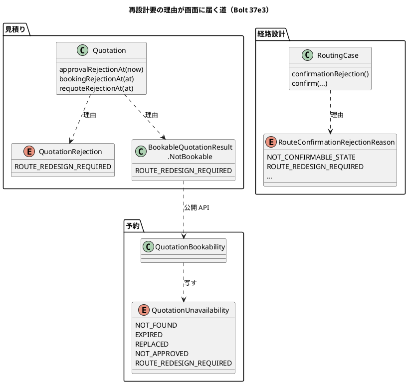
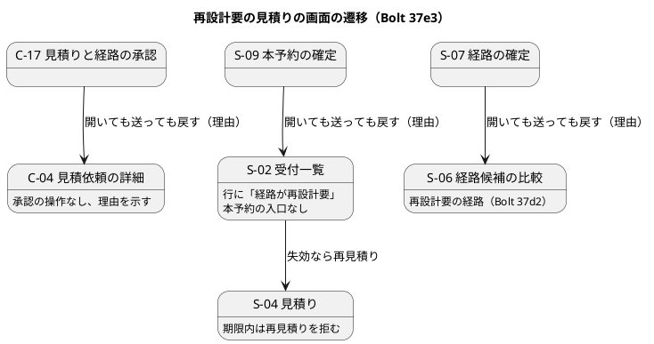

# Bolt 37e3 計画 - US-07 AC5 の予約と画面の側（再設計要の経路の拒否の理由と文言、S-02・S-07、予約の腐敗防止層の追従）

## 基本情報

| 項目 | 内容 |
| :--- | :--- |
| Bolt | 第 37e3 回（W6 の 10 本目） |
| 予定 | W6（2026-11-09 の週。前倒しで着手できる）。作業は約 4.6 時間（`check`・`uiTest`・SonarQube・CI の待ちを除く。確認ポイント 10） |
| アプローチ | アウトサイドイン（画面の層のシナリオを外側の Red にし、状態の組み合わせの表を先に書く。T-161・T-163・T-182） |
| 対象 | 予約: 腐敗防止層 `QuotationBookability` と `QuotationUnavailability` の再設計要、S-09 の文言。見積り: 再見積りの判定（`Quotation.requoteRejectionAt`）の再設計要の理由、C-04 の承認の操作の出し分けと案内、C-17 の拒否の文言、S-04 の再見積りの案内、S-02 の予約の確定待ちの表の行（本予約の入口を出さず再設計要と示す）。経路設計: 確定の拒否の理由 `ROUTE_REDESIGN_REQUIRED` と S-07 の GET・POST の文言。ArchUnit の規則（#50）。画面の層のシナリオ |
| GitHub | [#16](https://github.com/k2works/practical-domain-driven-design-in-enterpris-application/issues/16)（閉じるのは Bolt 37e4）、[#50](https://github.com/k2works/practical-domain-driven-design-in-enterpris-application/issues/50)（予約から見積りのドメインへの型の規則の項目） |
| SP | 0（US-07 の 2 SP は Bolt 37e4 で数える） |
| 承認ゲート | 計画と終了報告。新しいファイル（画面の層のシナリオ、テスト）。構造（経路設計の確定の拒否の理由と見積りの再見積りの理由を変える。確認ポイント 3・4）。スキーマ・認可・環境変数・開発データは変えない（開発データは 37e3b） |
| 開始準備で決めたこと | 2026-10-23、human:kakimomokuri: (1) 37e3 を理由で分け、37e3 は再設計要の経路、37e4 は出発済み（D-88 の判定・理由・文言・マニュアル、#16 のクローズと 2 SP）にする、(2) C-04 は印のある見積りの承認の操作を出さず、理由を示す、(3) W7 の評価の入口をつなぐ Bolt は 37e3（と 37e3b）を終えてから始める（出発済みは評価の入口と関係なく出るので条件にしない）。2 つの整合性検証の後に: (4) S-02 の予約の確定待ちの表からは除かず、行に再設計要と示して本予約の入口だけ出さない（除くと、印のある見積りの期限の後の再見積りの入口が消え、D-86 の変更と食い違う。(2) の前の決定「表から除く」を改めた）、(5) 印のある見積りを期限内に再見積りしようとしたときの理由は、ドメインの判定で `ROUTE_REDESIGN_REQUIRED` を返す（Bolt 37e の行 14b・14c などの期待値が変わる）、(6) 開発データ・マニュアル（4 章・6 章・7 章・8.3）・デモは Bolt 37e3b に分ける。37e2 の終了報告の承認で 37e3 に送った 3 つ（届く順 B の受入シナリオ、行 13 の統合テスト、ロックの操作の名前）は 37e4 に送り直す |

## Bolt ゴール

割り当てた経路版が再設計要になった見積りについて、荷主・営業担当者・経路設計者が開く画面のどこでも、操作できない理由と次の行動が正しく分かるようにする。誤った案内（「荷主の承認がまだ」「本予約の確定へ進んでください」「詳細経路設計を依頼済み」「すでに確定しているか、候補をまだ算出していません」）をなくす。37e2 で DE-06 の listener をつないだので、W7 の評価の入口がつながる前に理由と文言をそろえる。

### 確かめたい仮説

| # | 仮説 | この Bolt で分かること |
| :--- | :--- | :--- |
| H1 | 再設計要の理由をドメインの判定（見積りの再見積り、経路設計の確定）と予約の腐敗防止層で名前で返せば、画面ごとの文言は既存の分岐に腕を足すだけで済み、複雑度の上限（10）を超えない | 単体テスト、checkstyle |
| H2 | 画面の層のシナリオは、背景を画面で進めたあと、印だけを見積りの公開 API で、案件の再設計要の記録を `JdbcTemplate` で付ければ作れる（本番に評価の入口がなくても確かめられる） | `uiTest` |

### 開始準備で確かめたこと

- **予約の腐敗防止層**（`booking/application/internal/outboundservices/acl/QuotationBookability.java:72-78`、`QuotationUnavailability.java:6`）: 理由は NOT_FOUND・EXPIRED・REPLACED・NOT_APPROVED の 4 つで、公開 API の `ROUTE_REDESIGN_REQUIRED` は `default -> NOT_APPROVED` に寄る。S-09 は「荷主の承認がまだ」と誤って出す（`BookingController.unavailable` :160-170）。理由で分岐する箇所は `BookingController.java:163` の switch と `BookingCommandService.java:85` の 2 つ（T-175。37e4 で出発済みを足すときも同じ箇所）
- **再見積りの判定**（`Quotation.requoteRejectionAt`）: 印のある承認済みは期限内なら `APPROVED_AND_STILL_VALID`（S-04 は「本予約の確定へ進んでください」と誤って案内する）、印のある荷主承認待ちは期限内なら `ROUTING_REQUESTED`（「詳細経路設計を依頼済み」と誤る）。期限の後はどちらも再見積りできる（D-86 の変更）
- **S-04 の案内**（`StaffQuotationController.java:410-422`）: 印のある荷主承認待ちが失効すると、再見積りのボタンは出る（判定が空）のに、案内は `isRoutingStarted` の枝で「再見積りはできません」と出る。今のコードの矛盾
- **営業の文言**（`StaffQuotationController.rejection` :358-375）: 循環的複雑度が上限の 10。`ROUTE_REDESIGN_REQUIRED` は `approvalStageRejection` に入れてある（Bolt 37e で「腕は増やさない」と決めた）
- **C-04**（`QuotationViews.java:109`、`detail.html:77`、`TransportRequestLabels.java:124-125`）: 承認の操作は `approvalRejectionAt(now).isEmpty()` で出し分け、印があると黙って消える。状態の下の案内は荷主承認待ちで「承認してください」、承認済みで「担当営業が本予約を確定します。確定したらご連絡します。」のまま残る（印があると誤り）。案内は輸送要求の状態だけで組み立てているので、見積りの印を渡す引数が要る
- **C-17**（`QuotationApprovalController.rejected` :108-125）: 印は `default` の「承認できません。担当営業にご連絡ください」になる
- **S-02**（`QuotationMapper.xml:220-229` の `selectAwaitingBooking`、`TransportRequestReviewController.java:111-113`・:380-400）: 表は承認済みと、経路を引き継いだ承認待ち（`PENDING_APPROVAL`）を出す。有効期限の前は本予約の確定（S-09）、失効した見積りは再見積り（S-04）、経路を引き継いだ承認待ちは見積り（S-04）を開ける。表は失効した見積りの再見積りの入口でもある。照会は印を見ない
- **S-07**（`RoutingCaseController.java:135-139`・:206）: GET は集約の `confirm` に届く前に `confirmable()` で `NOT_CONFIRMABLE_STATE` を返す。POST は `RoutingCase.confirm` が返す。どちらも再設計要の案件で「この案件の経路はすでに確定しているか、候補をまだ算出していません。」になる（37d2 の報告の指摘 16）。理由の文言は `RoutingCaseController.java:58` の `EnumSet`（S-06 に戻す組）と `MESSAGES` で、すべての理由に文言があることはテストで確かめている。既存の期待値（`RoutingCaseConfirmationTest.java:727`、`RoutingCaseControllerTest.java:499・539`）は理由を足すと変わる
- **画面の層のシナリオ**: `src/test/resources/features/ui/*_ui.feature` とステップ `src/test/java/.../ui/*UiSteps.java`（Playwright、axe）。前例は `requote_after_approval_ui.feature`（背景で経路の確定から承認まで画面で進め、時刻は `JdbcTemplate` で動かす）。印は `@US-07 @ui`。再設計要の画面の層のシナリオはまだない
- **ArchUnit**: `PublicApiArchitectureTest` の 3 つの規則と `ModularityTest`。予約から見積りのドメインへの型の依存は `ModularityTest` だけが守る（#50、Bolt 35 の報告 :104）

## 設計の決定（案）

| 項目 | 決定 | 根拠 |
| :--- | :--- | :--- |
| 予約の理由 | `QuotationUnavailability` に `ROUTE_REDESIGN_REQUIRED` を足し、腐敗防止層で公開 API の定数から写す。`default` の腕は残し、知らない理由は今のまま `NOT_APPROVED` に寄せる（確認ポイント 2） | Bolt 37e の開発レビューの低の指摘 |
| 再見積りの理由 | `requoteRejectionAt` は、印があり期限内なら状態（承認済み・荷主承認待ち）によらず `ROUTE_REDESIGN_REQUIRED` を返す。期限の後は今のまま再見積りできる（確認ポイント 3） | 開始準備の決定 (5) |
| 文言（社内の画面） | 営業担当者と経路設計者の画面は「経路が再設計要」と書き、次の行動を添える。S-09「TR-2026-0001 見積 1 は割り当てた経路が再設計要のため本予約を確定できません。経路設計者と扱いを相談してください。」、S-04 の再見積りの拒否「…は割り当てた経路が再設計要のため、有効期限まで再見積りできません。経路設計者と扱いを相談してください」（`approvalStageRejection` の中で言い分け、`rejection` の腕は増やさない） | 確認ポイント 1 |
| 文言（荷主の画面） | 社内の語（再設計要）を出さない。C-04 は承認の操作を出さず、状態の下の案内を「割り当てた経路の見直しが必要になったため、この見積りと経路は承認できません。担当営業にご相談ください。」に替える（承認済みなら「割り当てた経路の見直しが必要になりました。本予約の扱いは担当営業からご連絡します。」）。C-17 は開いても送っても C-04 に戻し「TR-2026-0001 見積 1 は割り当てた経路の見直しが必要になったため承認できません。担当営業にご相談ください」 | 開始準備の決定 (2)、C-17 の置換済みの前例 |
| S-04 の案内 | 印のある荷主承認待ちが失効したら「…を過ぎました。割り当てた経路が再設計要のため、経路を引き継いで再見積りしても荷主は承認できません。経路設計者と扱いを相談してから再見積りしてください。」（再見積りのボタンは今のまま出す） | 検証の指摘（今の矛盾） |
| S-02 | 表には残す。照会の行に再設計要の有無を足し、印のある行は「本予約を確定する」を出さず「経路が再設計要」と示す。失効した行の「再見積りする」は今のまま出す（確認ポイント 5） | 開始準備の決定 (4) |
| S-07 | 経路設計の確定の拒否の理由に `ROUTE_REDESIGN_REQUIRED` を足す。GET と POST が同じ理由を返すよう、確定できるかの判定を集約の 1 か所（理由を返す操作）に置き、GET はそれを使う。S-06 に戻す組に入れ、文言は「この案件の経路は再設計要のため確定し直せません。担当営業と扱いを相談してください。」。domain_model :777 の理由の順に足す（確認ポイント 4） | 37d2 の報告の指摘 16、検証の指摘 |
| ArchUnit | 予約のパッケージは見積りの `domain` と `application` に依存しない規則を足す（ほかのコンテキストの組は #50 の残り） | #50 |

## ふりかえりと前の Bolt からの引き継ぎ

| 出典 | 内容 | この Bolt での扱い |
| :--- | :--- | :--- |
| Bolt 37e2 Try T-183 | ロックの届く順を両方の向きで確かめる | ロックを足さないので当てはまらない |
| Bolt 37e2 Try T-184 | listener の配信まで確かめる統合テスト | listener を足さないので当てはまらない |
| Bolt 37e Try T-180 | 新しいポートやアダプターは同じステップで組み立てに足す | 新しい部品は作らない。S-02 の照会の列は統合テストで確かめる |
| Bolt 37e Try T-181 | 列を足す Bolt は列を落とす変異を入れる | 照会の行に再設計要の有無を足すので、照会から列を落とす変異を入れる（確認ポイント 9） |
| Bolt 37e Try T-182 | 状態の組み合わせの表に出口の列を置く | 下の表に置く |
| T-175 | 理由で分岐する箇所を数える | 開始準備で数えた（予約 2 か所、経路設計 2 か所、見積りの営業の文言 1 か所） |
| Bolt 37e2 の既知の課題（終了報告の承認で 37e3 に送った） | 届く順 B の受入シナリオ、行 13 を本物の本予約の確定で確かめる統合テスト、ロックの操作の名前 | 開始準備の決定 (6) で Bolt 37e4 に送り直す。37e2 の終了報告と release_plan の記録の後ろに変更を書く |
| W5・W6 の文言の約束 | 見える変化と文言・マニュアルを同じ Bolt に入れる（release_plan :731・:785） | 本番とデモには評価の入口も再設計要の見本もないので、37e3 では見える変化は起きない。見本（開発データ）とマニュアルとデモは 37e3b で一緒に入れる（開始準備の決定 (6)） |

## 状態の組み合わせ（行ごとにテストを 1 本。出口の列。T-182）

| 行 | 画面 | 見積りの状態 | 振る舞い | 出口 |
| :--- | :--- | :--- | :--- | :--- |
| 1 | C-04 | 荷主承認待ち、印あり | 承認の操作を出さず、案内を理由に替える | 有効期限の後に再見積り（D-86）、担当営業に相談 |
| 2 | C-04 | 承認済み、印あり | 承認済みと示し、本予約の案内を理由に替える | 担当営業に相談 |
| 3 | C-04 | 荷主承認待ち、印なし | 承認の操作と「承認してください」を出す（今のまま） | 承認 |
| 4 | C-17 の GET・POST | 荷主承認待ち、印あり | C-04 に戻して理由を示す | 行 1 と同じ |
| 5 | S-02 | 承認済み、印あり、期限内 | 表に出し「経路が再設計要」と示し、本予約の入口を出さない | 担当者が相談（S-06 で再設計要を見る） |
| 6 | S-02 | 承認済み、印あり、失効 | 表に出し「経路が再設計要」と「再見積りする」を示す | 再見積り（新しい見積りも印を引き継ぐ） |
| 7 | S-02 | 経路を引き継いだ承認待ち（`PENDING_APPROVAL`）、印あり | 表に出し「経路が再設計要」と示し、見積り（S-04）を開ける | 提示しても荷主は承認できない、担当者が相談 |
| 8 | S-02 | 承認済み、印なし | 本予約の入口を出す（今のまま） | 本予約 |
| 9 | S-09 の GET・POST | 承認済み、印あり | S-02 に戻して理由を示す | 行 5 と同じ |
| 10 | S-04 の再見積り | 承認済み・荷主承認待ち、印あり、期限内 | 再設計要の理由で拒む | 有効期限の後に再見積り |
| 11 | S-04 の案内 | 荷主承認待ち、印あり、失効 | 再見積りできることと、荷主は承認できないことを示す | 再見積り、担当者が相談 |
| 12 | S-07 の GET・POST | 案件の経路版が再設計要 | S-06 に戻して理由を示す | 再設計（US-08）、担当営業と相談 |
| 13 | 予約の腐敗防止層 | 公開 API が知らない理由を返す | `NOT_APPROVED` に寄せる（今のまま） | 開発者の調査 |

## スコープ

### 入れるもの

- 上の表の行 1〜13 と、その画面の層のシナリオ（C-04・C-17・S-02・S-09・S-07）。axe の確かめ
- 再見積りの理由の変更と、変わる既存の期待値（Bolt 37e の行 14b・14c など。集約・受入のテスト）
- 経路設計の確定の拒否の理由と、変わる既存の期待値（`NOT_CONFIRMABLE_STATE` の 3 つのテスト）
- ArchUnit の規則（#50 の予約から見積りの項目）

### 入れないもの

- 開発データの見本（TR-2026-0909・RC-2026-0906）、マニュアル 4 章・6 章・7 章・8.3 とキャプチャ、W6 のデモ項目「再設計要の経路の拒否」の動画（Bolt 37e3b。開始準備の決定 (6)）
- 出発済みの判定（D-88）と、その理由・文言・マニュアル、#16 のクローズと US-07 の 2 SP（Bolt 37e4）
- 37e2 の既知の課題 3 つ（Bolt 37e4。開始準備の決定 (6)）
- 再設計の操作（US-08）、評価の入口（W7）

### 設計の約束

- 公開 API の契約（理由の定数）は変えない。予約の腐敗防止層が写す先を足すだけにする
- `StaffQuotationController.rejection` の腕は増やさない
- 荷主の画面には内部の語（再設計要、印、DE-06、経路版の番号）を出さない

## 設計（この Bolt の範囲）

- 状態遷移図: 見積りと案件の状態は変えないので省く（Bolt 37e・37d2 の図のまま）
- ER 図: スキーマは変えないので省く。S-02 の照会の行に再設計要の有無（`route_redesign_required_at` の有無）を足すだけ
- 画面遷移図: 下の図（ui_design の荷主の遷移 :360 と社内の遷移 :436-446 にも足す）

## ステップ計画

- [ ] **1. 設計の文書**: ui_design（C-04・C-17・S-02・S-04・S-09・S-07 の再設計要の文言と出し分け、荷主と社内の画面遷移図）、domain_model（`QuotationUnavailability` の理由、:777 の確定の拒否の理由の順、再見積りの判定の理由、要素表と用語集の行）、US-07・US-24（AC5 の 37e3・37e3b・37e4 の受け持ち。:347・:353 の D-88 と #16 のクローズを 37e4 へ）、test_strategy、release_plan（37e3 の行を 37e3・37e3b・37e4 に分ける。W6 の SP 合計 12 は変わらない。:731・:868 の D-88 の送り先を 37e4 に、:746 の「37c〜37e3」を 37e4 までに、:785 のマニュアルの注を 37e3b（再設計要）と 37e4（出発済み）に分け、:783 と開発戦略 :185 の動画を撮る Bolt に 37e3b を足す。W7 の行 :803 とリスク :901 の開始条件を「37e3b を終えてから」に。37e2 の終了報告の承認の記録 :1232 の後ろに、37e2 の既知の課題を 37e4 に送り直したことを書く）（完了の判定: 文書の差分）
- [ ] **2. 画面の層のシナリオ（Red）**: `features/ui/route_redesign_required_ui.feature`（`@US-07 @ui`）を作る。背景は前例の形で経路の確定と荷主の承認まで画面で進め、印は見積りの公開 API を呼ぶステップで付ける。C-04（行 1）、C-17（行 4）、S-02（行 5）、S-09（行 9）、S-07（行 12。案件の再設計要の記録は `JdbcTemplate` で入れる）。落ちる理由が「理由の文言がない」「本予約の入口が出る」であることを確かめる（完了の判定: 足したシナリオが期待した理由で落ちる）
- [ ] **3. 予約の腐敗防止層と S-09（Green）**: 腐敗防止層の単体テスト（行 9・13）と `BookingControllerTest` を書いて Red を見てから、`QuotationUnavailability`、写し、文言を作る（完了の判定: テストと S-09 のシナリオが緑）
- [ ] **4. 再見積りの理由と S-04（Green）**: 集約のテスト（行 10）と `StaffQuotationControllerTest`（行 10・11）を書いて Red を見てから、`requoteRejectionAt` と `approvalStageRejection` と S-04 の案内を作る。変わる既存の期待値（37e の行 14b・14c と受入シナリオ）を直す（完了の判定: テストが緑、checkstyle の複雑度が 10 以下）
- [ ] **5. C-04・C-17（Green）**: `QuotationViews`・`TransportRequestLabels`・`QuotationApprovalController` のテスト（行 1〜4）を書いて Red を見てから作る（完了の判定: テストと C-04・C-17 のシナリオが緑）
- [ ] **6. S-02（Green）**: 照会の PostgreSQL の統合テスト（行 5〜8 の再設計要の有無。業務番号は 2081 年以前の空いている年を開始時に確かめる）と `TransportRequestReviewControllerTest` を書いて Red を見てから、照会の列と行の出し分けを作る（完了の判定: テストと S-02 のシナリオが緑）
- [ ] **7. S-07（Green）**: 集約のテスト（GET と POST で同じ理由）と `RoutingCaseControllerTest`（行 12。すべての理由に文言がある既存のテスト）を書いて Red を見てから、理由と判定の操作と文言を作る。変わる既存の期待値（`NOT_CONFIRMABLE_STATE` の 3 つ）を直す（完了の判定: テストと S-07 のシナリオが緑）
- [ ] **8. ArchUnit の規則**: 予約が見積りの `domain`・`application` に依存しない規則を書き、規則に反する一時の依存で落ちることを確かめてから戻す（完了の判定: 規則が緑）
- [ ] **9. 品質ゲートと開発レビューと終了報告**: 変異（確認ポイント 9）、`check`・`uiTest`、その後に SonarQube、開発レビュー、ローカルの dev（ポート 8091。H2）で起動して既存の見本（TR-2026-0906・0908）の S-02・S-09・C-04 が変わらないことを確かめる（T-172）、push して CI と MkDocs とデモ環境の配備を確かめる。#16 にコメントを残す。終了報告で release_plan・開発の索引・mkdocs を完了に直す

### 時間の配分と打ち切り

| # | 目安 | 打ち切り |
| :--- | :--- | :--- |
| 1 | 35 分 | — |
| 2 | 45 分 | 背景を画面で進められない（印を付ける手段がない）と分かったら止めて諮る |
| 3 | 20 分 | — |
| 4 | 35 分 | 期待値の変わる既存のテストが計画の外（37e の行 14b・14c と受入シナリオのほか）にも広がったら止めて諮る |
| 5 | 35 分 | C-04 の案内に見積りの印を渡すと、輸送要求の画面の組み立ての形を大きく変える必要があると分かったら止めて諮る |
| 6 | 30 分 | — |
| 7 | 30 分 | 判定の操作を集約に置くと、GET の判定の順（状態 → 候補 → 適合）が変わる既存の期待値が出たら止めて諮る |
| 8 | 15 分 | 既存のコードが規則に反していたら、動かさずに止めて諮る（CLAUDE.md） |
| 9 | 30 分（`check`・`uiTest`・SonarQube・CI の待ちを除く） | — |

合計 275 分（約 4.6 時間）。

## 確認ポイント（計画の承認の場でまとめて確認する。Try T-6）

| # | 確認すること | 場所 | 推奨 |
| :--- | :--- | :--- | :--- |
| 1 | **文言**（社内の画面は「経路が再設計要」と次の行動、荷主の画面は「割り当てた経路の見直しが必要になった」と「担当営業にご相談ください」） | ステップ 1 | 荷主には社内の語を出さない（C-17 の置換済みの前例）。S-09・S-04 は「経路設計者と扱いを相談してください」、S-07 は「担当営業と扱いを相談してください」（S-06 の既存の文言とそろえる） |
| 2 | **予約の腐敗防止層の知らない理由** | ステップ 3 | `default` を残して `NOT_APPROVED` に寄せる（行 13）。例外にすると、見積りが理由を足したときに S-09 が 500 になる |
| 3 | **再見積りの理由を変える（構造。決定 (5)）** | ステップ 4 | 印があり期限内なら状態によらず `ROUTE_REDESIGN_REQUIRED`。37e の行 14b・14c と受入シナリオの期待値を直す |
| 4 | **経路設計の確定の拒否の理由を足す（構造）** | ステップ 7 | `ROUTE_REDESIGN_REQUIRED` を足し、確定できるかの判定を集約の 1 か所に置いて GET も使う。S-06 に戻す組に入れる。`NOT_CONFIRMABLE_STATE` の 3 つの期待値を直す |
| 5 | **S-02 の行の出し分け（決定 (4)）** | ステップ 6 | 表に残し、印のある行は本予約の入口を出さず「経路が再設計要」と示す。失効なら「再見積りする」、経路を引き継いだ承認待ちなら見積りを開ける（今のまま） |
| 6 | **画面の層のシナリオで印を付ける手段** | ステップ 2 | ステップから見積りの公開 API `RouteRedesignNotification` を呼ぶ（本番の契約を通す）。案件の再設計要の記録は `JdbcTemplate` で入れる（S-07 の行 12） |
| 7 | **ArchUnit の規則の範囲** | ステップ 8 | 予約から見積りだけにする。ほかの組は #50 の残り |
| 8 | **見える変化** | — | 本番とデモには評価の入口も再設計要の見本もないので、37e3 では見える変化は起きない。見本・マニュアル・デモは 37e3b（決定 (6)）。W7 の評価の入口をつなぐ Bolt は 37e3b を終えてから |
| 9 | **変異** | ステップ 9 | 変異は 8 つ: 腐敗防止層が再設計要を写さない、S-09 が再設計要を未承認の文言にする、再見積りの判定が印を見ない、C-04 が承認の操作を出す、C-17 が既定の文言にする、S-02 の照会から再設計要の列を落とす、S-02 が印のある行に本予約の入口を出す、S-07 の GET が状態の理由を返す。スクリプトは gradlew.bat を絶対パスで呼び、結果の XML を消してから流して XML で判定する（T-178） |
| 10 | **時間** | — | 約 4.6 時間で目安の 4 時間を少し超える。37e3b は約 2 時間（開発データ 30 分、マニュアル 4 章・6 章・7 章・8.3 とキャプチャ 60 分、デモ 15 分、品質ゲート 15 分）、37e4 は約 4 時間（D-88 と 37e2 の既知の課題 3 つ）の見込み。さらに分けるなら、S-07（ステップ 7）を 37e3b に移す |

## 完了条件

- [ ] 上のステップ 1〜9 の完了の判定を満たす
- [ ] 状態の組み合わせの表の行 1〜13 に、それを名乗るテストがある
- [ ] `check`・`uiTest` が緑、SonarQube が PASS、CI が緑、デモ環境が新しい版で動く
- [ ] ローカルの dev で既存の見本の画面が変わらない
- [ ] 終了報告が承認される

## 更新履歴

| 日付 | 更新内容 | 更新者 |
| :--- | :--- | :--- |
| 2026-10-23 | 2 つの整合性検証の指摘を反映した（承認待ち）。S-02 は表に残して本予約の入口だけ消す、再見積りの理由をドメインで変える、開発データ・マニュアル・デモを 37e3b に分ける、37e2 の既知の課題を 37e4 に送り直すと決めた（human:kakimomokuri）。S-07 の GET の判定を集約に置く、文言を社内と荷主で分ける、C-04 の案内・S-04 の案内の矛盾を足した | anthropic/claude-opus-5-5 |
| 2026-10-23 | 初版作成（承認待ち）。開始準備で 37e3 を理由で分け、C-04・W7 の扱いを決めた（human:kakimomokuri） | anthropic/claude-opus-5-5 |

## 関連ドキュメント

- [リリース計画](release_plan.md)（W6 節の 37e3 の行、W7 の行、リスク台帳の D-86・D-88）
- [Bolt 37e2 終了報告](bolt_37e2_report.md)、[Bolt 37e 終了報告](bolt_37e_report.md)
- [UI 設計](../../design/cargo-tracker/ui_design.md)、[ドメインモデル](../../design/cargo-tracker/domain_model.md)
- [ユーザーストーリー](../../requirements/cargo-tracker/user_story.md)（US-07、US-24）
