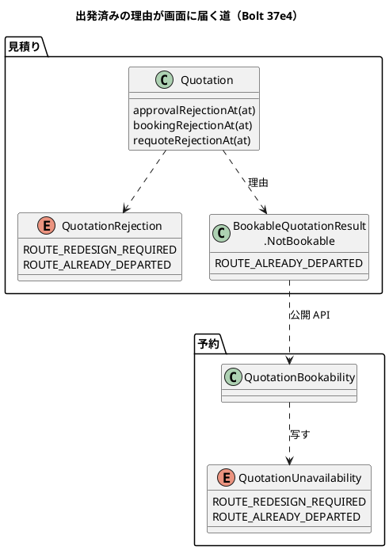
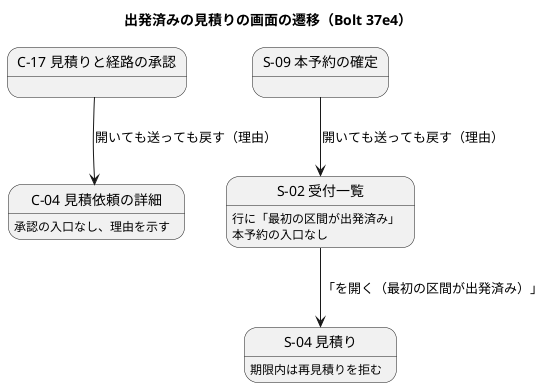

# Bolt 37e4 計画 - US-07 AC5 の出発済みの経路（D-88 の判定・理由・文言・マニュアル）

## 基本情報

| 項目 | 内容 |
| :--- | :--- |
| Bolt | 第 37e4 回（W6 の 12 本目） |
| 予定 | W6（2026-11-09 の週。前倒しで着手できる）。作業は約 4.9 時間（`check`・`uiTest`・`manualScreenshots`・SonarQube・CI の待ちを除く。確認ポイント 10） |
| アプローチ | アウトサイドイン（画面の層のシナリオを外側の Red にし、状態の組み合わせの表を先に書く。T-161・T-163・T-182） |
| 対象 | 見積り: 荷主の承認と本予約の照会の判定に出発済み（D-88）を足し、理由 `ROUTE_ALREADY_DEPARTED` を公開 API まで流す。再見積りの期限内の拒否の理由も出発済みにする（受け付けるかどうかは変えない）。予約: 腐敗防止層と S-09 の文言。画面: C-04・C-17 の荷主の案内、S-02 の予約の確定待ちの行、S-04 の再見積りの拒否の文言。マニュアル 4.2・6.4・7.1・7.2・付録 B（S-09 の文言の表記のそろえを含む）・用語集とキャプチャ |
| GitHub | [#16](https://github.com/k2works/practical-domain-driven-design-in-enterpris-application/issues/16)（閉じるのは Bolt 37e4c） |
| SP | 0（US-07 の 2 SP は Bolt 37e4c で数える） |
| 承認ゲート | 計画と終了報告。新しいファイル（画面の層のシナリオ、テスト）。構造（見積りの判定に理由を足し、公開 API の理由の定数を足す。確認ポイント 3・4）。スキーマ・認可・環境変数・開発データは変えない（開発データは 37e4b） |
| 開始準備で決めたこと | 2026-10-23、human:kakimomokuri: (1) 37e4 を 3 つに分ける。37e4 は判定・理由・文言・画面の層のシナリオ・マニュアル、37e4b は開発データの見本とデモ、37e4c は 37e2 の既知の課題 3 つ（届く順 B の受入シナリオ、行 13 と予約の画面で予約が残ることの確かめ、ロックの操作の名前）と #16 のクローズと US-07 の 2 SP。出発済みは時刻だけで画面に出るので、判定と文言を入れる 37e4 にマニュアルを入れる（見える変化と文言・マニュアルを同じ配備にする約束。release_plan :731・:787）、(2) ロックの操作の名前は目的の名前にそろえる（37e4c）。2 つの整合性検証の後に: (3) 荷主の画面は「最初の航海がすでに出発した」と書く（荷主の経路の表の列の語「航海」にそろえる）、(4) 出発済みの承認済みの見積りの期限内の再見積りは、理由を `ROUTE_ALREADY_DEPARTED` にして「荷主と扱いを相談」と案内する（受け付けるかどうかは変えないので D-88 の「再見積りの引き継ぎはそのまま」の範囲。Bolt 37e3 の再設計要と同じ形）、(5) キャプチャは 37e4 に入れる（テストのデータで撮れる。37e3b の実績）。37e4b は開発データの見本とデモだけになる |

## Bolt ゴール

割り当てた経路の最初の区間が出発した後は、荷主が見積りと経路を承認したり、営業担当者が本予約を確定したりできないようにする（D-88）。そのときの画面には、操作できない理由と次の行動（担当者で相談する）を示す。境界は経路設計の確定の出発済み（`ALREADY_DEPARTED`）と同じにする（判定時刻と同時刻か前なら出発済み）。

### 確かめたい仮説

| # | 仮説 | この Bolt で分かること |
| :--- | :--- | :--- |
| H1 | 出発済みの判定を見積りの集約の判定（荷主の承認・本予約・再見積りの期限内の理由）に足し、理由を Bolt 37e3 の再設計要と同じ道（公開 API → 予約の腐敗防止層 → 画面）で流せば、画面の文言は既存の分岐に腕を足すだけで済む | 単体テスト、checkstyle |
| H2 | 割り当てた区間の写しは見積りが持つ（ADR-014）ので、経路設計に問い合わせずに見積りの中で判定できる | 集約のテスト |

### 開始準備で確かめたこと

- **D-88 の決定**（release_plan :731・台帳 :870）: 再見積りの引き継ぎはそのまま。荷主の承認と本予約の確定で、割り当てた経路の最初の区間の出発予定が判定時刻と同時刻か前なら拒否し、担当者で相談と案内する（`ALREADY_DEPARTED` とそろえる）。スキーマは変えない。`isPresentedForReapproval` は W6 では変えない（US-08・D-86 で見直す）
- **判定の場所**: `Quotation.approvalRejectionAt`（:458-473）と `bookingRejectionAt`（:568-582）の最後が `routeRedesignRejection()`。`requoteRejectionAt`（:530）は印と状態を先に見る（Bolt 37e3）。区間は `AssignedRoute.legs()`、出発は `AssignedRouteLeg.departureAt`（区間の番号は 1 から。`MyBatisQuotationRepository.java:107`）。経路設計の境界は `!departureAt.isAfter(commitAt)`（`RoutingCase.java:264-265`）。判定の時刻は、荷主の承認は承認の時刻、本予約は commit 時刻（`BookingCommandService.java:81`）
- **既存の期待値**: 単体テストの区間の出発は 2099-10-10 以後（`QuotationFixture.java:40`）で、判定時刻はいちばん遅くても 2099-10-09。業務ルール層のシナリオは出発 2026-10-10 で、現在時刻はいちばん遅くても 2026-10-08T11:00。判定を足しても既存の期待値は変わらない見込み
- **理由の流れ**（Bolt 37e3 と同じ道）: `QuotationRejection`、`BookableQuotation.Reason`（:77-87）、`BookableQuotationQueryService.reasonOf`（網羅の switch。:138 の注「4 つ」も直す）、`BookableQuotationQueryAdapter`（:62-66）、公開 API `BookableQuotationResult.NotBookable`、予約の `QuotationUnavailability` と `QuotationBookability`（今は `default -> NOT_APPROVED` で、出発済みは「荷主の承認がまだ」と誤る）、`BookingController.unavailable`。`QuotationRejection` に定数を足すと、既定の腕のない網羅の switch 2 つ（`QuotationResponseController.java:128-143`、`StaffQuotationController.rejection` :358-374）にも名前が要る（コンパイルで分かる。既存の組に入れ、腕は増やさない）。T-175 の分岐: 予約 2 か所、見積り 3 か所（上の 2 つと `reasonOf`）
- **画面**: C-17 は `QuotationApprovalController.rejected` の `default`。C-04 の承認の入口は `approvalRejectionAt` で出し分ける（`QuotationViews.java:109`。判定を足せば入口は消える）。C-04 の案内は `TransportRequestLabels.LatestQuotation` が再設計要の真偽までしか持たず、再承認の見積り（経路を引き継いだ荷主承認待ち）の案内「もう一度承認してください」も出発済みで直す必要がある（:139-142、`detail.html:70`）。見積りの節の承認済みの段落は Bolt 37e3 で印を見るようにした。S-02 の `AwaitingBookingSummary` は再設計要の真偽まで（`selectAwaitingBooking` に `LEFT JOIN quotation.assigned_route_leg l ON l.quotation_id = q.id AND l.leg_no = 1` で出発を足す。H2 は `MODE=PostgreSQL`）。S-04 は、出発済みで承認済み・期限内の見積りの再見積りを開くと「本予約の確定へ進んでください」と誤って案内する（`StaffQuotationController.java:386-389`）
- **荷主の画面の語**: 経路の表の列は「航海」「出発予定」（`assigned-route.html:13・18-21`）
- **マニュアル**: 出発済みの記述は 8.3（経路の確定）だけ。付録 B は S-09 の文言が 2 つの表に重なり、省略の書き方がそろっていない（Bolt 37e3b の既知の課題）。用語集に「出発済み」がない
- **開発データ**: 今の見本（0906〜0910）はどれも最初の区間の出発が起動した日の 5 日後で、出発済みにならない（デモ環境は 1 日 1 回以上初期状態に戻る。`heroku_demo_setup.md:364`）。出発済みの見本は 37e4b
- **見える変化**: ステージング・本番はまだない（release_plan :739）。今すぐ出発済みが見えるのは、デモ環境やローカルで利用者が見本の時刻をまたいだときか、利用者が新しく作った見積りの区間の出発が来たとき

## 設計の決定（案）

| 項目 | 決定 | 根拠 |
| :--- | :--- | :--- |
| 判定 | `approvalRejectionAt` と `bookingRejectionAt` の最後（再設計要の後）に、割り当てた経路の最初の区間の出発予定が判定時刻と同時刻か前なら `ROUTE_ALREADY_DEPARTED`。再設計要と出発済みの両方なら再設計要を返す（確認ポイント 2） | D-88、`ALREADY_DEPARTED` の境界 |
| 再見積り | `requoteRejectionAt` は受け付けるかどうかを変えない（出発済みでも期限の後は再見積りでき、新しい見積りも承認で拒まれる）。承認済みで期限内の拒否の理由だけ、出発済みなら `ROUTE_ALREADY_DEPARTED` にする（再設計要が先） | D-88、開始準備の決定 (4) |
| 理由の名前 | 見積り `QuotationRejection.ROUTE_ALREADY_DEPARTED`、公開 API `NotBookable.ROUTE_ALREADY_DEPARTED`、予約 `QuotationUnavailability.ROUTE_ALREADY_DEPARTED`。公開 API に定数を足す（確認ポイント 4）。domain_model :619 の「公開 API の理由の定数は変えない」（37e3 の決定）の後ろに、37e4 で足したことを書く | Bolt 37e3 の再設計要と同じ形 |
| 文言（社内の画面） | S-09「TR-2026-0001 見積 1 は割り当てた経路の最初の区間が出発済みのため本予約を確定できません。荷主と扱いを相談してください。」。S-04 の再見積りの拒否「…は割り当てた経路の最初の区間が出発済みのため、有効期限まで再見積りできません。荷主と扱いを相談してください」（`approvalStageRejection` の中で言い分け、`rejection` の腕は増やさない）。S-02 の予約の確定待ちの行は経路の欄に「（最初の区間が出発済み）」と示し、本予約の入口を出さず「TR-… 見積 n を開く（最初の区間が出発済み）」。再設計要と出発済みの両方なら「（経路が再設計要）」だけ | Bolt 37e3 の S-02・S-04・S-09 の形 |
| 文言（荷主の画面） | 社内の語（区間、再設計要）を出さない。C-04 の荷主承認待ち（再承認の見積りを含む）は承認の入口を出さず「割り当てた経路の最初の航海がすでに出発したため、この見積りと経路は承認できません。担当営業にご相談ください。」、承認済みは「割り当てた経路の最初の航海がすでに出発しました。本予約の扱いは担当営業からご連絡します。」（見積りの節の「担当営業が本予約を確定します」を出さない）。C-17 は開いても送っても C-04 に戻し「TR-2026-0001 見積 1 は割り当てた経路の最初の航海がすでに出発したため承認できません。担当営業にご相談ください」 | 開始準備の決定 (3)、Bolt 37e3 の C-04・C-17 の形 |
| 予約の腐敗防止層 | `ROUTE_ALREADY_DEPARTED` を写す。知らない理由は今のまま `NOT_APPROVED` に寄せる | Bolt 37e3 |
| キャプチャ | `@manual` に出発済みのシナリオを足し、C-04（荷主承認待ちで出発済み）と S-02（出発済みの行）を撮る。名前は `04-quotation-route-departed.png`・`07-awaiting-booking-route-departed.png` | 開始準備の決定 (5) |

## ふりかえりと前の Bolt からの引き継ぎ

| 出典 | 内容 | この Bolt での扱い |
| :--- | :--- | :--- |
| Bolt 37e3 Try T-185 | 画面の文言を直す Bolt は、その画面を描くテスト（MockMvc）で古い文言が出ないことを状態ごとに確かめる | C-04（荷主承認待ち・再承認・承認済み）、S-02、S-04、S-09 の古い文言が出ないことを MockMvc で確かめる（ステップ 4〜6） |
| Bolt 37e3 Try T-186 | 計画の変異を替えずに、落とせるテストを足してから当てる | 確認ポイント 9 の変異を替えない。替えたら終了報告に書く |
| Bolt 37e3b Try T-187 | 変異で全件が落ちたら、当てた変異を見直す | 変異の表に落ちた検査の名前を書く |
| Bolt 37e3b Try T-188 | CHECK 制約を満たす形で変異を当てる | この Bolt は開発データを変えないので当てはまらない |
| Bolt 37e Try T-181 | 列を足す Bolt は列を落とす変異を入れる | S-02 の照会の出発の列を落とす変異を入れる |
| Bolt 37e Try T-182 | 状態の組み合わせの表に出口の列を置く | 下の表に置く |
| T-172 | dev（H2）で起動して確かめる | 既存の見本の画面が変わらないことを確かめる（完了条件） |
| Bolt 37e3b の既知の課題 | 付録 B の S-09 の文言の表記のそろえ | この Bolt で出発済みの行を足すときにそろえる |
| W5・W6 の文言の約束 | 見える変化と文言・マニュアル・キャプチャを同じ配備にする | 出発済みは時刻だけで画面に出るので、マニュアルとキャプチャをこの Bolt に入れる（開始準備の決定 (1)・(5)） |

## 状態の組み合わせ（行ごとにテストを 1 本。出口の列。T-182）

| 行 | 対象 | 状態 | 振る舞い | 出口 |
| :--- | :--- | :--- | :--- | :--- |
| 1 | 集約の荷主の承認 | 荷主承認待ち、最初の区間の出発が判定時刻より前 | `ROUTE_ALREADY_DEPARTED` で拒む | 担当営業に相談、有効期限の後に再見積り |
| 2 | 集約の荷主の承認 | 同上、出発が判定時刻と同時刻 | 拒む（境界） | 同上 |
| 3 | 集約の荷主の承認 | 同上、出発が判定時刻の後 | 拒まない（今のまま） | 承認 |
| 4 | 集約の本予約の照会 | 承認済み、出発が commit 時刻と同時刻か前 | `ROUTE_ALREADY_DEPARTED` で拒む | 荷主と相談 |
| 5 | 集約 | 再設計要の印があり出発済み | 再設計要を返す（先に見る） | 再設計要と同じ |
| 6 | 集約の再見積り | 承認済み・出発済み、期限の後 | 受け付ける（D-88。今のまま） | 新しい見積りも承認で拒まれる |
| 7 | 集約の再見積り | 承認済み・出発済み、期限内 | `ROUTE_ALREADY_DEPARTED` で拒む（今は `APPROVED_AND_STILL_VALID`） | 有効期限の後に再見積り |
| 8 | C-04 | 荷主承認待ち、出発済み | 承認の入口を出さず、案内を理由に替える | 担当営業に相談 |
| 9 | C-04 | 再承認の見積り（経路を引き継いだ荷主承認待ち）、出発済み | 「もう一度承認してください」を出さず、案内を理由に替える | 担当営業に相談 |
| 10 | C-04 | 承認済み、出発済み | 承認済みと示し、本予約の案内を理由に替える（見積りの節の段落も） | 担当営業からの連絡 |
| 11 | C-17 の GET・POST | 荷主承認待ち、出発済み | C-04 に戻して理由を示す | 行 8 と同じ |
| 12 | S-02 | 承認済み、出発済み、期限内 | 行に「（最初の区間が出発済み）」、本予約の入口を出さず「を開く（最初の区間が出発済み）」 | 荷主と相談 |
| 13 | S-02 | 承認済み、再設計要と出発済みの両方 | 「（経路が再設計要）」だけ | 再設計要と同じ |
| 14 | S-04 | 承認済み、出発済み、期限内の再見積り | 出発済みの文言で拒む | 有効期限の後に再見積り |
| 15 | S-09 の GET・POST | 承認済み、出発済み | S-02 に戻して理由を示す | 行 12 と同じ |
| 16 | 予約の腐敗防止層 | 公開 API が出発済みを返す | `ROUTE_ALREADY_DEPARTED` に写す | — |

## スコープ

### 入れるもの

- 上の表の行 1〜16 と、その画面の層のシナリオ（C-04・C-17・S-02・S-09。axe）。区間の出発はテストの準備で `JdbcTemplate` を使って過去にする（見積りの割り当てた区間だけ。更新件数が 1 であることを確かめる）
- マニュアル 4.2（承認できないとき）、6.4（注意・補足に、出発済みの期限内の再見積りの拒否と、期限の後は再見積りできるが新しい見積りも承認できないこと）、7.1（予約の確定待ちの行）・7.2（確定できないとき）、付録 B（エラーメッセージ早見表の C-17・S-04・S-09 の行。S-09 の文言の表記を 2 つの表でそろえる）、用語集（「出発済み」）とキャプチャ 2 枚
- ui_design（C-04・C-17・S-02・S-04・S-09 の出発済み、荷主と社内の画面遷移図の理由）、domain_model（判定、理由の要素表に `QuotationRejection` と `BookableQuotation.Reason`・`NotBookable` の行、`QuotationUnavailability` の行、:619 の後ろの注、用語集）、US-07・US-24（37e4・37e4b・37e4c の受け持ち。:353・:367 の #16 の記述を 37e4c に）、test_strategy、release_plan と開発戦略（ステップ 1 の一覧）

### 入れないもの

- 開発データの見本（出発済み）と W6 のデモの動画（Bolt 37e4b）
- 37e2 の既知の課題 3 つ、#16 のクローズと US-07 の 2 SP（Bolt 37e4c）
- 再見積りを受け付けるかどうかの変更（D-88）、`isPresentedForReapproval` の見直し（US-08・D-86）
- C-02 の一覧の案内（Bolt 37e3 の既知の課題のまま）

### 設計の約束

- 公開 API の契約は定数を足すだけにする（既存の定数と形は変えない）
- `StaffQuotationController.rejection` の腕は増やさない
- 荷主の画面には社内の語（区間、再設計要）を出さない

## 設計（この Bolt の範囲）

- 状態遷移図: 見積りの状態は変えないので省く（出発済みは状態ではなく判定時刻で決まる）
- ER 図: スキーマは変えないので省く。S-02 の照会の行に最初の区間の出発（`quotation.assigned_route_leg` の区間 1 の `departure_at`）を足すだけ
- 画面遷移図: 下の図（ui_design の荷主の遷移 :361 と社内の遷移 :446 にも出発済みの理由を足す）

## ステップ計画

- [ ] **1. 設計の文書**: ui_design（C-04・C-17・S-02・S-04・S-09 の出発済みの文言と出し分け、遷移図の理由）、domain_model（判定、理由の要素表、:619 の後ろの注、用語集の「出発済み」）、US-07・US-24（:353・:367 の #16 の記述を含む）、test_strategy、release_plan（37e4 の行 :767 を 37e4・37e4b・37e4c の 3 行に分ける。W6 の SP 合計 12 は変えず 37e4c が 2 SP。:746 の US-07 の範囲を 37e4c までに、:785 のデモ項目に「出発済みの拒否」と動画の Bolt に 37e4b を、:787 のマニュアルの注に 6.4・付録 B・用語集とキャプチャを、:805 の W7 の行と :903 のリスク台帳の 37e4 の記述を 37e4〜37e4c に）、開発戦略（:185 の動画の Bolt に 37e4b）（完了の判定: 文書の差分）
- [ ] **2. 画面の層のシナリオ（Red）**: `features/ui/route_already_departed_ui.feature`（`@US-07 @ui`）を作る。背景は Bolt 37e3 の前例の形で経路の確定まで画面で進め、見積りの割り当てた区間の出発を `JdbcTemplate` で過去にする。C-04・C-17（行 8・11）、S-02・S-09（行 12・15）。落ちる理由が「理由の文言がない」「本予約の入口が出る」であることを確かめる（完了の判定: 足したシナリオが期待した理由で落ちる）
- [ ] **3. 集約の判定（Green）**: 集約のテスト（行 1〜7）を書いて Red を見てから、`QuotationRejection.ROUTE_ALREADY_DEPARTED` と判定を作る。網羅の switch 2 つの組に名前を入れる（完了の判定: テストが緑）
- [ ] **4. 公開 API・予約の腐敗防止層・S-09・S-04（Green）**: 入力ポートとアダプターのテスト、腐敗防止層のテスト（行 16）、`BookingControllerTest`（行 15）、`StaffQuotationControllerTest`（行 14。古い「本予約の確定へ進んでください」が出ないこと。T-185）を書いて Red を見てから作る（完了の判定: テストが緑）
- [ ] **5. C-04・C-17（Green）**: `TransportRequestLabels`・`TransportRequestControllerTest`（行 8〜10。古い案内と「担当営業が本予約を確定します」「もう一度承認してください」が出ないこと。T-185）・`QuotationApprovalControllerTest`（行 11）を書いて Red を見てから作る（完了の判定: テストと画面の層のシナリオが緑、checkstyle の複雑度が 10 以下）
- [ ] **6. S-02（Green）**: 照会の PostgreSQL の統合テスト（最初の区間の出発の列。`@Transactional` の既存のテストに足し、空いている番号を確かめる）と `TransportRequestReviewControllerTest`（行 12・13。陽性の対照を置く）を書いて Red を見てから作る（完了の判定: テストと画面の層のシナリオが緑）
- [ ] **7. マニュアルとキャプチャ**: 4.2・6.4・7.1・7.2・付録 B・用語集を、実装の文言から写して書く。`@manual` に出発済みのシナリオを足し、`manualScreenshots` で C-04 と S-02 を撮る（ほかの撮り直しの差分は戻す）（完了の判定: マニュアルの差分と画像）
- [ ] **8. 品質ゲートと開発レビューと終了報告**: 変異（確認ポイント 9）、`check`・`uiTest`、その後に SonarQube、開発レビュー、ローカルの dev（ポート 8091。H2）で既存の見本の画面が変わらないことを確かめる（T-172）、push して CI と MkDocs とデモ環境の配備を確かめる。#16 にコメントを残す。終了報告で release_plan・開発の索引・mkdocs を完了に直す

### 時間の配分と打ち切り

| # | 目安 | 打ち切り |
| :--- | :--- | :--- |
| 1 | 35 分 | — |
| 2 | 45 分 | 区間の出発を過去にすると、経路設計の側の画面や配信が壊れると分かったら止めて諮る |
| 3 | 25 分 | 判定を足すと、計画の外の既存の期待値が変わると分かったら止めて諮る |
| 4 | 30 分 | — |
| 5 | 35 分 | — |
| 6 | 35 分 | — |
| 7 | 60 分（`manualScreenshots` の待ちを除く） | — |
| 8 | 30 分（待ちを除く） | — |

合計 295 分（約 4.9 時間）。

## 確認ポイント（計画の承認の場でまとめて確認する。Try T-6）

| # | 確認すること | 場所 | 推奨 |
| :--- | :--- | :--- | :--- |
| 1 | **文言**（荷主の画面は「割り当てた経路の最初の航海がすでに出発した」、社内の画面は「最初の区間が出発済み」） | ステップ 1 | 荷主には社内の語（区間）を出さない（開始準備の決定 (3)）。S-09・S-04 の次の行動は「荷主と扱いを相談してください」（出発済みは経路設計ではどうにもならず、営業が荷主と扱いを決める） |
| 2 | **理由の順** | ステップ 3 | 再設計要と出発済みの両方なら再設計要を返す（Bolt 37e3 の文言と見本を変えない。再設計要のほうが根本の理由） |
| 3 | **見積りの判定に理由を足す（構造）** | ステップ 3 | `ROUTE_ALREADY_DEPARTED` を荷主の承認と本予約の照会の 2 つの判定に足し、再見積りは期限内の拒否の理由だけを変える（受け付けるかどうかは D-88 のまま。開始準備の決定 (4)） |
| 4 | **公開 API に定数を足す（構造）** | ステップ 4 | `NotBookable.ROUTE_ALREADY_DEPARTED`。予約の腐敗防止層の知らない理由の扱いは今のまま |
| 5 | **見える変化** | — | 出発済みは時刻だけで画面に出る。今の開発データの見本は出発が先で、デモ環境は 1 日 1 回以上初期状態に戻るので、見本では出ない（37e4b で見本を足す）。画面の文言とマニュアルとキャプチャはこの Bolt で入れる |
| 6 | **画面の層のシナリオの準備** | ステップ 2 | 見積りの割り当てた区間の出発を `JdbcTemplate` で過去にする（時刻を待てないため。前例は有効期限を過去にする準備）。経路設計の候補の区間は動かさない |
| 7 | **用語集の「出発済み」** | ステップ 7 | マニュアルの用語集に足す（荷主の画面では「最初の航海がすでに出発した」と示すことも書く） |
| 8 | **S-02 の行の表記** | ステップ 6 | 再設計要と出発済みの両方なら「（経路が再設計要）」だけ（理由の順と同じ） |
| 9 | **変異** | ステップ 8 | 変異は 11 個: 判定の境界を「前」だけにする（同時刻を出発済みにしない）、荷主の承認の判定が出発を見ない、本予約の判定が出発を見ない、理由の順を入れ替える（出発済みを先に）、再見積りの期限内の理由を戻す、腐敗防止層が写さない、S-09 が出発済みを未承認の文言にする、C-04 が理由を示さない、C-04 の承認済みの段落が出発を見ない、C-17 が既定の文言にする、S-02 の照会の出発の列を落とす（と、S-02 が出発済みの行に本予約の入口を出す）。落ちた検査の名前を表に書く（T-187）。スクリプトは gradlew.bat を絶対パスで呼び、結果の XML を消してから流して XML で判定する（T-178） |
| 10 | **時間** | — | 約 4.9 時間で目安の 4 時間を超える（キャプチャを入れた。開始準備の決定 (5)）。37e4b は約 1.5 時間（見本・デモ）、37e4c は約 2 時間（既知の課題 3 つ、#16 のクローズ）。順は 37e4 → 37e4b → 37e4c（#16 のクローズと 2 SP は最後）。さらに分けるなら、マニュアルとキャプチャ（ステップ 7）は分けず（約束）、S-02（ステップ 6）を 37e4b に移す |

## 完了条件

- [ ] 上のステップ 1〜8 の完了の判定を満たす
- [ ] 状態の組み合わせの表の行 1〜16 に、それを名乗るテストがある
- [ ] `check`・`uiTest` が緑、SonarQube が PASS、CI が緑、デモ環境が新しい版で動く
- [ ] ローカルの dev で既存の見本の画面が変わらない
- [ ] マニュアル 4.2・6.4・7.1・7.2・付録 B・用語集とキャプチャが実装と一致する
- [ ] 終了報告が承認される

## 更新履歴

| 日付 | 更新内容 | 更新者 |
| :--- | :--- | :--- |
| 2026-10-23 | 2 つの整合性検証の指摘を反映した（承認待ち）。荷主の文言を「航海」に、S-04 の期限内の再見積りの理由を出発済みに、キャプチャを 37e4 に入れると決めた（human:kakimomokuri）。再承認の見積りと S-02 の両方の行、網羅の switch 2 つ、変異、release_plan と開発戦略の直す行、遷移図を足した | anthropic/claude-opus-5-5 |
| 2026-10-23 | 初版作成（承認待ち）。開始準備で 37e4 を 3 つに分け、ロックの操作の名前を目的の名前にそろえると決めた（human:kakimomokuri） | anthropic/claude-opus-5-5 |

## 関連ドキュメント

- [リリース計画](release_plan.md)（W6 節の 37e4 の行、台帳の D-88）
- [Bolt 37e3 計画](bolt_37e3_plan.md)、[Bolt 37e3 終了報告](bolt_37e3_report.md)、[Bolt 37e3b 終了報告](bolt_37e3b_report.md)
- [UI 設計](../../design/cargo-tracker/ui_design.md)、[ドメインモデル](../../design/cargo-tracker/domain_model.md)
- [ユーザーストーリー](../../requirements/cargo-tracker/user_story.md)（US-07、US-24）
