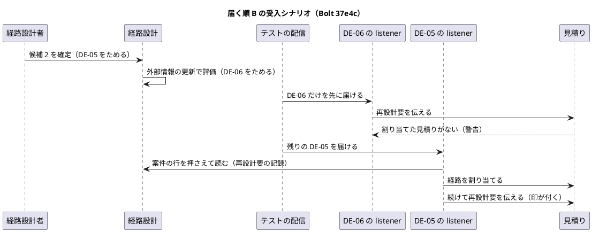
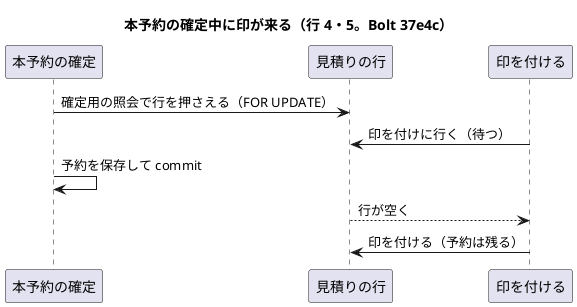

# Bolt 37e4c 計画 - US-07 AC5 の残り（届く順 B の受入シナリオ、本予約の後の予約の残り、ロックの操作の名前、#16 のクローズ）

## 基本情報

| 項目 | 内容 |
| :--- | :--- |
| Bolt | 第 37e4c 回（W6 の 14 本目） |
| 予定 | W6（2026-11-09 の週。前倒しで着手できる）。作業は約 3.8 時間（`check`・`uiTest`・SonarQube・CI の待ちを除く。確認ポイント 8） |
| アプローチ | アウトサイドイン（受入シナリオから。開発戦略 :119。ステップ 3 は既にある振る舞いを本物の部品で確かめる統合テスト、ステップ 4 は振る舞いを変えない構造の変更） |
| 対象 | Bolt 37e2 の既知の課題 3 つ: (1) 届く順 B（DE-06 が DE-05 より先に届く）を本物の見積りの入力ポートを通す受入シナリオ（AC5）、(2) 37e2 の状態の組み合わせの表の行 13（本予約の確定が見積りの行を押さえている間に印が来ても、予約は残り印も付く。AC4 の「予約は自動取消しされず」、R-INV-07）を本物の本予約の確定と予約の保存の commit まで並行で確かめる統合テストと、予約の画面（S-24）で予約が残ること、(3) 経路設計の側のロックの操作の名前を目的の名前にそろえる。US-07 の受入条件の照合、#16 のクローズと US-07 の 2 SP、W6 の動画の #16 への添付 |
| GitHub | [#16](https://github.com/k2works/practical-domain-driven-design-in-enterpris-application/issues/16)（この Bolt で閉じる）、[#50](https://github.com/k2works/practical-domain-driven-design-in-enterpris-application/issues/50)（支援技術による手動確認を載せる） |
| SP | 2（US-07 の残り。W6 の目標 12 SP の一部） |
| 承認ゲート | 計画と終了報告。構造（テストの配信の部品に操作を足す、リポジトリの操作の名前を変える。確認ポイント 2・3）。新しいファイル（統合テスト 1 つ）。GitHub（#16 のクローズ、#50 への追記、動画の添付。確認ポイント 5・6）。スキーマ・認可・環境変数・本体の振る舞い・画面・マニュアル・開発データは変えない |
| 開始準備で決めたこと | 2026-10-23（Bolt 37e4 の開始準備）、human:kakimomokuri: ロックの操作の名前は目的の名前にそろえる。2026-10-23（この開始準備。2 つの整合性検証の後）、human:kakimomokuri: (1) 行 13 は並行の形（本物の本予約の確定が見積りの行を押さえている間に印を付けに行く）で確かめる、(2) #16 の DoD の支援技術による手動確認は #50 に載せてから #16 を閉じる、(3) W6 の動画（bolt-37c・bolt-37e3b・bolt-37e4b）を 37e4c で #16 に添付する |

## Bolt ゴール

US-07 AC4・AC5 の残りの確かめを本物の部品で済ませ、#16 を閉じて US-07 の 2 SP を数える。経路設計が DE-06 を先に出しても見積りに印が付くこと（届く順 B）を受入シナリオで、本予約の確定が見積りの行を押さえている間に印が来ても予約が残り印も付くこと（R-INV-07）を本物の本予約の確定と PostgreSQL の並行の統合テストで確かめる。

### 確かめたい仮説

| # | 仮説 | この Bolt で分かること |
| :--- | :--- | :--- |
| H1 | テストの配信の部品に「指定した型のイベントだけを先に届ける」操作を足せば、本体を変えずに届く順 B を受入シナリオで通せる（Bolt 37e2 の DE-05 の listener が割り当てた後に続けて伝えるので、印が付く） | 受入シナリオ |
| H2 | 本予約の確定（`BookingCommandService.confirm`）が見積りの行を押さえている間に来た印は待ち、確定の commit の後に付く。予約と予約の画面の照会は変わらない | PostgreSQL の並行の統合テスト |
| H3 | 名前の変更は呼び出しが 1 か所（DE-05 の listener）なので、振る舞いを変えずに済む | `check`、既存のロックの統合テスト |

### 開始準備で確かめたこと

- **届く順 B**（Bolt 37e2 の計画 :64）: DE-06 が先（見積りはまだ詳細設計依頼済み）、その後に DE-05。DE-06 だけを先に配ると、DE-06 の listener（`QuotationRouteRedesignEventHandler:33-41`）が見積りの公開 API を呼び、割り当てた見積りが 0 件なので `NotMarked(QUOTATION_NOT_FOUND)`（`RouteRedesignNotificationAdapter:31-33`）になり、警告のログを残して終わる（例外にならない）。続けて DE-05 を配ると、DE-05 の listener（`QuotationRouteAssignmentEventHandler:50`・`:76-77`）が案件の行を押さえて読み、割り当てた後に再設計要の記録の時刻で続けて伝える。37e2 では listener の単体テスト（行 6・7）と入力ポートのテストを別々に確かめ、受入シナリオは順 A だけにした（37e2 の計画 :126）
- **受入シナリオの置き場**: `features/routing/evaluate_confirmed_route.feature` の背景は候補 2 の確定（DE-05 の発行。:30）と時刻（:31）で終わり、DE-05 をまだ配信しない。評価のステップは `ConfirmedRouteEvaluationSteps`（:66 航海の更新、:84 評価）。グルーは全コンテキストを含む（`RunCucumberTest`）ので、見積りのステップ（`RouteRedesignSteps:79` の印、`ShipperApprovalSteps:71`・`:82` の承認、`:106-111` の「経路版は割り当てられていない」）も使える。購読の組み立ては `AcceptanceTestConfiguration`（DE-05 の listener :312-321、DE-06 の listener :324-328、見積りの公開 API :297-300、購読の分岐 :375-377・:396-405）。`features/quotation/route_redesign_required.feature` の背景は DE-05 を配信する（:30-31）ので使えない。「見積り 1 には再設計要の印が付いていない」（`RouteRedesignSteps:95-98`）は割り当てがないと例外になる（:114-119）ので、行 1 では使わない
- **イベントの型**: DE-05 は `routing.domain.events.RouteConfirmed`、DE-06 は `routing.domain.events.RouteRedesignRequired`
- **テストの配信の部品**（`shared/acceptance/DeferredEventDelivery.java`）: `deliverAll`（発行の順に配る。:33-38）・`redeliverLast`・`redeliver`・`published`・`history`・`clear`。指定した型だけを届ける操作はない。共通のステップは `EventDeliverySteps`。ステップ定義の依存の規則（AT-05。`AcceptanceStepArchitectureTest:85-106`）は、`routing.acceptance` が自分のコンテキストのイベントに依存することを許す
- **行 13**（Bolt 37e2 の計画 :76・:109、domain_model :615、ADR-016 :37）: 本予約の確定用の照会（`findForConfirmation`）が見積りの行を `FOR UPDATE` で押さえている間に印（I）が来ると、印は待ち、予約が確定した後に印が付く。予約は残る（R-INV-07）。37e2 では見積りの照会の層まで確かめた（`MyBatisQuotationBookingLockIntegrationTest:69`）。予約の保存の commit までは確かめていない（37e2 の報告 :90）
- **統合テストの組み立て**: データベースは Testcontainers の PostgreSQL（`TestcontainersConfiguration.java:14-15`、postgres:18.6）。時計はシステムの時計（`ClockConfiguration:17-19`）。本物の本予約の確定を通す前例は `integration/RouteConfirmedAssignmentIntegrationTest`（本物の `BookingCommandService` :111、DE-07 は非同期で、予約確定済みと予約サガの COMPLETED を待つ :206-214・:234）。並行の前例は `BookingConfirmationConcurrentIntegrationTest` と `shared/OverlappingTransactions`（ロックの待ちの確かめ `awaitLockWaitOn`）。集約を直接保存して業務番号の年を選ぶ前例は `MyBatisQuotationBookingLockIntegrationTest:136-154`（2090 年）。テストの業務番号の年は 2082〜2099 と 2026 が使われ、2070〜2081 は空いている
- **S-24 の照会**: `BookingQueryService.detail(TrackingNumber)`（:62-73）。S-09 の `confirmation(String, int)`（:46-50）は予約があれば `AlreadyBooked` を返す
- **ロックの操作の名前**（Bolt 37e2 の報告 :89）: 経路設計の側 `RoutingCaseRepository.findByNumberForUpdate`。変える場所は本体 3（`RoutingCaseRepository:33-37` の Javadoc を含む、`MyBatisRoutingCaseRepository:118-127`、`QuotationRouteAssignmentEventHandler:50`）、テスト 3 ファイル（`InMemoryRoutingCaseRepository:53-57`、`QuotationRouteAssignmentEventHandlerTest:42-44`、`MyBatisRoutingCaseLockIntegrationTest:49・79・89・102`）、文書 1（domain_model :612）。mapper の `lockByNumber`（`RoutingCaseMapper.xml:197`）は SQL を表す名前なので変えない。Bolt 37e2 の計画と報告は履歴なので変えない。ADR-014・016・018 は経路設計の側の操作の名前を書いていない。目的の名前の前例は `BookableQuotationQuery.findForConfirmation`（行を押さえて読んで返す。domain_model :155）、`TransportRequestRepository.findByNumberForStaff`（:42）。`lockForBooking`・`lockForIssue` は真偽を返す「押さえるだけ」の操作
- **#16 と US-07**: US-07 の受入条件は user_story :320-323、分け方は :329、37e4c で閉じる決定は :353・:367・:374。予約の画面で予約が残ることは AC4 の「予約は自動取消しされず」として 37e4c に割り当てた（:354）。#16 は OPEN、Project の Status は In Progress。W6 の開始準備のコメントは「37e でクローズ」のまま（その後のコメントで 37e4c に送った）。DoD の「画面を変えたなら支援技術による手動確認を記録した」は、37c・37d2・37e3・37e4 で画面を変えたが記録がない（axe の自動検査は通している）。前例の #43（Bolt 35）は AC と DoD のチェックを入れてから閉じた（`bolt_35_report.md:118-119`）
- **Release 1.0 の外に残るもの**: AC5 の旧版の経路版の新規予約への割当ての拒否と、新しい経路版の作成（再設計）は US-08（Release 1.1。release_plan :147・:820。US-24 の注 user_story :176）。外部情報の更新から評価を起こす入口は W7（US-14。user_story :337）。荷主承認待ちで出発済みの見積りの社内の画面（S-02・S-04）の印は、Bolt 37e4・37e4b の報告の既知の課題だけで、台帳に送り先がない
- **US-07 の SP**: release_plan :134（5 SP）、:166（R0.1 で 3、残り 2）、:695（W6 の目標の内訳）、:769（37e4c の行）、:794（W6 の Bolt のチェックリスト）、:941（W6 の進捗の行。W6 の締めで埋める前例）、W6 節の状態（:703。37e2 で止まっている）
- **動画の添付**: 手順書（`docs/operation/cargo-tracker/index.md:56`）は、新しい Bolt は終了報告の承認の後に、添付先の表と `ops/scripts/issue_demo.js` の `BOLT_ISSUES` の両方に足すとしている。表と `BOLT_ISSUES`（:64-66）は bolt-34d で止まり、W6 の bolt-37c・bolt-37e3b・bolt-37e4b（#16）と bolt-37b2（#15）は未登録・未添付。前例は 33b（`bolt_33b_report.md:35`）
- **画面**: 変えない（Bolt 37e3・37e4 で文言を入れた）。マニュアルとキャプチャは変えない

## 設計の決定（案）

| 項目 | 決定 | 根拠 |
| :--- | :--- | :--- |
| 届く順 B の受入シナリオ | `evaluate_confirmed_route.feature` に 1 本足す（タグ `@US-07-AC5 @DE-06 @Q-INV-10`。機能の説明に届く順 B（37e4c）を 1 文足す）。流れ: 背景の後に「航海 "V-301" が次の内容に更新される」「外部情報の更新を受けて案件の確定した経路を評価する」→「再設計要のイベントだけが先に配信される」→「まだ配信していないイベントは経路を確定したイベントだけである」→「見積り 1 に経路版は割り当てられていない」→「発行されたドメインイベントが購読するコンテキストに配信される」→「見積り 1 には評価の時刻に再設計要になった印が付いている」→「荷主担当者が見積り 1 の見積りと経路を承認する」→「承認の結果は "経路が再設計要" である」 | 開始準備で確かめたこと |
| テストの配信の部品 | `DeferredEventDelivery` に汎用の `deliverOnly(Class<?>)` を足す。ためたイベントのうち指定した型のものだけを発行の順で届け、ほかは発行の順のまま残す。`lastDelivered` は届けた分にする。配っている間に購読側が出したイベントは残す側に足す（`deliverAll` と同じ）。「再設計要のイベントだけが先に配信される」「まだ配信していないイベントは経路を確定したイベントだけである」のステップは経路設計の受入ステップ（`ConfirmedRouteEvaluationSteps`）に置く（共通の部品に経路設計のイベントの型を持ち込まない） | 確認ポイント 2 |
| 行 13 の統合テスト | `integration` パッケージに新しい統合テスト（`@SpringBootTest @Import(TestcontainersConfiguration.class)`、クラスに `@Transactional` を付けない）。見積りと輸送要求は集約を直接保存する（業務番号と案件番号は 2081 年。データの時刻は今より前、有効期限と区間の出発は 2099 年。時計はシステムの時計のまま。コンテキストを共有するため差し替えない）。`OverlappingTransactions` で、本物の `BookingCommandService.confirm` が見積りの行を押さえている間に、見積りの公開 API で割り当てた経路版を再設計要と伝える。印がロックを待つことを確かめてから確定を commit させる。その後に、伝えた結果が 1 件の見積りに印を付けたこと（印の時刻）を先に確かめ、予約が 1 件だけ残ること、輸送要求が予約確定済みになり予約サガが完了すること（DE-07 は非同期なので待つ）、S-24 の照会（`BookingQueryService.detail`）が予約を返すことを確かめる | 開始準備の決定 (1)、確認ポイント 4 |
| ロックの操作の名前 | `RoutingCaseRepository.findByNumberForUpdate` を `findByNumberForRouteAssignment`（DE-05 の経路の割当ての伝達のために案件の行を押さえて読む）にする。振る舞いと `MANDATORY` は変えない。インターフェースの Javadoc も直す | 開始準備の決定、前例 `findForConfirmation`・`findByNumberForStaff`、既存の語 `QuotationRouteAssignments`（確認ポイント 3） |
| US-07 の受入条件の照合 | US-07 AC3〜AC5 の受入条件と、それを確かめるテスト（受入シナリオ・画面の層のシナリオ・単体テスト・統合テスト）の対応を終了報告に表で書く。行 4・5 は AC4 の欄に置く | #16 を閉じる根拠 |
| #16 を閉じる | 終了報告の承認の後に、#16 の AC と DoD のチェックを入れ、支援技術による手動確認は #50 に載せたと DoD に書いて閉じる。閉じるコメントに、閉じる Bolt が 37e から 37e4c に変わったこと、Release 1.0 の外に残るもの（旧版の割当ての拒否と新しい経路版の作成は US-08、評価の入口は W7・US-14、荷主承認待ちで出発済みの社内の画面の印は D-86）を書く。Project の Status を Done にする | 開始準備の決定 (2)、前例 #43 |
| 動画の添付 | 終了報告の承認の後に、`DEMO_DRY_RUN=1` で確かめてから `DEMO_BOLT=bolt-37c|bolt-37e3b|bolt-37e4b DEMO_ISSUE=16 npx gulp issue:attach-demo` で 3 本を #16 に添付する。`ops/scripts/issue_demo.js` の `BOLT_ISSUES` と手順書の添付先の表に 37c・37e3b・37e4b → #16 を足す。bolt-37b2 → #15 は US-06 を閉じる Bolt（37f）に送る | 開始準備の決定 (3)、手順書 |

## ふりかえりと前の Bolt からの引き継ぎ

| 出典 | 内容 | この Bolt での扱い |
| :--- | :--- | :--- |
| Bolt 37e4b Try T-191 | 計画に環境の前提を書くときは設定のファイルの行を根拠に添える | 統合テストのデータベースと時計を `TestcontainersConfiguration.java:14-15`・`ClockConfiguration:17-19` を根拠に書いた |
| Bolt 37e4b Try T-192 | 計画で決めた見本の値を検査で守る | 開発データを変えないので当てはまらない |
| Bolt 37e4 Try T-189 | 判定の境界は値オブジェクトの 1 つの操作に置く | 判定を変えないので当てはまらない |
| Bolt 37e4 Try T-190 | 画面の行は画面を描くテストを名乗らせる | 行 5 は S-24 の照会（`BookingQueryService.detail`）の値で確かめる。S-24 を描くテストは既存の `BookingControllerTest` |
| Bolt 37e3 Try T-186 | 計画の変異を替えずに、落とせるテストを足してから当てる | 確認ポイント 7 の変異を替えない。替えたら終了報告に書く |
| Bolt 37e3b Try T-187 | 変異で全件が落ちたら、当てた変異を見直す | 下の変異の表に落ちる見込みのテストを先に書く |
| Bolt 37e2 Try T-183 | ロックを足す Bolt は、届く順の各組を両方の向きで統合テストにする | ロックは足さない（名前だけ）。行 13 は I の向き（確定が先に押さえ、印が待つ）を確かめる。逆の向き（印が先、確定が待つ）は 37e2 の `MyBatisQuotationBookingLockIntegrationTest`（届く順 J）が確かめている |
| W5 の Try T-106・T-119 | 「ないこと」「変わらないこと」を確かめる前に、対象があり条件が成り立つことを確かめる | 行 1 は未配信のイベントを先に確かめる。行 4 は印が付いたことを先に確かめる |
| W5 の Try T-148・T-152 | 名前の変更と共通の部品の変更は、全体を検索して変える場所を数えてから変える | 変える場所を数えた（本体 3、テスト 3 ファイル、文書 1。開始準備で確かめたこと） |
| W5 の Try T-164 | 変異の結果は XML で判定する | 確認ポイント 7 |
| T-174 | レビューで足す変更もテストを先に書く | 開発レビューの直しもテストを先に書く |

## 状態の組み合わせ（行ごとにテストを 1 本。出口の列。T-182）

| 行 | 対象 | 状態 | 振る舞い | 確かめ方 | 出口 |
| :--- | :--- | :--- | :--- | :--- | :--- |
| 1 | 届く順 B（AC5） | 確定と評価の後、DE-06 だけを先に配る | 未配信は経路を確定したイベントだけ。見積り 1 に経路版は割り当てられていない（DE-06 は `QUOTATION_NOT_FOUND` の警告） | 受入シナリオ | 続けて DE-05 を配る |
| 2 | 届く順 B（AC5） | 続けて DE-05 を配る | 割り当てた後に続けて伝え、見積り 1 に評価の時刻で印が付く | 受入シナリオ | 荷主は承認できない |
| 3 | 届く順 B（AC5、Q-INV-10） | 印の付いた見積り | 荷主の承認は「経路が再設計要」で拒まれる | 受入シナリオ | 担当営業に相談 |
| 4 | 本予約の確定中の印（AC4、R-INV-07。37e2 の行 13） | 本物の本予約の確定が見積りの行を押さえている間に印を付けに行く | 印はロックを待ち、確定の commit の後に付く（伝えた結果は 1 件、印の時刻）。予約は 1 件だけ残り、輸送要求は予約確定済み、予約サガは完了 | 並行の統合テスト（PostgreSQL） | — |
| 5 | 本予約の確定中の印（AC4） | 同上 | S-24 の照会（`BookingQueryService.detail`）は予約を返す | 並行の統合テスト（PostgreSQL） | — |
| 6 | ロックの操作の名前 | DE-05 の listener | 新しい名前の操作で案件の行を押さえて読む（振る舞いは今のまま） | listener のテスト、`MyBatisRoutingCaseLockIntegrationTest` | — |

## スコープ

### 入れるもの

- 上の表の行 1〜6 のテスト、テストの配信の部品の操作と経路設計の受入ステップ、ロックの操作の名前の変更（本体・テストの偽物・テスト・domain_model）
- US-07 の受入条件の照合（終了報告）、user_story（US-07 に Bolt 37e4c の決定を 1 行: #16 を閉じたこと、2 SP、Release 1.0 の外に残るもの。AC5 の旧版の割当ての拒否は US-08 と US-07 の節にも書く）、release_plan（:769 の 37e4c の行、:794 のリンク、:166 の US-07 の残り 2、W6 節の状態 :703、更新履歴、D-86 の台帳に荷主承認待ちで出発済みの社内の画面の印を足す。:941 は W6 の締めで埋める）、test_strategy（US-07 の AC4 :563 と AC5 :564 に 37e4c）
- #16 のクローズ（AC と DoD のチェック、完了のコメント）と GitHub Project の Status、#50 への支援技術による手動確認の追記、W6 の動画 3 本の #16 への添付と添付先の表・`BOLT_ISSUES`

### 入れないもの

- 本体の振る舞い・画面・マニュアル・開発データの変更
- 「区間」を荷主の語とするかの決定（Bolt 37e4b の既知の課題。別に諮る）
- 荷主承認待ちで出発済みの見積りの社内の画面の印の実装（D-86・US-08）
- W7 の評価の入口、bolt-37b2 の #15 への添付（37f）

## 設計（この Bolt の範囲）

- ドメインモデル図・状態遷移図・ER 図・画面遷移図: 本体の型・状態・スキーマ・画面の遷移は変えないので省く（Bolt 37e2 の計画の図のまま）。ロックの操作の名前は domain_model :612 の文を直す

## ステップ計画

- [ ] **1. 設計の文書**: domain_model（:612 のロックの操作の名前）、test_strategy（US-07 の AC4 と AC5 の 37e4c）、release_plan（:769 の 37e4c の行に計画へのリンクと承認ゲート「計画と終了報告（構造、新しいファイル、GitHub。確認ポイント 2〜6）」）（完了の判定: 文書の差分）
- [ ] **2. 届く順 B の受入シナリオ（Red → Green）**: `evaluate_confirmed_route.feature` にシナリオを 1 本足す（行 1〜3）。`deliverOnly` を空の操作で作り、シナリオが「まだ配信していないイベントは経路を確定したイベントだけである」で落ちる（DE-06 が届かない）ことを確かめてから中身を作る（完了の判定: シナリオが緑）
- [ ] **3. 本予約の確定中の印の並行の統合テスト**: 新しい統合テスト（行 4・5）を書く。中身はすでにあるので、テストを書いて緑を確かめ、変異（確認ポイント 7）で落ちることを確かめる（T-174）（完了の判定: テストが緑、変異で落ちる）
- [ ] **4. ロックの操作の名前（構造）**: 名前を変える（本体 3、テスト 3 ファイル、domain_model）。振る舞いを変えない（完了の判定: `check` が緑、既存のロックの統合テストが緑）
- [ ] **5. 品質ゲートと開発レビュー**: 変異、`check`・`uiTest`、その後に SonarQube、開発レビューとその直し
- [ ] **6. 終了報告と #16 のクローズ**: US-07 の受入条件の照合を終了報告に書く。user_story・release_plan・test_strategy を直す。push して CI と MkDocs とデモ環境の配備を確かめる。終了報告の承認の後に、#50 に支援技術による手動確認を載せ、W6 の動画 3 本を #16 に添付し（試しの実行の後）、`BOLT_ISSUES` と手順書の添付先の表に足し、#16 の AC と DoD のチェックを入れて完了のコメントを残して閉じ、Project の Status を Done にする。release_plan・開発の索引・mkdocs を完了に直す

### 時間の配分と打ち切り

| # | 目安 | 打ち切り |
| :--- | :--- | :--- |
| 1 | 15 分 | — |
| 2 | 50 分 | 受入テストの購読の組み立てで、経路設計の評価と見積りの公開 API が同じシナリオの中でつながっていないと分かったら止めて諮る |
| 3 | 75 分 | 本物の本予約の確定の途中で見積りの行を押さえたまま止める手段が `OverlappingTransactions` で作れないと分かったら止めて諮る |
| 4 | 20 分 | — |
| 5 | 30 分（待ちを除く） | — |
| 6 | 35 分（CI の待ちを除く） | — |

合計 225 分（約 3.8 時間）。

## 確認ポイント（計画の承認の場でまとめて確認する。Try T-6）

| # | 確認すること | 場所 | 推奨 |
| :--- | :--- | :--- | :--- |
| 1 | **届く順 B の受入シナリオの置き場** | ステップ 2 | `evaluate_confirmed_route.feature`（背景が DE-05 を配信しない）。見積りの側のシナリオの背景は DE-05 を配信してしまうので使わない |
| 2 | **テストの配信の部品に操作を足す（構造）** | ステップ 2 | `DeferredEventDelivery.deliverOnly(Class<?>)`（指定した型だけを発行の順で先に届け、ほかは残す。`lastDelivered` は届けた分）。DE-06 を指すステップは経路設計の受入ステップに置く。本体の配信（発行記録）は変えない |
| 3 | **ロックの操作の名前（構造）** | ステップ 4 | `findByNumberForRouteAssignment`。DE-05（経路の割当ての伝達）のために案件の行を押さえて読む目的を名前にする。前例は `findForConfirmation`・`findByNumberForStaff`。`lockForBooking`・`lockForIssue` は真偽を返す「押さえるだけ」の操作なので `lockFor…` にしない。mapper の `lockByNumber` は変えない |
| 4 | **行 13 の並行の統合テスト（新しいファイル）** | ステップ 3 | 開始準備の決定 (1)。`OverlappingTransactions` で、本物の本予約の確定が見積りの行を押さえている間に印を付けに行き、印が待つことを `pg_blocking_pids` の形で確かめてから確定を commit させる。予約・輸送要求・予約サガ・S-24 の照会が変わらず、印も付くことを確かめる。業務番号の年は 2081 |
| 5 | **#16 のクローズと US-07 の 2 SP（GitHub）** | ステップ 6 | 開始準備の決定 (2)。終了報告の承認の後に、支援技術による手動確認（37c・37d2・37e3・37e4 で変えた S-06・S-07・C-04・C-17・S-02・S-04・S-09）を #50 に載せ、#16 の AC と DoD のチェックを入れて閉じる。Release 1.0 の外に残るもの（US-08、W7・US-14、D-86）を閉じるコメントに書く |
| 6 | **動画の添付（GitHub）** | ステップ 6 | 開始準備の決定 (3)。bolt-37c・bolt-37e3b・bolt-37e4b を #16 に添付する。`BOLT_ISSUES` と添付先の表に足す |
| 7 | **変異** | ステップ 5 | 下の 5 つ。スクリプトは gradlew.bat を絶対パスで呼び、結果の XML を消してから流して XML で判定する（T-178・T-164）。全件が落ちたら当て直す（T-187） |
| 8 | **時間** | — | 約 3.8 時間で目安の範囲。開始準備の決定 (1) の並行の形で約 30 分、#16 を閉じる前例の手順（DoD・#50・動画の添付）で約 15 分増えた |

### 変異と落ちる見込みのテスト（確認ポイント 7）

| # | 変異 | 落ちる見込みのテスト |
| :--- | :--- | :--- |
| V1 | `deliverOnly` が何も届けない | 届く順 B のシナリオ（「まだ配信していないイベントは経路を確定したイベントだけである」） |
| V2 | `deliverOnly` がすべてを届ける | 届く順 B のシナリオ（同じステップと「見積り 1 に経路版は割り当てられていない」） |
| V3 | DE-05 の listener が割り当てた後に続けて伝えない | 届く順 B のシナリオ（行 2 の印）、listener の既存のテスト |
| V4 | 確定用の照会が見積りの行を押さえない（`findForConfirmation` の `lockForBooking` を外す） | 行 4 の並行の統合テスト（印が待たない）、37e2 の `MyBatisQuotationBookingLockIntegrationTest` |
| V5 | 案件の行を押さえずに読む（名前を変えた操作がロックを取らない） | `MyBatisRoutingCaseLockIntegrationTest` の 1 本目と 2 本目（`awaitLockWaitOn` の 30 秒のタイムアウトで落ちるので、1 本あたり 30 秒以上かかる） |

## 完了条件

- [ ] 上のステップ 1〜6 の完了の判定を満たす
- [ ] 状態の組み合わせの表の行 1〜6 に、それを名乗るテストがある
- [ ] `check`・`uiTest` が緑、SonarQube が PASS、CI が緑、デモ環境が新しい版で動く
- [ ] US-07 AC3〜AC5 の受入条件の照合が終了報告にあり、#16 が閉じられ、US-07 の 2 SP が release_plan に数えられる
- [ ] 終了報告が承認される

## 更新履歴

| 日付 | 更新内容 | 更新者 |
| :--- | :--- | :--- |
| 2026-10-23 | 2 つの整合性検証の指摘を反映した（承認待ち）。空の操作では Red が出ないので未配信のイベントを確かめるステップを足し、行 1 の確かめを「経路版は割り当てられていない」に、行 4・5 を AC4 に、DE-06 のステップの置き場を経路設計の受入ステップに直した。行 13 を並行の形にし（human:kakimomokuri）、#16 を閉じる前例の手順（DoD のチェック、#50 への手動確認、動画の添付。human:kakimomokuri）、変異の表、名前を変える場所の数、統合テストの組み立てを足した | anthropic/claude-opus-5-5 |
| 2026-10-23 | 初版作成（承認待ち） | anthropic/claude-opus-5-5 |

## 関連ドキュメント

- [リリース計画](release_plan.md)（W6 節の 37e4c の行、W6 の目標 SP、D-86 の台帳）
- [Bolt 37e2 計画](bolt_37e2_plan.md)（届く順の表、状態の組み合わせの表の行 13）、[Bolt 37e2 終了報告](bolt_37e2_report.md)（既知の課題）
- [Bolt 37e4b 終了報告](bolt_37e4b_report.md)、[Bolt 37e4 終了報告](bolt_37e4_report.md)、[Bolt 35 終了報告](bolt_35_report.md)（#43 を閉じた前例）
- [ドメインモデル](../../design/cargo-tracker/domain_model.md)、[ユーザーストーリー](../../requirements/cargo-tracker/user_story.md)（US-07）、[テスト戦略](../../design/cargo-tracker/test_strategy.md)
- [ADR-016](../../adr/cargo-tracker/016-booking-checks-quotation-at-commit-time.md)、[運用の索引](../../operation/cargo-tracker/index.md)（動画の添付先の表）
