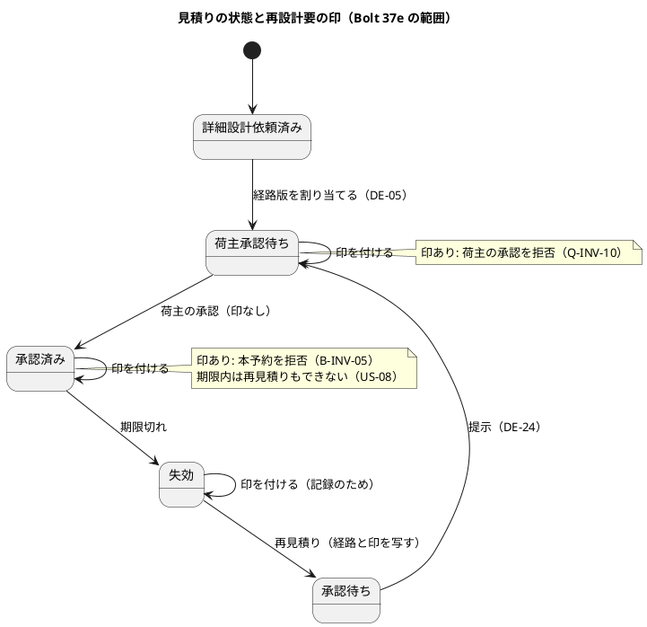
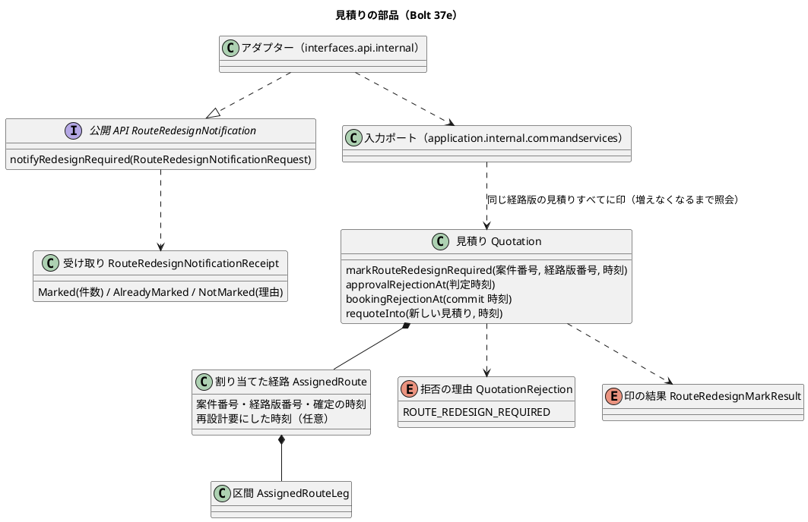
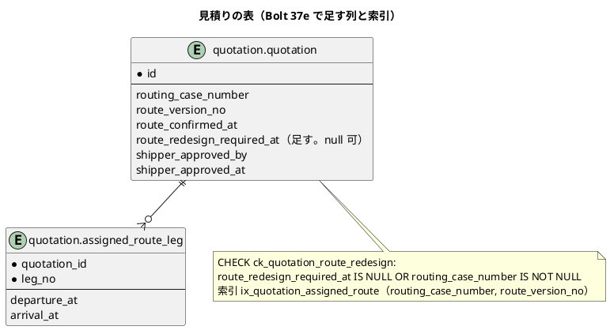

# Bolt 37e 計画 - US-07 AC5 の見積りの側（割り当てた経路の再設計要の印、荷主の承認と本予約の判定、見積りの公開 API）

## 基本情報

| 項目 | 内容 |
| :--- | :--- |
| Bolt | 第 37e 回（W6 の 8 本目） |
| 予定 | W6（2026-11-09 の週。前倒しで着手できる）。作業は約 3.9 時間（`check`・`uiTest`・SonarQube・CI の待ちを除く） |
| アプローチ | アウトサイドイン（受入シナリオを外側の Red にし、状態の組み合わせの表を先に書く。T-161・T-163）。緑にする順は集約 → 保存 → 公開 API（release_plan :763 の「受入シナリオ → 見積りの公開 API → 集約」と違うのは、公開 API の操作が集約の印の操作と経路版で引く照会を呼ぶだけなので、内側から緑にするほうが Red の理由を 1 つずつ確かめられるため） |
| 対象 | 見積りのドメイン: 割り当てた経路の再設計要の印（`AssignedRoute`・`Quotation`）、荷主の承認と本予約の判定（`approvalRejectionAt`・`bookingRejectionAt`）への再設計要、再見積り（`requoteInto`）での印の引き継ぎ、拒否の理由（`QuotationRejection`）。保存（`quotation.quotation` の列・CHECK・索引、経路版で見積りを引く照会）。見積りの公開 API の新しい操作（再設計要を伝える）と、本予約の照会の公開 API の理由。受入シナリオ `features/quotation/route_redesign_required.feature`（新規）とステップ定義 |
| GitHub | [#16](https://github.com/k2works/practical-domain-driven-design-in-enterpris-application/issues/16)（閉じるのは Bolt 37e3） |
| SP | 0（US-07 の 2 SP は Bolt 37e3 で数える） |
| 承認ゲート | 計画と終了報告。データベース（見積りの表に列・CHECK・索引を足すマイグレーション 1 つ。確認ポイント 1）。新しいファイル（マイグレーション、公開 API の型 3 つとアダプター、入力ポートと結果の型、受入シナリオの feature とステップ、テスト）。ADR-016 :33・:35 の文言の直し（構造の記録。確認ポイント 8）。認可・層の構造・環境変数は変えない |
| 分け方 | Bolt 37e の開始準備で、1 つの Bolt では 8 時間を超えると分かり、3 つに分けた（human:kakimomokuri）。37e は見積りの側の契約（印・判定・公開 API の理由）、37e2 は経路設計の DE-06 の listener と DE-05・DE-06 の届く順と本予約との競合の守り（ADR-016 :55）、37e3 は出発済みの判定（D-88）・予約の追従・画面の文言・ArchUnit の規則（#50）・マニュアル 4 章と 7 章・開発データの見本・#16 のクローズ |

## Bolt ゴール

経路設計が経路版を再設計要にしたことを、見積りの公開 API で見積りに伝えられるようにする。その経路版を割り当てた見積り（再見積りでできた新しい見積りを含む）に印を付け、荷主の承認（Q-INV-10）と本予約の確定（B-INV-05）を見積りの判定で拒否する。本番で印を付ける入口（DE-06 の listener）は Bolt 37e2 なので、この Bolt では利用者に見える振る舞いは変わらない。

### 確かめたい仮説

| # | 仮説 | この Bolt で分かること |
| :--- | :--- | :--- |
| H1 | 印を割り当てた経路の写し（`AssignedRoute`）の項目にすると、再見積り（`requoteInto`）が経路を写すだけで印も新しい見積りに写り、引き継ぎのコードを足さずに済む | 再見積りのテストと受入シナリオ |
| H2 | 拒否の理由を判定の順の後ろに 1 つ足しても、既存の拒否（置換済み・失効・承認済み・承認待ちでない・承認済みでない）の期待値は変わらない。印は本番の経路で付かないので、既存の画面の層のシナリオも変わらない | 既存の `check`・`uiTest` が緑のまま |

### 開始準備で確かめたこと

- **DE-05 の前例**（`routing/application/internal/eventhandlers/QuotationRouteAssignmentEventHandler.java:37`、`routing/application/internal/outboundservices/acl/QuotationRouteAssignments.java:31-46`）: 経路設計の listener（`@ApplicationModuleListener`）が ACL を通して見積りの公開 API `RouteAssignment.assign(RouteAssignmentRequest)`（`quotation/interfaces/api/RouteAssignment.java:16`）を呼ぶ。受け取りは sealed の `RouteAssignmentReceipt`（`Assigned`・`AlreadyAssigned`・`NotAssigned(理由の定数)`。不正な依頼は例外にせず `INVALID_REQUEST`。ADR-014 :42）。見積りの側は入力ポート `RouteAssignmentService`（:47-62。`@Transactional`、楽観ロックで競合すれば listener ごと戻して再配信でやり直す）。`assignRoute` は同じ経路版なら `ALREADY_ASSIGNED`（`isSameVersionAs`）
- **割り当てた経路**（`quotation/domain/model/valueobjects/AssignedRoute.java:18-43`）: 案件番号・経路版番号・確定の時刻・区間。内部の ID は持たない（D-4）。`isSameVersionAs` は案件番号と経路版番号で比べる。record なので等価に全項目が入る
- **荷主の承認**（`Quotation.java:430-446`）: `approvalRejectionAt` の順は 置換済み・失効の記録 → 承認済み → 期限切れ → 荷主承認待ちでない。Javadoc に「再設計要・旧版の経路版の判定は W6 で足す」。画面の操作の出し分け（C-04。`QuotationViews.java:109`）も同じ判定を使う
- **本予約の判定**（`Quotation.java:519-532`）: `bookingRejectionAt` の順は 置換済み・失効の記録 → 期限切れ → 承認済みでない。予約は公開 API `BookableQuotationQuery` で問い合わせる。理由は 見積りの集約の `QuotationRejection` → 見積りの照会の `BookableQuotation.Reason`（`BookableQuotationQueryService.reasonOf` :107-113。`default` で NOT_APPROVED）→ 公開 API の `BookableQuotationResult.NotBookable` の定数（アダプター `BookableQuotationQueryAdapter.reasonOf` :50-57 は網羅の switch）→ 予約の ACL `QuotationBookability.toUnavailability`（:55-62。`default` で NOT_APPROVED）→ `QuotationUnavailability` と通る
- **再見積り**（`Quotation.java:265-288`、`requoteRejectionAt` :488-501）: 旧版が経路を持つときだけ、経路・荷主の回答・経路方針を新しい見積りに写す。再見積りできるのは承認済みで期限切れの見積りだけ（荷主承認待ちは `ROUTING_REQUESTED`、承認済みで期限内は `APPROVED_AND_STILL_VALID` で拒否）。新しい見積りは経路を引き継いだ承認待ちで、提示すると荷主承認待ちに直行する（DE-24。ADR-018）。旧版と新しい見積りを 1 つのトランザクションで書く
- **保存**（`db/migration/common/V20261008100000__add_route_assignment_and_shipper_approval.sql`）: `quotation.quotation` の `routing_case_number`・`route_version_no`・`route_confirmed_at`、CHECK `ck_quotation_route_assigned`、区間の表 `assigned_route_leg`。（案件番号・経路版番号）の索引と、それで見積りを引く照会はない（`QuotationMapper.xml`）
- **拒否の理由で分岐する箇所**（T-175。値を 1 つ足す）: 網羅の switch は `StaffQuotationController.rejection`（:358-372。腕 9 本）と `QuotationResponseController.rejection`（:123-139）で、値を足すとコンパイルが落ちる。`default` で受けるのは `QuotationApprovalController.rejected`（:117-123）と `BookableQuotationQueryService.reasonOf`（:107-113）。if で分岐する箇所は `QuotationApprovalController` :114、`QuotationResponseController` :112、`StaffQuotationController` :120・:375・:384。どれも上限（10）に当たらない（網羅の switch は既存の「承認できない」の組に入れる）
- **開発データ**: 荷主承認待ちの見本と再設計要の見本はない（承認済み 2 件、承認の後に失効 1 件）。開発データの航海の出発は起動日の 5 日後（出発済みの判定を入れると、デモ環境を 5 日以上動かすと効く。D-88 を 37e3 に送る理由の 1 つ）

## 設計の決定（案）

| 項目 | 決めること | 根拠 |
| :--- | :--- | :--- |
| 印の持ち方 | 割り当てた経路の写し `AssignedRoute` に「再設計要にした時刻」（任意）を持たせる。印は経路版の事実の写しで、見積りの状態ではない（状態は変えない）。再見積りは経路を写すので印も写る。印のない写しを作る 4 引数のコンストラクターを残す（T-148）。冪等の判定は `isSameVersionAs` だけを使い、等価（record）は使わない（確認ポイント 1） | 確認ポイント 8（W6）、ADR-014 :75。H1 |
| 列と索引 | `quotation.quotation.route_redesign_required_at`（TIMESTAMP WITH TIME ZONE、null 可、`COMMENT ON COLUMN` 付き）、CHECK `ck_quotation_route_redesign`（印があれば経路の割当てがある）、索引 `ix_quotation_assigned_route`（`routing_case_number`・`route_version_no`）。区間の表は変えない（確認ポイント 1） | data_model の命名・コメントの規約 |
| 印を付ける操作 | `Quotation.markRouteRedesignRequired(案件番号, 経路版番号, 再設計要にした時刻)`。結果（`RouteRedesignMarkResult`）は「付けた・付いていた・経路がない・別の経路版」。付いていれば最初の時刻を残す（冪等） | ADR-014（冪等な操作）、`RouteAssignmentResult` の前例 |
| 印を付ける範囲 | 同じ（案件番号・経路版番号）を割り当てたすべての見積りに付ける。失効・置換済みにも付ける（判定には効かない。置換済み・失効の記録が先に返る。記録の一貫性のためで、再見積りの旧版から写すときに印を失わない）（確認ポイント 4） | 確認ポイント 8（W6） |
| 印を付ける順と再見積りとの競合 | 1 つのトランザクションで、照会で ID を引き、1 件ずつ読んで印を付けて保存し、もう一度照会して増えた ID があれば同じことを繰り返す（増えなくなるまで）。下の「届く順」の表のどの順でも、印のない新しい見積りが残らない。2 つ以上の見積り（集約）を 1 つのトランザクションで書くのは、同じ経路版の写しをそろえるためで、再見積り（旧版と新しい見積りを 1 つで書く）の前例と同じ例外にする（確認ポイント 4） | T-179、ADR-018 :29 |
| 荷主の承認の判定 | 置換済み・失効の記録 → 承認済み → 期限切れ → 荷主承認待ちでない → **再設計要**（`ROUTE_REDESIGN_REQUIRED`）。承認済みの見積りに印が付いても、承認の判定は承認済みのまま（二重送信の結果を誤らせない）（確認ポイント 2） | Q-INV-10 |
| 本予約の判定 | 置換済み・失効の記録 → 期限切れ → 承認済みでない → **再設計要**（確認ポイント 2） | B-INV-05、ADR-016 |
| 再見積り | 印のある見積りの再見積りの可否は今の判定のまま（承認済みで期限切れだけが再見積りできる）。新しい見積りに印が写り、提示しても荷主の承認で拒否される。承認済みで期限内の見積りに印が付くと、本予約は再設計要、再見積りは `APPROVED_AND_STILL_VALID` で、期限まで出口がない（担当者の相談と US-08 の再設計が出口。既知の制限として domain_model・US-07 に書く）（確認ポイント 3） | D-88 の「担当者で相談」と同じ扱い |
| 公開 API | 新しい操作 `quotation.interfaces.api.RouteRedesignNotification.notifyRedesignRequired(RouteRedesignNotificationRequest)`（案件番号・経路版番号・再設計要にした時刻）。受け取り `RouteRedesignNotificationReceipt`（sealed: `Marked(新しく付けた件数)`・`AlreadyMarked`・`NotMarked(理由の定数)`。理由は `QUOTATION_NOT_FOUND`・`INVALID_REQUEST`。不正な依頼は例外にせず理由で返す）。アダプターは `interfaces.api.internal`、入力ポートは `application.internal.commandservices`。呼ぶのは Bolt 37e2 の経路設計の listener（確認ポイント 5） | ADR-014 :41-42、`BookingNotification` の前例、公開 API の置き場所（CLAUDE.md） |
| 本予約の照会の公開 API の理由 | `BookableQuotation.Reason` と `BookableQuotationResult.NotBookable` に `ROUTE_REDESIGN_REQUIRED` を足し、`BookableQuotationQueryService.reasonOf` の `default` を明示の case にする（アダプターは網羅の switch なのでコンパイルで追従する）。予約の側（ACL と `QuotationUnavailability`、S-09・S-02 の文言）の追従は Bolt 37e3。印は 37e2 までは本番で付かず、37e2 から 37e3 までは予約の画面で「承認済みでない」と出るが拒否は保たれる（確認ポイント 6） | 契約を先に固める（分け方の決定） |
| 37e2 で契約が変わり得るもの | DE-06 が DE-05 より先に届くと、見積りはまだ経路を持たず `NotMarked(QUOTATION_NOT_FOUND)` になり、その後の DE-05 が印のない経路を割り当てる（Q-INV-10 の穴。37e2 で塞ぐ。経路設計の DE-05 の listener が経路版の今の状態を見て、再設計要なら印の時刻を載せて割り当てるなら `RouteAssignmentRequest` に項目が増える）。ADR-016 :55 で見積りの版を期待版として渡す案を採ると `Bookable` に項目が増える。どちらも 37e2 の確認ポイントにする（確認ポイント 7） | 横断の検証の指摘 |

### 届く順（印を付ける操作と再見積り。T-179）

| # | 順 | 結果 |
| :--- | :--- | :--- |
| A | 印を付ける操作が終わってから再見積り | 旧版に印 → 新しい見積りに写る |
| B | 再見積りが終わってから印を付ける操作 | 照会で旧版と新しい見積りの両方が当たり、両方に付ける |
| C | 印の照会が再見積りの前、旧版を読むのが再見積りの後 | 旧版は失効で読める → 付ける → 2 度目の照会で新しい見積りが当たり、付ける |
| D | 再見積りが旧版を読んだ後、印の操作が旧版を先に保存 | 再見積りの旧版の保存が楽観ロックで競合して戻る（やり直すと A） |
| E | 印の操作が旧版を読んだ後、再見積りが旧版を先に保存 | 印の操作の旧版の保存が競合して例外 → 37e2 の listener が再配信でやり直す（B） |

## ふりかえりと前の Bolt からの引き継ぎ

| Try・材料 | 内容 | この計画での扱い |
| :--- | :--- | :--- |
| T-178（Bolt 37d2） | 変異のスクリプトは、テストの実行が始まったこと（終了コードと結果の XML の更新）を確かめてから判定する | 変異のスクリプトは gradlew.bat を絶対パスで呼び、結果の XML と終了コードで判定する（確認ポイント 10） |
| T-179（Bolt 37d2） | 「今の情報から元の要素を探す」仕様は、元を作る側の作り方から区別できない形を数え上げてから決める | 経路版で見積りを引く照会は、再見積りの旧版と新しい版の両方が当たる。再見積りとの届く順を上の表で数え上げた |
| T-175・T-176・T-177 | switch を数える、コンストラクターの分岐を数える、`record` を変数名に使わない | 上の「拒否の理由で分岐する箇所」。`AssignedRoute` の検査を足すときは分岐を数える |
| T-161・T-163・T-173・T-174 | 状態の組み合わせの表と行ごとのテスト、直しのスクリプトは 1 本ずつ、振る舞いの直しはテストを先に | 下の表、ステップ 3〜5。単体テストの Red はコンパイルの失敗だけでなく期待の値の誤りでも見る（Bolt 37d2 の Problem） |
| T-106・T-119 | 「ないこと」の前に条件を確かめる、既存の時刻の前提を確かめる | 印は本番の経路で付かないので、既存の画面の層のシナリオの期待値は変わらないことを `uiTest` で確かめる（H2） |
| Bolt 37d2 の既知の課題 | 見積り・予約の側、DE-06 の listener、DE-05 の再配信、ADR-016 :35 の直し、S-07 の拒否の文言 | 見積りの側と ADR-016 :33・:35 の文言はこの Bolt。DE-06 の listener・DE-05 の再配信・ADR-016 :55 は 37e2。S-07 の文言と予約の追従・画面の文言は 37e3 |
| release_plan の確認ポイント 7・8・10（W6） | 再設計要の伝え方、再見積りの印、D-88 | 7・8 は設計の決定のとおり。10（D-88）は 37e3 に送る（確認ポイント 9）。DE-06 と本予約の確定の競合の守り方（ADR-016 :55）は 37e2 の確認ポイントにし、release_plan の宿題の送り先を直す |

## 状態の組み合わせ（T-161。行ごとにテストを 1 本置く。T-163）

| # | 見積り | 印 | 荷主の承認 | 本予約 |
| :--- | :--- | :--- | :--- | :--- |
| 1 | 荷主承認待ち | なし | できる | 承認済みでない |
| 2 | 荷主承認待ち | あり | 再設計要 | 承認済みでない |
| 3 | 承認済み | なし | 承認済み | できる |
| 4 | 承認済み | あり | 承認済み | 再設計要 |
| 5a | 荷主承認待ち、判定時刻に期限切れ | あり | 失効（期限切れを先に） | 失効 |
| 5b | 承認済み、判定時刻に期限切れ | あり | 承認済み（承認済みを先に） | 失効 |
| 6 | 置換済み・失効の記録 | あり | 置換済み・失効 | 置換済み・失効 |
| 7 | 経路を引き継いだ承認待ち（再見積りの後、提示の前） | あり | 荷主承認待ちでない | 承認済みでない（提示すると荷主承認待ちになり、行 2） |

| # | 印を付ける操作・再見積り | 結果 |
| :--- | :--- | :--- |
| 8 | 同じ経路版を割り当てた荷主承認待ち・承認済み | 付けた（時刻を写す） |
| 9 | もう一度（別の時刻で） | 付いていた（最初の時刻のまま） |
| 10 | 経路を割り当てていない（詳細設計依頼済み） | 経路がない（変えない） |
| 11 | 別の経路版を割り当てた | 別の経路版（変えない） |
| 12 | 失効・置換済みで同じ経路版 | 付けた |
| 13 | 承認済みで期限切れの印のある見積りを再見積りして提示 | 新しい見積りに印が写り、荷主の承認は再設計要 |
| 14 | 荷主承認待ち・承認済みで期限内の印のある見積りを再見積り | 今の理由（`ROUTING_REQUESTED`・`APPROVED_AND_STILL_VALID`）で拒否（期限内の承認済みは出口がない。US-08） |
| 15 | 再見積りの後に印を付ける（旧版と新しい版が同じ経路版） | 両方に付けた（`Marked(2)`） |
| 16 | 片方だけ付いていた | `Marked(1)` |
| 17 | その経路版を割り当てた見積りがない | `NotMarked(QUOTATION_NOT_FOUND)` |
| 18 | 不正な依頼（空の案件番号、経路版番号が 1 未満、時刻がない） | `NotMarked(INVALID_REQUEST)` |
| 19 | 印のある見積りに同じ経路版の DE-05 が再配信される | `ALREADY_ASSIGNED`（印は残る） |
| 20 | 詳細設計依頼済みに印が先に届き、後で DE-05 が届く | 37e の時点では印のない経路が割り当てられ承認できる（穴。37e2 で塞ぐ） |
| 21 | 本予約を確定した見積り（輸送要求が予約確定済み）に印 | 付けた。予約と輸送要求は変わらない（R-INV-07。予約を自動で取り消さない） |

## スコープ

### 入れるもの・入れないもの

| 入れるもの | 入れないもの（送り先） |
| :--- | :--- |
| 印（`AssignedRoute` の項目と列）、印を付ける操作、荷主の承認と本予約の判定（再設計要）、再見積りでの印の引き継ぎ、経路版で見積りを引く照会と索引、見積りの公開 API の新しい操作と入力ポート、本予約の照会の公開 API の理由、ADR-016 :33（拒否の理由の一覧）・:35（DE-06 の受け方を ADR-014 の形に）の文言 | 経路設計の DE-06 の listener と ACL、DE-05 が再設計要の後に届いたときの扱い（材料 6、行 20）、DE-06 と本予約の確定の競合の守り（ADR-016 :55）（37e2）。出発済みの判定（D-88）、予約の ACL と `QuotationUnavailability` の追従、C-17・C-04・S-09・S-02・S-07 の拒否の文言と出し分け、S-02 の予約の確定待ちから再設計要と出発済みを除くか、予約 → 見積りのドメインの型の ArchUnit の規則（#50）、画面の層のシナリオ、マニュアル 4 章・7 章、開発データの見本、#16 のクローズ（37e3）。再設計（新しい経路版）・再設計中の表示・旧版の経路版の判定（旧版は確定から直接移ることがあり印が付かない）（US-08） |

### 設計の約束

- **集約**: `AssignedRoute` に再設計要にした時刻（任意）と、印を付けた写しを返すメソッドと、印があるかを足す（4 引数のコンストラクターは残す）。`isSameVersionAs` は印を見ない。`Quotation.markRouteRedesignRequired` と判定 2 つの拡張。判定はメソッドに分けて書く（T-176）
- **拒否の理由**: `QuotationRejection` に `ROUTE_REDESIGN_REQUIRED` を足す。網羅の switch 2 つには、今の「承認できない」の既定の文言の組に case を足す（言い分けは 37e3）
- **保存**: マイグレーション `common/V20261023100000__add_quotation_route_redesign_required.sql`（列・コメント・CHECK・索引）。`QuotationMapper` の更新と読み戻しに列を足し、（案件番号・経路版番号）で見積りの ID を引く照会を足す
- **公開 API と入力ポート**: 上の「印を付ける順」のとおり。イベントは出さない（DE-06 の写しで足りる。荷主への通知は US-08）。楽観ロックで競合したら例外にする（37e2 の listener が戻して再配信でやり直す。DE-05 の前例）
- **テストの置き場所**: 集約は見積りの集約のテストの近く、保存は見積りの MyBatis の統合テスト、入力ポートは受入テストのメモリ上のリポジトリでの単体テスト（届く順の C・E は保存の後に版を進めて起こす）、公開 API はアダプターのテスト、受入シナリオは業務ルール層

## 設計（この Bolt の範囲）

画面遷移は変えないので省く（画面の操作の出し分けも、印が本番の経路で付かないので変わらない。文言は 37e3）。

## ステップ計画

各ステップの終わりに対象のテストを流し、最後に `check` と `uiTest` を流して XML の結果から件数を数える（T-151）。コミットは pathspec で行い（T-110）、push してアプリの CI を確かめる（T-26）。

- [ ] **1. 設計の文書と数え上げ**: domain_model（Bolt 37e で決めたこと、用語集の「割り当てた経路」:117 に再設計要にした時刻、Q-INV-10 :553・B-INV-05 :878 の判定の順と旧版の扱い、DE-06 の行 :1493 の「経路設計案件 ID」を「案件番号」に、:785 の「37e で決める」を「37e2」に、状態遷移の注、期限内の承認済みの出口がないこと、`RouteRedesignMarkResult` の用語の行）、data_model（列・CHECK・索引）、US-07（:346 の「予約は取り消さない」の確かめの場所）・US-24 の注、system_usecase（UC-04 の拡張 3a :448、状態と操作の表 :599）、test_strategy（:242 B-INV-05、:561 US-07 AC5 の 37e・37e2・37e3 の分担）、ADR-014 :43（DE-06 の適用先の API の名前）、ADR-016 :33・:35 の文言、ADR-018 への影響の確かめ（印は見積りの状態を変えないので `QuotationGate` の守りは崩れない）、release_plan の W6 節の 37e の行を 37e・37e2・37e3 に分け、確認ポイント 7 の宿題（ADR-016 :55）と 10（D-88）の送り先を直す（完了の判定: 文書の差分）
- [ ] **2. 受入シナリオ（Red）**: `features/quotation/route_redesign_required.feature`（`@US-07 @must`）に、経路版を割り当てた見積りに再設計要が伝わると、(a) 荷主の承認が再設計要で拒否される（`@US-07-AC5 @US-24-AC5 @Q-INV-10`）、(b) 承認済みの見積りの本予約の照会が再設計要で拒否される（`@US-07-AC5 @B-INV-05`）、(c) もう一度伝わっても印の時刻は最初のまま（`@US-07-AC5`）、(d) 承認の後に失効した印のある見積りを再見積りして提示すると、新しい見積りの承認も再設計要で拒否される（`@US-07-AC5 @D-85`）、(e) 本予約を確定した見積りに伝わっても、予約と輸送要求は変わらない（`@US-07-AC4 @R-INV-07`）。ステップ定義: 公開 API で再設計要を伝える、本予約の照会。落ちる理由が「再設計要を伝える操作がない」であることを確かめる（完了の判定: 足したシナリオが期待した理由で落ちる）
- [ ] **3. 集約（Green）**: 状態の組み合わせの表の集約の行（1〜14、19）ごとにテストを 1 本足して Red を見てから（期待の値の誤りで落ちる Red も見る）、`AssignedRoute` の項目、印を付ける操作、判定 2 つ、拒否の理由と switch の case を作る（H1・H2）（完了の判定: 単体テストが緑、既存のテストの期待値は変わらない）
- [ ] **4. 保存とスキーマ（データベース）**: 見積りの統合テストに、印の往復、CHECK の違反、経路版で見積りを引く照会（旧版と新しい版の両方が当たり、別の経路版は当たらない）を足して Red を見てから、マイグレーションと mapper を作る。ローカルの dev（ポート 8091。H2）でマイグレーションが流れて起動し、見本の承認済みの見積りの C-04・S-09 が変わらないことを確かめる（T-172）（完了の判定: 統合テストが緑）
- [ ] **5. 公開 API と入力ポート（Green）**: 入力ポートのテスト（行 15〜18、20 の 37e の時点の結果、21、届く順の C・E）、アダプターのテスト、本予約の照会の公開 API の理由のテストを書いて Red を見てから作る（完了の判定: 受入シナリオとテストが緑）
- [ ] **6. 品質ゲートと開発レビューと終了報告**: 変異（確認ポイント 10）を当て、落ちたテストを XML で確かめる。`check`・`uiTest`・SonarQube（ほかの Gradle が終わってから。T-147）、開発レビュー、push して CI と MkDocs とデモ環境の配備（マイグレーションが H2 で流れる）を確かめる。#16 にコメントを残す。終了報告で release_plan・開発の索引・mkdocs を完了に直す

### 時間の配分と打ち切り

| # | 目安 | 打ち切り |
| :--- | :--- | :--- |
| 1 | 45 分 | ADR-018 の届く順の守りが印で崩れると分かったら止めて諮る |
| 2 | 30 分 | — |
| 3 | 55 分 | 既存のテストの期待値が変わると分かったら止めて範囲を諮る（H2） |
| 4 | 40 分 | 区間の表も変える必要が出たら止める（データベースの承認ゲート） |
| 5 | 35 分 | 層の規則（ArchUnit・`PublicApiArchitectureTest`）が新しい型の置き場所を拒否したら、置き場所を動かさずに止めて諮る（CLAUDE.md） |
| 6 | 30 分（`check`・`uiTest`・SonarQube・CI の待ちを除く） | — |

合計 235 分（約 3.9 時間）。

## 確認ポイント（計画の承認の場でまとめて確認する。Try T-6）

| # | 確認すること | 場所 | 推奨 |
| :--- | :--- | :--- | :--- |
| 1 | **印の持ち方と列（データベース）** | ステップ 3・4 | `AssignedRoute` に「再設計要にした時刻」を持たせ、`quotation.quotation.route_redesign_required_at`・CHECK `ck_quotation_route_redesign`・索引 `ix_quotation_assigned_route` を足す。理由の区分は写さない（経路設計の再設計要の記録と DE-06 にある。見積りの判定は印の有無だけで決まる） |
| 2 | **拒否の理由と判定の順** | ステップ 3 | `ROUTE_REDESIGN_REQUIRED` を足し、既存の判定の後ろに置く。承認済みの見積りの承認の判定は承認済みのまま。期限切れが先 |
| 3 | **再見積りと出口のない見積り** | ステップ 3 | 再見積りの可否は変えない。印は新しい見積りに写る。承認済みで期限内の見積りに印が付くと期限まで出口がない（担当者の相談と US-08）。既知の制限として書く |
| 4 | **印を付ける範囲と順** | ステップ 3〜5 | 同じ（案件番号・経路版番号）を割り当てたすべての見積り（失効・置換済みを含む）に付け、付いていれば最初の時刻を残す。照会し直して増えなくなるまで繰り返し、再見積りとの届く順（表の A〜E）のどれでも印のない新しい見積りを残さない。複数の見積りを 1 つのトランザクションで書くのは再見積りの前例と同じ例外 |
| 5 | **公開 API の形** | ステップ 5 | `RouteRedesignNotification.notifyRedesignRequired(RouteRedesignNotificationRequest)`、受け取りは `Marked(新しく付けた件数)`・`AlreadyMarked`・`NotMarked(QUOTATION_NOT_FOUND / INVALID_REQUEST)`。見積りは経路設計の案件 ID を持たないので案件番号で引く（D-4）。競合は例外にして 37e2 の listener が再配信でやり直す |
| 6 | **本予約の照会の公開 API の理由** | ステップ 5 | `BookableQuotation.Reason`・`NotBookable` に `ROUTE_REDESIGN_REQUIRED` を足し、見積りの側の `default` を明示の case にする。予約の側の追従は 37e3（37e2 から 37e3 までは予約の画面が「承認済みでない」と出すが拒否は保たれる） |
| 7 | **37e2 で契約が変わり得ること** | — | DE-06 が DE-05 より先に届く穴（行 20）と、ADR-016 :55 の守り方は 37e2 で決める。そのとき `RouteAssignmentRequest` か `Bookable` に項目が増えることがあり得る。37e2 で listener をつなぐと印が本番で付き、C-04 の承認の操作が消えて C-17 が既定の文言で拒否するので、37e2 の計画で画面の文言とマニュアルを 37e2 に入れるか、listener を 37e3 の後に回すかを決める（振る舞いが変わる Bolt はマニュアルを完了条件に入れる） |
| 8 | **ADR-016 の文言（構造の記録）** | ステップ 1 | :33 の拒否の理由の一覧に再設計要を足し、:35 の「見積りの側が DE-06 を受けて」を ADR-014 の形（経路設計の中の listener が DE-06 を受けて見積りの公開 API を呼ぶ）に直す。:55 の守り方は 37e2 |
| 9 | **出発済みの判定（D-88）を 37e3 に送る**（W6 の確認ポイント 10 の送り先の変更） | ステップ 1 | 出発済みは印と違って時刻だけで効き、37e の配備で本番の C-04・C-17・S-09 に出る（S-09 は予約の ACL の `default` で「承認済みでない」と誤って出る）。画面の文言・予約の追従・マニュアルと同じ 37e3 に入れる |
| 10 | **デモと変異** | ステップ 6 | 画面を変えないので、デモの動画・キャプチャは撮らない（W6 のデモ項目「再設計要の経路の拒否」は 37e3）。変異は 6 つ: 印があっても承認する、印があっても本予約できる、再見積りで印を写さない（写しのコンストラクターで落とす）、2 度目に印の時刻を上書きする、別の経路版の見積りにも印を付ける、照会し直さない。スクリプトは gradlew.bat を絶対パスで呼び、結果の XML と終了コードで判定する（T-178） |

## 完了条件

- 状態の組み合わせの表の行ごとのテストと受入シナリオが緑で、既存のテストの期待値が変わらない
- マイグレーションが PostgreSQL（統合テスト）と H2（dev とデモ環境）で流れる
- `check`・`uiTest`・SonarQube の品質ゲート・CI が緑、変異が落ちる
- 設計の文書（domain_model・data_model・US-07・US-24・system_usecase・test_strategy・ADR-014・ADR-016・release_plan）が実装と合う
- 終了報告を作り、人の承認を受ける

## 更新履歴

| 日付 | 更新内容 | 更新者 |
| :--- | :--- | :--- |
| 2026-10-22 | 整合性検証の指摘を反映した（承認待ち）。出発済みの判定（D-88）を 37e3 に送り、印を付ける操作と再見積りの届く順の表と照会し直す手順を足した。公開 API の名前と受け取りを前例にそろえた。状態の組み合わせの表の行 5 を分け、再見積りの前後・期限内の承認済み・DE-05 の再配信と先に届く穴・本予約の後の行を足した。数え上げ、直す文書、索引とコメント、アプローチ、打ち切りを直した | anthropic/claude-opus-5-5 |
| 2026-10-22 | 初版作成（承認待ち）。Bolt 37e を 3 つに分けた（human:kakimomokuri） | anthropic/claude-opus-5-5、分け方の決定 human:kakimomokuri |

## 関連ドキュメント

- [リリース計画](release_plan.md)（W6 節の確認ポイント 7・8・10、37e の行）
- [Bolt 37d2 終了報告](bolt_37d2_report.md)（既知の課題）、[Bolt 37d 計画](bolt_37d_plan.md)（材料 6）
- [ドメインモデル](../../design/cargo-tracker/domain_model.md)、[データモデル](../../design/cargo-tracker/data_model.md)
- [ADR-014](../../adr/cargo-tracker/014-downstream-to-upstream-notification.md)、[ADR-016](../../adr/cargo-tracker/016-booking-checks-quotation-at-commit-time.md)、[ADR-018](../../adr/cargo-tracker/018-requote-returns-transport-request-with-ordering-guard.md)
