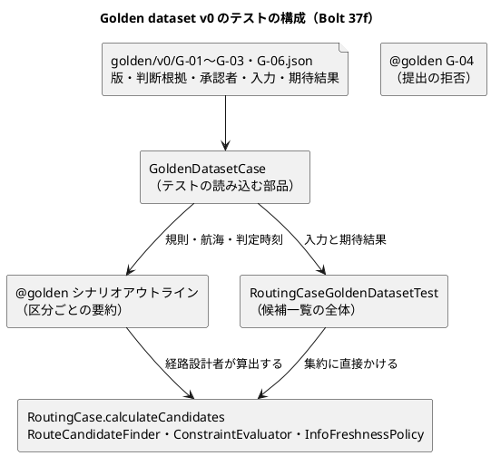

# Bolt 37f 計画 - US-06 の Golden dataset v0 と #15 のクローズ

## 基本情報

| 項目 | 内容 |
| :--- | :--- |
| Bolt | 第 37f 回（W6 の 15 本目） |
| 予定 | W6（2026-11-09 の週。前倒しで着手できる）。作業は約 5.0 時間（`check`・`uiTest`・SonarQube・CI の待ちを除く。確認ポイント 10） |
| アプローチ | アウトサイドイン（受入シナリオから。開発戦略 :107 の中盤の例外、:346。集約の単位のテストは受入シナリオと同じ案件のデータを使う） |
| 対象 | US-06 の Golden dataset v0（仮の値。業務責任者の承認待ち）: G-01〜G-03・G-06 を `@golden` のシナリオアウトラインと集約の単位のテストで、G-04 を提出の拒否の業務ルール層のシナリオで示す。CI の `ui` の段の上限を 30 分にする。US-06 の受入条件の照合、#15 のクローズと US-06 の 5 SP、bolt-37b2 の動画の #15 への添付 |
| GitHub | [#15](https://github.com/k2works/practical-domain-driven-design-in-enterpris-application/issues/15)（この Bolt で閉じる）、[#50](https://github.com/k2works/practical-domain-driven-design-in-enterpris-application/issues/50)（US-06 の画面の支援技術による手動確認と、「区間」・背景の写しの送り先を載せる） |
| SP | 5（US-06 の残り。W6 の目標 12 SP の一部） |
| 承認ゲート | 計画と終了報告。新しいファイル（Golden の feature 2 つ、案件のデータ 4 つ、案件のデータを読む部品、集約の単位のテスト）。CI の設定（`ui` の段の `timeout-minutes`。確認ポイント 7）。前の決定の変更（W6 の確認ポイント 11 の G-04。確認ポイント 6）。GitHub（#15 のクローズ、#50 への追記、動画の添付）。スキーマ・認可・環境変数・本体の振る舞い・画面・マニュアル・開発データは変えない |
| 開始準備で決めたこと | 2026-10-24、human:kakimomokuri: (1) 37f を分け、37f は Golden dataset v0 と #15 のクローズ（5 SP）、37f2 は受入シナリオの背景の写しの整理（0 SP。Golden の feature も含める。#50）にする、(2) G-04（特殊貨物）は提出の拒否で示す（経路設計に新しい止めを足さない。判定 `CARGO_NOT_SUPPORTED` は W7 のまま。W6 の確認ポイント 11 の「算出の前に止める」を変える）、(3) CI の `ui` の段の上限を 20 分から 30 分に上げる（37f に入れる）、(4)「区間」は社内の語にする。荷主の画面の `aria-label` とマニュアル 4・5 章を「航海」に直す Bolt 37f3（0 SP）を 38 の前に置く |

## Bolt ゴール

経路設計の制約適合判定（BR-11）が、代表案件の Golden dataset v0（仮の値）の期待結果と一致することを、受入シナリオと集約の単位のテストで示す。US-06 の受入条件の照合をそろえて #15 を閉じ、US-06 の 5 SP を数える。

### 確かめたい仮説

| # | 仮説 | この Bolt で分かること |
| :--- | :--- | :--- |
| H1 | 代表案件を案件のデータ（入力と期待結果）として 1 か所に置けば、受入シナリオ（区分ごとの要約）と集約の単位のテスト（候補一覧の全体）が同じデータで判定を確かめられる | `@golden` のシナリオアウトライン、集約の単位のテスト |
| H2 | 今の判定（Bolt 17・37・37b2）は、G-01〜G-03・G-06 の v0 の期待結果のまま変えずに済む | 本体のコードを変えずに緑になるか |

### 開始準備で確かめたこと

- **W6 の決定**（release_plan :716・:732 の確認ポイント 11）: G-01〜G-06 の仮の値で「Golden dataset v0（業務責任者の承認待ち）」を作り、#15 を閉じる。G-01〜G-03 は今の振る舞いで期待値を書く。G-04 は「算出の前に止める業務ルール層のシナリオ（US-04 AC5 の前例）」（開始準備の決定 (2) で提出の拒否に変える）。G-05 は v0 に入れない（US-08、W13）。G-06 は「古さ」だけ（欠落・矛盾は W7 の US-14）。DM-05（必要最小接続時間）も仮の値。TST-02 はパイロットの開始の条件として台帳に残す（:834・:904）。:716 の反映先「Bolt の表 :762」は今は :770
- **テスト戦略**（test_strategy :195-220）: `@golden` のシナリオアウトラインで、期待候補・除外候補・除外理由を例の列にし、データの版を Feature の説明に書く。置き場所は `features/routing/golden/`（:137、release_plan :745）。今の例は 6 区分のまま、ステップの文（「Golden dataset の案件 … を読み込む」「候補を算出する」）と理由（`CONNECTION_TOO_SHORT` などのコード）が今のステップ（日本語の理由。`RoutingSteps.java:43-47`）と違う（ステップ 1 で直す）。要件定義の Golden dataset（requirements_definition :793-805）は、案件ごとに入力・期待候補・除外候補・判断根拠・規制資料・承認者・適用期間を持つ
- **判定の事実**:
  - 並びは集約が決める（`RoutingCase.java:194` の `PRESENTATION_ORDER`、:406-411）。適合を先に、到着予定の早い順、同時刻は航海番号を「,」でつないだ文字列の順。上限は 20 件（:48・:197）。候補探索（`RouteCandidateFinder.java:30-46`）の並びは集約が並べ直す
  - 区間は 3 つ（積替え 2 回）まで（`RouteCandidateFinder.java:17・28`）
  - 接続余裕は接続ごとの「接続時間 − 必要最小接続時間」の最小（`ConstraintEvaluator.java:46-55`）。直行は空、ちょうどは `PT0S`、規則のない港の接続は「接続できない」（:42-44）。規則が重なると厳しい方（:67-70）
  - 同時刻・同値: 期限は同時刻で適合（:59 の `isAfter`）、接続は同値で適合（:52 の `isNegative`）、情報鮮度は取得 + 24 時間と同時刻で足りる（`InfoFreshnessPolicy.java:34`。理由は古い航海ごとに区間の順。:42-47）
- **今のシナリオとステップ**: `@golden` は 0 件。`RunCucumberTest` は `features` 配下をすべて拾い、`not @wip and not @ui`（`golden/` は `test` で動き、CI の `ui` の段に載らない）。背景の「荷主が必須条件をそろえた輸送条件を入力している」（`TransportRequestSteps.java:113-124`）は JPTYO → NLRTM、希望到着期限 2026-11-02T00:00Z、一般貨物を決め打ちし、`route_candidates.feature:20` は SGSIN 8 時間の規則を入れる。「次の航海がある」（`RoutingSteps.java:88-101`）は寄港 2 つで、取得時刻の列は省略でき既定は 2026-10-07T01:00Z（:42）。「港 … の必要最小接続時間は … 時間である」（:66）の適用開始は 2026-01-01。「経路設計者が案件の候補を算出する」（:112）の判定時刻は時計。「候補は次のとおりである」（:130）はデータの表で受けるので、例の表の 1 行の要約には使えない。「経路設計案件が {int} 件あり…」（:103-110）は 0 件で例外になる
- **G-04**: 経路設計は貨物種別で判定しない（`RouteSpecification.java:14`。`CARGO_NOT_SUPPORTED` の判定は W7。domain_model :819）。特殊貨物の輸送条件は提出で拒まれる（`quotation/submit_transport_request.feature:127-139`、`@US-01-AC4`。`MvpAcceptancePolicy`）。そのステップ（「荷主が "貨物種別" を … に変える」「提出は受け付けられず輸送要求は作られない」「"貨物種別" に誤り "MVP の対象外" が示される」）はグルーの範囲にあり、背景のない feature から使える（`ScenarioReset` が初期状態に戻す）
- **集約の単位のテスト**（Bolt 17 の開発レビュー D-65、`bolt_17_report.md:131`）: 候補の並びと上限は集約にあるので、Golden dataset が候補一覧を期待値に持つなら集約の単位のテストが要る。並びと 20 件の上限の一般の単体テストは `RoutingCaseTest`（:56・:82・:107・:146）。組み立ては `RoutingCase.open(...)` と `calculateCandidates(voyages, rules, judgedAt, new RouteCandidateFinder(), new ConstraintEvaluator(), new InfoFreshnessPolicy(Duration.ofHours(24)))`（`RoutingCase.java:176-182`、`RoutingCaseTest.open()` :283-296）。JSON はテストで Jackson 3（`tools.jackson.databind`。`MailpitClient.java:17-18`）。ArchUnit はテストを読み込まない（`DoNotIncludeTests`）。`AcceptanceStepArchitectureTest` は自分のコンテキストのステップの依存を許す
- **#15**: OPEN、Project の Status は In Progress。本文の AC4 と DoD 5 項目は未チェック。補足は「Golden dataset の 6 区分（TST-02）を `@golden` で検証」と「1 つだけ不足する接続と、規則の有効期間の境界」（後者は Bolt 37 の `route_candidates.feature:107・128・147` で満たした）。W6 のコメントは「G-04 は算出の前に止める」。US-06 で画面を変えた Bolt は 37（S-06・S-07 の文言）と 37b2（S-06 の情報不足、axe、動画）で、支援技術による手動確認の記録はない。#16 は手動確認を #50 に載せてから閉じ、Project の Status を Done にした（Bolt 37e4c の前例）
- **動画**: bolt-37b2 の `info-insufficient.webm` は #15 に未添付（Bolt 37e4c の計画 :64・:106 で 37f に送った）。`BOLT_ISSUES` と添付先の表（`docs/operation/cargo-tracker/index.md:67`）に bolt-37b2 はない。37f は画面を変えないので動画は撮らない（開発戦略 :141・:185、release_plan :787 の動画を撮る Bolt の一覧に 37f はない）。`bolt_37b_plan.md:154` の「デモの 3 区間は Bolt 37f の Golden で示す」は、動画ではなく `@golden` のシナリオ（G-01 の 3 区間の候補）で示すと読み替える（確認ポイント 8）
- **CI の `ui` の段**: `.github/workflows/cargo-tracker-ci.yml:107` の `timeout-minutes: 20`（`check` :45 と `deploy-demo` :154 は変えない）。W6 の 5 回で 15〜19 分、Bolt 37e4c で 1 回時間切れ。テスト戦略 :446-450 は画面の層を「10 分以内。超えたら下のレベルへ移せないか見直す」とし、`application_development_setup.md:101` は uiTest を「約 2 分」と書く（どちらも今と合わない）。ADR は要らない（アーキテクチャの決定ではない）
- **用語集**: domain_model の用語集に Golden dataset の行はない（:775 のサービスの説明にだけ出る）。`LivingGlossaryConsistencyTest` は本体の型だけを見るので、行を足しても落ちない。release_plan :785 は用語集の整合の対象に Golden dataset を挙げる
- **37f を分けたときに直す release_plan の行**: :770（37f の行）、:779（順序「37〜37f」）、:783（背景の写し「37f」）、:789（マニュアルの注）、:794（「Bolt 36〜37f」）。前例は 37e3・37e4 を分けた書き方（:765・:767）

## 設計の決定（案）

| 項目 | 決定 | 根拠 |
| :--- | :--- | :--- |
| 案件のデータ | 区分ごとに 1 つの JSON（`src/test/resources/golden/v0/G-01.json`〜`G-03.json`・`G-06.json`）。項目: `version`（「v0（仮の値。業務責任者の承認待ち。TST-02）」）、判断根拠（BR-11・D-89・D-90）、規制資料（なし）、承認者（未承認。TST-02）、適用期間（v0 は仮）、入力（輸送条件の積地・揚地・希望到着期限・貨物種別、必要最小接続時間の規則、航海と取得時刻、判定時刻）、期待結果（候補一覧: 航海の並び、判定、到着予定、接続余裕、除外の理由） | 開始準備で確かめたこと、requirements_definition :804、確認ポイント 3 |
| 背景と案件のデータの役割 | 輸送条件は背景が決め打ちする値（JPTYO → NLRTM、2026-11-02T00:00Z、一般貨物）に案件のデータをそろえ、読み込むステップは値を入れずに案件の条件と一致することを確かめる。必要最小接続時間の規則と航海は案件のデータだけから入れる（写す背景から SGSIN の規則の行と最後の時刻の行を外す）。判定時刻は 2026-10-07T03:00Z（背景の最後の時刻より後。`RoutingCaseTest.java:35` と同じ） | 詳細整合性検証・横断整合性検証の高の指摘 |
| 読み込む部品 | テストの `routing.domain.model.aggregates` に `GoldenDatasetCase`（JSON を読む部品と型。`RoutingCaseFixture` の隣）を 1 つ置き、受入のステップと集約の単位のテストで共有する | 横断整合性検証 |
| `@golden` のシナリオアウトライン | `features/routing/golden/route_candidates_golden_v0.feature`（Feature に `@US-06 @golden @BR-11`）。背景は `route_candidates.feature:11-19`（詳細経路設計の依頼の配信まで）の写し（37f2 でまとめる）。ステップ: 「Golden dataset v0 の案件 "<案件>" の規則と航海を読み込む」（案件の条件の一致も確かめる）、「現在時刻を案件の判定時刻にする」、既存の「経路設計者が案件の候補を算出する」、「適合候補は "<適合候補>" である」、「除外候補と理由は "<除外>" である」。新しいステップは `RoutingSteps` に足す（算出の結果を持つため）。Feature の説明に版と、G-04・G-05 の扱いを書く | test_strategy :195-220、開始準備の決定 (2) |
| 例の表の区分 | G-01 標準（直行・積替え 1 回・積替え 2 回の 3 区間。適合 1,2,3、除外なし）、G-02 接続時間の境界（ちょうどの候補と 1 分足りない候補。適合 1,2、3: 接続不足）、G-03 期限超過を含む（同時刻の候補と 1 分過ぎる候補。適合 1、2: 期限超過）、G-06 外部データの古さ（取得から 24 時間を過ぎた航海。適合なし、全候補: 情報不足）。理由は日本語（「接続不足」「期限超過」「情報不足」）。値は今の判定で決まる仮の値 | 確認ポイント 2 |
| G-04 | `features/routing/golden/special_cargo_golden_v0.feature`（Feature に `@US-06 @golden`、シナリオに `@Q-INV-02 @BR-03`。US-01 AC4 との関係は Feature の説明に書く）。背景なし。流れ: 輸送条件を入力 → 貨物種別を特殊貨物（危険物・冷凍・その他特殊の例）に変える → 提出 → 受け付けられず輸送要求は作られない → 「MVP の対象外」が示される → イベントを配信する → 経路設計案件はない（新しいステップ「経路設計案件はない」を `RoutingSteps` に足す） | 開始準備の決定 (2)、T-106・T-119 |
| 集約の単位のテスト | `routing/domain/model/aggregates/RoutingCaseGoldenDatasetTest`（JUnit のパラメーター化。案件のデータごとに 1 件）。案件のデータから `RoutingCase` を組み立て、`calculateCandidates` の候補一覧（並び、判定、到着予定、接続余裕、理由）を期待結果と比べる。期待結果は案件のデータの 1 か所に置き、受入シナリオ（要約）と粒度を分ける | D-65、確認ポイント 4 |
| Red の扱い | G-01〜G-03・G-06 は今の判定で通る見込み（H2）。TDD の値の Red として、読み込みを空の操作で先に作り、期待した理由で落ちることを確かめてから中身を作る。区分ごとの落ちる理由: G-01〜G-03 は適合候補が期待と違う（候補なし）、G-06 は除外候補の確かめで落ちる（適合 0 件は空でも成り立つ）、集約の単位のテストは案件のデータが 0 件で JUnit の前提で落ちる。判定の誤りを落とせることは変異で確かめる（確認ポイント 9） | TDD の三原則、T-174 |
| CI の上限 | `ui` の段の `timeout-minutes` を 30 にする。test_strategy :450 の後に注（`ui` ジョブは 15〜19 分で目標の 10 分を超える。37f で上限を 30 分にした。25 分を超えたら分けて並べることを諮る）、`application_development_setup.md:101` の「約 2 分」を今の時間に直す | 開始準備の決定 (3) |
| 用語集 | domain_model の用語集に「Golden dataset｜代表案件と期待結果（判断根拠・承認者・版つき）。v0 は仮の値で業務責任者の承認待ち｜経路設計」を足す（release_plan :785 とそろえる） | 横断整合性検証 |
| #15 を閉じる | 終了報告の承認の後に、US-06 の画面（37 の S-06・S-07、37b2 の S-06）の支援技術による手動確認を #50 に載せ、bolt-37b2 の動画を #15 に添付し（試しの実行の後）、`BOLT_ISSUES` と添付先の表に bolt-37b2 → #15 を足し、#15 の AC と DoD のチェックを入れて閉じ、Project の Status を Done にする。閉じるコメントに、補足の 6 区分を v0 の区分（G-04 は提出の拒否、G-05 は US-08、G-06 は古さだけ）に読み替えたこと、G-04 を「算出の前に止める」から「提出の拒否」に変えたこと、補足の 2 行目は Bolt 37 で満たしたこと、Release 1.0 の外に残るもの（G-05 は US-08、G-06 の欠落・矛盾は US-14・W7、`CARGO_NOT_SUPPORTED` は W7、TST-02 の差し替え）を書く | Bolt 37e4c の前例 |

## ふりかえりと前の Bolt からの引き継ぎ

| 出典 | 内容 | この Bolt での扱い |
| :--- | :--- | :--- |
| Bolt 37e4c Try T-193 | 届く順を確かめるシナリオは、届いたことそのものを確かめる段を置く | 配信の順を確かめないので当てはまらない |
| Bolt 37e4c Try T-194 | 統合テストで確かめる値を書くときは、その値を決める部品と前提のデータを書く | 期待結果を決める部品（`RouteCandidateFinder`・`ConstraintEvaluator`・`InfoFreshnessPolicy`・`RoutingCase` の並びと上限）と前提のデータ（規則・航海・取得時刻・判定時刻・背景の輸送条件）を、開始準備で確かめたことと案件のデータに書いた |
| Bolt 37e4c の既知の課題 | CI の `ui` の段の上限、「区間」の扱い | 開始準備の決定 (3)・(4) |
| Bolt 37e3 Try T-186 | 計画の変異を替えずに、落とせるテストを足してから当てる | 確認ポイント 9 の変異を替えない |
| Bolt 37e3b Try T-187 | 変異で全件が落ちたら、当てた変異を見直す | 変異の表に、Golden で落ちる見込みと既存で落ちるテストを分けて書く |
| W5 の Try T-148・T-152 | 写しや共通の部品を変えるときは、全体を検索して数えてから変える | 背景の写しが 1 つ増える（Golden の feature）。数えて 37f2 に渡す |
| W5 の Try T-106・T-119 | 「ないこと」を確かめる前に、対象があることを確かめる | G-04 は提出が拒まれたこと（理由）を先に確かめ、イベントの配信を通してから案件がないことを確かめる |
| T-164・T-178 | 変異はスクリプトで当て、結果は XML で判定する | 確認ポイント 9 |
| T-182 | 状態の組み合わせの表に出口の列を置く | 下の表 |
| Bolt 17 の開発レビュー D-65 | Golden dataset の集約の単位のテスト | 集約の単位のテストを足す |
| Bolt 37b の計画 :154 | デモの 3 区間は 37f の Golden で示す | G-01 に 3 区間の候補を 1 つ入れ、`@golden` のシナリオで示す（動画は撮らない。確認ポイント 8） |
| T-174 | レビューで足す変更もテストを先に書く | 開発レビューの直しもテストを先に書く |

## 状態の組み合わせ（行ごとにテストを 1 本。出口の列。T-182）

| 行 | 区分 | 入力 | 期待結果 | 確かめ方 | 出口 |
| :--- | :--- | :--- | :--- | :--- | :--- |
| 1 | G-01 標準 | 直行・積替え 1 回・積替え 2 回（3 区間） | 適合 1,2,3。並びは適合を先に、到着予定の早い順、同時刻は航海番号の順 | シナリオアウトラインの行、集約の単位のテスト | 経路設計者が選ぶ |
| 2 | G-02 接続時間の境界 | 接続余裕がちょうどの候補と 1 分足りない候補 | ちょうどは適合（`PT0S`）、足りない候補は接続不足 | 同上 | 同上 |
| 3 | G-03 期限超過を含む | 到着が期限と同時刻の候補と 1 分過ぎる候補 | 同時刻は適合、過ぎる候補は期限超過 | 同上 | 同上 |
| 4 | G-06 外部データの古さ | 取得から 24 時間を過ぎた航海 | 全候補が情報不足 | 同上 | 航海の情報を取り直す（W7） |
| 5 | G-04 特殊貨物 | 特殊貨物の輸送条件 | 提出で拒まれ「MVP の対象外」、経路設計の案件はできない | 業務ルール層のシナリオ | 特殊貨物は MVP の対象外 |

## スコープ

### 入れるもの

- 上の表の行 1〜5 のシナリオとテスト、案件のデータ 4 つ、読み込む部品、ステップ、集約の単位のテスト
- CI の `ui` の段の上限を 30 分にする（test_strategy :450 の注、`application_development_setup.md:101`）
- test_strategy（Golden dataset の節の例を計画のステップの文・タグ・v0 の区分・日本語の理由に、:137 のツリーに `golden/v0/`、Release 1.0 の受入条件の表に US-06 Golden v0 の行）、user_story（US-06 に Bolt 37f の決定、:293 の並びを「適合を先に、到着予定の早い順に 20 件まで」に）、domain_model（用語集に Golden dataset）、`route_candidates.feature` の説明
- release_plan（:732 の G-04 を【前の決定の変更】で直す、:770 を 37f・37f2・37f3 の 3 行に分ける、:779・:783・:789・:794、:716 の行番号、更新履歴。W6 節の状態と US-06 の SP は終了報告で）
- US-06 の受入条件の照合（終了報告）、#15 のクローズ、#50 への追記（US-06 の画面の手動確認、「区間」は社内の語に決めて 37f3 で直すこと、背景の写しは 37f2）、bolt-37b2 の動画の添付と `BOLT_ISSUES`・添付先の表、user_story の US-06 に #15 を閉じたこと・5 SP・Release 1.0 の外に残るもの

### 入れないもの

- 受入シナリオの背景の写しの整理（37f2）、「区間」の語のそろえ（37f3）
- 本体の振る舞い・画面・マニュアル・開発データの変更、経路設計の貨物種別の判定（W7）
- G-05（US-08、W13）、G-06 の欠落・矛盾（W7、US-14）、TST-02 の差し替え（業務責任者の承認の後の Bolt）
- 承認済みの Bolt 37e4b・37e4c の報告の直し（送り先はこの Bolt の報告と release_plan に書く）

## 設計（この Bolt の範囲）

- ドメインモデル図・状態遷移図・ER 図・画面遷移図: 本体の型・状態・スキーマ・画面の遷移は変えないので省く。テストの構成は下の図

## ステップ計画

- [ ] **1. 設計の文書**: release_plan（:732 の G-04 を【前の決定の変更】で直す、:770 を 3 行に分ける、:779・:783・:789・:794・:716）、test_strategy（Golden dataset の節、:137 のツリー、Release 1.0 の受入条件の表、:450 の注）、user_story（US-06 に Bolt 37f の決定、:293）、domain_model（用語集）、`application_development_setup.md:101`、`route_candidates.feature` の説明（完了の判定: 文書の差分）
- [ ] **2. `@golden` のシナリオアウトライン（Red → Green）**: 案件のデータ 4 つ、読み込む部品、feature、ステップを書く。読み込みを空の操作で作り、行 1〜4 が区分ごとの期待した理由で落ちることを確かめてから中身を作る（完了の判定: シナリオが緑。本体のコードを変えない）
- [ ] **3. G-04 のシナリオ**: 行 5。既存の提出のステップと新しい「経路設計案件はない」で書く（「経路設計案件はない」は空の操作で Red を見てから作る。T-174）（完了の判定: シナリオが緑）
- [ ] **4. 集約の単位のテスト（Red → Green）**: 案件のデータの読み込みを空の操作で作り、落ちることを確かめてから中身を作る（完了の判定: テストが緑）
- [ ] **5. CI の上限**: `ui` の段の `timeout-minutes` を 30 にする（完了の判定: push の後の CI で `ui` の段が通る）
- [ ] **6. 品質ゲートと開発レビュー**: 変異、`check`・`uiTest`、その後に SonarQube、開発レビューとその直し
- [ ] **7. 終了報告と #15 のクローズ**: US-06 の受入条件の照合を終了報告に書く（既知の課題に「区間 → 37f3」「背景の写し → 37f2」）。push して CI と MkDocs とデモ環境の配備を確かめる。終了報告の承認の後に、#50 に追記し、bolt-37b2 の動画を #15 に添付し（試しの実行の後）、`BOLT_ISSUES` と添付先の表に足し、#15 の AC と DoD のチェックを入れて完了のコメントを残して閉じ、Project の Status を Done にする。user_story の US-06 に閉じたことを書く。release_plan（W6 節の状態、US-06 の SP、W6 の Bolt の一覧）・開発の索引・mkdocs を完了に直す

### 時間の配分と打ち切り

| # | 目安 | 打ち切り |
| :--- | :--- | :--- |
| 1 | 45 分 | — |
| 2 | 95 分 | 案件のデータで今の判定と違う期待結果が出たら（H2 が成り立たない）、本体を直さずに止めて諮る |
| 3 | 25 分 | — |
| 4 | 45 分 | — |
| 5 | 5 分 | — |
| 6 | 35 分（待ちを除く） | — |
| 7 | 50 分（CI の待ちを除く） | — |

合計 300 分（約 5.0 時間）。

## 確認ポイント（計画の承認の場でまとめて確認する。Try T-6）

| # | 確認すること | 場所 | 推奨 |
| :--- | :--- | :--- | :--- |
| 1 | **37f の分け方**（開始準備の決定 (1)） | ステップ 1 | 37f（5 SP）: Golden dataset v0 と #15 のクローズ。37f2（0 SP。技術タスク）: 背景の写しの整理（Golden の feature も含めてまとめる）。37f3（0 SP。アウトサイドイン（画面の構造）。axe、マニュアル 4・5 章、画面の層のシナリオの読み上げの文言、動画は撮らない）: 「区間」の語のそろえ。順は 37f → 37f2 → 37f3 → 38。W6 の SP の合計 12 は変わらない |
| 2 | **v0 の区分** | ステップ 1・2 | G-01〜G-03・G-06（古さだけ）をシナリオアウトラインに、G-04 を提出の拒否のシナリオに、G-05 は入れない（US-08）。値は今の判定で決まる仮の値で、業務責任者の承認（TST-02）を待つ |
| 3 | **案件のデータの形と置き場（新しいファイル）** | ステップ 2 | 区分ごとの JSON を `src/test/resources/golden/v0/` に置き、読み込む部品（`GoldenDatasetCase`）で受入シナリオと集約の単位のテストが共有する。期待結果（候補一覧）はデータの 1 か所に置き、シナリオの例の表は区分ごとの要約にする。輸送条件は背景の値にそろえ、規則と航海は案件のデータだけから入れる |
| 4 | **集約の単位のテストの範囲** | ステップ 4 | 候補一覧（並び・判定・到着予定・接続余裕・理由）の全体を比べる。並びと 20 件の上限の一般の単体テストは `RoutingCaseTest` のまま（重ねない） |
| 5 | **Red の扱い** | ステップ 2〜4 | 今の判定で通る見込みなので、読み込みを空の操作で先に作って値の Red を見る。判定の誤りを落とせることは変異で確かめる |
| 6 | **G-04（前の決定の変更。開始準備の決定 (2)）** | ステップ 1・3 | W6 の確認ポイント 11 の「算出の前に止める（US-04 AC5 の前例）」を「提出の拒否（US-01 AC4）」に変える。経路設計の貨物種別の判定は W7 のまま。release_plan :732 に【前の決定の変更】と書く |
| 7 | **CI の上限（CI の設定。開始準備の決定 (3)）** | ステップ 1・5 | `ui` の段だけ 20 分から 30 分に。38 系で 25 分を超えたら、分けて並べることを諮る |
| 8 | **デモ** | — | 37f は画面を変えないので動画を撮らない。Bolt 37b の計画の「デモの 3 区間は 37f の Golden で示す」は、`@golden` のシナリオ（G-01 の 3 区間の候補）で示すと読み替え、終了報告のデモ項目に CI の Cucumber の結果へのリンクを書く |
| 9 | **変異** | ステップ 6 | 下の 5 つ。スクリプトは gradlew.bat を絶対パスで呼び、結果の XML を消してから流して XML で判定する（T-164・T-178）。判定は「Golden のテストが落ちること」（既存のテストも落ちる見込みなので、全件が落ちることとは分けて見る。T-187） |
| 10 | **時間** | — | 約 5.0 時間で目安の 4 時間を超える（#15 を閉じる前例の手順、CI の上限、文書の直しを入れた。4.6・4.9 時間の計画の承認の前例がある）。ステップ 4 の終わりで 4 時間を超えていたら、G-06 を集約の単位のテストだけにする |
| 11 | **#15 のクローズ（GitHub）** | ステップ 7 | 終了報告の承認の後に、US-06 の画面の手動確認を #50 に載せ、bolt-37b2 の動画を添付し、閉じるコメントに区分の読み替え・G-04 の変更・Release 1.0 の外に残るものを書いて閉じ、Project の Status を Done にする（Bolt 37e4c の前例） |

### 変異と落ちる見込みのテスト（確認ポイント 9）

| # | 変異 | Golden で落ちる見込み | 既存で落ちる見込み |
| :--- | :--- | :--- | :--- |
| V1 | 期限の判定を同時刻で不適合にする（`ConstraintEvaluator.java:59` の `isAfter` を `!isBefore` に） | G-03 の行、集約の単位のテスト（G-03） | `ConstraintEvaluatorTest`、`RoutingCaseTest`、`route_candidates.feature` の AC3 |
| V2 | 接続時間の判定を同値で不足にする（:52 の `isNegative` を `!isPositive` に） | G-02 の行、集約の単位のテスト（G-02） | `ConstraintEvaluatorTest`、`route_candidates.feature` の AC3 |
| V3 | 情報鮮度の判定が常に足りるとする（`InfoFreshnessPolicy.java:34`） | G-06 の行、集約の単位のテスト（G-06） | `InfoFreshnessPolicyTest`、`RoutingCaseTest`、`route_candidates.feature` の AC4、`RoutingCaseConfirmationTest` |
| V4 | 候補の並びの到着の比較を逆にする（`RoutingCase.java:409`） | 集約の単位のテスト（G-01・G-02） | `RoutingCaseTest`、`route_candidates.feature` の AC1・3 区間 |
| V5 | 特殊貨物の提出の拒否を外す（`MvpAcceptancePolicy.java:15` を常に受け付けに） | G-04 のシナリオ | `MvpAcceptancePolicyTest`、`ShipmentTermsInputTest`、`submit_transport_request.feature` の `@US-01-AC4` |

## 完了条件

- [ ] 上のステップ 1〜7 の完了の判定を満たす
- [ ] 状態の組み合わせの表の行 1〜5 に、それを名乗るテストがある
- [ ] `check`・`uiTest` が緑、SonarQube が PASS、CI が緑、デモ環境が新しい版で動く
- [ ] US-06 の受入条件の照合が終了報告にあり、#15 が閉じられ、US-06 の 5 SP が release_plan に数えられる
- [ ] 終了報告が承認される

## 更新履歴

| 日付 | 更新内容 | 更新者 |
| :--- | :--- | :--- |
| 2026-10-24 | 計画を承認した（確認ポイント 1〜11 を推奨のとおり） | anthropic/claude-opus-5-5、承認 human:kakimomokuri |
| 2026-10-24 | 2 つの整合性検証の指摘を反映した（承認待ち）。G-04 の決定の変更を release_plan :732 に書くこと、輸送条件は背景にそろえ規則と航海は案件のデータだけから入れること、G-01 の候補を 3 件（3 区間を含む）にすること、要約と案件がないことを確かめるステップ、読み込む部品の置き場、案件のデータの項目（判断根拠・承認者・適用期間）、変異の既存で落ちるテスト、37f を分けたときに直す release_plan の行、test_strategy・用語集・環境の手順書の直し、#15 を閉じる手順を足した | anthropic/claude-opus-5-5 |
| 2026-10-24 | 初版作成（承認待ち）。開始準備で、37f を Golden（37f）と背景の整理（37f2）に分け、G-04 は提出の拒否で示し、CI の `ui` の段の上限を 30 分にし、「区間」は社内の語にして 37f3 で直すと決めた（human:kakimomokuri） | anthropic/claude-opus-5-5 |

## 関連ドキュメント

- [リリース計画](release_plan.md)（W6 節の 37f の行、確認ポイント 11、D-65 の残り、TST-02）
- [Bolt 37e4c 終了報告](bolt_37e4c_report.md)、[Bolt 37b2 終了報告](bolt_37b2_report.md)、[Bolt 37 終了報告](bolt_37_report.md)、[Bolt 17 終了報告](bolt_17_report.md)
- [テスト戦略](../../design/cargo-tracker/test_strategy.md)（Golden dataset の節）、[ユーザーストーリー](../../requirements/cargo-tracker/user_story.md)（US-06）、[要件定義](../../requirements/cargo-tracker/requirements_definition.md)（Golden dataset）、[ドメインモデル](../../design/cargo-tracker/domain_model.md)
