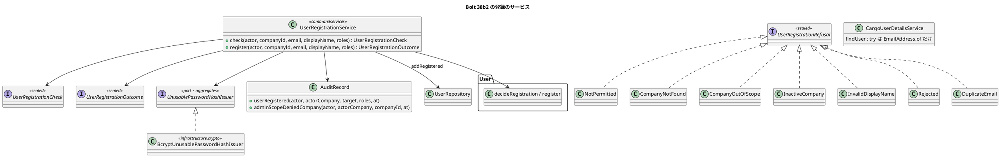

# Bolt 38b2 計画 - 利用者の登録のサービスと監査（使えないハッシュ、範囲外の記録）

## 基本情報

| 項目 | 内容 |
| :--- | :--- |
| Bolt | 第 38b2 回（W6 の 20 本目。開始準備で 38b2 を 38b2・38b2b の 2 つに分けた 1 つ目） |
| 予定 | W6（2026-11-09 の週。前倒しで着手できる）。作業は約 3.9 時間（`check`・SonarQube・CI の待ちを除く） |
| アプローチ | インサイドアウト（登録のサービスから。release_plan の 38b2 の行、開発戦略 :346）。新しい集約もスキーマも作らないので開発戦略 :118 の表には文字どおりは当たらないが、新しい振る舞い（利用者の生成）の不確実性がサービスの判定と書き込みにあるので内側から作る（開発戦略 :121） |
| 対象 | (1) 登録のサービス `UserRegistrationService`（確かめる `check` と、登録する `register`。判定の順は 操作者 → 企業の有無 → 管理範囲 → 企業の有効性 → 表示名 → 登録の判定（Bolt 38b）→ 重複のメールアドレス）、(2) 監査 `USER_REGISTERED`（役割だけ。個人情報を書かない）と、企業を対象にした範囲外の試行の記録（登録の確定の口の中で書く）、(3) 使えないハッシュのポートと実装（乱数を bcrypt にして捨てる）、(4) 登録した利用者を操作者と時刻つきで保存するリポジトリの口、(5) ログインの道の try を狭める（Bolt 38b の既知の課題）、(6) 設計の文書 |
| トレース | US-16 AC1（企業・利用者・役割の関係と記録）、US-16 AC2（管理範囲の外の拒否と試行の記録。UC-16 の拡張 2a）、US-16 AC3（職務分離。Bolt 38b の判定）、BR-14（事前登録のメールアドレス）、IA-INV-08・IA-INV-14 |
| GitHub | [#14](https://github.com/k2works/practical-domain-driven-design-in-enterpris-application/issues/14)（US-16） |
| SP | 0 |
| 承認ゲート | 計画と終了報告。構造（新しいサービス・判定の結果の型・ポート、範囲外の記録の 2 つ目の書き手）、セキュリティ（使えないハッシュ、管理範囲、ログインの道の例外の扱い）、新しいファイル。スキーマは変えない（`audit_record.action` に CHECK がない） |
| 開始準備で決めたこと | 2026-10-25、human:kakimomokuri: (1) 38b2 を 2 つに分ける（38b2 登録のサービス・監査・範囲外の記録・使えないハッシュ → 38b2b 登録のイベント・招待のトークンの発行・通知の公開 API・文面・`notification.kind` の CHECK）。どちらも配備しても画面がないので、普通の利用者から見える振る舞いは変わらない、(2) 使えないハッシュは `SecureRandom` の 32 バイトの値を今の `PasswordEncoder`（`DelegatingPasswordEncoder` が `{bcrypt}` を付ける）でハッシュにし、平文は捨てる（照合は常に一致しない、時間も普通の利用者と同じ）、(3) 企業が「ない」と「管理範囲の外」は同じ応答にし（存在を示さない）、範囲外だけ確定で `ADMIN_SCOPE_DENIED`（対象は企業）を記録する。無効な企業は範囲を確かめた後に理由を示して拒む。荷受人の企業は Bolt 38b の企業の種類の拒否のまま、(4) 監査 `USER_REGISTERED` は対象を新しい利用者・版 0、変更後の要約を役割の名前（`ROLES_CHANGED` と同じ書式）にし、メールアドレスと表示名は書かない。成功だけを記録する、(5) 範囲外の記録は登録のサービスの確定の口（`register`）の中で、別のトランザクションで書く（ArchUnit の「範囲外の試行の記録は詳細の部品からだけ呼ぶ」は変えない。画面の層の書き手は `UserDetailPage` の 1 つのまま。`check` は記録しない。確定は POST から呼ぶ）、(6) ログインの道の try を `EmailAddress.of` だけに狭め、読めない利用者の行（役割 0 件など）のときだけ監査の理由が `UNKNOWN_USER` から `SERVICE_ERROR` に変わり、ERROR のログが出て、応答時間が短くなることを受け入れる（画面は同じ `/login?error`）、(7) 表示名の検証は登録のサービスに置く |

## Bolt ゴール

38b3 の登録の画面が呼べるよう、利用者の登録を、管理範囲と企業の有効性と重複のメールアドレスを確かめて、使えないハッシュの利用者・役割・監査を 1 つのトランザクションで書くサービスにする。普通の利用者から見える振る舞いは変えない。

### 開始準備で確かめたこと

- **前例のサービス**（`identity/application/internal/commandservices/`）: `UserRoleChangeService` は `check`（書かない。:60-65）と `change`（`TransactionTemplate`。`Changed` でなければ `setRollbackOnly`。:75-84）の 2 つの口、判定の順は操作者 → 利用者と企業 → 管理範囲 → 規則 → 版（:111-136）、監査の値は承認の値から取る（:96-105）、判定の結果は private の sealed `Judgement`（:139-146）。組み立ては `IdentityConfiguration:150-159`。`ManagedUserLookup`（package-private の final class）は `SYSTEM_ADMIN` か → 利用者 → 所属企業 → `scopeOf(operator).covers(companyId)` の順（:38-51）で、利用者から企業をたどるので登録では使えない。一意制約の例外を値にする前例は `TotpEnrollmentService:93-99`（`execute` の外で捕まえる）
- **拒否の型**: `UserAdministrationRefusal`（sealed。`NotPermitted`・`NotFound`・`OutOfScope`・`Rejected<R>`・`Stale`）を網羅で switch するのは `UserDetailPage.java:143-176` で、対象を `UserId` で受け、`NotFound` と `OutOfScope` を両方 404 にし範囲外だけを記録する（Bolt 34b の「存在を示さない」は応答で守る）。登録は版も `Stale` もなく、企業の無効と重複のメールアドレスが加わるので、登録専用の sealed の型を作る（足すと `UserDetailPage` に使わない枝が増える）
- **範囲外の記録の規則**: `LayerArchitectureTest:324-351` の「範囲外の試行の記録は詳細の部品からだけ呼ぶ」は、`AdministrationScopeDenialService` への依存を `UserDetailPage` と組み立てに限る。`AdministrationScopeDenialService.recordDenied(actor, UserId)` は外側のトランザクションの中では例外にし、自分のトランザクションで書く（:40-47）。登録のサービスは、このサービスを使わずに `AuditRecordRepository` へ自分のトランザクションで書く（開始準備の決定 (5)）
- **管理範囲と企業**: `UserAssignmentRepository.scopeOf(UserId)`（割り当てがなければ空の範囲）、`AdministrationScope.covers(CompanyId)`。`CompanyRepository` は `add`・`findById` だけ。`Company` は `active` を持つ
- **登録の判定（Bolt 38b）**: `User.decideRegistration(Company, Set<Role>)`（static）と `User.register(approval, id, email, displayName, passwordHash)`。Javadoc に「管理範囲・企業の有効性・重複のメールアドレスは登録のサービスが見る」
- **保存**: `UserRepository.add(User)` は重複のメールアドレスで `DuplicateEmailException`。`MyBatisUserRepository.add`（:44-64）は時刻を `clock` から取り、`DuplicateKeyException` をどのキーでも `DuplicateEmailException` に変え、役割を `insertUserRole`（`granted_by` なし。`IdentityMapper.xml:90-92`）で入れる。役割の変更は `insertGrantedUserRole`（`granted_by` あり。:126-129）。`add` の呼び出しはテストに 31 か所（main はない）。`UserRepository` の実装は MyBatis と `AuthenticationAuditListenerTest.java:203-249` の匿名の実装の 2 つ。一意制約は `ux_app_user_email`。23505 は `MyBatisExceptionTranslator` で `DuplicateKeyException` になる（`MyBatisIdentityRepositoriesIntegrationTest:135`）
- **監査**: `AuditRecord.rolesChanged`（`AuditTarget("USER", 利用者 ID, 版, 前, 後)`。役割は宣言の順にカンマでつなぐ。:190-215・:318-323）、`adminScopeDenied(actor, actorCompany, UserId target, at)` は対象が利用者に固定で、前後は null（:221-234）。`AuditAction` に `USER_REGISTERED` はない。`AuditAction.ADMIN_SCOPE_DENIED` の Javadoc は「対象は利用者」。`audit_record.action` に CHECK はなく、`target_type` は `VARCHAR(50)`・`target_id` は `VARCHAR(100)`（マイグレーションなしで `COMPANY` を書ける）
- **使えないハッシュ**: `PasswordEncoder` は `PasswordEncoderFactories.createDelegatingPasswordEncoder()`（`SecurityConfiguration.java:138-141`。`encode` が `{bcrypt}` を付ける）。ポート `PasswordHasher`（`domain.model.aggregates`）と実装 `BcryptPasswordHasher`（`infrastructure.crypto`）。`AuthenticationArchitectureTest` の「crypto の部品は一覧に載っている」は 11 の名前の一覧と名前ごとの規則で守る（`allowEmptyShould(false)`）。壊れた bcrypt はすぐ「一致しない」を返し（`SpringSecurityCharacterizationTest:280-284`）、接頭辞のない値は `IllegalArgumentException`
- **表示名とメールアドレス**: 表示名は null の確かめだけ（`User.java:60`）、DB は `VARCHAR(200)`（文字で数える）。`EmailAddress.of` は strip と小文字化、320 文字まで
- **ログインの道**（Bolt 38b の既知の課題）: `CargoUserDetailsService.findUser:42-47` は `findByEmail` を丸ごと `catch (IllegalArgumentException _)` で囲み、役割 0 件の利用者の例外を「見つからない」に吸い込む。呼び手は `loadUserByUsername` と `AuthenticationAuditListener` の `targetOf`（:115）の 2 つ。狭めると、読めない行では `DaoAuthenticationProvider` が `InternalAuthenticationServiceException` に包み、`SecurityConfiguration:186-191` の対応表で `AuthenticationFailureServiceExceptionEvent` になり、`AuthenticationAuditListener:77-85` が理由 `SERVICE_ERROR` で書き、失敗を数えない。画面は `KeepEmailAuthenticationFailureHandler` の `/login?error` で同じ。「見つからない」の道の時間をそろえる仮の照合を通らないので、その時だけ応答が速くなる。確かめる場所は `AuthenticationErrorHandlingIntegrationTest`
- **テストの前例**: `UserRoleChangeIntegrationTest`（監査 1 行 :112、範囲外は何も書かない :167、同時の 2 つ :189）、`UserRoleChangeRollbackIntegrationTest`（`IdentitySpyIntegrationTestBase`。監査が書けなければ全体が戻る）、`AdministrationScopeDenialIntegrationTest:44`、`UserRoleChangeServiceTest`（Mockito）、`OverlappingTransactions.runSecondOutsideTransaction`（同時の書き込み。ADR-007）
- **数えた場所**（T-148・T-149・T-152）: `UserRepository.add` の 31 か所は変えない（新しい口を足す）。`UserRepository` の匿名の実装 1 か所に `addRegistered`（`UnsupportedOperationException`）を足す。`UserAdministrationRefusal` の switch は 1 か所（変えない）。crypto の一覧と名前ごとの規則に 1 つ足す（12 個に）。用語集の整合テストが見るのは `@AggregateRoot`・`@Entity`・`@ValueObject` を付けた型だけで、この Bolt の新しい型（サービス・結果・拒否・ポート）は注釈を付けないので当たらない
- **古い記述**: domain_model :238（利用者の招待の「発行とメールは Bolt 38b2」）、non_functional の SEC-08（同じ）、architecture_backend :315・domain_model :1172 の範囲外の記録の書き手、development_strategy :185（動画の「38b」。38b4 に）、architecture_backend の監査の書き手の表（:297-305）

## 設計の決定（案）

| 項目 | 決定 | 根拠 |
| :--- | :--- | :--- |
| サービスの口 | `UserRegistrationService`（`application.internal.commandservices`、`@Service` は JIG の印で組み立ては `IdentityConfiguration`）の `check(actor, CompanyId, EmailAddress, String displayName, Set<Role>)`（何も書かない。確認の画面が使う）と `register(...)`（書く）。メールアドレスは `EmailAddress` で受け、形の誤りは 38b3 の画面が見る。新しい利用者 ID はサービスが `UUID.randomUUID` で採る。結果は `UserRegistrationCheck`（`Acceptable`・`Refused`）と `UserRegistrationOutcome`（`Registered(UserId)`・`Refused`） | 前例 `UserRoleChangeService` |
| 拒否の型 | 登録専用の sealed `UserRegistrationRefusal`: `NotPermitted`（システム管理者でない）・`CompanyNotFound`・`CompanyOutOfScope`・`InactiveCompany`・`InvalidDisplayName`・`Rejected(UserRegistrationRejection)`（Bolt 38b の判定）・`DuplicateEmail`。「ない」と「範囲外」は別の値にし、38b3 の画面が同じ応答にする（前例 `UserDetailPage` と同じ。存在を示さないことは応答で守る） | 開始準備の決定 (3)、Bolt 34b |
| 判定の順 | 操作者が `SYSTEM_ADMIN` か → 企業があるか → 管理範囲か → 企業が有効か（範囲外の無効な企業に理由を示さない）→ 表示名 → 登録の判定 → 重複のメールアドレス（`findByEmail`）→ 使えないハッシュ → 保存 → 監査。前例 `ManagedUserLookup` と同じく、有無と範囲を先に見る（範囲外のときだけ記録で応答時間が違うことは Bolt 34b の既知の課題。#50、38e で扱う） | 前例の順、Bolt 34b |
| 同時の登録 | 重複のメールアドレスは先に `findByEmail` で確かめ、同時の登録は一意制約の `DuplicateEmailException` を `TransactionTemplate.execute` の外で捕まえて `DuplicateEmail` にする（前例 `TotpEnrollmentService:93-99`。中で捕まえると、続けて書く道で中断したトランザクションを踏む） | 前例 |
| 範囲外の記録 | `register` が範囲外を判定したら、`AuditRecord.adminScopeDeniedCompany(actor, actorCompany, CompanyId target, at)`（対象 `COMPANY`、前後は null）を、登録の書き込みとは別の `TransactionTemplate.execute` で書く（`register` は外側のトランザクションの外で呼ばれる前提。前例 `AdministrationScopeDenialService` と同じく、外側のトランザクションの中では例外にする）。`check` は書かない。画面の層の書き手は `UserDetailPage` の 1 つのままで、`LayerArchitectureTest` の規則は変えない。登録の範囲外の記録の書き手はこのサービスの 1 か所（2 つ目の書き手。architecture_backend :315・domain_model :1172 を直す） | 開始準備の決定 (5)、IA-INV-14 |
| 表示名 | サービスの判定で、strip し、空と 200 文字を超えるもの（コードポイントで数える）と制御文字（`Character.isISOControl`）を拒む（`InvalidDisplayName`）。strip した値で登録する。既存のデータを読む `User.of` には掛けない | 開始準備の決定 (7)、DB の長さ |
| 使えないハッシュ | ポート `UnusablePasswordHashIssuer`（`domain.model.aggregates`。「使えない password のハッシュの発行」）と実装 `BcryptUnusablePasswordHashIssuer`（`infrastructure.crypto`、`@Component`。`SecureRandom` の 32 バイトを Base64 にした平文を `PasswordEncoder`（`DelegatingPasswordEncoder`）でハッシュにし、平文は捨てる） | 開始準備の決定 (2)、ADR-017 の置き場所、前例 `PasswordHasher`・`TotpSecretIssuer` |
| 保存の口 | `UserRepository.addRegistered(User, UserId grantedBy, UtcInstant at)`: 利用者は `at` の時刻で、役割は `insertGrantedUserRole`（`granted_by` は操作者）で入れる。重複は `DuplicateEmailException`。`add` は変えない | `user_role.granted_by` の記録（US-16 AC1）、前例 `changeRoles(…, grantedBy, at)` |
| 監査 | `AuditAction.USER_REGISTERED`、`AuditRecord.userRegistered(actor, actorCompany, UserId target, Set<Role> roles, at)`（対象 `USER`・版 0・前は null・後は役割の名前）。役割は作った利用者から取る。成功だけを書く。`ADMIN_SCOPE_DENIED` の Javadoc を「対象は利用者または企業」に直す | 開始準備の決定 (4)、前例の「ないものは null」 |
| ログインの道 | `CargoUserDetailsService.findUser` の try を `EmailAddress.of` だけに狭める（形の誤ったメールアドレスは「見つからない」のまま、読めない利用者の行は例外を外へ出す）。architecture_backend の監査の書き手の表（`LOGIN_FAILED` の行）と `AuthenticationAuditListener` の Javadoc に `SERVICE_ERROR` になることを書く | 開始準備の決定 (6) |
| イベント | 出さない（登録のイベントと招待の発行は 38b2b。38b2b は `register` のトランザクションでイベントを出し、その ID を招待のトークンの `request_id` にする） | 開始準備の決定 (1) |

## ふりかえりと前の Bolt からの引き継ぎ

| 出典 | 内容 | この Bolt での扱い |
| :--- | :--- | :--- |
| Bolt 38b Try T-203 | 新しい `@ValueObject`・`@AggregateRoot` の Javadoc は「用語集の名前。」で始める | 当たる型はない（注釈を付けない）。用語集の行を足すサービスの Javadoc も同じ形にする |
| Bolt 38b Try T-204 | 複数行のスクリプトはファイルにする | 守る |
| Bolt 38 Try T-200〜T-202 | 変異はバイトのまま、最小の形、止まっているかは時刻で決める | 変異の表、処理の確かめ |
| Bolt 37f3 Try T-198・T-199 | 句ごとに確かめる、ログを残す | 状態の組み合わせの表 |
| Bolt 37f2 Try T-197 | 文書の行を実装のコミットの前に突き合わせる | ステップ 4 |
| Bolt 34b Try T-144 | 監査を足す計画では、記録が POST で守られるかと、記録の有無で応答時間が変わるかを確認ポイントに挙げる | 確認ポイント 4 |
| Bolt 34e・34f の Try T-150・T-153 | 承認の値と判定した対象の結び付き、「書き手は 1 か所」と書くときは規則の範囲を確認ポイントに挙げる | 行 1 で範囲を確かめた企業と承認の企業 ID が同じであることを確かめる。確認ポイント 4 |
| Bolt 34 Try T-142 | 権限を変える機能の組 | 登録は役割を付ける機能なので、監査と範囲外の記録を組で作る |
| W5 の Try T-106・T-119 | 「書かないこと」の前に対象と条件があることを確かめる | 拒否の行は対照の企業と利用者を置き、対照では書くことを確かめる |
| W5 の Try T-161・T-163 | 状態の組み合わせの表 | 下の表（拒否の理由ごとに 1 行） |
| W5 の Try T-148・T-152、T-125、T-104・T-147・T-139、T-164 | 数えてから変える、規則に当たったら諮る、SonarQube の時機、変異の道具 | 開始準備で確かめたこと、開始準備の決定 (5)、ステップ 5 |
| Bolt 38b の既知の課題 | ログインの道の try | この Bolt で閉じる |

## 状態の組み合わせ（行ごとにテストを 1 本。T-182）

| 行 | 状況 | 期待 | 確かめ方 |
| :--- | :--- | :--- | :--- |
| 1 | システム管理者が管理範囲の有効な運用する会社に営業担当者を登録する | 登録した利用者（版 0・利用中・役割・所属企業は範囲を確かめた企業）、`user_role.granted_by` は操作者、監査 `USER_REGISTERED` 1 行（対象 USER・版 0・前は null・後 `SALES`・メールアドレスと表示名を含まない）、password のハッシュは `{bcrypt}` で始まり、空の文字列と一致しない | `UserRegistrationIntegrationTest`、`UserRegistrationServiceTest` |
| 2 | システム管理者でない | `NotPermitted`、何も書かない（対照の登録は書く） | `UserRegistrationServiceTest` |
| 3 | 企業がない | `CompanyNotFound`、何も書かない | 同上 |
| 3b | 管理範囲の外の企業（有効、無効のどちらも） | `CompanyOutOfScope`（無効でも `InactiveCompany` にしない）。確定では範囲外の記録 1 行（対象 COMPANY・企業 ID）だけを書き、利用者は書かない。`check` は何も書かない | 同上、`UserRegistrationIntegrationTest` |
| 5 | 無効な企業（範囲内） | `InactiveCompany` | `UserRegistrationServiceTest` |
| 6 | 表示名が空・空白だけ・201 文字（コードポイント）・制御文字を含む | `InvalidDisplayName`（200 文字は通り、前後の空白を除いた値で登録する） | 同上 |
| 7 | 監督の役割・企業の種類に合わない役割（Bolt 38b の判定） | `Rejected`（判定の拒否をそのまま返す） | 同上 |
| 8 | 既にいるメールアドレス（範囲の内でも外の利用者でも） | `check` も `register` も `DuplicateEmail`、ハッシュの発行と保存を呼ばない | 同上、統合テスト |
| 9 | 同じメールアドレスの同時の 2 つの登録 | 1 つだけ `Registered`、もう 1 つは `DuplicateEmail`、利用者と監査は 1 つずつ | `UserRegistrationIntegrationTest`（`OverlappingTransactions.runSecondOutsideTransaction`） |
| 10 | 監査が書けない | 利用者も役割も残らない | `UserRegistrationRollbackIntegrationTest` |
| 11 | `check` は判定だけで何も書かない | 受け付けるときも拒むときも、利用者・監査が増えない | `UserRegistrationIntegrationTest` |
| 12 | 使えないハッシュの発行 | 呼ぶたびに `PasswordEncoder` に渡る平文が違い、32 バイト分以上（43 文字以上）、結果は `{bcrypt}` で始まる | `BcryptUnusablePasswordHashIssuerTest` |
| 12b | 使えないハッシュの利用者が password でログインを試みる | 誤った password と同じ応答（500 にならない） | `AuthenticationSecurityIntegrationTest` |
| 13 | 形の誤ったメールアドレスでログインを試みる | 誤った認証情報と同じ応答、監査の理由は今のまま | `AuthenticationErrorHandlingIntegrationTest` |
| 13b | 役割 0 件の利用者のログイン | `/login?error`、監査の理由 `SERVICE_ERROR`、失敗を数えない（データの不整合を「見つからない」に吸い込まない） | 同上 |

## スコープ

### 入れるもの

- 行 1〜13b のテスト、`UserRegistrationService`・`UserRegistrationCheck`・`UserRegistrationOutcome`・`UserRegistrationRefusal`（`commandservices`）、`UnusablePasswordHashIssuer` とその実装（crypto の一覧と名前ごとの規則に 1 つ足す）、`UserRepository.addRegistered` と MyBatis の実装と匿名の実装、`AuditAction.USER_REGISTERED`・`AuditRecord.userRegistered`・`adminScopeDeniedCompany`、組み立て（`IdentityConfiguration`）、`CargoUserDetailsService.findUser`
- 設計の文書: domain_model（登録のサービスの流れと拒否の順、用語集に「利用者の登録のサービス」と「使えない password のハッシュの発行」、:238 の「38b2」を「38b2b」に、:1172 の範囲外の記録の書き手、IA-INV-08・IA-INV-14 に登録）、data_model（`audit_record` の `USER_REGISTERED` と `target_type` の `COMPANY`、前後の null。文書だけ）、architecture_backend（置き場所、:315 の範囲外の記録の書き手、:297-305 の監査の書き手の表）、non_functional（SEC-07 に使えないハッシュ、SEC-08 の「38b2」を「38b2b」に、SEC-12 に登録の管理範囲と企業を対象にした範囲外の記録）、development_strategy :185（動画の 38b を 38b4 に）、release_plan（38b2 を 2 つの行に。38b2b の行にアプローチ（インサイドアウト）・承認ゲート（スキーマ・構造・外部連携）・Bolt 38b の確認ポイント 1 の制約（通知の公開 API は招待の口だけ、一般の口は 38d で決める）・「38b3 は 38b2b の後」の順、状態、更新履歴）

### 入れないもの

- 登録のイベント・招待のトークンの発行・通知の公開 API・メールの文面・`notification.kind` の CHECK（38b2b）
- 登録の画面（38b3。38b2b の後でなければ、招待のない登録が本番に出る）、A-06 の出し分け（38b4）
- 招待の再送（作らない。本人が A-05 で設定できる。38c の開始準備で見直す）
- `audit_record` の列のコメントのマイグレーション（文書だけを直す）
- 範囲外の記録のポートの共有カーネルへの一般化（38e の開始準備に送る材料。release_plan の確認ポイント 17）

## 設計（この Bolt の範囲）

- 状態遷移図: 利用者の状態（登録で利用中）は変わらないので省く。ER 図: スキーマを変えないので省く（`audit_record` の値だけが増える）。画面遷移図: 画面を変えないので省く

## ステップ計画

- [ ] **1. 設計の文書**: domain_model・data_model・architecture_backend・non_functional・development_strategy、release_plan（38b2 を 38b2・38b2b の 2 行に、:703 の状態）（完了の判定: 文書の差分）
- [ ] **2. 監査と使えないハッシュと保存の口（Red → Green）**: 行 1 の監査の形・行 12・`addRegistered` の統合テスト（完了の判定: 期待した理由で落ちた後に緑、crypto の一覧の規則が緑）
- [ ] **3. 登録のサービス（Red → Green）**: 行 1〜11 の単体と統合のテスト、組み立て（完了の判定: 同上、既存の S-20 と認証のテストが緑のまま）
- [ ] **4. ログインの道と突き合わせ**: 行 12b・13・13b、`findUser` の try、監査の書き手の表と Javadoc。実装のコミットの前に T-197 の突き合わせ（完了の判定: 差分）
- [ ] **5. 品質ゲートと開発レビュー**: 変異、`check`・`uiTest`、その後に SonarQube、開発レビューとその直し
- [ ] **6. 終了報告**: push して CI と MkDocs とデモ環境の配備を確かめる。release_plan・開発の索引・mkdocs を完了に直す

### 時間の配分と打ち切り

| # | 目安 | 打ち切り |
| :--- | :--- | :--- |
| 1 | 30 分 | — |
| 2 | 55 分 | — |
| 3 | 80 分 | 同時の 2 つの登録のテストが揺らぐときは、一意制約の例外を値に変えることを単体で確かめ、統合は 1 回の重複だけにする（報告に書く） |
| 4 | 30 分 | — |
| 5 | 35 分（待ちを除く） | — |
| 6 | 5 分（CI の待ちを除く） | — |

合計 235 分（約 3.9 時間）。

## 確認ポイント（計画の承認の場でまとめて確認する。Try T-6）

| # | 確認すること | 場所 | 推奨 |
| :--- | :--- | :--- | :--- |
| 1 | **分け方（開始準備の決定 (1)）** | release_plan | 38b2（この Bolt）と 38b2b。38b3 は 38b2b の後。どちらも普通の利用者から見える振る舞いを変えない |
| 2 | **拒否の型と順（構造）** | ステップ 3 | 登録専用の sealed 型。「ない」と「範囲外」は別の値で 38b3 の画面が同じ応答にする、範囲外の無効な企業は範囲外として扱う、重複は値で返す（同時の登録は一意制約の例外を `execute` の外で値にする） |
| 3 | **使えないハッシュ（セキュリティ・新しいファイル）** | ステップ 2 | 乱数を bcrypt にして捨てる。ポートは `domain.model.aggregates`、実装は `infrastructure.crypto`（crypto の一覧に足す） |
| 4 | **監査と範囲外の記録（開始準備の決定 (4)・(5)、T-144・T-153）** | ステップ 2・3 | `USER_REGISTERED`（役割だけ、前は null）。範囲外の記録は `register`（確定。38b3 では POST から呼ぶ）の中で自分のトランザクションで書き、`check` は書かない。登録の範囲外の記録の書き手はこのサービスの 1 か所（画面の層の規則は変えない）。範囲外のときだけ記録で応答時間が違うことは Bolt 34b の既知の課題のまま（38e） |
| 5 | **ログインの道（開始準備の決定 (6)）** | ステップ 4 | try を `EmailAddress.of` だけに狭める。読めない利用者の行のときだけ監査の理由が `SERVICE_ERROR`、ERROR のログ、応答時間の差を受け入れる |
| 6 | **表示名の検証（開始準備の決定 (7)）** | ステップ 3 | サービスで、strip、空・201 コードポイント以上・制御文字を拒む |
| 7 | **変異** | ステップ 5 | 下の 9 つ。スクリプトはバイトのまま読み書きし、gradlew.bat を絶対パスで呼び、結果の XML を消してから流す（T-164・T-178・T-200） |

### 変異と落ちる見込みのテスト

| # | 変異 | 落ちる見込み |
| :--- | :--- | :--- |
| V1 | 管理範囲を見ない | 行 3b |
| V2 | 企業の有効性を見ない | 行 5 |
| V3 | 重複のメールアドレスを先に確かめない（一意制約だけ） | 行 8（`check` の `DuplicateEmail`、`register` でハッシュの発行と保存を呼ばないこと） |
| V4 | 監査を書かない | 行 1 |
| V5 | `granted_by` を入れない（`insertUserRole` を使う） | 行 1 |
| V6 | 使えないハッシュの平文を固定にする | 行 12 |
| V7 | `findUser` の try を元に戻す | 行 13b |
| V8 | 管理範囲と企業の有効性の順を入れ替える | 行 3b（範囲外の無効な企業） |
| V9 | 表示名の長さを見ない | 行 6 |

## 完了条件

- [ ] 上のステップ 1〜6 の完了の判定を満たす
- [ ] 行 1〜13b に、それを名乗るテストがある
- [ ] `check`・`uiTest` が緑、SonarQube が PASS、CI が緑、デモ環境が新しい版で動く
- [ ] 普通の利用者から見える振る舞いが変わらない（マニュアルは変えない。読めない利用者の行のログインの監査の理由だけが変わる）
- [ ] 終了報告が承認される

## 更新履歴

| 日付 | 更新内容 | 更新者 |
| :--- | :--- | :--- |
| 2026-10-25 | 整合性検証の指摘を反映した（承認待ち）。「ない」と「範囲外」を別の値にし、範囲外の記録は登録のサービスの確定の口の中で書くと決め（ArchUnit の規則は変えない）、ログインの道の差を受け入れ、表示名はサービスに置くと決めた（human:kakimomokuri）。行 3b・12・12b・13b と変異 V8・V9、同時の登録の捕まえ方、匿名の実装と crypto の一覧、古い記述、引き継ぎ（T-144・T-150・T-153・T-142）、38b2b の行の中身、行番号を直した | anthropic/claude-opus-5-5 |
| 2026-10-25 | 初版作成（承認待ち）。開始準備で、38b2 を 2 つに分け、使えないハッシュは乱数の bcrypt、ない・範囲外は同じ拒否で無効は理由を示し、監査は役割だけにすると決めた（human:kakimomokuri） | anthropic/claude-opus-5-5 |

## 関連ドキュメント

- [リリース計画](release_plan.md)（W6 節の 38b2 の行）
- [Bolt 38b 計画](bolt_38b_plan.md)・[終了報告](bolt_38b_report.md)、[Bolt 34b 終了報告](bolt_34b_report.md)（管理範囲と範囲外の記録）、[Bolt 34 終了報告](bolt_34_report.md)（役割の変更のサービス）
- [ドメインモデル](../../design/cargo-tracker/domain_model.md)、[データモデル](../../design/cargo-tracker/data_model.md)、[バックエンドのアーキテクチャ](../../design/cargo-tracker/architecture_backend.md)、[非機能要件](../../design/cargo-tracker/non_functional.md)
