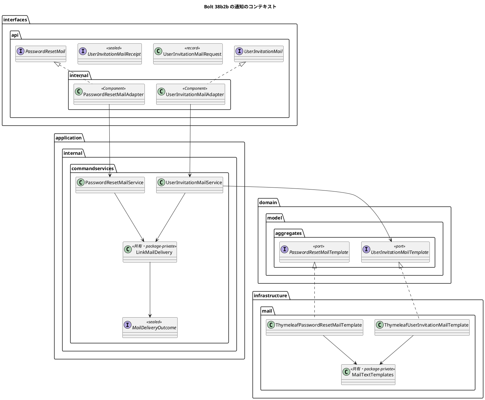

# Bolt 38b2b 計画 - 利用者の招待のメール（通知の側）と、範囲外の企業の記録の規則

## 基本情報

| 項目 | 内容 |
| :--- | :--- |
| Bolt | 第 38b2b 回（W6 の 21 本目。開始準備で 38b2b を 38b2b（通知の側）・38b2c（identity の側）に分けた 1 つ目） |
| 予定 | W6（2026-11-09 の週。前倒しで着手できる）。作業は約 3.3 時間（`check`・SonarQube・CI の待ちを除く） |
| アプローチ | インサイドアウト（通知の公開 API と記録・送信の部品から。release_plan の 38b2b の行） |
| 対象 | (1) 通知の記録・送信・結果・伏せ字を、再設定と招待で共有する部品にまとめる（再設定の振る舞いは変えない。伏せ字の文字列とログの文だけが変わる）、(2) 通知の種類 `USER_INVITATION` と `notification.kind` の CHECK（スキーマ）、(3) 招待専用の公開 API `UserInvitationMail`（要求・受領・アダプター）、コマンド・サービス・文面のポートと Thymeleaf の実装・本文、(4) ArchUnit の規則「範囲外の企業の記録は登録のサービスだけが作る」と名前の見張り（Bolt 38b2 の終了報告の議題 2）、(5) 設計の文書 |
| トレース | US-16 AC1（利用者の登録の初回の設定の案内）、ADR-017（通知のモジュールとメール）、N-INV-01（メールに業務の情報を書かない）、IA-INV-14（範囲外の記録の書き手） |
| GitHub | [#14](https://github.com/k2works/practical-domain-driven-design-in-enterpris-application/issues/14)（US-16） |
| SP | 0 |
| 承認ゲート | 計画と終了報告。スキーマ（common のマイグレーション 1 つ。`ck_notification_kind` の差し替え）、構造（新しい公開 API、記録と送信の共有の部品、ArchUnit の規則の追加）、外部連携（メールの文面）、新しいファイル |
| 開始準備で決めたこと | 2026-10-26、human:kakimomokuri: (1) 38b2b を 2 つに分ける（38b2b 通知の側と ArchUnit の規則 → 38b2c identity の側：登録のイベント DE-25、招待のトークンの発行の手順の共有化と招待のハンドラー、ACL、登録から Mailpit までの統合テスト、招待の発行を招待のハンドラーに限る ArchUnit の規則）。38b3 は 38b2c の後。どちらも配備しても呼び手がないので見える振る舞いは変わらない、(2) 招待のメールは短い文面にし、期限を過ぎたときの出口（A-05）の 1 文を足す（整合性検証の後の決定。下の設計の決定）、(3) 通知の記録と送信を再設定と招待で共有し、送れなかった理由の伏せ字を「[リンク]」に寄せる（通知の記録の理由の列とログだけ。利用者には見えない）、(4) ArchUnit の規則は範囲外の企業の記録（この Bolt）と招待の発行（38b2c）の 2 つを足し、それぞれ名前の見張りと組にする |

## Bolt ゴール

38b2c が招待のメールを送れるよう、通知のコンテキストに招待の種類・公開 API・文面を足し、記録と送信を再設定と共有する。範囲外の企業の記録の書き手を規則で 1 か所に限る。見える振る舞いは変えない（呼び手がなく、受入シナリオは 38b2c の統合テストと 38b4 の受入シナリオで通す）。

### 開始準備で確かめたこと

- **再設定のメールの流れ（通知の側）**: 公開 API `PasswordResetMail.send(PasswordResetMailRequest) → PasswordResetMailReceipt`（`notification/interfaces/api/`。Receipt は sealed で `Sent`・`AlreadySent`・`Failed(reason)`。Request は `UUID requestId, UUID tokenId, UUID recipientUserId, String email, String resetUrl, UtcInstant expiresAt, String locale` の 7 項目で、`toString` はリンクとアドレスを伏せる）、アダプター `interfaces/api/internal/PasswordResetMailAdapter.java:15-40`、コマンド `SendPasswordResetMailCommand.java:19-44`、結果 `PasswordResetMailOutcome.java:8-27`、サービス `PasswordResetMailService.java`（`Notification.pending(…, PASSWORD_RESET, tokenId, …)` を `addIfAbsent`、false なら `AlreadySent`（:61-72）、`template.compose` → `sender.send` を同じ try の中で（:73-76。文面の例外も FAILED）、RuntimeException は `reasonOf` で伏せて FAILED（:77-82、伏せ字は :32-38・:105-113。リンクの最後の段をトークンとして伏せる）、`saveOutcome` は書けなくても WARN（:91-96。ログの文は「password の再設定のメールを送れなかった」））
- **文面**: ポート `PasswordResetMailTemplate.compose(to, resetUrl, expiresAt, locale)`（`domain/model/aggregates/`）、実装 `ThymeleafPasswordResetMailTemplate`（件名の定数 :23、Asia/Tokyo の書式 :25-26、引数なしのコンストラクターで ClassLoaderTemplateResolver を組み立てる :30-39。設定と `NotificationMailAdaptersTest:27` が `new` する）、本文 `resources/mail/password-reset.txt`（「30 分間、1 回だけ」）
- **表と種類**: `V20261015100000__create_notification.sql` の `kind VARCHAR(30)`（:13）、UK(event_id, recipient_user_id)（:22）、`ck_notification_kind`（:23-25。`USER_INVITATION` はない）、event_id と target_ref の注は再設定のことだけ（:34・:38。適用済みなので新しいマイグレーションの COMMENT ON で直す）。`NotificationKind` は `PASSWORD_RESET` だけ（Javadoc「Bolt 33 は password の再設定だけを作る」）。保存は `name()`・`valueOf`。CHECK の差し替えの前例は `V20261008100000__add_route_assignment_and_shipper_approval.sql:13-16`（DROP と ADD を別の文。H2（MODE=PostgreSQL）と PostgreSQL の両方で通る）
- **組み立てと依存**: `NotificationConfiguration.java:29-52`（MailSender・Template・Service の Bean。アダプターは `@Component`）。identity は `notification :: api` に既に依存できる。notification は `shared` だけ（`notification/package-info.java` の Javadoc に「W5 は password の再設定のメールだけ」、`commandservices/package-info.java` に「（password の再設定のメールの送信）」）。公開 API は `PublicApiArchitectureTest` で標準と共有カーネルの型だけ（identity の `EmailAddress` は使えない）
- **SpotBugs**: `config/spotbugs/exclude.xml:35` が `PasswordResetMailService` の `EI_EXPOSE_REP2` をクラス名で抑止している。同じ形の `UserInvitationMailService` と `LinkMailDelivery`（`TransactionTemplate` を持つ）は落ちる見込み。identity は :22-25 でパッケージで抑止している
- **ADR-017**: 決定 1（公開 API と Receipt の 3 値、要求の型の制約、PENDING → SENT か FAILED、UK による重複の判定、Thymeleaf のテキスト）、決定 3（ポートの一覧）、決定 5（target_ref はトークンの ID。PASSWORD_RESET だけの例外）、:121（公開 API を種類ごとに分けるか汎用にするかは W9 で見直す）。frontmatter の description も再設定だけ
- **重複の見込み**（MNT-02）: `PasswordResetMailService.send`・`saveOutcome`・`reasonOf`（約 30 文）と Thymeleaf の実装の組み立て（7 文）を写すと SonarQube の重複（3%）に当たりうる（開始準備の決定 (3) で共有する）。Adapter・Request（`toString` の伏せ字）・Receipt・Command は短く、写しても重複の連続には当たりにくい見込み（SonarQube で確かめる）
- **伏せ字のテスト**: `PasswordResetMailServiceTest:97-123` は `doesNotContain("secret-token")` と `contains("[メールアドレス]")` を見るだけで、「[再設定のリンク]」を期待する文はない。文面の組み立ての失敗を確かめるテストもない
- **ArchUnit の前例**: `LayerArchitectureTest.java:323-341`（依存の規則と書き手の FQN の定数 `SCOPE_DENIAL_WRITER`）、:343-350（名前の見張り。T-135）、:311-321（`callMethodWhere(target(owner(assignableTo(...))).and(target(nameMatching(...))))`。static import は :3-15 で、`equivalentTo` もある）。解析はテストを含まない（:41）。本体で `AuditRecord.adminScopeDeniedCompany` を呼ぶのは `UserRegistrationService:141` だけ（ラムダの中も持ち主のクラスに数える）。`AdministrationScopeDenialService` が呼ぶ `adminScopeDenied` は別の名前。`callMethodWhere` はメソッド参照を捕まえない
- **テストの前例**: `PasswordResetMailIntegrationTest`（公開 API から Mailpit まで、2 回目は送らない）、`NotificationMailAdaptersTest`（件名と本文、`&amp;` が出ない）、`PasswordResetMailServiceTest`（`RecordingSender`・`InMemoryNotifications`・`ImmediateTransactions`）、`MyBatisNotificationRepositoryIntegrationTest`（PostgreSQL だけ。種類は PASSWORD_RESET 固定）、`H2DevProfileSmokeTest`（H2 でマイグレーションが通る）
- **設計の文書**: domain_model の用語集（:238「利用者の招待」は「発行とメールは Bolt 38b2b」→ 分け方に合わせる、:262 `Notification`・:263 `NotificationKind`（PASSWORD_RESET だけ）・:265-269 再設定のメールの系、:214 共有の部品の前例 `TotpProvisioningStarter`）、通知の節（:1430・:1434・:1450・:1452「この種類だけの例外」）。ui_design の通知の種類の表（:1625-1632。「荷受人への招待」は CONSIGNEE_INVITATION で日英）と再設定のメールの節（:1636-1665）、:40 と non_functional ACC-04（:241）の「招待メールは日英」は荷受人の招待のこと。non_functional SEC-08（:155）の「発行とメールは Bolt 38b2b」。data_model の notification の制約（:979）と注（:981-983）・:1202。test_strategy :332（Mailpit の行は再設定だけ）。architecture_backend :153（公開 API の一覧）・:311（合成ルート）。`PasswordResetTokenPurpose.java:14` の「Bolt 38b2 で発行する」（38b2c に直す）
- **数えた場所**（T-126・T-148・T-152）: 通知の種類の値の一覧は CHECK・data_model :979・domain_model :263・ui_design の表の 4 か所。`PasswordResetMailOutcome` を使うのはサービスとアダプターとサービスのテスト。マイグレーションの最新は `V20261025100000`

## 設計の決定（案）

| 項目 | 決定 | 根拠 |
| :--- | :--- | :--- |
| 共有の部品 | `LinkMailDelivery`（`application.internal.commandservices`、package-private の final class。Bean にせず各サービスがコンストラクターの引数から作る。前例 `TotpProvisioningStarter`・`ManagedUserLookup`。`PasswordResetMailService` のコンストラクターの形は変えない）: `deliver(Notification pending, String link, Supplier<OutgoingMail> mail)` が記録（`addIfAbsent`）→ 文面の組み立てと送信（Supplier は記録の後に try の中で呼ぶ。文面の例外も FAILED）→ 結果の保存 → 伏せ字をまとめる。`Notification.pending` は各サービスが作る。結果は `PasswordResetMailOutcome` を種類によらない名前 `MailDeliveryOutcome`（`Sent`・`AlreadySent`・`Failed`）に改めて共有する（リンクのない 38d の通知にも使える名前）。伏せ字は「[リンク]」「[メールアドレス]」（招待のリンクも A-06 の形で最後の段がトークンであることを前提にする。38b2c で守る）。ログの文は種類を含む一般の文（「{種類} のメールを送れなかった」）にする（ロガーの名前も変わる。ログの文を期待するテストと手順書はない） | 開始準備の決定 (3)、MNT-02、java:S107 |
| 文面の共有 | `infrastructure.mail` の package-private な `MailTextTemplates`（Thymeleaf のエンジンと日時の書式）を、2 つの実装がそれぞれの引数なしのコンストラクターの中で作る | 同上 |
| 種類とスキーマ | `NotificationKind.USER_INVITATION`（Javadoc を直す）。マイグレーション `V20261026100000__add_notification_kind_user_invitation.sql`（common）: `ALTER TABLE notification.notification DROP CONSTRAINT ck_notification_kind;` の後に `ADD CONSTRAINT ck_notification_kind CHECK (kind IN (既存の 7 値, 'USER_INVITATION'))`。event_id の注を「契機のイベントの ID（再設定の依頼、利用者の登録など）」、target_ref の注を「対象の参照（再設定と利用者の招待はトークンの ID）」に直す | ADR-017 の決定 1・5、前例 |
| 公開 API | 招待専用の `UserInvitationMail.send(UserInvitationMailRequest) → UserInvitationMailReceipt`（`Sent`・`AlreadySent`・`Failed(reason)`）。Request は `UUID registrationId, UUID tokenId, UUID recipientUserId, String email, String invitationUrl, UtcInstant expiresAt, String locale` の 7 項目（`EmailAddress`・`UserId` は使わない）で、`toString` はリンクとアドレスを伏せる。アダプター `UserInvitationMailAdapter`（`interfaces/api/internal`、`@Component`）。一般の口と共有の部品を広げるかは 38d で決め、ADR-017 :121（W9）との関係を ADR に書く | Bolt 38b の確認ポイント 1、ADR-017 :121 |
| コマンドとサービス | `SendUserInvitationMailCommand`（`application.internal.commands`、7 項目）と `UserInvitationMailService`（`LinkMailDelivery` を使う。種類は `USER_INVITATION`、target_ref はトークンの ID）。SpotBugs の抑止は前例 identity と同じく `notification.application.internal` のパッケージに広げる | 前例 |
| 文面 | ポート `UserInvitationMailTemplate.compose(to, invitationUrl, expiresAt, locale)`（`domain.model.aggregates`）、実装 `ThymeleafUserInvitationMailTemplate`、本文 `resources/mail/user-invitation.txt`。件名「【cargo-tracker】利用者の登録のご案内」。本文は下の 6 文（企業名・役割・登録した人・業務の情報は書かない。日本語だけ） | 開始準備の決定 (2)、N-INV-01 |
| ArchUnit の規則 | `LayerArchitectureTest` に、書き手の FQN の定数（前例 `SCOPE_DENIAL_WRITER`）と述語の定数 `DescribedPredicate<JavaCall<?>>`（`target(owner(equivalentTo(AuditRecord.class))).and(target(nameMatching("adminScopeDeniedCompany")))`）を置き、「範囲外の企業の記録は登録のサービスだけが作る」（`noClasses().that().doNotHaveFullyQualifiedName(書き手).should().callMethodWhere(述語)`）と「範囲外の企業の記録の書き手は登録のサービス」（名前の見張り。`classes().that().haveFullyQualifiedName(書き手).should().callMethodWhere(述語)`）の 2 つ。Javadoc に、守るのは呼び出しだけ（メソッド参照は捕まえない）と書く（T-153） | 開始準備の決定 (4)、T-205、T-135 |

本文:

```text
cargo-tracker の利用者として、このメールアドレスが登録されました。
次のリンクを開いて、password を設定してください。
{設定の URL}
このリンクは {期限} まで、1 回だけ使えます。
期限を過ぎたときは、ログインの画面の「password を忘れた場合」から設定できます。
心当たりがない場合は、このメールを無視してください。
```

ui_design の「場面と本文の各文が事実と合うか」の表は、①登録された本人、②別人のアドレスに届いた、③招待の後に本人か第三者が再設定を依頼した・利用停止された（リンクは無効になる。受け入れたリスク。出口は A-05）、④期限切れ・送れなかった（出口は A-05。登録したての利用者は利用中なので A-05 を使える）の 4 行にする。

## ふりかえりと前の Bolt からの引き継ぎ

| 出典 | 内容 | この Bolt での扱い |
| :--- | :--- | :--- |
| Bolt 38b2 Try T-205 | 「書き手は 1 か所」は守る規則を挙げ、ないなら足すかを諮る | 開始準備の決定 (4) で足す |
| Bolt 38b2 の既知の課題 | 「書き手は 1 か所」を守る規則がない、外側のトランザクションに合流したときの rollback-only、書式文字の表示名 | 前者はこの Bolt で閉じる。後の 2 つは 38b3 に送ったまま |
| Bolt 38b Try T-203・T-204 | 新しい `@ValueObject` などの Javadoc は用語集の名前で始める、複数行のスクリプトはファイルにする | `NotificationKind` は値を足すだけ。守る |
| Bolt 38 Try T-200〜T-202 | 変異はバイトのまま、最小の形、止まっているかは時刻で決める | 変異の表 |
| Bolt 37f3 Try T-198・T-199、Bolt 37f2 Try T-197 | 句ごとに確かめる、ログを残す、文書の行を突き合わせる | 状態の組み合わせの表、ステップ 4 |
| Bolt 37c Try T-126 | 新しい値の一覧は grep で探してすべてに足す | 数えた場所（通知の種類の 4 か所） |
| #50 | `findByEventIdAndRecipient`（38d で扱う） | 新しい統合テストでも使う。整理は 38d のまま |
| W5 の Try T-106・T-119、T-148・T-152、T-125、T-104・T-147・T-139 | 「ないこと」の前に対象、数えてから変える、規則に当たったら諮る、SonarQube の時機 | 開始準備で確かめたこと、ステップ 5 |

## 状態の組み合わせ（行ごとにテストを 1 本。T-182）

| 行 | 状況 | 期待 | 出口 | 確かめ方 |
| :--- | :--- | :--- | :--- | :--- |
| 1 | 招待の公開 API で送る | Mailpit に 1 通、件名「【cargo-tracker】利用者の登録のご案内」、本文にリンクと期限（Asia/Tokyo）、通知の記録は `USER_INVITATION`・SENT・target_ref はトークンの ID | 本人がリンクを開く（A-06） | `UserInvitationMailIntegrationTest` |
| 2 | 同じ登録の ID と宛先でもう一度送る | `AlreadySent`、2 通目を送らない | 何もしない | 同上 |
| 3 | 送信が失敗する、文面の組み立てが失敗する | `Failed`、理由にリンク・トークン・アドレスを含まず「[リンク]」「[メールアドレス]」、記録は FAILED | 本人が A-05 で依頼する | `UserInvitationMailServiceTest` |
| 4 | 再設定のメール（共有の部品に移した後） | 今までどおり（Sent・AlreadySent・Failed、PASSWORD_RESET）。伏せ字は「[リンク]」（期待を足す）、文面の組み立ての失敗も Failed（足す） | 今までどおり | `PasswordResetMailServiceTest`、`PasswordResetMailIntegrationTest`（変えない） |
| 5 | 招待の文面 | 件名、本文の 6 文、期限の書式、`&amp;` が出ない、企業名・役割を含まない | — | `NotificationMailAdaptersTest` |
| 6 | `USER_INVITATION` の通知を保存して読み戻す | 種類が保たれる（CHECK が通る）。H2 はマイグレーションが通る | — | `MyBatisNotificationRepositoryIntegrationTest`、`H2DevProfileSmokeTest` |
| 7 | 公開 API の型 | 標準と共有カーネルの型だけ、record と interface、api にだけ置く | — | `PublicApiArchitectureTest`（既存の規則が新しい型に当たる） |
| 8 | 範囲外の企業の記録を登録のサービス以外が作る、書き手が呼ばなくなる | 前者は呼び出しの規則が落ちる、後者は名前の見張りが落ちる（今の本体では両方緑） | — | `LayerArchitectureTest`（2 つの規則。変異で確かめる） |

## スコープ

### 入れるもの

- 行 1〜8 のテスト、`LinkMailDelivery`・`MailDeliveryOutcome`（`PasswordResetMailOutcome` の名前を改める）、`PasswordResetMailService` の共有の部品への移し替え、`MailTextTemplates`、`NotificationKind.USER_INVITATION`、マイグレーション、`UserInvitationMail`・`UserInvitationMailRequest`・`UserInvitationMailReceipt`・`UserInvitationMailAdapter`、`SendUserInvitationMailCommand`・`UserInvitationMailService`、`UserInvitationMailTemplate`・`ThymeleafUserInvitationMailTemplate`・`mail/user-invitation.txt`、`NotificationConfiguration`、SpotBugs の抑止、`LayerArchitectureTest` の 2 つの規則、古くなる注（`NotificationKind`・`notification/package-info.java`・`commandservices/package-info.java`・`PasswordResetTokenPurpose.java:14`）
- 設計の文書: domain_model（用語集の :238・:262・:263・:268-270 と招待の系・`LinkMailDelivery` の行、通知の節の :1430・:1434・:1450・:1452）、ui_design（通知の種類の表に「利用者の招待」、:1666 に「### 利用者の招待のメール（US-16 AC1。Bolt 38b2b）」の節（件名・本文・場面と本文の各文が事実と合うかの表・日本語だけの注）、:40 の注）、non_functional（ACC-04 の注、SEC-08 の「発行とメールは Bolt 38b2b」を「メールの部品は 38b2b、発行と送信は 38b2c」に）、data_model（notification の制約と注、target_ref の例外に USER_INVITATION、:1202）、test_strategy :332（Mailpit に招待のメール）、ADR-017（frontmatter の description、決定 3 のポートの一覧、2 つ目の公開 API、共有の部品、target_ref の例外、:121 と 38d の関係、改訂の経緯）、architecture_backend（:153 の公開 API の一覧、:311 の合成ルート、置き場所と規則）、release_plan（38b2b を 38b2b・38b2c の 2 つの行に（38b2c にアプローチ・承認ゲート：構造・セキュリティ・外部連携）、38b3 の行の「38b・38b2・38b2b の上に」に 38b2c、38d の行に「共有の部品を広げるかも決める」、主なタスクの行、:703 の状態、更新履歴）

### 入れないもの

- 登録のイベント・招待のトークンの発行・招待のハンドラー・identity の ACL・招待の発行の ArchUnit の規則（38b2c）
- 一般の通知の口（38d で決める）、招待の再送（作らない。本人が A-05 で設定できる）
- 招待のメールの英語版（日本語だけ）
- 受入シナリオ（呼び手がなく見える振る舞いがないので書かない。38b2c の統合テストと 38b4 の受入シナリオで通す）

## 設計（この Bolt の範囲）



- ER 図: `notification.kind` の CHECK に値が 1 つ増えるだけで、表と列は変えないので省く。状態遷移図: 通知の状態（PENDING → SENT か FAILED）は変わらないので省く。画面遷移図: 画面を変えないので省く

## ステップ計画

- [ ] **1. 設計の文書**: domain_model・ui_design・non_functional（ACC-04・SEC-08）・data_model・test_strategy・ADR-017・architecture_backend・release_plan（スコープの行）（完了の判定: 文書の差分）
- [ ] **2. 共有の部品（リファクタリング）**: 行 4 に「[リンク]」の期待と文面の組み立ての失敗のテストを足して、前者が落ちることを確かめてから、`LinkMailDelivery`・`MailDeliveryOutcome`・`MailTextTemplates` に移す（完了の判定: 再設定のテストが緑）
- [ ] **3. 招待のメール（Red → Green）**: 行 1〜3・5〜7 のテスト、種類とマイグレーション、公開 API・コマンド・サービス・文面、SpotBugs の抑止（完了の判定: 期待した理由で落ちた後に緑）
- [ ] **4. ArchUnit の規則と突き合わせ**: 行 8 の 2 つの規則（変異で確かめる）。実装のコミットの前に T-197 の突き合わせ（ステップ 1 の文書の行と古くなる注）（完了の判定: 差分）
- [ ] **5. 品質ゲートと開発レビュー**: 変異、`check`・`uiTest`、その後に SonarQube（重複率を見る）、開発レビューとその直し
- [ ] **6. 終了報告**: push して CI と MkDocs とデモ環境の配備を確かめる。release_plan・開発の索引・mkdocs を完了に直す

### 時間の配分と打ち切り

| # | 目安 | 打ち切り |
| :--- | :--- | :--- |
| 1 | 40 分 | — |
| 2 | 40 分 | 共有の部品で再設定のテストが揺らぐときは、伏せ字だけを共有し、記録と送信の写しを残して重複率を SonarQube で確かめる（報告に書く） |
| 3 | 60 分 | — |
| 4 | 20 分 | — |
| 5 | 30 分（待ちを除く） | — |
| 6 | 5 分（CI の待ちを除く） | — |

合計 195 分（約 3.3 時間）。

## 確認ポイント（計画の承認の場でまとめて確認する。Try T-6）

| # | 確認すること | 場所 | 推奨 |
| :--- | :--- | :--- | :--- |
| 1 | **分け方（開始準備の決定 (1)）** | release_plan | 38b2b（通知の側と規則）・38b2c（identity の側）。38b3 は 38b2c の後 |
| 2 | **スキーマ** | ステップ 3 | `ck_notification_kind` を DROP して ADD（`USER_INVITATION` を足す）。列の注を直す |
| 3 | **公開 API（構造）** | ステップ 3 | 招待専用。Request は 7 項目（UUID と String と UtcInstant）。一般の口と共有の部品を広げるかは 38d |
| 4 | **共有の部品と伏せ字（開始準備の決定 (3)）** | ステップ 2 | `LinkMailDelivery`（記録・送信・結果・伏せ字。文面は記録の後に try の中で作る）、結果は `MailDeliveryOutcome` に改名、伏せ字は「[リンク]」、ログの文は種類を含む一般の文 |
| 5 | **文面（開始準備の決定 (2)、外部連携）** | ステップ 3 | 件名「【cargo-tracker】利用者の登録のご案内」と上の 6 文（期限を過ぎたときの出口の 1 文を足した）。日本語だけ |
| 6 | **ArchUnit の規則（開始準備の決定 (4)）** | ステップ 4 | 範囲外の企業の記録の 2 つの規則（呼び出しの規則と名前の見張り。メソッド参照は捕まえない） |
| 7 | **変異** | ステップ 5 | 下の 7 つ。スクリプトはバイトのまま読み書きし、gradlew.bat を絶対パスで呼び、結果の XML を消してから流す（T-164・T-178・T-200） |

### 変異と落ちる見込みのテスト

| # | 変異 | 落ちる見込み |
| :--- | :--- | :--- |
| V1 | 招待のサービスの種類を `PASSWORD_RESET` にする | 行 1 |
| V2 | 共有の部品で `addIfAbsent` が false でも送る | 行 2・行 4 |
| V3 | 伏せ字でリンクを伏せない | 行 3・行 4 |
| V4 | 招待の文面の期限を出さない（本文から期限の行を外す） | 行 5 |
| V5 | 範囲外の企業の記録をほかの部品（例: `AdministrationScopeDenialService` で `adminScopeDeniedCompany(…, operator.companyId(), …)`）からも作る | 行 8（呼び出しの規則） |
| V6 | `UserRegistrationService` の `adminScopeDeniedCompany` の呼び出しを外す（呼び出しの規則は緑のまま） | 行 8（名前の見張り） |
| V7 | 共有の部品で文面の組み立てを try の外に出す | 行 3・行 4（文面の組み立ての失敗） |

## 完了条件

- [ ] 上のステップ 1〜6 の完了の判定を満たす
- [ ] 行 1〜8 に、それを名乗るテストがある
- [ ] `check`・`uiTest` が緑、SonarQube が PASS（重複 3% 未満）、CI が緑、デモ環境が新しい版で動く
- [ ] 見える振る舞いが変わらない（マニュアルは変えない。受入シナリオは書かない）
- [ ] 終了報告が承認される

## 更新履歴

| 日付 | 更新内容 | 更新者 |
| :--- | :--- | :--- |
| 2026-10-26 | 計画を承認した（確認ポイント 1〜7 を推奨のとおり） | anthropic/claude-opus-5-5、承認 human:kakimomokuri |
| 2026-10-26 | 整合性検証の指摘を反映した（承認待ち）。招待のメールに期限を過ぎたときの出口の 1 文を足すと決めた（human:kakimomokuri）。domain_model・SEC-08・test_strategy・ADR-017・architecture_backend の直す行、伏せ字のテストの事実、文面の組み立てを try の中に残すこと（行 3・4、V7）、共有の部品の受ける形（3 つ）と結果の名前（`MailDeliveryOutcome`）、SpotBugs の抑止、ArchUnit の規則の書き方（`equivalentTo`、メソッド参照）、V6 を名前の見張りの変異に、出口の列、引き継ぎ（T-126・#50）、受入シナリオを書かない理由を足した | anthropic/claude-opus-5-5 |
| 2026-10-26 | 初版作成（承認待ち）。開始準備で、38b2b を通知の側（38b2b）と identity の側（38b2c）に分け、招待のメールは短い文面にし、記録と送信を共有して伏せ字を「[リンク]」に寄せ、ArchUnit の規則を範囲外の企業の記録と招待の発行の 2 つ足すと決めた（human:kakimomokuri） | anthropic/claude-opus-5-5 |

## 関連ドキュメント

- [リリース計画](release_plan.md)（W6 節の 38b2b の行）
- [Bolt 38b2 計画](bolt_38b2_plan.md)・[終了報告](bolt_38b2_report.md)、[Bolt 38b 終了報告](bolt_38b_report.md)
- [ADR-017](../../adr/cargo-tracker/017-notification-module-and-mail.md)、[UI 設計](../../design/cargo-tracker/ui_design.md)（通知とメール）、[データモデル](../../design/cargo-tracker/data_model.md)（notification）、[ドメインモデル](../../design/cargo-tracker/domain_model.md)（通知）
