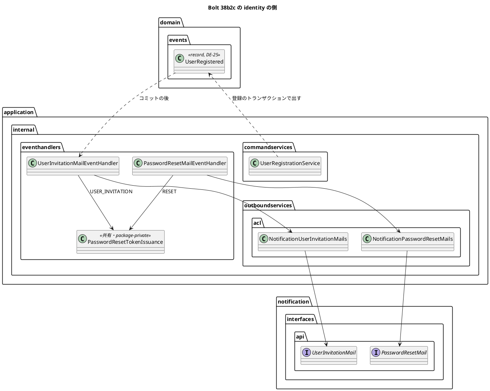

# Bolt 38b2c 計画 - 利用者の招待の発行（identity の側）と、招待の用途の規則

## 基本情報

| 項目 | 内容 |
| :--- | :--- |
| Bolt | 第 38b2c 回（W6 の 22 本目。38b2b・38b2c の 2 つ目） |
| 予定 | W6（2026-11-09 の週。前倒しで着手できる）。作業は約 3.7 時間（`check`・SonarQube・CI の待ちを除く） |
| アプローチ | インサイドアウト（イベントとハンドラーから。release_plan の 38b2c の行、development_strategy の W6「新しい振る舞いはインサイドアウト」） |
| 対象 | (1) 登録のイベント DE-25 `UserRegistered`（登録のトランザクションで出す）、(2) 再設定と招待で共有するトークンの発行の部品（再設定の振る舞いは変えない）、(3) 招待のハンドラーと identity の ACL（通知の公開 API `UserInvitationMail` を呼ぶ）、(4) ArchUnit の規則「招待の用途を参照するのは招待のハンドラーだけ」と名前の見張り、(5) 登録から Mailpit までの統合テスト、(6) 設計の文書 |
| トレース | US-16 AC1（関係の記録。登録の手段として初回の設定の案内を足す。38b 系の決定。確認ポイント 9）、ADR-017（決定 2・4。identity からの呼び出しと、送信を応答から切り離すこと）、IA-INV-12（再設定のトークン）、SEC-08（招待のトークンは 24 時間・1 回だけ） |
| GitHub | [#14](https://github.com/k2works/practical-domain-driven-design-in-enterpris-application/issues/14)（US-16） |
| SP | 0 |
| 承認ゲート | 計画と終了報告。構造（新しいイベント、発行の共有の部品、ArchUnit の規則の追加）、セキュリティ（トークンの発行・リンクの平文の扱い）、外部連携（通知の公開 API の呼び出し）、新しいファイル（下の一覧）。スキーマは変えない |
| 開始準備で決めたこと | 2026-10-26、human:kakimomokuri: (1) 発行の手順（占有・再配信の確かめ・有効か・前の未使用の無効化・発行）は部品に抜き出し、2 つのハンドラーが使う、(2) DE-25 には登録の ID・利用者の ID・登録の時刻だけを載せる（メールアドレスはハンドラーが利用者から読む）、(3) 登録の後、発行までに利用者が利用停止・企業が無効になったら発行しない、(4) 招待の発行の規則は用途の定数 `USER_INVITATION` の参照で守り、名前の見張りと組にする |

新しいファイル: 本体は `identity/domain/events/UserRegistered.java`、`identity/application/internal/eventhandlers/PasswordResetTokenIssuance.java`（`IssuedLink` は入れ子の record）・`UserInvitationMailEventHandler.java`、`identity/application/internal/outboundservices/acl/NotificationUserInvitationMails.java`。テストは `identity/application/internal/commandservices/UserInvitationIntegrationTest.java`、`identity/application/internal/eventhandlers/UserInvitationMailEventHandlerTest.java`、`identity/domain/model/valueobjects/PasswordResetTokenPurposeTest.java`（今はない）。

## Bolt ゴール

システム管理者が利用者を登録したら、登録のコミットの後に招待のトークン（24 時間）を発行し、38b2b の通知の公開 API で招待のメールを送る。再設定の発行と手順を共有し、招待の用途を参照する部品を規則で 1 か所に限る。画面はないので見える振る舞いは変えない（登録の画面は 38b3。受入シナリオは 38b4）。

### 開始準備で確かめたこと

- **再設定の発行の流れ**: `PasswordResetMailEventHandler.on(PasswordResetRequested)`（:76-107）は `@ApplicationModuleListener`（コミットの後・非同期・新しいトランザクション）で、`tokens.lockForIssue`（利用者の行の占有。いなければ false）→ `existsByRequestId`（再配信）→ `PasswordResetToken.allowsIssue(findLastIssuedAt(userId, RESET), now)`（1 分の抑え）→ 利用者が有効か（`authenticationRejection(company)` が空。停止と企業の無効）→ `invalidateUnused`（用途を問わない）→ `generator.generate`・`hasher.hash`・`PasswordResetToken.issue(RESET, requestId, …)`・`tokens.add` → ACL `NotificationPasswordResetMails.send(…)` の順。スキップの理由と送れなかった理由は INFO・WARN のログに出す。抑えは占有の後でないと直列にならない（同時の 2 つの依頼）
- **ACL と合成ルート**: `NotificationPasswordResetMails`（`application.internal.outboundservices.acl`。言語は `LOCALE = "ja"`。Receipt を `Optional<String>` の理由に変える）。`IdentityConfiguration:321-347` がハンドラーに `publicBaseUrl(environment) + SessionPaths.PASSWORD_RESET_URL + "/"` を渡す（招待のリンクも A-06 の同じ形。最後の段がトークン。38b2b の伏せ字の前提）
- **登録のサービス**: `UserRegistrationService.registerInTransaction` の `Registered` の枝（:123-132）で利用者・付与・監査を書く。コンストラクターは 7 引数（`java:S107` の抑止あり）で、イベントの発行者を持たない。重複のメールアドレスは `execute` の外で値にする（そのときイベントはロールバックで消える）。`UserRegistrationServiceTest:58` がコンストラクターを直に作る。`UserRegistrationIntegrationTest` は `@IdentityIntegrationTest`（Mailpit を含む）で、登録が成功すると、この Bolt から非同期で招待の発行と送信が走る
- **イベントの規則**: `DomainEventArchitectureTest`（`@DomainEvent` の record は `domain.events` に置き、Java 標準と共有カーネルの型だけを持つ）。DE-23 は「発行記録に JSON で残るので、トークン・リンク・メールアドレスを載せない」。DE の番号は DE-24 まで使っていて、DE-25 は空いている。イベントの一覧は domain_model のイベントの表（:1557-1582）の 1 か所で、前置き（:1555）は「すべてのイベントはアクセス・監査が購読して監査記録を残す」、DE-23 の行（:1582）は監査を同期に書く例外を述べる
- **用途の定数**: `PasswordResetTokenPurpose.USER_INVITATION` を本体で参照するクラスはない（永続化は `MyBatisPasswordResetTokenRepository:85` の `valueOf`）。テストの `PasswordResetRequestIntegrationTest:275` が招待のトークンを直に作る（`LayerArchitectureTest` は `DoNotIncludeTests`（:43））。`accessField(Class, String)` は ArchUnit 1.5.1 にある。列挙の初期化と `$values()` の自己参照は `areNotAssignableTo(PasswordResetTokenPurpose.class)` で外れる
- **38b4 との関係**: release_plan の 38b4 の行（:779）は、A-06 を「用途で見出し・説明・期限の文言・完了の知らせ・監査」で出し分け、用途はトークンから読む（Bolt 38b の決定 (3)）。A-06 の部品が定数 `USER_INVITATION` を参照すると、この Bolt の規則に当たる
- **テストの前例**: `PasswordResetRequestIntegrationTest`（依頼から Mailpit、平文が表と発行記録に残らない（`publications(user)` :110-117）、依頼の後に止められた利用者、1 分の抑え、招待の直後の再設定（行 7b、:268）、ロールバック、再配信（:316-330。`target.on` を 2 回呼んで例外が出ない）、同時の 2 つの発行。`awaitCompletedPublications` で発行記録の完了を待つ）。ハンドラーの単体のテストはない（Mockito の前例はテストに 31 ファイル）。ログは `identity.LogCapture` で捕まえる
- **要求**: US-16 AC1 の文（user_story.md:677）は「役割を付与する → 関係と変更履歴が記録される」で、招待と初回の設定は要求の文書のどこにもない（ui_design:1668 の解釈。US-16 には 34・34b・34d の決定の注はあるが 38b 系の注はない）

## 設計の決定（案）

| 項目 | 決定 | 根拠 |
| :--- | :--- | :--- |
| 登録のイベント | DE-25 `UserRegistered(UUID registrationId, UserId userId, UtcInstant registeredAt)`（`identity.domain.events`、`@DomainEvent`。Javadoc は「DE-25 利用者を登録した。」で始める）。`registerInTransaction` の `Registered` の枝で、`users.addRegistered`・`auditRecords.append` の後に `ApplicationEventPublisher` に出す（拒否と重複のロールバックでは残らない）。`registrationId` は新しい UUID で、招待のトークンの `request_id` と通知の `event_id` になる。操作者・メールアドレス・役割は載せない。監査は登録のサービスが同期に書くので、このイベントからは書かない（DE-23 の前例）。`UserRegistrationService` のコンストラクターに発行者を足す（8 引数。抑止の理由の文を直す） | 開始準備の決定 (2)、DE-23 の前例 |
| 外側のトランザクション | DE-25 は `Registered` の枝でだけ出るので、外側のトランザクションに合流しても、発行記録とコミットの後のリスナーは外側のコミットかロールバックに従う（招待が出るのは外側がコミットしたときだけ）。38b2 の既知の課題（拒否と重複で外側を rollback-only にする）は悪化しない（Spring Modulith の発行記録が同じトランザクションで書かれる前提の推論。38b3 の開始準備で画面の呼び方とあわせて確かめる） | Bolt 38b2 の既知の課題 |
| 発行の共有の部品 | `PasswordResetTokenIssuance`（`application.internal.eventhandlers`、package-private の final class。Bean にせず 2 つのハンドラーがコンストラクターの引数から作る。前例 `LinkMailDelivery`）: `Optional<IssuedLink> issue(PasswordResetTokenPurpose purpose, UUID requestId, UserId userId, String linkPrefix)` が占有 → 再配信 → 抑え → 有効か → 前の未使用の無効化 → 発行と記録をまとめ、発行しなかったときは理由を INFO のログに出して空を返す。`IssuedLink`（入れ子の record）は発行したトークン・宛先のメールアドレス・リンクを持ち、平文はこの値とメールの要求にだけある。`toString` はリンクとアドレスを伏せる（前例 `UserInvitationMailRequest`）。ログの文は用途を含む一般の文（「{用途} のトークンを発行しなかった（理由）: 契機 {}」） | 開始準備の決定 (1)、MNT-02 |
| 1 分の抑え | 抑えるかを用途の値に持たせる（`PasswordResetTokenPurpose.throttlesRepeatedIssue()`。`RESET` は true、`USER_INVITATION` は false）。部品は占有の後に、この値が true の用途だけ、**発行する用途**の前の発行の時刻（`findLastIssuedAt(userId, purpose)`）を見る（今の Javadoc「繰り返しの依頼の抑えは RESET の発行だけで数え」を値にする）。開始準備の選択肢では「再設定のハンドラーだけが前に見る」と書いたが、抑えは占有の後でないと同時の 2 つの依頼を直列にできないので、この形を推奨にする（確認ポイント 2） | IA-INV-12、T-100 |
| 招待のハンドラー | `UserInvitationMailEventHandler`（`application.internal.eventhandlers`、`@Service` は JIG の印、組み立ては `IdentityConfiguration`）: `@ApplicationModuleListener` で DE-25 を受け、部品で `USER_INVITATION` のトークンを発行し、ACL で送る。送れなかったら WARN のログ（登録の ID とトークンの ID と通知の側が伏せた理由。リンク・トークン・アドレスは出さない）を出して例外にしない（トークンは残る。出口は A-05） | 開始準備の決定 (3)、ADR-017 の決定 4 |
| ACL | `NotificationUserInvitationMails`（`application.internal.outboundservices.acl`）: `UserInvitationMail.send(new UserInvitationMailRequest(…, "ja"))` を呼び、Receipt を `Optional<String>` の理由にする。言語の定数は再設定の ACL と同じ値（共有はしない。2 行） | 前例 `NotificationPasswordResetMails` |
| 合成ルート | `IdentityConfiguration` に ACL と招待のハンドラーの Bean。リンクの接頭辞は再設定と同じ式（A-06。38b4 で用途によって出し分ける） | 前例 |
| ArchUnit の規則 | `LayerArchitectureTest` に、書き手の FQN の定数（`UserInvitationMailEventHandler`）と、「招待の用途を参照するのは招待のハンドラーだけ」（`noClasses().that().doNotHaveFullyQualifiedName(書き手).and().areNotAssignableTo(PasswordResetTokenPurpose.class).should().accessField(PasswordResetTokenPurpose.class, "USER_INVITATION")`）と名前の見張り（`classes().that().haveFullyQualifiedName(書き手).should().accessField(…)`）の 2 つ。Javadoc に、守るのは定数の参照で、`valueOf`・`values()` は捕まえず、用途の `switch` は形によって当たるか、すり抜けることを書く（T-153・T-205） | 開始準備の決定 (4)、T-135 |
| 38b4 の出し分け | A-06 の出し分け（38b4）は定数を参照せず、用途の値の振る舞い（`throttlesRepeatedIssue()` と同じ形の、enum の中で定数を見るメソッド。例: 見出しや文言のキー）で問い合わせる。参照が要るなら規則の例外として人に諮る。release_plan の 38b4 の行に書く（横断整合性検証の高の指摘への案 (a)。確認ポイント 6） | 開始準備の決定 (4)、Bolt 38b の決定 (3) |

## ふりかえりと前の Bolt からの引き継ぎ

| 出典 | 内容 | この Bolt での扱い |
| :--- | :--- | :--- |
| Bolt 38b2b Try T-206 | 伏せ字・マスクのテストは、残る文字列の全文で期待する | 行 6 の WARN と行 2 のログを、ハンドラーのロガーの行の全文で確かめる |
| Bolt 38b2b Try T-207 | 文書に行を足すスクリプトは、先に節の形を読む | ステップ 1（ADR-017 の改訂の経緯は箇条書き） |
| Bolt 38b2b の既知の課題 | 一般の口と共有の部品の範囲（38d）、伏せ字の形の前提（リンクの最後の段がトークン） | 後者はこの Bolt で守る（リンクの接頭辞にトークンを続ける）。前者は 38d のまま |
| Bolt 38b2 Try T-205、Bolt 38b2 の既知の課題 | 「書き手は 1 か所」は規則で守る。外側のトランザクションに合流したときの rollback-only、書式文字だけの表示名 | 前者は招待の用途の規則で守る。rollback-only は上の設計の決定で悪化しないと判断した。2 つの課題は 38b3 の行に書き足す（今の行にない） |
| Bolt 38b Try T-203・T-204 | 新しい `@DomainEvent` などの Javadoc は用語集の名前で始める、複数行のスクリプトはファイルにする | DE-25 の Javadoc。守る |
| Bolt 38 Try T-200〜T-202 | 変異はバイトのまま、最小の形、止まっているかは時刻で決める | 変異の表 |
| Bolt 37f2 Try T-197、Bolt 37c Try T-126 | 文書の行を突き合わせる、新しい値の一覧は grep で探してすべてに足す | ステップ 1 の行の一覧と完了の判定（grep で残りがない） |

## 状態の組み合わせ（行ごとにテストを 1 本。T-182）

| 行 | 状況 | 期待 | 出口 | 確かめ方 |
| :--- | :--- | :--- | :--- | :--- |
| 1 | システム管理者が利用者を登録する | コミットの後に招待のトークンを 1 つ（用途 `USER_INVITATION`、期限は 24 時間、`request_id` は登録の ID）。Mailpit に招待のメールが 1 通（件名、本文のリンクは A-06 の接頭辞にトークン）。通知の記録は `USER_INVITATION`・SENT・`target_ref` はトークンの ID | 本人がリンクを開く（A-06） | `UserInvitationIntegrationTest` |
| 2 | 同じ登録 | リンクの平文とトークンが表・発行記録に残らない。DE-25 の発行記録にメールアドレスがない。ハンドラーのロガーの行にリンク・トークン・アドレスがない（`LogCapture` を `awaitCompletedPublications` の後まで開いておく） | — | 同上 |
| 3 | 登録が拒否される・重複のメールアドレス | 発行記録（`event_publication`）に `UserRegistered` の行が増えない（件数の前後の差で見る）。トークンもメールもない | 管理者が直して登録し直す | 同上 |
| 4 | 同じ DE-25 の再配信 | ハンドラーを 2 回呼んでも例外が出ず、トークンは 1 つ、メールは 1 通（前例 :316-330） | — | 同上 |
| 5 | 登録の後、発行の前に利用者が利用停止になった・企業が無効になった | 発行も送信もしない | 再開の後に本人が A-05 で設定する | 同上 |
| 6 | 招待のメールを送れない | 例外にせず WARN のログ（全文に登録の ID とトークンの ID があり、リンク・トークン・アドレスがない）。トークンは残る | 本人が A-05 で設定する | `UserInvitationMailEventHandlerTest`（`Failed` を返す `UserInvitationMail` の偽物を本物の ACL で包む。リポジトリと生成器とハッシュは Mockito） |
| 7 | 再設定（共有の部品に移した後） | 今までどおり（1 分の抑え、依頼の後に止められた利用者、招待の直後の再設定、ロールバック、再配信、同時の 2 つの発行） | 今までどおり | `PasswordResetRequestIntegrationTest`（変えない） |
| 8 | 用途の値 | `RESET` は抑えを数え、`USER_INVITATION` は数えない | — | `PasswordResetTokenPurposeTest` |
| 9 | 招待の用途をほかのクラスが参照する・書き手が参照しなくなる | 前者は参照の規則が落ちる、後者は名前の見張りが落ちる（今の本体では両方緑） | — | `LayerArchitectureTest`（変異で確かめる） |
| 10 | DE-25 の型 | `domain.events` の record で、Java 標準と共有カーネルの型だけ | — | `DomainEventArchitectureTest`（既存の規則が新しい型に当たる） |

## スコープ

### 入れるもの

- 行 1〜10 のテスト、`UserRegistered`、`UserRegistrationService` のイベントの発行（と `UserRegistrationServiceTest:58` の直し）、`PasswordResetTokenIssuance`・`IssuedLink`、`PasswordResetTokenPurpose.throttlesRepeatedIssue`、`PasswordResetMailEventHandler` の共有の部品への移し替え、`UserInvitationMailEventHandler`、`NotificationUserInvitationMails`、`IdentityConfiguration`、`LayerArchitectureTest` の 2 つの規則
- 古くなる注: `PasswordResetTokenPurpose` の Javadoc（:6-9・:14）、`PasswordResetTokenRepository.java:21`、`UserRegistrationService` のクラスの Javadoc（:27-37）、`eventhandlers/package-info.java`（イベントハンドラーと共有の部品）
- 設計の文書（T-126。行番号は 2026-10-26 の版）:
  - domain_model: イベントの表に DE-25（:1582 の DE-23 の行にならう）、用語集に `UserRegistered`・`PasswordResetTokenIssuance`・`UserInvitationMailEventHandler`・`NotificationUserInvitationMails`（:227 の DE-23 の行の近く）、:229（再設定のハンドラーは共有の部品を使う）、:237（用途の値 `throttlesRepeatedIssue`）、:238（利用者の招待。発行と送信は済み）、:239（登録のサービスは DE-25 を出す）、:1172（再設定の流れに招待の流れと共有の部品）・:1174（利用者の登録の段落）、:1362 IA-INV-12（抑えは用途の値が決める、招待では `request_id` は登録の ID）、:1455（「呼ぶのは Bolt 38b2c」を済みに）
  - ADR-017: 決定 2 の identity の側に招待のハンドラーと ACL、決定 4 の表（:66-71・:75。DE-25、招待のハンドラーと共有の部品、招待は 24 時間で抑えを数えない、送れないときの出口は A-05）、改訂の経緯（箇条書き）
  - architecture_backend: :153 にならって identity の ACL `NotificationUserInvitationMails`、:154 の「呼ぶのは Bolt 38b2c」を済みに、合成ルートの節、規則の節（招待の用途の規則）
  - ui_design :1670（「送るのは Bolt 38b2c の…」を済みに）、non_functional SEC-08（「発行と送信は 38b2c」を済みに）、test_strategy :278（IA-INV-12 の行）と Mailpit の行（登録から招待のメール）、data_model :927（`request_id` の注に DE-25 の再配信）
  - user_story: US-16 に 38b 系の決定の注（登録と招待。確認ポイント 9）
  - release_plan: 主なタスクの行（:802）、W6 の状態の段落（:703）、38b3 の行に 38b2 の既知の課題（rollback-only・書式文字だけの表示名）、38b4 の行に出し分けは定数を参照しないこと、更新履歴

### 入れないもの

- 登録の画面（38b3）、A-06 の用途による出し分けとマニュアル・受入シナリオ・動画（38b4）
- 招待の再送の操作（作らない。本人が A-05 で設定できる）、招待の監査の記録（DE-25 に操作者を載せない決定のとおり、今は作らない）
- スキーマの変更（`password_reset_token.purpose` は Bolt 38b で足した）

## 設計（この Bolt の範囲）

- ER 図: 表と列を変えないので省く。状態遷移図: トークン（未使用 → 使用済みか無効）と利用者の状態は変わらないので省く。画面遷移図: 画面を変えないので省く

## ステップ計画

- [ ] **1. 設計の文書**: 上のスコープの行の一覧（完了の判定: 文書の差分と、`grep -n "38b2c"`・`grep -n "PasswordResetMailEventHandler"` で古い記述が残っていない）
- [ ] **2. 発行の共有の部品（リファクタリング）**: 行 8 のテストで値が Red になることを確かめてから、用途の値と `PasswordResetTokenIssuance` を作り、再設定のハンドラーを移す（完了の判定: 行 7 の既存のテストが緑）
- [ ] **3. DE-25 と招待のハンドラー（Red → Green）**: 行 1〜6・10 のテスト、`UserRegistered` と登録のサービスの発行（`UserRegistrationServiceTest` の直し。既存の `UserRegistrationIntegrationTest` は登録の後に招待が走ることを受け入れる）、招待のハンドラー、ACL、合成ルート（完了の判定: 期待した理由で落ちた後に緑）
- [ ] **4. ArchUnit の規則**: 行 9 の 2 つの規則（変異で確かめる）
- [ ] **5. 品質ゲートと開発レビュー**: 変異、`check`・`uiTest`、その後に SonarQube（重複率を見る）、開発レビューとその直し。実装のコミットの前に T-197 の突き合わせ
- [ ] **6. 終了報告**: push して CI と MkDocs とデモ環境の配備を確かめる。release_plan・開発の索引・mkdocs を完了に直す

### 時間の配分と打ち切り

| # | 目安 | 打ち切り |
| :--- | :--- | :--- |
| 1 | 40 分 | — |
| 2 | 50 分 | 共有の部品で行 7 の既存のテストが揺らぐときは、再設定のハンドラーを戻し、招待のハンドラーだけが部品を使う形にして重複率を SonarQube で確かめる（報告に書く） |
| 3 | 70 分 | — |
| 4 | 20 分 | 規則が合成のクラスなどに当たって書けないときは、規則を足さず人に諮る |
| 5 | 30 分（待ちを除く） | — |
| 6 | 10 分（CI の待ちを除く） | — |

合計 220 分（約 3.7 時間）。

## 確認ポイント（計画の承認の場でまとめて確認する。Try T-6）

| # | 確認すること | 場所 | 推奨 |
| :--- | :--- | :--- | :--- |
| 1 | **DE-25（構造）** | ステップ 3 | 登録の ID・利用者の ID・時刻だけ。登録のトランザクションで出し、ロールバックで消える。監査はこのイベントから書かない。登録のサービスの引数が 8 つになる |
| 2 | **1 分の抑えの置き場所（開始準備の選択肢の説明からの変更）** | ステップ 2 | 用途の値 `throttlesRepeatedIssue()` に持たせ、共有の部品が占有の後に、発行する用途の前の発行を見る（占有の前に見ると同時の 2 つの依頼を直列にできない） |
| 3 | **発行の共有の部品（開始準備の決定 (1)）** | ステップ 2 | `PasswordResetTokenIssuance`（package-private。Bean にしない）。発行しなかった理由のログの文が用途を含む一般の文に変わる（ログの文を期待するテストと手順書はない） |
| 4 | **セキュリティ** | ステップ 3 | 招待のトークンは 24 時間・1 回だけ。リンクの平文は表・発行記録・ログに残さない（`IssuedLink` の `toString` も伏せる）。発行の前に有効か確かめ、止められていれば発行しない（開始準備の決定 (3)） |
| 5 | **外部連携** | ステップ 3 | 通知の公開 API `UserInvitationMail` を ACL から同期で呼ぶ。送れなくても例外にしない（出口は A-05） |
| 6 | **ArchUnit の規則と 38b4（開始準備の決定 (4)、横断整合性検証の高の指摘）** | ステップ 4、release_plan の 38b4 の行 | 定数の参照の規則と名前の見張り。38b4 の A-06 の出し分けは定数を参照せず、enum の中のメソッドで問い合わせる（参照が要るなら規則の例外として諮る）。`valueOf`・`values()` は捕まえない |
| 7 | **外側のトランザクション** | 設計の決定 | DE-25 で 38b2 の既知の課題（rollback-only）は悪化しないと判断した（推論。38b3 で確かめる） |
| 8 | **見える振る舞い** | — | 登録の画面がないので変わらない。マニュアル・キャプチャ・受入シナリオは変えない（38b4） |
| 9 | **要求の文書** | ステップ 1 | US-16 の AC1 は役割の付与の文で、招待がない。US-16 に 38b 系の決定の注（登録の手段と初回の設定の案内）を足す（AC の文は変えない） |
| 10 | **変異** | ステップ 5 | 下の 9 つ。スクリプトはバイトのまま読み書きし、gradlew.bat を絶対パスで呼び、結果の XML を消してから流す（T-164・T-178・T-200） |

### 変異と落ちる見込みのテスト

| # | 変異 | 落ちる見込み |
| :--- | :--- | :--- |
| V1 | 登録のサービスが DE-25 を出さない | 行 1 |
| V2 | DE-25 を登録のトランザクションの外（`execute` の後、結果を問わず）で出す | 行 3（発行記録の件数） |
| V3 | 部品が再配信を確かめない | 行 4（2 回目の `add` が一意制約の例外になる）・行 7 の再配信 |
| V4 | 部品が有効かを確かめない | 行 5・行 7 の止められた利用者 |
| V5 | `USER_INVITATION` も抑えを数える | 行 8 だけ（新しい利用者には前の招待がなく、振る舞いでは観測できない） |
| V6 | 招待のハンドラーが ACL の失敗を例外にする | 行 6 |
| V7 | ほかのクラス（例: 再設定のハンドラー）が `USER_INVITATION` を参照する | 行 9（参照の規則） |
| V8 | 招待のハンドラーが `RESET` で発行する | 行 9（名前の見張り）・行 1（用途と期限） |
| V9 | 部品の抑えが、発行する用途でなく用途を問わず前の発行を見る | 行 7 の 7b（招待の直後の再設定） |

## 完了条件

- [ ] 上のステップ 1〜6 の完了の判定を満たす
- [ ] 行 1〜10 に、それを名乗るテストがある（既存のテストが当たる行は、報告にそう書く）
- [ ] `check`・`uiTest` が緑、SonarQube が PASS（重複 3% 未満）、CI が緑、デモ環境が新しい版で動く
- [ ] 見える振る舞いが変わらない（マニュアルは変えない。受入シナリオは書かない）
- [ ] 終了報告が承認される

## 更新履歴

| 日付 | 更新内容 | 更新者 |
| :--- | :--- | :--- |
| 2026-10-26 | 整合性検証の指摘を反映した（承認待ち）。招待の用途の規則と 38b4 の A-06 の出し分けの関係（出し分けは定数を参照せず enum の中のメソッドで問い合わせる）、文書で直す行の一覧（domain_model・ADR-017 の決定 4・architecture_backend・ui_design・test_strategy・data_model・user_story・release_plan の 38b3 と 38b4 の行）、行 3 の発行記録の確かめ、V5 の期待と V9、行 6 の偽物とログの全文、外側のトランザクションの判断、新しいファイルの一覧、既存のテストへの影響、古くなる注 | anthropic/claude-opus-5-5 |
| 2026-10-26 | 初版作成（承認待ち）。開始準備で、発行の手順を部品に抜き出す、DE-25 は ID と時刻だけ、発行の前に止められていれば発行しない、招待の発行の規則は用途の定数の参照で守ると決めた（human:kakimomokuri） | anthropic/claude-opus-5-5 |

## 関連ドキュメント

- [リリース計画](release_plan.md)（W6 節の 38b2c・38b3・38b4 の行）、[Bolt 38b2b 計画](bolt_38b2b_plan.md)・[終了報告](bolt_38b2b_report.md)、[Bolt 38b2 終了報告](bolt_38b2_report.md)、[Bolt 38b 計画](bolt_38b_plan.md)、[Bolt 33 計画](bolt_33_plan.md)
- [ADR-017](../../adr/cargo-tracker/017-notification-module-and-mail.md)、[ドメインモデル](../../design/cargo-tracker/domain_model.md)、[バックエンドのアーキテクチャ](../../design/cargo-tracker/architecture_backend.md)、[非機能要件](../../design/cargo-tracker/non_functional.md)、[ユーザーストーリー](../../requirements/cargo-tracker/user_story.md)（US-16）
