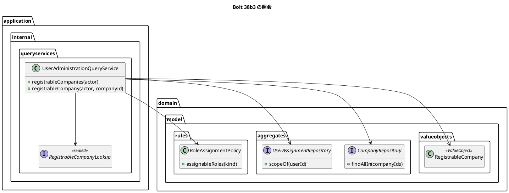

# Bolt 38b3 計画 - 登録の画面の下ごしらえ（表示名の規則と、登録できる企業の照会）

## 基本情報

| 項目 | 内容 |
| :--- | :--- |
| Bolt | 第 38b3 回（W6 の 23 本目。開始準備で 38b3 を 38b3（下ごしらえ）・38b3b（画面）に分けた 1 つ目） |
| 予定 | W6（2026-11-09 の週。前倒しで着手できる）。作業は約 2 時間（`check`・SonarQube・CI の待ちを除く） |
| アプローチ | インサイドアウト（照会とドメインの規則から）。development_strategy の W6 は「既存の集約と照会に操作や判定を足す Bolt はアウトサイドイン」だが、外側の画面はまだなく（38b3b）、利用者の生成という新しい振る舞いの一部なので「新しい振る舞いはインサイドアウト」に当てる。画面は 38b3b がアウトサイドインで足す |
| 対象 | (1) 登録の表示名の規則（前後の空白に NBSP などの Unicode の空白を含め、書式文字（Cf）と行・段落の区切り（Zl・Zp）を含む名前を拒む。Bolt 38b2 の既知の課題）、(2) 登録できる企業の照会（管理範囲の、有効で、付けられる業務の役割がある企業の一覧と、1 社の照会）、(3) 企業のリポジトリの口と mapper、(4) 設計の文書 |
| トレース | US-16 AC1・AC2（登録と管理範囲）、UC-16 の主シナリオ 1、IA-INV-13（企業の種類と役割）、IA-INV-14（管理範囲） |
| GitHub | [#14](https://github.com/k2works/practical-domain-driven-design-in-enterpris-application/issues/14)（US-16） |
| SP | 0 |
| 承認ゲート | 計画と終了報告。構造（照会の新しい値と口、リポジトリの口）、セキュリティ（新しい照会の口での操作者と管理範囲の判定。IA-INV-14）、新しいファイル。スキーマ・画面・認可の規則は変えない |
| 開始準備で決めたこと | 2026-10-26、human:kakimomokuri: (1) 38b3 を 2 つに分ける（38b3: 表示名の規則と登録できる企業の照会。見える振る舞いは変わらない。38b3b: 2 段の画面・確認の POST・確定・認可と CSRF の統合テスト・UI テストと axe・マニュアル 11 章とキャプチャ）、(2) 登録の確認の領域へは POST で進み、値は hidden で持つ（メールアドレスと表示名を URL・アクセスログ・履歴に残さない。確認の POST は何も書かない。38b3b）、(3) 企業を選ぶ画面と、その企業に付けられる役割と入力の画面の 2 段にし、JS を使わない（38b3b）、(4) 付けられる役割がない荷受人の企業は選択肢に出さない（画面を経ない送信は今の拒否で守る）、(5) 書式文字と NBSP だけの表示名を拒む。整合性検証の後（同日）: (6) 38b3b と 38b4 の「同じ配備」は、38b3b を機能ブランチで進めて PR の CI を緑にし、develop へのマージを 38b4 と一緒にして守る（デモ環境は develop への push で自動で配備されるため。38b3 は見える振る舞いが変わらないので develop で進める）、(7) `RegistrableCompany` は射影の前例 `UserSummary` に合わせて `domain.model.valueobjects` に `@ValueObject` で置き、照会の結果 `RegistrableCompanyLookup` は前例 `UserLookup` に合わせて `queryservices` に印なしの sealed で置く、(8) 名前の途中の行・段落の区切り（U+2028・U+2029）も拒む、(9) 38b3 に送られていた既知の課題（rollback-only と DE-25 の推論の確かめ、Bolt 38 の停止の理由の文言とエラー要約の二重の読み上げ、Bolt 38b2c の行 3 の件数の前提）は 38b3b に送り、38b3b の開始準備で確かめて諮る |

## Bolt ゴール

38b3b の登録の画面が、選択肢に出す企業と、1 社を選んだときの可否を照会で得られるようにする。登録の表示名で、見分けにくい名前（書式文字・区切り文字を含む、NBSP などの空白だけ）を拒む。画面はないので見える振る舞いは変えない。

### 開始準備で確かめたこと

- **表示名の判定**: `UserRegistrationService.normalizedDisplayName`（:187-193）は `strip()`（`Character.isWhitespace` の空白だけを除く。U+3000 は除くが、NBSP（U+00A0）・U+202F・U+2007 は除かない）の後、空・200 コードポイントを超える・`Character::isISOControl` を含むなら拒む。U+202E などの書式文字（Cf）と U+2028・U+2029 は通る（Bolt 38b2 の終了報告の低の指摘、既知の課題）。拒否は `UserRegistrationRefusal.InvalidDisplayName`。テストは `UserRegistrationServiceTest` の拒否のパラメーター化（:192-201。コメントは 38b2 の「行 6」）と 200・201（:203-213）。空白を除く前例は `RecoveryCode.java:26` の `[\s\p{Z}]+`
- **管理範囲と企業**: `UserAssignmentRepository.scopeOf(UserId)` が `AdministrationScope`（`companies()`・`covers`）を返す。`CompanyRepository` は `add`・`findById` だけで、実装は `MyBatisCompanyRepository`（`identity.infrastructure.persistence`）の 1 つ。テストの `AuthenticationAuditListenerTest.java:257-269` に匿名の実装がある（口を足すと直す）。mapper は `selectCompany`（`IdentityMapper.xml:77`）と、IN 句の前例 `selectUserAdministrationRowsIn`（:142。空の集合では呼ばない）。`MyBatisUserRepository.findSummariesIn`（:131）は空なら空を返す（照会のサービス `list` は空を見ず、リポジトリで守る）
- **付けられる役割**: `RoleAssignmentPolicy.assignableRoles(CompanyKind)`（:85。業務の役割だけ）。荷主の企業は荷主、運用する会社は荷主以外の業務の役割、荷受人の企業は空（IA-INV-13）
- **照会のサービス**: `UserAdministrationQueryService`（`queryservices`）の `list`・`detail`。システム管理者でなければ空か `NotPermitted`。`detail` は管理範囲を先に読み、いない利用者と範囲外の利用者で読み出しの量をそろえる（Bolt 34b の開発レビュー）。結果の値は `UserLookup`（`queryservices`、印なしの sealed）。射影 `UserSummary`・`UserDetail` は `domain.model.valueobjects` に `@ValueObject`（architecture_backend :317）。`UserAdministrationQueryServiceTest:33` がコンストラクターを直に作る
- **登録のサービスの判定の順**: 操作者 → 企業の有無 → 管理範囲 → 企業の有効性 → 表示名 → 登録の判定 → 重複。範囲外の無効な企業は範囲外として扱う（Bolt 38b2 の終了報告の議題 1、`UserRegistrationServiceTest` の行 3b）
- **配備**: `.github/workflows/cargo-tracker-ci.yml` は、develop への push で check と ui が緑なら deploy-demo を走らせる。pull_request でも CI は動くが配備しない（開始準備の決定 (6) の根拠）
- **画面の側の事実（38b3b に送る）**: S-20 は素の form で、確認は GET とクエリ、確定は POST と PRG（ui_design :182-183 の「確認の GET は書かない」「範囲外の試行は確定の POST でだけ記録する」は GET を前提にした文）。`/staff/users/**` は `hasRole(SYSTEM_ADMIN)`。テンプレートに `<select>` の前例はなく、選択肢はラジオとチェックボックス。UI テストの準備では荷主の利用者の企業が「荷主 テスト」、ほかは「A 社」（`UiUsers:186-191`）。マニュアル 11 章 :55 は「利用者の登録は、この画面ではまだできません」

## 設計の決定（案）

| 項目 | 決定 | 根拠 |
| :--- | :--- | :--- |
| 表示名の規則 | 前後から `Character.isWhitespace` か `Character.isSpaceChar` のコードポイント（NBSP・U+202F・U+2007・U+3000 を含む）を除き、空・200 コードポイントを超える・制御文字（`isISOControl`）を含む・書式文字（`Character.getType == FORMAT`。U+202E・U+200B・U+200D・U+FEFF・国旗のタグ）を含む・行と段落の区切り（`LINE_SEPARATOR`・`PARAGRAPH_SEPARATOR`。U+2028・U+2029）を含むなら `InvalidDisplayName`。判定は登録のサービスの中のまま（役割の変更と停止は表示名を扱わない）。絵文字の ZWJ の連なりと国旗のタグも拒むことになる（受け入れる）。既に登録した利用者の名前は変えない | 開始準備の決定 (5)・(8)、Bolt 38b2 の既知の課題 |
| 登録できる企業 | `RegistrableCompany(CompanyId id, String name, CompanyKind kind, Set<Role> assignableRoles)`（`domain.model.valueobjects`、`@ValueObject`。Javadoc は「登録できる企業。」で始める（T-203））。付けられる役割は `RoleAssignmentPolicy.assignableRoles` から作る | 開始準備の決定 (4)・(7) |
| 一覧の照会 | `UserAdministrationQueryService.registrableCompanies(AuthenticatedActor)`: システム管理者でなければ空（リポジトリを呼ばない）。管理範囲の企業を 1 回で読み（空の範囲はリポジトリが空を返す。前例 `list`）、有効で付けられる役割がある企業だけを、リポジトリの順（名前・ID）で返す | 開始準備の決定 (3)・(4) |
| 1 社の照会 | `registrableCompany(AuthenticatedActor, CompanyId)` が `RegistrableCompanyLookup`（`queryservices`、印なしの sealed。`NotPermitted`・`NotFound`・`OutOfScope`・`Inactive`・`NoAssignableRoles`・`Found(RegistrableCompany)`）を返す。順は「操作者 → 管理範囲を読む → 企業の有無 → 範囲外 → 有効性 → 付けられる役割」で、登録のサービスと同じ。範囲外の無効な企業と範囲外の荷受人の企業も `OutOfScope`（範囲外の企業の状態を示さない）。管理範囲を先に読み、`detail` と同じく読み出しの量をそろえる。38b3b の 2 段目の GET が使い、`NotFound` と `OutOfScope` は同じ 404（GET では範囲外を記録しない）、`Inactive` と `NoAssignableRoles` は 1 段目に戻して文言を示す | 前例 `UserLookup`、Bolt 34b、Bolt 38b2 の議題 1 |
| リポジトリの口 | `CompanyRepository.findAllIn(Set<CompanyId>)`（空の集合なら SQL を流さず空。名前・ID の順）と mapper の `selectCompaniesIn`（前例 `selectUserAdministrationRowsIn` の IN 句。`ORDER BY name, id`） | 前例 `findSummariesIn` |

## ふりかえりと前の Bolt からの引き継ぎ

| 出典 | 内容 | この Bolt での扱い |
| :--- | :--- | :--- |
| Bolt 38b2 の既知の課題 | 書式文字と NBSP だけの表示名 | この Bolt で閉じる（開始準備の決定 (5)・(8)） |
| Bolt 38b2 の既知の課題（:71・:101）、Bolt 38b2c の既知の課題（:120） | 外側のトランザクションに合流したときの rollback-only（38b3 の画面は `@Transactional` の外で呼ぶ）と、DE-25 で悪化しないという推論 | 38b3b の開始準備で確かめて諮る（開始準備の決定 (9)）。release_plan の 38b3b の行に書く |
| Bolt 38 の既知の課題（`bolt_38_report.md:104-106`、Bolt 38b 計画 :79） | 停止の理由の文言を名前の文字列で持つこと、エラー要約の二重の読み上げと fieldset の `aria-invalid` | 38b3b（登録の画面の拒否の文言とエラー要約）に送る（開始準備の決定 (9)）。release_plan の 38b3b の行に書く |
| Bolt 38b2c の既知の課題（:90・:119） | 行 3 の件数の差は、テストが逐次に流れる前提 | 38b3b に送る（画面の統合テストが DE-25 を出す）。release_plan の 38b3b の行に書く |
| Bolt 38b2c Try T-208・T-209 | 選択肢を書く前に守る順序をコードで確かめる、非同期の結果を読むテストは前例の待ち方を写す | 1 社の照会の判定の順を、登録のサービスの順で確かめた。非同期の結果は読まない |
| Bolt 38b2b Try T-206 | 伏せ字・正規化は全文で期待する | 行 1 の前後の NBSP を除いた名前を、保存した表示名の全文で確かめる |
| W5 の Try T-106・T-119 | 「ないこと」を確かめる前に、対象があることを先に確かめる | 行 4 で、荷受人・無効・範囲外の企業を準備にそろえてから、出ないことを確かめる |
| W5 の Try T-125 | 置き場所で ArchUnit の規則に当たったら止めて諮る | 置き場所は開始準備の決定 (7) で決めた。当たったら止める |
| Bolt 37c Try T-126、Bolt 37f2 Try T-197 | 新しい値の一覧を grep で探す、文書の行を突き合わせる | ステップ 1 の行の一覧、ステップ 4 |

## 状態の組み合わせ（行ごとにテストを 1 本。T-182）

| 行 | 状況 | 期待 | 確かめ方 |
| :--- | :--- | :--- | :--- |
| 1 | 表示名が NBSP・U+202F・U+2007 だけ。前後に NBSP | 空白だけは拒む（U+3000 だけは今も拒む）。前後の NBSP は除いて受け付け、保存した表示名は除いた全文 | `UserRegistrationServiceTest`（拒否のパラメーター化と、保存した名前を captor で確かめる 1 本） |
| 2 | 表示名に U+202E・U+200B・U+FEFF・U+2028・U+2029 を含む | 拒む | 同上（拒否のパラメーター化） |
| 3 | 表示名が 200 コードポイント・201 コードポイント・制御文字を含む | 今までどおり（200 は受け付け、201 と制御文字は拒む） | 同上（既存） |
| 4 | 管理範囲の企業の一覧（準備に荷受人・無効・範囲外の企業がある） | 有効で付けられる役割がある企業だけ（荷受人の企業・無効な企業・範囲外の企業は出ない）、リポジトリの順のまま、役割は種類に合う業務の役割 | `UserAdministrationQueryServiceTest`（mock。並びは行 7 で確かめる） |
| 5 | システム管理者でない | 一覧は空で、管理範囲もリポジトリも読まない | 同上 |
| 6 | 1 社の照会 | 範囲の企業は `Found`、ない企業は `NotFound`、範囲外は `OutOfScope`、無効は `Inactive`、荷受人は `NoAssignableRoles`、システム管理者でなければ `NotPermitted` | 同上 |
| 6b | 範囲外の無効な企業・範囲外の荷受人の企業 | `OutOfScope`（範囲外の企業の状態を示さない） | 同上 |
| 7 | リポジトリの一覧 | 渡した ID の企業だけを名前・ID の順に返す（同じ名前の 2 社は ID の順。準備は ID の降順に入れる）、知らない ID は無視、空の集合は空 | `MyBatisIdentityRepositoriesIntegrationTest`（PostgreSQL） |

## スコープ

### 入れるもの

- 行 1〜7 のテスト、表示名の規則、`RegistrableCompany`・`RegistrableCompanyLookup`、照会の 2 つの口、`CompanyRepository.findAllIn` と mapper と実装、照会のサービスの組み立て（`IdentityConfiguration`）、既存のテストの直し（`AuthenticationAuditListenerTest` の匿名の実装に `findAllIn`、`UserAdministrationQueryServiceTest` のコンストラクター）
- 設計の文書（T-126。行番号は 2026-10-26 の版）:
  - domain_model: 用語集に `RegistrableCompany`・`RegistrableCompanyLookup`（登録の拒否の `CompanyNotFound`・`CompanyOutOfScope`・`InactiveCompany` との対応を 1 文で）、:235 `RoleAssignmentPolicy`（`assignableRoles`）、:239 登録のサービス（表示名の規則）、:247 `UserAdministrationQueryService`（2 つの口）、:1174 利用者の登録の段落、:1182 管理範囲の段落（照会の対象）、:1367 IA-INV-13（荷受人の企業は登録の選択肢に出さない）、:1368 IA-INV-14（登録できる企業の照会も管理範囲の企業だけ）、:1666 リポジトリの表（`findAllIn`）
  - architecture_backend: :317 の置き場所に `RegistrableCompany`（`domain.model.valueobjects`）と `RegistrableCompanyLookup`（`queryservices`）、照会の口とポート `findAllIn`・mapper `selectCompaniesIn`
  - user_story: :701 の「登録の画面は Bolt 38b3」を 38b3b に
  - release_plan: 38b3 を 38b3（インサイドアウト、承認ゲートは構造・セキュリティ）と 38b3b（アウトサイドイン、承認ゲートは認可・画面。機能ブランチで進め、develop へのマージは 38b4 と一緒。送った既知の課題 3 つ）の 2 つの行に、38b4 の行の「38b3 と同じ配備」を 38b3b に（デモ環境の配備の確かめは 38b4 の終了報告）、:703 の状態、:802 の主なタスク、更新履歴

### 入れないもの

- 画面・テンプレート・controller・認可と CSRF の統合テスト・UI テスト・マニュアル（38b3b）。ui_design の S-20 の行と拒否の文言も 38b3b
- 管理範囲の割り当ての画面（W10 の運用タスク。W6 の確認ポイント 12）
- スキーマの変更（照会だけ）

## 設計（この Bolt の範囲）

- ER 図: 表と列を変えないので省く。状態遷移図: 状態を持つものを足さないので省く。画面遷移図: 画面を変えないので省く（38b3b で載せる）

## ステップ計画

- [ ] **1. 設計の文書**: 上のスコープの行の一覧（完了の判定: 文書の差分と、`grep -n "38b3"` で分けた後の名前に合っている）
- [ ] **2. 表示名の規則（Red → Green）**: 行 1・2 のテストで、NBSP・U+202F・U+2007 だけの名前と、書式文字・区切り文字を含む名前が受け付けられて落ちることを確かめてから直す（行 3 と U+3000 は緑のまま）
- [ ] **3. 登録できる企業の照会（Red → Green）**: 行 4〜7 のテスト、値、照会の口、リポジトリの口と mapper と実装、既存のテストの直し（完了の判定: 期待した理由で落ちた後に緑。口を足したことによるコンパイルの誤りを Red にしない）
- [ ] **4. 品質ゲートと開発レビュー**: 変異、`check`・`uiTest`、その後に SonarQube、開発レビューとその直し。実装のコミットの前に T-197 の突き合わせ
- [ ] **5. 終了報告**: push して CI と MkDocs とデモ環境の配備を確かめる。release_plan・開発の索引・mkdocs を完了に直す

### 時間の配分と打ち切り

| # | 目安 | 打ち切り |
| :--- | :--- | :--- |
| 1 | 25 分 | — |
| 2 | 20 分 | — |
| 3 | 45 分 | — |
| 4 | 20 分（待ちを除く） | — |
| 5 | 10 分（CI の待ちを除く） | — |

合計 120 分（約 2 時間）。

## 確認ポイント（計画の承認の場でまとめて確認する。Try T-6）

| # | 確認すること | 場所 | 推奨 |
| :--- | :--- | :--- | :--- |
| 1 | **分け方と配備（開始準備の決定 (1)・(6)）** | release_plan | 38b3（表示名の規則と照会。develop で進める）・38b3b（画面。機能ブランチで進め、PR の CI を緑にし、develop へのマージは 38b4 と一緒。38b3b の完了条件は「PR の CI が緑」、デモ環境の配備の確かめは 38b4 の終了報告） |
| 2 | **表示名の規則（開始準備の決定 (5)・(8)）** | ステップ 2 | 前後の Unicode の空白を除き、書式文字と行・段落の区切りを含む名前を拒む。絵文字の ZWJ の連なりと国旗のタグも拒むことになる（受け入れる）。既に登録した利用者の名前は変えない |
| 3 | **照会の値と口（構造・セキュリティ。開始準備の決定 (7)）** | ステップ 3 | `RegistrableCompany`（`domain.model.valueobjects`、`@ValueObject`）と `RegistrableCompanyLookup`（`queryservices`、6 つの値）。判定の順は登録のサービスと同じで、範囲外の企業は状態によらず `OutOfScope` |
| 4 | **38b3b に送る決定（開始準備の決定 (2)〜(4)・(9)）** | release_plan の 38b3b の行 | 確認は POST と hidden、2 段の画面で JS なし、荷受人の企業は出さない。確認の POST も書かず、範囲外の記録もしない（38b2 の `check` と同じ）。「戻る」と誤りの示し直しも POST と hidden で行い、確定の後の PRG の行き先にメールアドレスを入れない。ui_design :182-183 の「確認の GET は書かない」は「確認（GET・POST）は書かない」に一般化する。企業の選択肢の名前は「企業名（企業の種類）」にし、同じ名前の企業は並び（名前・ID）で区別する。送った既知の課題 3 つを 38b3b の開始準備で確かめて諮る |
| 5 | **変異** | ステップ 4 | 下の 8 つ。スクリプトはバイトのまま読み書きし、gradlew.bat を絶対パスで呼び、結果の XML を消してから流す（T-164・T-178・T-200） |

### 変異と落ちる見込みのテスト

| # | 変異 | 落ちる見込み |
| :--- | :--- | :--- |
| V1 | 表示名の前後で `isSpaceChar` を見ない（`strip` に戻す） | 行 1 |
| V2 | 書式文字を見ない | 行 2 |
| V3 | 行・段落の区切りを見ない | 行 2 |
| V4 | 一覧で無効な企業を除かない | 行 4 |
| V5 | 一覧で付けられる役割のない企業を除かない | 行 4 |
| V6 | 1 社の照会で有効性と付けられる役割を範囲より先に見る | 行 6b |
| V7 | リポジトリで空の集合でも mapper を呼ぶ | 行 7（`IN ()` で SQL の誤り） |
| V8 | mapper の並びを名前だけにする | 行 7（同じ名前の 2 社の順。準備は ID の降順に入れる） |

## 完了条件

- [ ] 上のステップ 1〜5 の完了の判定を満たす
- [ ] 行 1〜7 に、それを名乗るテストがある
- [ ] `check`・`uiTest` が緑、SonarQube が PASS（重複 3% 未満）、CI が緑、デモ環境が新しい版で動く
- [ ] 見える振る舞いが変わらない（マニュアルは変えない。受入シナリオは書かない）
- [ ] 終了報告が承認される

## 更新履歴

| 日付 | 更新内容 | 更新者 |
| :--- | :--- | :--- |
| 2026-10-26 | 計画を承認した（確認ポイント 1〜5 を推奨のとおり） | anthropic/claude-opus-5-5、承認 human:kakimomokuri |
| 2026-10-26 | 整合性検証の指摘を反映した（承認待ち）。38b3b と 38b4 の同じ配備の守り方（機能ブランチ）、値と照会の結果の置き場所、行・段落の区切りも拒む、送られた既知の課題を 38b3b に送ると決めた（human:kakimomokuri）。1 社の照会の判定の順と行 6b、承認ゲートのセキュリティ、アプローチの根拠、文書の行の一覧、既存のテストの直し、変異の分け方と V6・V8、空の範囲はリポジトリで守る（前例 `list`）、Try の対応 | anthropic/claude-opus-5-5 |
| 2026-10-26 | 初版作成（承認待ち）。開始準備で、38b3 を 38b3・38b3b に分け、確認は POST と hidden、2 段の画面で JS なし、荷受人の企業は出さない、書式文字と NBSP だけの表示名を拒むと決めた（human:kakimomokuri） | anthropic/claude-opus-5-5 |

## 関連ドキュメント

- [リリース計画](release_plan.md)（W6 節の 38b3・38b3b・38b4 の行）、[Bolt 38b2 終了報告](bolt_38b2_report.md)（表示名の既知の課題）、[Bolt 38b2c 終了報告](bolt_38b2c_report.md)、[Bolt 38b 計画](bolt_38b_plan.md)、[Bolt 38 終了報告](bolt_38_report.md)
- [ドメインモデル](../../design/cargo-tracker/domain_model.md)、[UI 設計](../../design/cargo-tracker/ui_design.md)（S-20）、[バックエンドのアーキテクチャ](../../design/cargo-tracker/architecture_backend.md)、[ユーザーストーリー](../../requirements/cargo-tracker/user_story.md)（US-16）
