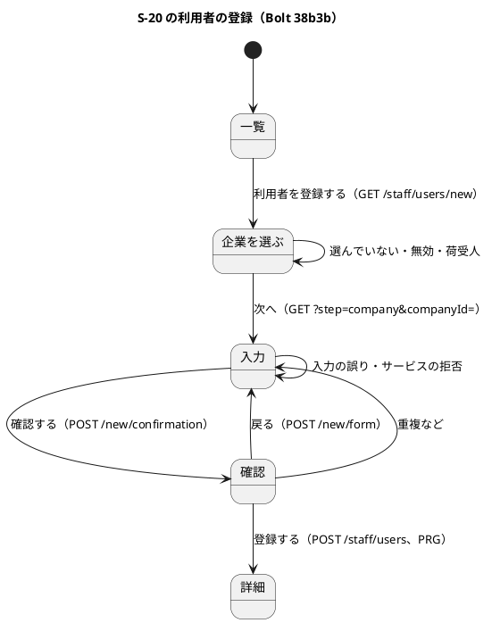

# Bolt 38b3b 計画 - S-20 の利用者の登録の画面

## 基本情報

| 項目 | 内容 |
| :--- | :--- |
| Bolt | 第 38b3b 回（W6 の 24 本目。38b3・38b3b の 2 つ目） |
| 予定 | W6（2026-11-09 の週。前倒しで着手できる）。作業は約 4 時間（`check`・`uiTest`・SonarQube・CI の待ちを除く） |
| アプローチ | アウトサイドイン（38b・38b2・38b2b・38b2c・38b3 の上に画面を足す。画面の層の受入シナリオの Red から入る。release_plan の 38b3b の行、development_strategy の W6） |
| 対象 | (1) 一覧の入口と、企業を選ぶ画面・付けられる役割と入力の画面の 2 段（JS なし）、(2) 確認の POST（値は hidden）と確定の POST（詳細へ PRG）、(3) 拒否の文言とエラー要約（Bolt 38 の形。画面で見る誤りはまとめて示す）、(4) `/staff/users/**` の認可と CSRF の統合テスト、(5) UI テストと axe、(6) マニュアル 11 章とキャプチャ、(7) 設計の文書 |
| トレース | US-16 AC1（登録の手段。38b 系の決定。変更履歴は監査 `USER_REGISTERED`）・AC2（管理範囲）、UC-16 の主シナリオ 1 と拡張 2a、IA-INV-13・IA-INV-14、ACC-01（WCAG 2.2 AA） |
| GitHub | [#14](https://github.com/k2works/practical-domain-driven-design-in-enterpris-application/issues/14)（US-16）。PR を 1 つ作る（下のブランチ） |
| SP | 0 |
| 承認ゲート | 計画と終了報告。認可（`/staff/users/**` の新しい URL と CSRF）、画面（新しい 3 つの画面）、GitHub（PR の作成。マージは 38b4 の終了報告の承認で）、新しいファイル（下の一覧）。スキーマは変えない |
| ブランチ | 実装と終了報告とその承認の記録は機能ブランチ `feature/bolt-38b3b` で進める。PR（develop 向け）は実装の最初の push で開き、PR の CI（check・ui。pull_request で動く。配備はしない）を途中から見る。38b4 も同じブランチで続け、develop への PR は 1 つ。計画とその承認の記録は develop に置く。マージはマージコミットで（Bolt ごとのコミットを残す）、前に develop を取り込んで release_plan・開発の索引・mkdocs の衝突を解く。PR の作成はこの計画の承認で、マージは 38b4 の終了報告の承認で行う（Bolt 38b3 の開始準備の決定 (6)。デモ環境は develop への push で配備されるため。2026-10-26、human:kakimomokuri） |
| 開始準備で決めたこと | Bolt 38b3 の開始準備の決定 (2)〜(4)・(6) と確認ポイント 4（確認は POST と hidden、2 段の画面で JS なし、荷受人の企業は出さない、確認の POST も書かず範囲外の記録もしない、「戻る」と誤りの示し直しも POST と hidden、確定の後の PRG の行き先にメールアドレスを入れない、ui_design :182-183 を「確認（GET・POST）は書かない」に一般化、企業の選択肢は「企業名（企業の種類）」で名前・ID の順、役割は `Role` の宣言の順）。2026-10-26、human:kakimomokuri: (1) エラー要約は今の共通の形（フォーカスと `role="alert"`）にそろえ、Bolt 38 の既知の課題（二重の読み上げ、fieldset の `aria-invalid`）は残して、W6 の支援技術による手動確認（release_plan :804）で確かめてから共通の部品ごと直す、(2) Bolt 38 の既知の課題「停止の理由の文言を名前の文字列で持つ」は残す、(3) 確定の後は登録した利用者の詳細へ PRG し、「利用者を登録しました。登録したメールアドレスへ初回の設定の案内を送ります。」を知らせる。整合性検証の後（同日）: (4) 拒否の文言は下の表（文言は表示名で始めない。ui_design :922）、エラー要約の見出しは「利用者を登録できませんでした」、確認の見出しは「利用者を登録しますか」、役割の欄は「付ける役割」、(5) 画面で見る誤り（メールアドレスの空と形、表示名の空、役割なし）はまとめて示し、それがなければサービスの判定の拒否を 1 件示す、(6) ブランチは上のとおり（38b4 も同じブランチで 1 つの PR）、(7) 確認の領域の回復手段は「誤って登録したときは、利用者の詳細から利用を停止してください（送った案内のリンクも使えなくなります）。」 |

新しいファイル: 本体は `identity/interfaces/web/UserRegistrationController.java`・`UserRegistrationPage.java`、テンプレートは `templates/identity/users/registration-company.html`・`registration-form.html`・`registration-confirmation.html`。テストは `identity/interfaces/web/UserRegistrationControllerTest.java`、`identity/infrastructure/security/UserRegistrationSecurityIntegrationTest.java`（`IdentitySpyIntegrationTestBase` を継ぐ。ArchUnit の spy の規則のため）、`features/ui/register_user_ui.feature`、`ui/UserRegistrationUiSteps.java`。

## Bolt ゴール

システム管理者が、S-20 の一覧から、管理範囲の企業を選び、その企業に付けられる役割とメールアドレスと表示名を入れ、確認してから利用者を登録できる。登録した利用者には、38b2c のハンドラーが初回の設定の案内を送る。メールアドレスと表示名は URL に残さない。

### 開始準備で確かめたこと

- **登録のサービス**: `UserRegistrationService.check`（何も書かない）と `register`（`TransactionTemplate` の中で書き、範囲外の企業への試行は別のトランザクションで記録。外側のトランザクションの中で呼ぶと `IllegalStateException`。:146）。判定は操作者 → 企業の有無 → 管理範囲 → 有効性 → 表示名 → 登録の判定 → 重複の順で、最初の拒否 1 つだけを返す（:154-172）。拒否は `UserRegistrationRefusal` の 7 つの値（`DuplicateEmail` は値を持たない）、`Rejected` の理由は `NO_ROLES`・`OVERSIGHT_ROLE`・`UNFIT_FOR_COMPANY`・`CONFLICTING_ROLES`。メールアドレスの形は `EmailAddress.of`（strip と小文字、`@` の前後、320 文字まで。誤りは `IllegalArgumentException`）で画面が見る（Bolt 38b2 の計画 :51）
- **照会（Bolt 38b3）**: `registrableCompanies(actor)`（名前・ID の順）と `registrableCompany(actor, companyId)` → `RegistrableCompanyLookup`。`RegistrableCompany.assignableRoles` は順を持たない（`Set.copyOf`）
- **rollback-only（Bolt 38b2・38b2c の既知の課題）**: `identity.interfaces.web` に `@Transactional` はなく、永続化は MyBatis で open-in-view もない。画面の POST は登録のサービスをトランザクションの外から呼ぶので、rollback-only も DE-25 の消失も起きない。行 13 で画面の POST から DE-25 と招待のトークンまで確かめる
- **行 3 の件数の前提（Bolt 38b2c の既知の課題）**: `UserInvitationIntegrationTest` の行 3 は DE-25 の発行記録の全件の前後の差を見る。発行記録の行は登録のコミットで同期に入り、ハンドラーの非同期の完了と再起動の後の配り直しは行を足さない。`test` のタスクは逐次に流れるので揺れない。`uiTest` は別の JVM
- **S-20 の今の形**: `UserAdministrationController`（`/staff/users` と `{id}`）、`UserRoleChangeController`・`UserStatusChangeController`（確認は GET とクエリ、確定は POST、範囲外は 404、flash の `notice` で詳細へ PRG）。`UserDetailPage` の中の public の record `ErrorSummary(title, anchor, text)`（1 件を持つ。`of` は `DetailForm`・`Section` 専用）・`ErrorMessage(text, field)`・`RoleOption`（:333。`Role` の宣言の順に並べる処理 :205-210 が前例）。役割の欄の名前は「付ける役割」（:248）。`UserAdministrationParameters` は利用者の ID だけを解釈する（企業の ID の口はない）。テンプレートは `list.html`（入口はない）・`detail.html`（エラー要約 :19-25、fieldset :46-62）・`confirmation.html`。`transport-request-form.js` がエラー要約へフォーカスを移す。`/staff/users/new` のリテラルは `{id}` より優先される。`architecture_backend:323` は「W6 の操作は 4 つ目の controller として部品（`UserDetailPage`）を使って足す」と書く
- **文言の約束**: ui_design :922（エラー要約のリンクは「表示名: 文言」で、文言は表示名で始めない）、:920（空欄は形の誤りと分けて示す）、:1539（確認の領域は対象・現在状態・変更内容・影響・実行者・回復手段）、:1305（S-20 の確認の領域の項目は共通にそろえる）。役割の拒否の文言（:1240-1252）の監督の役割は「付けたり外したり」で、登録には合わない。組み立ての `UserRoleChangeController.errorMessage` は `RoleChangeRejection` を受ける
- **認可と CSRF**: `SecurityConfiguration:219-221` が `/staff/users/**` を `hasRole(SYSTEM_ADMIN)` にする。トークンのない POST は 3xx で案内へ移る（`UserAdministrationSecurityIntegrationTest:180`）。統合テストの前例は同じクラスの :120（ほかの役割）・:158（画面を経ない POST）・:317（範囲外は 404 で試行は 1 行）
- **UI テストとマニュアル**: `manage_user_roles_ui.feature`（Feature に `@ui @US-16 @must`、幅 320 px）、`UiUsers:186-191`（利用者ごとに企業「A 社」（運用する会社）を新しく作り、荷主の利用者の企業は「荷主 テスト」。システム管理者にすべて割り当てる。1 段目に「A 社（運用する会社）」が複数並ぶ）。キャプチャは `manual_screenshots.feature:143-160`。マニュアル 11 章は :12 の冒頭の文、:16-21 の画面の表、:54 の範囲外の記録の文、:55 の「まだできません」。`00-はじめに.md:27`（役割の表）・:43（章の表）、`index.md:24`（章の表。「利用停止と再開」が既に抜けている）
- **CI**: `.github/workflows/cargo-tracker-ci.yml` の push は develop と main だけ（:8-11）、pull_request は向け先を絞らず check と ui が流れる（:17-22）、deploy-demo は develop への push と手動だけ（:153）

## 設計の決定（案）

| 項目 | 決定 | 根拠 |
| :--- | :--- | :--- |
| URL | `GET /staff/users/new`（企業を選ぶ）、`GET /staff/users/new?step=company&companyId=…`（役割と入力。hidden の印 `step=company` で「選ばずに次へ」を初めて開いたときと見分ける。企業の ID だけを URL に持つ）、`POST /staff/users/new/confirmation`（確認の領域。何も書かない）、`POST /staff/users/new/form`（確認から「戻る」。入力を戻した入力の画面）、`POST /staff/users`（確定。詳細へ PRG）。どれも `/staff/users/**` の認可の下 | ui_design :153 の作成は `/new` |
| controller と部品 | `UserRegistrationController`（`identity.interfaces.web`）と、登録の画面の組み立て `UserRegistrationPage`（package-private の `@Component`）。登録は詳細の操作ではないので `UserDetailPage` を使わず、`ErrorMessage` の record だけを使う（要約は複数の誤りを持つ登録の値にする）。architecture_backend :323 をそう改める。範囲外の試行は登録のサービスが記録し、画面は記録しない（`UserDetailPage` の記録の規則と `範囲外の企業の記録は登録のサービスだけが作る` が守る。T-205）。企業の ID の解釈は `UserAdministrationParameters` に口を足す（誤りは 404） | architecture_backend :323、ArchUnit |
| 1 段目 | 登録できる企業をラジオで並べる（「企業名（企業の種類）」、名前・ID の順）。ない企業は「登録できる企業がありません。」を示し、「次へ」を出さない。印があって企業がないときは、同じ画面にエラー要約 | Bolt 38b3 の決定 (3)・(4) |
| 2 段目 | `Found` なら、企業名と種類を示し、「付ける役割」のチェックボックス（`Role` の宣言の順）、メールアドレス（`autocomplete` は付けない。本人の情報ではない）、表示名を入れる。`NotFound`・`OutOfScope` は共通の 404（GET では記録しない）、`Inactive`・`NoAssignableRoles` は 1 段目に戻してエラー要約、`NotPermitted` は 403 | Bolt 38b3 の確認ポイント 3 |
| 確認・戻る・確定の拒否 | 画面で見る誤り（メールアドレスの空と形、表示名の空、役割なし）はすべて示す。それがなければ確認は `check`、確定は `register` を呼び、拒否を 1 件示す。`CompanyNotFound`・`CompanyOutOfScope` は 404（確認と戻るでは記録しない。確定では登録のサービスが試行を記録する）、`InactiveCompany` は 1 段目に戻す、`NotPermitted` は 403。誤りの画面は入力を戻す（hidden と欄の値） | 開始準備の決定 (5) |
| 文言（開始準備の決定 (4)） | 要約の見出し「利用者を登録できませんでした」。企業「登録する企業を 1 つ選んでください。」、無効・荷受人「選んだ企業には利用者を登録できません。ほかの企業を選んでください。」、メールアドレスの空「入力してください。」・形「名前@ドメイン の形で入力してください（例: user@example.com）。」・重複「既に登録されています。ほかのメールアドレスを入力してください。」（管理範囲の内外で同じ文。Bolt 38b の決定 (2)）、表示名の空「入力してください。」・規則「見分けやすい文字で、200 文字以内で入力してください。」、付ける役割のなし「1 つ以上選んでください。」、企業の種類「{役割の名前}は、{企業の種類}の利用者には付けられません。」、監督の役割「{役割の名前}は、この画面では付けられません。」、職務分離は役割の変更と同じ文。リンクは「表示名: 文言」で最初の欄（役割は群の最初の選択肢）へ。役割の拒否の文言の組み立ては、役割の変更の組み立てと共通にする（重複を避ける） | ui_design :920・:922・:1240-1252 |
| 確認の領域 | 見出し「利用者を登録しますか」。対象（企業名と種類）、現在の状態「未登録」、変更内容（メールアドレス・表示名・付ける役割。保存する値＝正規化したメールアドレスと前後を除いた表示名）、影響「登録したメールアドレスへ、初回の設定の案内（24 時間有効）を送ります。」、実行者、回復手段（開始準備の決定 (7)）。ボタンは「登録する」と「戻る」（どちらも POST と hidden） | ui_design :1305・:1539 |
| 確定の後 | `Registered(userId)` なら `/staff/users/{userId}` へ PRG し、flash の `notice` に開始準備の決定 (3) の文 | 開始準備の決定 (3) |
| 入口 | 一覧の見出しの下に「利用者を登録する」のリンク（`/staff/users/new`） | release_plan の 38b3b の行 |
| UI テストの企業 | 1 段目で選ぶ企業は、名前が重ならない荷主の企業「荷主 テスト」（荷主の役割だけ）と、準備で足す名前の違う運用する会社（複数の役割）。同じ名前の企業の並びは controller のテスト（行 2）で確かめる | 検証の指摘 |

## ふりかえりと前の Bolt からの引き継ぎ

| 出典 | 内容 | この Bolt での扱い |
| :--- | :--- | :--- |
| Bolt 38b3 Try T-210 | テストのフィールドを足す前に同じ名前のローカル変数を探す | テストの準備で守る |
| Bolt 38b3 の既知の課題 | 計画の外の見分けにくい名前 | 残す |
| Bolt 38b2・38b2c の既知の課題 | rollback-only と DE-25 の推論、行 3 の件数の前提 | 開始準備で確かめた（上）。行 13 で画面から確かめる |
| Bolt 38 の既知の課題 | エラー要約の二重の読み上げと fieldset の `aria-invalid`、停止の理由の文言、リンクの先へのフォーカスは chromium だけで確かめた | 残す（開始準備の決定 (1)・(2)。chromium だけのことも残す） |
| Bolt 38b2c Try T-208・T-209 | 選択肢の前に順序をコードで確かめる、非同期の結果は前例の待ち方を写す | 2 段目の判定の順は照会で確かめた。行 13 は発行記録の完了を待ってからトークンを読む |
| Bolt 38b2c Try T-205 | 「書き手は 1 か所」は規則で守る | 範囲外の記録は既存の 2 つの規則で守る（新しい部品は記録の部品に依存しない） |
| Bolt 38b2b Try T-206・T-207、Bolt 38b Try T-204 | 全文で期待する、節の形を読んでから行を足す、スクリプトは Write で作る | 文言と知らせを全文で確かめる。ステップ 1・4 |
| Bolt 38 Try T-200〜T-202 | 変異はバイトのまま、最小の形、止まっているかは時刻で決める | 変異の表 |
| Bolt 37f3 Try T-198・T-199、Bolt 37f2 Try T-197 | 句ごとに確かめる、ログを残す、文書の行を突き合わせる | 状態の組み合わせの表、ステップ 4 |

## 状態の組み合わせ（行ごとにテストを 1 本。T-182）

| 行 | 状況 | 期待 | 確かめ方 |
| :--- | :--- | :--- | :--- |
| 1 | 一覧 | 「利用者を登録する」のリンクが `/staff/users/new` | `UserAdministrationControllerTest` |
| 2 | 1 段目 | 登録できる企業をラジオで並べ、名前は「企業名（企業の種類）」、同じ名前の 2 社は並びの順。ない企業は文言だけで「次へ」なし | `UserRegistrationControllerTest` |
| 3 | 1 段目で選ばずに次へ（印あり、企業なし） | 同じ画面にエラー要約（見出し「利用者を登録できませんでした」、リンク「企業: 登録する企業を 1 つ選んでください。」） | 同上 |
| 4 | 2 段目（運用する会社） | 企業名と種類、付ける役割は `Role` の宣言の順（複数の役割で確かめる）、メールアドレスと表示名の欄 | 同上 |
| 5 | 2 段目の企業がない・範囲外・ID の誤り | 共通の 404（記録しない）。無効・荷受人は 1 段目に戻してエラー要約 | 同上 |
| 6 | 確認の POST | 受け付けたら確認の領域（見出し、6 つの項目の全文、正規化した値、hidden で値を持つ）。何も書かない（`register` を呼ばず、監査が増えない） | 同上、`UserRegistrationSecurityIntegrationTest` |
| 7 | 画面で見る誤りが重なる（メールアドレスの形、表示名の空、役割なし） | 3 件をまとめてエラー要約（全文、各欄へのリンク）、入力を戻す。サービスを呼ばない | `UserRegistrationControllerTest` |
| 8 | サービスの拒否 | 表示名の規則・重複・役割の拒否は 1 件、全文の文言。範囲外は 404 で記録しない（確認） | 同上、`UserRegistrationSecurityIntegrationTest` |
| 9 | 重複（既にいる利用者が範囲内の企業・範囲外の企業） | どちらも同じ全文の文言（Bolt 38b の決定 (2)） | `UserRegistrationSecurityIntegrationTest` |
| 10 | 「戻る」 | 入力を戻した入力の画面。範囲外は 404 で記録しない | `UserRegistrationControllerTest` |
| 11 | 確定の POST | 詳細へ PRG（行き先にメールアドレスがない）、flash の知らせの全文。範囲外は 404 で試行を 1 行記録 | 同上、`UserRegistrationSecurityIntegrationTest` |
| 12 | 認可と CSRF | ほかの役割は 5 つの URL で 403。CSRF のトークンのない確認・戻る・確定の POST は案内へ移り、何も書かない。システム管理者の `GET /staff/users/new` は詳細でなく登録の画面（`{id}` に落ちない） | `UserRegistrationSecurityIntegrationTest` |
| 13 | 画面の確定から招待まで | 外側のトランザクションのない POST で登録でき、監査 `USER_REGISTERED` が 1 行増え、DE-25 の発行記録が 1 つ完了し、招待のトークンができる（rollback-only の推論の確かめ） | 同上 |
| 14 | UI の通し | 一覧から入口、企業、入力、確認、登録して詳細に知らせ。入力の誤りでエラー要約へフォーカスとリンク。選ばずに次へでもエラー要約。幅 320 px。どの段も axe の違反 0 | `register_user_ui.feature`（Feature に `@ui @US-16 @must`、シナリオに `@US-16-AC1`） |

## スコープ

### 入れるもの

- 行 1〜14 のテスト、`UserRegistrationController`・`UserRegistrationPage`、`UserAdministrationParameters` の企業の ID の口、役割の拒否の文言の組み立ての共通化、テンプレート 3 つと `list.html` の入口、`register_user_ui.feature` と Steps、UI テストの準備（名前の違う運用する会社）、キャプチャのシナリオ
- マニュアル 11 章: :12 の冒頭の文、:16-21 の画面の表、11.1 の入口（画面の説明と操作手順）と :54（登録の範囲外の試行も記録される）と :55、「11.5 利用者の登録」（企業を選ぶ・入力・確認の 3 つの小見出しに、画面の説明・操作手順・注意）。`00-はじめに.md` の :27（役割の表）・:43（章の表）、`index.md:24`（章の表。抜けていた「利用停止と再開」も足す）。キャプチャ `11-users`（入口で変わる）と `11-user-registration-company`・`11-user-registration-form`・`11-user-registration-confirmation`・`11-user-registration-rejected`
- 設計の文書（T-126）: ui_design（:145 の S-20 の行、URL の表に 3 画面の 3 行、:182-183 を「確認（GET・POST）は書かない」に一般化し理由を「38b2 の `check` と同じく何も書かない」に、:494-519 の社内の画面遷移図に登録の遷移、S-20 の節に 3 つの画面のワイヤーフレームと拒否の文言の表、:1539 の確認の領域に登録の項目）、architecture_backend（:323 の controller と部品の箇条）、test_strategy（:344 の後に「利用者の登録の画面」の行）、release_plan（38b3b の行と更新履歴。ブランチで直す）

### 入れないもの

- A-06 の出し分けと受入シナリオ（登録から A-07 まで）・受入条件の照合の表・動画・デモ環境の配備の確かめ（38b4）
- エラー要約の共通の部品の直し、停止の理由の文言（既知の課題のまま）
- 管理範囲の割り当ての画面（W10）、招待の再送

## 設計（この Bolt の範囲）

- ER 図: 表と列を変えないので省く。状態遷移図: 利用者の状態（登録で利用中）は変わらないので省く

## ステップ計画

- [ ] **0. ブランチ**: develop から `feature/bolt-38b3b` を作る
- [ ] **1. 設計の文書**: ui_design・architecture_backend・test_strategy（完了の判定: 文書の差分）
- [ ] **2. テストの Red（外側から）**: 行 14 の feature の Red、続いて行 1〜13 の controller と統合のテスト（空の controller とテンプレートで、期待した理由で落ちることを確かめる）。最初の push で PR を開く
- [ ] **3. 実装の Green**: controller・画面の組み立て・テンプレート・文言・入口
- [ ] **4. マニュアルとキャプチャ**: 11 章、索引、`manualScreenshots`。T-197 の突き合わせ
- [ ] **5. 品質ゲートと開発レビュー**: 変異、`check`・`uiTest`、その後に SonarQube、開発レビューとその直し
- [ ] **6. 終了報告**: ブランチに置き、PR の CI（check・ui）を緑にする（デモ環境の配備の確かめは 38b4 の終了報告）

### 時間の配分と打ち切り

| # | 目安 | 打ち切り |
| :--- | :--- | :--- |
| 0・1 | 30 分 | — |
| 2 | 60 分 | 行 1〜13 の Red が 60 分で終わらないときは、統合のテストの Red を Green の後に回し、controller のテストと feature だけを先に落とす（報告に書く） |
| 3 | 70 分 | 3 つの画面が 70 分で緑にならないときは、「戻る」を企業の ID だけの GET の入力の画面に縮め、入力を戻さない形を諮る |
| 4 | 40 分 | — |
| 5 | 30 分（待ちを除く） | — |
| 6 | 10 分（CI の待ちを除く） | — |

合計 240 分（約 4 時間）。

## 確認ポイント（計画の承認の場でまとめて確認する。Try T-6）

| # | 確認すること | 場所 | 推奨 |
| :--- | :--- | :--- | :--- |
| 1 | **URL と認可** | 設計の決定 | 5 つの URL はどれも `/staff/users/**` の下でシステム管理者だけ。確認と「戻る」は `/new` の下の POST で、CSRF のトークンが要る。確認と戻るは何も書かない |
| 2 | **文言（開始準備の決定 (4)）** | 設計の決定 | 上の文言の表。重複は管理範囲の内外で同じ文。監督の役割は登録用の文 |
| 3 | **誤りの示し方（開始準備の決定 (5)）** | 設計の決定 | 画面で見る誤りはまとめ、サービスの拒否は 1 件 |
| 4 | **ブランチと PR（開始準備の決定 (6)）** | 基本情報 | 機能ブランチで 38b4 まで続け、develop への PR は 1 つ。PR の作成はこの計画の承認、マージは 38b4 の終了報告の承認 |
| 5 | **確認の領域（開始準備の決定 (7)）** | 設計の決定 | 6 つの項目と回復手段の文。保存する値（正規化した値）を示す |
| 6 | **マニュアル** | ステップ 4 | 11.5 を足し、キャプチャ 5 枚（`11-users` の撮り直しを含む） |
| 7 | **変異** | ステップ 5 | 下の 8 つ。スクリプトはバイトのまま読み書きし、gradlew.bat を絶対パスで呼び、結果の XML を消してから流す（T-164・T-178・T-200） |

### 変異と落ちる見込みのテスト

| # | 変異 | 落ちる見込み |
| :--- | :--- | :--- |
| V1 | 確認の POST で `register` を呼ぶ | 行 6 |
| V2 | 確定の PRG の行き先にメールアドレスを入れる | 行 11 |
| V3 | 2 段目で範囲外を 1 段目に戻す（404 にしない） | 行 5 |
| V4 | 役割を `assignableRoles` の順のまま並べる（宣言の順に並べ直さない） | 行 4（運用する会社の複数の役割） |
| V5 | メールアドレスの形を見ずにサービスを呼ぶ | 行 7 |
| V6 | 画面で見る誤りを最初の 1 件だけにする | 行 7 |
| V7 | 「戻る」で入力を戻さない | 行 10 |
| V8 | 1 段目の印を見ない（選ばずに次へで初めて開いたときと同じ画面を返す） | 行 3・行 14 |

## 完了条件

- [ ] 上のステップ 0〜6 の完了の判定を満たす
- [ ] 行 1〜14 に、それを名乗るテストがある
- [ ] `check`・`uiTest` が緑、SonarQube が PASS（重複 3% 未満）、PR の CI（check・ui）が緑
- [ ] マニュアル 11 章とキャプチャが実装と合う
- [ ] 終了報告が承認される

## 既知の課題の候補（確かめてから報告に書く）

- 入力の控え（ACC-06）: POST の応答で描く入力の画面（確認の誤り・戻る）に、session の失効の警告の戻り先が付くかは確かめていない（`SessionLifetimeFilter` が GET だけを戻り先にするなら、控えられない）

## 更新履歴

| 日付 | 更新内容 | 更新者 |
| :--- | :--- | :--- |
| 2026-10-26 | 整合性検証の指摘を反映した（承認待ち）。文言（表示名で始めない、見出し、付ける役割）、画面で見る誤りはまとめる、38b4 も同じブランチで 1 つの PR、確認の領域の回復手段と決めた（human:kakimomokuri）。1 段目の印、URL を `/new` の下に、`UserDetailPage` を使わない部品と architecture_backend :323、行 9（重複の内外）・行 12（5 つの URL と 3 つの POST、`/new` が `{id}` に落ちない）・行 13（監査）、V6・V8、UI テストの企業、新しいファイルの一覧、ui_design・マニュアル・test_strategy の直す行、Try と既知の課題の対応、行番号 | anthropic/claude-opus-5-5 |
| 2026-10-26 | 初版作成（承認待ち）。開始準備で、エラー要約は今の共通の形にそろえ課題を残す、停止の理由の文言は残す、確定の後は詳細へ PRG と知らせると決めた（human:kakimomokuri） | anthropic/claude-opus-5-5 |

## 関連ドキュメント

- [リリース計画](release_plan.md)（W6 節の 38b3b・38b4 の行）、[Bolt 38b3 計画](bolt_38b3_plan.md)・[終了報告](bolt_38b3_report.md)、[Bolt 38b2c 終了報告](bolt_38b2c_report.md)、[Bolt 38 終了報告](bolt_38_report.md)、[Bolt 38b 計画](bolt_38b_plan.md)
- [UI 設計](../../design/cargo-tracker/ui_design.md)（S-20）、[ドメインモデル](../../design/cargo-tracker/domain_model.md)、[バックエンドのアーキテクチャ](../../design/cargo-tracker/architecture_backend.md)、[ユーザーマニュアル 11 章](../../manual/11-利用者の管理.md)
