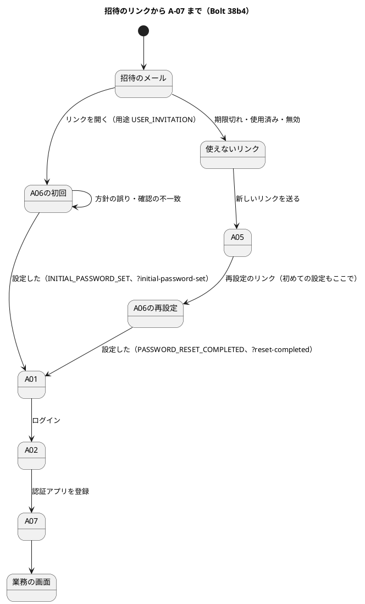

# Bolt 38b4 計画 - A-06 の初回の設定の出し分けと、登録から A-07 までの受入シナリオ

## 基本情報

| 項目 | 内容 |
| :--- | :--- |
| Bolt | 第 38b4 回（W6 の 25 本目） |
| 予定 | W6（2026-11-09 の週。前倒しで着手できる）。作業は約 5.5 時間（`check`・`uiTest`・SonarQube・CI の待ちを除く）。development_strategy の目安（2〜4 時間）を超えるが、開始準備で分けないと決めた（下の打ち切りで守る） |
| アプローチ | アウトサイドイン（受入シナリオの Red から入る。release_plan の 38b4 の行） |
| 対象 | (1) 用途のメソッドと、A-06 の初回の設定の出し分け（見出し・説明・タイトル・完了の知らせ・監査 `INITIAL_PASSWORD_SET`）、(2) 使えないリンクの案内を用途を問わない文言に、(3) 遅れた DE-25 で招待を発行しない（招待の期限を過ぎた、登録の後に本人の再設定のトークンがある）、(4) 受入シナリオ（登録から A-07 まで）と Steps の共有の口、動画 `@demo-bolt-38b4`、(5) US-16 の受入条件の照合（途中の経過。閉じるのは 38g）、(6) マニュアル 2 章・11 章・付録 B とキャプチャ、(7) 設計の文書、(8) デモ環境の配備の確かめ |
| トレース | US-16 AC1（登録の手段と初回の設定）、US-18 AC7（初回ログインで TOTP の登録）・AC8（A-06）、IA-INV-08（同期の監査）・IA-INV-09（理由を示さない）・IA-INV-12、SEC-08、ACC-01 |
| GitHub | [#14](https://github.com/k2works/practical-domain-driven-design-in-enterpris-application/issues/14)（US-16）。動画は終了報告の承認の後に #14 へ添付する（前例 Bolt 33a。`ops/scripts/issue_demo.js` の `BOLT_ISSUES` と運用の索引の添付先の表に bolt-38b4 → #14 を足し、`DEMO_DRY_RUN=1` で先に確かめる） |
| SP | 0 |
| 承認ゲート | 計画と終了報告。画面（A-06・A-01 の文言）、セキュリティ（初回の設定の監査、発行の抑え）、GitHub（動画の添付）、新しいファイル（下の一覧）。スキーマは変えない（`audit_record.action` に CHECK はない） |
| ブランチ | develop で開発する（2026-10-26、human:kakimomokuri の指示。38b3b の PR #51 は先にマージした）。途中の push はデモ環境の配備になるので、push はステップ 7 でまとめる |
| 開始準備で決めたこと | 2026-10-26、human:kakimomokuri: (1) 遅れた DE-25 では、登録の時刻から招待の用途の期限（24 時間）を過ぎていれば発行も送信もせず、登録の後に本人の再設定のトークンが発行されていても発行しない（Bolt 38b2c の議題 5）、(2) 使えないリンクの案内は用途を問わない同じ画面にし、期限の時間を書かない（IA-INV-09。使えないトークンの用途を読まない）、(3) 招待のリンクで初回の password を設定したら監査に新しい値 `INITIAL_PASSWORD_SET` を書く、(4) 初回の設定の完了の知らせは用途で分ける（`/login?initial-password-set`。A-06 の見出しは「password の設定」、説明は「初めて使う password を入力してください。」。再設定は今のまま）、(5) 分けずに 1 つの Bolt で進める。整合性検証の後（同日）: (6) 使えないリンクの案内は下の全文、(7) 招待のリンクが使えなくなった利用者が再設定のリンクで初めて設定するとき（第三者の再設定の依頼、遅れた DE-25 が本人の再設定に譲った、期限切れ）は、再設定の文言と監査のままで受け入れ、ui_design の場面の表とマニュアル 2.6 の注に書く（初回かは用途だけで決め、スキーマを変えない。ログインすれば A-07 が出る）、(8) 初回の知らせにログアウトの一文を足す（全文は下） |

新しいファイル: 本体は `identity/application/internal/commandservices/PasswordSetup.java`（印のない record。前例 `PasswordResetCompletion`）。テストは `identity/interfaces/web/PasswordResetControllerTest.java`（WebMvc。前例 `UserRegistrationControllerTest`）。資産は `docs/manual/assets/02-password-initial-new.png`・`02-login-initial-password-set.png`、動画 `docs/assets/demo/bolt-38b4/register-and-setup.webm`。

## Bolt ゴール

招待のメールのリンクから開いた A-06 が「初回の password の設定」として見え、設定を終えると A-01 が初回の知らせを出し、ログインして A-07 で認証アプリを登録できる。システム管理者の登録から A-07 までを受入シナリオと動画で通す。遅れて配られた DE-25 で、設定を済ませた本人に招待を送り直さない。

### 開始準備で確かめたこと

- **A-06 の今の形**: `PasswordResetController`（:92-103 リンクを開く GET、`completions.open(token)` が空なら使えない案内、使えれば session に `PasswordResetSession.TOKEN_ID`（UUID）を置いて `changeSessionId` し `/password-reset/new` へ。:106-116 GET `/new` は `isUsable` で確かめる、:119-154 POST `/new` は確認の不一致を先に画面で見て（:131-135。サービスを呼ばない）、`Completed` なら認証を捨てて `/login?reset-completed`（:147-151））。用途はどこも読まない。テンプレートは `password-reset-new.html`（title「password の再設定 - cargo-tracker」、見出し「password の再設定」、説明「新しい password を入力してください。」）、`password-reset-invalid.html`（見出し「この再設定のリンクは使えません」、「有効期限（30 分）」を固定、:14-17 の項目、A-05 へのリンク「password の再設定を依頼し直す」）、`login.html`（:24-28 `reset-completed` の知らせ）
- **完了のサービス**: `PasswordResetCompletionService.open`（使えないトークンの用途は捨てる）、`isUsable(UUID)`、`complete`、`changePassword`（:152-153 `AuditRecord.passwordResetCompleted`）。結果 `PasswordResetCompletion`（`Completed`・`Invalid`・`PolicyViolated`）は用途を持たない。`PasswordResetToken.purpose()` は読める
- **今の A-06 と A-01 のテスト**: `AuthenticationSecurityIntegrationTest`（:1311-1600。:1316 `INVALID_TITLE`、:1397 使えないリンク、:1413・:1423・:1474 完了の知らせ、:1436 確認の不一致と方針の誤り）、`PasswordResetUiSteps`（:192-212。見出しと A-05 へのリンクの名前を確かめる）、`login_ui.feature`（`@US-18-AC8` :157-187）、`manual_screenshots.feature`（:10-27。2 章はログインの前に撮る）。WebMvc の A-06 のテストはない
- **用途の規則（Bolt 38b2c）**: `LayerArchitectureTest`（:383-411）は `USER_INVITATION` の参照を招待のハンドラーだけに限る（テストのコードは対象外）。出し分けは用途の型のメソッドで問い合わせる。Thymeleaf の式で用途の名前を比べる書き方は規則で捕まらないので使わない（controller が文言を渡す）
- **監査**: `AuditAction` に初回の設定の値はない。`audit_record.action` は `VARCHAR(100)` で CHECK はない。一覧と流れは data_model :942、domain_model :223・:264・:1211（と後の PlantUML）・:1365、ADR-012 :105、user_story（US-18 :639 と US-16 の 38b 系の注 :701）、`AuditRecordTest`
- **発行の部品**: `PasswordResetTokenIssuance`（占有 → 再配信 → 抑え → 有効か → 前の未使用の無効化 → 発行）。`UserRegistered.registeredAt` と `PasswordResetRequested.requestedAt` を発行で使っていない。本人が設定を済ませたかを直接読む口はない。手がかりは `findLastIssuedAt(userId, RESET)`。手順を書いた文書は domain_model :228・:231・:232・IA-INV-12、architecture_backend :314、ADR-017 :70、test_strategy :278
- **受入シナリオの足場**: `login_ui.feature` の `@US-18-AC7 @demo @demo-bolt-31b/enroll`・`@US-18-AC8 @demo @demo-bolt-33a/reset`。`UserRegistrationUiSteps` はメールアドレスを private に持つ。`PasswordResetUiSteps` は件名と宛先が荷主で固定、設定する password は private の定数、トークンの確定の待ち（T-127）は荷主の利用者の ID。`LoginUiSteps` のログインは `credentials`。TOTP のコードは A-07 の手入力のキーから作るが、`UiUsers.codeFromKey(Role, key)` は役割の利用者の ID で秘密を暗号化するので、画面で登録した利用者には使えない。`UiScenarioState` は見積依頼の番号と追跡番号だけ。Mailpit は UI テストで読める
- **動画と添付**: `demoVideo`（build.gradle:152-175）は置き場所を消してすべての Bolt を撮り直す（前例はほかの Bolt の差分を戻す。Bolt 37e4b）。添付は `ops/scripts/issue_demo.js` の `BOLT_ISSUES` と運用の索引の表（Bolt 33a の終了報告 :144）
- **照合**: release_plan :783-785 で AC4（業務担当者の担当範囲の外）と AC1 の担当案件・AC5 の役割の取消しのシナリオは 38e〜38g。US-16 の照合が閉じるのは 38g（#14 のクローズ）。test_strategy :567-569 に「照合の表の前の対応」（ストーリー・受入条件・Bolt・確かめるもの）がある
- **マニュアル**: 2 章 2.6（:273-338。キャプチャ 4 枚、「30 分」の文 :323・:333・:337-338）、付録 B（:31・Q1-7 :66-70 が見出し「この再設定のリンクは使えません」とリンクの名前と「30 分」を書く）、11 章（初回の設定の案内）
- **配備**: develop への push で check → ui → deploy-demo。版は deploy-demo のログの release か `npx gulp deploy:demo:status` で見る（heroku_demo_setup.md:184）

## 設計の決定（案）

| 項目 | 決定 | 根拠 |
| :--- | :--- | :--- |
| 用途のメソッド | `PasswordResetTokenPurpose` に、初回の設定か `setsInitialPassword()`（RESET は false、USER_INVITATION は true）、契機の時刻で発行してよいか `acceptsTriggerAt(UtcInstant triggeredAt, UtcInstant now)`（USER_INVITATION は契機から期限の前だけ（ちょうど期限は不可）、RESET はいつも true）、後に発行された用途に譲るか `yieldsTo()`（USER_INVITATION は `Optional.of(RESET)`、RESET は空。譲る相手を列挙の中で返す）。`USER_INVITATION` を外から参照しない（Bolt 38b2c の規則） | 開始準備の決定 (1)・(3)・(4) |
| 発行の抑え | `PasswordResetTokenIssuance.issue` に契機の時刻を足し、占有と再配信の後に、`acceptsTriggerAt` が false なら「契機が古い」、`yieldsTo()` の用途の最後の発行（`findLastIssuedAt`）が契機より後なら「契機の後に本人の別の用途の発行がある」で発行しない（理由は INFO のログ）。同じ時刻は譲らない。再設定のハンドラーは依頼の時刻、招待のハンドラーは登録の時刻を渡す（再設定の振る舞いは変わらない） | 開始準備の決定 (1) |
| A-06 の出し分け | 完了のサービスに、使えるトークンの設定の形を返す口 `setupOf(UUID)` → `Optional<PasswordSetup>`（`initial` を持つ。`isUsable` を置き換える）を足す。controller は GET `/new` と POST `/new` の最初に `setupOf` を 1 回呼び、空なら使えない案内、あれば見出し・説明・タイトルの文言を選んでテンプレートに渡す（テンプレートは用途を比べない）。確認の不一致・方針の誤りの画面も同じ見出しで示す。`Completed` は `initial` を持ち、controller は初回なら `/login?initial-password-set`、再設定なら今の `/login?reset-completed` へ移す | 開始準備の決定 (4) |
| A-06 の文言 | 初回: title「password の設定 - cargo-tracker」（誤りのときは前に「エラー: 」）、見出し「password の設定」、説明「初めて使う password を入力してください。」。欄の名前（「新しい password」「新しい password（確認）」）と条件の箇条とボタンは再設定と同じ。再設定は今のまま | 開始準備の決定 (4) |
| 監査 | `AuditAction.INITIAL_PASSWORD_SET`（招待のリンクで初回の password を設定した。成功だけ）と `AuditRecord.initialPasswordSet`。完了のサービスが `setsInitialPassword()` で選ぶ（同じトランザクション。IA-INV-08） | 開始準備の決定 (3) |
| 使えないリンクの案内（開始準備の決定 (6)） | title「このリンクは使えません - cargo-tracker」、見出し「このリンクは使えません」、本文「有効期限を過ぎた、使用済み、新しいリンクが送られた、などが考えられます。」、項目は今のまま（複数のメールが届いているなら最も新しいメールのリンク、設定済みならログイン、問い合わせ先）、A-05 へのリンク「新しいリンクを送る（初めて設定する場合も、ここから設定できます）」、「ログインに戻る」。「30 分」と「再設定の」を消す | IA-INV-09、ui_design の場面の表 |
| A-01 の知らせ（開始準備の決定 (8)） | `initial-password-set` の印で「password を設定しました。このブラウザでログインしていた場合は、ログアウトしました。設定した password でログインし、認証アプリを登録してください。」（`role="status"`）。再設定は今のまま | 開始準備の決定 (4)・(8) |
| 受入シナリオ | `register_user_ui.feature` に `@US-16-AC1 @US-18-AC7 @demo @demo-bolt-38b4/register-and-setup`: システム管理者が登録する → Mailpit の招待のメール（件名「【cargo-tracker】利用者の登録のご案内」、登録したアドレス）を待ち、トークンの確定を待って（T-127）リンクを開く → A-06「password の設定」で設定 → A-01 の初回の知らせ → 登録したアドレスと設定した password でログイン → A-07 で認証アプリを登録 → 業務の画面。`UiScenarioState` に登録した利用者（メールアドレス・利用者の ID・設定した password）を置き、`UiUsers` に `codeFromKey(UserId, key)` を足す | release_plan の 38b4 の行 |
| 動画 | `demoVideo` で撮り、`docs/assets/demo/bolt-38b4/` だけを残し、ほかの Bolt の撮り直しの差分は戻す。開発の索引にリンク | 前例 Bolt 37e4b・33a |
| 照合（途中の経過） | test_strategy :567-569 の「照合の表の前の対応」の形で US-16 の行を足す。AC1（登録と初回の設定は 38b〜38b4、担当案件は 38e）、AC2（34b・38b2）、AC3（34・38b）、AC4（未。38e〜38g）、AC5（34d、役割の取消しのシナリオは 38g）。閉じるのは 38g（#14 のクローズ） | 横断整合性検証の高の指摘 |
| キャプチャ | `manual_screenshots.feature` の 11 章の登録のシナリオ（「B 運輸」）の後に、招待のメールのリンクを開いて `02-password-initial-new` を、初回の完了の後に `02-login-initial-password-set` を撮る。`02-password-reset-invalid` は撮り直す | 検証の指摘 |

## ふりかえりと前の Bolt からの引き継ぎ

| 出典 | 内容 | この Bolt での扱い |
| :--- | :--- | :--- |
| Bolt 38b3b Try T-211・T-212 | 範囲や権限の行は誤った値との組み合わせも置く、フォークの指示に T-204 を最初に書く | 監査の行 4 に、招待のトークン × 方針の誤り（監査なし）と × 利用停止（使えない案内・監査なし）を置く。フォークを使うときに守る |
| Bolt 38b3b の既知の課題 | エラー要約の二重の読み上げ・chromium だけ、停止の理由の文言、ACC-06、hidden の重複、見分けにくい名前 | 残す |
| Bolt 38b の決定 (1) | 38b3b と 38b4 を同じ配備 | やめた（人の指示。release_plan の更新履歴）。登録の画面が A-06 の出し分けより先にデモ環境に出たことを受け入れた |
| Bolt 38b の決定 (3)・:62 の受け入れたリスク | 招待のリンクは再設定の URL で用途はトークンから読む、第三者の再設定の依頼で招待のリンクが無効になる | 守る。再設定のリンクで初回の設定をする場面は開始準備の決定 (7) |
| Bolt 38b2c の議題 5 | 遅れた DE-25 | 開始準備の決定 (1) で閉じる |
| Bolt 38b2b Try T-206 | 全文で期待する | 見出し・知らせ・案内・title を全文で確かめる |
| W5 の Try T-122・T-127 | 文言を変える前に既存の期待を探す、トークンの確定を待つ | ステップ 2 で既存の期待を検索する。受入シナリオで待つ |
| Bolt 37e4b・33a の前例 | 動画の撮り直しの差分を戻す、動画を Issue に添付し添付先の表を足す | ステップ 5・7 |

## 状態の組み合わせ（行ごとにテストを 1 本。T-182）

| 行 | 状況 | 期待 | 確かめ方 |
| :--- | :--- | :--- | :--- |
| 1 | 用途の値 | RESET は初回でなく、契機の時刻を問わず、譲る相手がない。USER_INVITATION は初回で、契機から 24 時間の前だけ発行してよく（23 時間 59 分 59 秒は可、24 時間は不可）、RESET に譲る | `PasswordResetTokenPurposeTest` |
| 2 | 招待のリンクで A-06 を開く | title・見出し・説明の全文が初回 | `PasswordResetControllerTest`（新規） |
| 3 | 再設定のリンクで A-06 を開く | 今のまま | 同上 |
| 4 | 招待のリンクで設定を終える | `/login?initial-password-set`、監査 `INITIAL_PASSWORD_SET` が 1 行（`PASSWORD_RESET_COMPLETED` は書かない）、前の未使用のトークンの無効化は今のまま。招待のトークン × 方針の誤りは監査なし、× 利用停止は使えない案内で監査なし | `PasswordResetCompletionServiceTest`・`PasswordResetCompletionIntegrationTest`（既存に足す）、`AuthenticationSecurityIntegrationTest`（既存に足す。行き先） |
| 5 | 再設定のリンクで設定を終える | 今のまま（`/login?reset-completed`、`PASSWORD_RESET_COMPLETED`） | 同上（既存） |
| 6 | 初回の誤りの画面（方針の誤り・確認の不一致） | 初回の見出しと title（「エラー: 」付き）のまま誤りを示す | `PasswordResetControllerTest` |
| 7 | 使えないリンク（期限切れ・使用済み・無効・存在しない。招待と再設定） | どれも同じ案内の全文（時間を書かない）、出口は A-05 | `AuthenticationSecurityIntegrationTest`（既存を直す）、`PasswordResetUiSteps`・`login_ui.feature`（既存を直す） |
| 8 | A-01 の知らせ | `initial-password-set` で初回の知らせの全文、`reset-completed` は今のまま | `AuthenticationSecurityIntegrationTest`（既存に足す） |
| 9 | 遅れた DE-25（登録から 24 時間を過ぎた） | 招待を発行せず送らない | `UserInvitationIntegrationTest` |
| 10 | 登録の後に本人の再設定のトークンがある DE-25（後・同じ時刻） | 後なら招待を発行せず、本人の再設定のトークンを無効にしない。同じ時刻なら発行する | 同上 |
| 11 | 再設定のハンドラー（契機の時刻を渡した後） | 今のまま（1 分の抑え、再配信など） | `PasswordResetRequestIntegrationTest`（変えない） |
| 12 | 登録から A-07 まで（受入シナリオ） | 登録 → 招待のメール → A-06 の初回 → A-01 の初回の知らせ → ログイン → A-07 → 業務の画面。どの画面も axe の違反 0 | `register_user_ui.feature`（`@US-16-AC1 @US-18-AC7 @demo @demo-bolt-38b4/register-and-setup`） |
| 13 | ArchUnit の規則 | 新しいメソッドの後も、`USER_INVITATION` を参照するのは招待のハンドラーだけ | `LayerArchitectureTest` |

## スコープ

### 入れるもの

- 行 1〜13 のテスト、用途の 3 つのメソッド、発行の抑え、`setupOf` と `PasswordSetup` と `Completed` の `initial`、`AuditAction.INITIAL_PASSWORD_SET`・`AuditRecord.initialPasswordSet`（`AuditRecordTest`）、`PasswordResetController` とテンプレート 3 つ（A-06・使えないリンク・A-01）、既存の期待の直し（`AuthenticationSecurityIntegrationTest`・`PasswordResetUiSteps`・`login_ui.feature`・`manual_screenshots.feature`）、受入シナリオと Steps の共有の口（`UiScenarioState`・`UiUsers.codeFromKey(UserId, key)`）、動画、`issue_demo.js` の `BOLT_ISSUES` と運用の索引の添付先の表
- マニュアル: 2 章 2.6（初回の設定の小節、使えないリンクの文言、「30 分」の文、再設定のリンクで初めて設定する場合の注）、11 章（初回の設定から 2 章への参照）、付録 B（:31・Q1-7）。キャプチャ `02-password-initial-new`・`02-login-initial-password-set`、撮り直し `02-password-reset-invalid`（ほかの撮り直しの差分は戻す）
- 設計の文書（T-126）: ui_design（:94 の画面一覧、:190 の URL の表、:259・:280 の遷移図、A-06 の節（初回の見出し・説明・title、使えないリンクの案内、知らせ、知らせの場面の表、再設定のリンクで初めて設定する行）、A-03 の表 :749 の注、招待のメールの場面の表 :1758 の注（遅れた DE-25 も止まる）、:1840）、domain_model（:223 監査の操作、:228 `UserRegistered`、:231・:232 ハンドラーと発行の部品、`PasswordResetTokenPurpose` の行、:264 完了のサービス、:1211 完了の流れと PlantUML、:1365 IA-INV-08、IA-INV-12、DE-25 の行）、data_model :942、ADR-012 :105、ADR-017 :70、architecture_backend :314、non_functional SEC-08（出し分けは済み、遅れた DE-25 の抑え）、user_story（US-16 の 38b 系の注に `INITIAL_PASSWORD_SET`）、test_strategy（:278 IA-INV-12、:340-345 の identity の表に初回の設定、:567-569 の照合の前の対応に US-16）、release_plan（38b4 の行の範囲と承認ゲート、:803 の主なタスク、:804 の手動確認に A-06 の初回と使えないリンク、状態の段落、更新履歴に計画と分けない決定）

### 入れないもの

- エラー要約の共通の部品の直し、ACC-06 の確かめ（既知の課題のまま）
- 本人が設定を済ませたかを持つ列（スキーマは変えない。開始準備の決定 (7)）
- US-16 の照合を閉じること（38g）

## 設計（この Bolt の範囲）

- ER 図: 表と列を変えないので省く。状態遷移図: トークンの状態（未使用 → 使用済みか無効）は変わらないので省く

## ステップ計画

- [ ] **1. 設計の文書**（完了の判定: 文書の差分）
- [ ] **2. 受入シナリオの Red**: 既存の A-06・A-01 の期待を検索してから（T-122）、行 12 を Steps の共有の口とともに書き、A-06 の見出しで落ちることを確かめる
- [ ] **3. 用途と発行の抑え（Red → Green）**: 行 1・9・10・11・13
- [ ] **4. A-06 の出し分けと監査（Red → Green）**: 行 2〜8、行 12 を緑に
- [ ] **5. マニュアル・キャプチャ・動画・照合**: 2 章・11 章・付録 B、キャプチャ、`demoVideo`（ほかの差分は戻す）、test_strategy の照合の前の対応。T-197 の突き合わせ
- [ ] **6. 品質ゲートと開発レビュー**: 変異、`check`・`uiTest`、その後に SonarQube、開発レビュー（テンプレートで用途の名前を比べていないかを grep で確かめる）とその直し
- [ ] **7. 終了報告と配備**: develop に push して CI（check・ui・deploy-demo）を確かめ、デモ環境の版を見る。承認の後に動画を #14 へ添付する

### 時間の配分と打ち切り

| # | 目安 | 打ち切り |
| :--- | :--- | :--- |
| 1 | 40 分 | — |
| 2 | 50 分 | Steps の共有の口が 50 分で書けないときは、受入シナリオを登録 → A-06 → A-01 までに縮め、A-07 は既存の `@US-18-AC7` に任せる形を諮る |
| 3 | 50 分 | 行 9・10（遅れた DE-25 の抑え）が 50 分で緑にならないときは、抑えを別の Bolt に分ける形を諮る |
| 4 | 70 分 | 70 分で行 2〜8 が緑にならないときは、使えないリンクの文言の直し（行 7）を別の Bolt に分ける形を諮る |
| 5 | 60 分 | 動画の撮り直しが不安定なときは、撮れる範囲（登録から A-01）で撮って報告に書く |
| 6 | 40 分（待ちを除く） | — |
| 7 | 20 分（CI の待ちを除く） | — |

合計 330 分（約 5.5 時間）。

## 確認ポイント（計画の承認の場でまとめて確認する。Try T-6）

| # | 確認すること | 場所 | 推奨 |
| :--- | :--- | :--- | :--- |
| 1 | **用途の 3 つのメソッド（構造）** | 設計の決定 | `setsInitialPassword`・`acceptsTriggerAt`・`yieldsTo`。`USER_INVITATION` を外から参照しない |
| 2 | **発行の抑え（セキュリティ）** | 設計の決定 | 契機が古い・契機の後に本人の再設定がある、で発行しない（同じ時刻は発行）。再設定の振る舞いは変えない |
| 3 | **A-06・A-01・使えないリンクの文言（画面）** | 設計の決定 | 開始準備の決定 (2)・(4)・(6)・(8) の全文 |
| 4 | **監査** | 設計の決定 | `INITIAL_PASSWORD_SET`（成功だけ、同じトランザクション）。再設定のリンクで初めて設定する場合は `PASSWORD_RESET_COMPLETED` のまま（開始準備の決定 (7)） |
| 5 | **受入シナリオと動画（GitHub）** | 設計の決定 | 登録から A-07 まで。動画は承認の後に #14 へ添付 |
| 6 | **照合** | 設計の決定 | US-16 の途中の経過として足し、閉じるのは 38g |
| 7 | **大きさ（開始準備の決定 (5)）** | 時間の配分 | 1 つの Bolt で、ステップ 2〜5 の打ち切りで守る |
| 8 | **変異** | ステップ 6 | 下の 9 つ。スクリプトはバイトのまま読み書きし、gradlew.bat を絶対パスで呼び、結果の XML を消してから流す |

### 変異と落ちる見込みのテスト

| # | 変異 | 落ちる見込み |
| :--- | :--- | :--- |
| V1 | `setsInitialPassword` が招待でも false | 行 1・2・4 |
| V2 | `acceptsTriggerAt` の境界を「以下」にする（ちょうど 24 時間でも発行） | 行 1 |
| V3 | 招待のハンドラーが登録の時刻を渡さない（今の時刻を渡す） | 行 9 |
| V4 | 後に発行された用途に譲らない | 行 10 |
| V5 | 初回の設定でも `PASSWORD_RESET_COMPLETED` を書く | 行 4 |
| V6 | 初回の完了でも `reset-completed` へ移す | 行 4（`AuthenticationSecurityIntegrationTest`）・行 12 |
| V7 | 使えないリンクの案内に「30 分」を戻す | 行 7 |
| V8 | `acceptsTriggerAt` を RESET でも期限で見る | 行 1 |
| V9 | ほかのクラスが `USER_INVITATION` を参照する | 行 13 |

## 完了条件

- [ ] 上のステップ 1〜7 の完了の判定を満たす
- [ ] 行 1〜13 に、それを名乗るテストがある
- [ ] `check`・`uiTest` が緑、SonarQube が PASS（重複 3% 未満）、CI が緑、デモ環境が新しい版で動く
- [ ] マニュアル 2 章・11 章・付録 B とキャプチャが実装と合い、動画が撮れている
- [ ] 終了報告が承認される

## 更新履歴

| 日付 | 更新内容 | 更新者 |
| :--- | :--- | :--- |
| 2026-10-26 | 整合性検証の指摘を反映した（承認待ち）。使えないリンクの案内の全文、再設定のリンクで初めて設定する場合は受け入れて文書に書く、初回の知らせにログアウトの一文と決めた（human:kakimomokuri）。照合は途中の経過（閉じるのは 38g）、時間と打ち切り、新しいファイルの一覧、テストのクラスの実名、`setupOf` と POST の扱い、`yieldsTo` で RESET を外から参照しない、行 4・10 の組み合わせ、文書の一覧（付録 B、ui_design の画面一覧・遷移図、domain_model の流れ、ADR、architecture_backend、test_strategy）、既存の期待の直し、キャプチャの撮り方、動画の添付先の表、受入シナリオの足場 | anthropic/claude-opus-5-5 |
| 2026-10-26 | 初版作成（承認待ち）。開始準備で、遅れた DE-25 は招待の期限と本人の再設定で止める、使えないリンクは用途を問わない同じ案内、初回の設定の監査に新しい値、完了の知らせは用途で分ける、分けずに 1 つの Bolt、develop で開発すると決めた（human:kakimomokuri） | anthropic/claude-opus-5-5 |

## 関連ドキュメント

- [リリース計画](release_plan.md)（W6 節の 38b4 の行）、[Bolt 38b3b 終了報告](bolt_38b3b_report.md)、[Bolt 38b2c 終了報告](bolt_38b2c_report.md)（議題 5）、[Bolt 38b 計画](bolt_38b_plan.md)、[Bolt 33a 計画](bolt_33a_plan.md)
- [UI 設計](../../design/cargo-tracker/ui_design.md)（A-06）、[ドメインモデル](../../design/cargo-tracker/domain_model.md)、[非機能要件](../../design/cargo-tracker/non_functional.md)（SEC-08）、[テスト戦略](../../design/cargo-tracker/test_strategy.md)、[ユーザーマニュアル 2 章](../../manual/02-ログインと共通の画面.md)
