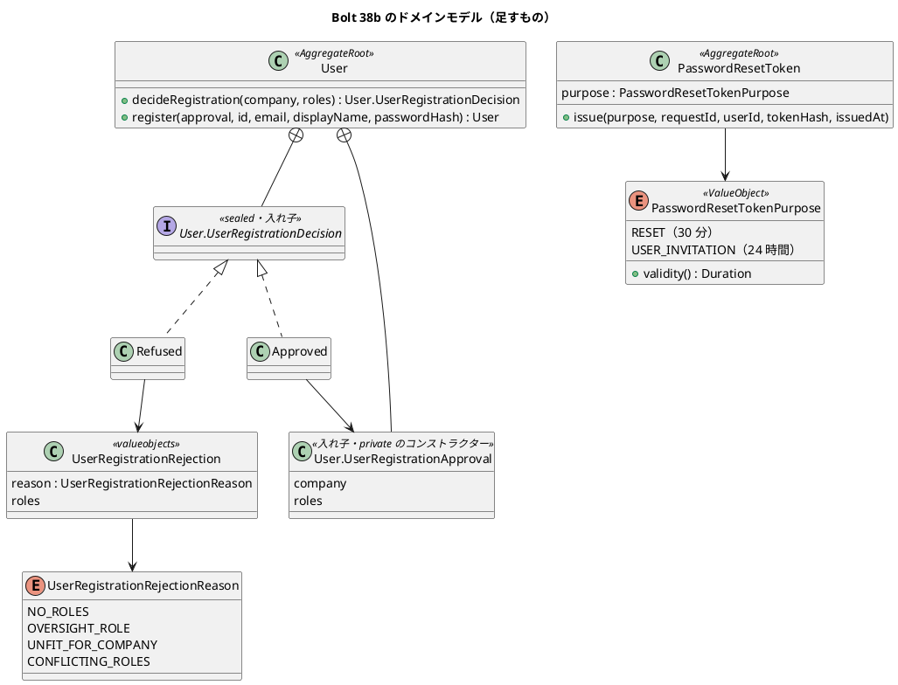
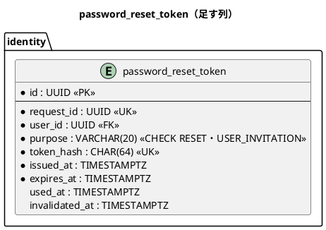
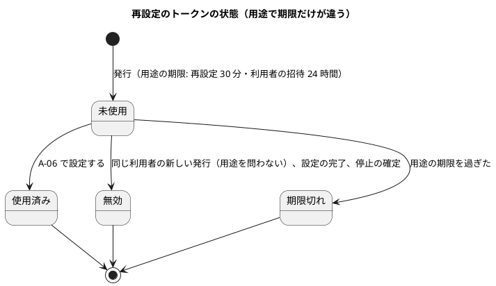

# Bolt 38b 計画 - 利用者の登録の判定と、招待のトークンの用途（ドメインと永続化）

## 基本情報

| 項目 | 内容 |
| :--- | :--- |
| Bolt | 第 38b 回（W6 の 19 本目。開始準備で 38b を 38b・38b2・38b3・38b4 の 4 つに分けた 1 つ目） |
| 予定 | W6（2026-11-09 の週。前倒しで着手できる）。作業は約 3.8 時間（`check`・SonarQube・CI の待ちを除く） |
| アプローチ | インサイドアウト（利用者の生成の判定とトークンの用途から。release_plan の 38b の行、開発戦略 :118・:346）。登録の判定はスキーマを変えないのでドメインから入り、トークンの用途はマイグレーションから入る（2 つの塊は互いに依存しない。開発戦略 :123） |
| 対象 | (1) `User` の登録の判定（企業の種類・役割 1 つ以上・監督の役割を付けない・職務分離）と、判定を通った承認の値からだけ利用者を作る口、(2) #50 の「役割 0 件の検査の二重」を `User` のコンストラクターの 1 か所にする、(3) `password_reset_token` に用途の列（`RESET`・`INVITATION`）を足し、用途ごとの期限（30 分・24 時間）と、繰り返しの依頼の抑えを再設定の発行だけで数える形にする、(4) 設計の文書（domain_model・data_model・non_functional・ADR-011 の注）。見える振る舞いは変えない（招待のトークンを発行する口は 38b2） |
| トレース | US-16 AC1（企業・利用者・役割の関係。UC-16 の主シナリオ 1・4（企業間分離・職務分離））、US-16 AC3（職務分離。UC-16 の拡張 4a は監督の役割の拒否で満たす。登録では競合する役割の両方でなく監督の役割を示す。役割の変更の 4a は Bolt 34 のまま）、BR-14（事前登録のメールアドレス）、SEC-08・IA-INV-12（トークン）。拡張 2a（管理範囲）は 38b2、4b（同時の更新）は登録に当たらない |
| GitHub | [#14](https://github.com/k2works/practical-domain-driven-design-in-enterpris-application/issues/14)（US-16）、[#50](https://github.com/k2works/practical-domain-driven-design-in-enterpris-application/issues/50)（「役割 0 件の検査の二重」の項目を閉じる） |
| SP | 0 |
| 承認ゲート | 計画と終了報告。スキーマ（common のマイグレーション 1 つ。`password_reset_token.purpose`）、セキュリティ（トークンの期限と繰り返しの依頼の抑え）、新しいファイル（拒否の値と理由、用途の値、マイグレーション、テスト。判定の結果と承認の値は `User` の入れ子なのでファイルを増やさない） |
| 開始準備で決めたこと | 2026-10-25、human:kakimomokuri: (1) 38b を 4 つに分ける（38b ドメインと永続化 → 38b2 登録のサービス・管理範囲・監査・招待のトークンの発行とメール → 38b3 S-20 の登録の画面・axe・マニュアル 11 章とキャプチャ → 38b4 A-06 と無効のリンクの画面の出し分け・axe・マニュアル 2 章・受入シナリオ・動画。38b3 と 38b4 は同じ配備にして、登録できるが A-06 の文言が再設定のままの窓を作らない）、(2) 既にいるメールアドレスでの登録は、管理範囲の内外で同じ文で拒む（範囲外の利用者の存在が分かることは受け入れる。38b2・38b3）、(3) 招待のリンクは再設定の URL（`/password-reset/{トークン}`・`/password-reset/new`）を使い、用途はトークンから読む（公開の URL を増やさない。38b4）、(4) 役割 0 件の守りは `User` のコンストラクターの 1 か所にし、リポジトリの確かめを消す（データの不整合の区別は例外の文に利用者 ID を足して補う） |

## Bolt ゴール

38b2 以降が利用者の登録と招待を組み立てられるよう、登録の判定と招待のトークンの用途を、見える振る舞いを変えずにドメインと永続化に足す。

### 開始準備で確かめたこと

- **生成の口がない**: `User.of(...)`（`identity/domain/model/aggregates/User.java:63-86`）は「登録とリポジトリの復元が使う」と書くが、本番のコードで登録に使う所はない。`UserRepository.add`（`UserRepository.java:19`）と重複のメールアドレスの `DuplicateEmailException`（`MyBatisUserRepository.java:44-63`）はある。役割の変更は判定（`decideRoleChange`。:123-127）が承認の値（`RoleChangeApproval`）を返し、承認からだけ変える形（Bolt 34e）
- **役割の変更の判定の順**（`User.java:130-153`）: 自分 → 役割なし → 変更なし → 監督の役割 → 企業の種類 → 職務分離。登録では自分・変更なしがない。監督の役割（システム管理者・監査担当者）は登録でも付けない（IA-INV-01。最初の管理者は W10 の運用の手順）。`RoleAssignmentPolicy.conflicts`（`rules/RoleAssignmentPolicy.java:44-52`）は業務の役割と監督の役割の両方があるときだけ値を返すので、登録で監督の役割を拒んだ後は今の規則で職務分離に当たる組み合わせは残らない。運用する会社の付けられる役割（:38）には監督の役割も含まれるので、監督の役割の判定を外すと企業の種類の判定では止まらない。荷受人の企業は付けられる役割が空（:39・:85）なので、どの業務の役割でも企業の種類で拒まれる（監督の役割は先に拒まれる）
- **役割 0 件の検査**（#50。出典 `bolt_32c_report.md:145`）: `User` のコンストラクター（`User.java:55-57`。`IllegalArgumentException`）と `MyBatisUserStandingRepository.java:45-46`（`IllegalStateException`「データの不整合」）の 2 か所。入力の拒否は判定の `NO_ROLES`（`User.java:136-138`）で別
- **トークン**（`PasswordResetToken.java`）: `VALIDITY` 30 分（:21）、`REISSUE_INTERVAL` 1 分（:24）、`issue`（:74）は期限を `VALIDITY` で決める、`allowsIssue`（:106）は最後の発行時刻で決める。表（`migration/common/V20261015110000__create_identity_password_reset_token.sql:6-35`）に用途の列はなく、`expires_at` の注は「発行から 30 分」（:33）
- **繰り返しの依頼の抑え**: `PasswordResetMailEventHandler.java:84` が `findLastIssuedAt(userId)` で判定し、SQL は用途を区別しない（`PasswordResetTokenMapper.xml:29-31` の `MAX(issued_at) … WHERE user_id`）。このままだと招待の直後 1 分以内に本人が出した再設定の依頼が止まる（確認ポイント 15）。`invalidateUnused`（:33-39）は用途を問わず未使用を無効にする。停止の確定（Bolt 34d）も同じ操作で無効にする
- **トークンを使う所**: 発行はハンドラー（:72-106）、使うのは `PasswordResetCompletionService`（:87・:109-155）と `PasswordResetController`（:92-150）。`invalidateUnused` の呼び出しは 3 か所（ハンドラー :93、`PasswordResetCompletionService` :151 の完了の後、`UserStatusChangeService` :147 の停止の確定）で、どれも用途を問わない SQL のまま。`findLastIssuedAt` はマッパーのインターフェース（引数が 2 つになるので `@Param`）と XML、`MyBatisPasswordResetTokenRepositoryIntegrationTest` :75・:81 に及ぶ（モックの stub はない）。テストは `PasswordResetTokenTest`、`MyBatisPasswordResetTokenRepositoryIntegrationTest`（PostgreSQL だけ。:159 が `PasswordResetToken.VALIDITY` を参照）、`PasswordResetCompletionServiceTest`・`PasswordResetCompletionIntegrationTest`、`AuthenticationSecurityIntegrationTest`。`VALIDITY` の定数は用途の `validity()` に移して消す（参照を直す）
- **設計の文書**: domain_model の `User`（:186）・`PasswordResetToken`（:226・:1330）・再設定の流れ（:1162）・役割の判定の順（:1164）・IA-INV-12（:1350）。登録の判定と用途の記述はない。data_model の `password_reset_token`（:884-894・:926・:1181）。non_functional の SEC-08（:155）。ADR-011 :257 の「初回の password の渡し方は Bolt 34 で決める」が残る（決定は release_plan :714。招待のリンクで渡し、登録は使えないハッシュで行い、本人が A-06 で設定する。招待のトークンだけ 24 時間）
- **語**: 「招待」は US-19 の荷受人の招待（参照許可。通知の種類 `CONSIGNEE_INVITATION`）にも使う。この Bolt の用途は「利用者の招待」（`USER_INVITATION`）とし、用語集に分けて書く
- **承認の値の形**（Bolt 34e）: `RoleChangeDecision`・`RoleChangeApproval`・`StatusChangeApproval` は `User` の入れ子の型で、承認のコンストラクターは private（`User.java:261-344`。「同じパッケージからも作れない。作り手を集約に限るため、valueobjects でなく集約の中に置く」。bolt_34e_plan :35・:77・:83、architecture_backend :311・:313）。拒否の値と理由（`RoleChangeRejection`・`RoleChangeRejectionReason`）は `domain.model.valueobjects`
- **用語集の整合テスト**: `LivingGlossaryConsistencyTest`（`documentationTest`。`check` から動く）は、`@ValueObject`・`@AggregateRoot` を付けたクラス（入れ子を含む）に domain_model の「### 用語集」の行と、Javadoc の最初の語の一致を求める。前例は :190・:233・:234（承認と拒否）。`SuspensionReason` は `@ValueObject` で行があり、`RoleChangeRejectionReason` は付けない
- **列のコメントの整合テスト**: `SchemaCommentIntegrationTest`（:54-65）はすべての列に日本語のコメントを求める
- **状態遷移図の 30 分**: domain_model :1330（集約の表）と :1390-1393（状態遷移図の「発行（30 分）」「30 分を過ぎた」）
- **トークンの行を入れるほかのテスト**: `UserStatusChangeSecurityIntegrationTest:208`（生の SQL。列の DEFAULT で動く）、`PasswordResetRequestIntegrationTest`（:240 が 1 分の抑え）、`PasswordResetResponseIntegrationTest`、`PasswordResetUiSteps`。直接 SQL で表に触るのは `UserStatusChangeSecurityIntegrationTest:208`・`PasswordResetUiSteps:150・:167`・`PasswordResetResponseIntegrationTest:110`（どれも `purpose` なしの INSERT。`DEFAULT` で動く）。役割 0 件の例外の型を確かめるテストは 2 つ: 契約 `UserStandingRepositoryContract:135-146`（`isInstanceOf(IllegalStateException.class)`。H2 の `H2UserStandingRepositoryTest` と PostgreSQL の `MyBatisUserStandingRepositoryIntegrationTest` で流れる）と `SessionRevalidationSecurityIntegrationTest:394-403`（原因の型）。`MyBatisUserStandingRepository` の Javadoc :21-23 も「例外にする」と書く
- **例外の型の変更の影響**: 役割のない行は request ごとの確かめ（`SessionRevalidationFilter:77`）で `RuntimeException` として 500 になり、ログインの道（`CargoUserDetailsService.findUser:42-47`）は `findByEmail` を丸ごと `catch (IllegalArgumentException _)` で囲み、役割 0 件の利用者を「見つからない」に吸い込む（今も同じ。この Bolt で変わらない。既知の課題に書き、try を `EmailAddress.of` だけに狭めることを 38b2 以降の候補にする）。`IllegalStateException` から `IllegalArgumentException` に変わっても見える振る舞いは変わらない。利用者 ID を例外の文に足すのは、request ごとの確かめの道のログでだけ役に立つ
- **マイグレーションの既定の値**: `NOT NULL DEFAULT` は common の前例（`create_identity.sql` の `excluded BOOLEAN NOT NULL DEFAULT FALSE`）があり、H2（MODE=PostgreSQL）と PostgreSQL の両方で既存の行に既定の値が入る。Flyway のテストは空の DB に流すので、既存の行の扱いは `purpose` を省いた INSERT が `RESET` になることと、行のあるデモ環境への配備で確かめる。CHECK は前例（ADR-007）どおり `ALTER TABLE … ADD CONSTRAINT` の別の文にする
- **release_plan で 38b を指す所**: :774（38b の行）、:703（状態）、:781（半日を超えそうな Bolt の列挙）、:785（#50 から入れるもの）、:789（動画 `@demo-38b`）、:791（マニュアル 2 章・11 章の「38b の招待」）
- **マイグレーション**: common の最新は `V20261023100000__add_quotation_route_redesign_required.sql`。この Bolt の番号は `V20261025100000__add_identity_password_reset_token_purpose.sql`
- **数えた場所と switch**（T-148・T-175）: `findLastIssuedAt` の呼び出しは 1 か所（ハンドラー）。用途の値で分岐する switch は 0 個（期限は値が持つ）

## 設計の決定（案）

| 項目 | 決定 | 根拠 |
| :--- | :--- | :--- |
| 登録の判定 | `User.decideRegistration(Company company, Set<Role> roles)`（static）。判定の順は、役割なし（`NO_ROLES`）→ 監督の役割（`OVERSIGHT_ROLE`）→ 企業の種類（`UNFIT_FOR_COMPANY`）→ 職務分離（`CONFLICTING_ROLES`。役割の変更と同じ順。今の規則では監督の役割を拒んだ後に当たる組み合わせは残らないが、規則が広がったときに登録だけが黙って見なくならないよう、最後に残す。release_plan :774・US-16 AC3）。受け付けるなら承認の値、受け付けないなら拒否を返す | UC-16 の主シナリオ 1、US-16 AC3、IA-INV-01・IA-INV-13 |
| 型の置き場所 | 判定の結果 `UserRegistrationDecision`（sealed。`Approved`・`Refused`）と承認の値 `UserRegistrationApproval`（企業と役割）は `User` の入れ子にし、承認のコンストラクターは private（Bolt 34e の形）。拒否 `UserRegistrationRejection`（record。理由と該当の役割）と理由 `UserRegistrationRejectionReason` は `domain.model.valueobjects`（`RoleChangeRejection` と同じ）。用語集に「利用者の登録の承認」「利用者の登録の拒否」を足し、Javadoc の最初の語を合わせる | Bolt 34e、architecture_backend :311・:313、`LivingGlossaryConsistencyTest` |
| 生成の口 | `User.register(UserRegistrationApproval approval, UserId id, EmailAddress email, String displayName, String passwordHash)` が版 0・利用中の利用者を作る。承認の値は判定からだけ作れる。承認は判定した実体に縛られない（static の判定なので）。1 回の登録に使い、重複は 38b2 のサービスとメールアドレスの一意制約で守ると Javadoc に書く。`User.of` の Javadoc を「復元が使う」に直す。管理範囲と企業の有効性・重複のメールアドレスは 38b2 のサービスで見る | Bolt 34e の前例 |
| 役割 0 件の守り | `User` のコンストラクターの 1 か所。例外の文に利用者 ID を足す（「利用者 … には役割が 1 つ以上要る（BR-15）」）。`MyBatisUserStandingRepository.java:45-46` の確かめを消し、空の役割はそのまま `User.of` に渡して例外にする | 開始準備の決定 (4) |
| 用途の値 | `PasswordResetTokenPurpose`（`domain.model.valueobjects`。`@ValueObject` を付け、用語集に「再設定のトークンの用途」を足す）: `RESET`（再設定。30 分）・`USER_INVITATION`（利用者の招待。24 時間。荷受人の招待の通知の種類 `CONSIGNEE_INVITATION` と並べて揺れないよう、38b2 で足す通知の種類 `USER_INVITATION` と名前をそろえる）。期限は用途が持つ（`validity()`）。`PasswordResetToken` は用途を持ち、`issue(purpose, requestId, userId, tokenHash, issuedAt)` が用途の期限で `expiresAt` を決める | 確認ポイント 15、release_plan :714 |
| 繰り返しの依頼の抑え | `findLastIssuedAt(userId, purpose)` にし、ハンドラーは `RESET` の最後の発行だけで判定し、`RESET` で発行する（招待の直後の再設定の依頼を止めない。再設定のリンクは 30 分のまま）。`allowsIssue` の形は変えない | 確認ポイント 15 |
| 無効化 | `invalidateUnused(userId, at)` は今のまま用途を問わず無効にする（本人の再設定の発行は未使用の招待のリンクも無効にする。新しいリンクが前のリンクに代わる IA-INV-12 を用途をまたいで保つ。停止の確定と完了の後も今のまま）。受け入れるリスク: メールアドレスを知る第三者が招待の直後に再設定を依頼すると、招待のリンクが無効になる。再設定のリンクは本人に届き、初回の設定はそれでもできる（38b4 の A-06 の文言で扱う）。SEC-08 の残りのリスクに書く | IA-INV-12、SEC-12、SEC-08 |
| スキーマ | `purpose VARCHAR(20) NOT NULL DEFAULT 'RESET'` と `CONSTRAINT ck_password_reset_token_purpose CHECK (purpose IN ('RESET', 'USER_INVITATION'))` を足す（既存の行は `RESET`。`DEFAULT` は既存の行と生の SQL で行を入れるテストのために残す。入れ忘れは行 9 の確かめと V5 で捕まえる）。`COMMENT ON COLUMN … purpose IS '用途（RESET 再設定、USER_INVITATION 利用者の招待）'`。`expires_at` の注を「発行から用途の期限（再設定 30 分、利用者の招待 24 時間）」に、`request_id` の注を「再設定の依頼または利用者の登録の ID（通知の契機の ID と同じ）」に直す。索引は今の `(user_id, issued_at)` のまま（利用者ごとの行は少ない） | 確認ポイント 15、`SchemaCommentIntegrationTest` |
| 使う側 | A-06（`PasswordResetCompletionService`・`PasswordResetController`）は用途を読まない（出し分けは 38b4）。トークンの使用の条件（`isUsable`・`markUsedIfUsable`）は用途によらない | 開始準備の決定 (1) |

## ふりかえりと前の Bolt からの引き継ぎ

| 出典 | 内容 | この Bolt での扱い |
| :--- | :--- | :--- |
| Bolt 38 Try T-200 | 変異の道具はバイトのまま読み書きする | 変異のスクリプトを `rb`・`wb` で書く |
| Bolt 38 Try T-201 | 変異は確かめたい振る舞いだけが変わる最小の形にする | 下の変異の表 |
| Bolt 38 Try T-202 | 止まっているかはプロセスの開始時刻と今を比べてから決める | 長い処理を止める前に確かめる |
| Bolt 37f3 Try T-198・T-199 | 受入条件の句ごとに確かめる、ログを残す | 状態の組み合わせの表、ログはスクラッチパッドに置く |
| Bolt 37f2 Try T-197 | 文書の行を実装のコミットの前に突き合わせる | ステップ 4 |
| W5 の Try T-161・T-163 | 状態の組み合わせの表と行ごとのテスト | 下の表（用途 × 期限の境界 × 依頼の時刻） |
| W5 の Try T-106・T-119 | 「ないこと」の前に対象があることを確かめる | 行 6（招待の後の再設定）は、招待のトークンがあることを先に確かめる |
| W5 の Try T-125 | 規則に当たったら止めて諮る | ArchUnit・ModularityTest に当たったら止める |
| W5 の Try T-152 | 共通の部品と写しは全体を数えてから変える | 開始準備で確かめたこと（トークンを使う所、例外の型を確かめるテスト、release_plan で 38b を指す所）に数えた |
| Bolt 38 の既知の課題 | 停止の理由の文言は名前の文字列で持つ、エラー要約の二重の読み上げ | 38b3（登録の画面の拒否の文言とエラー要約）に送る |
| W5 の Try T-104・T-147・T-139 | SonarQube の時機、テストのラムダの中で値を作らない | ステップ 5 |
| #50 | 役割 0 件の検査の二重（Bolt 32c） | この Bolt で閉じる |

## 状態の組み合わせ（行ごとにテストを 1 本。T-182）

| 行 | 状況 | 期待 | 確かめ方 |
| :--- | :--- | :--- | :--- |
| 1 | 運用する会社に営業担当者、荷主の企業に荷主担当者で登録を判定する | 承認。承認から作った利用者は版 0・利用中・その役割 | `UserRegistrationTest` |
| 2 | 役割なしで判定する | `NO_ROLES` | `UserRegistrationTest` |
| 3 | 監督の役割（システム管理者、監査担当者、業務の役割との組み合わせ）を含めて判定する | `OVERSIGHT_ROLE` と監督の役割 | `UserRegistrationTest` |
| 4 | 荷主の企業に営業担当者、荷受人の企業に荷主担当者で判定する | `UNFIT_FOR_COMPANY` と合わない役割 | `UserRegistrationTest` |
| 5 | 荷受人の企業にシステム管理者と荷主担当者で判定する（監督の役割と企業の種類が重なるときの順） | `OVERSIGHT_ROLE`（企業の種類より先） | `UserRegistrationTest` |
| 6 | 用途ごとの期限の境界（再設定は発行から 29 分 59 秒・30 分、招待は 23 時間 59 分 59 秒・24 時間） | 前は使え、ちょうどは使えない | `PasswordResetTokenTest` |
| 7 | 招待のトークンを入れた直後（1 分以内）に、再設定の最後の発行を読む | 空（招待の時刻を返さない）。招待のトークンがあることを先に確かめる | `MyBatisPasswordResetTokenRepositoryIntegrationTest`（`findLastIssuedAt(userId, RESET)`） |
| 7b | 招待のトークンを入れた直後（1 分以内）に、本人が再設定を依頼する | ハンドラーが発行してメールを送り、そのトークンは `RESET`・期限 30 分 | `PasswordResetRequestIntegrationTest`（:240 の隣） |
| 8 | 再設定の発行の直後（1 分以内）に再設定を依頼する | 発行しない（今のまま） | `PasswordResetRequestIntegrationTest:240`（既存） |
| 9 | 用途を保存して読み戻す | 用途と期限が保たれる（PostgreSQL）。`purpose` を省いた INSERT は `RESET` になる。H2 ではマイグレーションが流れる（`H2DevProfileSmokeTest`）ことだけを確かめる | `MyBatisPasswordResetTokenRepositoryIntegrationTest` |
| 10 | 再設定の発行が未使用の招待のトークンを無効にする | 招待のトークンも無効（用途をまたぐ） | 同上 |
| 11 | 役割のない利用者の行を読む（データの不整合） | `User` のコンストラクターの `IllegalArgumentException` で、文に利用者 ID がある。request ごとの確かめでは今までどおり 500 で session を捨てる | `UserStandingRepositoryContract:135-146`（H2 と PostgreSQL。名前と期待する型を直す）、`SessionRevalidationSecurityIntegrationTest:394-403`（原因の型を直す） |

## スコープ

### 入れるもの

- 行 1〜11 のテスト、`User.decideRegistration`・`User.register`・`UserRegistrationDecision`・`UserRegistrationApproval`・`UserRegistrationRejection`（と理由）、`PasswordResetTokenPurpose`、`PasswordResetToken` と リポジトリ・MyBatis・マッパーの用途、ハンドラーの `RESET` の抑え、マイグレーション、`MyBatisUserStandingRepository` の確かめの削除と `User` の例外の文
- 設計の文書: domain_model（`User` の登録の判定と生成、`PasswordResetToken` の用途と期限（:226・:1330・:1390-1393 の状態遷移図の「30 分」）、再設定の流れの抑え（:1162）、IA-INV-12、用語集「利用者の招待」「利用者の登録の承認」「利用者の登録の拒否」「再設定のトークンの用途」）、architecture_backend（:311・:313 の置き場所の段落に登録の承認）、data_model（`password_reset_token.purpose`、制約、`request_id`・`invalidated_at`・`expires_at` の注）、non_functional の SEC-08（招待は 24 時間、抑えは再設定だけ、第三者の再設定の依頼で招待のリンクが無効になり得るリスク）、ADR-011 :257 の注（決定の場所を release_plan :714 と 38b〜38b4 に）、release_plan（38b を 4 つに分けた行（各行にアプローチと承認ゲート）、:703・:781・:785・:789・:791、更新履歴）
- #50 へのコメント

### 入れないもの

- 登録のサービス・管理範囲・重複のメールアドレス・監査・招待のトークンの発行とメール・通知の種類（38b2）、S-20 の登録の画面（38b3）、A-06 の出し分け・マニュアル・動画（38b4）
- 使えないハッシュの作り方（38b2。登録のサービスで決める）
- マニュアル（見える振る舞いを変えない）

## 設計（この Bolt の範囲）

- 画面遷移図: 画面を変えないので省く

## ステップ計画

- [ ] **1. 設計の文書**: domain_model（:186・:226・:1162・:1330・:1350・:1390-1393、用語集の 4 行）・architecture_backend（:311・:313）・data_model・non_functional の SEC-08・ADR-011 :257 の注、release_plan（38b を 38b〜38b4 の 4 行に、:703・:781・:785・:789・:791）（完了の判定: 文書の差分）
- [ ] **2. 登録の判定（Red → Green）**: 行 1〜5 のテストを先に書き、空の操作で落ちることを確かめてから判定と生成の口を作る（完了の判定: 期待した理由で落ちた後に緑。新しい型の Javadoc の最初の語が用語集の名前と合い、`LivingGlossaryConsistencyTest` が緑）
- [ ] **3. トークンの用途（Red → Green）**: 行 6〜10（7b を含む）のテストとマイグレーション（H2 と PostgreSQL の両方で流れる）、用途の値、トークン・リポジトリ・マッパー・ハンドラー、`VALIDITY` の参照（完了の判定: 同上、既存の再設定のテストと `SchemaCommentIntegrationTest` が緑のまま）
- [ ] **4. 役割 0 件の守りと突き合わせ**: 行 11、リポジトリの確かめと Javadoc :21-23 を直し、2 つのテストの期待する型を直す。実装のコミットの前に T-197 の突き合わせ（ステップ 1 の文書の行）（完了の判定: 差分）
- [ ] **5. 品質ゲートと開発レビュー**: 変異、`check`・`uiTest`、その後に SonarQube、開発レビューとその直し
- [ ] **6. 終了報告**: push して CI と MkDocs とデモ環境の配備を確かめる。終了報告の承認の後に #50 にコメントし、release_plan・開発の索引・mkdocs を完了に直す

### 時間の配分と打ち切り

| # | 目安 | 打ち切り |
| :--- | :--- | :--- |
| 1 | 35 分 | — |
| 2 | 45 分 | — |
| 3 | 80 分 | PostgreSQL のマイグレーションで既存の行の `DEFAULT` の扱いが H2 と違うときは、`ADD COLUMN … DEFAULT` の後に `UPDATE` と `SET NOT NULL` の 3 文に分ける（報告に書く） |
| 4 | 20 分 | — |
| 5 | 35 分（待ちを除く） | — |
| 6 | 15 分（CI の待ちを除く） | — |

合計 230 分（約 3.8 時間）。

## 確認ポイント（計画の承認の場でまとめて確認する。Try T-6）

| # | 確認すること | 場所 | 推奨 |
| :--- | :--- | :--- | :--- |
| 1 | **分け方（開始準備の決定 (1)）** | release_plan | 38b（この Bolt）・38b2・38b3・38b4。38b3 と 38b4 は同じ配備。38b2 は登録のサービス・管理範囲・重複・監査・招待のトークンの発行と通知の種類（スキーマ）と公開 API・メール・使えないハッシュで大きいので、38b2 の開始準備で 38b2（登録と監査）と 38b2b（招待の発行とメール）に分けるかを決める。38b2 の通知の公開 API は招待の口だけにし、38d（本人への通知）で一般の口が要るかを決める |
| 2 | **登録の判定の順と理由** | ステップ 2 | 役割なし → 監督の役割 → 企業の種類 → 職務分離（役割の変更と同じ順。今の規則では職務分離は到達しないが、規則が広がったときのために残す） |
| 3 | **用途の名前と期限（スキーマ・セキュリティ）** | ステップ 3 | `RESET` 30 分・`USER_INVITATION` 24 時間（38b2 の通知の種類と同じ名前）。列は `purpose`、既存の行と省いた INSERT は `DEFAULT` で `RESET`、CHECK を付ける |
| 4 | **繰り返しの依頼の抑えと無効化（セキュリティ）** | ステップ 3 | 抑えは再設定の発行だけで数える。無効化は今のまま用途を問わない（本人の再設定は未使用の招待のリンクも無効にする）。第三者の再設定の依頼で招待のリンクが無効になり得ることを受け入れ、SEC-08 に書く |
| 5 | **役割 0 件の守り（開始準備の決定 (4)）** | ステップ 4 | `User` のコンストラクターの 1 か所。例外の文に利用者 ID |
| 6 | **語** | ステップ 1 | 「利用者の招待」（`USER_INVITATION`。US-19 の荷受人の招待 `CONSIGNEE_INVITATION` と分ける） |
| 7 | **変異** | ステップ 5 | 下の 8 つ。スクリプトはバイトのまま読み書きし、gradlew.bat を絶対パスで呼び、結果の XML を消してから流す（T-164・T-178・T-200） |

### 変異と落ちる見込みのテスト

| # | 変異 | 落ちる見込み |
| :--- | :--- | :--- |
| V1 | 登録の判定で監督の役割を見ない | 行 3 |
| V2 | 登録の判定で企業の種類を見ない | 行 4 |
| V3 | 招待の期限を 30 分にする | 行 6 |
| V4 | 繰り返しの依頼の抑えを用途によらず数える（SQL の用途の条件を外す） | 行 7 |
| V5 | 保存で用途を `RESET` に固定する | 行 9（`USER_INVITATION` を書いて戻す） |
| V6 | 無効化の SQL に `AND purpose = 'RESET'` を足す | 行 10 |
| V7 | ハンドラーが `USER_INVITATION` で発行する | 行 7b（期限 30 分の確かめ） |
| V8 | 企業の種類を監督の役割より先に見る | 行 5 |

## 完了条件

- [ ] 上のステップ 1〜6 の完了の判定を満たす
- [ ] 行 1〜11（7b を含む）に、それを名乗るテストがある
- [ ] `check`・`uiTest` が緑、SonarQube が PASS、CI が緑、デモ環境が新しい版で動く（行のある PostgreSQL にマイグレーションが流れ、既存のトークンが `RESET` になる）
- [ ] 見える振る舞いが変わらない（既存の再設定のテストと画面の層が緑のまま。マニュアルは変えない）
- [ ] 終了報告が承認される

## 更新履歴

| 日付 | 更新内容 | 更新者 |
| :--- | :--- | :--- |
| 2026-10-25 | 整合性検証の指摘を反映した（承認待ち）。判定の結果と承認の値を `User` の入れ子にし（承認のコンストラクターは private）、職務分離を判定の最後に残し、用途の名前を `USER_INVITATION` にし、用語集・状態遷移図・列のコメント・architecture_backend・release_plan の 38b を指す所を足し、行 7b・ハンドラーの確かめ・行 11 の確かめ先・V7・V8、第三者の再設定で招待のリンクが無効になるリスク、トレースを直した | anthropic/claude-opus-5-5 |
| 2026-10-25 | 初版作成（承認待ち）。開始準備で、38b を 4 つに分け、既にいるメールアドレスは範囲の内外で同じ文で拒み、招待のリンクは再設定の URL を使い、役割 0 件の守りはコンストラクターの 1 か所にすると決めた（human:kakimomokuri） | anthropic/claude-opus-5-5 |

## 関連ドキュメント

- [リリース計画](release_plan.md)（W6 節の 38b の行、確認ポイント 15、:714 の初回の password の渡し方）
- [Bolt 38 終了報告](bolt_38_report.md)、[Bolt 34e 終了報告](bolt_34e_report.md)（承認の値の形）、[Bolt 32c 終了報告](bolt_32c_report.md)（役割 0 件の検査の二重）
- [ドメインモデル](../../design/cargo-tracker/domain_model.md)、[データモデル](../../design/cargo-tracker/data_model.md)、[非機能要件](../../design/cargo-tracker/non_functional.md)（SEC-08）
