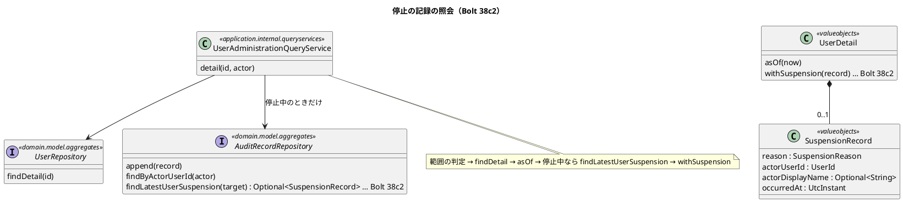
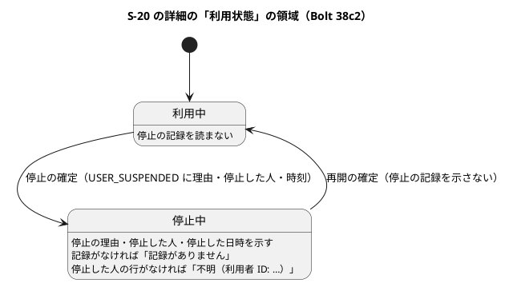
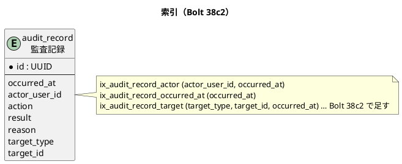

# Bolt 38c2 計画 - S-20 の詳細に停止の記録を示し、ロックの期限を項目に分ける

## 基本情報

| 項目 | 内容 |
| :--- | :--- |
| Bolt | 第 38c2 回（W6 の 27 本目。38c の開始準備で 38c を 38c・38c2 に分けた 2 つ目） |
| 予定 | W6（2026-11-09 の週。前倒しで着手できる）。作業は約 3.6 時間（`check`・`uiTest`・SonarQube・CI の待ちを除く）。development_strategy の目安（2〜4 時間）に収まる。合計が 240 分を超えそうなら、決定 (8)・(9)（ロックの期限の表示）を後の Bolt に送る（停止の記録と独立しているため。下の打ち切り） |
| アプローチ | アウトサイドイン（受入シナリオの Red から入る。S-20 の詳細から、監査記録の照会と索引へ下りる）。索引は表も列も変えないので、開発戦略 :118 の「新しいスキーマ → インサイドアウト」ではなく :119 の「既存の集約に受入条件を足す」に当たる（W6 の行 :346 と一致） |
| 対象 | (1) S-20 の詳細の「利用状態」の領域に、停止中のときだけ、今の停止の理由・停止した人・停止した日時を示す（記録がなければ「記録がありません」）、(2) 監査記録を対象で引く索引のマイグレーション、(3) 「ログインの資格」の領域と、ロックの解除の確認の画面で、ロックの期限を「解ける日時」の項目に分ける、(4) マニュアル 11 章・付録 B・用語集とキャプチャ（一覧の停止の例を含む）、(5) 設計の文書 |
| トレース | US-16 AC5（利用終了・取消し、履歴は保持）、US-18 AC3（ロック）、IA-INV-07（監査は追記だけ）、BR-10（社内の画面の UTC の併記）、AUD-03、PERF-01、RET-02、#50（Bolt 34d の報告 :103「停止の理由などの表示」）、Bolt 38c の報告の議題 4 |
| GitHub | [#50](https://github.com/k2works/practical-domain-driven-design-in-enterpris-application/issues/50)（W5 の締めの返済の候補。38c2 で「停止の理由などの表示」の項目の 2 つの課題（詳細の表示と一覧のキャプチャ）を返す。同じ項目の「処理中の request の隙」「動画の確かめの手段」は範囲の外）、[#14](https://github.com/k2works/practical-domain-driven-design-in-enterpris-application/issues/14)（US-16 の残り）。動画は撮らないので、添付はない |
| SP | 0 |
| 承認ゲート | 計画と終了報告。**スキーマ**（`identity.audit_record` に索引を足すマイグレーション。W6 の確認ポイントのデータベース）、**画面**（詳細の利用状態の領域、ログインの資格の領域、ロックの解除の確認。A-03 は変えない）、**構造**（照会のサービスが初めて監査記録を読む）、新しいファイル（下の一覧） |
| ブランチ | develop で開発する。途中の push はデモ環境の配備になるので、push はステップ 7 でまとめる |
| 開始準備で決めたこと | 2026-10-27、human:kakimomokuri: (1) 停止の情報は監査記録 `USER_SUSPENDED` から読み、対象で引く索引 `(target_type, target_id, occurred_at)` を足すマイグレーションを書く（Flyway の命名と前例に合わせ、本番の表が大きいときの作り方を計画で確かめる）、(2) S-20 を開けるシステム管理者に示す、(3) 今の停止の分だけ（最新の `USER_SUSPENDED`）を示し、履歴は S-21 で扱う、(4) 再開した後は何も示さない、(5) 停止中で記録がなければ「記録がありません」と示す、(6) 停止した人は今の表示名で示す、(7) 時刻は社内の形（`DateTimeDisplay.staff`）、(8) ロックの期限は 2 つの項目に分ける（「ロック: ロック中」と「解ける日時: …」）。これは 38c の報告の議題 4 で承認された推奨（「ロック中: … まで」の 1 行の形。`bolt_38c_report.md:22,155`）を改めたもの、(9) 分のずれの注はマニュアル 11.2 と付録 B の Q1-1 に置く、(10) 停止中の詳細のキャプチャを足し、`11-user-detail` を撮り直す。動画は撮らない。整合性検証の後（同日）: (11) 停止した人は、管理範囲の外の人でも表示名を示す（職務の上の名前で、確認の画面の「実行者」とそろう。停止の操作はシステム管理者だけが行う）、(12) 停止した人の行がないときは「不明（利用者 ID: {ID}）」と示す（監査証跡（S-21）でたどるため。DB を直接操作したときだけ起こる）、(13) #50 の「一覧のキャプチャに停止の例がない」も返す（一覧のキャプチャ `11-users` に停止中の利用者を 1 人入れて撮り直す） |

新しいファイル（計画の承認で確かめる）:

- マイグレーション: `apps/cargo-tracker/src/main/resources/db/migration/common/V20261027100000__add_identity_audit_record_target_index.sql`
- 本体:
  - `identity/domain/model/valueobjects/SuspensionRecord.java`（停止の記録。理由・停止した人の ID と表示名・時刻。`@ValueObject`）
  - `identity/infrastructure/persistence/SuspensionRecordRow.java`（停止の記録の 1 行。前例 `UserDetailRow`・`AuditRecordRow`）
- テスト:
  - `identity/domain/model/aggregates/AuditRecordSuspensionContract.java`（停止の記録の照会の契約。前例 `UserStandingRepositoryContract`）
  - `identity/infrastructure/persistence/H2AuditRecordSuspensionTest.java`（H2 の子。前例 `H2UserStandingRepositoryTest`）
  - `identity/infrastructure/persistence/MyBatisAuditRecordSuspensionIntegrationTest.java`（PostgreSQL の子）
  - 索引の確かめ（行 10）は既存の `MyBatisIdentityRepositoriesIntegrationTest` に足す。受入シナリオは既存の `manage_user_status_ui.feature` に足す（新しい feature は作らない）
- 資産: `docs/manual/assets/11-user-detail-suspended.png`

## Bolt ゴール

システム管理者が S-20 の詳細で、停止中の利用者の今の停止の理由・停止した人・停止した日時を見て、再開してよいかを判断できる。ロックの期限は「解ける日時」の項目として、ほかの日時と同じ形で読める。

### 開始準備で確かめたこと

| # | 事実 | 根拠 |
| :--- | :--- | :--- |
| 1 | #50 で 38c2 に当たるのは「利用者の管理」の 1 項目の「停止の理由などの表示」。出典は 34d の報告で、「詳細に停止の理由・停止した人・時刻を示さない（監査記録にだけ残る）。一覧のキャプチャに停止の例がない」 | `gh issue view 50`、`bolt_34d_report.md:102-107` |
| 2 | 停止の理由・停止した人・時刻は監査記録 `USER_SUSPENDED` にだけ残る。理由は `reason`（停止の理由の名前）、停止した人は `actor_user_id`、時刻は `occurred_at`、対象は `target_type='USER'` と `target_id`（利用者 ID の文字列。`AuditRecord.java:291` の `UserId.value().toString()`）。`app_user` は状態（`status`）だけを持つ。34d は「`app_user` に列を足さず、スキーマを変えない」と決めた（`domain_model.md:1191`） | `V20261006140000__create_identity_users.sql:24,50-61`、`V20261016100000__add_identity_audit_record_target.sql:5-9`、`AuditRecord.java:294-318` |
| 3 | `audit_record` の索引は `ix_audit_record_actor (actor_user_id, occurred_at)` と `ix_audit_record_occurred_at (occurred_at)` の 2 つだけで、対象の列の索引はない。data_model は `(target_type, target_id, occurred_at)` の索引を US-17 のために先に予定している（`data_model.md:948,1179`）。監査記録は 7 年残し（RET-02）、ログインのたびに増える。7 年の後に消すと、停止中なのに記録がない場面も起こりうる | `V20261006140000:63-64`、`V20261016100000`、`non_functional.md:220` |
| 4 | `User`・`UserDetail`（:29-40。列は id から totpEnrolledAt まで）・`UserDetailRow`・`selectUserDetailRowsById`（`IdentityMapper.xml:184-193`。`app_user`・`company`・`user_role`・`login_failure`・`totp_credential`）は停止の情報を持たない。`AuditRecordRepository` は `append` と `findByActorUserId` だけ（:9-15）で、`findByActorUserId` は main から呼ばれずテストだけが使う。照会のサービスが監査記録を読む前例はない（読むのは commandservices と認証の listener だけ） | 各ファイル |
| 5 | 停止した人の表示名は、`actor_user_id` を `app_user.display_name` につなげば引ける（今の表示名）。`actor_user_id` に外部キーはなく、アプリに利用者の行を消す機能はない。PRV-06 は行を残して氏名を消すので、その後は消した後の表示名が出る | `V20261006140000:50-61` |
| 6 | 停止の理由は列挙の 3 値（`USAGE_ENDED`・`TRANSFERRED`・`EMERGENCY`）で、自由な文はない（2026-10-17 の決定）。表示名は `UserAdministrationLabels.suspensionReason`（:43-48。「利用終了・異動・緊急停止」）。個人情報を含まない | `SuspensionReason.java`、`UserAdministrationLabels.java` |
| 7 | 詳細は基本の項目の「利用状態」（`detail.html:26-35` の `dl`。`dt`「利用状態」と `dd`「利用中」で、コロンを使わない）で状態の名前だけを示す。「利用状態」の領域（:66-）には、停止のフォームか再開のボタンが出る。ログインの資格の領域は `
` の「ロック: なし」の形（:101-102） | `detail.html`、`UserDetailPage.java:98-121,223` |
| 8 | 監査記録を経ずに停止を起こす経路は、テストで状態を直接書き換えるものだけ（4 か所以上）。開発の初期データに停止中の利用者はいない。本番でも DB を直接書き換えれば、監査記録のない停止が起こりうる。失敗の `USER_SUSPENDED` を書くコードはない（`AuditRecord.java:417` の `statusChanged` は成功だけを書く） | `PasswordResetRequestIntegrationTest:196` ほか |
| 9 | ロックの期限の今の形は `"ロック中（" + DateTimeDisplay.staff(..) + " まで）"`。`staff` は「2026-11-09 10:45 Asia/Tokyo（UTC+09:00）（UTC 2026-11-09 01:45）」の形で、分で切り捨てる（`uuuu-MM-dd HH:mm`） | `UserAdministrationLabels.java:61-63`、`DateTimeDisplay.java:18-31` |
| 10 | ロックの文言を期待している箇所（T-122）: `UserAdministrationControllerTest:140`、`UserLoginCredentialControllerTest:91`、`UserLoginCredentialUiSteps:60,62,83`（「ロック中（」の前置きと「 まで）」）、`unlock-confirmation.html:16`（仮の文）、`ui_design.md:181`（S-20 の詳細の行）・`:184`（ロックの解除の確認の行）・`:1353`（ログインの資格の salt 図）・`:1383`（ロックの解除の確認の文。salt 図はない）、マニュアル 11 章 :88・:297、release_plan :782、キャプチャ `11-user-detail`・`11-unlock-confirmation` | grep |
| 11 | S-20 はシステム管理者だけが開ける。監査記録のオブジェクトは監査担当者のもので、照会だけ（`ui_design.md:75-76`）。停止の理由などを S-20 に示してよいかの決まりは設計の文書にない。関わる非機能要件は SEC-12・SEC-13（職務分離）と AUD-01〜04 | `ui_design.md:75-76,146`、`non_functional.md:179-180,198-201` |
| 12 | キャプチャ `11-user-detail` はロックのない営業担当者（利用中）を撮っており、撮り直しても差分が出ない。停止中の例もロックの 2 行の例もない（34d の課題）。一覧のキャプチャ `11-users` にも停止中の利用者がいない。動画に停止の場面はない | `manual_screenshots.feature:144-150` |
| 13 | 38c の Try T-214（変異の対象に契約テストを入れる）と T-215（Gradle を流す担当を 1 つにする）を守る。既知の課題で関わるのは「ロックの期限の表示」だけ | `bolt_38c_report.md` |
| 14 | マイグレーションは `common`（H2 と PostgreSQL の共通の構文）と `postgresql`（PostgreSQL だけ）に分かれる。`common` に置く普通の複合の索引の前例は `V20261010150000__add_tracking_record_shipper_index.sql`（部分索引の `V20261022100100` は postgresql）。最新は `V20261026100000`。H2 は `CREATE INDEX CONCURRENTLY` を持たず、Flyway は既定で 1 つのマイグレーションを 1 つのトランザクションで流す | `db/migration/common`・`postgresql` |
| 15 | MyBatis の SQL は自分のスキーマだけを参照する（`MapperSchemaArchitectureTest:36`）。`identity.audit_record` と `identity.app_user` は同じ identity のスキーマなので、`IdentityMapper.xml` の 1 つの select でつなげる。行の数を絞る前例は `LIMIT #{limit}`（`BookingMapper.xml:172`）。identity の mapper は射影ごとに Row のクラスと resultMap を持つ（`IdentityMapper.xml:5-87`） | 各ファイル |
| 16 | `MyBatisIdentityRepositoriesIntegrationTest` は PostgreSQL（Testcontainers）だけで動く（:46）。UI テストも実際の PostgreSQL にアプリを起動する（`UiTestConfiguration.java:11,15-26`）。新しい select が H2 で動くことを確かめるには、前例（32c の `UserStandingRepositoryContract` と `H2UserStandingRepositoryTest`）の契約と子の組が要る（ADR-007）。索引の有無の前例は `MyBatisTrackingRecordRepositoryIntegrationTest.java:278-284`（`pg_indexes` で読む） | 各ファイル |
| 17 | `AuditRecordRepository` に口を足すと、テストの中の手書きの実装 9 か所がコンパイルできなくなる: `LoginAttemptServiceTest:65,184`、`RecoveryCodeVerificationServiceTest:98,224`、`SessionRevalidationServiceTest:78`、`TotpEnrollmentServiceTest:101`、`TotpReEnrollmentServiceTest:132`、`AuthenticationAuditListenerTest:57`、`FakeLoginAttemptService.java:58`。監査記録の `InMemory…` の偽物はない。照会のサービスのコンストラクタを呼ぶのは `IdentityConfiguration.java:244` と `UserAdministrationQueryServiceTest:45`。`new UserDetail(` は 13 か所（本体の `asOf` と `MyBatisUserRepository` を含む） | grep |
| 18 | `UserDetail.asOf`（`UserDetail.java:57-87`）はロックの期限を空にするときにレコードを作り直す。停止の記録を載せる順を間違えると記録が落ちる | `UserDetail.java` |
| 19 | 詳細の照会は確認の画面と確定にも共有される（`UserDetailPage.find`）。停止中の利用者では、確認の GET と POST のたびに監査記録も読む | `UserDetailPage.java` |

## 設計の決定（案）

| 項目 | 決定 | 根拠 |
| :--- | :--- | :--- |
| 索引 | `CREATE INDEX ix_audit_record_target ON identity.audit_record (target_type, target_id, occurred_at);` を `common` の `V20261027100000__add_identity_audit_record_target_index.sql` に置く（H2 と PostgreSQL の共通の構文。前例 `V20261010150000` の形と `V20261016100000` の注の書き方）。CONCURRENTLY は使わない: H2 が持たず、Flyway の既定のトランザクションの中で流せない。本番はまだない（W10 に配備）ので、本番の DB は全部のマイグレーションから作られ、今回の索引に待ちの問題はない。operation には「将来、大きな表に索引を足すとき」の一般の手順の注として、CONCURRENTLY を postgresql の側で、トランザクションの外で流す必要があると書く。`executeInTransaction=false` のスクリプトの設定と、使っている Flyway の版が CONCURRENTLY をどう流すかは、確かめるまで事実として書かない | 開始準備の決定 (1)、事実 3・14 |
| 読み出しの置き場所 | 監査記録を読むのは監査記録の集約のリポジトリにする: `AuditRecordRepository.findLatestUserSuspension(UserId target)` が `Optional<SuspensionRecord>` を返す（`IdentityMapper.xml` に select `selectLatestUserSuspension` と resultMap、行は `SuspensionRecordRow`）。SQL は `action = 'USER_SUSPENDED' AND target_type = 'USER' AND target_id = #{targetId}`（`targetId` は利用者 ID の文字列で渡す。列が VARCHAR のため）を `occurred_at DESC, id DESC` で並べ `LIMIT 1`、`actor_user_id` を `app_user` に LEFT JOIN して今の表示名を引く（停止した人の行が消えていれば表示名は空。INNER JOIN にすると記録ごと失い、誤って「記録がありません」と示す）。`id DESC` は同じ時刻の行の並びを決めるだけで意味はないと注に書く。`result` の条件は入れない（失敗の `USER_SUSPENDED` を書くコードがない。YAGNI。事実 8）。`UserDetail` の詳細の SQL には足さない（詳細の SQL は役割の行を持ち、監査を JOIN すると行が増える。照会の責務を分ける）。リポジトリの Javadoc「追記だけを持つ」（`AuditRecordRepository.java:7`、`MyBatisAuditRecordRepository.java:17`）を「追記と照会だけを持つ（更新と削除はしない）」に直す | 開始準備の決定 (1)・(3)・(6)、事実 4・5・8・15 |
| 監査記録を業務の表示に使うこと | 照会のサービスが監査記録を読む前例はない（事実 4）。34d の「`app_user` に列を足さず、スキーマを変えない」決定（`domain_model.md:1191`）と、data_model が先に予定した索引（`data_model.md:948,1179`）の延長として選ぶ。層の規則は変えず、ADR は要らない | 開始準備の決定 (1)、事実 2・3 |
| 射影 | `UserDetail` に `Optional<SuspensionRecord> suspension` を足す（今の停止の記録。利用中なら空）。照会のサービス `UserAdministrationQueryService.detail` は、範囲の判定の後、状態が停止中のときだけ `findLatestUserSuspension` を呼び、`asOf` の後に `UserDetail.withSuspension` で載せる（順を固定する。事実 18）。利用中なら読まない（再開した後は何も示さない）。範囲の判定の後で読むので、「いない利用者と範囲外の利用者で読み出しの量をそろえる」守り（`UserAdministrationQueryService.java:188-206`）は保たれる。照会のサービスが受ける部品は 4 つから 5 つになり、組み立ての `IdentityConfiguration` も変わる | 開始準備の決定 (3)・(4)・(6) |
| 停止の記録の値 | `SuspensionRecord`（用語集の日本語名「停止の記録」。Javadoc の最初の語も「停止の記録」。`LivingGlossaryConsistencyTest`）は理由（`SuspensionReason`）・停止した人の ID（`UserId`）・表示名（`Optional<String>`）・時刻（`UtcInstant`）を持つ値（`valueobjects`、`@ValueObject`。前例 `UserDetail`・`UserSummary`・`RegistrableCompany`） | 開始準備の決定 (6)・(12) |
| 画面 | 「利用状態」の領域の見出しの下に、停止中のときだけ、ログインの資格の領域と同じ `
` の「項目名: 値」の形で「停止の理由: 異動」「停止した人: {表示名}」「停止した日時: {社内の形}」を示す（id は `suspension-record-reason`・`suspension-record-actor`・`suspension-record-at`・`suspension-record-missing`。停止のフォームの欄の id と重ならない）。停止中で記録がなければ「停止の記録: 記録がありません」の 1 項目を示す。停止した人の表示名が空なら「停止した人: 不明（利用者 ID: {ID}）」。値は `UserDetailPage` の補助のメソッド（`suspensionRecord`）で作り、ラベルは `UserAdministrationLabels`（複雑度 10 以内）。拒否の後に詳細を描き直す場面（`UserDetailPage.refuse` の Rejected と Stale）でも同じ射影を使う | 開始準備の決定 (2)・(5)・(6)・(7)・(11)・(12) |
| 示す範囲 | 停止した人は、見ている管理者の管理範囲（IA-INV-14）の外の人でも表示名を示す（職務の上の名前で、確認の画面の「実行者」とそろう。停止の操作はシステム管理者だけが行い、荷主の利用者の名前が出ることはない） | 開始準備の決定 (11) |
| ロックの期限 | 「ログインの資格」の領域の「ロック: ロック中（… まで）」を、「ロック: ロック中」と「解ける日時: {社内の形}」の 2 行に分ける（ロックなしなら「ロック: なし」の 1 行のまま）。ロックの解除の確認の画面の「現在の状態」は「ロック中」にし、次に「解ける日時」の項目を足す。共通の確認の領域の項目（`ui_design.md:1684`。対象・現在状態・変更内容・影響・実行者・回復手段）に足す例外として、:1684 か S-20 の節に書く。`UserAdministrationLabels.locked` を、状態の文と期限の文の 2 つに分ける | 開始準備の決定 (8)、38c の議題 4 |
| 分のずれ | 画面には出さない。マニュアル 11.2 の領域の表の行と付録 B の Q1-1 に注を置く | 開始準備の決定 (9) |
| 示す相手 | S-20 を開けるシステム管理者に示す（範囲の判定は今のまま）。値は停止の理由の名前・表示名・時刻だけで個人情報を含まない。ui_design :76（監査記録の行）に「S-20 の詳細で、今の停止の記録だけをシステム管理者に示す。履歴は S-21」と書き、non_functional は SEC-13（職務分離。:180）の注に「システム管理者は S-20 で今の停止の記録を読むだけで、監査記録を照会・変更しない」と書く | 開始準備の決定 (2)、事実 6・11 |
| 性能 | 停止中の利用者の詳細（確認の画面と確定を含む。事実 19）は、監査記録を索引で 1 行読む分だけ増える。PERF-01（画面の表示 p95 1.0 秒）の範囲に収まると non_functional の PERF-01 の注に書く | 事実 19 |
| 受入シナリオ | 既存の `manage_user_status_ui.feature` に、別のシナリオとして 1 つの場面を足す（停止の確定 → 詳細に理由・停止した人・日時 → 再開すると消える）。`@demo-bolt-34d` の付いたシナリオは変えない。理由と停止した人は全文で、停止した日時は実際の時刻になるので形（パターン）で確かめる。ロックの 2 行は `manage_user_login_credentials_ui.feature` の既存のステップの期待を直す。動画は撮らない | 開始準備の決定 (10) |
| キャプチャ | `11-user-detail-suspended`（新規）はロック中の停止中の利用者で撮り、停止の記録とロックの 2 行を 1 枚で示す。`11-users`（撮り直し）に停止中の利用者を 1 人入れる。`11-unlock-confirmation` を撮り直す。`11-user-detail` は差分が出ないので撮り直さない | 開始準備の決定 (10)・(13)、事実 12 |

### 文言（全文。文言は表示名で始めない）

| 場面 | 文言 |
| :--- | :--- |
| 停止の理由の項目 | 停止の理由: {利用終了・異動・緊急停止} |
| 停止した人の項目 | 停止した人: {停止した人の今の表示名} |
| 停止した人の行がない | 停止した人: 不明（利用者 ID: {ID}） |
| 停止した日時の項目 | 停止した日時: 2026-11-09 10:30 Asia/Tokyo（UTC+09:00）（UTC 2026-11-09 01:30） |
| 停止中で記録がない | 停止の記録: 記録がありません |
| ロック中（詳細） | ロック: ロック中 ／ 解ける日時: 2026-11-09 10:45 Asia/Tokyo（UTC+09:00）（UTC 2026-11-09 01:45） |
| ロックなし（詳細） | ロック: なし（今のまま） |
| ロックの解除の確認の現在の状態 | 現在の状態: ロック中 ／ 解ける日時: 2026-11-09 10:45 Asia/Tokyo（UTC+09:00）（UTC 2026-11-09 01:45） |
| マニュアルの分のずれの注 | 表示は分で切り捨てるので、表示の時刻を過ぎて 1 分ほどは、まだロックされていることがあります。 |

「停止の理由」は停止のフォームの欄の名前（`detail.html:76`）と同じ語で、停止中の利用者にはフォームを描かないので画面の上でぶつからない。「〜日時」は「本人確認の日時」の前例、「解ける日時」はマニュアル（`11-利用者の管理.md:88,297`）が既に使う語。

### 既存の期待を変える箇所（T-122）

- テスト: `UserAdministrationControllerTest:140`、`UserLoginCredentialControllerTest:91`、`UserLoginCredentialUiSteps:60,62,83`
- テンプレート: `unlock-confirmation.html:16`（仮の文）、`detail.html:101`
- 設計: `ui_design.md:181`（S-20 の詳細の行）・`:184`（ロックの解除の確認の行）・`:1353`（ログインの資格の salt 図）・`:1383`（ロックの解除の確認の文）
- マニュアル: 11 章 :88・:137（「理由は監査のため記録されます（この画面には示しません）」は事実と逆になる）・:210（問い合わせの手がかり）・:297、用語集 :23（停止の理由）
- 計画: release_plan :782（38c2 の行の「ロック中: … まで」の形）
- キャプチャ: `11-users`・`11-unlock-confirmation`
- `new UserDetail(` の 13 か所（事実 17）
- ほかに「ロック中（」を期待するものを、ステップ 2 の前に grep で確かめる

## ふりかえりと前の Bolt からの引き継ぎ

| 出典 | 内容 | この Bolt での扱い |
| :--- | :--- | :--- |
| Bolt 38c Try T-214 | 変異の対象のテストに、変異するファイル（mapper の XML）を使う契約テストを入れる | 停止の記録の照会の契約（`AuditRecordSuspensionContract`）と H2・PostgreSQL の子を、変異 V3・V4・V7・V8 の対象に入れる |
| Bolt 38c Try T-215 | 変異やゲートを流す間は、Gradle を流す担当を 1 つにする | フォークを使うときは、Gradle を流す担当を 1 つに決めて指示に書く |
| Bolt 38c の既知の課題（議題 4） | ロックの期限の括弧の重なりと分の切り捨て | 決定 (8)・(9) で返す |
| Bolt 34d の報告 :103（#50） | 詳細に停止の理由・停止した人・時刻を示さない。一覧のキャプチャに停止の例がない | 決定 (1)〜(7)・(10)〜(13) で 2 つとも返す |
| Bolt 38b4 Try T-213 | 画面のクラスに DI の部品を足すときは SpotBugs を先に確かめる | 照会のサービスに口が増えるので、ステップ 4 で `spotbugsMain` を流す |
| 38b4 までの既知の課題 | エラー要約の二重の読み上げ・chromium だけなど | 残す |

## 状態の組み合わせ（行ごとにテストを 1 本。T-182）

| 行 | 状況 | 期待 | 確かめ方 |
| :--- | :--- | :--- | :--- |
| 1 | 停止中で記録がある | 停止の理由・停止した人・停止した日時の 3 項目の全文 | `UserAdministrationControllerTest`、`manage_user_status_ui.feature` |
| 2 | 停止中で記録がない（DB を直接書き換えた） | 「停止の記録: 記録がありません」だけ | `UserAdministrationControllerTest`、`UserAdministrationQueryServiceTest` |
| 3 | 利用中（再開した後を含む） | 停止の記録の項目を出さず、監査記録を読まない | `UserAdministrationQueryServiceTest`（読まないこと）、受入シナリオ（再開すると消える） |
| 4 | 停止 → 再開 → 停止（2 回の停止。時刻と理由を変える: 異動 → 緊急停止） | 最新の停止の理由（緊急停止）・停止した人・時刻。停止した人は今の表示名（決定 (6)） | 契約（H2・PostgreSQL） |
| 5a | 同じ利用者の、停止より新しい `ROLES_CHANGED`（停止中の役割の変更は許されている） | 選ばない（操作で絞る） | 契約 |
| 5b | ほかの利用者の、より新しい停止 | 選ばない（対象で絞る） | 契約 |
| 6 | 停止した人の行がない | 表示名が空。画面は「不明（利用者 ID: {ID}）」 | 契約（表示名が空）、`UserAdministrationControllerTest` |
| 7 | ロック中 | 「ロック: ロック中」と「解ける日時: …」の 2 行、確認の画面も同じ | `UserAdministrationControllerTest`、`UserLoginCredentialControllerTest`、`manage_user_login_credentials_ui.feature` |
| 8 | ロックなし・期限切れ | 「ロック: なし」の 1 行で、「解ける日時」を出さない | `UserAdministrationControllerTest` |
| 8b | 停止中で、ロックの期限が切れた（`asOf` が作り直す） | 停止の記録が残り、「ロック: なし」 | `UserAdministrationQueryServiceTest` |
| 9 | 範囲外の利用者の詳細 | 今のまま 404。監査記録を読まない | `UserAdministrationQueryServiceTest` |
| 9b | 拒否の後に詳細を描き直す（Rejected・Stale） | 停止の記録が出る | `UserStatusChangeControllerTest` か `UserAdministrationControllerTest` |
| 9c | DB で停止した監督の役割の利用者 | 案内の一文と停止の記録（または「記録がありません」）の両方が出る | `UserAdministrationControllerTest` |
| 10 | 索引 | マイグレーションの後に `ix_audit_record_target` があり、列が `(target_type, target_id, occurred_at)` の順（PostgreSQL。`pg_indexes` を `schemaname='identity' AND indexname='ix_audit_record_target'` で読む。EXPLAIN は使わない。行が少ないとプランナーが表を順に読み、結果が揺れる）。H2 に当たることは `H2DevProfileSmokeTest` が見る | `MyBatisIdentityRepositoriesIntegrationTest`（前例 `MyBatisTrackingRecordRepositoryIntegrationTest:278-284`） |
| 11 | UI の通し | 停止の記録の表示、ロックの 2 行、幅 320 px、axe の違反 0 | 2 つの feature |

## スコープ

### 入れるもの

- 行 1〜11 のテスト、マイグレーション、`SuspensionRecord`・`SuspensionRecordRow`、`AuditRecordRepository.findLatestUserSuspension` と mapper（XML と `IdentityMapper.java`）と `MyBatisAuditRecordRepository`、契約と H2・PostgreSQL の子、`UserDetail.suspension`・`withSuspension`、照会のサービスと `IdentityConfiguration` の組み立て、`UserDetailPage`・`UserAdministrationLabels`、テンプレート（詳細、ロックの解除の確認）
- 既存の直し: テストの手書きの `AuditRecordRepository` の実装 9 か所（事実 17）、照会のサービスのコンストラクタの 2 か所、`new UserDetail(` の 13 か所、T-122 の箇所、リポジトリの Javadoc（「追記と照会だけ」）
- UI テスト、キャプチャ
- マニュアル: 11 章（11.2 の領域の表に停止の記録の行とロックの 2 行と分のずれの注、11.4 の停止の後の詳細と :137 の「この画面には示しません」、:210 の問い合わせの手がかりに停止の記録、11.6 の現在の状態、キャプチャ `11-user-detail-suspended`（新規）・`11-users`・`11-unlock-confirmation`（撮り直し））、付録 B（Q1-1 の分のずれの注）、用語集 :23（停止の理由を詳細に示す）。ほかの撮り直しの差分は戻す
- 設計の文書（T-126）:
  - ui_design: :75-76（監査記録の行に、システム管理者が詳細でその一部を見ること）、:181・:184、S-20 の利用状態の領域の salt 図と文言の表、ログインの資格の salt 図（:1353）、ロックの解除の確認の文（:1383）、確認の領域の項目の例外（:1684）、PRV-06 で氏名を消した後の停止した人の見え方を 1 文
  - domain_model: 用語集に「停止の記録 | SuspensionRecord」、:252（照会のサービス）・:254（`UserDetail`）の定義の行、`AuditRecordRepository` の照会
  - data_model: `audit_record` の索引の表（:948・:1179 の予定を実装にし、索引の名前と用途（S-20）を足す）、ER の索引の注
  - non_functional: PERF-01 の注（詳細の照会の索引）、SEC-13 の注（示す決まり）
  - architecture_backend: S-20 の置き場所の決定（:315・:318・:320・:323）に、照会のサービスが監査記録のリポジトリを受けること
  - user_story: US-16 の「Bolt 38c2 の決定」の段落（前例は 34d と 38b 系。:685-687）
  - test_strategy: identity の表に行 4〜6・10
  - operation: 将来、大きな表に索引を足すときの CONCURRENTLY の一般の手順の注
  - release_plan: 38c2 の行（表示の形は決定 (8)、承認ゲートは「スキーマ・画面」）、更新履歴

### 入れないもの

- 停止と再開の履歴の表示（S-21）、停止の記録の編集
- #50 の同じ項目の「処理中の request の隙」「動画の確かめの手段」
- 本番で索引を CONCURRENTLY で作る仕組み（本番の配備は W10）
- 失敗の `USER_SUSPENDED` を絞る条件（書くコードがない）

## 設計（この Bolt の範囲）

- 画面遷移は変えない（詳細の中の表示だけ）

## ステップ計画

- [ ] **1. 設計の文書**（完了の判定: 文書の差分。release_plan の 38c2 の行は計画の同期で直す）
- [ ] **2. 受入シナリオの Red**: 行 11 を書き、詳細に停止の記録がない・ロックが 1 行であることで落ちることを確かめる。先に「ロック中（」と停止の表示の既存の期待を grep する（T-122）
- [ ] **3. マイグレーションと照会（Red → Green）**: 索引、`SuspensionRecord`・`SuspensionRecordRow`、`findLatestUserSuspension` と mapper、手書きの実装 9 か所、契約と H2・PostgreSQL の子、行 4〜6・10
- [ ] **4. 射影と画面（Red → Green）**: `UserDetail`、照会のサービスと `IdentityConfiguration`、`UserDetailPage`・ラベル・テンプレート、行 1〜3・7〜9c、`spotbugsMain`（T-213）
- [ ] **5. マニュアル・キャプチャ**: 11 章・付録 B・用語集、キャプチャ 3 枚（ほかの差分は戻す）。T-197 の突き合わせ
- [ ] **6. 品質ゲートと開発レビュー**: 変異、`check`・`uiTest`、その後に SonarQube、開発レビューとその直し（Gradle を流す担当は 1 つ。T-215）
- [ ] **7. 終了報告と配備**: develop に push して CI（check・ui・deploy-demo）を確かめ、デモ環境の版を見る（マイグレーションが流れる）

### 時間の配分と打ち切り

| # | 目安 | 打ち切り |
| :--- | :--- | :--- |
| 1 | 35 分 | — |
| 2 | 20 分 | — |
| 3 | 60 分 | H2 で `LIMIT` と並びが PostgreSQL と同じにならないときは、H2 の子の確かめを後に回し、報告に書く |
| 4 | 45 分 | ステップ 4 の終わりで合計が 240 分を超えそうなら、決定 (8)・(9)（ロックの期限の表示）を後の Bolt に送る形を諮る |
| 5 | 30 分 | — |
| 6 | 25 分（待ちを除く。開発レビューの直しを含む） | — |
| 7 | 10 分（CI の待ちを除く） | — |

合計 225 分（約 3.6 時間）。

## 確認ポイント（計画の承認の場でまとめて確認する。Try T-6）

| # | 確認すること | 場所 | 推奨 |
| :--- | :--- | :--- | :--- |
| 1 | **スキーマ（索引）** | 設計の決定 | `common` に通常の `CREATE INDEX`（`V20261027100000`）。CONCURRENTLY は使わず、将来の一般の手順の注だけを operation に書く |
| 2 | **読み出しの置き場所（構造）** | 設計の決定 | `AuditRecordRepository.findLatestUserSuspension`。照会のサービスが監査記録を読むのは初めて（前例なし）で、34d の決定と data_model の予定の延長。詳細の SQL に監査を JOIN しない |
| 3 | **示す相手と値** | 設計の決定 | システム管理者に、理由の表示名・今の表示名（管理範囲の外の人でも）・社内の形の時刻だけ。履歴は S-21 |
| 4 | **画面の文言** | 文言の表 | 停止の記録の 3 項目・記録なし・ロックの 2 行・マニュアルの注の全文。「停止した人」は名前だけで、確認の画面の「実行者」は「システム管理者 高橋」と役割を付ける（表示の違いを受け入れる） |
| 5 | **決定の外の文言** | 文言の表 | 「停止した人: 不明（利用者 ID: {ID}）」（決定 (12)。DB を直接操作したときだけ起こる） |
| 6 | **確認の領域の例外** | 設計の決定 | ロックの解除の確認に「解ける日時」を足し、共通の確認の領域の項目（ui_design :1684）の例外として書く |
| 7 | **新しいファイル** | 一覧 | マイグレーション 1、本体 2、テスト 3、資産 1 |
| 8 | **変異** | ステップ 6 | 下の 8 個。スクリプトはバイトのまま読み書きし、gradlew.bat を絶対パスで呼び、結果の XML を消してから流す。対象に契約と H2・PostgreSQL の子を入れる（T-214） |

### 変異と落ちる見込みのテスト

| # | 変異 | 落ちる見込み | 流すタスク |
| :--- | :--- | :--- | :--- |
| V1 | 利用中でも停止の記録を読んで示す | 行 3 | `test`（`UserAdministrationQueryServiceTest`） |
| V2 | 記録がないときに何も示さない | 行 2 | `test`（`UserAdministrationControllerTest`） |
| V3 | SQL の並びを `occurred_at ASC` にする（最初の停止を返す） | 行 4（理由が異動になる） | `test`（契約の H2・PostgreSQL の子） |
| V4 | SQL の `action` の条件を外す | 行 5a | 同上 |
| V5 | ロックの期限を 1 行に戻す | 行 7 | `test`（2 つの controller のテスト） |
| V6 | ロックなしでも「解ける日時」を出す | 行 8 | `test`（`UserAdministrationControllerTest`） |
| V7 | SQL の `target_id` の条件を外す | 行 5b | `test`（契約の子） |
| V8 | LEFT JOIN を INNER JOIN にする | 行 6 | `test`（契約の子） |

## 完了条件

- [ ] 上のステップ 1〜7 の完了の判定を満たす
- [ ] 行 1〜11 に、それを名乗るテストがある
- [ ] `check`・`uiTest` が緑、SonarQube が PASS（重複 3% 未満）、CI が緑、デモ環境が新しい版で動く（マイグレーションが流れる）
- [ ] マニュアル 11 章・付録 B・用語集とキャプチャ 3 枚が実装と合う
- [ ] 終了報告が承認される

## 更新履歴

| 日付 | 更新内容 | 更新者 |
| :--- | :--- | :--- |
| 2026-10-27 | 整合性検証の指摘を反映した（承認待ち）。管理範囲の外の停止した人も表示名を示す、行がなければ「不明（利用者 ID: …）」、一覧のキャプチャも返すと決めた（human:kakimomokuri）。契約と H2・PostgreSQL の子、`SuspensionRecordRow`、手書きの実装 9 か所、`result` の条件を外す、行 5 の分割と行 8b・9b・9c、変異 V7・V8、`
` の形、`asOf` の後に載せる順、索引の確かめ方、CONCURRENTLY の注、ドメインモデル図、用語集の名前、示す決まりの置き場所（ui_design :76、SEC-13）、PERF-01、architecture_backend、T-122 の漏れ、決定 (8) が議題 4 を改めたこと、時間の配分と打ち切り | anthropic/claude-opus-5-5 |
| 2026-10-27 | 初版作成（承認待ち）。開始準備で、停止の情報は監査記録から索引を足して読む、システム管理者に今の停止の分だけ示す、再開の後は示さない、記録がなければ「記録がありません」、停止した人は今の表示名、時刻は社内の形、ロックの期限は 2 つの項目に分ける、分のずれの注はマニュアルに置く、停止中の詳細のキャプチャを足し動画は撮らないと決めた（human:kakimomokuri） | anthropic/claude-opus-5-5 |

## 関連ドキュメント

- [リリース計画](release_plan.md)（W6 節の 38c2 の行）、[Bolt 38c 計画](bolt_38c_plan.md)・[終了報告](bolt_38c_report.md)（議題 4）、[Bolt 34d 計画](bolt_34d_plan.md)・[終了報告](bolt_34d_report.md)（停止と再開、#50 の出典）、[Bolt 32c 計画](bolt_32c_plan.md)（契約と H2 の子の前例）
- [UI 設計](../../design/cargo-tracker/ui_design.md)（S-20）、[ドメインモデル](../../design/cargo-tracker/domain_model.md)、[データモデル](../../design/cargo-tracker/data_model.md)（監査記録）、[非機能要件](../../design/cargo-tracker/non_functional.md)、[ユーザーマニュアル 11 章](../../manual/11-利用者の管理.md)
