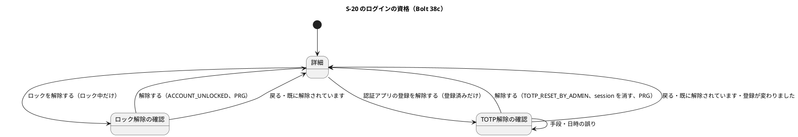
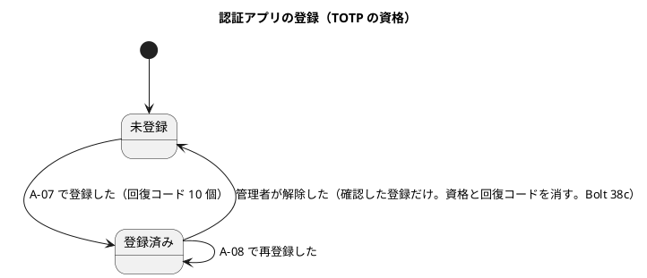
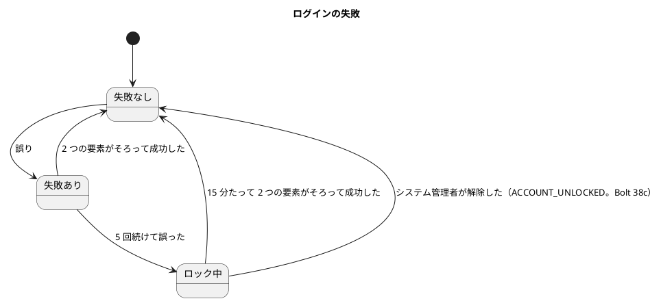

# Bolt 38c 計画 - S-20 のログインの資格（ロックの解除と管理者による TOTP の解除）

## 基本情報

| 項目 | 内容 |
| :--- | :--- |
| Bolt | 第 38c 回（W6 の 26 本目。開始準備で 38c を 38c（ロックと TOTP の解除）・38c2（停止の理由・停止した人・時刻の表示。#50）に分けた 1 つ目） |
| 予定 | W6（2026-11-09 の週。前倒しで着手できる）。作業は約 5.5 時間（`check`・`uiTest`・SonarQube・CI の待ちを除く）。development_strategy の目安（2〜4 時間）を超えるが、開始準備で 2 つに分けると決め、これ以上は分けない（下の打ち切りで守る。前例 38b4 の 5.5 時間。確認ポイント 10） |
| アプローチ | アウトサイドイン（受入シナリオの Red から入る。S-20 から既存の集約に操作を足す。release_plan の 38c の行、development_strategy :119・:346） |
| 対象 | (1) S-20 の詳細の「ログインの資格」の領域（ロックの状態と期限、認証アプリの登録の有無）、(2) ロックの解除（確認と確定、監査 `ACCOUNT_UNLOCKED`）、(3) 管理者による TOTP の解除（本人確認の手段と日時、確認した登録だけの資格と回復コードの削除、session の消去、監査 `TOTP_RESET_BY_ADMIN`）、(4) A-03 の理由の文、(5) 認可と CSRF の統合テスト、UI テストと axe、動画 `@demo-bolt-38c`、(6) マニュアル 11 章・2 章・付録 B とキャプチャ、(7) 設計の文書 |
| トレース | US-18 AC3（ロック）・AC9（管理者の経路）、US-16 AC2（管理範囲）、SEC-02・SEC-09・SEC-10、IA-INV-01・IA-INV-03・IA-INV-04・IA-INV-08・IA-INV-10・IA-INV-11・IA-INV-14、#47（前半） |
| GitHub | [#47](https://github.com/k2works/practical-domain-driven-design-in-enterpris-application/issues/47)（US-18 AC9 の管理者経路。38c は解除・監査・A-07 での再登録を満たし、本人への通知は 38d。クローズは 38d）。ロックの解除（US-18 AC3 の運用の側）は [#14](https://github.com/k2works/practical-domain-driven-design-in-enterpris-application/issues/14)（US-16 の残り）で追う。動画は終了報告の承認の後に #47 へ添付する（`ops/scripts/issue_demo.js` の `BOLT_ISSUES` と運用の索引の添付先の表に bolt-38c → #47 を足し、`DEMO_DRY_RUN=1` で先に確かめる） |
| SP | 0 |
| 承認ゲート | 計画と終了報告。セキュリティ・認可（ロックの解除と TOTP の解除、本人確認の記録、session の消去。W6 の確認ポイント 13・14）、画面（詳細の領域・確認の画面 2 つ・A-03）、GitHub（動画の添付）、新しいファイル（下の一覧）。スキーマは変えない（`audit_record.action` に CHECK はなく、3 つの表の DELETE は DB の権限で許されている） |
| ブランチ | develop で開発する。途中の push はデモ環境の配備になるので、push はステップ 7 でまとめる |
| 開始準備で決めたこと | 2026-10-27、human:kakimomokuri: (1) 38c を 2 つに分ける（38c: ロックの解除と TOTP の解除、38c2: 停止の理由・停止した人・時刻の表示（#50）。どちらも振る舞いが変わるのでマニュアルとキャプチャを含める）、(2) TOTP の解除から 38d（本人への通知）までの窓を受け入れる（デモ環境だけ。確認の領域とマニュアルに「本人への連絡は別に行う」と書く）、(3) TOTP の解除では、資格と回復コードを 1 つのトランザクションで消して監査を書き、確定の後にその利用者の session をすべて消す。ロックは触らない（別の操作）。本人は次のログインで A-07 から登録し直す、(4) 本人確認の手段は選ぶ形（登録の電話番号への折り返し・対面・所属企業の管理担当者への確認の 3 つ。自由な文はない）、日時は入れる（未来と 7 日より前は拒む）。監査の `reason` は `IDENTITY_VERIFIED`、手段と日時は `after_state`、(5) 自分と監督の役割の利用者のロックと TOTP の解除は画面で扱わず、一文の案内を出す（IA-INV-01 を広げる。運用の手順はランブック（W10））、(6) 操作は当てはまるときだけ出す（ロックの解除はロック中、TOTP の解除は登録済み）。確定のときにもう当てはまらなければ「既に解除されています」と案内して何も書かない。詳細にはロックの期限と認証アプリの登録の有無を示す（管理者には期限を示してよい）、(7) ロックの解除は本人確認の記録と理由を持たない（監査は `ACCOUNT_UNLOCKED` だけ）、(8) 招待の再送は作らない。整合性検証の後（同日）: (9) A-03 の 1 文目に「システム管理者が認証アプリの登録を解除したため」を理由として足し、次のログインで認証アプリを登録し直すよう案内する（前例 Bolt 33a・33b の理由の文）、(10) 確認の画面で読んだ登録の時刻（`enrolled_at`）を hidden で持ち、その登録のときだけ消す（前例 `replace` の `expectedSecret`）。違えば「登録が変わりました。詳細を開き直してください。」と示して何も書かない、(11) 本人確認の日時は S-13 と同じ日本時間のテキストの欄（「2026-11-09 10:30」の形、Asia/Tokyo（UTC+09:00）の説明付き、厳格に解釈）。解釈は名前が `FormConverter` で終わる部品に置く（`LayerArchitectureTest` の日時の規則）、(12) ロックの期限は共通の `DateTimeDisplay` の社内の形で示す（「ロック中（2026-11-09 10:45 Asia/Tokyo（UTC+09:00） まで）」。共通の部品は変えない） |

新しいファイル（計画の承認で確かめる）:

- 本体: `identity/application/internal/commandservices/UserLoginCredentialService.java`（2 つの操作）、`UnlockCheck.java`・`UnlockOutcome.java`・`TotpResetCheck.java`・`TotpResetOutcome.java`（前例 `StatusChangeCheck`・`StatusChangeOutcome`）、`identity/domain/model/valueobjects/LoginCredentialRejection.java`（自分・監督の役割・ロック中でない・未登録・登録が変わった。前例 `StatusChangeRejection`）、`IdentityVerificationMethod.java`（本人確認の手段。名前だけ）、`identity/domain/model/rules/IdentityVerificationPolicy.java`（日時の範囲の規則。`@DomainRule`）、`identity/interfaces/web/UserLoginCredentialController.java`、`IdentityVerificationFormConverter.java`（日時の欄の解釈）、テンプレート `templates/identity/users/unlock-confirmation.html`・`totp-reset-confirmation.html`、`identity/infrastructure/persistence/UserDetailRow.java`（詳細だけの行）
- テスト: `UserLoginCredentialServiceTest`・`UserLoginCredentialIntegrationTest`（同時の 2 つの解除）・`UserLoginCredentialRollbackIntegrationTest`（commandservices）、`IdentityVerificationPolicyTest`（rules）、`UserLoginCredentialControllerTest`・`IdentityVerificationFormConverterTest`（interfaces.web）、`UserLoginCredentialSecurityIntegrationTest`（infrastructure.security。`IdentitySpyIntegrationTestBase` を継ぐ）、`features/ui/manage_user_login_credentials_ui.feature`・`ui/UserLoginCredentialUiSteps.java`
- 資産: `docs/manual/assets/11-unlock-confirmation.png`・`11-totp-reset-confirmation.png`、動画 `docs/assets/demo/bolt-38c/unlock-and-totp-reset.webm`

## Bolt ゴール

システム管理者が S-20 の詳細の「ログインの資格」の領域から、ロック中の利用者のロックを外し、認証アプリを失った利用者の TOTP の登録を、別経路の本人確認の記録とともに解除できる。解除した利用者は次のログインで A-07 から登録し直す。本人への通知は 38d で足す。

### 開始準備で確かめたこと

- **ロック**: `LoginFailureRepository` の口は `findByUserId`・`prepare`・`recordFailure`・`recordSuccess` だけで、解除の口はない。`LoginFailure.recordSuccess`（:73）と mapper の `resetLoginFailure`（`AuthenticationFactorMapper.xml` :128-134）は、ロック中でないことが条件で、ロックを外せない。`LockPolicy` は 5 回・15 分で、Javadoc は「SQL と規則を契約テストで両方を確かめる」と書く。ロックは `LockAwareUserDetailsChecker`・`RecoveryCodeAuthenticationProvider`・`TotpAuthenticationProvider` が見る
- **TOTP と回復コード**: `TotpCredentialRepository` は `add`・`replace`（`expectedSecret` を条件にする。mapper :59-66）・`findByUserId`・`useStep` で、消す口はない。`RecoveryCodeRepository` は `replaceAll`・`findUnusedByUserId`・`use`（mapper の `deleteRecoveryCodes` は `replaceAll` が使い、Java の側（`AuthenticationFactorMapper.java`）は void）。DB の権限は DELETE を許す（`afterMigrate__grant_app_user.sql`。3 つの表に `[append-only]`・`[no-delete]` の印はない）。`RecoveryCodeAuthenticationProvider.authenticate` は TOTP の資格を見ないので、資格だけ消すと古い回復コードでログインできる（開始準備の決定 (3) の根拠）。資格がなければ GET `/login/totp` は A-07 へ移し（`LoginController` :67-71）、`TotpEnrollmentService` が回復コードを作り直す
- **契約テストと偽物**: `AuthenticationFactorRepositoriesContract`（domain.model.aggregates）を `InMemoryAuthenticationFactorRepositoriesTest`・`H2AuthenticationFactorRepositoriesTest`・`MyBatisAuthenticationFactorRepositoriesIntegrationTest` が継承する。口を足すと偽物 `InMemoryLoginFailureRepository`・`InMemoryTotpCredentialRepository`・`InMemoryRecoveryCodeRepository` を直す（`FakeLoginAttemptService` はリポジトリでないので直さない）
- **session**: `UserSessionRevoker.revokeAll(email)`。前例は `UserStatusChangeService` :166-173（再開の確定の後に呼び、失敗は警告のログ）。失効の失敗の扱いは Bolt 33b の報告 :22 が #49 に送っている
- **S-20 の詳細**: `UserDetail` はロックの状態と TOTP の登録の有無を持たない。`findDetail` の SQL（`IdentityMapper.xml` :165-172）は一覧（:150-159）と列の断片（:144-147）と resultMap `userAdministrationRow`（:41-53。コンストラクタの形）を共有する。`UserAdministrationQueryService`（:33-38）は `Clock` を持たない。`new UserDetail(` は 4 つのテストのファイルの 6 か所（`UserAdministrationQueryServiceTest`・`UserAdministrationControllerTest`・`UserRoleChangeControllerTest`・`UserStatusChangeControllerTest`）、詳細の統合テストは `MyBatisIdentityRepositoriesIntegrationTest` :288-302
- **画面の部品**: `UserDetailPage`（Javadoc :32-36 に操作を足す手順、`render` :86-129、`refuse` :136-178（`Rejected` は詳細の画面を描く）、`anchor` :190-202、`Section` :246-268（ROLES・STATUS。エラー要約の見出しと選び方の欄の表示名を 1 つ持つ）、`Retry` は役割と停止の理由に寄る）。前例は `UserStatusChangeController`（:38-39・:55・:76。確認は GET、確定の POST も同じ `…/confirmation` に送る。範囲を先に確かめてから値を解釈、PRG）と `UserStatusChangeService`（操作者 → `ManagedUserLookup` → 規則 `User.decideStatusChange`（:186-218）→ 版、0 件なら Stale、拒否は `UserAdministrationRefusal<R>`）。確認の画面に入力の欄を持つ前例は登録の `UserRegistrationPage` の `Summary`（Bolt 38b3b）。`@Import(UserDetailPage.class)` を使う `@WebMvcTest` が 3 つある
- **日時の規則**: `LayerArchitectureTest` :315-324「画面の層は日時表示の写しを持たない」（`interfaces.web` で `DateTimeFormatter` に依存してよいのは名前が `FormConverter` で終わるクラスだけ。`ZoneId.of`・`systemDefault` も呼べない）。前例は `MilestoneFormConverter`（:43・:143-144。`DateTimeDisplay.ZONE`）。日時の入力は Bolt 4 で `datetime-local` を使わずテキストの欄に決めた（bolt_04_plan :327、ui_design :179 の S-13）
- **監査**: `AuditAction` に解除の値はない。`AuditRecord.userSuspended`・`statusChanged`（:295・:340-370）が管理の操作の前例で、`AuditTarget` は種類・ID・版・変更前・変更後を持ち、値は名前（enum の名前）。表示名は画面の層の `UserAdministrationLabels`（前例 `suspensionReason`）。`audit_record.reason` は DB では `VARCHAR(100)`（`IDENTITY_VERIFIED` は 17 文字）、`after_state` は `VARCHAR(4000)`。範囲外の試行の記録の書き手は `UserDetailPage` の 1 か所（`LayerArchitectureTest` :326-353。新しい controller は `page.find(id, actor, true)` を経由すれば当たらない）
- **同時の更新**: 3 つの表（`login_failure`・`totp_credential`・`recovery_code`）は `version` を持たず、条件付きの更新で判定する（data_model :152）。前例の同時の更新のテストは `UserStatusChangeIntegrationTest` :206
- **デモの開発データ**: dev の利用者は設定の固定の秘密で A-02 を入力済みにする（`DevTotpCodes`）。動画は UI テストの利用者で撮り、デモ環境の利用者は解除しない
- **#47**: 受入条件の Then は「解除が監査証跡へ記録され本人へ通知される」。完了の定義の「`@US-18-AC9` が `@wip` なしで通る」は、38c のシナリオだけでは通知を確かめないので満たさない（38d で通知の確かめをシナリオに足して満たす）

## 設計の決定（案）

| 項目 | 決定 | 根拠 |
| :--- | :--- | :--- |
| 詳細の射影 | `UserDetail` にロックの期限（`Optional<UtcInstant> lockedUntil`。今の時刻で切れていれば空）、認証アプリの登録の時刻（`Optional<UtcInstant> totpEnrolledAt`。登録の有無と、確認の画面で持つ値を兼ねる）を足す。SQL は詳細だけの列と行（`UserDetailRow` と resultMap `userDetailRow`）に分け、`login_failure` と `totp_credential` を LEFT JOIN する（どちらも主キーが `user_id` で役割の行は増えない）。一覧の SQL と行は変えない。期限が切れたかは照会のサービスが `Clock` で判定する（`UserAdministrationQueryService` に `Clock` を入れる。リポジトリは期限をそのまま返す） | 開始準備の決定 (6)・(10) |
| 領域と操作 | 詳細に h2「ログインの資格」の領域。「ロック: ロック中（{日時} まで）／なし」と「認証アプリ: 登録済み／未登録」を示し（日時は `DateTimeDisplay` の社内の形）、ロック中なら「ロックを解除する」、登録済みなら「認証アプリの登録を解除する」を出す。自分と監督の役割の利用者には操作を出さず案内だけ。停止中の利用者と荷受人の企業の利用者にも、前例（停止中の役割の変更を許す）どおり操作を出す。値は `render` の外の補助のメソッドで作る（複雑度 10 以内） | 開始準備の決定 (5)・(6)・(12) |
| Section と要約 | `Section` に `UNLOCK`・`TOTP_RESET` を足し、詳細の画面に出す拒否（自分・監督の役割・ロック中でない・未登録・登録が変わった）だけに対応させる（選び方の欄はないので `fieldLabel` は null。リンクしない）。確認の画面の 2 つの欄（手段・日時）の誤りは、確認の画面の要約で示す（前例 `UserRegistrationPage` の `Summary`。複数の誤りをまとめる）。0 件の確定は `Rejected`（「既に解除されています」）で返し、`Stale` の文言にしない | Bolt 38 の決定 (5)、Bolt 38b3b |
| URL | 前例（`status-changes`・`role-changes`）に合わせた名詞の形で、確定の POST も確認と同じ URL に送る。ロック: `GET`・`POST /staff/users/{id}/unlocks/confirmation`。TOTP: `GET`・`POST /staff/users/{id}/totp-resets/confirmation`（手段と日時の誤りは POST の応答で確認の画面に示す）。範囲外は 404、確定の POST でだけ `ADMIN_SCOPE_DENIED` を残し、値は範囲の判定の後に解釈する | ui_design :182・:183 の前例 |
| 規則と拒否 | 拒否 `LoginCredentialRejection`（`SELF`・`OVERSIGHT_ROLE`・`NOT_LOCKED`・`NOT_ENROLLED`・`ENROLLMENT_CHANGED`）を `valueobjects` に、判定は `User` のロックと TOTP の操作の判定（前例 `decideStatusChange` の順: 自分 → 監督の役割 → 状態）に置く。本人確認の日時の範囲（未来と 7 日より前を拒む）は規則 `IdentityVerificationPolicy`（`rules`、`@DomainRule`）。結果は `UnlockCheck`・`UnlockOutcome`・`TotpResetCheck`・`TotpResetOutcome`（`UserAdministrationRefusal<LoginCredentialRejection>` を使う） | 前例 Bolt 34d |
| ロックの解除 | `LoginFailure.unlock(now)`（ロック中なら数を 0 に、期限を空にする）と `LoginFailureRepository.unlock(userId, now)`（`locked_until > now` を条件にした更新。件数で判定）。サービスはトランザクションの中で解除と監査 `ACCOUNT_UNLOCKED` を書く。0 件なら「既に解除されています」（何も書かない）。session は消さない（IA-INV-03） | 開始準備の決定 (6)・(7) |
| TOTP の解除 | `TotpCredentialRepository.remove(userId, expectedEnrolledAt)`（登録の時刻を条件にした DELETE。件数で判定）、`RecoveryCodeRepository.removeAll(userId)`。サービスは手段と日時の検証の後、トランザクションの中で資格・回復コード・監査を書く。資格が 0 件なら、行がなければ「既に解除されています」、行があって時刻が違えば「登録が変わりました。詳細を開き直してください。」（どちらも何も書かない）。確定の後に `revokeAll`（失敗は警告のログ。前例は再開。失効の失敗の扱いは #49 のまま）。ロックは触らない | 開始準備の決定 (3)・(10) |
| 本人確認の手段と日時 | `IdentityVerificationMethod`（`PHONE_CALLBACK`・`IN_PERSON`・`COMPANY_ADMINISTRATOR`。名前だけ。`@ValueObject`）。表示名は `UserAdministrationLabels`（「登録の電話番号への折り返し」・「対面」・「所属企業の管理担当者への確認」）。日時はテキストの欄（「2026-11-09 10:30」の形、Asia/Tokyo（UTC+09:00）の説明付き）で、`IdentityVerificationFormConverter` が `ResolverStyle.STRICT` で解釈する | 開始準備の決定 (4)・(11) |
| 監査 | `ACCOUNT_UNLOCKED`（target は種類 `USER`・ID・版は利用者の今の版（変わらない）・`before_state` は `LOCKED`・`after_state` は `UNLOCKED`、`reason` は空）。`TOTP_RESET_BY_ADMIN`（target は種類 `USER`・ID・版は利用者の今の版・`before_state` は `ENROLLED`・`after_state` は `method=PHONE_CALLBACK;verifiedAt=2026-11-09T01:30:00Z` の形（enum の名前と UTC の ISO-8601）、`reason` は `IDENTITY_VERIFIED`）。data_model の監査の値の決まり（:950 と同じ形）に 2 行足す | 確認ポイント 14 |
| A-03 | 1 文目の理由に「システム管理者が認証アプリの登録を解除したため」を足し、「次のログインで認証アプリを登録し直してください。」を案内する。session の消し方は再開・再設定と同じ `revokeAll` で、どの理由で消したかを A-03 に渡す方法は今の仕組み（前例 33a・33b）に合わせる | 開始準備の決定 (9) |
| controller | 2 つの操作を 1 つの `UserLoginCredentialController` に置き、`UserDetailPage` の手順で操作を足す（architecture_backend :323 の 4 つ目の controller）。switch は 1 つの操作にまとめ、複雑度 10 以内 | Bolt 38 の決定 |
| 受入シナリオと動画 | `manage_user_login_credentials_ui.feature`（Feature に `@ui @US-18 @must`）に 2 つの場面: `@US-18-AC3 @demo @demo-bolt-38c/unlock`（5 回誤ってロック → 管理者が解除 → すぐにログイン）と `@US-18-AC9 @demo @demo-bolt-38c/totp-reset`（管理者が本人確認を記録して TOTP を解除 → 本人の別の端末は A-03 → 次のログインで A-07 から登録し直す）。38d で通知の確かめを `@US-18-AC9` に足す。ほかの Bolt の撮り直しの差分は戻す | release_plan :795、#47 の完了の定義 |

### 文言（全文。文言は表示名で始めない）

| 場面 | 文言 |
| :--- | :--- |
| 詳細の領域の見出し | ログインの資格 |
| 自分の詳細の案内 | 自分のログインの資格は、この画面では変えられません。 |
| 監督の役割の利用者の案内 | システム管理者・監査担当者のログインの資格は、この画面では変えられません。運用の手順に従ってください。 |
| 詳細のエラー要約の見出し（ロック） | ロックを解除できませんでした |
| 詳細のエラー要約の見出し（TOTP） | 認証アプリの登録を解除できませんでした |
| ロック中でない | この利用者のロックは、既に解除されています。 |
| 未登録 | この利用者の認証アプリの登録は、既に解除されています。 |
| 登録が変わった | 登録が変わりました。詳細を開き直してください。 |
| ロックの確認の見出しとボタン | ロックを解除しますか ／ 「解除する」「戻る」 |
| TOTP の確認の見出しとボタン | 認証アプリの登録を解除しますか ／ 「解除する」「戻る」 |
| ロックの確認の領域 | 対象、現在の状態「ロック中（{日時} まで）」、変更内容「ロックを解除する」、影響「すぐにログインを試せます。失敗の回数は 0 に戻ります。」、回復手段「ロックの解除は取り消せません（5 回続けて誤ると、また 15 分ロックされます）。」、実行者 |
| TOTP の確認の領域 | 対象、現在の状態「認証アプリ: 登録済み」、変更内容「認証アプリの登録と回復コードを消す」、影響「この利用者のログイン中の session はすべて終わります。次のログインで認証アプリを登録し直します。本人への連絡は別に行ってください。」、回復手段「本人が次のログインで登録し直します。」、実行者、本人確認の手段（ラジオ）と日時（テキストの欄） |
| 確認の画面のエラー要約の見出し | 認証アプリの登録を解除できませんでした |
| 手段なし | 本人確認の手段: どれか 1 つを選んでください。 |
| 日時なし | 本人確認の日時: 入力してください。 |
| 日時の形の誤り | 本人確認の日時: 「2026-11-09 10:30」の形で、日本時間で入力してください。 |
| 未来 | 本人確認の日時: 今より後の日時は入力できません。 |
| 7 日より前 | 本人確認の日時: 7 日以内に確認した日時を入力してください。 |
| 完了の知らせ（ロック） | ロックを解除しました。 |
| 完了の知らせ（TOTP） | 認証アプリの登録を解除しました。この利用者は次のログインで認証アプリを登録し直します。 |
| A-03 の理由の文 | システム管理者が認証アプリの登録を解除したため、ログインし直してください。次のログインで認証アプリを登録し直してください。 |

エラー要約のリンクは「表示名: 文言」の形で、表の「本人確認の手段: …」の「本人確認の手段」は欄の表示名（リンクの前置き）。文言の本体は表示名で始めない。

## ふりかえりと前の Bolt からの引き継ぎ

| 出典 | 内容 | この Bolt での扱い |
| :--- | :--- | :--- |
| Bolt 38b4 Try T-213 | 画面のクラスに DI の部品を足すときは SpotBugs を先に確かめる | ステップ 4 で `spotbugsMain` を流す |
| Bolt 38b4 の既知の課題 | 登録したての利用者のロック（受け入れた） | 管理者がロックを外せるようになるので、ui_design の初回の知らせの場面の表とマニュアル 2.6 の注に「システム管理者に解除を頼める」を足す |
| Bolt 38b3b Try T-211・T-212 | 範囲や権限の行は誤った値との組み合わせも置く、フォークの指示に T-204 を最初に書く | 行 11（範囲外 × 誤った手段と日時）、フォークを使うときに守る |
| W5 の Try T-106・T-119・T-125・T-148・T-152・T-164 | 対象と条件を先に確かめる、規則に当たったら諮る、共通の部品は全体を数えてから変える、変異は 1 つを手で照らす | 行の準備、ArchUnit（日時の規則と範囲外の記録の規則）、`UserDetailPage` と `DateTimeDisplay`（変えない）、変異 |
| Bolt 38 の既知の課題、38b3b・38b4 の既知の課題 | エラー要約の二重の読み上げ・chromium だけなど | 残す（新しい確認の画面も今の共通の形にそろえる） |
| Bolt 33b の報告 :22 | 失効の失敗の扱いは #49 | 前例のまま（警告のログ）。#49 で扱う |
| Bolt 38b2 :111 | 招待の再送を見直す | 作らない（開始準備の決定 (8)） |

## 状態の組み合わせ（行ごとにテストを 1 本。T-182）

| 行 | 状況 | 期待 | 出口 | 確かめ方 |
| :--- | :--- | :--- | :--- | :--- |
| 1 | 詳細 | 「ログインの資格」にロックの期限（切れていればなし）と認証アプリの登録の有無。当てはまる操作だけが出る。自分と監督の役割には案内だけ。停止中・荷受人の企業の利用者にも出る | 操作のボタン | `UserAdministrationControllerTest`、`MyBatisIdentityRepositoriesIntegrationTest`（射影）、`UserAdministrationQueryServiceTest`（期限の判定） |
| 2 | ロックの解除の確認 | 確認の領域の全文。何も書かない | 解除する・戻る | `UserLoginCredentialControllerTest`、`UserLoginCredentialSecurityIntegrationTest` |
| 3 | ロックの解除の確定 | 数が 0・期限が空、監査 `ACCOUNT_UNLOCKED` が 1 行（target の値）、詳細へ PRG と知らせ、session は消さない。すぐにログインできる | 詳細 | 同上 |
| 4 | ロック中でない（確定の前に期限が切れた・ほかの管理者が解除した） | 「既に解除されています」、何も書かない | 詳細 | 同上、`UserLoginCredentialIntegrationTest`（期限の切れた行で準備。V1） |
| 5 | TOTP の解除の確認 | 手段と日時の入力を含む確認の領域の全文、登録の時刻を hidden で持つ。何も書かない | 解除する・戻る | `UserLoginCredentialControllerTest`、`UserLoginCredentialSecurityIntegrationTest` |
| 6 | TOTP の解除の確定 | 資格と回復コードが消え、監査 `TOTP_RESET_BY_ADMIN`（`IDENTITY_VERIFIED`、`after_state` の全文）が 1 行、確定の後に session がすべて消え、別の端末は A-03 の理由の文、ロックは変わらない。次のログインで A-07。古い回復コードでログインできない | 詳細、本人は A-07 | 同上 |
| 7 | 手段と日時の誤り（なし・形の誤り・未来・7 日より前、組み合わせ） | 確認の画面にエラー要約と全文の文言、入力を戻す。何も書かない | 確認の画面 | `UserLoginCredentialControllerTest`、`IdentityVerificationPolicyTest`、`IdentityVerificationFormConverterTest` |
| 8a | 未登録（ほかの管理者が先に解除した・もともと未登録） | 「既に解除されています」、何も書かない | 詳細 | `UserLoginCredentialServiceTest`・`UserLoginCredentialIntegrationTest` |
| 8b | 確認の後に本人が登録し直した（登録の時刻が違う） | 「登録が変わりました。詳細を開き直してください。」、新しい登録を消さず、何も書かない | 詳細 | 同上 |
| 9 | 自分・監督の役割 | 確定は拒み、何も書かない | 詳細の案内 | `UserLoginCredentialServiceTest`・`UserLoginCredentialSecurityIntegrationTest` |
| 10 | 同時の 2 つの解除（ロック・TOTP） | 1 つだけが書き、監査は 1 行 | — | `UserLoginCredentialIntegrationTest` |
| 11 | 範囲外 × 誤った値 | 確認は 404 で記録しない、確定は値の誤りによらず 404 で試行を 1 行（T-211） | 共通の 404 | `UserLoginCredentialSecurityIntegrationTest` |
| 12 | 認可と CSRF | ほかの役割は 2 つの URL の GET・POST で 403、CSRF のトークンのない確定は案内へ移り何も書かない | — | 同上 |
| 13 | 監査の失敗 | 資格・回復コード・ロックの更新が戻り、session も消さない | — | `UserLoginCredentialRollbackIntegrationTest` |
| 14 | リポジトリの契約 | `unlock`（ロック中・期限切れ・行なし・件数）、`remove`（時刻が合う・違う・行なし）、`removeAll` を、偽物・H2・PostgreSQL で同じに | — | `AuthenticationFactorRepositoriesContract` |
| 15 | UI の通し | ロックの解除とすぐのログイン、TOTP の解除と A-03 と A-07 の再登録、エラー要約、幅 320 px、axe の違反 0 | — | `manage_user_login_credentials_ui.feature` |

### #47 と受入条件の照合（38c の時点）

| 受入条件・完了の定義 | 38c で満たすもの | 38d に残すもの |
| :--- | :--- | :--- |
| US-18 AC9（管理者の経路）: 別経路で本人確認して登録を解除する | 本人確認の手段と日時の記録、資格と回復コードの削除、session の消去、`TOTP_RESET_BY_ADMIN` | — |
| US-18 AC9: TOTP を再登録できる | 次のログインで A-07（`@US-18-AC9` の場面） | — |
| US-18 AC9: 本人へ通知される | — | 本人への通知（38d）と、その確かめを `@US-18-AC9` に足す |
| #47 の完了の定義: `@US-18-AC9` が `@wip` なしで通る | 解除と再登録の分は通る（`@wip` なし） | 通知の確かめを足して満たす |
| #47 の完了の定義: セキュリティの統合テストとアーキテクチャテスト、`@ui` と axe、マニュアル | 満たす | 通知の分（38d） |
| US-18 AC3 の運用（ロックの解除。#14 で追う） | `@US-18-AC3` の解除の場面 | — |

## スコープ

### 入れるもの

- 行 1〜15 のテスト、射影（`UserDetail`・`UserDetailRow`・resultMap・SQL）と照会のサービスの `Clock`、`LoginFailure.unlock`・`LoginFailureRepository.unlock`・`TotpCredentialRepository.remove`・`RecoveryCodeRepository.removeAll` と mapper（XML と `AuthenticationFactorMapper.java`）と偽物 3 つ、`UserLoginCredentialService` と結果 4 つ、`LoginCredentialRejection`・`IdentityVerificationMethod`・`IdentityVerificationPolicy`、`User` の判定、`AuditAction.ACCOUNT_UNLOCKED`・`TOTP_RESET_BY_ADMIN` と `AuditRecord` の工場（`AuditRecordTest`）、`UserDetailPage` の `Section` と領域、`UserLoginCredentialController`・`IdentityVerificationFormConverter`、`UserAdministrationLabels` の表示名、テンプレート（詳細の領域と確認 2 つ、A-03）、組み立て（`IdentityConfiguration`）、既存のテストの直し（`new UserDetail` の 6 か所、`MyBatisIdentityRepositoriesIntegrationTest`、`@Import(UserDetailPage.class)` の 3 つの `@WebMvcTest` の準備）、UI テストと動画、キャプチャ、`issue_demo.js` の `BOLT_ISSUES` と運用の索引の添付先の表
- Javadoc の直し: `ManagedUserLookup`（:15-18「2 つのサービスが組み立てる」）、`UserAdministrationRefusal`（:6-10）、`UserDetailPage` の操作の足し方
- マニュアル: 11 章（frontmatter の description、章の頭の画面の表（:16-22）に 11.6・11.7、11.2 にログインの資格の領域、11.6 ロックの解除の確認、11.7 認証アプリの登録の解除の確認）、2 章（2.1 の注「ロックされたら 15 分待つか、システム管理者に解除を頼む」、2.4 の A-03 の理由、:92・:95 の問い合わせの後の流れ、2.6 の初回の設定の注に「システム管理者に解除を頼める」）、付録 B（Q1-1 ロック、Q1-9 回復コードもない）。キャプチャ `11-user-detail`（撮り直し）・`11-unlock-confirmation`・`11-totp-reset-confirmation`（ほかの撮り直しの差分は戻す）
- 設計の文書（T-126）: ui_design（:75・:145・:181・:182-183 の URL の表に 2 行・:319・S-20 のワイヤーフレームと文言の表・遷移図・A-03 の場面の表と 1 文目（:754-767）・初回の知らせの場面の表のロックの行・:1626 の確認の領域の共通部品（確認の画面に入力の欄を持つ形））、domain_model（`LoginFailure`・`TotpCredential`・`RecoveryCode` の行、TOTP の状態遷移 :1313（「まだ作らない」を消す）、ログインの失敗の状態遷移 :1391-1402 にロック中から失敗なしへの管理者の解除、IA-INV-01・03・04・08・10・11・14、監査の操作の行、新しい型の行）、data_model（:942 の action、:950 と同じ形の 2 行、:924-926 の 3 つの表の規則）、non_functional（SEC-02 の「Bolt 34 で作る」と「0 に戻すのは」、SEC-09、SEC-10）、user_story（:617 の「0 に戻すのは」、US-18 AC9 と US-16 の決定の注）、ADR-011（:257・:320・:370 と改訂の経緯）、ADR-012（決定 3 のほかの session を失効させる場面に TOTP の解除と改訂の経緯）、architecture_backend（:323 と新しい箇条: サービス・ポート 3 つ・手段の値・規則・FormConverter）、operation.md（:272-280 の表に「ロックの解除」と「自分と監督の役割の利用者は運用の手順で扱う（W10）」、:278 の本人確認の手段）、test_strategy（:277・:576・US-18 AC3 の行・identity の表）、release_plan（38c と 38c2 の 2 つの行、:787・:791・:804、更新履歴）

### 入れないもの

- 停止の理由・停止した人・時刻の表示（38c2。#50）
- 本人への通知と残りの回復コードの案内（38d）
- 失効の失敗の扱いの見直し（#49）、ランブックの本文（W10）、招待の再送

## 設計（この Bolt の範囲）

- ER 図: 表と列を変えないので省く

## ステップ計画

- [ ] **1. 設計の文書**（完了の判定: 文書の差分）
- [ ] **2. 受入シナリオの Red**: 行 15 を Steps とともに書き、詳細にログインの資格がないことで落ちることを確かめる。既存の詳細・A-03 の期待を検索してから（T-122）
- [ ] **3. ドメインとリポジトリ（Red → Green）**: 射影、`LoginFailure.unlock`、3 つの口と mapper と偽物、契約テスト（行 14）、監査の工場、手段の値と規則
- [ ] **4. サービスと画面（Red → Green）**: 行 1〜13、`spotbugsMain`（T-213）
- [ ] **5. マニュアル・キャプチャ・動画**: 11 章・2 章・付録 B、キャプチャ、`demoVideo`（ほかの差分は戻す）。T-197 の突き合わせ
- [ ] **6. 品質ゲートと開発レビュー**: 変異、`check`・`uiTest`、その後に SonarQube、開発レビューとその直し
- [ ] **7. 終了報告と配備**: develop に push して CI（check・ui・deploy-demo）を確かめ、デモ環境の版を見る。承認の後に動画を #47 へ添付する

### 時間の配分と打ち切り

| # | 目安 | 打ち切り |
| :--- | :--- | :--- |
| 1 | 40 分 | — |
| 2 | 40 分 | — |
| 3 | 50 分 | 契約テストが 50 分で 3 つの実装で緑にならないときは、H2 の分を後に回し、報告に書く |
| 4 | 100 分 | 100 分で行 1〜13 が緑にならないときは、TOTP の解除（行 5〜8b）を別の Bolt に分ける形を諮る |
| 5 | 50 分 | 動画の撮り直しが不安定なときは、撮れる範囲で撮って報告に書く |
| 6 | 30 分（待ちを除く） | — |
| 7 | 15 分（CI の待ちを除く） | — |

合計 325 分（約 5.5 時間）。

## 確認ポイント（計画の承認の場でまとめて確認する。Try T-6）

| # | 確認すること | 場所 | 推奨 |
| :--- | :--- | :--- | :--- |
| 1 | **セキュリティ（TOTP の解除）** | 設計の決定 | 確認した登録だけを、資格と回復コードを 1 つのトランザクションで消し、確定の後に session をすべて消す。ロックは触らない |
| 2 | **セキュリティ（ロックの解除）** | 設計の決定 | ロック中の行だけを条件付きの更新で外す。session は消さない |
| 3 | **監査** | 設計の決定 | `ACCOUNT_UNLOCKED`、`TOTP_RESET_BY_ADMIN`（`IDENTITY_VERIFIED`、`after_state` は enum の名前と UTC） |
| 4 | **画面の文言** | 文言の表 | 領域・確認・誤り・知らせ・A-03 の全文 |
| 5 | **認可と範囲** | 設計の決定 | 2 つの URL の GET・POST はシステム管理者だけ、範囲外は 404 で確定でだけ記録、自分と監督の役割は扱わない |
| 6 | **射影と照会（構造）** | 設計の決定 | 詳細だけの行と resultMap、照会のサービスに `Clock` |
| 7 | **通知の窓（開始準備の決定 (2)）** | 受入条件の照合 | 38d まで本人への通知はなく、#47 の完了の定義は 38d で満たす |
| 8 | **動画（GitHub）** | — | 承認の後に #47 へ添付 |
| 9 | **新しいファイル** | 一覧 | 上の一覧 |
| 10 | **大きさ** | 時間の配分 | 約 5.5 時間（目安を超えることを受け入れる）。ステップ 3・4 の打ち切りで守る |
| 11 | **変異** | ステップ 6 | 下の 10 個。スクリプトはバイトのまま読み書きし、gradlew.bat を絶対パスで呼び、結果の XML を消してから流す |

### 変異と落ちる見込みのテスト

| # | 変異 | 落ちる見込み |
| :--- | :--- | :--- |
| V1 | ロックの解除の条件（`locked_until > now`）を外す | 行 4（期限の切れた行で準備）・行 14 |
| V2 | TOTP の解除で回復コードを消さない | 行 6（古い回復コードでログインできる） |
| V3 | TOTP の解除の後に session を消さない | 行 6 |
| V4 | 日時の検証で未来を受け付ける | 行 7 |
| V5 | 自分・監督の役割を拒まない | 行 9 |
| V6 | 確定で値を範囲の判定より先に解釈する | 行 11 |
| V7 | 監査を書かない | 行 3・6 |
| V8 | ロックの解除の操作をロック中でなくても出す | 行 1 |
| V9 | TOTP の解除でロックも外す | 行 6 |
| V10 | 登録の時刻を条件にせずに消す | 行 8b・行 14 |

## 完了条件

- [ ] 上のステップ 1〜7 の完了の判定を満たす
- [ ] 行 1〜15 に、それを名乗るテストがある
- [ ] `check`・`uiTest` が緑、SonarQube が PASS（重複 3% 未満）、CI が緑、デモ環境が新しい版で動く
- [ ] マニュアル 11 章・2 章・付録 B とキャプチャが実装と合い、動画が撮れている
- [ ] 終了報告が承認される

## 更新履歴

| 日付 | 更新内容 | 更新者 |
| :--- | :--- | :--- |
| 2026-10-27 | 計画を承認した（確認ポイントを推奨のとおり） | anthropic/claude-opus-5-5、承認 human:kakimomokuri |
| 2026-10-27 | 整合性検証の指摘を反映した（承認待ち）。A-03 に解除の理由を書く、確認した登録だけを消す、日時は前例のテキストの欄、ロックの期限は共通の社内の形と決めた（human:kakimomokuri）。URL を前例の名詞の形と同じ確定の送り先に、#47 と受入条件の照合、`Section` は詳細の拒否だけで確認の画面の要約は別、拒否・規則・結果の型と新しいファイルの一覧、射影の行と照会の `Clock`、契約テストと偽物、文言の全文、監査の値、`@US-18-AC3` の場面、文書の範囲の漏れ、出口の列、行 8 の分割と行 10・14、変異 V10、時間の配分 | anthropic/claude-opus-5-5 |
| 2026-10-27 | 初版作成（承認待ち）。開始準備で、38c を 38c・38c2 に分ける、通知の窓を受け入れる、TOTP の解除は資格と回復コードを消し session を消す、本人確認は手段を選び日時を入れる、自分と監督の役割は画面で扱わない、操作は当てはまるときだけ出す、ロックの解除は理由を持たない、招待の再送は作らないと決めた（human:kakimomokuri） | anthropic/claude-opus-5-5 |

## 関連ドキュメント

- [リリース計画](release_plan.md)（W6 節の 38c・38c2・38d の行と確認ポイント 13・14）、[Bolt 38b4 終了報告](bolt_38b4_report.md)、[Bolt 34d 計画](bolt_34d_plan.md)（停止と再開の前例）、[Bolt 38 計画](bolt_38_plan.md)、[Bolt 38b3b 計画](bolt_38b3b_plan.md)（確認の画面の入力）、[Bolt 33b 計画](bolt_33b_plan.md)（回復コードと A-08）
- [UI 設計](../../design/cargo-tracker/ui_design.md)（S-20・A-03）、[ドメインモデル](../../design/cargo-tracker/domain_model.md)、[データモデル](../../design/cargo-tracker/data_model.md)、[非機能要件](../../design/cargo-tracker/non_functional.md)（SEC-02・SEC-09・SEC-10）、[ユーザーマニュアル 11 章](../../manual/11-利用者の管理.md)
