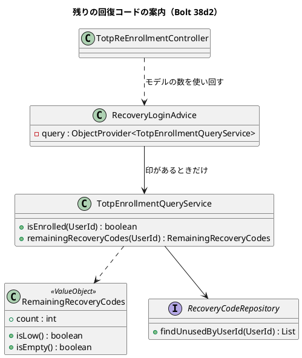
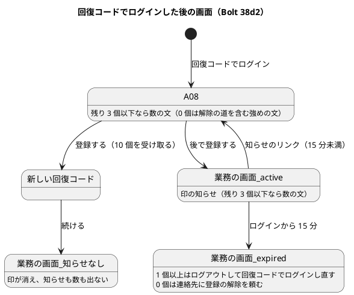
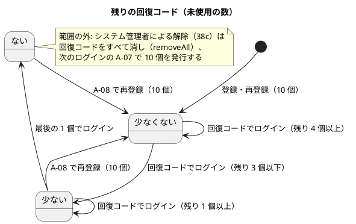

# Bolt 38d2 計画 - 回復コードでログインした後に、残りの回復コードの数を案内する

## 基本情報

| 項目 | 内容 |
| :--- | :--- |
| Bolt | 第 38d2 回（W6 の 29 本目。38d の開始準備で 38d（メールのお知らせ）・38d2（残りの回復コードの案内）に分けた 2 つ目） |
| 予定 | W6（2026-11-09 の週。前倒しで着手できる）。38d（`4fc130b5d`）の後に行い、**38d の終了報告の承認を前提にする**（#47 の照合は 38d の照合表に乗るため）。作業は約 3.5 時間（210 分。`check`・`uiTest`・SonarQube・CI の待ちを除く）。development_strategy の目安（2〜4 時間）に収まる |
| アプローチ | アウトサイドイン（release_plan :784「A-08 から」）。既にある A-08 と印の知らせに受入条件を足すので、開発戦略 :119 の「既存の集約に受入条件を足す」に当たる。受入シナリオの Red から入り、A-08 の画面 → 照会 → 値の順に下りて A-08 を先に緑にし、その後に印の知らせへ進む（ステップ 3・4） |
| 対象 | (1) 回復コードでログインした後の A-08 の本文に、未使用の回復コードが 3 個以下のとき残りの数を示す（0 個なら解除の道を含む強めの文）、(2) 「後で登録する」の後の業務の画面の印の知らせ（active・expired）にも同じ数を示し、期限を過ぎて 0 個のときは通れない道の文を連絡先の文に差し替える、(3) 残りの数を読む照会と残りの数の値、(4) 受入シナリオと準備のステップ、マニュアル 2 章・付録 B とキャプチャ 2 枚、(5) 設計の文書と SEC-10 の確定、(6) #47 のクローズ |
| トレース | SEC-10（残りの回復コードが少ないときの案内）、W6 の確認ポイント 14、ADR-011 決定 10（:75・:279・:370・:374・:406・:429。残りの数の案内は #47 に送る）、US-18 AC9、#47（クローズ） |
| GitHub | [#47](https://github.com/k2works/practical-domain-driven-design-in-enterpris-application/issues/47)（38d2 の終了報告の承認の後に、理由のコメントを付けて閉じる）、[#50](https://github.com/k2works/practical-domain-driven-design-in-enterpris-application/issues/50)（「回復コードが送り直すたびに減る」の行に、38d2 の案内が減りを見えるようにすることを書き足す。advice の負債の行に 1 つ増えたことを書き足す）。どちらも終了報告の承認の後。動画は撮らない |
| SP | 0 |
| 承認ゲート | 計画と終了報告。**画面**（A-08 の本文と、印の知らせの文言。0 個の文の差し替え）、**GitHub**（#47 のクローズ、#50 への書き足し）、新しいファイル（下の一覧）。スキーマ・認可・外部連携は変えない |
| ブランチ | develop で開発する。途中の push はデモ環境の配備になるので、push はステップ 7 でまとめる |
| 開始準備で決めたこと | 2026-10-27、human:kakimomokuri: (1) 案内は A-08 の本文と、「後で登録する」の後の印の知らせ（active・expired）の 2 か所に出す、(2) 数は、ログインに使った 1 個を引いた後の未使用の数（A-08 に移る時点で使用済みになっている。事実 10）で、3 個以下のときだけ示す、(3) 0 個なら強めの文で今すぐの再登録を促す。「後で登録する」は残す（業務を止めない。SEC-10 の決定のまま）、(4) 回復コードだけを作り直す画面は作らない（SEC-10 (2)。作り直す道は A-08 の再登録だけ）、(5) 数えるのは今の口の `findUnusedByUserId().size()`。リポジトリに口を足さない（最大 10 行でハッシュの照合をしない。口を足すと手書きの実装と偽物の直しが増える。38c2 の議題 4 と同じ利子）、(6) #47 は 38d2 の終了報告の承認の後に閉じる、(7) 動画は撮らない（表示だけの変更。33b の `@demo-bolt-33b/re-enroll` の動画も撮り直さない）。整合性検証の後（同日）: (8) 0 個のときは解除の道を示す。A-08 の 0 個の文は「認証アプリを使えないと、登録の解除を頼むまでログインできなくなる」ことを理由にし、0 個のまま「後で登録する」を選ぶと 15 分を過ぎた後は A-08 に戻れないことも示す。期限を過ぎた知らせで 0 個のときは「いったんログアウトして、回復コードでログインし直してください」を出さず、付録 B Q1-9 と同じ連絡先（荷主の方は担当営業に、社内の方はシステム管理者に。レイアウトで出し分ける）に登録の解除を頼む文に差し替える。ui_design の場面の表に「残り 0 個」の行を足し、事実と合うかを先に表で確かめる（T-123）、(9) 認証コードでログインした後は回復コードが少なくても案内が出ない（事実 15）ことは、#50 ではなく、次のストーリーの候補として release_plan の決定の台帳に記録する（記録は計画の同期のときに親が行う） |

新しいファイル（計画の承認で確かめる。計 3）:

- 本体（2）:
  - `identity/domain/model/valueobjects/RemainingRecoveryCodes.java`（残りの回復コードの数と「少ない」「ない」の判定。`@ValueObject`。しきい値 3 を持つ。Javadoc は「残りの回復コード。」で始める）
  - `templates/layout/recovery-login-notice.html`（印の知らせの断片。2 つのレイアウトが今それぞれ持つ知らせの 2 つの div を 1 つに寄せ、数の文と 0 個の差し替えを持つ。連絡先は呼ぶレイアウトが渡す）
- テスト（1）:
  - `identity/domain/model/valueobjects/RemainingRecoveryCodesTest.java`（境界 4・3・1・0、負の数を拒む）
- 照会は、既にある `identity/application/internal/queryservices/TotpEnrollmentQueryService.java` に `remainingRecoveryCodes(UserId)` を足す（確認ポイント 4。新しいクラス `RecoveryCodeQueryService` を作る案と比べる）。テストは既にある `TotpEnrollmentQueryServiceTest` に足す
- 資産: なし（キャプチャは既存の 2 枚を撮り直す）。受入シナリオは既存の `login_ui.feature` に足す。統合の確かめは既存の `RecoveryCodeLoginSecurityIntegrationTest` に足す

## Bolt ゴール

回復コードでログインした利用者が、まだ使っていない回復コードが残り少ない（3 個以下）か、残っていないことに、A-08 と業務の画面の知らせで気づき、認証アプリを登録し直す（新しい回復コードを 10 個受け取る）判断ができる。残っていないときは、取れる道（今すぐ登録し直すか、登録の解除を頼むか）が分かる。

### 開始準備で確かめたこと

| # | 事実 | 根拠 |
| :--- | :--- | :--- |
| 1 | release_plan の 38d2 の行は「回復コードでログインした後と A-08 で、未使用が 3 個以下のときに案内する。#47 をクローズする」。アプローチは「アウトサイドイン（A-08 から）」、承認ゲートは画面 | `release_plan.md:784` |
| 2 | 確認ポイント 14 は「残りの回復コードの案内は、回復コードでログインした後と A-08 で、残り 3 個以下のときに出す」。ADR-011 決定 10 は残りの数の案内を #47 に送り、数は示さないと書く（:75・:279・:370・:374・:406・:429） | `release_plan.md:735`、`011-mfa-totp.md` |
| 3 | #47 の受入条件は AC9（管理者の経路）の 1 つで、残りの回復コードの案内を含まない。完了の定義の 3 つ（`@US-18-AC9` が `@wip` なしで通る、セキュリティとアーキテクチャのテスト、`@ui`・axe とマニュアル）は、38d の照合表で 38d2 の分を除いて満たした。残りは SEC-10 の残り（残りの回復コードの案内）をそろえてから閉じること | `gh issue view 47`、`bolt_38d_report.md` の照合表（:75・:79） |
| 4 | SEC-10 は、回復コードの経路の再登録で回復コード 10 個を発行し直すと書く。残りが少ないときの案内は SEC-10 の「提案」の分として残っている（38d で SEC-10 を確定にしたとき、38d2 の分は提案のまま） | `non_functional.md:157` |
| 5 | 回復コードが通ると、認証の入口はいつも A-08 へ移し、session に印（利用者の ID と時刻）を置く。「回復コードでログインした後」の画面は、まず A-08 | `TotpAuthenticationFilter.java:114-123`、`ui_design.md:193` |
| 6 | A-08 で「後で登録する」を選ぶと、印のある間（ログインから 15 分）、業務の画面の上部に印の知らせが出る。active はリンク付き、expired はリンクなしで「…を過ぎたため、この画面からは認証アプリを登録し直せません。登録し直すには、いったんログアウトして、回復コードでログインし直してください。」。知らせは `RecoveryLoginAdvice`（`@ControllerAdvice`。`ObjectProvider<Clock>` で受け、Clock のない slice でも動く）が印の状態をモデル `recoveryLoginNotice` に入れ、2 つのレイアウトが描く。A-08 の画面は本文が同じことを言うので、知らせを `null` で上書きする | `RecoveryLoginAdvice.java:23-33`、`layout/customer.html:52-58`、`layout/staff.html:77-83`、`TotpReEnrollmentController.java:177-180` |
| 7 | A-08 の本文は今、「回復コードでログインしました。認証アプリを登録し直してください。登録し直すと、前の認証アプリのコードと、残っている回復コードは使えなくなります。」。残りの数は示していない。期限を過ぎたときの文（:18）と、「残っている回復コード…」の文（:24）がある | `templates/identity/account-authenticator.html:18,23-24`、`ui_design.md:827-911` |
| 8 | 再登録を終えると回復コード 10 個を発行し直し、印を消すので、残りが少ない状態は消える。案内が意味を持つのは、再登録の前の A-08 と、「後で登録する」の後の知らせの間だけ | SEC-10 (4)、`RecoveryLogin.java:51-52`、`ui_design.md:195` |
| 9 | 未使用を数える口は `RecoveryCodeRepository.findUnusedByUserId`（一覧を返す）だけで、数を返す口も全部を返す口もない。使用済みを除くのは mapper の `used_at IS NULL`（`AuthenticationFactorMapper.xml:89`）と偽物（`InMemoryRecoveryCodeRepository.java:31`）で、契約 `AuthenticationFactorRepositoriesContract`（:201・:493-496）が確かめている | `RecoveryCodeRepository.java:20` |
| 10 | ログインに使った 1 個は、照合の後のトランザクションで `use` により使用済みになり、画面へ移す前にコミットする。A-08 に移る時点で、`findUnusedByUserId` はその 1 個を引いた数を返す。最後の 1 個でログインすると 0 個になる | `RecoveryCodeVerificationService.java:59-66` |
| 11 | 設定の画面（回復コードだけを作り直す画面）はない。SEC-10 (2) が「入口はこの流れだけで、設定の画面は作らない」と決めている。回復コードを作り直す道は A-08 の再登録だけ | `non_functional.md:157` |
| 12 | 受入シナリオの前例は `login_ui.feature` の :99-106（後で登録して知らせが出る）、:108-119（`@US-18-AC9 @demo @demo-bolt-33b/re-enroll`、A-08 の再登録）、:121-130（後で登録して知らせから再登録）。A-08 と知らせのキャプチャは `manual_screenshots.feature:131-142` で撮る（`02-account-authenticator`・`02-recovery-login-notice`） | `login_ui.feature:99-130`、`manual_screenshots.feature:131-142` |
| 13 | マニュアルで変える箇所は、2 章 2.7「認証アプリを登録し直す」（:365-。:395 の知らせのキャプチャ、:406-408 の知らせと「残っている回復コードでログインし直してください」、:413 の連絡先）と、付録 B の Q1-9（:83-91。:90 は回復コードでログインし直す道、:91 は回復コードもないときの連絡先）と Q1-10（:93-） | `02-ログインと共通の画面.md:365-413`、`付録B-トラブルシューティング.md:83-97` |
| 14 | 38d の Try T-217（フォークへの指示に「テストを先に書いたら、本体を直す前に Gradle で Red を流し、落ちた理由を記録する」を、禁止事項と同じ欄に書く）は、38d2 の計画と指示に入れる | `bolt_38d_report.md` |
| 15 | 範囲の外の気づき: 「後で登録する」のまま再登録せず、後で認証コードでログインした利用者は、回復コードが少なくても印がないので、どの案内も出ない。その利用者は 0 個になると、A-08 に入る道（回復コードでのログイン）がなく、作り直せない（SEC-10 (2)） | 事実 5・6・11 |
| 16 | 画面の層はリポジトリに依存できない（`LayerArchitectureTest` :240「interfacesはリポジトリに依存しない」）。画面だけが呼ぶ照会の前例は `TotpEnrollmentQueryService`（`isEnrolled`。`IdentityConfiguration:328` で組み立てる）。読み取りは SELECT 1 文なので、前例と同じくトランザクションを付けない | `LayerArchitectureTest.java:240,264`、`TotpEnrollmentQueryService.java:14` |
| 17 | A-08 と印の知らせは、本物の DB とセキュリティのフィルターを通す `RecoveryCodeLoginSecurityIntegrationTest`（MockMvc）が確かめている。WebMvc の単体のテストはない | `RecoveryCodeLoginSecurityIntegrationTest.java` |
| 18 | `RecoveryLoginAdvice` は全画面に効く `@ControllerAdvice` で、`@WebMvcTest` の 17 クラス（booking・identity・quotation・routing・tracking）の slice にも読み込まれる。照会をコンストラクターで直接受けると、照会の bean のない slice が起動できなくなる | `RecoveryLoginAdvice.java:27-28` |
| 19 | `@ModelAttribute` は handler より先に、印がある間のすべての request（302 で終わる POST、`/session/extend` の 204、htmx の断片を含む）で動く。A-08 の再登録を完了する POST の時点で印はまだ active なので、advice は再登録の前の数をモデルに入れる | `SessionController.java:20`、`TotpReEnrollmentController.java:92-97` |
| 20 | UI テストの利用者の回復コードは `UiUsers.recoveryCode`（:127-140）がいつも 10 個を未使用で発行し直す。`replaceAll` は 10 個そろいを求める（`RecoveryCode.requireIssuedSet`）ので、7 個だけを入れることはできない。N 個を使用済みにする準備のステップは今ない | `UiUsers.java:127-140`、`InMemoryRecoveryCodeRepository.java:23` |

## 設計の決定（案）

| 項目 | 決定 | 根拠 |
| :--- | :--- | :--- |
| 残りの数の値 | `RemainingRecoveryCodes(int count)` を `identity.domain.model.valueobjects` に置く（`@ValueObject`）。`count` は 0 以上（負は拒む）。`isLow()` は `count <= 3`（しきい値 `LOW_THRESHOLD = 3`）、`isEmpty()` は `count == 0`。用語集に「残りの回復コード \| RemainingRecoveryCodes」を足し、Javadoc を「残りの回復コード。」で始める（`LivingGlossaryConsistencyTest` は最初の「。」までを 1 語として読む） | 決定 (2)。しきい値を画面に写さない。しきい値を `identity.domain.model.rules`（前例 `SessionPolicy`）に置く案は、ほかの規則が使わず値の性質そのものなので採らない |
| 照会 | `TotpEnrollmentQueryService.remainingRecoveryCodes(UserId)` が `findUnusedByUserId(userId).size()` から値を作る（トランザクションなし。前例 `isEnrolled`）。口は足さない | 決定 (5)、事実 9・10・16 |
| 知らせの advice | `RecoveryLoginAdvice` は照会を `ObjectProvider<TotpEnrollmentQueryService>` で受ける（前例の `ObjectProvider<Clock>`）。印の状態が active か expired で、かつ `getIfAvailable()` が null でないときだけ照会を呼び、`isLow()` のときだけモデル `remainingRecoveryCodes`（値）を入れる。印のない画面では呼ばず、属性も入れない。主体の ID は印の利用者と同じ（`RecoveryLogin.stateOf` が確かめた後）。#50 の「`@ControllerAdvice` 4 つと `@ModelAttribute`」（33f:99）の負債に、advice が照会を持つことが 1 つ増える（終了報告の承認の後に #50 へ書き足す） | 決定 (1)、事実 18・19 |
| A-08 の本文 | A-08 は advice が入れた `remainingRecoveryCodes` をそのまま使い、controller は照会しない（1 回の表示で読むのは 1 回。モデルの名前は 1 つ）。A-08 の GET とコードの誤り・15 分を過ぎた送信の描き直しでは数を残し、知らせ（`recoveryLoginNotice`）だけを今のまま `null` にする。新しい回復コードの画面（完了の応答）では、advice の数は再登録の前の古い値なので、`addLayout` で `remainingRecoveryCodes` も `null` にする。テンプレートは 1〜3 個と 0 個で文を出し分け、0 個の文は本文の最初の段落の後に置き、`strong` で強める（色だけに頼らない） | 決定 (1)・(3)・(8)、事実 7・8・19 |
| 知らせの断片 | 2 つのレイアウトの知らせの 2 つの div を、断片 `layout/recovery-login-notice.html` に寄せ、引数に連絡先の文を渡す（customer は「担当営業」、staff は「システム管理者」。レイアウトが役割を表すので、advice は役割を見ない）。数の文は知らせの div の中に置く（知らせのない画面には出ない）。断片の枝は、active・expired × 1〜3 個・0 個 の 4 つ。expired で 0 個のときだけ、今の文の後段「登録し直すには、いったんログアウトして、回復コードでログインし直してください。」を出さず、連絡先の文に差し替える | 決定 (1)・(8)、事実 6 |
| 読む回数 | 印がある間（最大 15 分）、request ごとに 1 回読む（advice が動く request。302 で終わる POST、`/session/extend` の 204、htmx の断片を含む。A-08 は advice の値を使い回す）。1 回は索引 `ix_recovery_code_user` を使う最大 10 行の SELECT で、PERF-01 に収まる。`code_hash` の列まで読むことは受け入れる（口を足さないため） | 決定 (5)、事実 19 |
| 作り直す道 | 回復コードだけを作り直す画面は作らない。A-08 の 1〜3 個の文に「登録し直すと、新しい回復コードを 10 個受け取ります。」を入れて、A-08 の再登録が作り直す道であることを示す | 決定 (4)、事実 11 |
| 準備のステップ | `UiUsers` に、発行した後に `use()` で N 個を使用済みにする口と、前提のステップ「…の未使用の回復コードを残り {n} 個にしておく」を足す（`login_ui.feature` と `manual_screenshots.feature` で使う）。統合テストの補助 `enrolledUserWithRecoveryCodes`（`RecoveryCodeLoginSecurityIntegrationTest`）にも同じ形の補助を足す | 事実 20 |
| キャプチャ | `02-account-authenticator`（A-08。残り 3 個）と `02-recovery-login-notice`（知らせ。残り 3 個）の 2 枚を撮り直す。ほかの撮り直しの差分は戻す（T-197） | 決定 (7)、事実 12 |

### 受入条件（行と 1:1）

| 受入条件 | 行 |
| :--- | :--- |
| AC-1 A-08 に、残り 1〜3 個なら数の文を示す（描き直しも同じ） | 4・6 |
| AC-2 A-08 に、残り 0 個なら解除の道を含む強めの文を示し、「後で登録する」は残す | 5 |
| AC-3 印の知らせ（active）に、残り 1〜3 個・0 個の数の文を示す | 9a・9b |
| AC-4 印の知らせ（expired）に数の文を示し、0 個なら通れない道の文を連絡先の文（荷主・社内）に差し替える | 9c・9d・9e |
| AC-5 残り 4 個以上、印がない、再登録の後は、数の文を出さない | 3・7・8・9f |
| AC-6 数はログインに使った 1 個を引いた後の未使用の数で、しきい値は 3 | 1・2 |
| AC-7 全画面の advice を変えても、ほかのコンテキストの画面のテストが起動する | 10 |
| AC-8 UI の通し（axe の違反 0、幅 320 px） | 11 |

### 文言（全文）

| 場面 | 文言 |
| :--- | :--- |
| A-08 の本文の追加（残り 1〜3 個） | まだ使っていない回復コードは、残り {n} 個です。登録し直すと、新しい回復コードを 10 個受け取ります。 |
| A-08 の本文の追加（残り 0 個。`strong` は 1 文目と 2 文目） | 回復コードは残っていません。認証アプリを使えないと、登録の解除を頼むまでログインできなくなるので、今すぐ登録し直してください。「後で登録する」を選ぶと、ログインから 15 分を過ぎた後は、この画面に戻れません。 |
| 印の知らせ（active・expired）の追加（残り 1〜3 個） | まだ使っていない回復コードは、残り {n} 個です。 |
| 印の知らせ（active）の追加（残り 0 個） | 回復コードは残っていません。 |
| 印の知らせ（expired、残り 0 個。後段の差し替え。customer） | 回復コードは残っていないので、回復コードでログインし直して登録することはできません。担当営業に、認証アプリの登録の解除を頼んでください。 |
| 印の知らせ（expired、残り 0 個。後段の差し替え。staff） | 回復コードは残っていないので、回復コードでログインし直して登録することはできません。システム管理者に、認証アプリの登録の解除を頼んでください。 |
| マニュアル 2.7 の注 | 回復コードでログインしたとき、まだ使っていない回復コードが 3 個以下なら、A-08 と業務の画面の知らせに残りの数が示されます。残っていないときは、今すぐ登録し直してください。登録し直さずに 15 分を過ぎた場合は、荷主の方は担当営業に、社内の方はシステム管理者に、認証アプリの登録の解除を頼んでください（付録 B の Q1-9）。 |

「認証アプリを使えないと、登録の解除を頼むまでログインできなくなる」は、0 個で認証アプリを失うと、戻る道がシステム管理者による解除（38c）だけになるため（付録 B Q1-9 :91 と同じ道）。「新しい回復コードを 10 個受け取ります」はマニュアル 2.7 の語順にそろえる。「10」「15 分」を文に直接書くのは、33d の「6 桁は文に残す」の前例に合わせる。

ui_design の A-08 の場面の表（:890-907）に「残り 0 個」の行を足し、各文が事実と合うかを先に表で確かめる（T-123。決定 (8)）。

### 既存の期待を変える箇所（T-122）

- テンプレート: `templates/identity/account-authenticator.html`（:23 の本文に段落を足す。:18 の期限を過ぎたときの文と :24 の「残っている回復コード…」が 0 個のときに事実と合うかを確かめる）、`templates/layout/customer.html:51-58`・`layout/staff.html:76-83`（知らせの 2 つの div を断片に寄せる。今の文は 0 個の expired の後段を除いて変えない）
- `TotpReEnrollmentController.java:177-180`（`addLayout` で数の属性も消す）、`RecoveryLoginAdvice.java`（照会を受ける）
- `ui_design.md`: A-08 の節（:827-911。salt 図 :836、場面の表 :890-907 と :907 の「残りの数の案内は #47」）、共通部品「回復コードでログインした印の知らせ」（:1775-1789）、:195 の A-08 の行
- ADR-011: :75・:279・:370・:374・:406・:429（「#47 に送る」「数は示さない」を「Bolt 38d2 で作った」に）と改訂の経緯
- `non_functional.md:157` の SEC-10 の状態（38d2 の分を確定にする）
- release_plan: 確認ポイント 14（:735）と 38d2 の行（:784）を「A-08 と、後で登録した後の印の知らせ（active・expired）」に直す。:799 のマニュアルの行に付録 B を足す
- マニュアル: 2 章 2.7（:395 のキャプチャ、:406-408 の知らせの文と「残っている回復コードでログインし直してください」、:413 の連絡先）、付録 B の Q1-9（:90 の回復コードでログインし直す道に、残っていないときの道を足す）
- `login_ui.feature` の知らせの期待（:106・:118 の「表示される」「表示されない」のステップが文の一部で確かめているかを grep で確かめる）、`manual_screenshots.feature:131-142`

完了の判定: ADR-011・ui_design・release_plan を grep し、「#47」と「数は示さない」の残りの数の案内に関する記述が残らないこと。実装の前に、上の箇所を今のファイルで grep し直す（38d の後に行番号がずれている見込み）。

## ふりかえりと前の Bolt からの引き継ぎ

| 出典 | 内容 | この Bolt での扱い |
| :--- | :--- | :--- |
| Bolt 38d Try T-217 | フォークへの指示に「テストを先に書いたら、本体を直す前に Gradle で Red を流し、落ちた理由を記録する」を、禁止事項と同じ欄に書く | ステップ 2・3・4 と、レビューの直しのフォークの指示の禁止事項の欄に書く。受入シナリオの Red を最初に流す |
| Bolt 38d の Problem（T-204） | フォークが標準入力を待つコマンドを流した | フォークの指示の禁止事項に「heredoc と、標準入力を待つコマンド（`python -` など）」を書く |
| Bolt 38c Try T-214・T-215 | 変異の対象に変異するファイルを使うテストを入れる、Gradle を流す担当を 1 つにする | 変異の表の流すタスクに統合テストと `uiTest`、mapper の変異には契約の H2・PostgreSQL の子を入れる。変異と開発レビューを並べるときは、レビューに Gradle を流させない |
| Bolt 38c2 Try T-216 | 「今の状態」を読む行は、打ち消す操作の後の場面を置く | 行 7（再登録の後に案内が消える） |
| Bolt 38d の既知の課題 | エラー要約の二重の読み上げ・chromium だけ、ACC-06 | A-08 に手を入れて axe を流すので、新しい文が今の形を崩さないことを行 11 で確かめる。課題そのものは残す |
| Bolt 34c :97（#50） | 回復コードのログインで成功の監査を書けないと、送り直すたびに回復コードが減る | 行 4・5 の数は実際の未使用の数なので、案内はむしろ減りを見えるようにする。課題は #50 のまま残し、終了報告の承認の後に #50 の行へ 38d2 の影響を書き足す |
| Bolt 38d の既知の課題 | 送れなかったお知らせの出口なし、照会の口の分離 | 範囲の外（残す） |
| 事実 15 | 認証コードでログインした後の案内がない（0 個になると作り直す道もない） | 範囲の外。次のストーリーの候補として release_plan の決定の台帳に記録する（決定 (9)） |

## 状態の組み合わせ（行ごとにテストを 1 本。T-182）

| 行 | 状況 | 期待 | 出口 | 確かめ方 |
| :--- | :--- | :--- | :--- | :--- |
| 1 | 残りの数の値の境界（4・3・1・0、負） | 4 は少なくない、3・1 は少ない、0 は少なくてない、負は拒む | — | `RemainingRecoveryCodesTest` |
| 2 | 照会 | 受け取った利用者の ID でリポジトリを読み、返った一覧の数をそのまま値にする（使用済みを除くのはリポジトリの契約。事実 9） | — | `TotpEnrollmentQueryServiceTest` |
| 3 | 回復コードでログインして A-08、残り 4 個ちょうど（ログインの前は 5 個） | A-08 に数の文を出さない（今のまま） | 登録する・後で登録する | `RecoveryCodeLoginSecurityIntegrationTest` |
| 4 | 回復コードでログインして A-08、残り 3 個（ログインの前は 4 個） | 「まだ使っていない回復コードは、残り 3 個です。…」の全文 | 登録する・後で登録する | 同上 |
| 5 | 回復コードでログインして A-08、残り 0 個（最後の 1 個でログイン） | 0 個の強めの文の全文（`strong`）。「後で登録する」は残る | 登録する・後で登録する（15 分を過ぎた後は連絡先） | 同上 |
| 6 | A-08 のコードの誤り・15 分を過ぎた送信（POST の応答で A-08 を描き直す）、残り 3 個 | 描き直した A-08 にも数の文が出る | 登録する・後で登録する | 同上 |
| 7 | A-08 で再登録を完了した（新しい回復コード 10 個、印が消える） | 新しい回復コードの画面のモデルの `remainingRecoveryCodes` が null で、数の文を出さない。「続ける」の後の業務の画面に知らせも数も出ない | 続ける | 同上、`login_ui.feature` |
| 8 | 認証コードでログインした利用者（印がない）、残り 1 個 | `model().attributeDoesNotExist("remainingRecoveryCodes")`。知らせも数も出さない | — | 同上（範囲の外の場面を、今のまま出さないことで固定する。事実 15） |
| 9a | 後で登録した後の業務の画面（active）、残り 1 個（customer のレイアウト） | 知らせの今の文と「…残り 1 個です。」 | 知らせのリンクで A-08 | 同上、`login_ui.feature` |
| 9b | 後で登録した後の業務の画面（active）、残り 0 個（staff のレイアウト） | 知らせの今の文と「回復コードは残っていません。」 | 知らせのリンクで A-08 | `RecoveryCodeLoginSecurityIntegrationTest` |
| 9c | 印の期限を過ぎた（expired）、残り 2 個（staff のレイアウト） | expired の今の文と「…残り 2 個です。」 | ログアウトして回復コードでログインし直す（今の文のとおり） | 同上 |
| 9d | 印の期限を過ぎた（expired）、残り 0 個（customer のレイアウト） | 「いったんログアウトして…」を出さず、担当営業の連絡先の文の全文 | 担当営業に登録の解除を頼む | 同上 |
| 9e | 印の期限を過ぎた（expired）、残り 0 個（staff のレイアウト） | 「いったんログアウトして…」を出さず、システム管理者の連絡先の文の全文 | システム管理者に登録の解除を頼む | 同上 |
| 9f | 後で登録した後の業務の画面（active）、残り 4 個ちょうど | 知らせの今の文だけ（数の文なし） | 知らせのリンクで A-08 | 同上 |
| 10 | ほかのコンテキストの `@WebMvcTest`（照会の bean のない slice） | 今のまま起動して緑（advice は照会がなければ数を入れない） | — | 既にある booking の `@WebMvcTest` の 1 本（変えずに流す） |
| 11 | UI の通し | 残り 3 個の A-08 と知らせの数の文、axe の違反 0、幅 320 px で横スクロールが出ない | — | `login_ui.feature` |

断片の 4 つの枝（active・expired × 1〜3 個・0 個）は行 9a〜9e で 1 回ずつ通し、連絡先の 2 つの文は行 9d・9e で両方のレイアウトを通す。断片は 1 つなので、残りの組み合わせ（staff の active 1〜3 個など）は同じ枝の繰り返しになる。

## スコープ

### 入れるもの

- 行 1〜11 のテスト、`RemainingRecoveryCodes`、`TotpEnrollmentQueryService.remainingRecoveryCodes`、`RecoveryLoginAdvice`（`ObjectProvider` で受ける）と組み立て、`TotpReEnrollmentController`（`addLayout`）、テンプレート（A-08、2 つのレイアウト、新しい断片）
- 準備のステップ（`UiUsers` の口と前提のステップ、統合テストの補助）、受入シナリオ（`login_ui.feature` に残り 3 個の場面）、キャプチャ 2 枚の撮り直し
- マニュアル: 2 章 2.7（注、知らせの文、:406-408・:413）、付録 B の Q1-9（:90 に残っていないときの道）
- 設計の文書（T-126）: ui_design（A-08 の節 :827-911・場面の表に「残り 0 個」の行・共通部品の知らせ :1775-1789・:195）、domain_model（用語集「残りの回復コード」、値と照会の行）、non_functional（SEC-10 の確定）、ADR-011（6 か所と改訂の経緯）、architecture_backend（照会と advice の箇条）、user_story（US-18 の 38d2 の決定の段落）、test_strategy（US-18 AC9 の行）、release_plan（:735・:784・:799 と #47 の照合）
- 終了報告の承認の後の GitHub: #47 を閉じる（理由のコメント付き）、#50 に 34c の行への影響と advice の負債を書き足す

### 入れないもの

- 認証コードでログインした後の案内（事実 15。次のストーリーの候補）
- 回復コードだけを作り直す画面（決定 (4)）
- `RecoveryCodeRepository` の数を返す口（決定 (5)）
- 0 個のときに「後で登録する」を出さないこと（決定 (3)）
- 動画（決定 (7)）

## 設計（この Bolt の範囲）

- ER 図: 表と列を変えないので省く

## ステップ計画

- [ ] **1. 設計の文書**（完了の判定: 文書の差分と、T-122 の grep。ui_design の場面の表に「残り 0 個」の行を足して事実と合うかを先に確かめる。T-123）
- [ ] **2. 準備のステップと受入シナリオの Red**: `UiUsers` に N 個を使用済みにする口と前提のステップを足し、行 11 を `login_ui.feature` に足す。本体を直す前に Gradle で流し、A-08 に数の文がないことで落ちることを確かめて、落ちた理由を記録する（T-217）。既存の知らせの期待を grep してから（T-122）
- [ ] **3. A-08（Red → Green）**: 行 1〜8 と 10。統合テスト（行 3〜8）を先に書いて Red を流し（T-217）、照会と値に下りる。`RemainingRecoveryCodes`、`TotpEnrollmentQueryService.remainingRecoveryCodes`、advice（`ObjectProvider`）、controller の `addLayout`、A-08 のテンプレート。完了の判定に、行 10（ほかのコンテキストの `@WebMvcTest` の 1 本が今のまま緑）を入れる
- [ ] **4. 印の知らせ（Red → Green）**: 行 9a〜9f。統合テストを先に書いて Red を流し（T-217）、断片と 2 つのレイアウトを直す。`spotbugsMain`（T-213）
- [ ] **5. マニュアル・キャプチャ**: 2.7・付録 B Q1-9、キャプチャ 2 枚（ほかの差分は戻す。T-197 の突き合わせ）
- [ ] **6. 品質ゲートと開発レビュー**: 変異、`check`・`uiTest`、その後に SonarQube、開発レビューとその直し（直しのフォークの指示にも T-217 と T-204 を書く）
- [ ] **7. 終了報告と配備**: develop に push して CI（check・ui・deploy-demo）を確かめ、デモ環境の版を見る。承認の後に #47 を閉じ、#50 に書き足す

### 時間の配分と打ち切り

| # | 目安 | 打ち切り |
| :--- | :--- | :--- |
| 1 | 20 分 | — |
| 2 | 35 分 | 準備のステップが不安定なときは、統合テストの補助だけで行 3〜9 を確かめ、受入シナリオの場面を報告に書く |
| 3 | 55 分 | 55 分で行 1〜8・10 が緑にならないときは、止めて諮る |
| 4 | 40 分 | 40 分で行 9a〜9f が緑にならないときは、印の知らせを後の Bolt に送る形を諮る（確認ポイント 7。A-08 だけでも確認ポイント 14 の「A-08」は満たす） |
| 5 | 25 分 | — |
| 6 | 20 分（待ちを除く。レビューの直しを含む） | — |
| 7 | 15 分（CI の待ちを除く） | — |

合計 210 分（約 3.5 時間）。

## 確認ポイント（計画の承認の場でまとめて確認する。Try T-6）

| # | 確認すること | 場所 | 推奨 |
| :--- | :--- | :--- | :--- |
| 1 | **画面の文言** | 文言の表 | A-08 の 2 つの文、知らせの 2 つの文、expired で 0 個の差し替えの 2 つの文（荷主・社内）、マニュアル 2.7 の注の全文 |
| 2 | **expired の知らせにも数を出す** | 文言の表 | 出す（決定 (1) の「後で登録した後の知らせ」に expired も含めた読み方。数は回復コードでログインし直すかの判断の材料になる。0 個は決定 (8) の差し替え） |
| 3 | **読む回数** | 設計の決定 | 印がある間、request ごとに 1 回（A-08 は advice の値を使い回す）。最大 10 行で PERF-01 に収まる。`code_hash` の列まで読むことは受け入れる |
| 4 | **照会の置き場所** | 設計の決定 | 既にある `TotpEnrollmentQueryService` に `remainingRecoveryCodes` を足す（画面だけが呼ぶ照会の前例で、組み立ても既にある。新しいクラスと bean が要らない）。新しい `RecoveryCodeQueryService` を作る案は、照会の責務が回復コードに限られて名前は分かりやすいが、ファイルと組み立てが増える |
| 5 | **全画面の advice の負債** | 設計の決定 | advice が照会を `ObjectProvider` で持つ。ほかのコンテキストの slice は今のまま起動する（行 10）。#50 の advice の行に 1 つ増えたことを書き足す |
| 6 | **新しいファイル** | 一覧 | 本体 2（値、知らせの断片）、テスト 1 |
| 7 | **打ち切ったときの #47** | 時間の配分 | 印の知らせを後の Bolt に送った場合は #47 を閉じない（SEC-10 の残りがそろわないため）。送った先の Bolt で閉じる |
| 8 | **GitHub** | — | 終了報告の承認の後に #47 を閉じ（理由のコメント付き）、#50 に 34c の行への影響と advice の負債を書き足す |
| 9 | **変異** | ステップ 6 | 下の 11 個。スクリプトはバイトのまま読み書きし、gradlew.bat を絶対パスで呼び、結果の XML を消してから流す。対象に統合テストと `uiTest`、mapper の変異には契約の H2・PostgreSQL の子を入れる（T-214） |

### 変異と落ちる見込みのテスト

| # | 変異 | 落ちる見込み | 流すタスク |
| :--- | :--- | :--- | :--- |
| V1 | しきい値を `< 3` にする | 行 1・4 | `test`（`RemainingRecoveryCodesTest`・`RecoveryCodeLoginSecurityIntegrationTest`） |
| V2 | しきい値を `<= 4` にする | 行 1・3・9f | 同上 |
| V3 | 照会が一覧の数ではなく発行数（`CODES_PER_USER`）を返す | 行 2・4 | `test`（`TotpEnrollmentQueryServiceTest`・`RecoveryCodeLoginSecurityIntegrationTest`） |
| V4 | 0 個の文を 1〜3 個の文と同じにする | 行 5・9b | `test`（`RecoveryCodeLoginSecurityIntegrationTest`） |
| V5 | A-08 で数の属性を消す（知らせと一緒に `null` にする） | 行 4・6 | `test`（同上）、`uiTest` |
| V6 | advice が数をモデルに入れない | 行 9a・9c | 同上 |
| V7 | 印がなくても照会を呼んで数を入れる | 行 8（`attributeDoesNotExist`） | `test`（同上） |
| V8 | `addLayout` で数の属性を消さない | 行 7（新しい回復コードの画面のモデル） | `test`（同上） |
| V9 | expired で 0 個のときも「いったんログアウトして…」を出す | 行 9d・9e | `test`（同上） |
| V10 | advice が照会を `ObjectProvider` ではなく直接受ける | 行 10（slice が起動しない） | `test`（booking の `@WebMvcTest` の 1 本） |
| V11 | mapper の `used_at IS NULL` を外す | 行 4（使用済みも数える）・契約 | `test`（`RecoveryCodeLoginSecurityIntegrationTest`、契約の H2・PostgreSQL の子） |

## 完了条件

- [ ] 上のステップ 1〜7 の完了の判定を満たす
- [ ] 行 1〜11（9a〜9f を含む）に、それを名乗るテストがある
- [ ] `check`・`uiTest` が緑、SonarQube が PASS（重複 3% 未満）、CI が緑、デモ環境が新しい版で動く
- [ ] マニュアル 2 章 2.7・付録 B Q1-9 とキャプチャ 2 枚が実装と合っている
- [ ] SEC-10 が確定になり（38d2 の分）、ADR-011 の 6 か所が直っている
- [ ] 終了報告が承認され、#47 を閉じ、#50 に書き足す

### #47 のクローズの照合（38d2 の時点）

前提: 38d の終了報告が承認されていること。

| 受入条件・完了の定義 | 満たした Bolt | 38d2 で足すもの |
| :--- | :--- | :--- |
| US-18 AC9: 別経路で本人確認して登録を解除する | 38c | — |
| US-18 AC9: TOTP を再登録できる | 38c | — |
| US-18 AC9: 本人へ通知される | 38d | — |
| SEC-10: 解除と再登録を本人のメールで知らせる | 38d | — |
| SEC-10: 残りの回復コードが少ないときの案内 | — | A-08 と印の知らせ（行 3〜9f。38d の照合表の「A-08 と回復コードのログインの後」を、決定 (1) で「A-08 と印の知らせ（active・expired）」に広げた） |
| #47 の完了の定義: `@US-18-AC9` が `@wip` なしで通る | 38d | 残りの数の場面も `@US-18-AC9` に足す |
| #47 の完了の定義: セキュリティとアーキテクチャのテスト、`@ui` と axe、マニュアル | 38d（38d2 の分を除く） | 38d2 の分（行 10・11、マニュアル 2.7・付録 B） |
| #47 のクローズ | — | 終了報告の承認の後に閉じる（打ち切ったときは確認ポイント 7） |

## 更新履歴

| 日付 | 更新内容 | 更新者 |
| :--- | :--- | :--- |
| 2026-10-28 | 計画を承認した（確認ポイントを推奨のとおり） | anthropic/claude-opus-5-5、承認 human:kakimomokuri |
| 2026-10-27 | 整合性検証の指摘を反映した（承認待ち）。0 個のときは解除の道を示し、期限を過ぎた知らせの通れない文を連絡先の文に差し替える、認証コードでログインした後の案内は次のストーリーの候補にすると決めた（human:kakimomokuri）。advice は照会を `ObjectProvider` で受ける、完了の応答では数の属性も消す、A-08 は advice の値を使い回してモデルの名前を 1 つにする、照会は `TotpEnrollmentQueryService` に足す案、知らせを 1 つの断片に寄せる、準備のステップ、受入条件の一覧、行の境界（4 個ちょうど）と 9a〜9f・10、変異の作り直し（V3・V7・V8）と追加（V9〜V11）、T-122・T-126 の漏れ（ADR-011 の 6 か所、ui_design、release_plan、キャプチャ 2 枚、マニュアル）、38d の終了報告の承認の前提、38d の既知の課題 2 件、T-217 と T-204、時間を 210 分にそろえ A-08 を先にする順、打ち切ったときの #47 | anthropic/claude-opus-5-5 |
| 2026-10-27 | 初版作成（承認待ち）。開始準備で、案内は A-08 と後で登録した後の知らせの 2 か所、数はログインに使った 1 個を引いた後で 3 個以下、0 個は強めの文で「後で登録する」は残す、回復コードだけを作り直す画面は作らない、今の口で数える、#47 は終了報告の承認の後に閉じる、動画は撮らないと決めた（human:kakimomokuri） | anthropic/claude-opus-5-5 |

## 関連ドキュメント

- [リリース計画](release_plan.md)（W6 節の 38d2 の行と確認ポイント 14）、[Bolt 38d 計画](bolt_38d_plan.md)・[終了報告](bolt_38d_report.md)、[Bolt 33b 計画](bolt_33b_plan.md)（A-08 と印の知らせ）
- [UI 設計](../../design/cargo-tracker/ui_design.md)（A-08、共通部品「回復コードでログインした印の知らせ」）、[非機能要件](../../design/cargo-tracker/non_functional.md)（SEC-10）、[ADR-011](../../adr/cargo-tracker/011-mfa-totp.md)、[ユーザーマニュアル 2 章](../../manual/02-ログインと共通の画面.md)、[付録 B](../../manual/付録B-トラブルシューティング.md)
