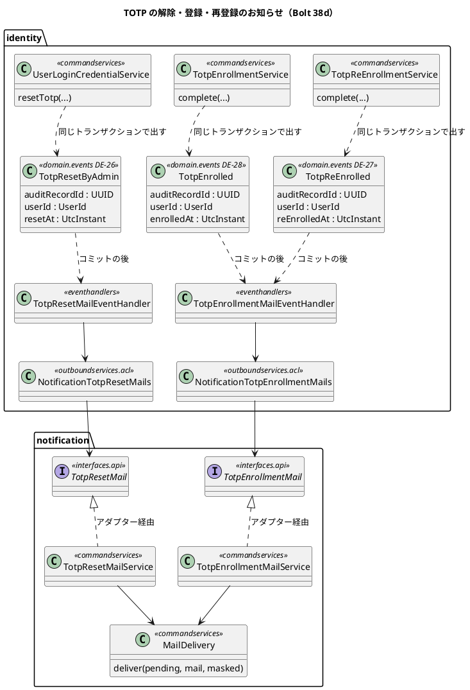
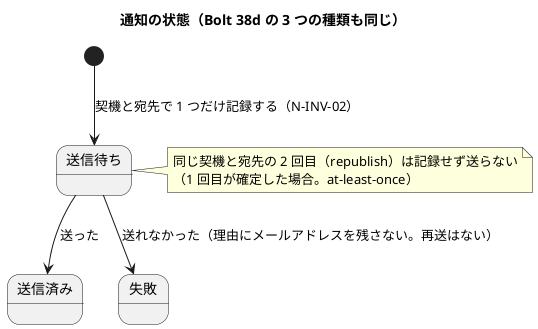
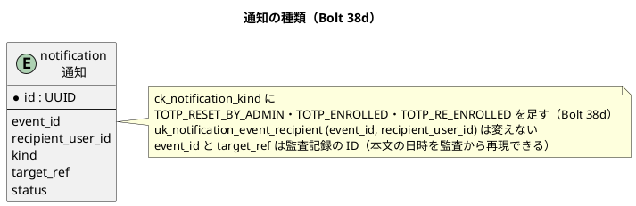

# Bolt 38d 計画 - TOTP の解除・登録・再登録を本人のメールで知らせる

## 基本情報

| 項目 | 内容 |
| :--- | :--- |
| Bolt | 第 38d 回（W6 の 28 本目。開始準備で 38d を 38d（メールのお知らせ）・38d2（残りの回復コードの案内）に分けた 1 つ目） |
| 予定 | W6（2026-11-09 の週。前倒しで着手できる）。38c2 の後に行う（38c2 の変更を前提にする）。作業は約 6 時間（`check`・`uiTest`・SonarQube・CI の待ちを除く）。development_strategy の目安（2〜4 時間）を超える。開始準備で「分けずに、解除のお知らせ（DE-26）を縦に通し切ってから登録の側に入る」と決め、打ち切りを DE-26 を終えた時点に置く（下の時間の配分。確認ポイント 9） |
| アプローチ | インサイドアウト（開発戦略 :346、release_plan :707・:783。通知の種類と公開 API から入り、イベントとハンドラー、受入シナリオの順に上がる）。新しい公開 API・イベント・通知の種類を足すので、開発戦略 :119 の「既存の集約に受入条件を足す」には当たらない。DE-26 の縦の 1 本（通知 → イベント → 受入）を先に通し、登録の側（DE-27・DE-28）を同じ順で後に足す |
| 対象 | (1) 管理者による TOTP の解除（DE-26）、A-07 の登録（DE-28）、回復コードの経路の再登録（DE-27）のドメインのイベント、(2) identity のイベントハンドラー 2 つと ACL 2 つ、(3) 通知の公開 API 2 つ（解除のお知らせと、登録・再登録のお知らせ）と通知のサービス・テンプレート、(4) 送り方の部品をリンクのないメールにも使える形に広げ、名前を `MailDelivery` に変える、(5) 通知の種類の CHECK を差し替えるマイグレーション、(6) 確認の画面の文言、受入シナリオ（Mailpit）、マニュアル 11 章・2 章・付録 B、(7) 設計の文書 |
| トレース | US-18 AC9（「解除が監査証跡へ記録され本人へ通知される」）、SEC-10（解除と再登録を本人のメールで知らせる）、N-INV-01（本文に業務の情報を書かない）・N-INV-02（契機と宛先で冪等）、ADR-017（通知モジュールとメール。:124 の種類ごとの口の見直し）、ADR-003（イベントの配り方）、W6 の確認ポイント 14、#47（後半） |
| GitHub | [#47](https://github.com/k2works/practical-domain-driven-design-in-enterpris-application/issues/47)（US-18 AC9 の管理者経路と本人への通知。38d は AC9 の「本人へ通知される」を満たし、`@US-18-AC9` に通知の確かめを足す。#47 を閉じるのは 38d2。SEC-10 の残り（残りの回復コードの案内）をそろえてから閉じる）、[#50](https://github.com/k2works/practical-domain-driven-design-in-enterpris-application/issues/50)（回復コードが送り直すたびに減る件と `findByEventIdAndRecipient` は #50 に残す）。動画は撮らない（メールは受入シナリオで確かめる） |
| SP | 0 |
| 承認ゲート | 計画と終了報告。**スキーマ**（`notification.notification` の `ck_notification_kind` を差し替える。W6 の確認ポイント 14）、**外部連携**（本人へのメール 3 種類。宛先・件名・本文）、**セキュリティ**（解除・登録・再登録の通知。伏せ字、宛先の決め方、送れなかったとき）、**構造**（通知の公開 API を 2 つ足す、送り方の部品を広げて名前を変える、ADR-017 の見直しの記録）、**画面**（確認の画面の影響の文）、新しいファイル（下の一覧） |
| ブランチ | develop で開発する。途中の push はデモ環境の配備になるので、push はステップ 7 でまとめる |
| 開始準備で決めたこと | 2026-10-27、human:kakimomokuri: (1) 知らせるのは、管理者による TOTP の解除、管理者の解除の後の A-07 の登録、回復コードの経路の再登録の 3 つ。ロックの解除は知らせない（要件にない。事実 11）。A-07 の登録を知らせるのは、password を知る第三者が解除の後に自分の認証アプリを登録できる窓に、本人が気づけるようにするため（SEC-10 の「解除と再登録」。整合性検証の後に (1) を改めた）、(2) 残りの回復コードの案内（A-08 と回復コードのログインの後、未使用 3 個以下）は 38d2 に分ける。#47 を閉じるのは 38d2、(3) 通知の公開 API は種類ごとの口にする（前例 `PasswordResetMail`・`UserInvitationMail`）。ADR-017 :124 と `UserInvitationMail` の Javadoc の「38d で見直す」は「種類ごとのまま。一般の口は W9 の業務の通知で宛先のモデルを決めるときに見直す」と記録する、(4) 送り方の部品 `LinkMailDelivery` を、リンクのないメールにも使える形に広げる（写さない）、(5) イベントを解除・登録・再登録と同じトランザクションで出し、コミットの後に identity のハンドラーが ACL で送る（前例 DE-25 と `UserInvitationMailEventHandler`。republish-on-restart で送り漏れを防ぐ）、(6) `ck_notification_kind` を差し替えるマイグレーションを書く（前例 `V20261026100000`。DROP と ADD を別の文にする）、(7) 本文は事実・日時・連絡先だけにし、本人確認の手段・操作した人の名前・企業名は書かない（N-INV-01）。解除のお知らせには役割だけを書く（「システム管理者が…解除しました」。整合性検証の後に決めた。解除できるのはシステム管理者だけなので人は特定されず、本人が不具合と区別しやすい）、(8) 送れなければ、通知を失敗として記録し警告のログを残す（前例。解除・登録・再登録は戻さない）、(9) #50 の 2 項目（回復コードが送り直すたびに減る、`findByEventIdAndRecipient`）は #50 に残す。整合性検証の後（同日）: (10) 38d は分けない。DE-26（解除のお知らせ）を通知の側・イベント・受入まで縦に通し切ってから、登録の側に入る。打ち切りは DE-26 を終えた時点、(11) 心当たりがないときの連絡先は既存の文にそろえる（「荷主の方は担当営業に、社内の方はシステム管理者にお知らせください。」。前例 `password-reset.txt:12`。管理者の悪用は監査（W10 の運用の手順）で扱う） |

新しいファイル（計画の承認で確かめる。計 37、消すもの 1）:

- マイグレーション（1）: `apps/cargo-tracker/src/main/resources/db/migration/common/V20261027110000__add_notification_kind_totp.sql`（38c2 の `V20261027100000` の後。38c2 の版が変わったら合わせる）
- identity（7）:
  - `identity/domain/events/TotpResetByAdmin.java`（DE-26）・`TotpReEnrolled.java`（DE-27）・`TotpEnrolled.java`（DE-28）。どれも監査記録の ID・利用者の ID・時刻だけ
  - `identity/application/internal/eventhandlers/TotpResetMailEventHandler.java`（DE-26）・`TotpEnrollmentMailEventHandler.java`（DE-27・DE-28 の 2 つの listener を 1 つのクラスに）
  - `identity/application/internal/outboundservices/acl/NotificationTotpResetMails.java`・`NotificationTotpEnrollmentMails.java`（前例 `NotificationUserInvitationMails`）
- notification（17、消すもの 1）:
  - `notification/interfaces/api/TotpResetMail.java`・`TotpResetMailRequest.java`・`TotpResetMailReceipt.java`
  - `notification/interfaces/api/TotpEnrollmentMail.java`・`TotpEnrollmentMailRequest.java`・`TotpEnrollmentMailReceipt.java`（登録と再登録の 2 つの種類を 1 つの口で送る。Request が種類を持つ）
  - `notification/interfaces/api/internal/TotpResetMailAdapter.java`・`TotpEnrollmentMailAdapter.java`
  - `notification/application/internal/commands/SendTotpResetMailCommand.java`・`SendTotpEnrollmentMailCommand.java`
  - `notification/application/internal/commandservices/TotpResetMailService.java`・`TotpEnrollmentMailService.java`・`MailDelivery.java`（`LinkMailDelivery.java` の名前を変える。`LinkMailDelivery.java` は消す）
  - `notification/domain/model/aggregates/TotpResetMailTemplate.java`・`TotpEnrollmentMailTemplate.java`（文面の組み立てのポート）
  - `notification/infrastructure/mail/ThymeleafTotpResetMailTemplate.java`・`ThymeleafTotpEnrollmentMailTemplate.java`
- 雛形（3）: `apps/cargo-tracker/src/main/resources/mail/totp-reset.txt`・`totp-enrolled.txt`・`totp-re-enrolled.txt`
- テスト（9）:
  - `identity/application/internal/eventhandlers/TotpResetMailEventHandlerTest.java`・`TotpEnrollmentMailEventHandlerTest.java`（単体）
  - `identity/application/internal/commandservices/TotpNotificationIntegrationTest.java`（コミットの後の配り方・冪等・伏せ・日時。前例 `UserInvitationIntegrationTest` と同じパッケージ）
  - `notification/application/internal/commandservices/TotpResetMailServiceTest.java`・`TotpEnrollmentMailServiceTest.java`・`MailDeliveryTest.java`（部品の単体。今は直接の単体がない）
  - `notification/interfaces/api/TotpResetMailIntegrationTest.java`・`TotpEnrollmentMailIntegrationTest.java`（前例 `UserInvitationMailIntegrationTest`）
  - `notification/interfaces/api/TotpMailRequestsTest.java`（2 つの Request と 2 つの Command の `toString`）
  - 文面の全文は既存の `NotificationMailAdaptersTest` に足す（新しいファイルを作らない）。受入シナリオは既存の `manage_user_login_credentials_ui.feature`（`@US-18-AC9`）と `login_ui.feature`（A-07・A-08）に足す
- 資産: なし（キャプチャは確認の画面の 1 枚を撮り直すだけ。動画は撮らない。38c の `@demo-bolt-38c/totp-reset` と 33b の `@demo-bolt-33b/re-enroll`（`login_ui.feature:108`）の動画も撮り直さない）

## Bolt ゴール

システム管理者が TOTP の登録を解除したとき、本人か第三者が A-07 で認証アプリを登録したとき、または回復コードの経路で登録し直したとき、本人の登録メールアドレスにお知らせのメールが届く。心当たりのない解除・登録・再登録に、本人が気づいて連絡できる。

### 開始準備で確かめたこと

| # | 事実 | 根拠 |
| :--- | :--- | :--- |
| 1 | #47 の受入条件は AC9（管理者の経路）の「…解除が監査証跡へ記録され本人へ通知される」。完了の定義は、`@US-18-AC9` が `@wip` なしで通る、セキュリティとアーキテクチャのテストが通る、画面を変えたなら `@ui`・axe とマニュアル。通知は `notification.interfaces.api` を使うと決まっている。受入条件は管理者の経路だけで、残りの回復コードの案内を含まない | `gh issue view 47` |
| 2 | release_plan の 38d の行は、解除・再登録（回復コードの経路を含む）のメール、通知の種類と公開 API（一般の口にまとめるか、`LinkMailDelivery` をリンクのないメールに広げるか）、残りの回復コードの案内、回復コードが送り直すたびに減る件と `findByEventIdAndRecipient`（#50）、マニュアル 2 章、#47 のクローズを挙げ、アプローチはインサイドアウト（通知の種類と公開 API から）。承認ゲートはスキーマ（確認ポイント 14）。:792 と :798 も 38d に #50 の 2 項目と回復コードの案内を置いている | `release_plan.md:707,783,792,798` |
| 3 | SEC-10 は「解除と再登録を本人のメールで知らせる。回復コードの経路の再登録の通知も #47 で作る（33b では送らない）。残りの回復コードが少ないときの案内も #47」と書き、目的に「管理者による解除を悪用されないよう」とある。管理者の経路の再登録（A-07）も「再登録」に読める。状態の欄は「提案」。W6 の確認ポイント 14 は、解除と同時に password の再設定は求めず本人への通知だけ、通知は日本語、残りの回復コードの案内は残り 3 個以下 | `non_functional.md:157`、release_plan の W6 の確認ポイント 14、ADR-011 :75・:279 |
| 4 | 通知の公開 API は種類ごとの口（`PasswordResetMail`・`UserInvitationMail`。Request・Receipt の組。Request の `toString` はリンクとメールアドレスを伏せる）。`UserInvitationMail` の Javadoc と ADR-017 :124 は「種類ごとの口か一般の口かは 38d で見直す」と書く。Request の `toString` を確かめる既存のテストはない | `notification/interfaces/api/UserInvitationMail.java:3-7`・`UserInvitationMailRequest.java`、`017-notification-module-and-mail.md:124` |
| 5 | 送り方の部品 `LinkMailDelivery`（package-private。各サービスがコンストラクターで作る。呼ぶのは `PasswordResetMailService:25,34`・`UserInvitationMailService:19,28` の 2 つ）は、送信待ちを `addIfAbsent` で記録し（N-INV-02）、送って、送信済みか失敗にする。失敗は例外にしない。失敗の理由とログからリンクとその最後の段（トークン）とメールアドレスを伏せる。呼ぶ側のトランザクションに加わる。`deliver(pending, link, mail)` でリンクを前提にしている。直接の単体テストはなく、テスト・ArchUnit・SpotBugs（パッケージで指定）からの参照もない。結果の型は 38b2b で種類によらない `MailDeliveryOutcome` にしてある | `LinkMailDelivery.java`、`MailDeliveryOutcome.java:6`、`config/spotbugs/exclude.xml:22-34` |
| 6 | 通知の種類（`NotificationKind`）は今 `PASSWORD_RESET`・`USER_INVITATION` を含み、表の `ck_notification_kind` は CHECK の値の列挙なので、種類を足すにはマイグレーションが要る。前例は `V20261026100000`（DROP と ADD を別の文にする。`event_id` と `target_ref` の注も直している）。`uk_notification_event_recipient (event_id, recipient_user_id)` が冪等の正。`kind` は `VARCHAR(30)` で、`TOTP_RESET_BY_ADMIN`（19 字）・`TOTP_RE_ENROLLED`（16 字）・`TOTP_ENROLLED`（13 字）は収まる | `NotificationKind.java`、`V20261015100000__create_notification.sql:13-29`、`V20261026100000:11` |
| 7 | ACL とイベントの前例: 登録のサービスが同じトランザクションで DE-25 `UserRegistered`（ID・利用者・時刻だけ。メールアドレスは載せない）を出し、`UserInvitationMailEventHandler` が `@ApplicationModuleListener`（コミットの後、非同期、新しいトランザクション）で受けて ACL `NotificationUserInvitationMails` で送る。宛先のメールアドレスはハンドラーが利用者を読んで得る。失敗は警告のログ。前例の `SendUserInvitationMailCommand.toString` は ID だけを出す | `UserRegistrationService.java:36,156`、`UserRegistered.java`、`UserInvitationMailEventHandler.java:17-79`、`SendUserInvitationMailCommand.java:39-43` |
| 8 | イベントは `identity.domain.events` に置き（`PasswordResetRequested`・`UserRegistered`）、Java 標準と共有カーネルの型だけを持つ record にする（DomainEventArchitectureTest の 3 規則）。番号は DE-25 が最後で、DE-26〜DE-28 は空いている | `identity/domain/events/`、`DomainEventArchitectureTest.java:20-51`、`domain_model.md` のイベントの表 |
| 9 | TOTP の解除（`UserLoginCredentialService.resetTotp`）は `transactionTemplate.execute` の中で資格・回復コード・監査を書き、コミットの後に `revokeSessions` を呼ぶ。結果は `Reset`・`Refused`（拒否と、`NotEnrolled`・`EnrollmentChanged` の 0 件。`setRollbackOnly` で戻す）・`Unverifiable`（日時の誤り）。イベントは今は出さない | `UserLoginCredentialService.java:157-208` |
| 10 | 回復コードの経路の再登録（`TotpReEnrollmentService.complete`）は、トランザクションの中で資格を置き換え、回復コードを発行し直し、`TOTP_RE_ENROLLED` を書き、コミットの後に `revokeOthers` を呼ぶ。結果は `Unavailable`・`Expired`・`SecretUnusable`・`CodeRejected`・`Superseded`（トランザクションの前と中）と成功。A-08 の入口は回復コードでログインした流れだけ（設定の画面はない）なので、この再登録は必ず回復コードの経路。通知はない | `TotpReEnrollmentService.java:36-48,125-183`、SEC-10 |
| 11 | ロックの解除の通知は、US-18・SEC-02・SEC-10 のどこにも求められていない | `user_story.md:595,618-619`、`non_functional.md:149` |
| 12 | メールの文面の決まり: N-INV-01（本文に業務の情報を書かない）。既存の 2 通は件名「【cargo-tracker】…のご案内」、日本語だけ、日時は画面と同じ形（Asia/Tokyo と UTC offset）、誰が操作したかを述べない。連絡先の文は「荷主の方は担当営業に、社内の方はシステム管理者にお知らせください。」。ui_design に件名と本文の全文と「場面ごとに本文の各文が事実と合うか」の表を置く。雛形は `resources/mail/*.txt`（Thymeleaf のテキスト）。メールの一覧の表（:1771-1779）に種類ごとの行がある | `domain_model.md:1454,1469`、`ui_design.md:1771-1837`、`mail/user-invitation.txt`・`password-reset.txt:12` |
| 13 | 「残りの回復コードの案内」は、回復コードでログインした後（A-02 → A-08）と A-08 で、未使用が 3 個以下のときに出す画面の案内（メールではない）。38d2 に分けた | release_plan の確認ポイント 14、ADR-011 :279、`ui_design.md:1752` |
| 14 | #50 の 2 項目: 回復コードのログインで成功の監査を書けないと、送り直すたびに減る件（34c の議題 2 で未決）と、`findByEventIdAndRecipient` が本番のコードから呼ばれていない件。#50 に残す | `bolt_34c_report.md:97`、`bolt_33_report.md:139`、#50 :26・:35 |
| 15 | Mailpit の受入の前例: `MailpitClient`・`MailpitConfiguration`、UI の `UserRegistrationUiSteps`・`PasswordResetUiSteps`、統合の `UserInvitationIntegrationTest`（`commandservices`。:199 で「平文のトークンとリンクとメールアドレスは表と発行記録とログに残らない」）・`PasswordResetRequestIntegrationTest`・`UserInvitationMailIntegrationTest`（`notification/interfaces/api`）。文面の全文のテストは `NotificationMailAdaptersTest`（:26・:45）に 1 つずつ足している | `ui/`・`identity/`・`notification/` のテスト |
| 16 | 今の文言で通知と食い違う箇所: 確認の画面の影響「本人への連絡は別に行ってください」（`totp-reset-confirmation.html:29`、`UserLoginCredentialControllerTest:158`、`UserLoginCredentialUiSteps:98`、`ui_design.md:185,1369`、マニュアル 11 章 :334）。「38d で足す」と書いた既存の文（`UserLoginCredentialService.java:41-42` の Javadoc、`manage_user_login_credentials_ui.feature:6`）。マニュアル 2 章（2.1 の注 :92、2.4 の注 :190、2.7 の A-08）と付録 B の Q1-9（:83-91）に、届くメールの記述がない | grep |
| 17 | 38c2 は計画の承認待ちで、`UserDetail`・監査の照会・索引 `V20261027100000` を足し、ui_design :181・:184・:1353、マニュアル 11 章 :88・:137・:297 と付録 B、`UserLoginCredentialUiSteps:60-83`、`UserLoginCredentialControllerTest:91`、release_plan :782、`TotpReEnrollmentServiceTest` の手書きの `AuditRecordRepository`、`IdentityConfiguration` を変える。38d はその後に行い、マイグレーションの版を後にし、計画が引く行番号は 38c2 のコミットの後に引き直す。38c の Try T-214（変異の対象に契約テストを入れる）と T-215（Gradle を流す担当を 1 つにする）を守る | `bolt_38c2_plan.md`、`bolt_38c_report.md` |
| 18 | 管理者は停止中の利用者の TOTP も解除できる（38c の決定。停止中の利用者にも操作を出す）。招待のハンドラーは、登録の後に利用者が止められていれば発行しない（停止の確定で未使用のトークンを無効にするので、リンクが使えないため。SEC-08） | `bolt_38c_plan.md:57`、`UserInvitationMailEventHandler.java:21` |
| 19 | A-07 の登録（`TotpEnrollmentService.complete`）は、トランザクションの中で資格を作り、回復コードを発行し、`TOTP_ENROLLED` を書く。結果は `AlreadyEnrolled`（2 か所）・`SecretUnusable`・`CodeRejected` と `Enrolled`。招待の後の最初の登録も、管理者の解除の後の登録も、同じこの道を通る | `TotpEnrollmentService.java:92-132` |
| 20 | 監査の工場 `AuditRecord.totpEnrolled`・`totpReEnrolled`・`totpResetByAdmin` は、ID を `UUID.randomUUID()` で作り、時刻を `occurred_at` に持つ。data_model は「本文は保存せず、テンプレートと `target_ref` から再現できる」と決め、例外は平文のトークンを含むリンクのある `PASSWORD_RESET`・`USER_INVITATION` だけ | `AuditRecord.java:100-109,367-`、`data_model.md:980-984,1203` |
| 21 | `ApplicationEventPublisher` を 3 つのサービスのコンストラクターに足すと、手で組み立てる `IdentityConfiguration.java:222・296` と、`UserLoginCredentialServiceTest.java:72`・`TotpReEnrollmentServiceTest.java:149`・`TotpEnrollmentServiceTest` の組み立てが変わる | grep |

## 設計の決定（案）

| 項目 | 決定 | 根拠 |
| :--- | :--- | :--- |
| イベント | DE-26 `TotpResetByAdmin`、DE-27 `TotpReEnrolled`、DE-28 `TotpEnrolled` を `identity.domain.events` に置く。どれも監査記録の ID（イベントの ID を兼ねる）・利用者の ID・時刻（監査の `occurred_at` と同じ瞬間）だけを持つ。メールアドレス・操作者・本人確認の手段は持たない（発行記録 `event_publication` に個人情報を残さない。前例 DE-25）。監査記録の ID が通知の `event_id` と `target_ref` になる（同じ契機の 2 回目の配信を見分け、本文の日時を監査から再現できる） | 開始準備の決定 (5)・(7)、事実 7・8・20 |
| 出すところ | `UserLoginCredentialService.resetTotp` は、資格と回復コードを消して監査を書くのと同じトランザクションで DE-26 を出す（`Reset` のときだけ。`Refused`・0 件・`Unverifiable` では出さない）。`TotpEnrollmentService.complete` は `Enrolled` のときだけ DE-28 を、`TotpReEnrollmentService.complete` は置き換えたときだけ DE-27 を、同じトランザクションで出す（`AlreadyEnrolled`・`Unavailable`・`Expired`・`SecretUnusable`・`CodeRejected`・`Superseded` では出さない）。監査が書けずに戻ると、イベントも出ない（`@ApplicationModuleListener` はコミットの後にしか動かない） | 開始準備の決定 (5)、事実 9・10・19 |
| A-07 の登録の範囲 | 招待の後の最初の A-07 の登録も知らせる（推奨。見分けない）。招待の後も、password を知る第三者が本人より先に登録できる窓は同じで、見分けるための読み出し（監査記録に `TOTP_RESET_BY_ADMIN` があるかを 38c2 の索引で引く）が要らない。見分ける案（管理者の解除の後だけを知らせる）は確認ポイント 3 | 開始準備の決定 (1)、事実 19 |
| ハンドラー | `TotpResetMailEventHandler`（DE-26）と `TotpEnrollmentMailEventHandler`（DE-27・DE-28 の 2 つの listener。`eventhandlers`、`@ApplicationModuleListener`。コミットの後、非同期、新しいトランザクション。名前は `*EventHandler`、`@Service`）。利用者を読んでメールアドレスを得て、ACL で送る。利用者がいなければ送らずに警告のログ。停止中の利用者にも送る（解除・登録・再登録の 3 つとも。リンクのない知らせで、招待の前例の理由（使えないリンク）が当たらない。SEC-10 の目的は悪用に本人が気づくこと）。送れなければ ACL が返す理由で警告のログを残し、例外にしない（解除・登録・再登録は戻さない）。ログに出すのは利用者の ID と監査記録の ID だけ | 開始準備の決定 (5)・(8)、事実 3・18 |
| ACL | `NotificationTotpResetMails`・`NotificationTotpEnrollmentMails`（`outboundservices.acl`。前例 `NotificationUserInvitationMails`。`interfaces.api` への依存は LayerArchitectureTest :93-95 が許す）。通知の公開 API を呼び、送れなかったときだけ理由を返す | ADR-017、前例 |
| 公開 API | 2 つの口を足す: `TotpResetMail.send(TotpResetMailRequest)`（解除のお知らせ）と `TotpEnrollmentMail.send(TotpEnrollmentMailRequest)`（登録と再登録のお知らせ。Request が `reEnrolled` を持ち、種類 `TOTP_ENROLLED`・`TOTP_RE_ENROLLED` と雛形を選ぶ。本文の作りが同じで、口を 3 つにすると前例の組を 3 組写すことになるため）。Request は契機の ID（監査記録の ID）・宛先の利用者の ID・メールアドレス・時刻・言語を持ち、`toString` はメールアドレスを伏せる。Command の `toString` も ID だけを出す（前例）。Receipt は前例と同じ形（送った・送り済み・失敗）。実装は `interfaces.api.internal` のアダプター（CLAUDE.md の置き場所）。ADR-017 :124 の見直しは「種類ごとのまま（解除と登録の 2 つの口。登録と再登録は 1 つの口で種類を分ける）」と改訂の経緯に書き、`UserInvitationMail` の Javadoc の「38d で見直す」を直す | 開始準備の決定 (3)、事実 4 |
| 送り方の部品 | `LinkMailDelivery` の名前を `MailDelivery` に変え、口を 1 本の道にする: `deliver(pending, mail, masked)`（`masked` は理由とログから伏せる文字列のリスト。リンクのある送りはリンクとトークンとメールアドレス、リンクのない送りはメールアドレスだけを渡す）。記録・冪等・失敗の扱いを共有し、伏せ字の重複を作らない。再設定と招待のサービスの参照を直す（リファクタリングで、既存のテストが緑のまま）。結果の型 `MailDeliveryOutcome` とそろう | 開始準備の決定 (4)、事実 5 |
| 通知の種類 | `NotificationKind` に `TOTP_RESET_BY_ADMIN`・`TOTP_ENROLLED`・`TOTP_RE_ENROLLED` を足す（監査の操作の名前とそろえる）。`target_ref` は監査記録の ID（本文の日時は監査の `occurred_at` から再現できる。data_model の決まりのとおりで、例外を広げない）。マイグレーションは `V20261027110000__add_notification_kind_totp.sql` で、前例 `V20261026100000` と同じく DROP と ADD を別の文にし、`event_id` と `target_ref` の COMMENT を直す。38c2 の版の後に置く（38c2 の版が変わるか、38c2 より先に流れると Flyway の検証が落ちる） | 開始準備の決定 (6)、事実 6・20 |
| 文面 | 件名と本文は通知のテキストのテンプレート（`mail/totp-reset.txt`・`totp-enrolled.txt`・`totp-re-enrolled.txt`）で組み立て、表に保存しない。件名は前例の「…のご案内」にそろえる。日時は再設定のメールと同じ形で、監査の時刻を示す。本文は事実・日時・連絡先だけで、本人確認の手段・操作した人の名前・企業名・回復コードの値は書かない（N-INV-01）。解除のお知らせだけは役割（システム管理者）を書く（決定 (7)。「誰が操作したかを述べない」の決まりの例外として ui_design に理由を書く）。連絡先は既存の文にそろえる（決定 (11)）。全文は下の表 | 開始準備の決定 (7)・(11)、事実 12 |
| 冪等 | 契機（監査記録の ID）と宛先で 1 通だけ記録する（N-INV-02）。送った後、コミットの前に落ちると、republish で 2 通目が届く（at-least-once。ADR-017 決定 4・:113）。行 6 の「2 回目は送らない」は、1 回目が確定した場合に限る | ADR-017 |
| 確認の画面 | 影響の文「本人への連絡は別に行ってください。」を「本人の登録メールアドレスに、解除のお知らせのメールを送ります。」に変える（送れなかったときも解除は戻らないので「送ります」とし「届きます」とは書かない。停止中の利用者にも送るので事実と合う） | 事実 16 |
| 受入シナリオ | `manage_user_login_credentials_ui.feature` の `@US-18-AC9` の場面に「本人の登録メールアドレスに解除のお知らせが届く」と、続く A-07 の登録で「登録のお知らせが届く」を Mailpit で足す（件名の全文と本文の要の文。日時は形で）。`login_ui.feature` の A-08 の再登録の場面に「再登録のお知らせが届く」を足す（`@demo-bolt-33b/re-enroll` の付いた場面は変えず、確かめのステップだけを足す。動画は撮り直さない） | 事実 1・15 |
| 示す決まり | ui_design のメールの一覧の表（:1771-1779）に 3 行、メールの節を 2 つ足す（解除と、登録・再登録。件名・本文・場面の表）。domain_model のイベントの表と用語集に DE-26〜DE-28、通知の集約の表（イベント ID・対象の列）と種類の表、送り方の部品の用語（「リンクのあるメールの送り方」を「メールの送り方」に）。通知の不変条件（N-INV-01・02）は変えない | 事実 12 |

### メールの件名と本文（全文）

#### 管理者による TOTP の登録の解除のご案内

件名: 「【cargo-tracker】認証アプリの登録の解除のご案内」

```text
cargo-tracker で、このメールアドレスの利用者の認証アプリの登録を、システム管理者が {日時} に解除しました。
回復コードも使えなくなりました。
次のログインで、認証アプリを登録し直してください。
この解除に心当たりがない場合は、荷主の方は担当営業に、社内の方はシステム管理者にお知らせください。
```

| 場面 | 本文の各文が事実と合うか |
| :--- | :--- |
| 端末を失い、本人がシステム管理者に解除を頼んだ | 合う。解除されたこと・役割・日時・回復コードが使えないこと・次のログインで登録し直すこと（A-07）を示す。本人確認の手段と操作した人の名前は書かない |
| 本人が頼んでいない（管理者の誤り・悪用） | 合う。解除の事実と日時から本人が気づき、連絡先に知らせられる（SEC-10 の目的）。管理者の悪用は監査（W10 の運用の手順）で扱う |
| 停止中の利用者 | 一部だけ合う。解除の事実は合う。停止中はログインできないので「次のログインで登録し直す」は再開の後になる（停止の扱いはマニュアル 11 章に書く） |
| 解除の後に、本人が既に A-07 で登録し直した（メールが遅れた） | 合う。解除の事実と日時は変わらない。「登録し直してください」は済んでいれば読み流せる。登録のお知らせも別に届く |

#### 認証アプリの登録のご案内（A-07）

件名: 「【cargo-tracker】認証アプリの登録のご案内」

```text
cargo-tracker で、このメールアドレスの利用者の認証アプリが、{日時} に登録されました。
この登録に心当たりがない場合は、すぐに、荷主の方は担当営業に、社内の方はシステム管理者にお知らせください。
```

| 場面 | 本文の各文が事実と合うか |
| :--- | :--- |
| 本人が初めて登録した（招待の後） | 合う。登録の事実と日時を示す。新しい回復コードの値は書かない |
| 管理者の解除の後に、本人が登録し直した | 合う |
| 第三者が password を使って、本人より先に登録した | 合う。本人は心当たりのない登録に気づき、連絡先に知らせられる（決定 (1) の窓） |

#### 認証アプリの再登録のご案内（A-08）

件名: 「【cargo-tracker】認証アプリの再登録のご案内」

```text
cargo-tracker で、このメールアドレスの利用者の認証アプリが、{日時} に登録し直されました。
回復コードでログインして登録し直したため、前の認証アプリと前の回復コードは使えなくなりました。
この操作に心当たりがない場合は、すぐに、荷主の方は担当営業に、社内の方はシステム管理者にお知らせください。
```

| 場面 | 本文の各文が事実と合うか |
| :--- | :--- |
| 本人が回復コードで再登録した | 合う。再登録の事実・日時・前の要素が使えないことを示す。新しい回復コードの値は書かない |
| 第三者が password と回復コードを使って再登録した | 合う。本人は前の認証アプリでログインできなくなる。password の再設定だけでは認証アプリの要素を取り戻せないので、連絡先から管理者の経路で解除を頼める |
| ほかの端末の session の失効に失敗した | 合う。本文は session の失効に触れない（失効の失敗は #49） |

3 通とも、件名と本文は日本語だけを作り、本文に業務の情報（企業名・操作した人の名前・本人確認の手段・回復コードの値）を書かない（N-INV-01）。リンクは置かない。「回復コード」の語は使うが、値は書かない。

### 既存の期待を変える箇所（T-122。行番号は 38c2 のコミットの後に引き直す）

- テンプレート: `totp-reset-confirmation.html:29`（影響の文）
- テスト: `UserLoginCredentialControllerTest:158`、`UserLoginCredentialUiSteps:98`、`NotificationMailAdaptersTest`（文面を足す）、`MyBatisNotificationRepositoryIntegrationTest`（全部の種類）
- 組み立て: `IdentityConfiguration.java:222・296`、`UserLoginCredentialServiceTest.java:72`、`TotpReEnrollmentServiceTest.java:149`、`TotpEnrollmentServiceTest`、`NotificationConfiguration`
- 部品の名前の変更: `PasswordResetMailService.java:25,34`、`UserInvitationMailService.java:19,28`、`MailDeliveryOutcome.java:6` の Javadoc、`PasswordResetTokenIssuance.java:27` の Javadoc
- Javadoc と説明: `UserInvitationMail` の Javadoc、`UserLoginCredentialService.java:41-42`、`manage_user_login_credentials_ui.feature:6`、`NotificationKind` の Javadoc、notification の `package-info.java` の 3 つ（モジュールの直下・`interfaces/api`・`commandservices`）
- 設計: `ui_design.md:185`（S-20 の認証アプリの登録の解除の確認の行）・`:1369`（salt 図の影響）・`:1771-1779`（メールの一覧）、`domain_model.md:274・279・282・284・1446・1450・1458-1467・1469`、`data_model.md:980・982・984・1203`、`architecture_backend.md:313`、ADR-017 :40・:124
- non_functional: SEC-10 の文と状態（「提案」を確定に）
- マニュアル: 11 章 :334（影響の文）、2 章 2.1 の注 :92・2.4 の注 :190・2.7（A-08）、付録 B の Q1-9（:83-91）
- release_plan: :707（アプローチ）・:783（38d の行。38d2 に分けたこと、#47 のクローズは 38d2、#50 の 2 項目は #50、種類ごとのまま）・:792・:798、38d2 の行を足す
- キャプチャ: `11-totp-reset-confirmation`
- 改訂の経緯（ADR-017 :136、release_plan :1295）と過去の計画は、名前を変えてもそのまま残す
- ほかに「本人への連絡は別に」と通知の種類の列挙を期待するものを、ステップ 2 の前に grep で確かめる

## ふりかえりと前の Bolt からの引き継ぎ

| 出典 | 内容 | この Bolt での扱い |
| :--- | :--- | :--- |
| Bolt 38c Try T-214 | 変異の対象のテストに、変異するファイル（mapper の XML・マイグレーション）を使う契約テストを入れる | 通知の記録は PostgreSQL の統合テスト `MyBatisNotificationRepositoryIntegrationTest` だけで確かめる（notification に H2 の契約の組はない。38c2 の検証で出た型）。全部の `NotificationKind` の値を保存し、enum と CHECK のずれを見張る。このテストを変異 V8 の対象に入れる |
| Bolt 38c Try T-215 | 変異やゲートを流す間は、Gradle を流す担当を 1 つにする | フォークを使うときは、Gradle を流す担当を 1 つに決めて指示に書く |
| Bolt 38c の報告の議題 5（#49） | TOTP の解除の後の失効の失敗 | 範囲の外（#49）。本文は session の失効に触れない |
| Bolt 38c2 の計画と検証 | `UserDetail`・監査の照会・索引。契約テスト、手書きの実装の漏れ、T-126 の範囲の指摘 | 前提にする。マイグレーションの版を後にし、行番号を 38c2 のコミットの後に引き直す。38c2 が打ち切りで一部を後に送った場合も、38d が使うのは索引の版の順だけ（監査の照会は使わない）なので、版だけを合わせる。手書きの組み立ては事実 21 に挙げた |
| Bolt 38b2c・38b4 | DE-25 とハンドラー、遅れた配信の抑え | 前例。解除・登録・再登録は「後から取り消される」ことがないので、遅れた配信の抑えは要らない（遅れても事実は変わらない） |
| Bolt 38b4 Try T-213 | 画面のクラスに DI の部品を足すときは SpotBugs を先に確かめる | ハンドラーと通知のサービスに部品が増えるので、ステップ 2・3 で `spotbugsMain` を流す（identity と notification の `application.internal` はパッケージで抑止されている） |
| 38b4 までの既知の課題 | エラー要約の二重の読み上げなど | 残す |

## 状態の組み合わせ（行ごとにテストを 1 本。T-182）

| 行 | 状況 | 期待 | 出口 | 確かめ方 |
| :--- | :--- | :--- | :--- | :--- |
| 1 | 管理者が TOTP を解除した | コミットの後に解除のお知らせが 1 通、本人の登録メールアドレスへ。通知の記録は `TOTP_RESET_BY_ADMIN`・送信済み・`event_id` と `target_ref` は監査記録の ID | 本人がメールを読み、心当たりがなければ連絡先へ | `TotpNotificationIntegrationTest`、受入シナリオ（Mailpit） |
| 2 | 回復コードの経路で再登録した（A-08） | コミットの後に再登録のお知らせが 1 通。通知の記録は `TOTP_RE_ENROLLED`・送信済み | 同上 | 同上 |
| 3 | A-07 で登録した（招待の後・管理者の解除の後） | コミットの後に登録のお知らせが 1 通。通知の記録は `TOTP_ENROLLED`・送信済み | 同上 | 同上 |
| 4a | 解除が送られなかった（`Refused`・`NotEnrolled`・`EnrollmentChanged`・`Unverifiable`） | イベントを出さない | 確認の画面か詳細の案内（38c のまま） | `UserLoginCredentialServiceTest`（偽の publisher） |
| 4b | 再登録が成り立たなかった（`Unavailable`・`Expired`・`SecretUnusable`・`CodeRejected`・`Superseded`（前と中）） | イベントを出さない | A-08 の案内（33b のまま） | `TotpReEnrollmentServiceTest`（偽の publisher） |
| 4c | A-07 の登録が成り立たなかった（`AlreadyEnrolled`・`SecretUnusable`・`CodeRejected`） | イベントを出さない | A-07 の案内（今のまま） | `TotpEnrollmentServiceTest`（偽の publisher） |
| 5 | 監査が書けずに解除が戻った | イベントも出ず、送らない | 38c のまま（例外） | `UserLoginCredentialRollbackIntegrationTest` |
| 6 | 同じイベントが 2 回配られた（republish） | 1 回目が確定していれば 2 回目は送らない（`AlreadySent`。N-INV-02）。コミットの前に落ちた 1 回目は 2 通目が届きうる（at-least-once） | — | `TotpNotificationIntegrationTest`、通知のサービスのテスト |
| 7 | 送信に失敗した | 通知は失敗として記録し、理由とログにメールアドレスを残さない。解除・登録・再登録は戻らない。ハンドラーは例外にしない | **なし**（再送はなく、通知の一覧 C-16（N-INV-03）は W9。本人は知らないまま。確認ポイント 7） | 通知のサービスのテスト、`MailDeliveryTest`、ハンドラーの単体 |
| 8 | 宛先の利用者が停止中（解除・登録・再登録のどれでも。ハンドラーが動く前に止められた場合も） | お知らせを送る | 再開の後に本人がログインできる | 2 つのハンドラーの単体 |
| 9 | 宛先の利用者がいない（DB を直接消した） | 送らずに警告のログ（利用者の ID だけ）。例外にしない | **なし**（DB を直接操作したときだけ起こる） | ハンドラーの単体 |
| 10 | 件名と本文 | 3 通とも件名と本文の全文。日時は画面と同じ形。解除だけ役割を書く。業務の情報・リンク・回復コードの値がない | — | `NotificationMailAdaptersTest` |
| 11 | 伏せ字 | 2 つの Request と 2 つの Command の `toString` にメールアドレスが出ない。発行記録（`event_publication.serialized_event`）とログにメールアドレスが残らない | — | `TotpMailRequestsTest`、`TotpNotificationIntegrationTest`（前例 `UserInvitationIntegrationTest:199`） |
| 12 | 通知の種類の保存 | 全部の `NotificationKind` の値が CHECK を通って保存される（PostgreSQL） | — | `MyBatisNotificationRepositoryIntegrationTest`（T-214） |
| 13 | 送り方の部品の広げ | リンクのない送りでもメールアドレスを伏せ、冪等・失敗の扱いが同じ。再設定と招待は今のまま | — | `MailDeliveryTest`、既存の再設定と招待のテスト |
| 14 | 本文の日時 | イベントの時刻（監査の `occurred_at`）を示し、ハンドラーが動いた時刻ではない（遅れた配信でもずれない） | — | `TotpNotificationIntegrationTest` |
| 15 | 公開 API の通し | 2 つの口が送信済みの Receipt を返し、2 回目は送り済みを返す | — | `TotpResetMailIntegrationTest`・`TotpEnrollmentMailIntegrationTest` |
| 16 | UI の通し | 確認の画面の影響の文、Mailpit に届いた 3 通の件名と要の文、幅 320 px、axe の違反 0 | — | 2 つの feature |

層の規則（identity は通知の公開 API だけを呼ぶ。イベントは `domain.events`、ACL は `outboundservices.acl`）は、既存の `LayerArchitectureTest`・`DomainEventArchitectureTest`・`PublicApiArchitectureTest` と Modulith の検証（`identity/package-info.java:8` の `notification :: api`）が見る。この Bolt で新しいテストは作らない（完了条件の「行に名乗るテスト」の外）。

### #47 と受入条件の照合（38d の時点）

| 受入条件・完了の定義 | 38c までで満たしたもの | 38d で満たすもの | 38d2 に残すもの |
| :--- | :--- | :--- | :--- |
| US-18 AC9: 別経路で本人確認して登録を解除する | 本人確認の記録、資格と回復コードの削除、session の消去、`TOTP_RESET_BY_ADMIN` | — | — |
| US-18 AC9: TOTP を再登録できる | 次のログインで A-07 | — | — |
| US-18 AC9: 本人へ通知される | — | 解除のお知らせ（行 1） | — |
| SEC-10: 解除と再登録を本人のメールで知らせる | — | A-07 の登録のお知らせ（行 3）、回復コードの経路の再登録のお知らせ（行 2） | — |
| SEC-10: 残りの回復コードが少ないときの案内 | — | — | A-08 と回復コードのログインの後の案内（未使用 3 個以下） |
| #47 の完了の定義: `@US-18-AC9` が `@wip` なしで通る | 解除と再登録の分 | 通知の確かめを足して通る | — |
| #47 の完了の定義: セキュリティとアーキテクチャのテスト、`@ui` と axe、マニュアル | 解除の分 | 通知の分 | 案内の分 |
| #47 のクローズ | — | — | 38d2 で閉じる（SEC-10 の残りをそろえてから閉じる。#47 の受入条件そのものは 38d で満たす） |

## スコープ

### 入れるもの

- 行 1〜16 のテスト、マイグレーション、`NotificationKind` の 3 つの値、イベント 3 つ、ハンドラー 2 つ、ACL 2 つ、公開 API 2 つ（Request・Receipt・アダプター）、通知のコマンドとサービス 2 つ、文面のポートと Thymeleaf の実装 2 つと雛形 3 つ、送り方の部品の広げと名前の変更、`UserLoginCredentialService`・`TotpEnrollmentService`・`TotpReEnrollmentService` のイベントの発行、組み立て（`IdentityConfiguration`・`NotificationConfiguration`）
- 既存の直し: 確認の画面の影響の文、T-122 の箇所（組み立て・部品の参照・Javadoc・package-info・テスト）
- UI テスト、キャプチャ `11-totp-reset-confirmation` の撮り直し（ほかの撮り直しの差分は戻す）
- マニュアル: 11 章（11.7 の影響の文と、解除のお知らせが本人に届くこと。停止中の利用者はログインが再開の後になること）、2 章（2.1 の注 :92 と 2.4 の注 :190 に解除のお知らせ、2.7 の A-08 に再登録のお知らせ、A-07 の登録に登録のお知らせ）、付録 B（Q1-9 の近くに「心当たりのないお知らせが届いたとき」）
- 設計の文書（T-126）:
  - ui_design: メールの一覧の表（:1771-1779）に 3 行、メールの節を 2 つ（件名・本文・場面の表。解除の役割を書く例外の理由）、:185・:1369 の影響の文
  - domain_model: イベントの表と用語集に DE-26〜DE-28、`UserLoginCredentialService`・`TotpEnrollmentService`・`TotpReEnrollmentService` の定義の行にイベント、通知の集約の表と種類の表（:1446・:1450・:1458-1467・:1469）、送り方の部品の用語（:274・:279・:282・:284）
  - data_model: 通知の種類の CHECK の値（:980・:982 の数）と、`target_ref` が監査記録の ID であること（:984・:1203。例外を広げない）
  - ADR-017: :40 の部品の名前、:124 の見直しの記録（種類ごとのまま）と改訂の経緯、送り方の部品の広げ
  - ADR-011: 決定 10 の「本人への通知」の実装の注
  - non_functional: SEC-10 の文（解除・A-07 の登録・回復コードの経路の再登録）と状態の欄（「提案」を確定に。Bolt 38d）
  - architecture_backend: :313 の部品の名前、identity のハンドラーと ACL の一覧、notification の公開 API の一覧
  - user_story: US-18 AC9 の「Bolt 38d の決定」の段落
  - test_strategy: identity と notification の表に行 1〜3・6・7・10〜15
  - release_plan: :707・:783・:792・:798 と 38d2 の行、更新履歴（計画の同期で直す）

### 入れないもの

- 残りの回復コードの案内（38d2）、#47 のクローズ（38d2）
- ロックの解除の通知（要件にない）
- #50 の 2 項目（回復コードが送り直すたびに減る件、`findByEventIdAndRecipient`）
- 一般の通知の口（W9 の業務の通知で見直す）、英語の文面
- 送れなかったお知らせの再送と、本人が通知を確かめる画面（C-16。W9）
- 失効の失敗の扱い（#49）

## 設計（この Bolt の範囲）







- 画面遷移は変えない（確認の画面の文だけ）

## ステップ計画

インサイドアウトで、解除のお知らせ（DE-26）を縦に通し切ってから、登録の側（DE-27・DE-28）を同じ順で足す。

- [ ] **1. 設計の文書**（完了の判定: 文書の差分。release_plan は計画の同期で直す）。先に 38c2 のコミットの後の行番号を引き直し、T-122 の箇所を grep する
- [ ] **2. 解除のお知らせ（DE-26）を縦に通す（Red → Green）**
  - 2a 通知: マイグレーションと 3 つの種類（行 12）、送り方の部品の名前の変更と 1 本の道（行 13。リファクタリングは既存のテストを緑のまま）、`TotpResetMail` の公開 API・サービス・文面・雛形（行 6・7・10・11・15 の解除の分）
  - 2b イベント: DE-26、`resetTotp` の発行、ハンドラーと ACL、組み立て（行 1・4a・5・8・9・14 の解除の分）、`spotbugsMain`（T-213）
  - 2c 受入: `@US-18-AC9` に解除のお知らせの確かめを足し、Red（Mailpit に届かない）を見てから緑にする。確認の画面の影響の文（行 16 の解除の分）
  - **ここが打ち切りの点**（下の時間の配分）
- [ ] **3. 登録と再登録のお知らせ（DE-27・DE-28）を同じ順で足す（Red → Green）**: `TotpEnrollmentMail` の公開 API・サービス・文面・雛形 2 つ、DE-27・DE-28、2 つのサービスの発行、ハンドラーと ACL、受入（`@US-18-AC9` の A-07 と `login_ui.feature` の A-08）。行 2・3・4b・4c と、行 6〜11・14〜16 の登録の分
- [ ] **4. マニュアル・キャプチャ**: 11 章・2 章・付録 B、キャプチャ 1 枚（ほかの差分は戻す）。T-197 の突き合わせ
- [ ] **5. 品質ゲートと開発レビュー**: 変異、`check`・`uiTest`、その後に SonarQube（重複 3% 未満。前例の組を 2 組足すので重複を見る）、開発レビューとその直し（Gradle を流す担当は 1 つ。T-215）
- [ ] **6. 終了報告と配備**: develop に push して CI（check・ui・deploy-demo）を確かめ、デモ環境の版を見る（マイグレーションが流れる）

### 時間の配分と打ち切り

前例: 38b2b（公開 API 1 組と部品と種類）が約 3.3 時間、38b2c（イベント 1 つとハンドラー 1 つ）が約 3.7 時間。38d の解除の縦の 1 本はその合計の多くに当たり、登録の側はその型を写す。

| # | 目安 | 打ち切り |
| :--- | :--- | :--- |
| 1 | 40 分 | — |
| 2 | 150 分（2a 70 分、2b 50 分、2c 30 分） | **ステップ 2 を終えた時点**で、合計の見込みが 360 分を超えそうなら、登録と再登録のお知らせ（ステップ 3）を後の Bolt に送る形を諮る（解除のお知らせだけで #47 の AC9 は満たせる）。部品の名前の変更が既存のテストを大きく揺らすときは、名前を変えずに口だけ足し、報告に書く |
| 3 | 90 分 | — |
| 4 | 35 分 | — |
| 5 | 40 分（待ちを除く。開発レビューの直しを含む） | — |
| 6 | 15 分（CI の待ちを除く） | — |

合計 370 分（約 6.2 時間）。目安の 2〜4 時間を超える。開始準備で分けないと決めたので、ステップ 2 の終わりの打ち切りで守る（確認ポイント 9）。

## 確認ポイント（計画の承認の場でまとめて確認する。Try T-6）

| # | 確認すること | 場所 | 推奨 |
| :--- | :--- | :--- | :--- |
| 1 | **スキーマ** | 設計の決定 | `ck_notification_kind` に 3 つの種類を足す（`V20261027110000`。前例 `V20261026100000` の形。38c2 の版の後）。表と列は変えない |
| 2 | **外部連携（メールの文面）** | 件名と本文の表 | 3 通の件名と本文の全文。件名は前例の「…のご案内」。本人確認の手段・操作した人の名前・企業名・回復コードの値・リンクを書かない。解除の文は役割だけを書く（「システム管理者が…解除しました」。「誰が操作したかを述べない」の決まりの例外として ui_design に書く）。連絡先は既存の文 |
| 3 | **A-07 の登録の範囲（セキュリティ）** | 設計の決定 | 招待の後の最初の A-07 の登録も知らせる（見分けない）。見分ける案（監査記録に `TOTP_RESET_BY_ADMIN` があるときだけ）もある |
| 4 | **宛先（セキュリティ）** | 設計の決定 | 停止中の利用者にも、解除・登録・再登録のお知らせを送る（リンクのない知らせで、招待の前例の理由が当たらない）。確認の画面の「…メールを送ります。」はこの決定とつながる |
| 5 | **構造（送り方の部品）** | 設計の決定 | `LinkMailDelivery` を `MailDelivery` に変え、伏せる文字列のリストを持つ 1 本の道にする（呼ぶのはサービス 2 つ。文書の箇所は T-122 の一覧） |
| 6 | **構造（公開 API と ADR-017）** | 設計の決定 | 解除と、登録・再登録の 2 つの口を足す（登録と再登録は 1 つの口で種類を分ける）。ADR-017 :124 の見直しは「種類ごとのまま」と改訂の経緯に書く |
| 7 | **送れなかったときの出口** | 状態の組み合わせの行 7 | 失敗の記録と警告のログだけで、再送はなく本人は知らないまま（C-16 と再送は W9）。受け入れる |
| 8 | **画面の文言** | 設計の決定 | 確認の画面の影響の文「本人の登録メールアドレスに、解除のお知らせのメールを送ります。」 |
| 9 | **大きさ** | 時間の配分 | 約 6.2 時間（目安を超える。開始準備で分けないと決めた）。ステップ 2 の終わりで、登録の側を後の Bolt に送れる |
| 10 | **新しいファイル** | 一覧 | 計 37（マイグレーション 1、identity 7、notification 17、雛形 3、テスト 9）。消すもの 1（`LinkMailDelivery.java`） |
| 11 | **変異** | ステップ 5 | 下の 12 個。スクリプトはバイトのまま読み書きし、gradlew.bat を絶対パスで呼び、結果の XML を消してから流す。対象に通知の記録の統合テストを入れる（T-214） |

### 変異と落ちる見込みのテスト

| # | 変異 | 落ちる見込み | 流すタスク |
| :--- | :--- | :--- | :--- |
| V1 | 解除でイベントを出さない | 行 1 | `test`（`TotpNotificationIntegrationTest`）、`uiTest` |
| V2 | 再登録でイベントを出さない | 行 2 | 同上 |
| V3 | A-07 の登録でイベントを出さない | 行 3 | 同上 |
| V4 | 解除の拒否・0 件でもイベントを出す | 行 4a（拒否の枝は `setRollbackOnly` で戻り、listener はコミットの後にしか動かないので、統合テストでは見えない。単体の偽の publisher で落ちる） | `test`（`UserLoginCredentialServiceTest`） |
| V5 | 解除の前に別の `transactionTemplate.execute` でイベントを出す（監査が戻っても送る） | 行 5 | `test`（`UserLoginCredentialRollbackIntegrationTest`） |
| V6 | ハンドラーか ACL が監査記録の ID の代わりに `UUID.randomUUID()` を渡す | 行 6（republish で 2 通目を送る） | `test`（`TotpNotificationIntegrationTest`） |
| V7 | リンクのない送りで失敗の理由のメールアドレスを伏せない | 行 7・13 | `test`（`MailDeliveryTest`） |
| V8 | マイグレーションに 1 つの種類を足さない | 行 12 | `test`（`MyBatisNotificationRepositoryIntegrationTest`。PostgreSQL） |
| V9 | 本文に本人確認の手段を足す | 行 10 | `test`（`NotificationMailAdaptersTest`） |
| V10 | 本文の日時にハンドラーの今の時刻を使う | 行 14 | `test`（`TotpNotificationIntegrationTest`） |
| V11 | 停止中の利用者を飛ばす | 行 8 | `test`（2 つのハンドラーの単体） |
| V12 | Request の `toString` にメールアドレスを出す | 行 11 | `test`（`TotpMailRequestsTest`） |

## 完了条件

- [ ] 上のステップ 1〜6 の完了の判定を満たす
- [ ] 行 1〜16 に、それを名乗るテストがある（層の規則は既存のテストが見る）
- [ ] `check`・`uiTest` が緑、SonarQube が PASS（重複 3% 未満）、CI が緑、デモ環境が新しい版で動く（マイグレーションが流れる）
- [ ] `@US-18-AC9` が通知の確かめを含めて `@wip` なしで通る
- [ ] マニュアル 11 章・2 章・付録 B とキャプチャ 1 枚が実装と合う
- [ ] 終了報告が承認される

## 更新履歴

| 日付 | 更新内容 | 更新者 |
| :--- | :--- | :--- |
| 2026-10-27 | 整合性検証の指摘を反映した（承認待ち）。管理者の解除の後の A-07 の登録も知らせる（招待の後の最初の登録も含める案を推す）、分けずに解除のお知らせを縦に通し切ってから登録の側に入り打ち切りを置く、解除のお知らせは役割だけを書く、連絡先は既存の文にそろえると決めた（human:kakimomokuri）。アプローチをインサイドアウトに戻した。部品は `MailDelivery` に変え 1 本の道に、`target_ref` は監査記録の ID に、停止中の利用者にも送る、H2 の主張を消し全部の種類の保存を PostgreSQL で確かめる、件名は「…のご案内」にそろえた。登録と再登録の口を 1 つにし、イベントを 3 つにした。状態の表に出口の列と行 4a〜4c・14・15、変異を作り直して 12 個に、伏せる対象（発行記録・ログ・Command）、新しいファイルを実数（37）に、T-122・T-126 の漏れ、38c2 の後に行番号を引き直すこと、at-least-once の注、時間の配分（約 6.2 時間） | anthropic/claude-opus-5-5 |
| 2026-10-27 | 初版作成（承認待ち）。開始準備で、TOTP の解除と回復コードの経路の再登録の 2 つを知らせる（ロックの解除は知らせない）、残りの回復コードの案内を 38d2 に分け #47 は 38d2 で閉じる、公開 API は種類ごとの口を 2 つ、送り方の部品をリンクのないメールに広げる、DE-26・DE-27 をトランザクションで出しコミットの後に送る、通知の種類の CHECK を差し替える、本文は事実・日時・連絡先だけ、送れなければ記録と警告のログ、#50 の 2 項目は #50 に残すと決めた（human:kakimomokuri） | anthropic/claude-opus-5-5 |

## 関連ドキュメント

- [リリース計画](release_plan.md)（W6 節の 38d の行と確認ポイント 14）、[Bolt 38c 計画](bolt_38c_plan.md)・[終了報告](bolt_38c_report.md)、[Bolt 38c2 計画](bolt_38c2_plan.md)、[Bolt 38b2b 計画](bolt_38b2b_plan.md)（招待の公開 API と部品の前例）、[Bolt 38b2c 計画](bolt_38b2c_plan.md)（DE-25 とハンドラーの前例）、[Bolt 33b 計画](bolt_33b_plan.md)（回復コードの経路の再登録）
- [ADR-017](../../adr/cargo-tracker/017-notification-module-and-mail.md)、[ADR-011](../../adr/cargo-tracker/011-mfa-totp.md)、[UI 設計](../../design/cargo-tracker/ui_design.md)（メールの節、S-20）、[ドメインモデル](../../design/cargo-tracker/domain_model.md)、[データモデル](../../design/cargo-tracker/data_model.md)（通知）、[非機能要件](../../design/cargo-tracker/non_functional.md)（SEC-10）、[ユーザーマニュアル 11 章](../../manual/11-利用者の管理.md)・[2 章](../../manual/02-ログインと共通の画面.md)
