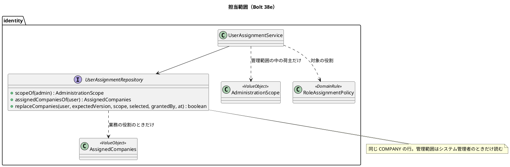
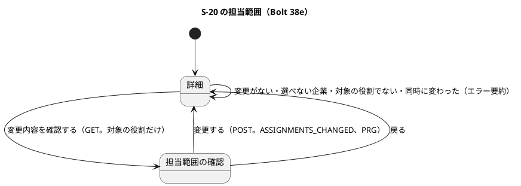
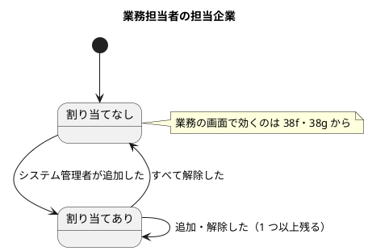

# Bolt 38e 計画 - 業務担当者の担当範囲（担当企業）の割り当て

## 基本情報

| 項目 | 内容 |
| :--- | :--- |
| Bolt | 第 38e 回（W6 の 30 本目。整合性検証の結果を受けて、受け渡しと範囲外の試行の記録のポートを 38f に送った。決定 (1)） |
| 予定 | W6（2026-11-09 の週。前倒しで着手できる）。38d2 の後に行う（38d の終了報告と 38d2 の計画は 2026-10-28 に承認済み。38d2 は `UiUsers`・`LoginUiSteps`・`login_ui.feature`・`manual_screenshots.feature` を変えるので、38e の #50 (a) と重なる。38d2 のコミットの後に行番号を引き直す）。作業は約 6.6 時間（395 分。`check`・`uiTest`・SonarQube・CI の待ちを除く）。development_strategy の目安（2〜4 時間）を超えるが、開始準備で分けないと決めた範囲から受け渡しとポートを外した残り。下の打ち切りで守る |
| アプローチ | インサイドアウト（release_plan :785。開発戦略 :346 の「新しい振る舞いはインサイドアウト」。S-20 の直しは :346 ではアウトサイドインだが、38e は割り当ての書き込みという新しい振る舞いを値とリポジトリから作るので、インサイドアウトにする）。割り当ての値とリポジトリ → サービス → S-20 の画面の順に縦に通す。受入シナリオは画面のステップで Red から入る |
| 対象 | (1) S-20 の詳細の「担当範囲」の領域（チェックボックスで選ぶ）と、担当範囲の変更の確認の画面（システム管理者が自分の管理範囲の中の有効な荷主の企業だけを割り当て・解除する）、(2) 監査（変更前・変更後の 1 行）、(3) 開発データの業務担当者への割り当て（dev だけのマイグレーション）、(4) #50 の 3 項目、(5) マニュアル 11 章とキャプチャ、axe、(6) 設計の文書、(7) 確認の画面の要約の共通部品（リファクタリング） |
| トレース | US-16 AC1（担当案件の関係と変更履歴。担当案件は担当企業で近似する。決定 (10)）・AC4（業務担当者の範囲外の拒否と試行の記録。38e は割り当てまで。受け渡し・記録のポート・拒否は 38f・38g）、BR-15（役割 × 操作表の対象範囲。決定 (10) で要件を変える）、IA-INV-02・IA-INV-14、W6 の確認ポイント 12・16・17・19、#14、#50 |
| GitHub | [#14](https://github.com/k2works/practical-domain-driven-design-in-enterpris-application/issues/14)（US-16 の残り。クローズは 38g）、[#50](https://github.com/k2works/practical-domain-driven-design-in-enterpris-application/issues/50)（3 項目を返す。終了報告の承認の後に書き足す） |
| SP | 0 |
| 承認ゲート | 計画と終了報告。**認可**（割り当てられるのは管理範囲の中の有効な荷主の企業だけ、対象の役割、同じ `COMPANY` の行の 2 つの意味の守り）、**開発データ（DB）**（dev だけのマイグレーション）、**画面**（S-20 の担当範囲の領域と確認の画面）、**構造**（確認の画面の要約の共通部品）、新しいファイル（下の一覧）。スキーマは変えない（決定 (6)・(9)） |
| ブランチ | develop で開発する。途中の push はデモ環境の配備になるので、push はステップ 9 でまとめる |
| 開始準備で決めたこと | 2026-10-28、human:kakimomokuri: (1) 【整合性検証の後に改めた】範囲は S-20 の割り当ての画面・監査・開発データ・マニュアル・#50 の 3 項目。`AuthenticatedActor` への担当企業の受け渡し（ADR-012 の改訂・古い session）と、範囲外の試行の記録のポート（ADR-019）は、最初に使う 38f に送る（先回りの実装を避けるため。38e では誰も使わず観測できない）。先の「分けない」を、整合性検証の結果で改めた、(2) 割り当ては担当企業（`COMPANY`）の単位。案件は入れない、(3) システム管理者が S-20 の詳細の「担当範囲」の領域で、自分の管理範囲の企業だけを割り当て・解除する、(4) 対象は業務の役割の利用者だけ（荷主担当者・システム管理者・監査担当者には出さない）、(5) 確認の領域を経て、変更前・変更後の 1 行の監査を書く（前例 `ROLES_CHANGED`）、(6) スキーマは変えない（既存の `user_assignment` を使う）、(7) 開発データの業務担当者に荷主 A・B を dev だけのマイグレーションで入れる（データベースの承認ゲート）、(8) #50 の 3 項目を扱う。応答時間の件は、手当てが大きければ受け入れとして記録する。整合性検証の後（同日）: (9) 同じ `COMPANY` の行の 2 つの意味（管理範囲と担当企業）は、スキーマを変えずに守る。担当企業は業務の役割を持つときだけ、管理範囲はシステム管理者のときだけ読む。運用の手順に「監督の役割と業務の役割を付け替えるときは、先に `COMPANY` の行を消す」を W10 の宿題として書く。この前提を data_model と domain_model に書く、(10) 担当案件は担当企業で近似する（パイロット）。US-16 と BR-15 に要件の変更として書く。対象の役割は営業担当者・経路設計者・追跡管理者・カスタマーサポート。データ責任者は対象に入れず W7 で決める。US-16 AC1 の「担当案件」はこの近似で閉じる、(11) 管理範囲の外の担当企業は「管理範囲の外の企業 N 社」と数だけ示す（名前を出さない）。選べるのは管理範囲の中の有効な荷主の企業だけ |

新しいファイル（計画の承認で確かめる。計 19 とキャプチャ 1）:

- マイグレーション（1）: `db/dev-data/V20261028100900__seed_dev_business_user_assignments.sql`（dev だけ。業務担当者 4 人に荷主 A・B を割り当てる。`DevDataLocationTest` が場所を守る）
- 本体（8）:
  - `identity/domain/model/valueobjects/AssignedCompanies.java`（担当企業。企業 ID の集合。`@ValueObject`。用語集「担当企業」。Javadoc は「担当企業。」で始める）
  - `identity/domain/model/valueobjects/AssignmentChangeRejection.java`（拒否: 対象の役割でない・変更がない・選べない企業を含む）
  - `identity/application/internal/commandservices/UserAssignmentService.java`（確かめと確定）、`AssignmentChangeCheck.java`・`AssignmentChangeOutcome.java`（前例 `RoleChangeCheck`・`RoleChangeOutcome`）
  - `identity/interfaces/web/UserAssignmentController.java`（確認と確定）
  - `templates/identity/users/assignment-confirmation.html`
  - `identity/interfaces/web/ConfirmationSummary.java`（確認の画面の要約の共通部品。`UserRegistrationPage.Summary` から寄せる。ステップ 3b のリファクタリング。名前はステップ 3b で既存の型を見て決める）
- テスト（10）:
  - `AssignedCompaniesTest`（valueobjects）
  - `UserAssignmentRepositoryContract`・`H2UserAssignmentRepositoryTest`・`MyBatisUserAssignmentRepositoryIntegrationTest`（persistence。前例 `UserStandingRepositoryContract`。実装は MyBatis だけなので persistence に置く）
  - `UserAssignmentServiceTest`・`UserAssignmentIntegrationTest`（同時の 2 つの変更）（commandservices）
  - `UserAssignmentControllerTest`（interfaces.web）
  - `UserAssignmentSecurityIntegrationTest`（infrastructure.security。`IdentitySpyIntegrationTestBase` を継ぐ）
  - `features/ui/manage_user_assignments_ui.feature`・`ui/UserAssignmentUiSteps.java`（前例は操作ごとに 1 つの feature）
- 資産（1）: `docs/manual/assets/11-assignment-confirmation.png`（新規）。`11-user-detail` は担当範囲の領域が加わるので撮り直す

## Bolt ゴール

システム管理者が S-20 の詳細の「担当範囲」の領域から、業務担当者に自分の管理範囲の中の荷主の企業を担当企業として割り当て・解除できる。割り当ては監査に残る。業務の側で担当企業が効く（絞り込みと拒否）のは 38f 以降。

### 開始準備で確かめたこと

| # | 事実 | 根拠 |
| :--- | :--- | :--- |
| 1 | release_plan の 38e の行は「担当範囲の割り当て（identity の側）」。アプローチはインサイドアウト、承認ゲートは認可・構造・開発データ（確認ポイント 16・17）。38f は見積り・予約、38g は経路設計・追跡の判定で、38g で #14 を閉じる | `release_plan.md:785-787` |
| 2 | 確認ポイント 16: 絞る役割は BR-15 の対象範囲が担当企業・担当案件の役割。システム管理者と監査担当者は今の管理範囲のまま。割り当てのない業務担当者は何も見えない（失敗に倒す）。開発データとデモの業務担当者に荷主 A・B を dev だけのマイグレーションで入れる | `release_plan.md:737` |
| 3 | 確認ポイント 17: 担当範囲は `SessionRevalidationService`（1 回の SQL）で読み `AuthenticatedActor` に載せる。範囲外は各コンテキストで 404。試行の記録は `shared` に置くポートを identity が実装する。38e ではこれらを作らず、38f に送る（決定 (1)） | `release_plan.md:738` |
| 4 | 確認ポイント 12: システム管理者の管理範囲の割り当ては画面にせず、W10 の運用タスクにする（アプリは管理範囲を書かない）。38e で書くのは担当企業だけで、管理範囲はこれまでどおりアプリで書かない | `release_plan.md:733`、`UserAssignmentRepository.java:7-8` |
| 5 | #14 の受入条件 AC1〜AC5 はすべて未チェック。38b4 の照合では、AC2・AC3 は済み、AC1 は担当案件の関係が 38e、AC4 は 38e〜38g、AC5 は役割の取消しのシナリオが 38g | `gh issue view 14`、`bolt_38b4_report.md` の US-16 の照合 |
| 6 | 表 `identity.user_assignment`（34b）は `user_id, scope_kind('COMPANY','BOOKING'), scope_id, granted_by(null 可), granted_at`、主キーは 3 つの列の組、`scope_id` に外部キーはない。業務担当者の割り当てにスキーマの変更は要らない | `V20261016180000__create_identity_user_assignment.sql:1-21` |
| 7 | `selectManagedCompanies`（`scopeOf`）は `user_id` と `scope_kind='COMPANY'` だけで読み、役割で絞らない。`ManagedUserLookup` は役割が `SYSTEM_ADMIN` かを見てから、同じ行を管理範囲として読む。画面では職務分離（`RoleAssignmentPolicy`）で業務の役割と監督の役割を同時に持てないが、運用の手順で付け替えると、残った行がもう一方の意味になる（権限の昇格）。決定 (9) で守る | `IdentityMapper.xml:190`、`ManagedUserLookup.java:39-47`、`RoleAssignmentPolicy.java:24-33` |
| 8 | 開発データの割り当てはシステム管理者 `...0304` の A 社（`...0003`。運用会社）・荷主 A（`...0001`）の 2 行だけ。荷主 B（`...0002`）は範囲外のまま残している。業務担当者の dev の利用者は SALES `...0301`・ROUTE_DESIGNER `...0302`・TRACKING_MANAGER `...0303`・CUSTOMER_SUPPORT `...0305`。データ責任者の dev の利用者はいない | `V20261016180900__seed_dev_system_admin_scope.sql`、`V20261006140900__seed_dev_users.sql` |
| 9 | 前例の役割の変更は、詳細の画面のチェックボックスで選び、`GET …/role-changes/confirmation?roles=…&version=…` で確認、POST で確定する。規則の拒否は詳細の画面にエラー要約で示す（`UserDetailPage.Section`）。版を条件にした更新は `UserRepository.changeRoles(user, expectedVersion, …)` にある | `detail.html:42-64`、`UserRoleChangeController.java:30-33,104-123`、`UserRepository.java:50`、ui_design :181-183 |
| 10 | Stale の前例の文は「この利用者の情報が先に更新されました。最新の内容を確かめてから、もう一度変更してください。」 | `UserDetailPage.java:43-44`、ui_design :183・:1274・:1359 |
| 11 | 共通の確認の領域は ui_design の :1489（節）と :1707（表） | `ui_design.md:1489・1707` |
| 12 | 登録できる企業の照会（`registrableCompany`）は、範囲の外の企業を状態によらず範囲外として返し、名前を出さない | `UserAdministrationQueryService` |
| 13 | BR-15 の対象範囲: 営業担当者・カスタマーサポートは担当企業・担当案件、経路設計者・追跡管理者は担当案件、データ責任者は承認済み情報源と担当案件、システム管理者は管理対象企業、監査担当者は許可された企業・期間。決定 (10) で担当案件を担当企業で近似する | `system_usecase.md:353-362` |
| 14 | #50 の 3 項目（34b の既知の課題）: (a) テストの準備でシステム管理者を作ると割り当てが自動で入る（`UserAdministrationSecurityIntegrationTest`・`UiUsers.create`）。作る順序に依存し準備が見えにくい。`UiUsers.create` は役割・状態・資格・登録の UI シナリオすべてが使う、(b) 照会の `list`・`registrableCompanies` は管理者でないと空、`detail` は 403 で扱いがそろっていない（URL の規則で先に 403 になり利用者には見えない）、(c) 確定の POST は範囲外のときだけ監査を書く（INSERT と 1 つのトランザクション）ので応答の時間が少し違う（CSRF で守られた管理者の操作に限る）。読み出しの量の差ではない | `bolt_34b_report.md:97-103`、#50 :27 |
| 15 | マニュアル 11 章に担当範囲の記述はない。ui_design は S-20 の目的に「担当範囲を管理する」とあるだけ | grep（11 章、`ui_design.md:145`） |
| 16 | `audit_record.action` に CHECK はなく、`ASSIGNMENTS_CHANGED` はスキーマを変えずに足せる。`before_state`・`after_state` は `VARCHAR(4000)`（UUID と `,` で約 108 社まで） | `V20261006140000__create_identity_users.sql:55` |
| 17 | `UserDetail` を作る箇所は 7 ファイル・16 か所 | grep |

## 設計の決定（案）

| 項目 | 決定 | 根拠 |
| :--- | :--- | :--- |
| 担当企業の値 | `AssignedCompanies`（企業 ID の集合。空を許す。`valueobjects`、`@ValueObject`）。割り当ては `user_assignment` の `COMPANY` の行で、システム管理者の管理範囲（`AdministrationScope`）と同じ行の形を使うが、型は分ける（意味が違う: 管理範囲は「管理できる企業」、担当企業は「業務で扱える企業」） | 決定 (2)・(6)・(9)、IA-INV-02・IA-INV-14 |
| 同じ行の 2 つの意味の守り | 担当企業は利用者が業務の役割を持つときだけ読み（`assignedCompaniesOf` は対象の役割でない利用者に空を返す）、管理範囲はシステム管理者のときだけ読む（今の `ManagedUserLookup`）。運用の手順（W10）に「監督の役割と業務の役割を付け替えるときは、先に `COMPANY` の行を消す」を宿題として書く。前提を data_model の `user_assignment` と domain_model の IA-INV-02・IA-INV-14 に書く。変異 V11 で守る | 決定 (9)、事実 7 |
| 対象の役割 | 営業担当者（`SALES`）・経路設計者（`ROUTE_DESIGNER`）・追跡管理者（`TRACKING_MANAGER`）・カスタマーサポート（`CUSTOMER_SUPPORT`）を 1 つでも持つ利用者。データ責任者・荷主担当者・システム管理者・監査担当者だけの利用者には領域を出さない。どの役割を絞るかは identity の `RoleAssignmentPolicy` だけに置く（判定の写しを作らない。Bolt 34 の指摘） | 決定 (4)・(10)、BR-15 |
| 選べる企業 | 操作者の管理範囲の中の、有効な荷主（`CompanyKind.SHIPPER`）の企業だけ。運用会社・荷受人・無効な企業は選べない | 決定 (11) |
| リポジトリ | `UserAssignmentRepository` に `assignedCompaniesOf(UserId)` と `replaceCompanies(UserId, long expectedVersion, AdministrationScope scope, AssignedCompanies selected, UserId grantedBy, UtcInstant at) : boolean` を足す。最初に `app_user.version` を条件にした UPDATE で版を上げ（行がロックされる。0 件なら false で Stale）、その後トランザクションの中で今の割り当てを読み、管理範囲の中の差（消す行と足す行）だけを書く。変わらない行の `granted_at`・`granted_by` は残す。DELETE は `scope_kind='COMPANY'` を条件にする。契約テストは前例 `UserStandingRepositoryContract` にならい H2・PostgreSQL の子を持ち、準備に `BOOKING` の行を入れる（T-214） | 決定 (5)・(6)、前例 Bolt 34、検証 H-2 |
| サービス | `UserAssignmentService`（確かめ `check` と確定 `change`）。順は前例 `UserRoleChangeService`: 操作者 → `ManagedUserLookup`（範囲外は 404 で、確定でだけ `ADMIN_SCOPE_DENIED`）→ 規則（対象の役割か）→ 選んだ企業が選べる企業か → 変更があるか → 版 → 監査。1 つのトランザクションで割り当てと監査を書く | 決定 (3)・(5)、IA-INV-14 |
| 監査 | `ASSIGNMENTS_CHANGED`（target は種類 `USER`・ID・版、`before_state`・`after_state` は管理範囲の外を含む担当企業の全体を、企業 ID の昇順に `,` でつないだ一覧、`reason` は空）。表示名は監査に残さない（企業名は変わりうる）。上限は約 108 社（`VARCHAR(4000)`）で、パイロットの規模では受け入れる | 決定 (5)、前例 `ROLES_CHANGED`（`AuditRecord.java:208-224`） |
| S-20 の領域 | 詳細に h2「担当範囲」。対象の役割の利用者には、選べる企業をチェックボックスで並べて今の割り当てに印を付け、「変更内容を確認する」で `GET …/assignment-changes/confirmation?companies=…&version=…` に進む（前例の役割の変更と同じ形）。管理範囲の外の担当企業は「管理範囲の外の企業 N 社」と数だけ示す（前例 `keptRoles` の注の形）。割り当てた企業が見つからないときも数に含める | 決定 (3)・(4)・(11)、検証 H-3 |
| 確認の画面 | `GET /staff/users/{id}/assignment-changes/confirmation?companies=…&version=…`（確認）と `POST` 同じ URL（確定）。確認の領域は共通部品（対象・現在の状態・変更内容・影響・回復手段・実行者。ui_design :1489・:1707）。規則の拒否（対象の役割でない・変更がない・選べない企業）と Stale は、詳細の画面のエラー要約で示す（`Section.ASSIGNMENTS`）。範囲外は 404、確定の POST でだけ `ADMIN_SCOPE_DENIED` を残し、値は範囲の判定の後に解釈する。値の形の誤り（UUID でない、重複、版が数でない）は 400（前例 ui_design :182） | 前例 Bolt 34、ui_design :181-183 |
| 確認の画面の要約の共通部品 | 3 つ目の確認の画面になるので、`UserRegistrationPage.Summary` を共通の部品に寄せる。機能の追加と混ぜず、ステップ 3b でリファクタリングとして先にコミットする（38c の報告の開発レビューの低の行） | `bolt_38c_report.md:114` |
| #50 の 3 項目 | (a) テストの準備で割り当てを明示する補助（`UiUsers.assign`・統合テストの `assign`）に置き換え、自動で入る形をやめる。`UiUsers.create` を使う UI のシナリオすべてに響くので、38d2 のコミットの後に引き直す。(b) 照会の `list`・`registrableCompanies` と `detail` を、管理者でない操作者には同じ拒否（前例どおり URL の規則の 403）にそろえ、サービスの側も同じ例外にする。(c) 差は範囲外のときの監査の書き込み（INSERT）で、読み出しの量の差ではない。範囲内でも書く形は監査の意味を変えるので、受け入れとして記録する（決定 (8)） | 決定 (8)、事実 14 |
| 開発データ | `db/dev-data/V20261028100900__seed_dev_business_user_assignments.sql`: 業務担当者 4 人（`...0301`・`...0302`・`...0303`・`...0305`）に荷主 A（`...0001`）・荷主 B（`...0002`）を `COMPANY` で割り当てる（`granted_by` は空。運用の手順の扱い）。開発のシステム管理者 `...0304` の管理範囲は荷主 B を含まないので、画面では荷主 B は「管理範囲の外の企業 1 社」と示され、変えられない。開発の利用者は「割り当てなし」に戻せない（デモの筋書きにこの制約を書く） | 決定 (7)、確認ポイント 16 |
| 確認ポイント 19 | 停止の確認の領域に「この利用者の担当企業」を示すことは、38g に送る（release_plan の 38g の行に書く。38f の開始準備で決めた） | release_plan :739 |
| 動画 | 撮らない。範囲外の拒否が見える 38f2 に送る（development_strategy :185 と release_plan :797 を直す。38f の開始準備で 38f と 38f2 に分けた） | 決定 (1) |

### 受入条件（行と 1:1）

| # | 受入条件 | 行 |
| :--- | :--- | :--- |
| AC-1 | 対象の役割の利用者の詳細に、担当範囲の領域（選べる企業のチェックボックスと今の割り当て、管理範囲の外の企業の数）が出る。対象外の役割には出ない | 1・2 |
| AC-2 | 詳細で選んで確認に進み、確定すると、割り当てが変わり、版が上がり、監査 `ASSIGNMENTS_CHANGED` が 1 行（変更前・変更後）書かれる。変わらない行はそのまま | 3・4 |
| AC-3 | 選べない企業（管理範囲の外・荷主でない・無効）は選べず、送られても拒む。管理範囲の外の割り当ては残る | 5・6・6b |
| AC-4 | 変更がない・対象の役割でない・同時に変わったときは何も書かず、詳細に理由を示す | 7・8・9 |
| AC-5 | 範囲外の利用者の確認は 404 で記録せず、確定は値の誤りによらず 404 で試行を 1 行。範囲の中の値の形の誤りは 400（T-211） | 10・10b |
| AC-6 | 同じ `COMPANY` の行は、業務の役割のときだけ担当企業として読み、システム管理者の管理範囲は今のまま | 11 |
| AC-7 | #50 の 3 項目が返される（準備の明示、`list`・`registrableCompanies` と `detail` の扱い、応答時間の受け入れ） | 12・13 |
| AC-8 | UI の通し（選んで確認・確定、範囲外の数、幅 320 px、axe の違反 0） | 14 |

### 文言（全文）

| 場面 | 文言 |
| :--- | :--- |
| 詳細の領域の見出し | 担当範囲 |
| 選び方の欄の表示名 | 担当企業 |
| 担当企業（なし）の案内 | 担当企業はまだありません。担当企業は、業務の画面で扱える企業を絞るために使います（業務の画面で効くのは、今後の更新からです）。 |
| この画面で変えられない担当企業（【開発レビューの後に改めた】管理範囲の外の企業と、管理範囲の中でも無効になった荷主など。2026-10-28、human:kakimomokuri） | この画面で変えられない企業 {N} 社も担当しています。 |
| 担当企業にできる荷主の企業が管理範囲にない（【開発レビューの後に足した】選択肢と確認の操作を出さない） | あなたの管理範囲には、担当企業にできる荷主の企業がありません。 |
| 操作のボタン（【開発レビューの後に改めた】役割の領域のボタンと名前で見分ける） | 担当範囲の変更内容を確認する |
| 確認の見出しとボタン | 担当範囲を変更しますか ／ 「変更する」「戻る」 |
| 確認の領域 | 対象、現在の状態「担当企業: {企業名}、…（この画面で変えられない企業 {N} 社）」、変更内容「追加: {企業名}、…／解除: {企業名}、…」、影響「この利用者の担当企業が変わります。業務の画面で効くのは、今後の更新からです。」、回復手段「もう一度変更すれば戻せます。」、実行者 |
| 詳細のエラー要約の見出し | 担当範囲を変更できませんでした |
| 変更がない | 担当企業: 今の割り当てから変わっていません。 |
| 選べない企業を送られた | 担当企業: 選べない企業が含まれています。詳細を開き直してください。 |
| 対象の役割でない | この利用者の役割には、担当範囲がありません。 |
| 同時に変わった | この利用者の情報が先に更新されました。最新の内容を確かめてから、もう一度変更してください。（前例の Stale の文。`UserDetailPage.STALE_MESSAGE`） |
| 完了の知らせ | 担当範囲を変更しました。 |

「業務の画面で効くのは、今後の更新からです」は 38f・38g で業務の側の絞り込みが入るまでの文で、38g で外す（38f・38g の T-122 に書く）。マニュアル 11 章も同じく「38f 以降で効く」ことが分かる書き方にする。

### 既存の期待を変える箇所（T-122）

- `UserAssignmentRepository.java:7-14` の Javadoc を分けて書き直す: 「担当企業は S-20 で書く（Bolt 38e）。管理範囲は運用の手順だけで書く（W10。確認ポイント 12）」
- `MyBatisUserAssignmentRepository` の Javadoc（「`COMPANY` の行だけを読む（`BOOKING` は W6）」）
- `UserDetail` の 16 か所（7 ファイル）と `MyBatisIdentityRepositoriesIntegrationTest` の詳細
- `UserRegistrationPage.Summary` を使う箇所（ステップ 3b）
- ui_design :145（S-20 の目的）・S-20 の salt 図と文言の表・URL の表（:181-184）・遷移図、:1489・:1707 の共通の確認の領域の一覧
- domain_model の IA-INV-02（「W6」）・IA-INV-14・用語集（「担当企業」。データモデルの表の名前「担当範囲」と区別する。:261-262）・監査の操作の表・:1357 の利用者の集約の表（担当企業は集約の外のリポジトリで持つ）
- data_model の `user_assignment`（「W6」の注、同じ行の 2 つの意味の前提）と監査の値の決まり
- non_functional の PERF-01・02 の注（:67。詳細の照会に担当企業の読み出しが加わる）、SEC の関係する行
- user_story の US-16（38e の決定の段落、担当案件の近似）
- `system_usecase.md` の BR-15（担当案件を担当企業で近似する注）
- architecture_backend :323 付近（S-20 の controller の一覧）
- マニュアル 11 章（章の頭の画面の表、11.2）
- release_plan :785（38e の行）・:786（38f の行）・:797（動画の Bolt）、確認ポイント 16 の文（BR-15 の要約）
- development_strategy :185（動画の Bolt）
- テストの準備で割り当てが自動で入る箇所（`UserAdministrationSecurityIntegrationTest`・`UiUsers`）
- 受け渡しの分（`AuthenticatedActor` の 3 か所の作り方とテストの 37 か所、`CargoUserDetails`、ADR-012 :153、domain_model :1183、`WithAuthenticatedActorSecurityContextFactory`）は 38f に送る

## ふりかえりと前の Bolt からの引き継ぎ

| 出典 | 内容 | この Bolt での扱い |
| :--- | :--- | :--- |
| Bolt 38d Try T-217 | テストを先に書いたら、本体を直す前に Gradle で Red を流し、落ちた理由を記録する | ステップ 2〜6 とレビューの直しの指示に、禁止事項と同じ欄に書く |
| T-204 | heredoc と標準入力を待つコマンドを使わない | フォークの指示の禁止事項に書く |
| Bolt 38c2 Try T-216 | 履歴から今の状態を読む行は、打ち消す操作の後の場面を置く | 割り当ての解除の後に追加し直す行（行 4） |
| Bolt 38c Try T-214・T-215 | 変異の対象に契約テストを入れる。Gradle を流す担当を 1 つにする | 変異の対象に契約の H2・PostgreSQL の子。変異とゲートは 1 つの担当 |
| Bolt 38c2 の議題 4 | 監査記録のリポジトリの照会の口の分離（US-17 の開始準備で諮る） | 今回は照会を足さない（書くだけ）ので影響しない |
| 38d の既知の課題 | エラー要約の二重の読み上げ・chromium だけ、ACC-06 | 新しい確認の画面も今の共通の形にそろえる（残す） |
| 38c の開発レビューの低の行 | 確認の画面の要約の共通部品（3 つ目で寄せる） | ステップ 3b でリファクタリングとして寄せる |
| 38d2（承認済み・実装中） | `UiUsers`・`LoginUiSteps`・`login_ui.feature`・`manual_screenshots.feature` を変える | 38d2 のコミットの後に引き直す |

## 状態の組み合わせ（行ごとにテストを 1 本。T-182）

| 行 | 状況 | 期待 | 出口 | 確かめ方 |
| :--- | :--- | :--- | :--- | :--- |
| 1 | 対象の役割の利用者の詳細（担当企業あり・なし・管理範囲の外を含む、停止中を含む） | 領域の全文、選べる企業のチェックボックス、管理範囲の外の企業の数、「変更内容を確認する」 | 確認の画面 | `UserAdministrationControllerTest` |
| 2 | 対象外の役割（データ責任者・荷主・システム管理者・監査担当者だけ）の詳細 | 領域を出さない | 詳細のほかの領域 | 同上 |
| 3 | 管理範囲の企業を追加・解除して確定 | 割り当てが変わり、版が上がり、監査が 1 行（変更前・変更後の全文）、詳細へ PRG と知らせ | 詳細 | `UserAssignmentServiceTest`・`UserAssignmentIntegrationTest`・`UserAssignmentSecurityIntegrationTest` |
| 4 | 解除した企業を後で追加し直す（T-216）。変わらない行がある | 追加し直した行の `granted_at`・`granted_by` は新しい値、変わらない行はそのまま。監査は 2 行 | 詳細 | 契約（H2・PostgreSQL）、`UserAssignmentIntegrationTest` |
| 5 | 選べない企業（管理範囲の外・運用会社・荷受人・無効）の ID を送られた（同値クラスをパラメーター化） | 何も書かず、詳細にエラー要約 | 詳細 | `UserAssignmentServiceTest`・`UserAssignmentSecurityIntegrationTest` |
| 6 | 管理範囲の外の割り当てがある利用者を変更した | 管理範囲の外の割り当ては残る（差は範囲の中だけ）。監査の一覧は全体 | 詳細 | 契約、`UserAssignmentIntegrationTest` |
| 6b | 同じ利用者に `BOOKING` の行がある（解除する企業と同じ `scope_id` を含む。開発レビューの後に V13 のため準備を改めた） | `COMPANY` の差だけを書き、`BOOKING` の行は残る | 詳細 | 契約 |
| 6c | 管理範囲の中で無効になった荷主を担当している（開発レビューの後に足した） | 選択肢に出さず、この画面で変えられない企業の数に入れる | 詳細（運用の窓口へ） | `UserAdministrationControllerTest` |
| 6d | 操作者の管理範囲に担当企業にできる荷主の企業がない（開発レビューの後に足した） | 理由を一文で示し、選択肢も確認の操作も出さない | 詳細のほかの領域 | `UserAdministrationControllerTest` |
| 6e | すべて解除して確認へ進み「戻る」（開発レビューの後に足した） | 印を外したまま詳細に戻る（選んだことを印 `companiesChosen` で渡す） | 詳細 | `UserAssignmentControllerTest`・`UserAdministrationControllerTest` |
| 7 | 変更がない | 何も書かず、詳細にエラー要約 | 詳細 | `UserAssignmentServiceTest`・`UserAssignmentControllerTest` |
| 8 | 対象の役割でない利用者の確認・確定の URL を直接 GET・POST した（画面からは来ない。運用の手順で役割が変わった場合も同じ） | 何も書かず、詳細に理由 | 詳細 | `UserAssignmentServiceTest`・`UserAssignmentSecurityIntegrationTest` |
| 9 | 同時の 2 つの変更（担当範囲どうし、担当範囲と役割の変更） | 1 つだけが書き、後は Stale（同じ利用者の版を使う） | 詳細（開き直す） | `UserAssignmentIntegrationTest` |
| 10 | 範囲外の利用者 × 誤った値（T-211。版の誤り・企業 ID の誤り・範囲の外の企業 ID・変更なしをパラメーター化） | 確認は 404 で記録しない、確定は値の誤りによらず 404 で試行を 1 行 | 共通の 404 | `UserAssignmentSecurityIntegrationTest` |
| 10b | 範囲の中の利用者 × 値の形の誤り（UUID でない、重複、版が数でない） | 400、何も書かない | 共通の 400 | `UserAssignmentControllerTest` |
| 11 | 同じ `COMPANY` の行の 2 つの意味 | 対象の役割でない利用者（システム管理者）の `assignedCompaniesOf` は空。システム管理者の管理範囲は今のまま | — | 契約（H2・PostgreSQL）、既存の `ManagedUserLookup` のテスト |
| 12 | #50 (a) テストの準備 | 割り当ては明示の補助で入り、管理者を作っただけでは入らない | — | `UserAssignmentIntegrationTest` の準備の補助のテスト（既存の統合テストと UI テストは緑のまま） |
| 13 | #50 (b) 管理者でない操作者の `list`・`registrableCompanies`・`detail` | どれも同じ拒否 | 403 | `UserAdministrationQueryServiceTest` |
| 14 | UI の通し | 選んで確認・確定、範囲外の数、幅 320 px、axe の違反 0 | — | `manage_user_assignments_ui.feature` |

#50 (c) は受け入れとして終了報告に書く（テストの行を持たない）。

## 38f に送るもの

開始準備の決定 (1) で、次を 38f（担当企業で絞り拒む最初の Bolt）に送る。release_plan の 38f の行に書く。

- `AuthenticatedActor` への担当企業の受け渡し（`SessionRevalidationService` の 1 回の SQL。`selectUserStanding` に LEFT JOIN すると役割 × 企業の行になるので、`scope_kind` を ON 句に置き、写すときに重なりを除く。契約の H2・PostgreSQL で確かめる）
- ADR-012 の改訂と古い session。【前の決定の変更】として書く（release_plan :738 は「配備で古い session を捨てる手順を ADR に書く」、ADR-012 :153 は「`CargoUserDetails` の項目の変更で復元できなくなる」、domain_model :1183 は「`CargoUserDetails` に項目を足さない」）。JDK の直列化ではフィールドを足すのは互換で、古い session では null になる。持つ型は `UUID` の集合にする（`CompanyId` は `Serializable` でない record）。`transient` の項目にする案と比べる（request ごとに作り直すので、直列化の形を変えずに済む）。古い session のバイト列はクラスを変える前にテストの資源（Base64）として残す。既存の `SpringSessionRows` を使う
- 範囲外の試行の記録のポートと ADR-019（名前は `019-out-of-scope-attempt-recorder.md` など。ADR の index の更新も）。引き継ぐ論点:
  - トランザクションの約束: 前例 `AdministrationScopeDenialService` は外側のトランザクションの中で呼ぶと例外にし、自分のトランザクションで書く。業務の側が 404 でロールバックしても記録が残るよう、呼んでよい場所と自分のトランザクションを ADR とポートの Javadoc に書く。GET で記録するか（SEC-12 の前例は GET では記録しない）
  - 置き場所: 共有カーネルに初めて振る舞いのあるポートを置くことになる（ADR-003 :58 は共有カーネルに `DomainEvent` を置かなかった）。ポートは `shared.domain`、実装は `commandservices` か `identity.interfaces.api.internal` のアダプターか（CLAUDE.md のインバウンドの置き場所）を人に諮る。package-info と ADR-001・ADR-003 への影響。38f の呼ぶ側の置き場所（ACL を通すか）
  - 用語: 「管理範囲の外の試行」（`ADMIN_SCOPE_DENIED`）と「担当範囲の外の試行」（`OUT_OF_SCOPE_DENIED`）に分け、用語集に載せる。`resourceKind` を文字列で受けず種類を値で固定するか（`target_type` は `VARCHAR(50)`。長さの境界）
  - ArchUnit: `OUT_OF_SCOPE_DENIED` の工場はポートの実装だけが呼ぶ（書き手を 1 か所にする。前例 T-205）
  - 判定のメソッド: `AuthenticatedActor` に閉じた答えを返す判定（例: `handlesCompany(CompanyId)`）を置き、各コンテキストに「空なら全件」の判定を写さない（失敗に倒す）
- 変異: `revalidate` で担当企業を載せない、古い session の null を空にしない、記録のポートで監査を書かない、ポートが外側のトランザクションに合流する（V17）
- 確認ポイント 19（停止の確認の領域に担当企業を示す）は 38g に、動画は 38f2 に送る（38f の開始準備で決めた）
- 38e の文言の「業務の画面で効くのは、今後の更新からです」を外すのは、業務の側の絞り込みがそろう 38g

## スコープ

### 入れるもの

- 行 1〜14 のテスト、`AssignedCompanies`・`AssignmentChangeRejection`、`User` の対象の役割の判定（`RoleAssignmentPolicy`）、`UserAssignmentRepository` の 2 つの口と mapper（XML）と契約テスト（H2・PostgreSQL）、`UserAssignmentService` と結果 2 つ、`AuditAction.ASSIGNMENTS_CHANGED` と `AuditRecord` の工場、`UserDetail` の担当企業、`UserDetailPage` の `Section.ASSIGNMENTS` と領域、`UserAssignmentController`・テンプレート、`UserAdministrationLabels` の表示、組み立て（`IdentityConfiguration`）
- 確認の画面の要約の共通部品（ステップ 3b のリファクタリング）
- 開発データのマイグレーション、#50 の 3 項目
- マニュアル 11 章（章の頭の表、11.2 の担当範囲の領域、新しい節「担当範囲の変更」）、キャプチャ 2 枚
- 設計の文書（T-126）: ui_design、domain_model、data_model、architecture_backend、non_functional、test_strategy、user_story、system_usecase（BR-15）、release_plan（38e・38f の行、:797、確認ポイント 16）、development_strategy（:185）。運用の手順の宿題（W10）は operation に書く

### 入れないもの

- 上の「38f に送るもの」
- 業務の側（quotation・booking・routing・tracking）の絞り込みと 404（38f・38g）
- 担当案件（`BOOKING`）の割り当て（決定 (2)・(10)）
- データ責任者の担当範囲（W7。決定 (10)）
- 監査担当者の「許可された企業・期間」（US-17）
- 割り当ての一括の操作、CSV の取り込み

## 設計（この Bolt の範囲）

- ER 図: 表と列を変えないので省く（`user_assignment` の `COMPANY` の行を業務担当者にも使う）

## ステップ計画

各ステップで、テストを先に書いたら、本体を直す前に Gradle で Red を流し、落ちた理由を記録する（T-217）。

- [ ] **1. 設計の文書**（T-126 の範囲。完了の判定: 文書の差分、`grep` で「割り当ての画面は W6」が残らず、確認ポイント 12 の「管理範囲はアプリで書かない」は残る）
- [ ] **2. 値・規則・リポジトリ（Red → Green）**: `AssignedCompanies`、対象の役割、2 つの口と mapper と契約テスト（行 4・6・6b・11、H2・PostgreSQL）、監査の工場
- [ ] **3. サービス（Red → Green）**: 行 3〜9
- [ ] **3b. 確認の画面の要約の共通部品（リファクタリング。緑のまま）**: 先にコミットする
- [ ] **4. 画面と受入（Red → Green）**: 受入シナリオの Red（詳細に担当範囲の領域がない）、行 1・2・5・7・8・10・10b・14、`spotbugsMain`（T-213）
- 打ち切り: ステップ 4 を終えた時点で経過が 300 分を超えていたら、#50 の 3 項目（ステップ 5 の後半）を後の Bolt に送る形を諮る（開発データは残す）
- [ ] **5. 開発データと #50 の 3 項目**: マイグレーション（`DevDataLocationTest`）、行 12・13、(c) の受け入れの記録
- [ ] **6. マニュアル・キャプチャ**: 11 章、`manualScreenshots`（ほかの撮り直しの差分は戻す。T-197 の突き合わせ）
- [ ] **7. 品質ゲートと開発レビュー**: 変異、`check`・`uiTest`、その後に SonarQube、開発レビューとその直し
- [ ] **8. 終了報告**
- [ ] **9. 配備**: develop に push して CI（check・ui・deploy-demo）を確かめ、デモ環境の版を見る

### 時間の配分と打ち切り

| # | 目安 | 打ち切り |
| :--- | :--- | :--- |
| 1 | 60 分 | — |
| 2 | 70 分 | 契約テストが 70 分で H2・PostgreSQL の両方で緑にならなければ、報告に書いて進む |
| 3 | 50 分 | — |
| 3b | 20 分 | 20 分で寄せられなければ、寄せずに 3 つ目を写し、既知の課題に書く |
| 4 | 90 分 | ステップ 4 の後の判断（上。経過 290 分の見込みに対して 300 分） |
| 5 | 40 分 | #50 (c) は受け入れとして記録する（決定 (8)） |
| 6 | 30 分 | — |
| 7 | 25 分（待ちを除く。レビューの直しを含む） | — |
| 8・9 | 10 分（CI の待ちを除く） | — |

合計 395 分（約 6.6 時間）。ステップ 1〜4 で 290 分。

## 確認ポイント（計画の承認の場でまとめて確認する。Try T-6）

| # | 確認すること | 場所 | 推奨 |
| :--- | :--- | :--- | :--- |
| 1 | **認可（割り当て）** | 設計の決定 | 割り当てられるのは操作者の管理範囲の中の有効な荷主の企業だけ。管理範囲の外の割り当ては数だけ示し変えない。対象は業務の 4 つの役割の利用者だけ |
| 2 | **認可（同じ行の 2 つの意味）** | 設計の決定 | スキーマを変えずに、担当企業は業務の役割のときだけ、管理範囲はシステム管理者のときだけ読む。付け替えの手順は W10 の宿題（決定 (9)） |
| 3 | **同時の変更の判定** | 設計の決定 | 利用者の版（`app_user.version`）を条件にした更新を先に流し、担当範囲の変更でも版を上げる（役割の変更と同じ版を使うので、片方の変更でもう片方が Stale になる。受け入れる） |
| 4 | **監査** | 設計の決定 | `ASSIGNMENTS_CHANGED`（変更前・変更後は管理範囲の外を含む全体を企業 ID の昇順の一覧。上限約 108 社を受け入れる） |
| 5 | **画面の形と文言** | 設計の決定・文言の表 | 前例の役割の変更と同じく、詳細で選んで GET の確認、POST の確定。拒否は詳細にエラー要約。文言の全文（「業務の画面で効くのは、今後の更新からです」を 38g まで置く） |
| 6 | **確認の画面の要約の共通部品（構造）** | 設計の決定 | 3 つ目の確認の画面なので、ステップ 3b でリファクタリングとして寄せる |
| 7 | **開発データ** | 設計の決定 | 業務担当者 4 人に荷主 A・B を dev だけのマイグレーションで入れる。開発のシステム管理者は荷主 B を管理しないので「管理範囲の外の企業 1 社」と示され、開発の利用者は「割り当てなし」に戻せない |
| 8 | **38f に送るもの** | 38f に送るもの | 受け渡し・ADR-012 の改訂・記録のポートと ADR-019 を 38f に、動画を 38f2 に、確認ポイント 19 を 38g に送る（決定 (1)。送り先は 38f の開始準備で決めた）。38f は 38e の割り当てを前提にする |
| 9 | **#50 (c)** | 設計の決定 | 差は監査の書き込みで、範囲内でも書く形は監査の意味を変えるので、受け入れとして記録する |
| 10 | **新しいファイル** | 一覧 | 19 とキャプチャ 1 |
| 11 | **大きさ** | 時間の配分 | 約 6.6 時間（目安を超える）。ステップ 4 の後で #50 の 3 項目を送る判断をする |
| 12 | **変異** | 下の表 | 13 個。スクリプトはバイトのまま読み書きし、gradlew.bat を絶対パスで呼び、結果の XML を消してから流す。対象に契約の H2・PostgreSQL の子を入れる（T-214） |

### 変異と落ちる見込みのテスト

| # | 変異 | 落ちる見込み | 流すタスク |
| :--- | :--- | :--- | :--- |
| V1 | 選べない企業を選べる（範囲・種類の確かめを外す） | 行 5 | `test`（`UserAssignmentServiceTest`・`UserAssignmentSecurityIntegrationTest`） |
| V2 | 管理範囲の外の割り当ても消す（差を範囲の中に限らない） | 行 6 | `test`（契約の子、`UserAssignmentIntegrationTest`） |
| V3 | 対象外の役割にも領域を出す | 行 2 | `test`（`UserAdministrationControllerTest`） |
| V4 | 版を確かめない | 行 9 | `test`（`UserAssignmentIntegrationTest`） |
| V5 | 監査を書かない | 行 3 | `test`（`UserAssignmentIntegrationTest`） |
| V6 | 変更がなくても書く | 行 7 | `test`（`UserAssignmentServiceTest`） |
| V7 | 確定で範囲の判定より先に値を解釈する | 行 10 | `test`（`UserAssignmentSecurityIntegrationTest`） |
| V11 | システム管理者の行を担当企業として読む（`assignedCompaniesOf` で役割を見ない） | 行 11 | `test`（契約の子） |
| V12 | 全部を消して入れ直す（差だけを書かない） | 行 4 | `test`（契約の子） |
| V13 | DELETE に `scope_kind='COMPANY'` の条件がない | 行 6b | `test`（契約の子） |
| V14 | サービスが対象の役割を確かめない | 行 8 | `test`（`UserAssignmentServiceTest`・`UserAssignmentSecurityIntegrationTest`） |
| V15 | 変更しても版を上げない | 行 9（担当範囲の後の役割の変更が Stale にならない） | `test`（`UserAssignmentIntegrationTest`） |
| V16 | 監査の `before`・`after` を並べない | 行 3 | `test`（`UserAssignmentServiceTest`） |

V8〜V10・V17 は 38f に送る（受け渡しとポート）。

## 完了条件

- [ ] 上のステップ 1〜9 の完了の判定を満たす
- [ ] 行 1〜14（6b・10b を含む）に、それを名乗るテストがある
- [ ] `check`・`uiTest` が緑、SonarQube が PASS（重複 3% 未満）、CI が緑、デモ環境が新しい版で動く
- [ ] マニュアル 11 章とキャプチャが実装と合う（T-197）
- [ ] 終了報告が承認される

### US-16 と #14 の照合（38e の時点）

| 受入条件 | 38e で満たすもの | 後に残すもの |
| :--- | :--- | :--- |
| AC1（固定役割の付与と関係・変更履歴） | 担当企業の割り当てと変更履歴（`ASSIGNMENTS_CHANGED`）。担当案件は担当企業で近似する（決定 (10)） | — |
| AC4（業務担当者の担当範囲の外の拒否と試行の記録） | 担当企業の割り当て | 受け渡し・記録のポート・業務の側の拒否と記録の呼び出し（38f・38g） |
| AC5（利用終了・取消しで次の request から拒否） | — | 役割の取消しのシナリオ（38g） |

## 更新履歴

| 日付 | 更新内容 | 更新者 |
| :--- | :--- | :--- |
| 2026-10-28 | 計画を承認した（確認ポイントを推奨のとおり）。確認ポイント 19 の送り先を 38g に、動画を 38f2 に直した | anthropic/claude-opus-5-5、承認 human:kakimomokuri |
| 2026-10-28 | 整合性検証の指摘を反映し、受け渡しとポートを 38f に送った（承認待ち）。同じ `COMPANY` の行の 2 つの意味はスキーマを変えずに守る、担当案件は担当企業で近似する、管理範囲の外の担当企業は数だけ示し選べるのは荷主だけと決めた（human:kakimomokuri）。版を口に入れ差だけを書く、画面の形を前例にそろえる、Stale の文言、状態の行と変異、T-122 の漏れ、時間の配分 | anthropic/claude-opus-5-5 |
| 2026-10-28 | 初版作成（承認待ち）。開始準備で、分けずに 1 つにする、担当企業の単位、システム管理者が S-20 で管理範囲の企業だけを割り当てる、対象は業務の役割、変更前・変更後の 1 行の監査、スキーマは変えない、開発データの業務担当者に荷主 A・B、#50 の 3 項目を扱うと決めた（human:kakimomokuri） | anthropic/claude-opus-5-5 |

## 関連ドキュメント

- [リリース計画](release_plan.md)（W6 節の 38e〜38g の行と確認ポイント 12・16・17・19）、[Bolt 38d2 計画](bolt_38d2_plan.md)、[Bolt 38c2 終了報告](bolt_38c2_report.md)、[Bolt 34 計画](bolt_34_plan.md)（役割の変更の前例）、[Bolt 34b 終了報告](bolt_34b_report.md)（管理範囲と #50 の 3 項目）
- [ADR-012](../../adr/cargo-tracker/012-authentication-principal-and-session.md)（38f で改訂する）、[ADR-017](../../adr/cargo-tracker/017-notification-module-and-mail.md)（置き場所の規則）
- [UI 設計](../../design/cargo-tracker/ui_design.md)（S-20）、[ドメインモデル](../../design/cargo-tracker/domain_model.md)（IA-INV-02・IA-INV-14）、[データモデル](../../design/cargo-tracker/data_model.md)（`user_assignment`）、[ユーザーマニュアル 11 章](../../manual/11-利用者の管理.md)
