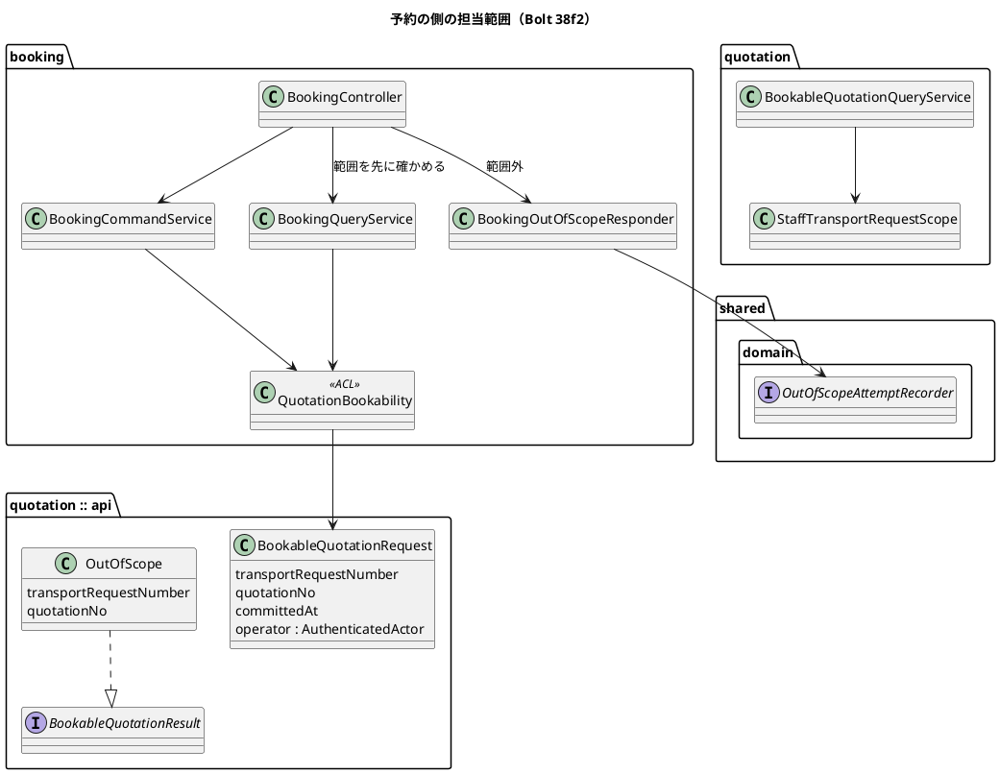
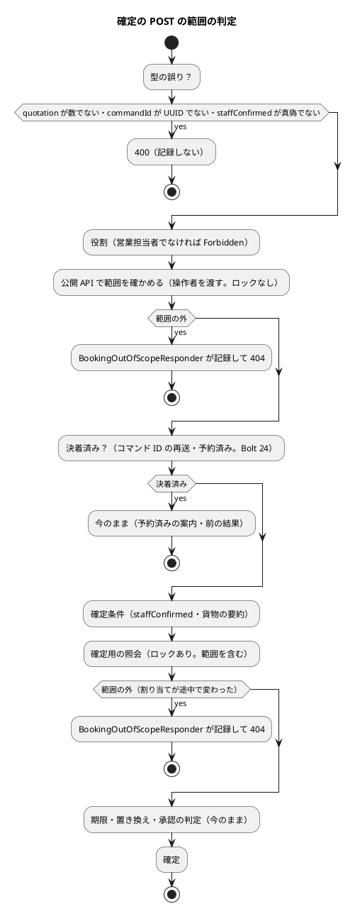

# Bolt 38f2 計画 - 予約の側の担当範囲の絞り込み

## 基本情報

| 項目 | 内容 |
| :--- | :--- |
| Bolt | 第 38f2 回（W6 の 32 本目。38f の開始準備で 38f と 38f2 に分けた 2 つ目。38f2 の開始準備で、動画と #14 への添付を 38f2b に分けた） |
| 予定 | W6（2026-11-09 の週。前倒しで着手できる）。前提は、38f（`0da4d3bd7`）の終了報告の承認と、その議題 4（404 の画面のヘッダー）の決着。作業は約 6 時間（360 分。`check`・`uiTest`・SonarQube・CI の待ちを除く）。CLAUDE.md の「半日を超える Bolt は分割する」に当たるので、動画を 38f2b に分けた（決定 (7)）。残りの 38f2 も半日を少し超えるが、予約の 4 つの入口の判定は 1 つの縦の切れ目で、これ以上分けると範囲の判定が予約の側で半分だけになる窓ができる。そのため、分割の規則の例外として受け入れるかを確認ポイント 7 で諮る。打ち切りはステップ 3b の後（下の表） |
| アプローチ | アウトサイドイン（既存の集約に受入条件を足す。開発戦略 :119・:346）。受入シナリオとセキュリティの統合テストの Red から入り、38f で作った受け渡し・ポート・判定の部品を予約の側に使う |
| 対象 | (1) 予約の作成（new GET）と確定（POST）: 見積りの公開 API `BookableQuotationQuery` の要求に操作者を渡し、quotation が範囲の外を `OutOfScope` で返す（ADR-016 の改訂）。範囲の判定は予約済みの判定より先、(2) 確定の POST は 38f と同じく controller が先にロックしない照会で範囲を確かめ、範囲の外なら記録して 404、(3) 予約の一覧（GET）と詳細（GET）: 予約の荷主企業で絞る、(4) booking の画面の層に予約用の記録の部品を置き、ArchUnit の部品の 4 つの規則を 2 クラスに広げる、(5) 受入シナリオ、マニュアル 7 章とキャプチャ、axe、(6) 設計の文書 |
| トレース | US-16 AC4（業務担当者の担当範囲の外の拒否と試行の記録。予約の分）、IA-INV-02・IA-INV-08、SEC-12、ADR-016・ADR-019、W6 の確認ポイント 16・17、#14 |
| GitHub | [#14](https://github.com/k2works/practical-domain-driven-design-in-enterpris-application/issues/14)（US-16 の残り。クローズは 38g）。38f2 では GitHub に書かない（動画の添付は 38f2b） |
| SP | 0 |
| 承認ゲート | 計画と終了報告。**認可**（予約の 4 つの入口を担当企業で絞り、範囲外は 404、確定の POST で試行を記録）、**公開 API の変更（ADR-016 の改訂）**（`BookableQuotationRequest` に操作者を足し、`BookableQuotationResult` に `OutOfScope` を足す。公開 API に主体を載せる最初の前例）、新しいファイル（下の一覧）。スキーマは変えない |
| ブランチ | develop で開発する。途中の push はデモ環境の配備になるので、push はステップ 7 でまとめる |
| 開始準備で決めたこと | 2026-10-28、human:kakimomokuri: (1) new と確定は、見積りの公開 API の要求に操作者（`AuthenticatedActor`）を渡し、quotation が範囲の外を結果 `OutOfScope` で返す。範囲の外でも期限切れなどの理由が先に返って存在が漏れることを防ぐ。`BookableQuotationQueryService` を `StaffTransportRequestScope` 経由にし、ArchUnit の「38f2 で外す」の印を外す、(2) 一覧と詳細は予約の荷主企業で絞る。一覧は `IN`（38f の `shipperCompanyIn` の形）、詳細は読んだ予約の荷主企業で `handlesCompany` を見る、(3) booking の `interfaces.web` に予約用の記録の部品を置き、ArchUnit の「ポートを呼ぶ部品」を 2 つに広げる、(4) 記録するのは確定の POST だけ。種類は `QUOTATION`（確定の対象は見積り。追跡番号はまだない）。GET は 404 だけ（SEC-12）、(5) 動画は荷主 A だけを担当する営業担当者の場面（→ 決定 (7) で 38f2b に送った）、(6) カスタマーサポートには開かない（`/staff/**` は営業担当者だけのまま）。整合性検証の後（同日）: (7) を改める: 動画と #14 への添付は 38f2b に分ける。38f2 は予約の側の絞り込みとマニュアル 7 章。38f2b は拒否が見える場面の動画（荷主 A だけの営業担当者。範囲の外の予約の準備を含む）と #14 への添付、`BOLT_ISSUES` と運用の索引の添付先の表の行。動画を 38g に送る案は取らない（38e → 38f → 38f2 とすでに 2 回送っており、38g は 5 SP で半日を超える）、(8) 見積りの公開 API の要求に操作者を載せ、ADR-016 を改める。ADR-016 には「公開 API に主体を載せるのは、呼び手の担当範囲で絞るときだけ」と書く |

新しいファイル（計画の承認で確かめる。計 4 とキャプチャ）:

- 本体（1）: `booking/interfaces/web/BookingOutOfScopeResponder.java`（予約の側の、範囲外の結果を受けてポートを呼び 404 にする唯一の部品。38f の `StaffOutOfScopeResponder` の写し。booking は `quotation.interfaces.web` に依存できず、`platform` に業務の 404 と記録を持たせないので共有しない。写しを共通にするかは 38g の開始準備で諮る）
- テスト（3）:
  - `BookingOutOfScopeResponderTest`（ポートを 1 回呼び 404 を返す。38f の ArchUnit の穴を単体で補う前例）
  - `BookingAssignedScopeSecurityIntegrationTest`（予約の 4 つの入口。範囲の中と外、GET と POST、予約済み。38f の `StaffAssignedScopeSecurityIntegrationTest` と同じ構成（同じ注釈・同じ `@MockitoBean` の組）にして、Spring の文脈を増やさない（#50 の文脈の数））
  - `features/ui/restrict_bookings_by_assigned_companies_ui.feature`（受入。タグに `@US-16-AC4`。38f の `restrict_staff_by_assigned_companies_ui.feature` に足さないのは、予約の側の 4 つの場面を 1 本にまとめ、38f2b で動画のタグを付ける先にするため。足す方が小さければステップ 2 で足す方を選び、報告に書く）
- 範囲の外の予約の準備: 38f の `StaffAssignedScopeUiSteps` に、範囲の外の荷主の `BookingTerms` で予約を直接作る（`BookingRepository.save`）ステップを足す（写さない）。UI の通しで荷主 B の承認と確定まで進めるのは重いので、準備としてリポジトリに置く
- 変える既存のファイル（主なもの）:
  - quotation: `BookableQuotationRequest`・`BookableQuotationResult`（公開 API）、`BookableQuotationQueryAdapter`、`BookableQuotationQueryService`・`BookableQuotation`（内部の結果）、`QuotationConfiguration`（`BookableQuotationQueryService` の組み立て）
  - booking: `QuotationBookability`（ACL。`Result.OutOfScope`、`toUnavailability` の `default` を網羅の switch に）、`BookingCommandService`・`BookingConfirmationOutcome`、`BookingQueryService`・`BookingConfirmationPage`、`BookingController`、`BookingRepository`・`MyBatisBookingRepository`・`BookingMapper.java`・`BookingMapper.xml`、`templates/booking/staff/bookings/list.html`（行 7 の案内）
  - テストと組み立て: `AcceptanceTestConfiguration`、`InMemoryBookingRepository`、`RandomTrackingNumberIssuerTest` の stub、`LayerArchitectureTest`、`ScopedResourceKind` の Javadoc
- 資産: `docs/manual/assets/07-*` の予約の一覧のキャプチャ（中身が変わるものだけ残す。T-197・38f の M5）

## Bolt ゴール

営業担当者は、担当企業の予約だけを社内の画面で見て確定できる。担当範囲の外の見積りで予約を作ろうとしても、すでに予約に使われていても、予約の一覧に出ず、URL を直接開いても共通の 404 になり、確定の操作を送ったときは試行が監査に残る。

### 開始準備で確かめたこと

| # | 事実 | 根拠 |
| :--- | :--- | :--- |
| 1 | release_plan の 38f2 の行は「社内の予約の 4 つの入口（一覧・new・確定・詳細）を担当企業で絞り、範囲外は 404 と試行の記録（AC4 の予約の分。38f のポートを使う）。動画。マニュアル 7 章」（決定 (7) で動画を 38f2b に分ける。ステップ 1 で行を直す）。アプローチはアウトサイドイン、承認ゲートは認可 | `release_plan.md:787` |
| 2 | 38f の終了報告は、予約の側（`/staff/bookings`・`/staff/bookings/new`）が 38f2 まで絞られないこと（38f の確認ポイント 8 で受け入れた）と、動画を 38f2 で撮ることを残している | `bolt_38f_report.md:96,118` |
| 3 | ArchUnit の「担当範囲を確かめない輸送要求の読み出しは判定の部品だけが呼ぶ」は、`BookableQuotationQueryService` を「38f2 で外す」の印付きで許している | `LayerArchitectureTest.java:467-482` |
| 4 | `BookingController` の 4 つの入口はどれも範囲を見ない。一覧 GET は `queryService.recent()`（全件）、new GET は `queryService.confirmation(番号, 見積り番号)`、確定 POST は `commandService.confirm(...)`（actor を渡すが、サービスは `hasRole(SALES)` だけを見る）、詳細 GET は `queryService.detail(追跡番号)` | `BookingController.java:58-128`、`BookingCommandService.java:74-75` |
| 4b | **予約済みの判定が見積りの照会より先に来る**。`BookingCommandService.confirm` は `alreadySettled(command)`（コマンド ID と `findTrackingNumber`。B-INV-11）を見てから `checkForConfirmation` を呼ぶ。`BookingQueryService.confirmation` も `findTrackingNumber` を見積りの照会（`quotations.check`）より先に呼び、`AlreadyBooked` を返す。controller はそれを「すでに予約に使われています（追跡番号 X）」と予約の詳細へのリンクで示す（Bolt 24 の意図的な順序）。範囲の判定を公開 API の中だけに置くと、範囲の外でも予約済みなら追跡番号が漏れ、POST の記録もされない | `BookingCommandService.java:77-84,161-185`、`BookingQueryService.java:47-50`、`BookingController.java:109-110,179-186` |
| 5 | 予約は荷主企業（`shipper_company_id`）を持つ（`Booking.shipperCompanyId()`）。荷主の側の一覧は `findRecentSummariesByShipper(CompanyId, limit)` で絞っている（前例）。社内の一覧 `findRecentSummaries(limit)` と詳細 `findByTrackingNumber` は絞らない。全件の `findRecentSummaries` を本体で呼ぶのは `BookingQueryService.recent()` だけ。索引 `ix_booking_shipper_status` がある | `BookingRepository.java:35,43,53`、`BookingMapper.xml:106,167,176-180`、`Booking.java:168`、`BookingQueryService.java:81` |
| 6 | new と確定は、ACL `QuotationBookability`（`check`・`checkForConfirmation`）から見積りの公開 API `BookableQuotationQuery` を通る。要求は `BookableQuotationRequest(番号, 見積り番号, committedAt)`。実装の `BookableQuotationQueryService.findByNumber` は `findByNumberForStaff`（範囲を見ない）で輸送要求を読み、その後に `lockForBooking`（`FOR UPDATE`）を取る。結果の `Bookable` は `shipperCompanyId` を持ち、`NotBookable(reason)` は荷主企業を持たず理由（期限切れなど）を返す。ACL の `toUnavailability` には `default -> NOT_APPROVED` がある | `QuotationBookability.java:31,44,81`、`BookableQuotationQueryService.java:118-129`、`BookableQuotationRequest.java:14`、`BookableQuotationResult.java:32-89` |
| 7 | booking が使ってよい依存は `shared`・`quotation :: api`・`platform :: web` だけ。38f の `StaffOutOfScopeResponder` は `quotation.interfaces.web` にあり、booking からは使えない。ArchUnit で `OUT_OF_SCOPE_RESPONDER` に頼る規則は 4 つ（ポートを呼ぶのはこの部品だけ、実在の見張り（T-135）、クラスにトランザクションを付けない、メソッドにトランザクションを付けない） | `booking/package-info.java:8`、`LayerArchitectureTest.java:485-528` |
| 8 | `ScopedResourceKind` は `TRANSPORT_REQUEST`・`QUOTATION` の 2 つで、Javadoc に「38f2 と 38g で値を足す」とある。ADR-019 :32 も「38f2 で予約を足す」と書く | `ScopedResourceKind.java`、`019-out-of-scope-attempt-recorder.md:32` |
| 9 | 予約の側を通る UI の feature は 8 本（confirm_booking・main_flow・manual_screenshots・query_tracking・register_milestone・requote_after_approval・route_already_departed・route_redesign_required）。38f で背景に「営業担当者は荷主の企業を担当している」を置いたので、範囲の中のままで足りる見込み | `features/ui/*.feature` |
| 10 | 動画の添付先の表 `BOLT_ISSUES` は bolt-38b4 → #14、bolt-38c → #47 まで。足す時期は、コメントと運用の索引が「終了報告の承認の後」、前例（38c の `72c779bcc`）は Bolt の中（→ 38f2b の開始準備で決める） | `ops/scripts/issue_demo.js:24-28,70-71`、`docs/operation/cargo-tracker/index.md:55` |
| 11 | マニュアル 7 章は 7.1 予約の確定待ち（:23）、7.2 本予約の確定、7.3 予約の詳細（:109）、7.4 予約一覧（:139）で、担当範囲に触れていない。付録 B :145 は「すでに予約に使われていることと追跡番号が示される」と書く。用語集に「担当企業」がない | `docs/manual/07-本予約の確定と予約一覧.md:23-160`、付録 B :145 |
| 12 | `new BookableQuotationRequest(` の呼び出しは 19 か所（本体 2: `QuotationBookability` の `check`・`checkForConfirmation`。テスト 17）。本体の呼び手は `BookingCommandService.confirm`（呼び手は `BookingController` だけ）と `BookingQueryService.confirmation` で、予約サガやイベントの処理からの呼び出しはない（整合性検証で確かめた） | grep |
| 13 | `staffConfirmed` は `@RequestParam(defaultValue="false") boolean` で、真偽でない値は Spring の型の変換で controller の本体より先に 400 になる。確定 POST の本体で値として解釈するのは、`staffConfirmed=false`（確認していない）と貨物の要約が空のときの `MissingConditions` だけ | `BookingController.java:84` |
| 14 | 5 引数の `AuthenticatedActor` は担当企業が空で、`handlesCompany` が偽になる。担当企業のない営業担当者で予約を確定する既存のテストは、38f2 の後は範囲の外になる | `AuthenticatedActor.java:42-45` |

## 設計の決定（案）

| 項目 | 決定 | 根拠 |
| :--- | :--- | :--- |
| 公開 API の要求 | `BookableQuotationRequest` に操作者 `AuthenticatedActor operator` を足す（共有カーネルの型なので `PublicApiArchitectureTest` には当たらない）。ADR-016 の決定の表「照会」の行を改め、「公開 API に主体を載せるのは、呼び手の担当範囲で絞るときだけ」と書く。本体の呼び出しは 2 つだけで、操作者のない呼び出しはない（事実 12） | 決定 (1)・(8) |
| 公開 API の結果 | `BookableQuotationResult` に `OutOfScope(transportRequestNumber, quotationNo)` を足す（荷主企業も理由も持たない。記録の ID のために、正規の業務番号だけを持つ）。理由の文字列に足さず別の record にするのは、ACL の `toUnavailability` の `default -> NOT_APPROVED` で黙って「承認がまだ」に化けるのを防ぐため。あわせて `default` を網羅の switch に直す | 決定 (1)、低い指摘 |
| 実装 | `BookableQuotationQueryService` は `findByNumberForStaff` を直接呼ばず、`StaffTransportRequestScope.find(番号, 操作者)` を使う。範囲の判定は `lockForBooking`（`FOR UPDATE`）より前に置き、範囲の外では見積りの行を押さえない。範囲の外なら、見積りが無い・期限切れでも `OutOfScope` を返す。ArchUnit の「38f2 で外す」の印を外す | 決定 (1)、事実 3・6 |
| new GET の順序 | `BookingQueryService.confirmation` は、見積りの照会（範囲を含む）を先に流し、`OutOfScope` なら 404 にする。その後に予約済み（`findTrackingNumber`）を見る。範囲の中では、予約済みを期限切れなどより先に示す Bolt 24 の順序を保つ（照会の結果を 1 回で取り、予約済みの判定をその後に並べる） | H1、事実 4b |
| 確定 POST の順序 | 38f と同じく、controller が `commandService.confirm` の前に、ロックしない照会（`BookingQueryService` の範囲だけを確かめる口。公開 API に操作者を渡す）で範囲を確かめ、範囲の外なら `BookingOutOfScopeResponder` で記録して 404 にする（ADR-019 :36 の「呼ぶ側」の形）。順序は「役割 → 範囲（ロックなし）→ 決着済み（コマンド ID・予約済み。Bolt 24）→ 確定用の照会（ロックあり）」。`commandService.confirm` が返す `BookingConfirmationOutcome.OutOfScope` は、割り当てが途中で変わったときの守りとして残し、controller はそれも記録して 404 にする | H1・H2、ADR-019 :36 |
| ACL と booking のサービス | `QuotationBookability` は `OutOfScope` を `Result.OutOfScope` に写す。`BookingCommandService` と `BookingQueryService` は、それを `BookingConfirmationOutcome.OutOfScope`・`BookingConfirmationPage.OutOfScope` に写す | 決定 (1) |
| 一覧 | `BookingRepository.findRecentSummaries(int)` を `findRecentSummaries(Set<CompanyId> shipperCompanyIds, int limit)` に置き換え、全件の口を消す（38f の見積りの一覧の口と同じ形。名前に `ForStaff` を使わない。見積りの `findByNumberForStaff` は「担当範囲を確かめない」意味なので、逆の意味になるのを避ける）。`IN` は booking の mapper に `<sql id="shipperCompanyIn">` を写す（booking は quotation の mapper に依存できない）。担当企業が空なら SQL を流さず空を返す（照会のサービスの 1 か所。38f の V3f の前例）。全件の口を消すので、ArchUnit で守る規則は要らない | 決定 (2)、事実 5 |
| 担当企業がない判定 | 一覧の案内は `AuthenticatedActor.hasNoAssignedCompanies`（38f の閉じた判定）で出す。集合の空を画面で見ない | 38f の決定 (6) |
| 詳細 | `BookingQueryService.detail(追跡番号, 操作者)` が、読んだ予約の荷主企業で `actor.handlesCompany(...)` を見る。範囲の判定は予約サガの読み出しより前に置く。範囲の外は `Optional.empty()`（いない予約と同じ 404） | 決定 (2) |
| 記録の部品 | `booking/interfaces/web/BookingOutOfScopeResponder`（`@Component`、`@Transactional` なし）。確定の POST の範囲外だけがこれを呼ぶ。ArchUnit の 4 つの規則をどれも 2 クラスに広げ、実在の見張りはクラスごとに 1 本にする（「A か B」にすると片方が無くても通る。T-135） | 決定 (3)、事実 7 |
| 記録の値 | 確定の POST の範囲外は `ScopedResourceKind.QUOTATION`、ID は `OutOfScope` が持つ正規の業務番号 `TR-…/n`（booking は業務番号を解釈しないので、生の入力を ID にしない）。`BOOKING` は足さない（記録しない GET でしか使わないため。YAGNI）。ADR-019 :32 と `ScopedResourceKind` の Javadoc を「38g で値を足す」に直す | 決定 (4)、事実 8 |
| 範囲の判定と値の解釈 | 確定の POST は、範囲の判定を確定条件（`staffConfirmed=false`・貨物の要約が空の `MissingConditions`）の判定より先に行う。`staffConfirmed` が真偽でない値・`quotation` が数でない・`commandId` が UUID でないときは、Spring の型の変換で範囲によらず 400 で記録しない | 38f の前例、T-211、事実 13 |
| 4 つの写し | 38g で経路設計と追跡の側が加わると記録の部品の写しは 4 つになる。共通にするか（または ArchUnit を名前の規則 `..interfaces.web..*OutOfScopeResponder` にするか）は、38g の開始準備で諮る | 低い指摘 |

### 入口ごとの記録の値と、範囲より先に止まる値

| 入口 | 範囲外の結果 | 記録 | 範囲より先に 400 になる値 |
| :--- | :--- | :--- | :--- |
| 一覧 GET `/staff/bookings` | 範囲の外の予約は出ない | しない | — |
| new GET `/staff/bookings/new` | 404（予約済みでも追跡番号を示さない） | しない | `quotation` が数でない |
| 確定 POST `/staff/bookings` | 404（予約済み・コマンド ID の再送でも） | `QUOTATION`、正規の `TR-…/n` | `commandId` が UUID でない、`quotation` が数でない、`staffConfirmed` が真偽でない |
| 詳細 GET `/staff/bookings/{trackingNumber}` | 404 | しない | （追跡番号の形の誤りは今のまま 404） |

### 受入条件（行と 1:1）

| # | 受入条件 | 行 |
| :--- | :--- | :--- |
| AC-1 | 担当企業の予約だけが予約の一覧に出る | 1a・1b・1c |
| AC-2 | 範囲の外の予約の詳細と予約の作成は 404 で、記録しない | 2a・2b |
| AC-3 | 範囲の外の見積りで確定を送ると 404 で、担当範囲の外の試行を 1 行記録する | 3 |
| AC-4 | 範囲の外では、期限切れなどの理由も、予約済みの追跡番号も示さない（存在を漏らさない） | 4・4b・4c |
| AC-5 | 範囲の判定は確定条件の判定より先（型の誤りは範囲によらず 400 で記録しない） | 5・5b |
| AC-6 | 範囲の中は今のまま見えて確定できる | 6a・6b・6c |
| AC-7 | 担当企業がない営業担当者は何も見えない | 7 |
| AC-8 | 記録のポートを呼ぶのは画面の層の部品だけ（2 つ） | 8 |
| AC-9 | UI の通し（幅 320 px、axe の違反 0） | 9 |

### 文言（全文）

| 場面 | 文言 |
| :--- | :--- |
| 範囲の外の詳細・作成・確定 | 共通の 404「画面が見つかりません」（今のまま。認証の前のレイアウト。38f の議題 4 の決着に従う） |
| 予約の一覧で担当企業がない | 担当企業がまだないので、表示できる予約はありません。システム管理者に担当企業の割り当てを頼んでください。（38f の受付一覧 `list.html:18` の文の「輸送要求」を「予約」に替えた写し） |
| マニュアル 7 章の注（要旨） | 予約の確定待ち（7.1）・本予約の確定（7.2）・予約の詳細（7.3）・予約一覧（7.4）で扱えるのは担当企業の予約だけ。範囲の外の URL は「画面が見つかりません」になる。担当企業の変更はシステム管理者に頼む（11.8）。全文は実装のときにマニュアルで決め、終了報告で示す（T-218） |

### 既存の期待を変える箇所（T-122）

- 公開 API の要求の呼び出し 19 か所（事実 12）。テストの呼び出しには操作者を渡す（`AuthenticatedActorFixture` の営業担当者）。ステップ 1 の grep で数え直す（T-148）
- 担当企業のない 5 引数の主体で確定を通すテスト（事実 14。担当企業を持つ主体に替える）:
  - `booking/acceptance/BookingSteps.java:203`（`features/booking/confirm_booking.feature`）
  - `BookingConfirmationConcurrentIntegrationTest.java:203`
  - `integration/BookingConfirmationWithRouteRedesignIntegrationTest.java:64`
  - `integration/RouteConfirmedAssignmentIntegrationTest.java:83`
  - `DevSampleDataSmokeTest.java:135`
  - ステップ 1 の grep で漏れがないか確かめる
- 組み立て: `AcceptanceTestConfiguration`、`QuotationConfiguration:149-151`（`BookableQuotationQueryService` の constructor）
- ACL の単体テスト `QuotationBookabilityTest`（`OutOfScope` の写しと網羅の switch）
- `BookingRepository` の実装と stub: `InMemoryBookingRepository`、`RandomTrackingNumberIssuerTest:84` の stub
- 一覧の並びの統合テスト `MyBatisBookingRepositoriesIntegrationTest:217-222`（新しい口に移す）
- `BookingQueryServiceTest`・`BookingCommandServiceTest` の照会と確定（操作者の引数）
- `BookingControllerTest`（`@WebMvcTest`。responder の `@MockitoBean`）
- 予約の側を通る UI の feature 8 本（事実 9）。範囲の中のまま緑であることを確かめる
- `LayerArchitectureTest`: 印を外す 1 つと、部品の 4 つ（2 クラスに広げ、実在の見張りはクラスごとに 1 本）
- `ScopedResourceKind` の Javadoc（「38f2 と 38g で値を足す」を「38g で」に）

## ふりかえりと前の Bolt からの引き継ぎ

| 出典 | 内容 | この Bolt での扱い |
| :--- | :--- | :--- |
| 38f の Try T-220 | 変異は uiTest で流さない | 変異はすべて `test` で流す。uiTest は振る舞いの確かめだけ |
| 38f の Try T-221 | コミットの一覧は `git -c core.quotepath=false status --porcelain` で作る | ステップ 7 で守る |
| 38e の Try T-219、T-214 | 変異の対象に単体と統合・契約の両方を入れる | 変異の表の「落ちる見込み」に両方を書く |
| 38d の Try T-217 | 本体の前に Red を流す | 各ステップに書く |
| T-204 | heredoc と標準入力を待つコマンドを使わない | フォークの指示の禁止事項に書く |
| 38f の Problem | 実装の担当がターンの上限で止まった | ステップ 3 を 3a・3b に分け、フォークへの指示の単位にする |
| 38f の既知の課題 | 予約の側が 38f2 まで絞られない窓 | この Bolt で閉じる |
| 38f の確認ポイント 8 | カスタマーサポートに開くかは別に諮る | 開かない（決定 (6)） |
| #50 | テストの Spring の文脈の数 | 新しいセキュリティの統合テストは 38f と同じ構成にする |

## 状態の組み合わせ（行ごとにテストを 1 本。T-182）

| 行 | 状況 | 期待 | 出口 | 確かめ方 |
| :--- | :--- | :--- | :--- | :--- |
| 1a | 一覧 GET、担当企業の予約がある | 担当企業の予約だけが出る | 予約の一覧 | `BookingAssignedScopeSecurityIntegrationTest`、`MyBatisBookingRepositoriesIntegrationTest`（2 社） |
| 1b | 一覧 GET、範囲の外の予約だけがある | 何も出ない | 予約の一覧（空） | 同上 |
| 1c | 一覧の SQL、2 社を担当 | 2 社の予約が出る | 予約の一覧 | リポジトリの統合テスト |
| 2a | 詳細 GET、範囲の外の予約 | 404、記録しない | 共通の 404 | セキュリティの統合テスト、`BookingQueryServiceTest` |
| 2b | new GET、範囲の外の見積り | 404、記録しない | 共通の 404 | 同上、`BookableQuotationQueryAdapterTest` |
| 3 | 確定 POST、範囲の外の見積り | 404、担当範囲の外の試行を 1 行（`QUOTATION`、正規の `TR-…/n`。操作者と `target_id` で絞って数える） | 共通の 404 | セキュリティの統合テスト、`BookingOutOfScopeResponderTest` |
| 4 | 範囲の外で、見積りが期限切れ・置き換え済み・無い | 理由を示さず `OutOfScope`（404）。見積りの行を押さえない | 共通の 404 | `BookableQuotationQueryAdapterTest`、セキュリティの統合テスト |
| 4b | 範囲の外 × 予約済みの見積り（new GET と確定 POST） | 追跡番号を示さず 404。POST は記録する | 共通の 404 | セキュリティの統合テスト、`BookingQueryServiceTest`・`BookingCommandServiceTest` |
| 4c | 範囲の外 × 同じコマンド ID の再送（確定 POST） | 決着済みの結果を示さず 404、記録する | 共通の 404 | セキュリティの統合テスト |
| 5 | 範囲の外 × 確認のチェックなし（`staffConfirmed=false`。確定条件の不足） | S-09 を示さず 404 と記録（範囲の判定が先） | 共通の 404 | セキュリティの統合テスト（T-211） |
| 5b | 型の誤り（`quotation=abc`、`commandId` が UUID でない、`staffConfirmed` が真偽でない） | 範囲によらず 400、記録しない | 400 | 同上 |
| 6a | 範囲の中の一覧・詳細 | 今のまま | 予約の一覧・予約の詳細 | 同上、既存の UI の feature 8 本 |
| 6b | 範囲の中の new | 今のまま（予約済みなら追跡番号の案内。Bolt 24 の順序） | 確定の画面・予約済みの案内 | 同上 |
| 6c | 範囲の中の確定 | 今のまま。確定は詳細へ移る | 予約の詳細 | 同上 |
| 6d | 確定の照会の後に割り当てが外れた（範囲の外になった） | コマンドの `OutOfScope` で 404、記録する | 共通の 404 | `BookingCommandServiceTest`、controller の単体テスト |
| 7 | 担当企業がない営業担当者 | 一覧は空で案内（全文）、ほかは 404 | 予約の一覧・共通の 404 | セキュリティの統合テスト |
| 8 | 記録のポートの呼び手 | `StaffOutOfScopeResponder` と `BookingOutOfScopeResponder` だけ。どちらも実在し、トランザクションを付けない | 該当しない（ArchUnit） | `LayerArchitectureTest`、`BookingOutOfScopeResponderTest` |
| 9 | UI の通し | 予約の一覧に担当企業の予約だけ、範囲の外の予約の URL は 404、幅 320 px、axe の違反 0 | 画面 | `restrict_bookings_by_assigned_companies_ui.feature` |

## スコープ

### 入れるもの

- 行 1a〜9 のテスト
- 公開 API の要求と結果、実装、ACL、booking のサービスと controller、リポジトリと SQL
- 予約用の記録の部品と ArchUnit
- 受入シナリオ、マニュアル 7 章とキャプチャ、設計の文書（T-126）

### 入れないもの

- 動画と #14 への添付、`BOLT_ISSUES` と運用の索引の添付先の表の行（38f2b）
- 経路設計と追跡の担当範囲（38g）
- カスタマーサポートに社内の画面を開くこと（決定 (6)）
- 確認ポイント 19（38g）
- 「業務の画面で効くのは、今後の更新からです」の文言を外すこと（38g）

## 設計（この Bolt の範囲）

- 状態遷移図: 集約の状態は変えないので省く
- 画面遷移図: 画面と遷移は変えない（範囲外は共通の 404）ので省く
- ER 図: 表と列を変えないので省く

## ステップ計画

- [ ] **1. 設計の文書**と、公開 API の呼び出し元・担当企業のない主体で確定を通すテストの数え直し（T-148）。直す文書は下の「親が直す文書」の一覧（T-126）
- [ ] **2. 受入シナリオとセキュリティの統合テストの Red**: 行 9 の feature と、`BookingAssignedScopeSecurityIntegrationTest` を先に書き、範囲の外の予約が一覧に出て 404 にならないこと・予約済みで追跡番号が出ることで落ちるのを見る（T-217。本体の前に Gradle で流し、理由を記録する）
- [ ] **3a. 公開 API と実装と ACL（Red → Green）**: 行 2b・4。`BookableQuotationQueryAdapterTest`・`QuotationBookabilityTest` を先に書き、Red を見る（T-217）。要求と結果、実装（範囲の判定を `lockForBooking` より前に）、ACL（網羅の switch）、組み立て、ArchUnit の印を外す
- [ ] **3b. booking のサービスと controller と記録の部品（Red → Green）**: 行 3・4b・4c・5・5b・6b・6c・6d・8。サービスの単体と controller の単体と `BookingOutOfScopeResponderTest` を先に書き、Red を見る（T-217）。new GET の順序、確定 POST の先の確かめ、responder、ArchUnit の部品の 4 つの規則、担当企業のない主体で確定を通す既存のテストの直し
- [ ] **4. 一覧と詳細（Red → Green）**: 行 1a〜1c・2a・6a・7。リポジトリの統合テスト（2 社）を先に書き、Red を見る（T-217）。全件の口を消し、並びの統合テストを移す。`spotbugsMain` を流す（T-213）
- [ ] **5. 既存のシナリオの確かめ**: UI の feature 8 本と `features/booking/confirm_booking.feature` が緑であることを確かめる
- [ ] **6. マニュアル 7 章・付録 B・用語集とキャプチャ**（`manualScreenshots`。中身が変わるものだけ残す。T-197）
- [ ] **7. 品質ゲートと開発レビュー、終了報告と配備**: 変異（`test` だけ。T-220）、`check`・`uiTest`、SonarQube、開発レビューとその直し（Red を先に。T-217）。develop に push して CI を確かめ、デモ環境の版を見る

### 時間の配分と打ち切り

| # | 目安 | 打ち切り |
| :--- | :--- | :--- |
| 1 | 40 分 | — |
| 2 | 40 分 | — |
| 3a | 50 分 | — |
| 3b | 70 分 | ステップ 3b を終えた時点で 230 分（ステップ 1〜3b の目安 200 分に、38f で実際に出た既存のテストの直しの余裕 30 分を足した値）を超えていたら、一覧と詳細（ステップ 4）を 38f2b に送るかを諮る。送ると、予約の一覧と詳細だけが 38f2b まで絞られない窓が残る |
| 4 | 50 分 | — |
| 5 | 20 分 | — |
| 6 | 30 分 | — |
| 7 | 60 分（待ちを除く） | — |

合計 360 分（約 6 時間）。初稿の 300 分に、整合性検証で見つかった既存のテストの直し（担当企業のない主体 5 か所、組み立て、ACL の単体、stub、並びの統合テスト）と、予約済みの順序の直しを足した。

## 確認ポイント（計画の承認の場でまとめて確認する。Try T-6）

| # | 確認すること | 場所 | 推奨 |
| :--- | :--- | :--- | :--- |
| 1 | **認可** | 設計の決定 | 予約の 4 つの入口を担当企業で絞り、範囲外は 404、確定の POST だけ記録（`QUOTATION`）。範囲の判定は予約済みの判定より先で、範囲の外では期限切れなどの理由も予約済みの追跡番号も示さない |
| 2 | **公開 API の変更（ADR-016 の改訂）** | 設計の決定 | `BookableQuotationRequest` に操作者を足し、`BookableQuotationResult` に `OutOfScope`（正規の業務番号だけ）を足す。ADR-016 に「公開 API に主体を載せるのは、呼び手の担当範囲で絞るときだけ」と書く。公開 API に主体を載せる最初の前例 |
| 3 | **呼ぶ側の形（ADR-019）** | 設計の決定 | 確定の POST は 38f と同じく、controller がロックしない照会で範囲を先に確かめ、範囲の外なら記録して 404。コマンドの `OutOfScope` は割り当てが途中で変わったときの守り |
| 4 | **記録の部品** | 設計の決定 | booking に予約用の部品を写して置き、ArchUnit の 4 つの規則を 2 クラスに広げる（実在の見張りはクラスごとに 1 本）。写しを共通にするかは 38g の開始準備で諮る |
| 5 | **全件の一覧の口** | 設計の決定 | ArchUnit で守らず、全件の口を消して担当企業の集合を受ける口に置き換える（本体の呼び手は 1 つだけ） |
| 6 | **新しいファイル** | 一覧 | 計 4 と、キャプチャ |
| 7 | **大きさ** | 時間の配分 | 約 6 時間。動画を 38f2b に分けた後も半日を少し超えるので、CLAUDE.md の「半日を超える Bolt は分割する」の例外として受け入れるか。予約の 4 つの入口の判定を分けると、予約の側の範囲の判定が半分だけの窓ができる。ステップ 3b の後の打ち切りで守る |
| 8 | **変異** | 下の表 | 13 個。`test` だけで流す（T-220）。対象に単体と統合・契約の両方を入れる（T-214・T-219） |

### 変異と落ちる見込みのテスト

| # | 変異 | 落ちる見込み | 流すタスク |
| :--- | :--- | :--- | :--- |
| V1 | 公開 API の実装が範囲を見ない（`findByNumberForStaff` を直接呼ぶ） | 行 2b・3 | `test`（`BookableQuotationQueryAdapterTest`、セキュリティの統合テスト、`LayerArchitectureTest`） |
| V2 | 範囲の判定を期限の判定の後にする | 行 4 | `test`（`BookableQuotationQueryAdapterTest`） |
| V2b | 範囲の判定を `lockForBooking` の後にする | 行 4 | `test`（`BookableQuotationQueryAdapterTest` で、範囲の外でロックを取らないことを確かめる） |
| V3 | ACL が `OutOfScope` を `QuotationUnavailable` に写す | 行 3・4 | `test`（`QuotationBookabilityTest`、`BookingCommandServiceTest`、セキュリティの統合テスト） |
| V4 | 確定の範囲外で記録しない | 行 3 | `test`（セキュリティの統合テスト、`BookingOutOfScopeResponderTest`） |
| V5 | GET の範囲外でも記録する | 行 2a・2b | `test`（セキュリティの統合テスト） |
| V6 | 一覧の `IN` を外す | 行 1a・1b | `test`（リポジトリの統合テスト、セキュリティの統合テスト） |
| V7 | 一覧の空の守りを外す（空の集合でリポジトリを呼ぶ） | 行 7 | `test`（`BookingQueryServiceTest` で `verify(..., never())`、セキュリティの統合テスト（PostgreSQL で `IN ()` は 500）） |
| V8 | 詳細で `handlesCompany` を見ない | 行 2a | `test`（セキュリティの統合テスト、`BookingQueryServiceTest`） |
| V9 | 確定で確定条件の判定（`MissingConditions`）を範囲の判定より先にする | 行 5 | `test`（セキュリティの統合テスト） |
| V10 | 予約済みの判定（`alreadySettled`・`findTrackingNumber`）を範囲の判定より先にする（今のコードの形） | 行 4b・4c | `test`（セキュリティの統合テスト、`BookingQueryServiceTest`・`BookingCommandServiceTest`） |
| V11 | ArchUnit の部品の一覧から予約の部品を外す | 行 8 | `test`（`LayerArchitectureTest`） |
| V12 | 予約の部品に `@Transactional` を付ける・予約の部品がポートを呼ばない | 行 8 | `test`（`LayerArchitectureTest`、`BookingOutOfScopeResponderTest`） |

## 完了条件

- [ ] 上のステップ 1〜7 の完了の判定を満たす
- [ ] 行 1a〜9 に、それを名乗るテストがある
- [ ] `check`・`uiTest` が緑、SonarQube が PASS（重複 3% 未満）、CI が緑、デモ環境が新しい版で動く
- [ ] マニュアル 7 章・付録 B・用語集とキャプチャが実装と合う（axe の違反 0）
- [ ] 終了報告が承認される

### US-16 と #14 の照合（38f2 の時点）

| 受入条件 | 38f2 までで満たすもの | 38f2b・38g に残すもの |
| :--- | :--- | :--- |
| AC4（業務担当者の担当範囲の外の拒否と試行の記録） | 見積りの側（38f）と予約の側（38f2） | 拒否が見える場面の動画（38f2b）、経路設計と追跡（38g） |
| AC5（利用終了・取消しで次の request から拒否） | — | 役割の取消しのシナリオ（38g） |
| #14 のクローズ | — | 38g |

## 親が直す文書（ステップ 1。T-126）

この計画の作成では次の文書を変えていない。ステップ 1 で直す。

- release_plan: 38f2 の行（動画を 38f2b に分けた）と 38f2b の行は計画の作成で直した。:798（デモの項目。動画の送り先を 38f2b に）、更新履歴
- development_strategy :185（動画を撮る Bolt を 38f2b に）
- ADR-016 :32（決定の表「照会」の行。要求に操作者、結果に範囲の外。「公開 API に主体を載せるのは、呼び手の担当範囲で絞るときだけ」）と改訂の経緯
- ADR-019 :32（「38f2 で予約を足す」を「38g で」に。`BOOKING` を足さない理由）、:36（呼ぶ側の形に予約の側と `BookingOutOfScopeResponder` を足す）、:53 と改訂の経緯
- architecture_backend :149（`BookableQuotationQuery` の説明。操作者と `OutOfScope`）、:307（`ASSIGNED_SCOPE_DENIED` の呼び手に `BookingOutOfScopeResponder`）
- domain_model :156・:272（「38f2 で予約を足す」）・:991（`QuotationUnavailability`）と、新しい用語（`BookableQuotationResult.OutOfScope`、`QuotationBookability.Result.OutOfScope`、`BookingConfirmationOutcome.OutOfScope`、`BookingConfirmationPage.OutOfScope`、`BookingOutOfScopeResponder`）
- non_functional :67（PERF-01 の「社内の 5 つの一覧」に予約の一覧）、:179（SEC-12 の進み）
- data_model :951（記録の書き手が予約の確定 POST に広がる）
- test_strategy :583
- ui_design :169（S-10。「社内の画面なので荷主企業で絞らない」を反対に。担当企業がないときの案内を salt のワイヤーフレームにも）、S-09・S-24
- マニュアル 7 章（7.1〜7.4 の注）、付録 B :145（範囲の外では 404 になること）と「担当企業の外の『画面が見つかりません』」の Q、用語集の「担当企業」
- `ScopedResourceKind` の Javadoc

## 更新履歴

| 日付 | 更新内容 | 更新者 |
| :--- | :--- | :--- |
| 2026-10-28 | 整合性検証の指摘を反映し、動画を 38f2b に分けた（承認待ち）。範囲の判定を予約済みの判定より先に置く（new GET は照会を先に、確定 POST は 38f と同じく controller が先にロックしない照会で確かめる）、公開 API に操作者を載せ ADR-016 を改める、ArchUnit の 4 つの規則を 2 クラスに広げる、一覧の全件の口を消す、行 4b・4c・5・6d を足し・直す、変異を 13 個に、既存のテストの直しを全列挙、時間を 360 分に（human:kakimomokuri が決定 (7)・(8) を決めた） | anthropic/claude-opus-5-5 |
| 2026-10-28 | 初版作成（承認待ち）。開始準備で、公開 API に操作者を渡し quotation が範囲外を返す、一覧と詳細は予約の荷主企業で絞る、予約用の記録の部品を置く、記録は確定の POST だけ、動画は荷主 A だけの営業担当者の場面、カスタマーサポートは開かない、1 つの Bolt で打ち切りを置くと決めた（human:kakimomokuri） | anthropic/claude-opus-5-5 |

## 関連ドキュメント

- [リリース計画](release_plan.md)（W6 節の 38f2・38f2b・38g の行）、[Bolt 38f 計画](bolt_38f_plan.md)、[Bolt 38f 終了報告](bolt_38f_report.md)、[Bolt 38e 終了報告](bolt_38e_report.md)
- [ADR-019](../../adr/cargo-tracker/019-out-of-scope-attempt-recorder.md)、[ADR-016](../../adr/cargo-tracker/016-booking-checks-quotation-at-commit-time.md)
- [UI 設計](../../design/cargo-tracker/ui_design.md)（S-09・S-10・S-24）、[ユーザーマニュアル 7 章](../../manual/07-本予約の確定と予約一覧.md)
