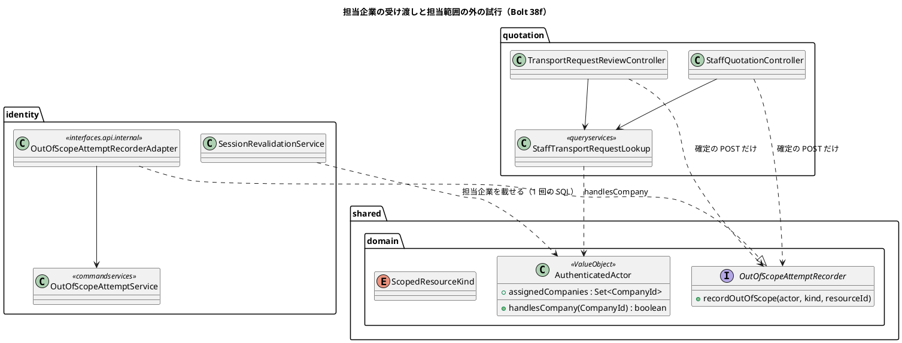
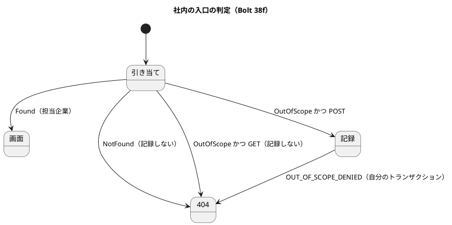

# Bolt 38f 計画 - 担当企業の受け渡しと範囲外の試行の記録、見積りの側の担当範囲の絞り込み

## 基本情報

| 項目 | 内容 |
| :--- | :--- |
| Bolt | 第 38f 回（W6 の 31 本目。開始準備で 38f と 38f2 に分けた 1 つ目。決定 (1)） |
| 予定 | W6（2026-11-09 の週。前倒しで着手できる）。38e の後に行う（38e は計画の承認待ち。38e の `AssignedCompanies`・`assignedCompaniesOf`・開発データの割り当て `V20261028100900` を前提にする）。作業は約 5.9 時間（355 分。`check`・`uiTest`・SonarQube・CI の待ちを除く）。development_strategy の目安（2〜4 時間）を超えるが、開始準備で 38f2 に分けた残り。下の打ち切りで守る |
| アプローチ | インサイドアウト（受け渡しとポート）の後にアウトサイドイン（既存の集約に受入条件を足す。release_plan の 38f の行、開発戦略 :119・:346）。受け渡しとポートは値と識別の側から作り、見積りの側は受入シナリオの Red から入る |
| 対象 | (1) `AuthenticatedActor` への担当企業の受け渡し（request ごとの確かめで載せ直す）と ADR-012 の改訂、(2) 範囲外の試行の記録のポート（`shared.domain`）と identity の実装と ADR-019、(3) 見積りの側の社内の画面（輸送要求の審査 4・社内の見積り 6 の計 10 の入口）を担当企業で絞り、範囲外は 404、確定の POST で試行を記録、(4) マニュアル 6 章とキャプチャ、axe、(5) 設計の文書 |
| トレース | US-16 AC4（業務担当者の担当範囲の外の拒否と試行の記録。見積りの分）、BR-15（38e の決定 (10) で担当企業に近似）、IA-INV-02・IA-INV-08、SEC-12、W6 の確認ポイント 16・17、#14 |
| GitHub | [#14](https://github.com/k2works/practical-domain-driven-design-in-enterpris-application/issues/14)（US-16 の残り。クローズは 38g） |
| SP | 0 |
| 承認ゲート | 計画と終了報告。**認可**（担当企業で絞る、範囲外は 404、確定の POST で試行を記録、割り当てのない営業担当者は何も見えない）、**構造**（ADR-012 の改訂、ADR-019 で共有カーネルに初めて振る舞いのあるポートを置く）、新しいファイル（下の一覧）。38e の決定 (9)（同じ `COMPANY` の行を役割で読み分ける）を使う。スキーマは変えない |
| ブランチ | develop で開発する。途中の push はデモ環境の配備になるので、push はステップ 9 でまとめる |
| 開始準備で決めたこと | 2026-10-28、human:kakimomokuri: (1) 38f と 38f2 に分ける。38f は受け渡し・ADR-012 の改訂・範囲外の試行の記録のポートと ADR-019・見積りの側の絞り込み（輸送要求の審査と社内の見積りの 10 の入口）・マニュアル 6 章。38f2 は予約の側の絞り込み（4 つの入口）・動画・マニュアル 7 章。打ち切りは受け渡し・ポートの後に置く、(2) 担当企業は `CargoUserDetails` に `transient` の項目で持ち、毎回の確かめで作り直す。古い session の互換の問題は起きないので【前の決定の変更】は要らない。ADR-012 にそう判断した理由を書く、(3) ポートは `shared.domain` に置き、実装は `identity.interfaces.api.internal` のアダプターから commandservices に委ねる。ADR-019 に ADR-003 :58 との違いと package-info の変更を書く、(4) 記録は前例どおり自分のトランザクションで行い、外側のトランザクションの中では拒む。記録するのは確定の POST だけで、GET の範囲外は 404 だけ（SEC-12）、(5) 用語を「管理範囲の外の試行」（`ADMIN_SCOPE_DENIED`）と「担当範囲の外の試行」（`OUT_OF_SCOPE_DENIED`）に分ける。種類は列挙で固定し、ArchUnit で書き手を 1 か所にする、(6) 判定は `AuthenticatedActor.handlesCompany(CompanyId)` に置き、失敗に倒す（空なら何も見えない）。絞らない役割の判定も閉じた答えで返す、(7) 確認ポイント 19 は 38g に送る、(8) カスタマーサポートに社内の画面を開くのは別に諮る。38f で絞るのは営業担当者だけ |

新しいファイル（計画の承認で確かめる。計 14 とキャプチャの撮り直し 1）:

- 本体（5）:
  - `shared/domain/OutOfScopeAttemptRecorder.java`（担当範囲の外の試行の記録のポート。共有カーネルで初めての振る舞いのある型。ADR-019）
  - `shared/domain/ScopedResourceKind.java`（記録する対象の種類の列挙。`TRANSPORT_REQUEST`・`QUOTATION`。38f2・38g で `BOOKING` などを足す。`target_type` の `VARCHAR(50)` に収まる名前）
  - `identity/interfaces/api/internal/OutOfScopeAttemptRecorderAdapter.java`（ポートの実装。commandservices に委ねる）
  - `identity/application/internal/commandservices/OutOfScopeAttemptService.java`（自分のトランザクションで監査 `OUT_OF_SCOPE_DENIED` を書く。前例 `AdministrationScopeDenialService`）
  - `quotation/application/internal/queryservices/StaffTransportRequestLookup.java`（社内の側の輸送要求の引き当て。`Found`・`NotFound`・`OutOfScope` を返す。前例 `ManagedUserLookup`。名前はステップ 4 で既存の照会を見て決める）
- 文書（1）: `docs/adr/cargo-tracker/019-out-of-scope-attempt-recorder.md`（と ADR の `index.md` の行）
- テスト（8）:
  - `AuthenticatedActorTest`（shared.domain。`handlesCompany` の閉じた答え。既にあれば足す）
  - `OutOfScopeAttemptServiceTest`（commandservices）
  - `OutOfScopeAttemptRecorderIntegrationTest`（infrastructure.security。外側のトランザクションで拒む、外側のロールバックでも残る。`IdentitySpyIntegrationTestBase` を継ぐ）
  - `StaffTransportRequestLookupTest`（quotation の queryservices）
  - `StaffAssignedScopeSecurityIntegrationTest`（quotation。10 の入口の範囲内・範囲外 × GET・POST × 誤った値）
  - `OldSessionPrincipalTest`（identity.infrastructure.security。直列化した主体を戻すと担当企業が空で、次の確かめで載る。既存の `SpringSessionRows` を使う）
  - `features/ui/restrict_staff_by_assigned_companies_ui.feature`・`ui/StaffAssignedScopeUiSteps.java`
- 資産: `docs/manual/assets/06-*` の受付一覧のキャプチャを撮り直す（開発の営業担当者は荷主 A・B を担当するので、一覧の見た目は変わらない見込み。変わらなければ撮り直さない）

## Bolt ゴール

営業担当者は、担当企業の輸送要求と見積りだけを社内の画面で見て操作できる。担当範囲の外の輸送要求は一覧に出ず、URL を直接開いても共通の 404 になり、確定の操作を送ったときは試行が監査に残る。

### 開始準備で確かめたこと

| # | 事実 | 根拠 |
| :--- | :--- | :--- |
| 1 | release_plan の 38f の行は、受け渡し（ADR-012 の改訂）、`shared` の範囲外の試行の記録のポートと identity の実装と ADR-019、社内の一覧・詳細・操作を担当企業で絞り範囲外は 404 と試行の記録（AC4）、確認ポイント 19、動画、マニュアル 6 章・7 章。アプローチはインサイドアウト（受け渡しとポート）の後にアウトサイドイン、承認ゲートは認可・構造（ADR）、確認ポイント 17・19 | `release_plan.md:786` |
| 2 | #14 の AC4 は「業務担当者が担当企業・担当案件以外を操作すると、拒否され試行が記録される」。38f は見積りの分、38f2 は予約の分、38g は経路設計と追跡の分。AC1 の担当案件は 38e の決定 (10) で担当企業に近似して閉じる | `gh issue view 14`、`bolt_38e_plan.md:24` |
| 3 | 38e の計画の「38f に送るもの」: LEFT JOIN の重なり、古い session の扱い、ポートのトランザクションの約束と GET で記録するか、置き場所、用語、ArchUnit の書き手、判定のメソッド、変異 4 つ（V17 を含む）。確認ポイント 19 は 38g、動画は 38f2 に送る（この計画の決定 (1)・(7)） | `bolt_38e_plan.md:178-192` |
| 4 | 絞る見積りの側の社内の入口は 10: `TransportRequestReviewController`（`/staff/transport-requests`）の一覧 GET（:78）・詳細 GET（:124）・審査 POST（:137）・書類 GET（:251）、`StaffQuotationController`（`/staff/transport-requests/{number}/quotations`）の new GET（:83）・作成 POST（:95）・詳細 GET（:138）・再見積り GET（:191）・再見積り POST（:217）・提示 POST（:270）。POST は 4、GET は 6 | 各 controller の `@RequestMapping` |
| 5 | 今の社内の照会はすべて全件（`findUnderReview()`・`findQuoting()`・`findQuotedSummaries()`・`findRoutingRequestedSummaries()`・`findAwaitingBookingSummaries()`）。社内の側の `AuthenticatedActor` の使い道は操作者（`userId()`）だけ | `TransportRequestReviewController.java:78-135`、`StaffQuotationController.java:278` |
| 6 | 荷主の画面は `actor.companyId()` で絞る（`findVisible(…, companyId)`・`findByNumber(found, companyId)`）。範囲外は見つからない扱い。社内の 404 は `ResponseStatusException(HttpStatus.NOT_FOUND)` | `TransportRequestController.java:90-307`、`StaffQuotationController.java:492`、`TransportRequestReviewController.java:146` |
| 7 | `TransportRequest`・`TransportRequestRepository`・`QuotationRepository` は荷主企業の `CompanyId` を持つ。スキーマの変更は要らない | grep |
| 8 | `/staff/**` を使えるのは営業担当者（`SALES`）だけ。カスタマーサポートは社内の見積り・予約の画面を使えない。38f で実際に絞られるのは営業担当者 | `SecurityConfiguration.java:212-223` |
| 9 | 範囲外の試行の記録の前例 `AdministrationScopeDenialService.recordDenied(AuthenticatedActor, UserId)`: 外側のトランザクションの中で呼ばれると `IllegalStateException`、自分のトランザクションで書く、確定の POST のときだけ記録し GET では記録しない（CSRF の守りがないため。SEC-12）、追記の失敗は 500 | `AdministrationScopeDenialService.java:13-18,40-44`、`non_functional.md:179` |
| 10 | session に入るのは `CargoUserDetails`（`serialVersionUID = 1L`。UUID・String・`EnumSet<Role>`）。`AuthenticatedActor` は `actor()`（:57）で作るだけで直列化されない。`CompanyId`・`UserId` は `Serializable` でない record | `CargoUserDetails.java:24-57`、`CompanyId.java:13` |
| 11 | `SessionRevalidationFilter` は公開でない認証済みの request のたびに `revalidate` を呼び、`CargoUserDetails` を作り直して `SecurityContext` に差し替える。`transient` の項目でも、絞る request ではいつも DB の値が入る。null になるのは確かめをしない公開の URL と、復元した直後だけ | `SessionRevalidationFilter.java:63-112` |
| 12 | 共有カーネル（`shared`、OPEN）には値だけがあり、振る舞いのあるポートの前例はない。ADR-003 :58 は共有カーネルに `DomainEvent` のインターフェースを置かないと決めた。依存は identity → `quotation :: events`、quotation → `shared`・`platform :: web`。quotation が identity の公開 API を呼ぶと循環する | `ADR-003:58`、各 `package-info.java` |
| 13 | `new AuthenticatedActor(` は本体 3 か所（`SessionRevalidationService:62`・`CargoUserDetails:57`・`CargoUserDetailsService:35`）、テスト 31 ファイル・38 か所 | grep（`build/` を除く） |
| 14 | ADR の最新は 018。019 は空いている | `docs/adr/cargo-tracker/` |

## 設計の決定（案）

| 項目 | 決定 | 根拠 |
| :--- | :--- | :--- |
| 担当企業の持ち方 | `CargoUserDetails` に `transient Set<UUID> assignedCompanyIds` を足す（直列化しない。`UUID` の集合にするのは `CompanyId` が `Serializable` でないため。`transient` なので型は問われないが、写しの手間をそろえる）。`revalidate` が毎回 DB から作り直すので、絞る request ではいつも今の値。復元した直後と公開の URL では null で、`actor()` は null を空として渡す（失敗に倒す）。ログインの時（`CargoUserDetailsService`）は空で作り、最初の保護された request の確かめで載る | 決定 (2)、事実 10・11 |
| ADR-012 の改訂 | 決定 3（主体）に担当企業を足す。古い session の互換: 直列化の形を変えない（`transient`）ので、ADR-012 :153・domain_model :1183 の「`CargoUserDetails` の項目の変更で復元できなくなる」に当たらない。release_plan :738 の「古い session を捨てる手順」は要らない。【前の決定の変更】にしない理由として書く | 決定 (2) |
| 読み出し | `UserStandingRepository.findById` の SQL（`selectUserStanding`）に `user_assignment` を LEFT JOIN し、1 回の SQL で役割と担当企業を読む。`scope_kind='COMPANY'` は ON 句に置き、役割 × 企業の行の重なりを写すときに除く。担当企業を載せるのは業務の役割を持つ利用者だけ（38e の決定 (9)。判定は identity の `RoleAssignmentPolicy`）。`UserStanding` に担当企業を足す。契約 `UserStandingRepositoryContract` の H2・PostgreSQL の子で、役割 2 × 企業 2 の利用者を確かめる | 確認ポイント 17、38e の送り |
| 判定のメソッド | `AuthenticatedActor` に `assignedCompanies`（`Set<CompanyId>`。不変の写し）と `handlesCompany(CompanyId)` を足す。`handlesCompany` は集合に含むときだけ真（空なら偽。失敗に倒す）。「絞らない役割」は 38f の社内の画面にはない（`/staff/**` は営業担当者だけ）ので、全件を返す分岐を作らない。絞らない役割が要る画面ができたときは、その役割を明示する閉じた判定を足す（「空なら全件」を写さない） | 決定 (6) |
| 5 引数のコンストラクタ | `AuthenticatedActor` の今の 5 引数のコンストラクタは残し、担当企業を空にして 6 引数に委ねる（テストの 38 か所を直さない）。本体の 3 か所は 6 引数を使う | 事実 13 |
| ポート | `shared.domain.OutOfScopeAttemptRecorder`（`void recordOutOfScope(AuthenticatedActor actor, ScopedResourceKind kind, String resourceId)`）。Javadoc に約束を書く: (a) 業務のトランザクションの外（controller）で呼ぶ、(b) 自分のトランザクションで書き、外側のトランザクションの中で呼ばれたら `IllegalStateException`、(c) 確定の POST のときだけ呼び、GET では呼ばない（SEC-12）、(d) 書けなければ例外（500。前例）。`resourceId` の長さは `target_id VARCHAR(100)` に収まる（輸送要求番号・見積り番号） | 決定 (3)・(4)、IA-INV-08 |
| 実装の層 | `identity.interfaces.api.internal.OutOfScopeAttemptRecorderAdapter`（ほかのコンテキストが呼ぶインバウンドの入口。CLAUDE.md の公開 API の置き場所）が `identity.application.internal.commandservices.OutOfScopeAttemptService` に委ねる。ポートだけは共有カーネルに置く（公開 API にすると quotation → identity の依存が要り、identity → `quotation :: events` と循環する）。この例外を ADR-019 に書く | 決定 (3)、事実 12 |
| 用語と監査 | 「管理範囲の外の試行」（`ADMIN_SCOPE_DENIED`。今のまま）と「担当範囲の外の試行」（`OUT_OF_SCOPE_DENIED`。新しい値）に分け、用語集に載せる。`OUT_OF_SCOPE_DENIED` の target は種類（`ScopedResourceKind` の名前）と ID、`result` は `DENIED`。`AuditRecord` の工場 `outOfScopeDenied` を呼べるのは `OutOfScopeAttemptService` だけ（ArchUnit。前例 T-205） | 決定 (5) |
| ADR-019 | `019-out-of-scope-attempt-recorder.md`: 文脈（業務の各コンテキストが担当範囲の外の試行を同期で記録する。IA-INV-08）、決定（ポートを `shared.domain` に置く、実装は identity の `interfaces.api.internal`、トランザクションの約束、GET で記録しない）、ADR-003 :58（共有カーネルに `DomainEvent` を置かない）との違い（値でなく振る舞いの型だが、実装を持たないインターフェースで、依存の向きを逆にするためだけに置く）、`shared` と `shared.domain` の package-info の変更（「値だけ」を「値と、依存性逆転のためのポートだけ」に）、比べた案（`platform :: api` に置く、ドメインイベントで非同期に記録する） | 決定 (3) |
| 社内の引き当て | quotation の queryservices に社内の側の引き当てを置き、輸送要求番号と操作者から `Found`・`NotFound`・`OutOfScope` を返す（前例 `ManagedUserLookup`）。`OutOfScope` は輸送要求があり、荷主企業が `handlesCompany` で偽のとき。存在しない番号は `NotFound`（記録しない） | 前例 Bolt 34b |
| 一覧の絞り込み | 社内の 5 つの一覧の照会に担当企業の集合を渡し、SQL の `IN` で絞る。担当企業が空なら SQL を流さずに空を返す（`IN ()` は書けない） | 決定 (6)、事実 5 |
| 詳細と操作の入口 | GET の 6 入口は、`OutOfScope` なら 404（記録しない）。POST の 4 入口は、`OutOfScope` なら controller が業務のトランザクションの外でポートを呼んで記録し、404。値の解釈（審査の結果・見積りの金額など）は範囲の判定の後（前例 T-211）。`NotFound` は記録せずに 404 | 決定 (4)、SEC-12 |
| 404 の画面 | 共通の 404 の画面のまま（範囲外と存在しないを見分けない。範囲の外の存在を見せない） | 前例 IA-INV-14 |
| カスタマーサポート | 社内の見積り・予約の画面を開くのは別に諮る。38f は今の認可の規則のまま（営業担当者だけ） | 決定 (8) |
| 確認ポイント 19 | 38g に送る（release_plan の 38g の行に書く） | 決定 (7) |

### 受入条件（行と 1:1）

| # | 受入条件 | 行 |
| :--- | :--- | :--- |
| AC-1 | 営業担当者の社内の一覧には、担当企業の輸送要求だけが出る。担当企業がなければ何も出ない | 1・3 |
| AC-2 | 担当範囲の外の輸送要求の詳細・書類・見積りの画面を GET で開くと共通の 404 で、記録しない | 2・14 |
| AC-3 | 担当範囲の外の審査・見積りの作成・再見積り・提示を POST で送ると、値の誤りによらず共通の 404 で、担当範囲の外の試行が監査に 1 行残る。存在しない番号は 404 で記録しない | 2・4・5 |
| AC-4 | 割り当てを変えると、次の request から新しい担当企業で絞られる | 6 |
| AC-5 | 記録は自分のトランザクションで書かれ、外側のトランザクションの中では呼べない | 8・10 |
| AC-6 | 受け渡しは 1 回の SQL で、業務の役割のない利用者の担当企業は空。古い session・公開の URL では空（失敗に倒す） | 7・11・12 |
| AC-7 | 荷主の画面は今のまま自社で絞る | 13 |
| AC-8 | UI の通し（範囲外が一覧に出ない、URL を開くと 404、幅 320 px、axe の違反 0） | 16 |

### 文言（全文）

| 場面 | 文言 |
| :--- | :--- |
| 範囲外の詳細・操作 | 共通の 404 の画面（文言は変えない） |
| 一覧で担当企業がない（営業担当者） | 担当企業がまだないので、表示できる輸送要求はありません。システム管理者に担当企業の割り当てを頼んでください。 |
| マニュアル 6 章の注（要旨。全文はステップ 6 でマニュアルで決め、終了報告で示す。T-218） | 社内の一覧と詳細には、担当企業の輸送要求だけが表示される。担当企業の外の輸送要求を開くと「ページが見つかりません」と示される。担当企業はシステム管理者が利用者の管理（11 章）で割り当てる |

38e の文言「業務の画面で効くのは、今後の更新からです」は、見積りの側が効いても予約・経路設計・追跡の側がまだなので、38f では外さない（38g で外す）。

### 既存の期待を変える箇所（T-122）

- 社内の照会が全件を前提にしたテスト: `TransportRequestReviewControllerTest`・`StaffQuotationControllerTest`（`@WebMvcTest`。主体に担当企業を渡す口が要る）、社内の受入シナリオ `review_transport_request_ui.feature`・`present_quotation_ui.feature`・`replace_quotation_ui.feature`・`requote_after_approval_ui.feature`・`approve_quotation_and_route_ui.feature`・`stepwise_transport_request_ui.feature`（営業担当者に担当企業が要る。`UiUsers` の割り当ての補助（38e の #50 (a)）を使う）
- `AuthenticatedActor` の本体の 3 か所。テストの 31 ファイル・38 か所は 5 引数のコンストラクタを残すので直さない。`WithAuthenticatedActorSecurityContextFactory`（担当企業を渡す口を足す）
- `UserStanding` と作る箇所（`MyBatisUserStandingRepository`・`SessionRevalidationServiceTest`）、`UserStandingRow`・resultMap、`UserStandingRepository` の Javadoc（「利用者・役割・所属企業を 1 回で」に担当企業を足す）
- `CargoUserDetails`・`CargoUserDetailsService`
- `shared/package-info.java`・`shared/domain/package-info.java`（「値だけ」）
- `LayerArchitectureTest`（範囲外の記録の書き手の規則。`ADMIN_SCOPE_DENIED` の書き手は今の `UserDetailPage` だけ、`OUT_OF_SCOPE_DENIED` は `OutOfScopeAttemptService` だけ）
- ADR-012（決定 3、:153）、domain_model :1183・IA-INV-08・用語集・監査の操作の表、data_model の監査の値の決まり、non_functional の PERF-01・02 の注（request ごとの SQL の中身）・SEC-12、architecture_backend（共有カーネルの説明、quotation の社内の照会）、test_strategy、ui_design（S-10 などの社内の一覧の注、404）、マニュアル 6 章
- release_plan（38f の行、:738 の古い session の文）、ADR の `index.md`

## ふりかえりと前の Bolt からの引き継ぎ

| 出典 | 内容 | この Bolt での扱い |
| :--- | :--- | :--- |
| Bolt 38d Try T-217 | テストを先に書いたら、本体を直す前に Gradle で Red を流し、落ちた理由を記録する | 各ステップとレビューの直しの指示に、禁止事項と同じ欄に書く |
| T-204 | heredoc と標準入力を待つコマンドを使わない | フォークの指示の禁止事項に書く |
| Bolt 38d2 Try T-218 | 計画に載せるマニュアルの文は要旨とし、全文は実装のときに決めて終了報告で示す。画面の文言は全文のまま契約にする | 文言の表のマニュアルの行は要旨、画面の文言は全文 |
| Bolt 38c2 Try T-216 | 打ち消す操作の後の場面を置く | 割り当てを外した後の次の request（行 6） |
| Bolt 38c Try T-214・T-215 | 変異の対象に契約テストを入れる。Gradle を流す担当を 1 つにする | 変異の対象に `UserStandingRepositoryContract` の H2・PostgreSQL の子。変異とゲートは 1 つの担当 |
| 38e の「38f に送るもの」 | 受け渡し・ADR-012・ポートと ADR-019・用語・ArchUnit・判定のメソッド・変異 | この計画の設計の決定と変異に入れた。確認ポイント 19 は 38g、動画は 38f2 |
| 38d2 の既知の課題 | 全画面の advice の負債、照会の失敗で全画面が 500 | 受け渡しは advice でなく確かめのフィルターで行うので増やさない |

## 状態の組み合わせ（行ごとにテストを 1 本。T-182）

| 行 | 状況 | 期待 | 出口 | 確かめ方 |
| :--- | :--- | :--- | :--- | :--- |
| 1 | 担当企業の輸送要求（一覧・詳細・書類・見積りの画面・4 つの操作） | 今のまま見えて操作できる | 各画面 | `StaffAssignedScopeSecurityIntegrationTest` |
| 2 | 担当範囲の外の輸送要求（10 の入口） | 一覧に出ない。GET は 404 で記録しない。POST は 404 で `OUT_OF_SCOPE_DENIED` が 1 行 | 共通の 404 | 同上（入口をパラメーター化） |
| 3 | 担当企業のない営業担当者 | 一覧は空（案内の文）、GET は 404、POST は 404 で記録 1 行 | 一覧の案内 | 同上 |
| 4 | 存在しない輸送要求番号 | 404 で記録しない（`NotFound`） | 共通の 404 | `StaffTransportRequestLookupTest`・`StaffAssignedScopeSecurityIntegrationTest` |
| 5 | 担当範囲の外 × 誤った値（審査の結果がない、金額の形の誤り、版の誤り。T-211 をパラメーター化） | 値の誤りによらず 404 で記録 1 行（範囲の判定が先） | 共通の 404 | `StaffAssignedScopeSecurityIntegrationTest` |
| 6 | 割り当てを外した・足した後の次の request（T-216） | 次の request から新しい担当企業で絞る | 各画面 | `StaffAssignedScopeSecurityIntegrationTest`（38e の割り当ての口で変える） |
| 7 | 直列化した主体を戻した直後・公開の URL | 担当企業は空（null を空に）。次の確かめで載る | — | `OldSessionPrincipalTest` |
| 8 | 外側のトランザクションの中でポートを呼んだ | `IllegalStateException`、何も書かない | 500 | `OutOfScopeAttemptServiceTest`・`OutOfScopeAttemptRecorderIntegrationTest` |
| 9 | 記録が書けない | 例外（500）、業務は何も書かない | 500 | `OutOfScopeAttemptRecorderIntegrationTest` |
| 10 | 記録の後に呼んだ側の処理が失敗した | 記録は自分のトランザクションで確定していて残る | 共通の 404 | `OutOfScopeAttemptRecorderIntegrationTest` |
| 11 | 役割 2 × 企業 2 の利用者（LEFT JOIN の重なり） | 役割 2・担当企業 2、重なりや抜けがない（H2・PostgreSQL） | — | `UserStandingRepositoryContract` の子 |
| 12 | 業務の役割のない利用者（システム管理者）の主体 | 担当企業は空（管理範囲の行を担当企業として載せない。38e の決定 (9)） | — | 同上、`SessionRevalidationServiceTest` |
| 13 | 荷主の画面 | 今のまま自社で絞る（担当企業を使わない） | 各画面 | 既存の荷主の統合テストが緑のまま（`TransportRequestControllerTest`。名前をこの行に挙げる） |
| 14 | 書類の GET（担当範囲の外） | 404 で記録しない | 共通の 404 | `StaffAssignedScopeSecurityIntegrationTest` |
| 15 | 書き手の規則 | `OUT_OF_SCOPE_DENIED` の工場を呼ぶのは `OutOfScopeAttemptService` だけ。`shared.domain` に置く振る舞いの型はポートだけ | — | `LayerArchitectureTest` |
| 16 | UI の通し | 範囲外が一覧に出ない、URL を開くと 404、幅 320 px、axe の違反 0 | — | `restrict_staff_by_assigned_companies_ui.feature` |

## スコープ

### 入れるもの

- 行 1〜16 のテスト、`AuthenticatedActor` の担当企業と `handlesCompany`、`UserStanding` と SQL と契約テスト、`CargoUserDetails`（`transient`）と `revalidate`、`OutOfScopeAttemptRecorder`・`ScopedResourceKind`・アダプター・`OutOfScopeAttemptService`、`AuditAction.OUT_OF_SCOPE_DENIED` と工場、quotation の社内の引き当てと 5 つの一覧の照会の絞り込み、10 の入口の 404 と記録、`LayerArchitectureTest` の規則、組み立て（`IdentityConfiguration`・quotation の組み立て）
- ADR-012 の改訂、ADR-019 と ADR の index、package-info
- マニュアル 6 章（注、担当企業がないときの一覧）、キャプチャ
- 設計の文書（T-126）: 上の T-122 の文書、release_plan（38f・38f2・38g の行、:738）

### 入れないもの

- 予約の側の 4 つの入口、動画、マニュアル 7 章（38f2）
- 経路設計・追跡の側、確認ポイント 19、38e の文言の「今後の更新から」を外すこと（38g）
- カスタマーサポートに社内の画面を開くこと（決定 (8)）
- 担当案件の単位（38e の決定 (10)）

## 設計（この Bolt の範囲）

- 画面遷移図: 画面と遷移は変えない（範囲外は共通の 404）ので省く
- ER 図: 表と列を変えないので省く

## ステップ計画

各ステップで、テストを先に書いたら、本体を直す前に Gradle で Red を流し、落ちた理由を記録する（T-217）。

- [ ] **1. 設計の文書**（T-126 の範囲のうち、受け渡し・ポートの文書は各ステップの頭で書く。ここでは domain_model の用語、data_model、ui_design、test_strategy、release_plan。完了の判定: 文書の差分）
- [ ] **2. 受け渡し（Red → Green）**: ADR-012 の改訂を先に書く。行 7・11・12、`AuthenticatedActor`・`UserStanding`・SQL・契約テスト・`CargoUserDetails`・`revalidate`
- [ ] **3. ポートと実装（Red → Green）**: ADR-019 と package-info を先に書く。行 8・9・10・15
- 打ち切り: ステップ 3 を終えた時点で経過が 200 分を超えていたら、社内の見積りの 6 入口（ステップ 5）を 38f2 に送り、輸送要求の審査の 4 入口だけで受け渡しとポートを使う形を諮る（受け渡しとポートを使う側なしで終えない）
- [ ] **4. 受入の Red と輸送要求の審査の 4 入口（Red → Green）**: 受入シナリオの Red（範囲外の輸送要求が一覧に出る）、社内の引き当て、一覧の絞り込み、行 1〜6・14（審査の分）、`spotbugsMain`（T-213）
- [ ] **5. 社内の見積りの 6 入口（Red → Green）**: 行 1〜5（見積りの分）、行 13・16
- [ ] **6. マニュアル・キャプチャ**: 6 章、`manualScreenshots`（ほかの撮り直しの差分は戻す。T-197 の突き合わせ）
- [ ] **7. 品質ゲートと開発レビュー**: 変異、`check`・`uiTest`、その後に SonarQube、開発レビューとその直し
- [ ] **8. 終了報告**
- [ ] **9. 配備**: develop に push して CI（check・ui・deploy-demo）を確かめ、デモ環境の版を見る

### 時間の配分と打ち切り

| # | 目安 | 打ち切り |
| :--- | :--- | :--- |
| 1 | 40 分 | — |
| 2 | 60 分 | 契約テストが 60 分で H2・PostgreSQL の両方で緑にならなければ、報告に書いて進む |
| 3 | 70 分 | ステップ 3 の後の判断（上。経過 170 分の見込みに対して 200 分） |
| 4 | 50 分 | — |
| 5 | 50 分 | — |
| 6 | 30 分 | — |
| 7 | 40 分（待ちを除く。レビューの直しを含む） | — |
| 8・9 | 15 分（CI の待ちを除く） | — |

合計 355 分（約 5.9 時間）。ステップ 1〜3 で 170 分。

## 確認ポイント（計画の承認の場でまとめて確認する。Try T-6）

| # | 確認すること | 場所 | 推奨 |
| :--- | :--- | :--- | :--- |
| 1 | **認可（絞り込み）** | 設計の決定 | 営業担当者の社内の 10 の入口を担当企業で絞る。担当企業がなければ何も見えない（失敗に倒す）。範囲外は共通の 404 |
| 2 | **認可（試行の記録）** | 設計の決定 | 確定の POST の 4 入口だけで `OUT_OF_SCOPE_DENIED` を記録し、GET では記録しない（SEC-12）。存在しない番号は記録しない。値の誤りによらず範囲の判定が先 |
| 3 | **構造（ADR-019）** | 設計の決定 | ポートを共有カーネル `shared.domain` に置き（共有カーネルで初めての振る舞いのある型）、実装は identity の `interfaces.api.internal` のアダプターから commandservices に委ねる。トランザクションの約束（外側の中で拒む、自分のトランザクションで書く）を ADR とポートの Javadoc に書く |
| 4 | **構造（ADR-012 の改訂）** | 設計の決定 | 担当企業は `CargoUserDetails` の `transient` の項目で、毎回の確かめで作り直す。直列化の形を変えないので、古い session を捨てる手順は要らない（【前の決定の変更】にしない理由を書く） |
| 5 | **判定の閉じ方** | 設計の決定 | `handlesCompany` は空なら偽。全件を返す分岐を作らない（絞らない役割の画面ができたら、その役割を明示する判定を足す） |
| 6 | **用語** | 設計の決定 | 「管理範囲の外の試行」と「担当範囲の外の試行」に分ける。種類は `ScopedResourceKind` の列挙 |
| 7 | **一覧の案内の文** | 文言の表 | 担当企業がないときの一覧の文（全文） |
| 8 | **38f2・38g に送るもの** | スコープ | 予約の 4 入口・動画・マニュアル 7 章は 38f2、確認ポイント 19 と 38e の文言を外すのは 38g、カスタマーサポートは別に諮る |
| 9 | **新しいファイル** | 一覧 | 14（本体 5、文書 1、テスト 8）とキャプチャの撮り直し |
| 10 | **大きさ** | 時間の配分 | 約 5.9 時間（目安を超える）。ステップ 3 の後で、社内の見積りの 6 入口を送るかを判断する |
| 11 | **変異** | 下の表 | 12 個。スクリプトはバイトのまま読み書きし、gradlew.bat を絶対パスで呼び、結果の XML を消してから流す。対象に契約の H2・PostgreSQL の子を入れる（T-214） |

### 変異と落ちる見込みのテスト

| # | 変異 | 落ちる見込み | 流すタスク |
| :--- | :--- | :--- | :--- |
| V1 | `revalidate` で担当企業を載せない | 行 1・6 | `test`（`StaffAssignedScopeSecurityIntegrationTest`）、`uiTest` |
| V2 | `handlesCompany` が空なら真（失敗に開く） | 行 3 | `test`（`AuthenticatedActorTest`・`StaffAssignedScopeSecurityIntegrationTest`） |
| V3 | 一覧を絞らない | 行 2 | `test`（`StaffAssignedScopeSecurityIntegrationTest`）、`uiTest` |
| V4 | 詳細の範囲の判定を外す（`OutOfScope` を `Found` にする） | 行 2 | `test`（`StaffTransportRequestLookupTest`・`StaffAssignedScopeSecurityIntegrationTest`） |
| V5 | POST で記録しない | 行 2 | `test`（`StaffAssignedScopeSecurityIntegrationTest`） |
| V6 | GET でも記録する | 行 2（GET は記録しない） | 同上 |
| V7 | 範囲の判定より先に値を解釈する | 行 5 | 同上 |
| V8 | 記録が外側のトランザクションに合流する（拒まない。38e の V17） | 行 8・10 | `test`（`OutOfScopeAttemptServiceTest`・`OutOfScopeAttemptRecorderIntegrationTest`） |
| V9 | `NotFound` でも記録する | 行 4 | `test`（`StaffAssignedScopeSecurityIntegrationTest`） |
| V10 | LEFT JOIN の重なりを除かない（ON 句から `scope_kind` を外す） | 行 11 | `test`（`UserStandingRepositoryContract` の H2・PostgreSQL の子） |
| V11 | 業務の役割のない利用者にも担当企業を載せる | 行 12 | `test`（契約の子・`SessionRevalidationServiceTest`） |
| V12 | `actor()` で null を空にしない（復元した直後・公開の URL） | 行 7 | `test`（`OldSessionPrincipalTest`） |

## 完了条件

- [ ] 上のステップ 1〜9 の完了の判定を満たす
- [ ] 行 1〜16 に、それを名乗るテストがある
- [ ] `check`・`uiTest` が緑、SonarQube が PASS（重複 3% 未満）、CI が緑、デモ環境が新しい版で動く
- [ ] マニュアル 6 章とキャプチャが実装と合う（T-197）。受入シナリオが幅 320 px と axe の違反 0 を確かめる
- [ ] 終了報告が承認される

### US-16 と #14 の照合（38f の時点）

| 受入条件 | 38f で満たすもの | 後に残すもの |
| :--- | :--- | :--- |
| AC4（業務担当者の担当範囲の外の拒否と試行の記録） | 受け渡し、記録のポート、見積りの側の 10 の入口の拒否と記録 | 予約の側（38f2）、経路設計・追跡の側（38g） |
| AC5（利用終了・取消しで次の request から拒否） | 割り当ての変更が次の request で効く（行 6） | 役割の取消しのシナリオ（38g） |

## 更新履歴

| 日付 | 更新内容 | 更新者 |
| :--- | :--- | :--- |
| 2026-10-28 | 初版作成（承認待ち）。開始準備で、38f と 38f2 に分ける、担当企業は `transient` で毎回作り直す、ポートは `shared.domain` で実装は identity の `interfaces.api.internal`、記録は自分のトランザクションで確定の POST だけ、用語を分ける、判定は `handlesCompany` で失敗に倒す、確認ポイント 19 は 38g、カスタマーサポートは別に諮ると決めた（human:kakimomokuri） | anthropic/claude-opus-5-5 |

## 関連ドキュメント

- [リリース計画](release_plan.md)（W6 節の 38f・38f2・38g の行と確認ポイント 16・17）、[Bolt 38e 計画](bolt_38e_plan.md)（「38f に送るもの」）、[Bolt 34b 終了報告](bolt_34b_report.md)（管理範囲の外の試行の前例）
- [ADR-012](../../adr/cargo-tracker/012-authentication-principal-and-session.md)（改訂する）、[ADR-003](../../adr/cargo-tracker/003-inter-context-integration.md)（コンテキスト間の連携と共有カーネル）、[ADR-017](../../adr/cargo-tracker/017-notification-module-and-mail.md)（置き場所の規則）
- [ドメインモデル](../../design/cargo-tracker/domain_model.md)（IA-INV-02・IA-INV-08）、[非機能要件](../../design/cargo-tracker/non_functional.md)（SEC-12）、[ユーザーマニュアル 6 章](../../manual/06-受付一覧と審査と見積り.md)
