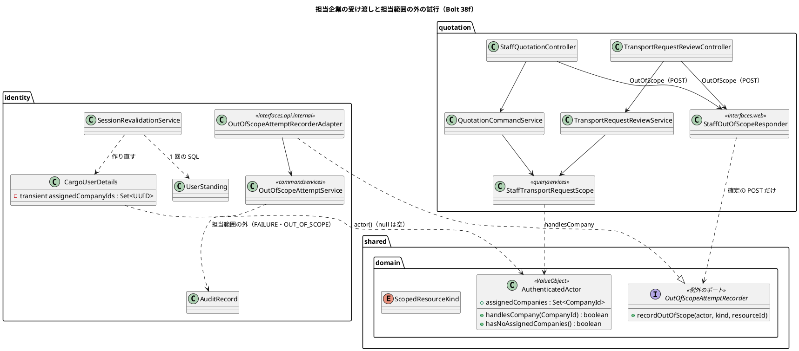
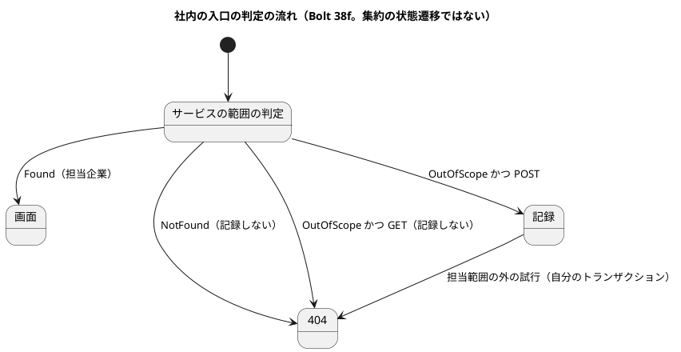

# Bolt 38f 計画 - 担当企業の受け渡しと範囲外の試行の記録、見積りの側の担当範囲の絞り込み

## 基本情報

| 項目 | 内容 |
| :--- | :--- |
| Bolt | 第 38f 回（W6 の 31 本目。開始準備で 38f と 38f2 に分けた 1 つ目。決定 (1)） |
| 予定 | W6（2026-11-09 の週。前倒しで着手できる）。38e の実装と終了報告の承認の後に行う（38e の計画は承認済み、実装中。38e の `AssignedCompanies`・`assignedCompaniesOf`・開発データの割り当て `V20261028100900` を前提にする）。作業は約 8.5 時間（510 分。`check`・`uiTest`・SonarQube・CI の待ちを除く）。CLAUDE.md の「半日を超える Bolt は分割する」の例外として受け入れる（決定 (11)）。下の打ち切りで守る |
| アプローチ | インサイドアウト（受け渡しとポート。横断の部品）の後にアウトサイドイン（既存の集約に受入条件を足す）。開発戦略 :119・:346 の「横断の部品はインサイドアウト、判定を足す Bolt はアウトサイドイン」に合わせる。受け渡しとポートは値と識別の側から作り、見積りの側は受入シナリオの Red から入る |
| 対象 | (1) `AuthenticatedActor` への担当企業の受け渡し（request ごとの確かめで載せ直す）と ADR-012 の改訂、(2) 担当範囲の外の試行の記録のポート（`shared.domain`）と identity の実装と ADR-019、食い違う文書（architecture_backend・ADR-001・ADR-014）の改訂、(3) 見積りの側の社内の画面（輸送要求の審査 4・社内の見積り 6 の計 10 の入口）を担当企業で絞り、範囲外は 404、確定の POST で試行を記録（判定はサービス）、(4) 既存の UI シナリオの割り当ての準備、(5) 開発データに荷主 A だけを担当する営業担当者、(6) マニュアル 6 章とキャプチャ、axe、(7) 設計の文書 |
| トレース | US-16 AC4（業務担当者の担当範囲の外の拒否と試行の記録。見積りの分）、BR-15（38e の決定 (10) で担当企業に近似）、IA-INV-02・IA-INV-08、SEC-12、W6 の確認ポイント 16・17、#14 |
| GitHub | [#14](https://github.com/k2works/practical-domain-driven-design-in-enterpris-application/issues/14)（US-16 の残り。クローズは 38g） |
| SP | 0 |
| 承認ゲート | 計画と終了報告。**認可**（担当企業で絞る、範囲外は 404、確定の POST で試行を記録、割り当てのない営業担当者は何も見えない）、**構造**（ADR-012 の改訂、ADR-019 で共有カーネルに例外として振る舞いのあるポートを 1 つ置き、architecture_backend・ADR-001・ADR-014 を改める）、**データベース**（dev だけのマイグレーションで営業担当者を 1 人足す）、新しいファイル（下の一覧）。38e の決定 (9)（同じ `COMPANY` の行を役割で読み分ける）を使う。スキーマは変えない |
| ブランチ | develop で開発する。途中の push はデモ環境の配備になるので、push はステップ 10 でまとめる |
| 開始準備で決めたこと | 2026-10-28、human:kakimomokuri: (1) 38f と 38f2 に分ける。38f は受け渡し・ADR-012 の改訂・担当範囲の外の試行の記録のポートと ADR-019・見積りの側の絞り込み（輸送要求の審査と社内の見積りの 10 の入口）・マニュアル 6 章。38f2 は予約の側の絞り込み（4 つの入口）・動画・マニュアル 7 章。打ち切りは自然な切れ目に置く、(2) 担当企業は `CargoUserDetails` に `transient` の項目で持ち、毎回の確かめで作り直す。古い session の互換の問題は起きないので【前の決定の変更】は要らない。ADR-012 にそう判断した理由を書く、(3) ポートは `shared.domain` に置き、実装は `identity.interfaces.api.internal` のアダプターから commandservices に委ねる、(4) 記録は前例どおり自分のトランザクションで行い、外側のトランザクションの中では拒む。記録するのは確定の POST だけで、GET の範囲外は 404 だけ（SEC-12）、(5) 用語を「管理範囲の外の試行」（`ADMIN_SCOPE_DENIED`）と「担当範囲の外の試行」に分ける。種類は列挙で固定し、ArchUnit で書き手を 1 か所にする、(6) 判定は `AuthenticatedActor` に置き、失敗に倒す（空なら何も見えない）、(7) 確認ポイント 19 は 38g に送る、(8) カスタマーサポートに社内の画面を開くのは別に諮る。38f で絞るのは営業担当者だけ。整合性検証の後（同日）: (9) ポートは `shared.domain` に置き、食い違う文書を改める。ADR-019 で、共有カーネルに置くのはこのポート 1 つだけの例外とし、architecture_backend :91・:133・:159、ADR-001 のコンプライアンス（前例 :78 の `platform :: web` の例外）、ADR-014 :59 に改訂の経緯を書く。比べる案に「使う側の各コンテキストがポートを持つ」も入れる。ArchUnit でイベントと公開 API の型がこのポートに依存しないことを守る、(10) 判定はサービスが行う（前例 `ManagedUserLookup`）。コマンドと照会に操作者を渡し、サービスが範囲外を結果で返す。controller はそれを見て記録し 404 にする。ポートを呼ぶのは `interfaces.web`（`@Transactional` なし）の 1 つの部品だけにし、ArchUnit で守る、(11) 38f と 38f2 の 2 つのままにし、38f は CLAUDE.md の「半日を超える Bolt は分割する」の例外として受け入れる。打ち切りで送る候補は社内の見積りの 6 入口、(12) デモと動画のために、dev だけのマイグレーションで荷主 A だけを担当する営業担当者を 1 人足す。動画は UI テストの利用者で撮る（38f2） |

新しいファイル（計画の承認で確かめる。計 21 とキャプチャの撮り直し）:

- 本体（8）:
  - `shared/domain/OutOfScopeAttemptRecorder.java`（担当範囲の外の試行の記録のポート。共有カーネルの例外。ADR-019）
  - `shared/domain/ScopedResourceKind.java`（記録する対象の種類の列挙。`TRANSPORT_REQUEST`・`QUOTATION`。38f2・38g で `BOOKING` などを足す。`target_type` の `VARCHAR(50)` に収まる名前）
  - `identity/interfaces/api/package-info.java`・`identity/interfaces/api/internal/package-info.java`（identity にまだない。ほかのコンテキストの前例にならう）
  - `identity/interfaces/api/internal/OutOfScopeAttemptRecorderAdapter.java`（ポートの実装。`@Component`。commandservices に委ねる）
  - `identity/application/internal/commandservices/OutOfScopeAttemptService.java`（自分のトランザクションで監査を書く。前例 `AdministrationScopeDenialService`。名前は確認ポイント 6）
  - `quotation/application/internal/queryservices/StaffTransportRequestScope.java`（社内の側の輸送要求の範囲の判定。`Found`・`NotFound`・`OutOfScope` を返す。照会のサービスとコマンドのサービスが使う。前例 `ManagedUserLookup`）
  - `quotation/interfaces/web/StaffOutOfScopeResponder.java`（範囲外の結果を受けてポートを呼び 404 にする、呼ぶ側の唯一の部品。T-205）
- マイグレーション（1）: `db/dev-data/V20261028110900__seed_dev_sales_assigned_to_shipper_a.sql`（荷主 A だけを担当する営業担当者。dev だけ。版は 38e の `V20261028100900` の後。名前はステップ 4 で前例を見て決める）
- 文書（1）: `docs/adr/cargo-tracker/019-out-of-scope-attempt-recorder.md`（と ADR の `index.md` の行）
- テスト（10）:
  - `shared/domain/AuthenticatedActorTest.java`（新しいファイル。`handlesCompany`・`hasNoAssignedCompanies` の閉じた答え）
  - `OutOfScopeAttemptServiceTest`（commandservices。`setActualTransactionActive(true)` で外側の中を拒む。前例 `AdministrationScopeDenialServiceTest`）
  - `OutOfScopeAttemptRecorderIntegrationTest`（identity。本物の `TransactionTemplate` の中から呼んで拒み、外側のロールバックの後に 0 行。`IdentitySpyIntegrationTestBase` を継ぐので identity のパッケージに置く）
  - `StaffTransportRequestScopeTest`（quotation の queryservices）
  - `StaffAssignedScopeSecurityIntegrationTest`（quotation。10 の入口。パッケージ内だけで見える基底は継げないので、公開の `@IdentityIntegrationTest` と `IdentityLogins` を使う）
  - `OldSessionPrincipalTest`（identity.infrastructure.security。変える前のバイト列の資源を新しいクラスで戻す。既存の `SpringSessionRows` を使う）と資源 `test/resources/.../old-session-principal.b64`
  - `StaffListingQueriesContract`・`H2StaffListingQueriesTest`・`MyBatisStaffListingQueriesIntegrationTest`（5 つの一覧の SQL の範囲の中と外。H2・PostgreSQL。T-214）
  - `features/ui/restrict_staff_by_assigned_companies_ui.feature`・`ui/StaffAssignedScopeUiSteps.java`
- 変える既存のファイル（主なもの）: `UiUsers`（明示の割り当ての補助と、2 つ目の荷主の企業と輸送要求）、`manual_screenshots.feature`（割り当ての手順）
- 資産: `docs/manual/assets/06-*` の受付一覧のキャプチャを撮り直す（`manual_screenshots.feature` は UI テストの利用者で動くので、割り当ての手順を足した後に差分を見る。開発データは使わない）

## Bolt ゴール

営業担当者は、担当企業の輸送要求と見積りだけを社内の画面で見て操作できる。担当範囲の外の輸送要求は一覧に出ず、URL を直接開いても共通の 404 になり、確定の操作を送ったときは試行が監査に残る。

### 開始準備で確かめたこと

| # | 事実 | 根拠 |
| :--- | :--- | :--- |
| 1 | release_plan の 38f の行は、受け渡し（ADR-012 の改訂）、`shared` の範囲外の試行の記録のポートと identity の実装と ADR-019、見積りの側の社内の一覧・詳細・操作を担当企業で絞り範囲外は 404 と試行の記録（AC4）、マニュアル 6 章。確認ポイント 19 は 38g、動画とマニュアル 7 章は 38f2 の行に移した | `release_plan.md:786`・:787・:788 |
| 2 | #14 の AC4 は「業務担当者が担当企業・担当案件以外を操作すると、拒否され試行が記録される」。38f は見積りの分、38f2 は予約の分、38g は経路設計と追跡の分。AC1 の担当案件は 38e の決定 (10) で担当企業に近似して閉じる | `gh issue view 14`、`bolt_38e_plan.md:24` |
| 3 | 38e の計画の「38f に送るもの」: LEFT JOIN の重なり、古い session の扱いと変える前のバイト列（Base64）、ポートのトランザクションの約束と GET で記録するか、置き場所と呼ぶ側（ACL を通すか）、用語、ArchUnit の書き手、判定のメソッド、変異 4 つ（V17 を含む）。確認ポイント 19 は 38g、動画は 38f2 に送る（決定 (1)・(7)） | `bolt_38e_plan.md` の「38f に送るもの」 |
| 4 | 絞る見積りの側の社内の入口は 10: `TransportRequestReviewController`（`/staff/transport-requests`）の一覧 GET（:78）・詳細 GET（:124）・審査 POST（:137）・書類 GET（:251）、`StaffQuotationController`（`/staff/transport-requests/{number}/quotations`）の new GET（:83）・作成 POST（:95）・詳細 GET（:138）・再見積り GET（:191）・再見積り POST（:217）・提示 POST（:270）。POST は 4、GET は 6 | 各 controller の `@RequestMapping` |
| 5 | 今の社内の照会はすべて全件（`findUnderReview()`・`findQuoting()`・`findQuotedSummaries()`・`findRoutingRequestedSummaries()`・`findAwaitingBookingSummaries()`）。SQL は `TransportRequestMapper.xml:161-172` の 2 つと `QuotationMapper.xml:167-177・194-203・224-236` の 3 つ。社内の側の `AuthenticatedActor` の使い道は操作者（`userId()`）だけ。本体とテストで 51 か所が呼ぶ | `TransportRequestReviewController.java:78-135`、`StaffQuotationController.java:278`、grep |
| 6 | 荷主の画面は `actor.companyId()` で絞る（`findVisible(…, companyId)`・`findByNumber(found, companyId)`）。範囲外は見つからない扱い。社内の 404 は `ResponseStatusException(HttpStatus.NOT_FOUND)`。404 の画面の文言は「画面が見つかりません」 | `TransportRequestController.java:90-307`、`StaffQuotationController.java:492`、`templates/error/404.html` |
| 7 | `TransportRequest`・`TransportRequestRepository`・`QuotationRepository` は荷主企業の `CompanyId` を持つ。スキーマの変更は要らない | grep |
| 8 | `/staff/**` を使えるのは営業担当者（`SALES`）だけ。38f で実際に絞られるのは営業担当者 | `SecurityConfiguration.java:212-223` |
| 9 | 管理範囲の外の試行の記録の前例 `AdministrationScopeDenialService.recordDenied`: 外側のトランザクションの中で呼ばれると `IllegalStateException`、自分のトランザクションで書く、確定の POST のときだけ記録し GET では記録しない（SEC-12）、追記の失敗は 500。監査は `result=FAILURE`・`reason=OUT_OF_SCOPE`（`AuditResult` は `SUCCESS`・`FAILURE` だけで、DB の CHECK も同じ）。書き手は `UserDetailPage` と `UserRegistrationService`（`adminScopeDeniedCompany`、:167）で、規則は `LayerArchitectureTest.java:345-` | `AdministrationScopeDenialService.java:13-18,40-44`、`AuditRecord.java:270-271,289-290`、`AuditResult.java:6-10`、`V20261006140000__create_identity_users.sql:60` |
| 10 | session に入るのは `CargoUserDetails`（`serialVersionUID = 1L`。UUID・String・`EnumSet<Role>`）。直列化は JDK の既定のまま（独自の変換の設定はない）。`AuthenticatedActor` は `actor()`（:57）で作るだけで直列化されない。`CompanyId`・`UserId` は `Serializable` でない record | `CargoUserDetails.java:24-57`、`CompanyId.java:13`、`application.properties` |
| 11 | `SessionRevalidationFilter` は公開でない認証済みの request のたびに `revalidate` を呼び、`CargoUserDetails` を作り直して `SecurityContext` に差し替える。null になるのは確かめをしない公開の URL と、復元した直後だけ。404 はエラーのディスパッチ（`/error`。公開の URL）で描かれ、このとき主体は session から戻したもので担当企業は null。`CurrentActorAdvice` がヘッダーのために `actor()` を呼ぶ | `SessionRevalidationFilter.java:63-112`、`SecurityConfiguration.java:98`、`CurrentActorAdvice.java:16` |
| 12 | 共有カーネル（`shared`、OPEN）には値だけがあり、振る舞いのあるポートの前例はない。正とする設計の文書は「業務の意味を持たない基本型だけに限る」（architecture_backend :133）、「業務規則を持つ型は共有しない」（:159）、ADR-014 :59（共有カーネルに業務の意味を持たせない）、ADR-001 のコンプライアンス（モジュール間の依存は公開 API とイベントだけ。例外は :78 の `platform :: web`）。ArchUnit（`DomainArchitectureTest.java:28`）と Modulith には当たらない。`PublicApiArchitectureTest.java:29`・`DomainEventArchitectureTest.java:55` は `shared.domain..` 全体を許すので、イベントや公開 API の型がポートを持っても通ってしまう。依存は identity → `quotation :: events`、quotation → `shared`・`platform :: web`。quotation が identity の公開 API を呼ぶと循環する | 各文書、`ADR-003:58`、各 `package-info.java` |
| 13 | `new AuthenticatedActor(` は本体 3 か所（`SessionRevalidationService:62`・`CargoUserDetails:57`・`CargoUserDetailsService:35`）、テスト 31 ファイル・38 か所 | grep（`build/` を除く） |
| 14 | ADR の最新は 018。019 は空いている | `docs/adr/cargo-tracker/` |
| 15 | identity の合成ルートの `@Bean` が返してよい型は `identity.application.internal`・`identity.infrastructure.security`・`org.springframework` だけ。`shared.domain` のポートを返す `@Bean` は落ちる。前例は `booking/interfaces/api/internal/TrackingStartNotificationAdapter.java:15` の `@Component` | `AuthenticationArchitectureTest.java:277-284・:311-318` |
| 16 | `UiUsers.create`（:208-238）は、シナリオごとに営業担当者と荷主をそれぞれ乱数の企業で作り、営業担当者に担当企業を割り当てない。38e の #50 (a) で自動の割り当てもなくなる。38f の後、営業担当者が荷主の輸送要求を扱う UI シナリオは、準備を足さないとすべて一覧が空・404 になる。`UiUsers` は役割ごとに 1 人を作るので、範囲の中と外の 2 つの荷主の企業を 1 つのシナリオに置く口がない | `UiUsers.java:208-238`、`bolt_38e_plan.md` |
| 17 | 営業担当者が出てくる UI の feature は 25 本。そのうち営業担当者が社内の見積りの側の一覧・詳細を通る候補は 15 本（`approve_quotation_and_route_ui`・`attach_required_documents_ui`・`compare_route_candidates_ui`・`confirm_booking_ui`・`confirm_route_ui`・`layout_ui`・`main_flow_ui`・`manual_screenshots`・`present_quotation_ui`・`replace_quotation_ui`・`request_route_design_ui`・`requote_after_approval_ui`・`resubmit_transport_request_ui`・`review_transport_request_ui`・`route_already_departed_ui`・`route_redesign_required_ui` のうち、ステップ 1 の grep で通ることを確かめたもの）。残りの 10 本（`kpi_observations_ui`・`login_ui`・`manage_user_*_ui`・`register_user_ui`・`session_timeout_ui`・`query_tracking_ui`・`register_milestone_ui`）は利用者の管理や追跡で、見積りの側を通らない見込み（ステップ 1 で確かめる。T-148） | grep（`features/ui`） |
| 18 | UI でないテストで全件の照会を呼ぶもの: `ShipperTransportRequestSteps.java:170`（`quotation/*.feature` 11 本が使う）、`MyBatisQuotationIntegrationTest`（:498・:671・:675・:729・:751）、`MyBatisTransportRequestReviewIntegrationTest`、`DevSampleDataSmokeTest`（:285-768 の 13 か所）、`InMemoryTransportRequestRepository`（:86・:95）・`InMemoryQuotationRepository`（:105・:110）、`TransportRequestEventHandlersConflictTest`（:218-229 の委譲の実装） | grep |
| 19 | dev の荷主の企業は A・B の 2 社だけ。38e の `V20261028100900` は開発の営業担当者に A・B の両方を割り当てるので、デモでは絞り込みが見えない | `db/dev-data/V20261006140900__seed_dev_users.sql` |

## 設計の決定（案）

| 項目 | 決定 | 根拠 |
| :--- | :--- | :--- |
| 担当企業の持ち方 | `CargoUserDetails` に `transient Set<UUID> assignedCompanyIds` を足す（直列化しない。`UUID` の集合にするのは `CompanyId` が `Serializable` でないため）。`revalidate` が毎回 DB から作り直すので、絞る request ではいつも今の値。復元した直後と公開の URL（`/error` を含む）では null で、`actor()` は null を空として渡す（失敗に倒す）。ログインの時（`CargoUserDetailsService`）は空で作り、最初の保護された request の確かめで載る | 決定 (2)、事実 10・11 |
| 古い session の確かめ | ステップ 2 の最初、`CargoUserDetails` を変える前に、今の `SecurityContextImpl`（`CargoUserDetails` を含む）のバイト列を `SpringSessionRows.attributeBytes` で採り、Base64 の資源として残す。新しいクラスでそれを戻して担当企業が空になること、次の確かめで載ることを確かめる（後で `transient` を外したときにも気づける） | 38e の送り、検証の指摘 |
| ADR-012 の改訂 | 決定 1（認証の主体の型。:33）に担当企業を足す。古い session の互換: 直列化の形を変えない（`transient`）ので、ADR-012 :153・ADR-011 :307・domain_model :1184 の「`CargoUserDetails` に項目を足さない（復元の互換）」に当たらない。release_plan :738 の「古い session を捨てる手順」は要らない。【前の決定の変更】にしない理由として書き、:153・ADR-011 :307・domain_model :1184 の文面は「直列化する項目を足さない」に直して、各文書の改訂の経緯に残す | 決定 (2) |
| 読み出し | `UserStandingRepository.findById` の SQL（`selectUserStanding`）に `user_assignment` を LEFT JOIN し、1 回の SQL で役割と担当企業を読む。`scope_kind='COMPANY'` は ON 句に置き、役割 × 企業の行の重なりを写すときに除く。担当企業を載せるのは対象の役割を持つ利用者だけ（38e の決定 (9)・(10)）。判定は 38e の `assignedCompaniesOf` と同じ `RoleAssignmentPolicy` のメソッドを使い、判定を 1 か所に保つ（読み出しの道は 2 つになっても、規則は 1 つ）。`UserStanding` に担当企業を足す。契約 `UserStandingRepositoryContract` の H2・PostgreSQL の子で、役割 2 × 企業 2 の利用者と、BOOKING の行を持つ利用者を確かめる | 確認ポイント 17、38e の送り |
| 判定のメソッド | `AuthenticatedActor` に `assignedCompanies`（`Set<CompanyId>`。不変の写し）、`handlesCompany(CompanyId)`（集合に含むときだけ真。空なら偽）、`hasNoAssignedCompanies()`（一覧の案内の文に使う。閉じた判定）を足す。「絞らない役割」は 38f の社内の画面にはない（`/staff/**` は営業担当者だけ）ので、全件を返す分岐を作らない。絞らない役割が要る画面ができたときは、その役割を明示する閉じた判定を足す（「空なら全件」を写さない） | 決定 (6) |
| 5 引数のコンストラクタ | `AuthenticatedActor` の今の 5 引数のコンストラクタは残し、担当企業を空にして 6 引数に委ねる（テストの 38 か所を直さない）。本体の 3 か所は 6 引数を使う。`WithAuthenticatedActorSecurityContextFactory` に担当企業を渡す口を足す | 事実 13 |
| ポート | `shared.domain.OutOfScopeAttemptRecorder`（`void recordOutOfScope(AuthenticatedActor actor, ScopedResourceKind kind, String resourceId)`）。Javadoc に約束を書く: (a) 業務のトランザクションの外（`interfaces.web` の部品）で呼ぶ、(b) 自分のトランザクションで書き、外側のトランザクションの中で呼ばれたら `IllegalStateException`（外側のロールバックで記録が消えないように、外側の中では呼ばせない）、(c) 確定の POST のときだけ呼び、GET では呼ばない（SEC-12）、(d) 書けなければ例外（500。前例）。`resourceId` の形は下の表。`target_id VARCHAR(100)` に収まる | 決定 (3)・(4)、IA-INV-08 |
| 共有カーネルの例外（ADR-019） | `019-out-of-scope-attempt-recorder.md`: 文脈（業務の各コンテキストが担当範囲の外の試行を同期で記録する。IA-INV-08）、決定（ポートを `shared.domain` に置く。共有カーネルに置く振る舞いの型はこのポート 1 つだけの例外。実装は identity の `interfaces.api.internal`、トランザクションの約束、GET で記録しない、呼ぶ側は ACL を通さず `interfaces.web` の 1 つの部品から呼ぶ（他のコンテキストの公開 API ではなく共有カーネルのポートなので ACL の対象でない））、正とする文書との食い違いとその改訂（architecture_backend :91・:133・:159、ADR-001 のコンプライアンスに `platform :: web` の前例（:78）と同じ形で例外を足す、ADR-014 :59）、ADR-003 :58（共有カーネルに `DomainEvent` を置かない。理由は一律の発生時刻が業務の時刻と二重になること）との関係、比べた案（使う側の各コンテキストがポートを持ち identity が実装する（識別の側が業務のすべてのコンテキストに依存する）、`platform :: api` に置く、ドメインイベントで非同期に記録する（同期で書く約束を守れない））、`shared` と `shared.domain` の package-info の変更（「値だけ」を「値と、依存性逆転のための例外のポート 1 つ」に）。上流とした quotation が実行時に identity の Bean を要することも書く（型の依存の向きは保たれる） | 決定 (3)・(9)、事実 12 |
| 実装の層と組み立て | `identity.interfaces.api.internal.OutOfScopeAttemptRecorderAdapter`（`@Component`。部品探索で拾う。前例 `TrackingStartNotificationAdapter`。`IdentityConfiguration` の `@Bean` にはしない（事実 15））が `identity.application.internal.commandservices.OutOfScopeAttemptService` に委ねる | 決定 (3)、事実 15 |
| 用語と監査 | 「管理範囲の外の試行」（`ADMIN_SCOPE_DENIED`。今のまま）と「担当範囲の外の試行」（新しい値）に分け、用語集に載せる。domain_model :267・test_strategy :341 の「範囲外の試行」は管理範囲の意味なので「管理範囲の外の試行」に書き直す。監査の値は `action` が新しい値、`result=FAILURE`、`reason=OUT_OF_SCOPE`（前例と同じ。スキーマを変えない）、target は種類（`ScopedResourceKind` の名前）と ID、版は null。値の名前は `OUT_OF_SCOPE_DENIED`（サービスは `OutOfScopeAttemptService`）か、前例と対にする `ASSIGNED_SCOPE_DENIED`（サービスは `AssignedScopeDenialService`）かを確認ポイント 6 で諮る（下の文はこの計画の仮の名前 `OUT_OF_SCOPE_DENIED` で書く）。38e の値 `AssignedCompanies`（identity）と shared の `assignedCompanies` は同じ「担当企業」を指す。用語集では「担当企業」を正とし、型の名前の対応を書く | 決定 (5) |
| 書き手と呼ぶ側の規則（ArchUnit） | (a) `AuditRecord` の担当範囲の外の工場を呼ぶのは `OutOfScopeAttemptService` だけ（前例 T-205）、(b) `OutOfScopeAttemptRecorder` を呼ぶのは各コンテキストの `interfaces.web` の 1 つの部品（38f では `StaffOutOfScopeResponder`）だけで、`@Transactional` を付けない、(c) ドメインイベントと公開 API の型は `OutOfScopeAttemptRecorder` に依存しない（`PublicApiArchitectureTest`・`DomainEventArchitectureTest` の許しに例外を足す）、(d) `shared.domain` に置く振る舞いの型はこのポートだけ | 決定 (5)・(9)・(10) |
| 範囲の判定（サービス） | quotation の queryservices に `StaffTransportRequestScope` を置き、輸送要求番号と操作者から `Found`・`NotFound`・`OutOfScope` を返す（前例 `ManagedUserLookup`）。社内の照会のサービスと、審査・見積りのコマンドのサービス（`TransportRequestReviewService`・`QuotationCommandService`）に操作者を渡し、各サービスが最初にこの判定を呼んで、範囲外なら結果（`OutOfScope`）を返す。範囲を知らないまま書ける道を残さない。`OutOfScope` は輸送要求があり、荷主企業が `handlesCompany` で偽のとき。存在しない番号は `NotFound`（記録しない）。照会と書き込みは同じトランザクションの中で判定するので、割り当ての変更との窓は前例と同じ（1 つのトランザクションの中で読む） | 決定 (10)、前例 Bolt 34b |
| 一覧の絞り込み | 社内の 5 つの一覧の照会に担当企業の集合を渡し、SQL の `IN` で絞る。担当企業が空のときの守りは照会のサービスの 1 か所に置き、SQL を流さずに空を返す（`IN ()` は書けない。リポジトリ 5 つと InMemory の 2 つに写さない）。一覧の上部の案内の文は `AuthenticatedActor.hasNoAssignedCompanies()` で出す（表ごとの空の文は今のまま） | 決定 (6)、事実 5 |
| 詳細と操作の入口 | GET の 6 入口は、`OutOfScope` なら 404（記録しない）。POST の 4 入口は、サービスが `OutOfScope` を返したら controller が `StaffOutOfScopeResponder` を通してポートを呼んで記録し（業務のトランザクションの外）、404。値の解釈（審査の結果・見積りの金額など）はサービスの範囲の判定の後（前例 T-211。今の `submitReview` は `decision()`（:147）と版番号（:148）を先に解釈しているので順を直す）。`NotFound` は記録せずに 404。経路の値の型の誤り（`@PathVariable int`）は本体に入る前に 400 で、記録しない（範囲によらず同じ 400 なので範囲の外の存在は漏れない） | 決定 (4)・(10)、SEC-12 |
| 404 の画面 | 共通の 404 の画面のまま（範囲外と存在しないを見分けない。範囲の外の存在を見せない）。ヘッダーの表示名は `/error` のディスパッチで担当企業が null でも出る（V12） | 前例 IA-INV-14、事実 11 |
| 既存のシナリオの準備 | `UiUsers` に明示の割り当ての補助（指定の利用者に指定の荷主の企業を担当させる）と、2 つ目の荷主の企業とその輸送要求を作る補助を足す。影響する feature（事実 17 の候補のうちステップ 1 の grep で確かめたもの）の背景に共通の前提「営業担当者は荷主の企業を担当している」を置く（暗黙の自動の割り当ては作らない。38e の #50 (a) の向き）。UI でないテスト（事実 18）は照会に担当企業を渡す形に直す | 事実 16・17・18 |
| 開発データ（デモ） | dev だけのマイグレーションで、荷主 A だけを担当する営業担当者を 1 人足す（`db/dev-data`、版は 38e の後）。開発の既存の営業担当者は A・B のまま。デモでは 2 人を見比べて絞り込みを見せる。動画は UI テストの利用者で撮る（38f2） | 決定 (12)、事実 19 |
| カスタマーサポート | 社内の見積り・予約の画面を開くのは別に諮る。38f は今の認可の規則のまま（営業担当者だけ） | 決定 (8) |
| 確認ポイント 19 | 38g に送る（release_plan の 38g の行に書いた） | 決定 (7) |

### 4 つの POST の記録の値と、範囲より先に止まる値

| 入口 | `ScopedResourceKind` | `resourceId` | 範囲の判定より先に 400 になる値（記録しない） |
| :--- | :--- | :--- | :--- |
| 審査 POST（`/staff/transport-requests/{number}/review`） | `TRANSPORT_REQUEST` | 輸送要求番号（例 `TR-2026-0001`） | なし（`decision`・版番号はフォームの文字列で受け、範囲の判定の後に解釈する） |
| 見積りの作成 POST（`…/{number}/quotations`） | `TRANSPORT_REQUEST` | 輸送要求番号（見積りはまだない） | なし（金額・期限はフォームの文字列） |
| 再見積り POST（`…/{number}/quotations/{quotationNo}/requote`） | `QUOTATION` | `{輸送要求番号}/{見積り番号}`（例 `TR-2026-0001/2`） | 経路の `quotationNo` が数でない |
| 提示 POST（`…/{number}/quotations/{quotationNo}/present`） | `QUOTATION` | 同上 | 経路の `quotationNo` が数でない |

範囲の外の輸送要求に、存在しない見積り番号を送ったときは、輸送要求の範囲の判定が先なので範囲外として記録する（`QUOTATION`、送られた番号のまま）。書類の GET の `int versionNo, int documentNo` が数でないときも 400（GET なので記録しない）。

### 受入条件（行と 1:1）

| # | 受入条件 | 行 |
| :--- | :--- | :--- |
| AC-1 | 営業担当者の社内の一覧には、担当企業の輸送要求だけが出る。担当企業がなければ何も出ず、上部に案内の文が出る | 1a・2a・3a |
| AC-2 | 担当範囲の外の輸送要求の詳細・書類・見積りの画面を GET で開くと共通の 404 で、記録しない | 2b・3b・14 |
| AC-3 | 担当範囲の外の審査・見積りの作成・再見積り・提示を POST で送ると、値の誤りによらず共通の 404 で、担当範囲の外の試行が監査に 1 行残る。存在しない番号は 404 で記録しない | 2c・3c・4・5・15 |
| AC-4 | 割り当てを変えると、次の request から新しい担当企業で絞られる | 6 |
| AC-5 | 記録は自分のトランザクションで書かれ、外側のトランザクションの中では呼べない。書けなければ 500 | 8・9・10 |
| AC-6 | 受け渡しは 1 回の SQL で、対象の役割のない利用者の担当企業は空。古い session・公開の URL では空（失敗に倒す）。404 の画面のヘッダーは表示名を出す | 7・11・12・16b |
| AC-7 | 荷主の画面は今のまま自社で絞る | 13 |
| AC-8 | UI の通し（範囲外が一覧に出ない、URL を開くと 404、幅 320 px、axe の違反 0） | 16a |

### 文言（全文）

| 場面 | 文言 |
| :--- | :--- |
| 範囲外の詳細・操作 | 共通の 404 の画面（文言は変えない。「画面が見つかりません」） |
| 一覧の上部の案内（担当企業がない営業担当者。表ごとの空の文は今のまま） | 担当企業がまだないので、表示できる輸送要求はありません。システム管理者に担当企業の割り当てを頼んでください。 |
| マニュアル 6 章の注（要旨。全文はステップ 8 でマニュアルで決め、終了報告で示す。T-218） | 社内の一覧と詳細には、担当企業の輸送要求だけが表示される。担当企業の外の輸送要求を開くと「画面が見つかりません」と示される。担当企業はシステム管理者が利用者の管理（11 章）で割り当てる |

38e の文言「業務の画面で効くのは、今後の更新からです」は、見積りの側が効いても予約・経路設計・追跡の側がまだなので、38f では外さない（38g で外す）。

### 既存の期待を変える箇所（T-122）

- UI の feature: 事実 17 の候補 15 本のうち、ステップ 1 の grep で営業担当者が見積りの側の一覧・詳細を通ると確かめたもの（背景に共通の前提を足す）。残りの 10 本は通らないことを確かめて報告に書く。`manual_screenshots.feature`（6 章 :38-79。割り当ての手順を足す）
- UI でないテスト: `ShipperTransportRequestSteps.java:170`、`MyBatisQuotationIntegrationTest`（:498・:671・:675・:729・:751）、`MyBatisTransportRequestReviewIntegrationTest`、`DevSampleDataSmokeTest`（13 か所）、`InMemoryTransportRequestRepository`・`InMemoryQuotationRepository`、`TransportRequestEventHandlersConflictTest`（委譲の実装）、`TransportRequestReviewControllerTest`・`StaffQuotationControllerTest`（`@WebMvcTest`。主体に担当企業を渡す口と、記録のポートの `@MockitoBean` が要る）
- `AuthenticatedActor` の本体の 3 か所、`WithAuthenticatedActorSecurityContextFactory`。テストの 31 ファイル・38 か所は 5 引数のコンストラクタを残すので直さない
- `UserStanding` と作る箇所（`MyBatisUserStandingRepository`・`SessionRevalidationServiceTest`）、`UserStandingRow`・resultMap、`UserStandingRepository` の Javadoc（「利用者・役割・所属企業を 1 回で」に担当企業を足す）
- `CargoUserDetails`・`CargoUserDetailsService`
- `shared/package-info.java`・`shared/domain/package-info.java`（「値だけ」）
- `LayerArchitectureTest`（:345- の書き手の規則。`ADMIN_SCOPE_DENIED` の書き手は `UserDetailPage` と `UserRegistrationService`、担当範囲の外は `OutOfScopeAttemptService` だけ）、`PublicApiArchitectureTest`・`DomainEventArchitectureTest`（ポートへの依存の例外）
- 「荷主企業で絞らない」と書いた生きたドキュメント: `StaffTransportRequestQueryService` の Javadoc、`TransportRequestReviewController.java:40`、`StaffQuotationController.java:42`、`QuotationMapper.xml:166` の注、ui_design :166
- 下の「親が直す文書」と、この Bolt の中で直す文書（ステップ 1）

### 親が直す文書（この計画のほかのファイル。計画の承認の後、ステップ 1 で直す）

- release_plan: :707（38e をインサイドアウトにした理由に残る受け渡しとポート。38f のアプローチを混成に）、:738（確認ポイント 17 の「古い session を捨てる手順」「38e で諮る」を、`transient` で捨てる手順が要らないことに）、:747（設計の文書の一覧）、:790（「38e の公開のポートの後に 38f・38g」を 38f の受け渡しとポートの後に）、:800（マニュアルの章を 6 章 38f・7 章 38f2・8 章と 9 章 38g に。8 章が抜けている）、38f の行（約 8.5 時間、分割の規則の例外、dev の営業担当者を足すデータベースの承認ゲート）
- test_strategy: :583（「38e〜38g」に 38f2 を足す）、:341（「範囲外の試行」を「管理範囲の外の試行」に）
- architecture_backend: :91・:133・:159（共有カーネルの例外）、:306（監査の書き手の表に担当範囲の外の行）
- domain_model: :267（「範囲外の試行」を「管理範囲の外の試行」に）、:1184（`CargoUserDetails` に項目を足さない理由）、IA-INV-08（:1378。管理範囲と担当範囲の両方で「確定の POST だけ」と明記）、用語集（「担当範囲の外の試行」「担当企業」と型の名前の対応）、監査の操作の表、要素の表（`ScopedResourceKind`・`OutOfScopeAttemptRecorder`）
- ADR-001（コンプライアンスの例外と改訂の経緯）、ADR-011 :307、ADR-012（決定 1、:153、改訂の経緯）、ADR-014 :59（改訂の経緯と ADR-019 への参照）、ADR の `index.md`
- data_model（監査の値の決まり）、non_functional（PERF-01・02 の注（request ごとの SQL の中身）、SEC-12）、ui_design（S-10 などの社内の一覧の注と案内の文、:166、404）、マニュアル 6 章

## ふりかえりと前の Bolt からの引き継ぎ

| 出典 | 内容 | この Bolt での扱い |
| :--- | :--- | :--- |
| Bolt 38d Try T-217 | テストを先に書いたら、本体を直す前に Gradle で Red を流し、落ちた理由を記録する | 各ステップとレビューの直しの指示に、禁止事項と同じ欄に書く |
| T-204 | heredoc と標準入力を待つコマンドを使わない | フォークの指示の禁止事項に書く |
| Bolt 38d2 Try T-218 | 計画に載せるマニュアルの文は要旨とし、全文は実装のときに決めて終了報告で示す。画面の文言は全文のまま契約にする | 文言の表のマニュアルの行は要旨、画面の文言は全文 |
| Bolt 38c2 Try T-216 | 打ち消す操作の後の場面を置く | 割り当てを外した後の次の request（行 6） |
| Bolt 38c Try T-214・T-215 | 変異の対象に契約テストを入れる。Gradle を流す担当を 1 つにする | 変異の対象に `UserStandingRepositoryContract`・`StaffListingQueriesContract` の H2・PostgreSQL の子。変異とゲートは 1 つの担当 |
| T-148 | 全体を数えてから共通の部品を変える | 影響する feature とテストは grep で数えてから直す（事実 17・18） |
| 38e の「38f に送るもの」 | 受け渡し・古い session のバイト列・ADR-012・ポートと ADR-019・呼ぶ側の置き場所・用語・ArchUnit・判定のメソッド・変異 | この計画の設計の決定と変異に入れた（V13 を足した）。確認ポイント 19 は 38g、動画は 38f2 |
| 38d2 の既知の課題 | 全画面の advice の負債、照会の失敗で全画面が 500 | 受け渡しは advice でなく確かめのフィルターで行うので増やさない |

## 状態の組み合わせ（行ごとにテストを 1 本。T-182）

| 行 | 状況 | 期待 | 出口 | 確かめ方 |
| :--- | :--- | :--- | :--- | :--- |
| 1a | 担当企業の輸送要求（一覧） | 今のまま一覧に出る | 一覧の画面 | `StaffAssignedScopeSecurityIntegrationTest` |
| 1b | 担当企業の輸送要求（詳細・書類・見積りの画面・4 つの操作） | 今のまま見えて操作できる | 各画面 | 同上 |
| 2a | 担当範囲の外の輸送要求（一覧） | 一覧に出ない（5 つの一覧のどれにも） | 一覧の画面 | 同上、`StaffListingQueriesContract` の子（SQL ごと） |
| 2b | 担当範囲の外の輸送要求（GET の 6 入口） | 404 で記録しない | 共通の 404 | `StaffAssignedScopeSecurityIntegrationTest`（入口をパラメーター化） |
| 2c | 担当範囲の外の輸送要求（POST の 4 入口） | 404 で担当範囲の外の試行が 1 行（全列: 操作者・企業・action・`result=FAILURE`・`reason=OUT_OF_SCOPE`・target_type・target_id・target_version が null。件数は操作者と target_id で絞る。T-113） | 共通の 404 | 同上 |
| 3a | 担当企業のない営業担当者（一覧） | 一覧は空で上部に案内の文 | 一覧の画面（案内） | 同上 |
| 3b | 担当企業のない営業担当者（GET） | 404 で記録しない | 共通の 404 | 同上 |
| 3c | 担当企業のない営業担当者（POST） | 404 で記録 1 行 | 共通の 404 | 同上 |
| 4 | 存在しない輸送要求番号 | 404 で記録しない（`NotFound`） | 共通の 404 | `StaffTransportRequestScopeTest`・`StaffAssignedScopeSecurityIntegrationTest` |
| 5 | 担当範囲の外 × 誤った値（審査の結果がない、金額の形の誤り、版の誤り。経路の値の型の誤りは除く。T-211 をパラメーター化） | 値の誤りによらず 404 で記録 1 行（範囲の判定が先） | 共通の 404 | `StaffAssignedScopeSecurityIntegrationTest` |
| 6 | 割り当てを外した・足した後の次の request（T-216） | 次の request から新しい担当企業で絞る | 各画面・共通の 404 | 同上（38e の割り当ての口で変える） |
| 7 | 変える前のバイト列の主体を戻した直後・公開の URL | 担当企業は空（null を空に）。次の確かめで載る | 該当しない（主体の値） | `OldSessionPrincipalTest` |
| 8 | 外側のトランザクションの中でポートを呼んだ | `IllegalStateException`、外側のロールバックの後に 0 行 | 500 | `OutOfScopeAttemptServiceTest`（単体）・`OutOfScopeAttemptRecorderIntegrationTest`（本物の `TransactionTemplate`） |
| 9 | 記録が書けない | 例外（500）、業務は何も書かない | 500 | `OutOfScopeAttemptRecorderIntegrationTest` |
| 10 | controller が記録の後に 404 を投げた | 記録は自分のトランザクションで確定していて残る | 共通の 404 | `StaffAssignedScopeSecurityIntegrationTest`（行 2c の確かめに含む。名前をこの行に挙げる） |
| 11 | 役割 2 × 企業 2 の利用者と、BOOKING の行を持つ利用者（LEFT JOIN の重なり） | 役割 2・担当企業 2、重なりや抜けがなく、BOOKING の行を担当企業に載せない（H2・PostgreSQL） | 該当しない（読み出しの値） | `UserStandingRepositoryContract` の子 |
| 12 | 対象の役割のない利用者（システム管理者）の主体 | 担当企業は空（管理範囲の行を担当企業として載せない。38e の決定 (9)） | 該当しない（主体の値） | `UserStandingRepositoryContract` の子（V11 はここで落とす） |
| 13 | 荷主の画面 | 今のまま自社で絞る（担当企業を使わない） | 各画面 | 既存の `TransportRequestControllerTest`（`@WebMvcTest`）が緑のまま。名前をこの行に挙げる |
| 14 | 書類の GET（担当範囲の外） | 404 で記録しない | 共通の 404 | `StaffAssignedScopeSecurityIntegrationTest` |
| 15 | 書き手と呼ぶ側の規則 | 担当範囲の外の工場を呼ぶのは `OutOfScopeAttemptService` だけ。ポートを呼ぶのは `StaffOutOfScopeResponder` だけで `@Transactional` なし。イベントと公開 API の型はポートに依存しない。`shared.domain` の振る舞いの型はポートだけ | 該当しない（構造） | `LayerArchitectureTest`・`PublicApiArchitectureTest`・`DomainEventArchitectureTest` |
| 16a | UI の通し | 範囲外が一覧に出ない、URL を開くと 404、幅 320 px、axe の違反 0 | 一覧の画面・共通の 404 | `restrict_staff_by_assigned_companies_ui.feature` |
| 16b | 範囲外の URL の 404 の画面 | ヘッダーに表示名が出る（`/error` のディスパッチで担当企業が null でも 500 にならない） | 共通の 404 | 同上 |

## スコープ

### 入れるもの

- 行 1a〜16b のテスト、`AuthenticatedActor` の担当企業と `handlesCompany`・`hasNoAssignedCompanies`、`UserStanding` と SQL と契約テスト、`CargoUserDetails`（`transient`）と `revalidate`、変える前のバイト列の資源、`OutOfScopeAttemptRecorder`・`ScopedResourceKind`・アダプター・`OutOfScopeAttemptService`・identity の `interfaces.api` の package-info、監査の新しい値と工場、quotation の `StaffTransportRequestScope` と照会・コマンドのサービスへの操作者の受け渡し、5 つの一覧の照会の絞り込みと契約テスト、10 の入口の 404 と記録、`StaffOutOfScopeResponder`、ArchUnit の規則、既存のシナリオの準備（`UiUsers`・feature の背景・UI でないテスト）、dev の営業担当者のマイグレーション
- ADR-012 の改訂、ADR-019 と ADR の index、package-info、architecture_backend・ADR-001・ADR-014・ADR-011 の改訂
- マニュアル 6 章（注、担当企業がないときの一覧）、キャプチャ
- 設計の文書（T-126）: 上の「親が直す文書」と T-122 の文書

### 入れないもの

- 予約の側の 4 つの入口、動画、マニュアル 7 章（38f2）
- 経路設計・追跡の側、確認ポイント 19、38e の文言の「今後の更新から」を外すこと（38g）
- カスタマーサポートに社内の画面を開くこと（決定 (8)）
- 担当案件の単位（38e の決定 (10)）

## 設計（この Bolt の範囲）

- 状態遷移図: 集約の状態を変えないので省く（上の 2 つ目の図は入口の判定の流れ）
- 画面遷移図: 画面と遷移は変えない（範囲外は共通の 404）ので省く
- ER 図: 表と列を変えないので省く

## ステップ計画

各ステップで、テストを先に書いたら、本体を直す前に Gradle で Red を流し、落ちた理由を記録する（T-217）。

- [ ] **1. 設計の文書と全数の確かめ**: 「親が直す文書」と T-122 の文書。事実 17・18 を grep で確かめ、影響する feature とテストの一覧を確定する（T-148）。完了の判定: 文書の差分と一覧
- [ ] **2. 受け渡し（Red → Green）**: 最初に変える前のバイト列を資源に残す。ADR-012 の改訂を先に書く。行 7・11・12、`AuthenticatedActor`・`UserStanding`・SQL・契約テスト・`CargoUserDetails`・`revalidate`、`spotbugsMain`（`transient` の項目。T-213）
- [ ] **3. ポートと実装（Red → Green）**: ADR-019・package-info・architecture_backend・ADR-001・ADR-014 を先に書く。行 8・9・15
- [ ] **4. 既存のシナリオの準備**: `UiUsers` の補助、feature の背景、UI でないテストの直し、dev の営業担当者のマイグレーション。既存の `uiTest`・`test` が緑のまま
- [ ] **5. 受入の Red と輸送要求の審査の 4 入口（Red → Green）**: 受入シナリオの Red（範囲外の輸送要求が一覧に出る）、`StaffTransportRequestScope`、サービスへの操作者の受け渡し、一覧の絞り込みと契約テスト、`StaffOutOfScopeResponder`、行 1a〜6・10・14・16b（審査の分）、`spotbugsMain`
- 打ち切り: ステップ 5 を終えた時点で経過が 400 分を超えていたら（見込みは 340 分）、社内の見積りの 6 入口（ステップ 6）を 38f2 に送る形を諮る。送るときは、一覧の 3 つの見積りの SQL の絞り込みも一緒に送り、部分配備の窓（一覧に出ないのに見積りの URL を開ける）を確認ポイント 8 で受け入れるかを諮る
- [ ] **6. 社内の見積りの 6 入口（Red → Green）**: 行 1a〜5（見積りの分）、行 13・16a
- [ ] **7. 品質ゲートの前の確かめ**: 対象のテストと `uiTest`
- [ ] **8. マニュアル・キャプチャ**: 6 章、`manualScreenshots`（ほかの撮り直しの差分は戻す。T-197 の突き合わせ）
- [ ] **9. 品質ゲートと開発レビュー**: 変異、`check`・`uiTest`、その後に SonarQube、開発レビューとその直し
- [ ] **10. 終了報告と配備**: 終了報告、develop に push して CI（check・ui・deploy-demo）を確かめ、デモ環境の版を見る

### 時間の配分と打ち切り

| # | 目安 | 打ち切り |
| :--- | :--- | :--- |
| 1 | 50 分 | — |
| 2 | 80 分 | 契約テストが H2・PostgreSQL の両方で緑にならなければ、報告に書いて進む |
| 3 | 80 分 | — |
| 4 | 60 分 | — |
| 5 | 70 分 | ステップ 5 の後の判断（上。経過 340 分の見込みに対して 400 分） |
| 6 | 70 分 | — |
| 7 | 10 分（待ちを除く） | — |
| 8 | 30 分 | — |
| 9 | 50 分（待ちを除く。レビューの直しを含む） | — |
| 10 | 10 分（CI の待ちを除く） | — |

合計 510 分（約 8.5 時間）。ステップ 1〜5 で 340 分。

## 確認ポイント（計画の承認の場でまとめて確認する。Try T-6）

| # | 確認すること | 場所 | 推奨 |
| :--- | :--- | :--- | :--- |
| 1 | **認可（絞り込み）** | 設計の決定 | 営業担当者の社内の 10 の入口を担当企業で絞る。担当企業がなければ何も見えない（失敗に倒す）。範囲外は共通の 404。判定はサービスが行い、範囲を知らないまま書ける道を残さない |
| 2 | **認可（試行の記録）** | 設計の決定、POST の表 | 確定の POST の 4 入口だけで記録し、GET では記録しない（SEC-12。IA-INV-08 を「確定の POST だけ」と明記する）。存在しない番号は記録しない。値の誤りによらず範囲の判定が先。経路の値の型の誤りは 400 で記録しない |
| 3 | **構造（ADR-019 と食い違う文書の改訂）** | 設計の決定 | ポートを `shared.domain` に置き、共有カーネルに置く振る舞いの型はこの 1 つだけの例外とする（決定 (9)）。architecture_backend :91・:133・:159、ADR-001 のコンプライアンス、ADR-014 :59 を改める。実装は identity の `interfaces.api.internal`（`@Component`）、呼ぶ側は `interfaces.web` の 1 つの部品で ACL を通さない。イベントと公開 API の型はポートに依存しない（ArchUnit） |
| 4 | **構造（ADR-012 の改訂）** | 設計の決定 | 担当企業は `CargoUserDetails` の `transient` の項目で、毎回の確かめで作り直す。直列化の形を変えないので、古い session を捨てる手順は要らない（【前の決定の変更】にしない理由を書く）。変える前のバイト列を資源に残して確かめる |
| 5 | **判定の閉じ方** | 設計の決定 | `handlesCompany` は空なら偽。一覧の案内も `hasNoAssignedCompanies` の閉じた判定。全件を返す分岐を作らない |
| 6 | **用語と値の名前** | 設計の決定 | 「管理範囲の外の試行」と「担当範囲の外の試行」に分ける。値の名前は `OUT_OF_SCOPE_DENIED`・`OutOfScopeAttemptService` か、前例と対にする `ASSIGNED_SCOPE_DENIED`・`AssignedScopeDenialService` か（推奨は対にする後者。区別がつきやすい） |
| 7 | **一覧の案内の文** | 文言の表 | 担当企業がないときの一覧の上部の文（全文） |
| 8 | **38f2・38g に送るものと部分配備の窓** | スコープ、打ち切り | 予約の 4 入口・動画・マニュアル 7 章は 38f2、確認ポイント 19 と 38e の文言を外すのは 38g、カスタマーサポートは別に諮る。38f2 までの間、予約の社内の画面（`/staff/bookings/new` を含む）は絞られない窓を受け入れる。打ち切った場合は見積りの側にも窓ができる |
| 9 | **新しいファイルとデータベース** | 一覧 | 21（本体 8、マイグレーション 1、文書 1、テスト 10。資源を含む）とキャプチャの撮り直し。dev だけのマイグレーションで営業担当者を 1 人足す（データベースの承認ゲート。決定 (12)） |
| 10 | **大きさ（分割の規則の例外）** | 時間の配分 | 約 8.5 時間。CLAUDE.md の「半日を超える Bolt は分割する」の例外として受け入れる（決定 (11)）。ステップ 5 の後で、社内の見積りの 6 入口を送るかを判断する |
| 11 | **既存のシナリオの準備** | 設計の決定 | 暗黙の自動の割り当ては作らず、`UiUsers` の明示の補助と feature の背景の共通の前提で割り当てる |
| 12 | **変異** | 下の表 | 17 個。スクリプトはバイトのまま読み書きし、gradlew.bat を絶対パスで呼び、結果の XML を消してから流す。対象に契約の H2・PostgreSQL の子を入れる（T-214） |

### 変異と落ちる見込みのテスト

| # | 変異 | 落ちる見込み | 流すタスク |
| :--- | :--- | :--- | :--- |
| V1 | `revalidate` で担当企業を載せない | 行 1a・1b・6 | `test`（`StaffAssignedScopeSecurityIntegrationTest`）、`uiTest` |
| V2 | `handlesCompany` が空なら真（失敗に開く） | 行 3b・3c | `test`（`AuthenticatedActorTest`・`StaffAssignedScopeSecurityIntegrationTest`） |
| V3a〜V3e | 5 つの一覧の SQL の `IN` を 1 つずつ外す | 行 2a | `test`（`StaffListingQueriesContract` の H2・PostgreSQL の子） |
| V3f | 照会のサービスの空の守りを外す（空でも SQL を流す） | 行 3a | `test`（`StaffAssignedScopeSecurityIntegrationTest`） |
| V4 | サービスの範囲の判定を外す（`OutOfScope` を `Found` にする） | 行 2b・2c | `test`（`StaffTransportRequestScopeTest`・`StaffAssignedScopeSecurityIntegrationTest`） |
| V5 | POST で記録しない（`StaffOutOfScopeResponder` がポートを呼ばない） | 行 2c | `test`（`StaffAssignedScopeSecurityIntegrationTest`） |
| V6 | GET でも記録する | 行 2b | 同上 |
| V7 | 範囲の判定より先に値を解釈する | 行 5 | 同上 |
| V8 | 記録が外側のトランザクションに合流する（拒まない。38e の V17） | 行 8 | `test`（`OutOfScopeAttemptServiceTest`・`OutOfScopeAttemptRecorderIntegrationTest`） |
| V9 | `NotFound` でも記録する | 行 4 | `test`（`StaffAssignedScopeSecurityIntegrationTest`） |
| V10 | ON 句の `scope_kind='COMPANY'` を外す（BOOKING の行が担当企業に載る） | 行 11 | `test`（`UserStandingRepositoryContract` の H2・PostgreSQL の子） |
| V11 | 対象の役割のない利用者にも担当企業を載せる | 行 12 | `test`（`UserStandingRepositoryContract` の子） |
| V12 | `actor()` で null を空にしない（復元した直後・公開の URL） | 行 7・16b | `test`（`OldSessionPrincipalTest`）、`uiTest`（404 の画面のヘッダー） |
| V13 | 記録のポートで監査を書かない（アダプターかサービスが何もしない） | 行 2c | `test`（`StaffAssignedScopeSecurityIntegrationTest`・`OutOfScopeAttemptServiceTest`） |

## 完了条件

- [ ] 上のステップ 1〜10 の完了の判定を満たす
- [ ] 行 1a〜16b に、それを名乗るテストがある（行 10・13 は既存のテストの名前を挙げる）
- [ ] `check`・`uiTest` が緑、SonarQube が PASS（重複 3% 未満）、CI が緑、デモ環境が新しい版で動く
- [ ] マニュアル 6 章とキャプチャが実装と合う（T-197）。受入シナリオが幅 320 px と axe の違反 0 を確かめる
- [ ] 終了報告が承認される

### US-16 と #14 の照合（38f の時点）

| 受入条件 | 38f で満たすもの | 後に残すもの |
| :--- | :--- | :--- |
| AC4（業務担当者の担当範囲の外の拒否と試行の記録） | 受け渡し、記録のポート、見積りの側の 10 の入口の拒否と記録 | 予約の側（38f2）、経路設計・追跡の側（38g） |
| AC5（利用終了・取消しで次の request から拒否） | 割り当ての変更が次の request で効く（行 6） | 役割の取消しのシナリオ（38g） |

## 更新履歴

| 日付 | 更新内容 | 更新者 |
| :--- | :--- | :--- |
| 2026-10-28 | 計画を承認した（確認ポイントを推奨のとおり。約 8.5 時間を分割の規則の例外として受け入れる） | anthropic/claude-opus-5-5、承認 human:kakimomokuri |
| 2026-10-28 | 整合性検証の指摘を反映した（承認待ち）。ポートは `shared.domain` に置き食い違う文書を改める、判定はサービスが行い呼ぶ側は 1 つの部品、38f と 38f2 の 2 つのままで分割の規則の例外として受け入れる、荷主 A だけを担当する営業担当者を dev に足すと決めた（human:kakimomokuri）。監査の値を `FAILURE`・`OUT_OF_SCOPE` に、既存のシナリオの準備と全数の確かめ、変える前のバイト列、4 つの POST の記録の値の表、行の分割と出口、契約テストと変異 V3a〜f・V13、組み立ての `@Component`、ArchUnit の規則、親が直す文書の一覧、見積り（約 8.5 時間）と打ち切り | anthropic/claude-opus-5-5 |
| 2026-10-28 | 初版作成（承認待ち）。開始準備で、38f と 38f2 に分ける、担当企業は `transient` で毎回作り直す、ポートは `shared.domain` で実装は identity の `interfaces.api.internal`、記録は自分のトランザクションで確定の POST だけ、用語を分ける、判定は `handlesCompany` で失敗に倒す、確認ポイント 19 は 38g、カスタマーサポートは別に諮ると決めた（human:kakimomokuri） | anthropic/claude-opus-5-5 |

## 関連ドキュメント

- [リリース計画](release_plan.md)（W6 節の 38f・38f2・38g の行と確認ポイント 16・17）、[Bolt 38e 計画](bolt_38e_plan.md)（「38f に送るもの」）、[Bolt 34b 終了報告](bolt_34b_report.md)（管理範囲の外の試行の前例）
- [ADR-012](../../adr/cargo-tracker/012-authentication-principal-and-session.md)（改訂する）、[ADR-001](../../adr/cargo-tracker/001-modular-monolith.md)（コンプライアンスの例外）、[ADR-003](../../adr/cargo-tracker/003-inter-context-integration.md)（コンテキスト間の連携と共有カーネル）、[ADR-014](../../adr/cargo-tracker/014-downstream-to-upstream-notification.md)（共有カーネルに業務の意味を持たせない）、[ADR-017](../../adr/cargo-tracker/017-notification-module-and-mail.md)（置き場所の規則）
- [ドメインモデル](../../design/cargo-tracker/domain_model.md)（IA-INV-02・IA-INV-08）、[非機能要件](../../design/cargo-tracker/non_functional.md)（SEC-12）、[アーキテクチャ（バックエンド）](../../design/cargo-tracker/architecture_backend.md)（共有カーネル）、[ユーザーマニュアル 6 章](../../manual/06-受付一覧と審査と見積り.md)
