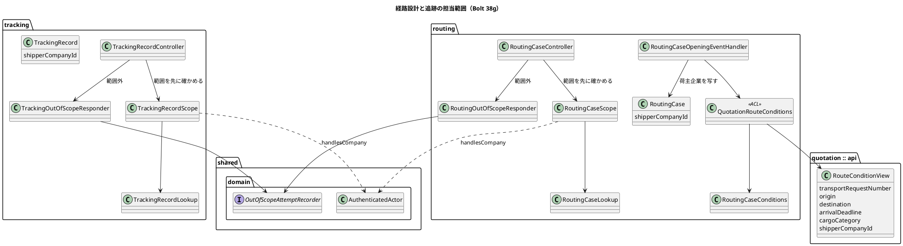
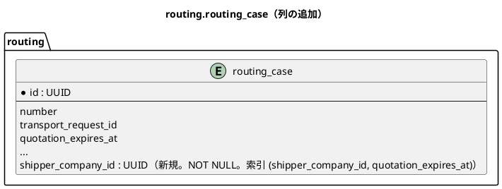

# Bolt 38g 計画 - 経路設計と追跡の担当範囲の絞り込みと、US-16 の締め

## 基本情報

| 項目 | 内容 |
| :--- | :--- |
| Bolt | 第 38g 回（W6 の 34 本目。US-16 を締め、#14 を閉じる） |
| 予定 | W6（2026-11-09 の週。前倒しで着手できる）。前提は、38f2 と 38f2b の終了報告の承認。作業は約 12.7 時間（760 分。`check`・`uiTest`・SonarQube・CI の待ちを除く）。CLAUDE.md の「半日を超える Bolt は分割する」に当たるが、開始準備で分けずに 1 つで進めると決め、整合性検証の後に人がもう一度確かめて同じく決めた（決定 (2)）。分割の規則の例外として受け入れるかを確認ポイント 9 で諮る。経路設計の側を縦に通し切ってから追跡の側に入る。打ち切りの点検はステップ 3a の後とステップ 5 の後の 2 か所（下の表） |
| アプローチ | 混成。経路設計の荷主企業の列と公開 API の結果はスキーマの変更なのでインサイドアウトで先に入れ（開発戦略 :118）、その後の担当範囲の判定はアウトサイドイン（既存の集約に受入条件を足す。開発戦略 :119・:346）。38f の行（release_plan :786「インサイドアウト…の後にアウトサイドイン」）と同じ書き方にする |
| 対象 | (1) 経路設計: `routing.routing_case` に `shipper_company_id` の列を NOT NULL で足す（3 段のマイグレーション）、`RouteConditionQuery` の結果に荷主企業を足し（公開 API の変更）、案件を開くときに写す。経路設計の 5 つの入口を担当企業で絞る、(2) 追跡: 追跡記録の荷主企業（`TrackingRecord.shipperCompanyId`）で追跡の 4 つの入口を絞る、(3) 判定の部品と記録の部品を routing と tracking に写し（記録の部品は計 4 つ）、ArchUnit を名前の規則と閉じる規則に変える、(4) 記録の対象を「状態を変える POST」に広げる（候補の算出・マイルストーンの登録を含める）、(5) 確認ポイント 19（停止の確認の領域に「この利用者の担当企業」）、(6) AC5 の役割の取消しのシナリオ、(7) 38e の文言「業務の画面で効くのは、今後の更新からです」を外す、(8) 既存のシナリオ（UI 13 本、UI 以外 10 本）の経路設計者・追跡管理者の割り当ての前提、(9) 受入シナリオ、マニュアル 8 章・9 章・11 章・付録 B・用語集とキャプチャ、axe、(10) #14 のクローズ（US-16 の 5 SP。支援技術による手動確認の記録なしで閉じる。決定 (7)） |
| トレース | US-16 AC1〜AC5、IA-INV-02・IA-INV-08、SEC-12、ADR-014・ADR-019、architecture_backend :148（`RouteConditionQuery`）、W6 の確認ポイント 16〜19、#14 |
| GitHub | [#14](https://github.com/k2works/practical-domain-driven-design-in-enterpris-application/issues/14)（US-16 の残り。終了報告の承認の後に閉じる。閉じるときのコメントに、支援技術による手動確認の記録がないこと、担当案件を担当企業で近似したことを書く） |
| SP | 5（US-16） |
| 承認ゲート | 計画と終了報告。**スキーマ**（`routing_case.shipper_company_id` の列を NOT NULL で足す 3 段のマイグレーションと、dev だけの既存の行の埋め、索引）、**公開 API の変更**（`RouteConditionView` に荷主企業。architecture_backend :148・ADR-014 :24 の系統）、**認可**（経路設計と追跡の 9 つの入口を担当企業で絞る。記録の対象を状態を変える POST に広げる。ADR-019・SEC-12 の改訂）、**開発データ**（dev の既存の案件の荷主企業）、**GitHub**（#14 のクローズ）、新しいファイル（下の一覧） |
| ブランチ | develop で開発する。途中の push はデモ環境の配備になるので、push はステップ 9 でまとめる |
| 開始準備で決めたこと | 2026-10-28、human:kakimomokuri: (1) `routing.routing_case` に `shipper_company_id` の列を足すマイグレーションを書く。`RouteConditionQuery` の結果に荷主企業を足し、案件を開くときに写す。既存の行は dev だけのマイグレーションで埋める。DE-16 の属性は変えない（確認ポイント 18）、(2) 分けずに 1 つの Bolt で進める。10 時間を超える見込みなので、分割の規則の例外として受け入れる。経路設計の側を縦に通し切ってから追跡の側に入り、自然な切れ目に打ち切りを置く、(3) 記録の部品を routing と tracking に写し（計 4 つ）、ArchUnit を名前の規則 `..interfaces.web..*OutOfScopeResponder` に変える、(4) AC5 の役割の取消しは `manage_user_roles_ui.feature` に `@US-16-AC5` のシナリオを足す、(5) #14 は、AC1〜AC5 のタグ付きシナリオがそろい、支援技術による手動確認の記録を確かめてから閉じる。記録がなければ人に諮る。整合性検証の後（2026-10-29、human:kakimomokuri）: (1) を改める。荷主企業の列は NOT NULL にする（common で null 可で足す → dev だけで埋める → common で `SET NOT NULL` の 3 段）。null の分岐は作らない、(2) 打ち切りの見込みが高いとの指摘を受けて再び確かめ、分けずに 1 つで進める。打ち切りの点検をステップ 3a の後に前倒しし、ステップ 5 の後の点検も残す、(6) 記録の対象を「状態を変える POST」に広げる（候補の算出・マイルストーンの登録を含める）。ADR-019 :36 と SEC-12 の文を直す、(7) を (5) に代えて決める。#14 は支援技術による手動確認の記録なしで閉じる。完了の定義のうちこの項目を満たさないことを照合表と確認ポイントと閉じるときのコメントに書き、手動確認は W10 の運用準備に送る |

新しいファイル（計画の承認で確かめる。計 15 とキャプチャ）:

- マイグレーション（3）:
  - `db/migration/common/V20261029100000__add_routing_case_shipper_company.sql`（`shipper_company_id UUID` を null 可で足し、索引 `(shipper_company_id, quotation_expires_at)` を付ける。`routing_case` に `status` の列はない（状態は `route_version.status`）。一覧の並び `quotation_expires_at ASC NULLS LAST, requested_at, case_number` に合わせる）
  - `db/dev-data/V20261029100900__fill_dev_routing_case_shipper_company.sql`（dev だけ。`WHERE shipper_company_id IS NULL` のすべての行を、`quotation.transport_request` の荷主企業から相関副問合せで埋める。H2 と PostgreSQL の両方で通る形。`UPDATE ... FROM` は H2 で通らないので使わない。デモ環境は dev の profile で動き、実行時に作った案件も埋める）
  - `db/migration/common/V20261029101000__set_routing_case_shipper_company_not_null.sql`（`ALTER ... SET NOT NULL`。Flyway は場所をまたいで版の順に流すので、dev では列の追加 → 埋め → NOT NULL の順になる。本番・ステージングには行がない（確認ポイント 18）。埋め漏れがあればマイグレーションの失敗で気づける）
- 本体（6）:
  - `routing/application/internal/queryservices/RoutingCaseScope.java`・`RoutingCaseLookup.java`（判定の部品と結果の型。`Found`・`NotFound`・`OutOfScope`。38f の `StaffTransportRequestScope`・`StaffTransportRequestLookup` の写し。担当企業が空なら SQL を流さない空の守りを 1 か所に置く）
  - `tracking/application/internal/queryservices/TrackingRecordScope.java`・`TrackingRecordLookup.java`（同上。荷主企業は `TrackingRecord.shipperCompanyId` を読む。`booking :: api` と `routing :: api` は使わない）
  - `routing/interfaces/web/RoutingOutOfScopeResponder.java`
  - `tracking/interfaces/web/TrackingOutOfScopeResponder.java`（どちらも 38f の `StaffOutOfScopeResponder` の写し。routing と tracking は `quotation.interfaces.web`・`booking.interfaces.web` に依存できない）
- テスト（6）:
  - `RoutingCaseScopeTest`・`TrackingRecordScopeTest`（空の守りは `verify(never())`）
  - `RoutingOutOfScopeResponderTest`・`TrackingOutOfScopeResponderTest`（ポートを 1 回呼び 404 を返す）
  - `RoutingAssignedScopeSecurityIntegrationTest`・`TrackingAssignedScopeSecurityIntegrationTest`（38f と同じ構成にして、Spring の文脈を増やさない（#50））
- 受入: `features/ui/restrict_routing_and_tracking_by_assigned_companies_ui.feature`（シナリオ単位のタグに `@US-16-AC4`。38f2 が別のファイル `restrict_bookings_by_assigned_companies_ui.feature` にした前例にならう。打ち切ったときは追跡の場面を 38g2 の別のファイルにし、`@wip` を使わない）
- 変える既存のファイル（主なもの）:
  - quotation: `RouteConditionView`（公開 API の結果に `shipperCompanyId`。`CompanyId` 型で `requireNonNull`。今の項目はすべて requireNonNull）、`RouteConditionQueryAdapter`
  - routing: `QuotationRouteConditions`（ACL）、`RoutingCaseConditions`（ACL の結果）、`RoutingCaseOpeningEventHandler`、`RoutingCase`（荷主企業。`open` は非 null を要求）、`RoutingCaseRepository`・MyBatis・mapper、`RoutingCaseQueryService`・`RoutingCaseCommandService`、`RoutingCaseController`、一覧のテンプレート（案内の文）
  - tracking: `TrackingRecordRepository`（社内の一覧を担当企業の集合で受ける口に置き換え、全件の口を消す）・MyBatis・mapper、`TrackingRecordQueryService`・`TrackingRecordCommandService`、`TrackingRecordController`、一覧のテンプレート（案内の文）
  - identity: 停止の確認の領域（`UserStatusChangeController`・テンプレート）、38e の文言（`UserDetailPage`・テンプレート）
  - テストと組み立て: `UiUsers`（経路設計者・追跡管理者の割り当ての補助）、`UserAssignmentUiSteps`（背景の前提）、`LayerArchitectureTest`（名前の規則と閉じる規則）、`ScopedResourceKind`（値を足す）、`WithAuthenticatedActorSecurityContextFactory`、`RoutingConfiguration`・`TrackingConfiguration`（組み立て）、38f の `restrict_staff_by_assigned_companies_ui.feature`（シナリオ単位の `@US-16-AC4`。照合の表を実態に合わせる）
- 資産: `docs/manual/assets/08-*`・`09-*`・`11-*` のうち中身が変わるものだけ残す（T-197・38f の M5）。キャプチャは UI テストの利用者で撮り、背景の前提で範囲の中に入るので、8 章・9 章の一覧のキャプチャは変わらない見込み。変わるのは 11 章の停止の確認と、38e の文言を外した S-20 の画面
- デモの動画は作らない（AC4 の動画は 38f2b）

## Bolt ゴール

経路設計者と追跡管理者は、担当企業の経路設計の案件と追跡記録だけを社内の画面で見て操作できる。範囲の外は一覧に出ず、URL を直接開いても共通の 404 になり、状態を変える操作（候補の算出・経路の確定・マイルストーンの登録）を送ったときは試行が監査に残る。役割を取り消された利用者は次の request から拒まれ、過去の操作の記録は残る。US-16 の受入条件 AC1〜AC5 がそろい、#14 を閉じる。

### 開始準備で確かめたこと

| # | 事実 | 根拠 |
| :--- | :--- | :--- |
| 1 | #14 は OPEN で、AC1〜AC5 のチェックはすべて未。完了の定義は、各 AC に `@US-16-ACn` のタグ付きシナリオが `@wip` なしで通ること、境界値の単体テスト、アーキテクチャとカバレッジの閾値、`@ui` と axe と支援技術による手動確認の記録 | `gh issue view 14` |
| 2 | 38g の行は、経路設計の案件に荷主企業の写しを足して絞る、追跡は予約の荷主企業で絞る、AC5 の役割の取消し、確認ポイント 19、38e の文言を外す、マニュアル 8 章・9 章、#14 を閉じて 5 SP を数える。承認ゲートはスキーマ・認可・開発データ（確認ポイント 18） | `release_plan.md:789` |
| 3 | 経路設計の社内の入口は `RoutingCaseController`（`/staff/routing-cases`）の 5 つで、範囲を見ない。一覧 GET（:80）、詳細 GET（:92）、候補の算出 POST（:104）、確定の確認 GET（:128）、確定 POST（:151）。経路設計者だけが使える | `RoutingCaseController.java:42-161`、`SecurityConfiguration.java:214-215` |
| 4 | 追跡の社内の入口は `TrackingRecordController`（`/staff/tracking-records`）の 4 つで、範囲を見ない。一覧 GET（:72。全件）、詳細 GET（:82）、マイルストーンの new GET（:89）・登録 POST（:101）。追跡管理者だけが使える | `TrackingRecordController.java:40-117`、`SecurityConfiguration.java:217-218` |
| 5 | `routing.routing_case` に荷主企業の列も `status` の列もない（状態は `route_version.status`）。案件は `RoutingCaseOpeningEventHandler` が DE-16 を受けて、ACL `QuotationRouteConditions` から `RouteConditionQuery.find(輸送要求 ID, 版番号)` を引いて作る。結果の `RouteConditionView`（`transportRequestNumber`・`origin`・`destination`・`arrivalDeadline`・`cargoCategory`）は荷主企業を持たない。`RouteConditionQuery` は Bolt 17 の最初の公開 API で、Javadoc は「社内の照会で、荷主企業で絞らない」 | `V20261007100000__create_routing.sql:6-33`、`RoutingCaseOpeningEventHandler.java:36-54`、`RouteConditionView.java:16-29`、architecture_backend :148、ADR-014 :24 |
| 6 | `RouteConditionQuery` の本番の呼び手は ACL 1 つ（`QuotationRouteConditions.java:22`）。`new RouteConditionView(` は本番 1 か所（`RouteConditionQueryAdapter.java:28`）とテスト 2 か所（`RouteConditionQueryAdapterTest:32`、`RoutingCaseOpeningEventHandlerTest:31`）。荷主企業の元は `TransportRequest.shipperCompanyId()` | grep |
| 7 | 追跡記録は荷主企業を NOT NULL で持つ（`TrackingRecord.shipperCompanyId`、`V20261009130000__create_tracking.sql:10`）。荷主の側は `findByTrackingNumber(…, CompanyId)`・`findRecentSummariesByShipper` で絞る（前例）。社内の `findRecentSummaries(int)` は全件で、スキーマの変更は要らない | `TrackingRecord.java:48`、`TrackingRecordRepository.java:29-52` |
| 8 | routing の依存は `shared`・`quotation :: events`・`quotation :: api`・`platform :: web`、tracking は `shared`・`booking :: events`・`booking :: api`・`routing :: api`・`platform :: web`。判定の部品と記録の部品は `shared`（`AuthenticatedActor`・`OutOfScopeAttemptRecorder`・`CompanyId`）にしか依存しないので、`allowedDependencies` を足す必要はない。38f・38f2 の記録の部品は共有できないので、写しが 4 つになる | `routing/package-info.java:8`、`tracking/package-info.java:9` |
| 9 | 主体を持たない読み出しがある。`routing :: api` の `RouteVersionLegQueryAdapter` は `RoutingCaseQueryService.confirmedLegs` を使い（tracking が事件の処理で呼ぶ）、システムの経路の `RoutingCaseCommandService.evaluateConfirmedRoute`（:132）も主体を持たない。これらは担当範囲で絞らない | `RouteVersionLegQueryAdapter.java:31`、`RoutingCaseCommandService.java:132` |
| 10 | 確認ポイント 19 は「停止の確認の領域に『この利用者の担当企業』を示すだけにし、付け替えは担当範囲の画面で行う」。identity の S-20 の中で閉じ、38e の照会（`AssignableCompanyQuery`・担当企業の読み出し）を使える | `release_plan.md:740` |
| 11 | AC5 は利用停止のシナリオ（`manage_user_status_ui.feature:13,28`、`@US-16-AC5`）だけがあり、役割の取消しのシナリオはない。役割の取消しは、request ごとの確かめ（Bolt 32c）が次の request から拒む。役割を 0 にする変更は `NO_ROLES` で拒まれる（`User.java:147`、`manage_user_roles_ui.feature:33`） | grep、`SessionRevalidationService` |
| 12 | 経路設計者・追跡管理者が出る UI の feature は 13 本（approve_quotation_and_route・compare_route_candidates・confirm_booking・confirm_route・main_flow・manage_user_roles・manual_screenshots・present_quotation・query_tracking・register_milestone・requote_after_approval・route_already_departed・route_redesign_required）。UI 以外の feature も 10 本（`features/routing/confirm_route`・`route_candidates`・`evaluate_confirmed_route`・`golden/route_candidates_golden_v0`、`features/tracking/register_milestone`・`query_tracking`、`booking/confirm_booking`、`quotation/approve_quotation_and_route`・`requote_after_approval`・`route_redesign_required`）。38f の背景の前提は営業担当者の分だけ | grep |
| 13 | 追跡の登録 POST は `@ModelAttribute MilestoneForm` と `BindingResult` で受ける。`expectedVersion` は `long` の欄で、型の誤りは束縛の誤りとして `BindingResult` に入り、変換の部品が空を返し、フォームが 200 で描き直される | `TrackingRecordController.java:104-114`、`MilestoneForm.java:15`、`MilestoneFormConverter.java:83` |
| 14 | コマンドのサービスは、読み出しの直後に版の照合で `Conflict` を返す（経路設計）、または `AlreadyRegistered`・`Conflict` を返す（追跡） | `RoutingCaseCommandService.java:71・:100`、`TrackingRecordCommandService.java:39-41` |
| 15 | 支援技術による手動確認の記録は、今の時点で S-20 にも業務の画面にもない。release_plan :808 の「S-06・S-07・S-20・A-06 の axe と支援技術による手動確認（人）」は未チェック。前例は Bolt 35（計画の確認ポイントで範囲を決め、人が確かめて報告に記録した） | `release_plan.md:808`、`bolt_38b3b_report.md:126`、`bolt_35_report.md:63` |
| 16 | 変えるマニュアルは `08-経路設計.md`・`09-追跡管理.md` と、11 章（停止の確認の領域、11.8）、付録 B、用語集。最新のマイグレーションは common が `V20261027110000`、dev-data が `V20261028110900`（38f2・38f2b の後に数え直す） | `docs/manual/`、`db/migration` |
| 17 | カスタマーサポートの照会（追跡）は W8 と書かれている。38f の確認ポイント 8（カスタマーサポートには開かない）とつながる | `SecurityConfiguration.java:216` |

## 設計の決定（案）

| 項目 | 決定 | 根拠 |
| :--- | :--- | :--- |
| 経路設計の荷主企業の列 | `routing.routing_case.shipper_company_id UUID` を NOT NULL にする。common で null 可で足す → dev だけで既存の行を埋める → common で `SET NOT NULL` の 3 段。索引は `(shipper_company_id, quotation_expires_at)`（一覧の並びに合わせる）。null の分岐は作らない。`AuthenticatedActor.handlesCompany` は不変の集合の `contains` で、null を渡すと NPE になるので、null の行を作らないことで守る。行を直接 INSERT するテストの準備は荷主企業を入れるように直す | 決定 (1)、確認ポイント 18、検証の H2 |
| 公開 API の結果 | `RouteConditionView` に `shipperCompanyId`（`CompanyId`。`requireNonNull`）を足す（主体ではなく値を足すだけの公開 API の変更。architecture_backend :148・ADR-014 :24 に記録する。ADR-016 は予約の照会の決定なので関係しない）。`RouteConditionQuery` の Javadoc の「荷主企業で絞らない」は今のまま（照会そのものは社内の事件の処理で、主体を持たない） | 決定 (1)、事実 5・6 |
| 案件を開く | `RoutingCaseOpeningEventHandler` が結果の荷主企業を `RoutingCase` に写す。`RoutingCase.open` は荷主企業を非 null で要求する。DE-16 の属性は変えない | 決定 (1) |
| 範囲の判定の部品 | `RoutingCaseScope`・`TrackingRecordScope`（`find` と `listWithin`）と、結果の型 `RoutingCaseLookup`・`TrackingRecordLookup`（`Found`・`NotFound`・`OutOfScope`）を、38f の `StaffTransportRequestScope`・`StaffTransportRequestLookup` にならって置く。照会とコマンドのサービスに操作者を渡し、サービスが範囲の外を `OutOfScope` で返す。コマンドの結果（`CandidateCalculationOutcome`・`RouteConfirmationOutcome`・`MilestoneRegistrationOutcome`）は封印型なので `OutOfScope` を足す | 38f・38f2 の前例、検証の M1 |
| 呼ぶ側の形 | 状態を変える POST は、controller がロックしない照会で範囲を先に確かめ、範囲の外なら記録の部品で記録して 404（ADR-019 :36 の呼ぶ側の形）。コマンドの `OutOfScope` は、割り当てが途中で変わったときの守り | 38f・38f2 の前例 |
| コマンドの中の判定の順 | 「読み出し → 範囲 → 版の照合・決着済み」の順にする。`OutOfScope` を `Conflict`・`AlreadyRegistered` より後に置くと、割り当てが途中で外れたときに競合のリダイレクトや「登録済み」が存在を漏らすため | 事実 14、検証の M3 |
| 主体を持たない読み出し | `RouteVersionLegQuery`（`confirmedLegs`）と `evaluateConfirmedRoute` は担当範囲で絞らない（事件の処理とシステムの経路） | 事実 9 |
| 一覧 | 経路設計の `findSummaries()` と追跡の `findRecentSummaries(int)` を、担当企業の集合を受ける口に置き換え、全件の口を消す（38f2 の前例。名前に `ForStaff` を使わない）。`IN` は各 mapper に `<sql id="shipperCompanyIn">` を写す。担当企業が空なら SQL を流さない（判定の部品の 1 か所） | 38f2 の前例 |
| 担当企業がない判定 | 一覧の案内は `AuthenticatedActor.hasNoAssignedCompanies` で出す | 38f の決定 (6) |
| 記録の部品と ArchUnit | `RoutingOutOfScopeResponder`・`TrackingOutOfScopeResponder` を写す（計 4 つ）。ArchUnit の 4 規則（呼ぶのは部品だけ、実在の見張り、クラスにトランザクションなし、メソッドにトランザクションなし）のうち、呼び手の規則とトランザクションの 2 規則を名前の規則（正規表現 `com\.example\.cargotracker\..*\.interfaces\.web\..*OutOfScopeResponder`）にする。名前の規則だけでは一覧が開くので、閉じる規則を 1 本足す（名前の規則に合うクラスは、トップレベルで `@Component` を付けた 4 つの FQN のどれか）。実在の見張りは FQN の 4 本（部品ごとに 1 本。「A か B」にしない。T-135） | 決定 (3)、検証の横断 M2・詳細 L4 |
| 記録の値と対象 | 記録の対象は「状態を変える POST」（候補の算出・経路の確定・マイルストーンの登録）。経路設計は `ScopedResourceKind.ROUTING_CASE`（ID は案件番号）、追跡は `TRACKING_RECORD`（ID は追跡番号）を足す。GET は 404 だけ（SEC-12）。38f の見積りの作成・再見積り・提示も確定ではない POST で記録しているので、ADR-019 :36 と SEC-12 の「確定の POST だけ」を「状態を変える POST」に直して実態に合わせる | 決定 (6)、38f の前例 |
| 範囲の判定と値の解釈 | POST は、範囲の判定を値の解釈より先に行う。経路の番号・追跡番号の形の誤りは今のまま 404。型の変換で止まる値（経路設計の `@RequestParam long expectedVersion`・`int candidate`）は範囲によらず 400 で記録しない。追跡の登録 POST は `BindingResult` が型の誤りを受けるので 400 になる値がない。範囲の確かめを `MilestoneFormConverter.convert` より前（`TrackingRecordController.java:111` の前）に置き、`expectedVersion=abc` は範囲の外なら 404 と記録（行 4） | 38f の前例、T-211、事実 13 |
| 確認ポイント 19 | 停止の確認の領域に「この利用者の担当企業」（担当企業の名前の並び）を示す。変えられない企業は 38e の語「この画面で変えられない企業 {N} 社も担当しています。」で示す。付け替えは担当範囲の画面で行う。領域を出すのは担当範囲のある対象の役割（営業担当者・経路設計者・追跡管理者・カスタマーサポート）の利用者だけで、荷主担当者・システム管理者・監査担当者には出さない（38e の決定 (4)） | 確認ポイント 19、事実 10 |
| 38e の文言を外す | 担当範囲の領域と確認の画面の「業務の画面で効くのは、今後の更新からです」を外す。マニュアル 11.8 の同じ文も外す | release_plan :789 |
| AC5 の役割の取消し | `manage_user_roles_ui.feature` に `@US-16-AC5` のシナリオを足す。前提: 外される利用者は経路設計者と追跡管理者の 2 つの役割を持つ（役割を 0 にできないため。事実 11）。システム管理者が経路設計者の役割を外すと、その利用者の次の request の経路設計の画面が A-04（権限なし。403）で拒まれ、追跡の画面は今のまま開ける。外される利用者の session は管理者の操作の間も生かす（`BrowserSession.cookies()`・`restoreCookies()` で Cookie を退避して戻す。前例 `login_ui.feature:48`、34d の AC5 の写し、T-216）。取消しの前の経路の確定の記録と監査の記録が残ることも確かめる（AC5 の「過去の操作履歴は保持される」） | 決定 (4)、事実 11 |
| 既存のシナリオの前提 | 38f の背景の前提にならい、経路設計者・追跡管理者に荷主の企業を割り当てる前提を `UserAssignmentUiSteps` に足し、13 本の UI の feature の背景に置く。UI 以外の 10 本の feature は、ステップ（`RoutingSteps`・`RouteConfirmationSteps`・`ConfirmedRouteEvaluationSteps`・`MilestoneSteps`、`AcceptanceTestConfiguration`）が担当企業を持つ主体を使うように直す。`UiUsers` に明示の割り当ての補助を足す（自動の割り当ては作らない） | 38f の前例、事実 12 |
| 開発データ | 開発の経路設計者・追跡管理者の担当企業は、38e の `V20261028100900` で荷主 A・B が入っている。追加の割り当ては作らない。dev の既存の案件の荷主企業は 3 段のマイグレーションの 2 段目で埋める | 38e の決定 (7) |
| #14 のクローズ | AC1〜AC5 のタグ付きシナリオが `@wip` なしで通ることを確かめ、終了報告の承認の後に閉じる。支援技術による手動確認の記録はなく、記録なしで閉じる（完了の定義のうちこの項目は満たさない）。手動確認は W10 の運用準備に送る。閉じるときのコメントに、手動確認の記録がないこと（W10 に送った）と、AC1・AC4 の「担当案件」を担当企業で近似したこと（38e の決定 (10)）を書く | 決定 (7)、事実 15 |

### 入口ごとの記録の値と、範囲より先に止まる値

| 入口 | 範囲外の結果 | 記録 | 範囲より先に 400 になる値 |
| :--- | :--- | :--- | :--- |
| 経路設計の一覧 GET `/staff/routing-cases` | 範囲の外の案件は出ない | しない | — |
| 経路設計の詳細 GET `/{number}` | 404 | しない | （番号の形の誤りは今のまま 404） |
| 候補の算出 POST `/{number}/candidates` | 404 | `ROUTING_CASE`、案件番号 | `expectedVersion` が数でない（`@RequestParam long`） |
| 確定の確認 GET `/{number}/confirmation` | 404 | しない | `candidate` が数でない（`@RequestParam int`） |
| 確定 POST `/{number}/confirmation` | 404 | `ROUTING_CASE`、案件番号 | `expectedVersion`・`candidate` が数でない |
| 追跡の一覧 GET `/staff/tracking-records` | 範囲の外の追跡記録は出ない | しない | — |
| 追跡の詳細 GET `/{trackingNumber}` | 404 | しない | （追跡番号の形の誤りは今のまま 404） |
| マイルストーンの new GET | 404 | しない | — |
| マイルストーンの登録 POST | 404 | `TRACKING_RECORD`、追跡番号 | なし（`BindingResult` が型の誤りを受ける。範囲の確かめは変換より前） |

各入口の引数は、ステップ 1 で controller を数え直して表を確かめる（T-148）。

### 受入条件（記号は US-16 の AC と分けて BA とする）

| # | 受入条件 | 行 |
| :--- | :--- | :--- |
| BA-1 | 担当企業の経路設計の案件と追跡記録だけが一覧に出る | 1a・1b・1c・1d |
| BA-2 | 範囲の外の詳細・確認・new は 404 で、記録しない | 2a・2b |
| BA-3 | 範囲の外の状態を変える POST（候補の算出・確定・マイルストーンの登録）は 404 で、担当範囲の外の試行を 1 行記録する | 3a・3b |
| BA-4 | 範囲の判定は値の解釈より先（経路設計の型の誤りは範囲によらず 400 で記録しない。追跡は範囲の外なら値の誤りによらず 404 と記録） | 4・4b |
| BA-5 | 範囲の中は今のまま見えて操作できる | 5a・5b |
| BA-6 | 担当企業がない経路設計者・追跡管理者は何も見えない（一覧は空で案内、詳細は 404、POST は 404 と記録） | 6 |
| BA-7 | 記録のポートを呼ぶのは、閉じた 4 つの部品だけ | 7 |
| BA-8 | 停止の確認の領域に、この利用者の担当企業が示される | 8 |
| BA-9 | 役割を取り消された利用者は次の request から拒まれ、過去の操作の記録は残る（US-16 AC5） | 9 |
| BA-10 | 38e の「今後の更新から」の文言が消える | 10 |
| BA-11 | UI の通し（幅 320 px、axe の違反 0）と、US-16 AC1〜AC5 のタグ付きシナリオ | 11 |
| BA-12 | 操作の途中で割り当てが外れても 404 と記録し、古い版でも存在を漏らさない | 5c・5d |
| BA-13 | 案件を開くときに荷主企業が写る | 6c |

### 文言（全文）

| 場面 | 文言 |
| :--- | :--- |
| 範囲の外の詳細・確認・操作 | 共通の 404「画面が見つかりません」（今のまま） |
| 経路設計の一覧で担当企業がない | 担当企業がまだないので、表示できる経路設計の案件はありません。システム管理者に担当企業の割り当てを頼んでください。 |
| 追跡の一覧で担当企業がない | 担当企業がまだないので、表示できる追跡記録はありません。システム管理者に担当企業の割り当てを頼んでください。 |
| 停止の確認の領域（担当企業） | 担当企業: {企業名の並び}（なければ「なし」）。この画面で変えられない企業 {N} 社も担当しています。（N が 0 なら後半を出さない。38e の語） |
| マニュアル 8 章・9 章の注（要旨） | 扱えるのは担当企業の案件と追跡記録だけ。範囲の外の URL は「画面が見つかりません」になる。担当企業の変更はシステム管理者に頼む（11.8）。全文は実装のときにマニュアルで決め、終了報告で示す（T-218） |

### 既存の期待を変える箇所（T-122）

ステップ 1 の grep で数え直す（T-148）。開始準備の時点の見込み:

- 公開 API の結果 `RouteConditionView` の生成（本番 1、テスト 2。事実 6）
- `RoutingCase.open(` の呼び出し（7 ファイルに 13 か所: `RoutingCaseGoldenDatasetTest`・`RoutingCaseTest`・`MyBatisRoutingCaseLockIntegrationTest`・`MyBatisRoutingRepositoriesIntegrationTest`・`RoutingCaseControllerTest` ほか）と `RoutingCaseFixture`
- `routing_case` に行を直接 INSERT するテストの準備（NOT NULL の列に荷主企業を入れる）
- ACL の結果 `RoutingCaseConditions` と、その単体テスト
- 経路設計と追跡の照会とコマンドのサービスの呼び出し（操作者の引数）。担当企業のない 5 引数の主体で経路設計・追跡の操作を通すテストは、担当企業を持つ主体に替える
- `RoutingCaseRepository.findSummaries()`・`TrackingRecordRepository.findRecentSummaries(int)` の実装と stub（InMemory・MyBatis、`TrackingRecordQueryServiceTest:178` の委ねの stub）と、並びの統合テスト
- `RoutingCaseControllerTest`・`TrackingRecordControllerTest`・`MilestoneRegistrationControllerTest`（`@WebMvcTest`。記録の部品の `@MockitoBean`）、`TrackingRecordCommandServiceTest`
- 統合テスト: `RouteConfirmedAssignmentIntegrationTest`（確定を呼ぶ）、`RouteDesignRequestedRoutingIntegrationTest`（案件を開く。行 6c の本当の統合テスト）、`InfoFreshnessSettingIntegrationTest`
- 経路設計者・追跡管理者が出る UI の feature 13 本と `manual_screenshots.feature`、UI 以外の feature 10 本とそのステップ（事実 12）
- `DevSampleDataSmokeTest:305・:337・:346`（消す口 `findSummaries()` を直接使っている。書き直す。経路設計の案件の荷主企業が埋まっていることも確かめる）
- `LayerArchitectureTest`（名前の規則と閉じる規則）、`ScopedResourceKind` の Javadoc
- 38e の文言を期待しているテスト（`UserAdministrationControllerTest`・`UserAssignmentControllerTest`・UI の feature）
- 停止の確認の画面の期待（`UserStatusChangeControllerTest`・`manage_user_status_ui.feature`）
- 38f の `restrict_staff_by_assigned_companies_ui.feature`（シナリオ単位の `@US-16-AC4`）

## ふりかえりと前の Bolt からの引き継ぎ

| 出典 | 内容 | この Bolt での扱い |
| :--- | :--- | :--- |
| 38f の Try T-220 | 変異は uiTest で流さない | 変異はすべて `test` で流す |
| 38f の Try T-221 | コミットの一覧は `git -c core.quotepath=false status --porcelain` で作り、除外は引用符の有無によらない条件で書く | ステップ 9 で守る |
| 38e の Try T-219、T-214 | 変異の対象に単体と統合・契約の両方を入れる | 変異の表に両方を書く |
| 38d の Try T-217 | 本体の前に Red を流す | 各ステップに書く |
| 38d2 の Try T-218 | マニュアルの文は要旨で、全文は実装のときに決める | 文言の表のとおり |
| T-215、T-216 | Gradle を流すのは 1 つの担当、打ち消す操作の後の場面を表に置く | フォークへの指示に書く。行 9（役割の取消し） |
| T-204 | heredoc と標準入力を待つコマンドを使わない | フォークの指示の禁止事項に書く |
| 38f の Problem | 実装の担当がターンの上限で止まった | ステップを 3a〜7 に分け、フォークへの指示の単位にする |
| 38f2 の H1 | 範囲より先に存在を漏らす判定（予約済み） | 同じ型の 2 つ（追跡の `BindingResult`、コマンドの `Conflict`）を範囲の判定の後に置く |
| 38f2 の決定 | 写しを共通にするかは 38g で諮る | 決定 (3) で名前の規則と閉じる規則にした |
| #50 | テストの Spring の文脈の数 | 新しいセキュリティの統合テストは 38f と同じ構成にする |

## 状態の組み合わせ（行ごとにテストを 1 本。T-182）

| 行 | 状況 | 期待 | 出口 | 確かめ方 |
| :--- | :--- | :--- | :--- | :--- |
| 1a | 経路設計の一覧、担当企業の案件がある | 担当企業の案件だけが出る | 経路設計の一覧 | `RoutingAssignedScopeSecurityIntegrationTest`、リポジトリの統合テスト（2 社） |
| 1b | 経路設計の一覧、範囲の外の案件だけ | 何も出ない | 経路設計の一覧（空） | 同上 |
| 1c | 追跡の一覧、担当企業の追跡記録がある | 担当企業の追跡記録だけが出る | 追跡の一覧 | `TrackingAssignedScopeSecurityIntegrationTest`、リポジトリの統合テスト（2 社） |
| 1d | 追跡の一覧、範囲の外の追跡記録だけ | 何も出ない | 追跡の一覧（空） | 同上 |
| 2a | 経路設計の詳細・確定の確認、範囲の外 | 404、記録しない | 共通の 404 | 経路設計のセキュリティの統合テスト |
| 2b | 追跡の詳細・マイルストーンの new、範囲の外 | 404、記録しない | 共通の 404 | 追跡のセキュリティの統合テスト |
| 3a | 候補の算出・確定の POST、範囲の外 | 404、`ROUTING_CASE` を 1 行（操作者と `target_id` で絞って数える） | 共通の 404 | 経路設計のセキュリティの統合テスト、`RoutingOutOfScopeResponderTest` |
| 3b | マイルストーンの登録 POST、範囲の外 | 404、`TRACKING_RECORD` を 1 行 | 共通の 404 | 追跡のセキュリティの統合テスト、`TrackingOutOfScopeResponderTest` |
| 4 | 範囲の外 × 値の誤り（経路の確定の理由の欠け、マイルストーンの日時の形の誤り、`expectedVersion=abc` の追跡の登録） | 範囲の判定が先で 404 と記録 | 共通の 404 | 両方のセキュリティの統合テスト（T-211。パラメーター化） |
| 4b | 経路設計の型の誤り（`expectedVersion`・`candidate` が数でない） | 範囲によらず 400、記録しない | 400 | 経路設計のセキュリティの統合テスト |
| 5a | 範囲の中の経路設計の 5 入口 | 今のまま | 経路設計の画面 | 同上、既存の UI の feature |
| 5b | 範囲の中の追跡の 4 入口 | 今のまま | 追跡の画面 | 追跡のセキュリティの統合テスト、既存の UI の feature |
| 5c | 操作の途中で割り当てが外れた（コマンドの `OutOfScope`） | 404、記録する | 共通の 404 | コマンドのサービスの単体、controller の単体（`verify` と呼びの順） |
| 5d | 範囲の外 × 古い版（コマンドの中） | `Conflict`・`AlreadyRegistered` ではなく `OutOfScope`（範囲の判定が版の照合より先） | 共通の 404 | コマンドのサービスの単体 |
| 6 | 担当企業がない経路設計者・追跡管理者 | 一覧は空で案内（全文）、詳細は 404、状態を変える POST は 404 と記録 | 一覧（案内）・共通の 404 | 両方のセキュリティの統合テスト、判定の部品の単体（空の守り） |
| 6c | 案件を開くときに荷主企業を写す | DE-16 の処理で、案件に輸送要求の荷主企業が入る | 該当しない（事件の処理） | `RouteDesignRequestedRoutingIntegrationTest`、`RouteConditionQueryAdapterTest`、`RoutingCase` の単体（`open` は非 null を要求） |
| 7 | 記録のポートの呼び手 | 閉じた 4 つの部品だけ。どれも実在し、トランザクションを付けない | 該当しない（ArchUnit） | `LayerArchitectureTest`、各部品の単体テスト |
| 8 | 停止の確認の領域（対象の役割の利用者） | 担当企業の名前と、変えられない企業の数 | 停止の確認の画面 | `UserStatusChangeControllerTest`、`manage_user_status_ui.feature` |
| 9 | 経路設計者と追跡管理者の役割を持つ利用者から、経路設計者の役割を外した後の次の request | 経路設計の画面は A-04（403）で拒まれ、追跡の画面は開ける。取消しの前の経路の確定の記録と監査の記録は残る | A-04（権限なしの画面） | `manage_user_roles_ui.feature`（`@US-16-AC5`。Cookie を退避して戻す） |
| 10 | 担当範囲の領域と確認の画面 | 「今後の更新から」の文言がない | S-20 の詳細・確認の画面 | `UserAdministrationControllerTest`、`UserAssignmentControllerTest` |
| 11 | UI の通し | 経路設計と追跡の一覧に担当企業のものだけ、範囲の外の URL は 404、幅 320 px、axe の違反 0 | 画面 | `restrict_routing_and_tracking_by_assigned_companies_ui.feature` |

## スコープ

### 入れるもの

- 行 1a〜11 のテスト
- マイグレーション 3 つ、公開 API の結果、ACL、案件を開く処理
- 判定の部品と結果の型、経路設計と追跡の照会とコマンドのサービスと controller、リポジトリと SQL
- 記録の部品 2 つと ArchUnit の名前の規則・閉じる規則
- 確認ポイント 19、38e の文言を外す、AC5 の役割の取消しのシナリオ
- 既存のシナリオ（UI 13 本・UI 以外 10 本）の前提、受入シナリオ、マニュアル 8 章・9 章・11 章・付録 B・用語集とキャプチャ、設計の文書（T-126）
- US-16 の照合と境界値の単体テストの表（ステップ 8）
- #14 のクローズ（終了報告の承認の後）

### 入れないもの

- カスタマーサポートに社内の画面を開くこと（38f の確認ポイント 8。W8）
- 担当案件の単位の割り当て（38e の決定 (10)。担当企業で近似する）
- 監査記録の照会の口の分離（38c2 の議題 4。US-17）
- テストの Spring の文脈を減らす直し（#50）
- 支援技術による手動確認（決定 (7)。W10 の運用準備に送る）
- デモの動画（AC4 の動画は 38f2b）

### 打ち切ったときに後の Bolt に送る候補

打ち切りの点検は 2 か所（ステップ 3a の後と、ステップ 5 の後）。どちらで打ち切っても、送るものは同じ。

- 送るもの: 追跡の側の 4 入口（ステップ 6）、確認ポイント 19 と AC5 のシナリオと 38e の文言を外すこと（ステップ 7）、マニュアル 9 章・11 章、#14 のクローズ
- 38g で行うもの: 打ち切りの点までのステップと、ステップ 8・9（照合のうち 38g の分、品質ゲート・変異・SonarQube・開発レビュー・終了報告・push）
- 送ったときの完了条件の版: 「マニュアル 8 章とキャプチャが実装と合う」「経路設計の側の行（1a・1b・2a・3a・4・4b・5a・5c・5d・6・6c・7）にテストがある」「US-16 の照合は途中の経過（AC4 の経路設計の分まで）」に置き換え、#14 は閉じない
- SP: US-16 の 5 SP は、#14 を閉じる 38g2 で数える
- release_plan: 38g2 の行を足す（計画の変更なので、打ち切りを諮るときに人の承認を受ける）。38g の行を経路設計の側だけに直す
- 受入シナリオ: 38g の feature には経路設計の場面だけを置き、追跡の場面は 38g2 で別のファイルにする（`@wip` を使わない）

## 設計（この Bolt の範囲）

- 状態遷移図: 集約の状態は変えないので省く
- 画面遷移図: 画面と遷移は変えない（範囲外は共通の 404）ので省く

## ステップ計画

経路設計の側を縦に通し切ってから（ステップ 2〜5）、追跡の側に入る（ステップ 6）。各ステップをフォークへの指示の単位にする。

- [ ] **1. 設計の文書**と、呼び出し元・既存の期待の数え直し（T-148）。直す文書は下の「親が直す文書」の一覧（T-126）。38f2・38f2b の後に、次を数え直して表と一覧を直す: マイグレーションの版（common・dev-data の最新）、ADR-019 の行番号（:32・:36・:53）、`LayerArchitectureTest` の記録の部品の規則の数（38f2 で 2 クラスに広げる）、`ScopedResourceKind` の Javadoc、38f2b の dev-data の版、受入の feature のファイル、入口ごとの controller の引数
- [ ] **2. 経路設計の受入とセキュリティの統合テストの Red**: 行 11 の経路設計の場面と `RoutingAssignedScopeSecurityIntegrationTest` を先に書き、範囲の外の案件が一覧に出て 404 にならないことで落ちるのを見る（T-217。本体の前に Gradle で流し、理由を記録する）
- [ ] **3a. 荷主企業の列と公開 API（インサイドアウト。Red → Green）**: 行 6c。マイグレーション 3 つ、`RouteConditionView`、ACL と `RoutingCaseConditions`、案件を開く処理、`RoutingCase`、リポジトリ、行を直接 INSERT するテストの準備。テストを先に書き、Red を見る（T-217）。スキーマの変更なので、H2 と PostgreSQL の両方でマイグレーションが通ることを確かめる。ここで打ち切りの 1 つ目の点検をする
- [ ] **3b. 経路設計の判定の部品とサービスと controller と記録の部品（Red → Green）**: 行 1a・1b・2a・3a・4・4b・5a・5c・5d・6・7。判定の部品の単体・サービスの単体・controller の単体・`RoutingOutOfScopeResponderTest` を先に書き、Red を見る（T-217）。ArchUnit を名前の規則と閉じる規則に変える
- [ ] **4. 既存のシナリオの経路設計者の前提**: UI の feature の背景の前提を足し、UI 以外の feature のステップと `RoutingCase.open(` の呼び出しと統合テストと `DevSampleDataSmokeTest` を直し、経路設計者が出る feature が緑であることを確かめる
- [ ] **5. マニュアル 8 章とキャプチャ**（中身が変わるものだけ残す。T-197）。ここで打ち切りの 2 つ目の点検をする
- [ ] **6. 追跡の側（Red → Green）**: 行 1c・1d・2b・3b・5b。受入の場面と `TrackingAssignedScopeSecurityIntegrationTest` の Red から入り、判定の部品・リポジトリ・サービス・controller（範囲の確かめを `MilestoneFormConverter.convert` より前に）・記録の部品。追跡管理者の背景の前提、UI 以外の追跡の feature、マニュアル 9 章
- [ ] **7. 確認ポイント 19・38e の文言・AC5（Red → Green）**: 行 8・9・10。テストを先に書き、Red を見る（T-217）。マニュアル 11 章・付録 B・用語集
- [ ] **8. US-16 の照合と #14 の完了の定義の確かめ**: AC1〜AC5 のタグ付きシナリオが `@wip` なしで通ることを確かめる。既存の境界値（直前・同時刻・直後）の単体テストを数えて、下の表にする。支援技術による手動確認の記録はないので、決定 (7) のとおり照合表に「満たさない（W10 に送った）」と書く
- [ ] **9. 品質ゲートと開発レビュー、終了報告と配備**: 変異（`test` だけ。T-220）、`check`・`uiTest`、SonarQube、開発レビューとその直し（Red を先に。T-217）。develop に push して CI を確かめ、デモ環境の版を見る。#14 を閉じるのは終了報告の承認の後

### 境界値の単体テストの表（ステップ 8 で埋める）

| 境界 | 直前 | 同時刻 | 直後 | テスト |
| :--- | :--- | :--- | :--- | :--- |
| 見積りの有効期限（経路設計の一覧の並び、確定） | ステップ 8 で既存のテストを数えて埋める | | | |
| マイルストーンの日時（未来の拒否） | 同上 | | | |
| session の確かめ（役割の取消しの後の次の request） | 同上 | | | |

### 時間の配分と打ち切り

| # | 目安 | 打ち切り |
| :--- | :--- | :--- |
| 1 | 50 分 | — |
| 2 | 40 分 | — |
| 3a | 80 分 | ステップ 3a を終えた時点で 210 分（ステップ 1〜3a の目安 170 分に、スキーマと公開 API の不確かさの余裕 40 分を足した値）を超えていたら、追跡の側などを 38g2 に送るかを諮る |
| 3b | 100 分 | — |
| 4 | 90 分 | — |
| 5 | 30 分 | ステップ 5 を終えた時点で 490 分（ステップ 1〜5 の目安 440 分に、38f で実際に出た既存のテストの直しの余裕 50 分を足した値）を超えていたら、追跡の側などを 38g2 に送るかを諮る |
| 6 | 130 分 | — |
| 7 | 70 分 | — |
| 8 | 30 分 | — |
| 9 | 90 分（待ちを除く） | — |

合計 760 分（約 12.7 時間）。38f（約 8.5 時間）・38f2（約 6 時間）に照らし、経路設計の側にスキーマ（3 段）と公開 API の変更が加わること、入口が 9 つ、既存のシナリオが UI 13 本・UI 以外 10 本、`RoutingCase.open(` の 13 か所と行を直接 INSERT するテストの準備の直しがあることを見込んだ。送ったときに行うことは「打ち切ったときに後の Bolt に送る候補」の節のとおり。

## 確認ポイント（計画の承認の場でまとめて確認する。Try T-6）

| # | 確認すること | 場所 | 推奨 |
| :--- | :--- | :--- | :--- |
| 1 | **スキーマ** | 設計の決定 | `routing_case.shipper_company_id` を NOT NULL で足す 3 段（null 可で足す → dev だけで埋める → `SET NOT NULL`）。索引 `(shipper_company_id, quotation_expires_at)`。null の分岐は作らない |
| 2 | **公開 API の変更** | 設計の決定 | `RouteConditionView` に `shipperCompanyId`（`CompanyId`。`requireNonNull`）を足す。主体ではなく値。architecture_backend :148 と ADR-014 :24 に記録する。公開 API の結果に値を足す規則を ADR として残すなら、ADR-014 の改訂か新しい ADR が要るか |
| 3 | **認可と記録の対象** | 設計の決定 | 経路設計と追跡の 9 つの入口を担当企業で絞り、範囲外は 404。記録の対象を「状態を変える POST」に広げる（候補の算出・確定・マイルストーンの登録。`ROUTING_CASE`・`TRACKING_RECORD`）。ADR-019 :36 と SEC-12 の文を直す。範囲の判定は値の解釈より先、コマンドの中では版の照合より先 |
| 4 | **記録の部品と ArchUnit** | 設計の決定 | routing と tracking に写し（計 4 つ）、呼び手とトランザクションの規則を名前の規則に変え、閉じる規則（4 つの FQN のどれか）を足す。実在の見張りは FQN の 4 本 |
| 5 | **確認ポイント 19** | 文言の表 | 対象の役割の利用者の停止の確認の領域に、担当企業の名前と、変えられない企業の数（38e の語）を示す |
| 6 | **38e の文言を外す** | 設計の決定 | 担当範囲の領域と確認の画面、マニュアル 11.8 から「今後の更新から」を外す |
| 7 | **AC5 の役割の取消し** | 設計の決定 | `manage_user_roles_ui.feature` に `@US-16-AC5` のシナリオを足す。外される利用者は 2 つの役割を持ち、Cookie を退避して別の session で確かめ、過去の記録が残ることも確かめる |
| 8 | **新しいファイル** | 一覧 | 計 15（マイグレーション 3、本体 6、テスト 6）と受入の feature、キャプチャ |
| 9 | **大きさ** | 時間の配分 | 約 12.7 時間。分けない決定のとおり、CLAUDE.md の「半日を超える Bolt は分割する」の例外として受け入れるか。打ち切りの点検はステップ 3a の後と 5 の後で、送るときは 38g2 の行を足す |
| 10 | **#14 のクローズ** | ステップ 8 | 支援技術による手動確認の記録なしで閉じる（決定 (7)）。完了の定義のうちこの項目は満たさないことを照合表と閉じるときのコメントに書き、手動確認は W10 の運用準備に送る |
| 11 | **変異** | 下の表 | 16 個。`test` だけで流す（T-220）。対象に単体と統合・契約の両方を入れる（T-214・T-219） |

### 変異と落ちる見込みのテスト

| # | 変異 | 落ちる見込み | 流すタスク |
| :--- | :--- | :--- | :--- |
| V1 | 案件を開くときに荷主企業を写さない | 行 6c | `test`（`RouteDesignRequestedRoutingIntegrationTest`、`RoutingCaseOpeningEventHandlerTest`） |
| V2 | 公開 API の結果に荷主企業を入れない | 行 6c | `test`（`RouteConditionQueryAdapterTest`、ACL の単体） |
| V3 | 経路設計の一覧の `IN` を外す | 行 1a・1b | `test`（リポジトリの統合テスト、セキュリティの統合テスト） |
| V4 | 追跡の一覧の `IN` を外す | 行 1c・1d | 同上（追跡） |
| V5 | 一覧の空の守りを外す | 行 6 | `test`（判定の部品の単体で `verify(never())`、セキュリティの統合テスト） |
| V6 | 経路設計の詳細で範囲を見ない | 行 2a | `test`（セキュリティの統合テスト、判定の部品とサービスの単体） |
| V7 | 追跡の詳細で範囲を見ない | 行 2b | 同上（追跡） |
| V8 | 状態を変える POST の範囲外で記録しない | 行 3a・3b | `test`（セキュリティの統合テスト、記録の部品の単体） |
| V9 | GET の範囲外でも記録する | 行 2a・2b | `test`（セキュリティの統合テスト、controller の単体で `verify(never())`） |
| V10 | POST で値の解釈を範囲の判定より先にする（追跡は `MilestoneFormConverter.convert` を先にする） | 行 4 | `test`（セキュリティの統合テスト、controller の単体で呼びの順） |
| V11 | `RoutingCase.open` で荷主企業の null を許す | 行 6c | `test`（`RoutingCase` の単体） |
| V12 | 名前の規則に合わない部品がポートを呼ぶ・部品に `@Transactional` を付ける | 行 7 | `test`（`LayerArchitectureTest`、記録の部品の単体） |
| V12b | 名前の規則に合う 5 つ目のクラスを入れ子に作ってポートを呼ぶ | 行 7 | `test`（`LayerArchitectureTest` の閉じる規則） |
| V13 | コマンドの中で `OutOfScope` を `Conflict`・`AlreadyRegistered` の後に移す | 行 5d | `test`（コマンドのサービスの単体） |
| V14 | controller の POST の前の確かめを外し、コマンドの `OutOfScope` だけに頼る | 行 3a・3b・4 | `test`（controller の単体、セキュリティの統合テスト） |
| V15 | 役割の取消しの後も、次の request で古い役割を使う | 行 9 | `test`（`SessionRevalidationServiceTest`。uiTest では流さない） |

## 完了条件

- [ ] 上のステップ 1〜9 の完了の判定を満たす
- [ ] 行 1a〜11 に、それを名乗るテストがある
- [ ] `check`・`uiTest` が緑、SonarQube が PASS（重複 3% 未満）、CI が緑、デモ環境が新しい版で動く
- [ ] マニュアル 8 章・9 章・11 章・付録 B・用語集とキャプチャが実装と合う（axe の違反 0）
- [ ] US-16 AC1〜AC5 のタグ付きシナリオが `@wip` なしで通る。#14 の完了の定義のうち支援技術による手動確認の記録は満たさない（決定 (7)。W10 に送った）
- [ ] 終了報告が承認され、#14 を閉じる（閉じるときのコメントに、手動確認の記録がないことと担当案件の近似を書く）
- 打ち切ったときは、「打ち切ったときに後の Bolt に送る候補」の節の版に置き換える

### US-16 と #14 の照合（38g の時点）

| 受入条件 | 確かめるもの | Bolt | 38g の後の状態 |
| :--- | :--- | :--- | :--- |
| AC1（固定役割の付与と関係・変更履歴） | 役割の変更、登録、担当企業の割り当て（担当案件は担当企業で近似） | 34・38b〜38e | 済み（近似は閉じるときのコメントに書く） |
| AC2（管理範囲の外の拒否と試行の記録） | 範囲外の試行の記録（役割・状態・登録・担当範囲） | 34b・38b2・38b3b・38e | 済み |
| AC3（職務分離） | 職務分離の拒否 | 34・38b | 済み |
| AC4（業務担当者の担当範囲の外の拒否と試行の記録） | 見積り（38f）・予約（38f2）・経路設計と追跡（38g）、動画（38f2b）（担当案件は担当企業で近似） | 38f〜38g | 済み |
| AC5（利用終了・取消しで次の request から拒否、履歴は保持） | 利用停止（34d）、役割の取消しと過去の記録の保持（38g） | 34d・38g | 済み |
| #14 の完了の定義: タグ付きシナリオ | `@US-16-AC1`〜`@US-16-AC5` が `@wip` なしで通る | 38g | 済み |
| #14 の完了の定義: 境界値の単体テスト | ステップ 8 の表 | 38g | 表で確かめる |
| #14 の完了の定義: アーキテクチャとカバレッジ | `check`・SonarQube | 38g | 済み |
| #14 の完了の定義: `@ui` と axe | UI の通し | 38g | 済み |
| #14 の完了の定義: 支援技術による手動確認の記録 | — | — | **満たさない**（決定 (7)。記録なしで閉じ、W10 の運用準備に送る） |

## 親が直す文書（ステップ 1。T-126）

この計画の作成では次の文書を変えていない。ステップ 1 で直す。

- release_plan:
  - :789 の 38g の行（分けない決定と大きさ、承認ゲートに公開 API と GitHub（#14 のクローズ）と記録の対象の広げ、アプローチを 38f の :786 にそろえて混成に）
  - :791「半日を超えそうな Bolt（…38g）は開始準備で分ける」（決定 (2) と食い違う。分けずに例外とした旨に直す）
  - :801 のマニュアルの行（8 章・9 章に 11 章を足す）
  - :808 の未チェックの「支援技術による手動確認（人。#14・#15・#50）」（#14 の分は記録なしで閉じ、W10 に送ったと書く）
  - 更新履歴
- development_strategy :346 の W6 の行（列の追加の分はインサイドアウトの注。計画の側の理由で足りれば注は不要）
- data_model（`routing.routing_case` の列と索引 `(shipper_company_id, quotation_expires_at)`、ER 図、:951 の `ASSIGNED_SCOPE_DENIED` の対象の種類に `ROUTING_CASE`・`TRACKING_RECORD`、:1173-1181 の索引の表）
- architecture_backend :148（`RouteConditionQuery` の説明。結果に荷主企業）、`ASSIGNED_SCOPE_DENIED` の呼び手に 2 つの部品、:306 付近
- ADR-014 :24（`RouteConditionQuery` の結果に値を足したこと。公開 API の結果に値を足す規則を残すかは確認ポイント 2 の結論による）
- ADR-019（:32 の `ScopedResourceKind` に `ROUTING_CASE`・`TRACKING_RECORD`、:36 の呼ぶ側に routing と tracking と「状態を変える POST」、:53、名前の規則と閉じる規則の比較とトレードオフ）。ポートの Javadoc の「各コンテキストの画面の層の 1 つの部品」も名前の規則の意味に合わせる
- non_functional（PERF-01 の社内の一覧、SEC-12 の「確定の POST だけ」を「状態を変える POST」に、SEC-12 の進み）
- domain_model（`RoutingCase` の荷主企業、要素表に判定の部品と Lookup の型（:274 の写し）、新しい用語「社内の経路設計案件の担当範囲」など、IA-INV-02）
- test_strategy（US-16 の照合、:583）
- ui_design（経路設計と追跡の画面の一覧の案内と salt の図、S-20 の停止の確認の領域。:181 の「変えられない企業」の語が 38e の最終の語と合っているかを確かめる）
- user_story（US-16 の決定の段落: 役割の取消し、手動確認の記録なし）
- マニュアル 8 章・9 章の注、11 章（停止の確認の領域、11.8 の文言）、付録 B、用語集
- `ScopedResourceKind` の Javadoc

## 更新履歴

| 日付 | 更新内容 | 更新者 |
| :--- | :--- | :--- |
| 2026-10-29 | 整合性検証の指摘と人の決定を反映した（承認待ち）。荷主企業の列を NOT NULL の 3 段にし索引を `(shipper_company_id, quotation_expires_at)` に、分けずに 1 つで進め打ち切りの点検をステップ 3a の後に前倒し、記録の対象を状態を変える POST に広げる、#14 は支援技術による手動確認の記録なしで閉じ W10 に送る、と決めた（human:kakimomokuri）。判定の部品と Lookup の型、ArchUnit の閉じる規則、追跡の `BindingResult` とコマンドの中の判定の順、受入条件の記号 BA、AC5 の前提と履歴の保持、境界値の表、T-122 の漏れ、出典（ADR-014・architecture_backend）を直した | anthropic/claude-opus-5-5 |
| 2026-10-28 | 初版作成（承認待ち）。開始準備で、経路設計の案件に荷主企業の列を足し公開 API で写す、分けずに 1 つで進める（分割の規則の例外）、記録の部品を写して ArchUnit を名前の規則に、AC5 の役割の取消しのシナリオを足す、#14 は手動確認の記録を確かめてから閉じると決めた（human:kakimomokuri） | anthropic/claude-opus-5-5 |

## 関連ドキュメント

- [リリース計画](release_plan.md)（W6 節の 38g の行と確認ポイント 16〜19）、[Bolt 38f2 計画](bolt_38f2_plan.md)、[Bolt 38f 計画](bolt_38f_plan.md)、[Bolt 38f 終了報告](bolt_38f_report.md)、[Bolt 38e 終了報告](bolt_38e_report.md)
- [ADR-019](../../adr/cargo-tracker/019-out-of-scope-attempt-recorder.md)、[ADR-014](../../adr/cargo-tracker/014-downstream-to-upstream-notification.md)
- [ユーザーストーリー](../../requirements/cargo-tracker/user_story.md)（US-16）、[データモデル](../../design/cargo-tracker/data_model.md)、[テスト戦略](../../design/cargo-tracker/test_strategy.md)
- [UI 設計](../../design/cargo-tracker/ui_design.md)、[ユーザーマニュアル 8 章](../../manual/08-経路設計.md)、[ユーザーマニュアル 9 章](../../manual/09-追跡管理.md)
