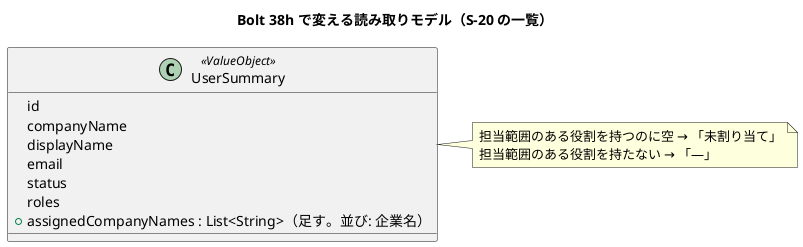

# Bolt 38h 計画 - W6 の返済（案件の出口の案内、担当企業の付け忘れ、担当範囲のテストのそろえ、マニュアルの追従）

## 基本情報

| 項目 | 内容 |
| :--- | :--- |
| Bolt | 第 38h 回（W7 の 1 本目。W6 の締めで足した返済の Bolt） |
| 予定 | W7（2026-11-16 の週。前倒しで着手できる）。作業は約 6.2 時間（`check`・`uiTest`・SonarQube・CI の待ちを除く）。分割の規則の例外（開始準備の決定 (1)） |
| アプローチ | アウトサイドイン（画面と受入シナリオから。既存の振る舞いを揃える。release_plan の W7 の節の 38h の行） |
| 対象 | [W6 横断レビュー](../../review/cargo-tracker/w6_review_20261102.md)の高 5 件（H-1〜H-5）と、38h とした中・低（M-11〜M-17、L-1・L-3・L-12・L-13） |
| トレース | US-07 AC4・AC5（再設計要・出発済みの案内）、US-16 AC1・AC4（利用者の一覧と担当範囲）、D-94（案件の終え方。運用の決まり） |
| GitHub | [#50](https://github.com/k2works/practical-domain-driven-design-in-enterpris-application/issues/50)（M-17 を足す） |
| SP | 0 |
| 承認ゲート | 計画と終了報告。画面（S-20 の一覧の列と登録の完了の案内、S-02 の空の文、拒否の文言）、新しいファイル（なし。テストの追加は既存のファイル）。スキーマは変えない（担当企業は既存の `identity.user_assignment` を読むだけ） |
| 開始準備で決めたこと | 2026-11-02、human:kakimomokuri: (1) 分けずに 1 つで進める（分割の規則の例外。打ち切りの点検をステップ 3 と 5 の後に置く）、(2) 再設計要・出発済みの運用の決まりは、マニュアルと画面の文言の両方に書き、互いを指し合わない終わりのある案内にする、(3) S-20 の一覧の担当企業は、一覧の照会の射影（`UserRepository.findSummariesIn` の SQL と `UserSummary`）に足す。担当範囲の判定に使う `UserAssignmentRepository` は変えない |

## Bolt ゴール

W7 の評価の入口（39f）で再設計要が本番で起き始める前に、再設計要・出発済みの案件の案内を終わりのある形にし、担当企業の付け忘れを見えるようにし、W6 で写しの形が揃わなかったテストと文書を揃える。

### 開始準備で確かめたこと

- **互いを指し合う案内（H-1）**: 循環しているのは再設計要だけ。マニュアル 6.4 :186・:187（営業 → 経路設計者）、7.1 :59・:63・7.2 :107（同）、8.2 :96・:97・8.3 :140（経路設計者 → 担当営業）、用語集 :45（「経路設計者は担当営業と、営業担当者は経路設計者と相談」）、付録 B :142・:143・:172・:173・:206〜:210。出発済みは営業が荷主を指して終わる（6.4 :188・:189、7.1 :64・:68、7.2 :108、用語集 :46）。荷主の画面（4.2 :108〜:119、`TransportRequestLabels.java:66・69・72・75`、`QuotationApprovalController.java:123-124`）は担当営業だけを指し、循環しない
- **画面の文言（H-1）**: 再設計要の社内の案内は `RoutingCaseController.java:234`（S-07）、`routing/staff/routing-cases/show.html:41`、`BookingController.java:210`、`StaffQuotationController.java:447`・`:459`。出発済みは `BookingController.java:211`、`StaffQuotationController.java:443`・`:462`。同じ文を確かめるテストは `route_redesign_required_ui.feature`、`route_already_departed_ui.feature`、`StaffQuotationControllerTest`、`RoutingCaseControllerTest`、`BookingControllerTest`。ui_design に 9 か所、user_story に 3 か所
- **S-20 の一覧（H-2）**: 列は企業・表示名・メールアドレス・利用状態・役割（`templates/identity/users/list.html:20-24`、11.1 :45-50）。行の型 `UserSummary(id, companyName, displayName, email, status, roles)`（`@ValueObject`）、照会は `UserAdministrationQueryService.list`（:109-115）→ `UserRepository.findSummariesIn` → `IdentityMapper.xml:179-187`（`selectUserAdministrationRowsIn`。役割の数だけ行が出る）。業務担当者の担当企業は `selectAssignedCompanies`（:200-209。担当範囲のある役割を持つときだけ意味を持つ。同じ `COMPANY` の行の意味は役割で決まる。`UserAssignmentRepository` の Javadoc）。表は `identity.user_assignment (user_id, scope_kind, scope_id, granted_by, granted_at)`
- **登録の完了（H-2）**: `UserRegistrationController.java:105-107` がフラッシュ（`REGISTERED_NOTICE` :44）を付けて `/staff/users/{id}` へ戻す。担当範囲の領域は `detail.html:69-70`（`aria-labelledby="assignments-title"`。担当範囲のある役割のときだけ出る）
- **キャプチャ（H-3）**: `features/ui/manual_screenshots.feature:71` で撮る。コマンドは `./gradlew manualScreenshots`（`build.gradle:139-152`。`check` に入らない）。航海の取得時刻はシナリオの手順（`RoutingUiSteps.java:80-91・104-115`。`Instant.now()-1h`）で入るので、今撮れば情報不足の規則に合う。PNG の最後のコミットは e967ef284（2026-10-11）。同じ一括で `06-intake-list-no-assignment`（:40）と `11-users`（:196）も撮られる
- **S-02 の空の文（H-4）**: `quotation/staff/transport-requests/list.html:17-18` の注は「表ごとの空の文は今のまま出す」、案内の語は「輸送要求」。5 つの表（:20・:54・:85・:110・:140）が空の文を無条件に出す。S-10（`booking/.../list.html:15`）・S-05（`routing/.../list.html:14`）・S-11（`tracking/.../list.html:14`）は `and !noAssignedCompanies` で抑える。S-10 :13 の注「S-02 と同じ形」は誤り。文の写しは 6 章 :58、`StaffAssignedScopeSecurityIntegrationTest.java:77`、ui_design :166
- **担当範囲のテスト（H-5）**: 見積りの `StaffAssignedScopeSecurityIntegrationTest` :330（ない対象の POST は 404 で記録しない）、:379（割り当てを足すと同じ session の次の request から出る）、:392（行を消すと次の request から 404）。予約（13 本）・経路設計（9 本）・追跡（8 本）の `*AssignedScopeSecurityIntegrationTest` に同じ趣旨はない（メソッド名と `assignCompany`・`DELETE FROM identity.user_assignment`・`missing` で検索）。WebMvc の NotFound のテスト（`RoutingCaseControllerTest.java:316-323`、`MilestoneRegistrationControllerTest.java:316-321`、見積りの `TransportRequestReviewControllerTest:572-581`）は記録しないことを確かめていない。`never()` の前例は GET の範囲外の場合（`BookingControllerTest:190`、`RoutingCaseControllerTest:287`、`MilestoneRegistrationControllerTest:244`）
- **出発済みの文（M-11）**: S-07 は「最初の区間の航海がすでに出発しているため確定できません。候補を再算出してください。」（`RoutingCaseController.java:235`）、S-02・S-04 は「最初の区間が出発済みのため…」。付録 B の早見表に S-07 の文はない
- **マニュアルの入口（M-12〜M-14）**: 00 章 :27・:43、index :24、用語集 :21 にロックの解除・認証アプリの解除・担当企業の割り当てがない（11 章 :4・:12 にはある）。用語集 :25 の担当企業にカスタマーサポートがなく、「担当範囲」がない。「11 章」へのリンクは 6 章 :57、7 章 :55、8 章 :27、9 章 :29、付録 B :180、用語集 :25。2.8 :426 の例は管理範囲だけ
- **domain_model（M-15・M-16）**: :270「確定の試行」、:272「38g で…値を足す」の未来形、:1213。`RoutingOutOfScopeResponder`・`TrackingOutOfScopeResponder` は用語集にない（4 つとも `@Component` だけで、`LivingGlossaryConsistencyTest` の対象ではない）。:150 の `RedesignReasonCode` は実装（逆順・予定なし・到着≦出発・2 度寄港）より狭い
- **M-17**: S-02 の承認の前の表（`RoutingRow`）には印の項目がなく、S-05 は「再設計要」を状態に出すが出発済みは出さない → #50 に送る
- **L 項目**: `OutOfScopeAttemptRecorder.java:14`「確定の POST のときだけ呼び」（ADR-019 :36・:74 は状態を変える POST）。ADR-017・ADR-019 のフロントマターは `status: draft` で `verified` なし（本文は採用）。ADR-016 にも `verified` がない。11.5 の 24 時間は :232・:267・:290。ADR-001 :72 の句点の後の半角空白

## 設計の決定（案）

| 項目 | 決定 | 根拠 |
| :--- | :--- | :--- |
| 再設計要の案内（社内） | 営業の画面（S-02・S-04・S-09）は「経路が再設計要です。荷主に新しい見積依頼の出し直しを案内してください。」、経路設計者の画面（S-06・S-07）は「経路が再設計要です。担当営業が荷主に新しい見積依頼の出し直しを案内します。」（互いを指し合わず、次に動く人と動き方を書く。古い案件はそのまま残す）。再設計（US-08）が入るまでの運用の決まりと注を、マニュアル 6.4・7.1・7.2・8.2・8.3・用語集・付録 B に書く | 開始準備の決定 (2)、D-94 |
| 出発済みの案内（社内） | 営業の画面は今のまま荷主を指す（循環しない）。文を「最初の区間の航海がすでに出発しています。」の形にそろえ、S-07 も同じ語にする（M-11。用語集の「出発済み」） | M-11 |
| 担当企業の列 | `UserSummary` に担当企業の名前（並び: 企業名）を足し、`selectUserAdministrationRowsIn` に `user_assignment`（`scope_kind = 'COMPANY'`）と企業を LEFT JOIN する。担当範囲のある役割を持たない利用者の列は空（「—」）。担当範囲のある役割を持つのに担当企業がない利用者は「未割り当て」と示す（付け忘れが見える）。担当範囲の判定（`UserAssignmentRepository`）は変えない | 開始準備の決定 (3) |
| 登録の完了の案内 | 担当範囲のある役割で登録したとき、フラッシュに「担当企業を割り当ててください」とリンク（`/staff/users/{id}#assignments-title`）を足す。招待のリンクの 24 時間と、本人に一言連絡する案内も同じフラッシュに入れる（L-12） | H-2、L-12 |
| S-02 の空の文 | S-10・S-05・S-11 と同じく `and !noAssignedCompanies` で表ごとの空の文を抑え、案内の語を「見積依頼」にする。S-10 の注を直す | H-4 |
| 担当範囲のテスト | 予約・経路設計・追跡の `*AssignedScopeSecurityIntegrationTest` に見積りの 3 本（:330・:379・:392）と同じ趣旨のテストを足す。WebMvc の NotFound のテスト 3 本（見積り・経路設計・追跡）に `then(outOfScope).should(never())` を足す | H-5 |
| キャプチャ | 画面とマニュアルを直した後に `manualScreenshots` を 1 回流し、`08-candidates`・`06-intake-list-no-assignment`・`11-users` を確かめて入れる。ほかの画像の差分は戻す | H-3 |

## ふりかえりと前の Bolt からの引き継ぎ

| 出典 | 内容 | この Bolt での扱い |
| :--- | :--- | :--- |
| W6 の Try T-204・T-212 | サブエージェントへの指示の最初に heredoc を使わないと書く | 任せるときの指示の最初に書く（`orchestrating-development` の `PROJECT.md`） |
| W6 の Try T-217 | 本体を直す前に Red を流し、落ちた理由を記録する | ステップ 2〜4 |
| W6 の Try T-225・T-213 | push の前に `check` | ステップ 7 |
| W6 の Try T-182・T-211・T-216 | 状態の組み合わせの表に出口・誤った入力の行を置く | 下の表 |
| W6 の Try T-215・T-222 | Gradle を流す担当を 1 つに、計画の初稿を先にコミット | この計画を先にコミットする |
| W5 の Try T-148・T-152 | 共通の部品と写しは全体を数えてから変える | 開始準備で文言の写し（画面 6 か所・テスト 5 ファイル・ui_design 9 か所・user_story 3 か所）を数えた |
| W6 横断レビュー | H-1〜H-5、M-11〜M-17、L-1・L-3・L-12・L-13 | この Bolt。M-17 は #50 |

## 状態の組み合わせ（行ごとにテストを 1 本。T-182）

| 行 | 状況 | 期待 | 確かめ方 |
| :--- | :--- | :--- | :--- |
| 1 | 営業が再設計要の見積りを S-04 で開く | 「荷主に新しい見積依頼の出し直しを案内してください」と出て、経路設計者を指さない | `StaffQuotationControllerTest`、`route_redesign_required_ui.feature` |
| 2 | 経路設計者が再設計要の経路版を S-07 で確定しようとする | 「担当営業が荷主に…出し直しを案内します」と出て、担当営業との相談を求めない | `RoutingCaseControllerTest` |
| 3 | 営業が出発済みの見積りの本予約を S-09 で確定しようとする | 「最初の区間の航海がすでに出発しています。」の形で、荷主を指す | `BookingControllerTest`、`route_already_departed_ui.feature` |
| 4 | 経路設計者が出発済みの候補を S-07 で確定しようとする | 行 3 と同じ語（「最初の区間の航海がすでに出発しています」） | `RoutingCaseControllerTest` |
| 5 | S-20 の一覧に、担当企業が 2 社の営業担当者、担当企業のない営業担当者、荷主担当者がいる | 2 社の名前、「未割り当て」、「—」 | `MyBatisIdentityRepositoriesIntegrationTest`（射影）、WebMvc の一覧のテスト |
| 6 | 役割を 2 つ持つ利用者（役割の数だけ行が出る SQL）に担当企業が 2 社ある | 一覧の行は 1 つで、担当企業は 2 社（重ならない） | 同上 |
| 7 | 担当範囲のある役割で登録した | 完了のフラッシュに担当企業の割り当ての案内と `#assignments-title` へのリンク、24 時間の注 | `UserRegistrationControllerTest` |
| 8 | 担当範囲のない役割（荷主担当者）で登録した | 割り当ての案内は出ない（24 時間の注は出る） | 同上 |
| 9 | 担当企業のない営業担当者が S-02 を開く | 案内だけが出て、表ごとの空の文は出ない。語は「見積依頼」 | `StaffAssignedScopeSecurityIntegrationTest:77` の隣、UI |
| 10 | 予約・経路設計・追跡で、ない対象に POST する | 404 で、範囲外の試行を記録しない | 3 つの `*AssignedScopeSecurityIntegrationTest`、WebMvc の NotFound の 3 本（`never()`） |
| 11 | 予約・経路設計・追跡で、割り当てを足した直後の次の request | 同じ session で一覧と詳細に出る | 3 つの `*AssignedScopeSecurityIntegrationTest` |
| 12 | 予約・経路設計・追跡で、割り当ての行を消した直後の次の request | 一覧から消え、詳細は 404 | 同上 |

## スコープ

### 入れるもの

- 行 1〜12 のテスト、画面の文言（社内の再設計要・出発済み）、`UserSummary` と SQL、一覧のテンプレート、登録の完了のフラッシュ、S-02 のテンプレート
- マニュアル: 00 章・index・用語集（システム管理者の仕事、担当企業にカスタマーサポート、「担当範囲」の項目、再設計要・出発済みの案内）、2.8（担当企業の外の 404 と付録 B の Q3-6 への相互参照）、6.4・7.1・7.2・8.2・8.3（運用の決まり）、6 章 :58、11.1（一覧の列）・11.5（完了の案内と 24 時間）、6〜9 章と付録 B の「11 章」へのリンクを 11.8 に、付録 B の早見表（S-07 の出発済みの文）、キャプチャ 3 枚
- 設計の文書: ui_design（文言 9 か所、S-20 の一覧の列、S-02 の空の文 :166）、user_story（文言 3 か所）、domain_model（:150・:270・:272・:1213、用語集に `RoutingOutOfScopeResponder`・`TrackingOutOfScopeResponder`）、data_model（`UserSummary` を読む照会の注があれば）
- Javadoc と ADR: `OutOfScopeAttemptRecorder.java:14`、ADR-017・ADR-019 のフロントマター（本文の採用に合わせて `stable` と `verified`。ADR-016 の `verified` も確かめる）、ADR-001 :72
- #50 へのコメント（M-17）、release_plan（38h の行、更新履歴）

### 入れないもの

- 「案件を終える」操作（D-94。W9 の荷主の辞退の開始準備で決める）
- 担当者のいない荷主企業の知らせ（W10 の運用準備）
- S-02 の承認の前の表と S-05 の印（M-17。#50）
- 支援技術による手動確認（W10）

## 設計（この Bolt の範囲）

- ER 図: スキーマを変えないので省く（`identity.user_assignment` と `identity.company` を読むだけ）
- 状態遷移図: 状態を変えないので省く
- 画面遷移図: 遷移を変えない（登録の完了の後の行き先は今の `/staff/users/{id}` のまま。案内のリンクは同じ画面の中の領域）

## ステップ計画

- [ ] **1. 設計の文書**: ui_design・user_story の文言と S-20・S-02、domain_model の 5 か所と用語集（完了の判定: 文書の差分）
- [ ] **2. 案内の文言（Red → Green）**: 行 1〜4 のテストの期待を新しい文に直して落ちることを確かめ、画面の文言を直す（完了の判定: 期待した理由で落ちた後に緑）
- [ ] **3. 一覧の担当企業と登録の完了（Red → Green）**: 行 5〜8 のテストを先に書き、SQL・`UserSummary`・テンプレート・フラッシュを作る（完了の判定: 同上。`LivingGlossaryConsistencyTest` が緑のまま）。**打ち切りの点検 1**: ここまでで 3.5 時間を超えたら、ステップ 5 のマニュアルの入口（M-12〜M-14）を次の Bolt に送るかを人に諮る
- [ ] **4. S-02 の空の文と担当範囲のテスト（Red → Green）**: 行 9 のテストで落ちることを確かめてテンプレートを直す。行 10〜12 は既存の振る舞いを確かめるテストなので、足した後に変異（下の V5〜V7）で落ちることを確かめる（完了の判定: 緑と変異）
- [ ] **5. マニュアルと Javadoc・ADR**: 運用の決まり、入口、11 章、付録 B、L 項目（完了の判定: 文書の差分）。**打ち切りの点検 2**: ここまでで 5.5 時間を超えたら、キャプチャを次の Bolt に送るかを人に諮る
- [ ] **6. キャプチャ**: `manualScreenshots` を 1 回流し、3 枚を確かめて入れ、ほかの差分を戻す（完了の判定: 3 枚の画像が新しい画面と規則に合う）
- [ ] **7. 品質ゲートと開発レビュー**: 変異、`check`・`uiTest`、その後に SonarQube、開発レビューとその直し。push の前に `check`（T-225）
- [ ] **8. 終了報告**: push して CI と MkDocs とデモ環境の配備を確かめる。#50 に M-17 をコメントし、release_plan・開発の索引・mkdocs を直す

### 時間の配分と打ち切り

| # | 目安 | 打ち切り |
| :--- | :--- | :--- |
| 1 | 30 分 | — |
| 2 | 50 分 | — |
| 3 | 100 分 | 点検 1（累計 3.5 時間） |
| 4 | 60 分 | — |
| 5 | 60 分 | 点検 2（累計 5.5 時間） |
| 6 | 25 分 | — |
| 7 | 35 分（待ちを除く） | — |
| 8 | 15 分（CI の待ちを除く） | — |

合計 375 分（約 6.2 時間）。

## 確認ポイント（計画の承認の場でまとめて確認する。Try T-6）

| # | 確認すること | 場所 | 推奨 |
| :--- | :--- | :--- | :--- |
| 1 | **再設計要の案内の文（画面）** | ステップ 2 | 営業「経路が再設計要です。荷主に新しい見積依頼の出し直しを案内してください。」、経路設計者「経路が再設計要です。担当営業が荷主に新しい見積依頼の出し直しを案内します。」。古い案件はそのまま残すと、マニュアルの運用の決まりに書く（D-94 の仮の決定） |
| 2 | **出発済みの文のそろえ** | ステップ 2 | 「最初の区間の航海がすでに出発しています。」を共通の頭にし、続く文（荷主と相談、候補を再算出）は画面ごとに残す |
| 3 | **担当企業の列の表し方（画面）** | ステップ 3 | 2 社以上は「、」で並べる。担当範囲のある役割で 0 社は「未割り当て」、担当範囲のない役割は「—」 |
| 4 | **登録の完了の案内（画面）** | ステップ 3 | 担当範囲のある役割のときだけ割り当ての案内とリンク。24 時間の注と「本人に一言連絡してください」はどの役割でも出す |
| 5 | **ADR のフロントマター** | ステップ 5 | ADR-017・ADR-019 を `stable` にし、`verified` を足す（本文の採用は人が承認した記録がある。017 は Bolt 33、019 は Bolt 38f の終了報告の承認）。ADR-016 も同じ |
| 6 | **変異** | ステップ 7 | 下の 7 つ。スクリプトはバイトのまま読み書きし、gradlew.bat を絶対パスで呼び、結果の XML を消してから流す（T-164・T-178・T-200） |

### 変異と落ちる見込みのテスト

| # | 変異 | 落ちる見込み |
| :--- | :--- | :--- |
| V1 | 営業の再設計要の文を前の「経路設計者と扱いを相談」に戻す | 行 1 |
| V2 | 一覧の SQL の担当企業の JOIN で `scope_kind` の条件を外す（管理範囲も担当企業に数える） | 行 5（システム管理者の行） |
| V3 | 一覧で担当企業を役割の行ごとに数える（重ねる） | 行 6 |
| V4 | 登録の完了の割り当ての案内を役割によらず出す | 行 8 |
| V5 | 予約の範囲の判定で、ない対象も範囲外として記録する | 行 10（予約） |
| V6 | 経路設計の request ごとの確かめで担当企業を session に持ち越す（次の request で読み直さない） | 行 11・12（経路設計） |
| V7 | S-02 の空の文の `!noAssignedCompanies` を外す | 行 9 |

## 完了条件

- [ ] 上のステップ 1〜8 の完了の判定を満たす
- [ ] 行 1〜12 に、それを名乗るテストがある
- [ ] `check`・`uiTest` が緑、SonarQube が PASS、CI が緑、デモ環境が新しい版で動く
- [ ] マニュアルの案内が画面の文言と一致し、キャプチャ 3 枚が新しい画面と規則に合う
- [ ] 終了報告が承認される

## 更新履歴

| 日付 | 更新内容 | 更新者 |
| :--- | :--- | :--- |
| 2026-11-02 | 初版作成（承認待ち）。開始準備で、分けずに 1 つで進め、案内はマニュアルと画面の両方に書き、担当企業は一覧の照会の射影に足すと決めた（human:kakimomokuri） | anthropic/claude-opus-5-5 |

## 関連ドキュメント

- [リリース計画](release_plan.md)（W7 の節の 38h の行、台帳の D-94）
- [W6 横断レビュー](../../review/cargo-tracker/w6_review_20261102.md)、[W6 完了報告書](iteration_report-W6.md)
- [ユーザーマニュアル](../../manual/index.md)、[UI 設計](../../design/cargo-tracker/ui_design.md)、[ドメインモデル](../../design/cargo-tracker/domain_model.md)
