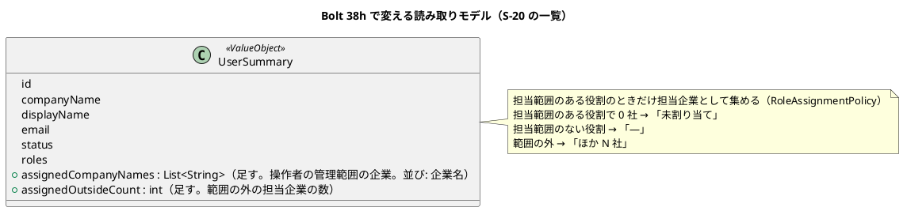

# Bolt 38h 計画 - W6 の返済（案件の出口の案内、担当企業の付け忘れ、担当範囲のテストのそろえ、マニュアルの追従）

## 基本情報

| 項目 | 内容 |
| :--- | :--- |
| Bolt | 第 38h 回（W7 の 1 本目。W6 の締めで足した返済の Bolt） |
| 予定 | W7（2026-11-16 の週。前倒しで着手できる）。作業は約 6.5 時間（`check`・`uiTest`・SonarQube・CI の待ちを除く）。CLAUDE.md の「半日を超える Bolt は分割する」に当たる。開始準備で分けずに 1 つで進めると決めた（分割の規則の例外。Bolt 38g の前例。打ち切りの点検を 2 か所に置き、送る先は Bolt 38h2（39f より前）） |
| アプローチ | アウトサイドイン（画面と受入シナリオから。既存の振る舞いを揃える。release_plan の W7 の節の 38h の行、開発戦略 :120・:347 の「S-20 の直しはアウトサイドイン」） |
| 対象 | [W6 横断レビュー](../../review/cargo-tracker/w6_review_20261102.md)の高 5 件（H-1〜H-5）と、38h とした中・低（M-11〜M-17、L-1・L-3・L-12・L-13） |
| トレース | US-07 AC4・AC5（再設計要・出発済みの案内）、US-16 AC1・AC4（利用者の一覧と担当範囲）、D-94（案件の終え方。運用の決まり） |
| GitHub | [#50](https://github.com/k2works/practical-domain-driven-design-in-enterpris-application/issues/50)（M-17 を足す） |
| SP | 0 |
| 承認ゲート | 計画と終了報告。画面（S-20 の一覧の列と登録の完了の案内、S-02 の空の文、拒否の文言）、認可の意味を持つ読み方（一覧の担当企業を役割で絞り、管理範囲の外は数だけ）、前の決定の変更（下の設計の決定の【前の決定の変更】）。スキーマは変えない（既存の `identity.user_assignment` を読むだけ）。新しいファイルはない（テストは既存のファイルに足す） |
| 動画 | 撮らない（画面は変わるが、W7 のデモ項目に当たるシナリオがない。Bolt 37f3 の前例。開始準備の決定 (4)） |
| 開始準備で決めたこと | 2026-11-02、human:kakimomokuri: (1) 分けずに 1 つで進める（例外。打ち切りで送る候補はマニュアルの入口（M-12〜M-14）と L 項目にし、高の H-3 は送らない）、(2) 再設計要・出発済みの運用の決まりは、マニュアルと画面の文言の両方に書く。今の文の「対象 + 理由 + できないこと」は残し、最後の「次の行動」の句だけを置き換える。再設計要と出発済みの両方に同じ決まりを当てる。語は「新しい見積依頼を出すよう案内」（用語集の「出し直し」は差戻しの版を増やす意味なので使わない）。荷主の 4.2 に一言足す、(3) 期限の後の再設計要の見積りの再見積りのボタンは残し（Bolt 37e3 の決定のまま）、文で「再見積りしても経路は再設計要のままで、荷主は承認できない」と知らせる、(4) 動画は撮らない、(5) S-20 の一覧の担当企業は一覧の照会の射影に足す。担当範囲のある役割のときだけ担当企業として読み（管理範囲は数えない。Bolt 38e の決定 (9)）、操作者の管理範囲の企業は名前、範囲の外は「ほか N 社」（詳細の画面と同じ形。Bolt 38e の決定 (11)）。担当範囲の判定（`UserAssignmentRepository`）は変えない |

## Bolt ゴール

W7 の評価の入口（39f）で再設計要が本番で起き始める前に、再設計要・出発済みの案件の案内を終わりのある形にし、担当企業の付け忘れを見えるようにし、W6 で写しの形が揃わなかったテストと文書を揃える。

### 開始準備で確かめたこと

- **互いを指し合う案内（H-1）**: 循環しているのは再設計要だけ。マニュアル 6.4 :186・:187（営業 → 経路設計者）、7.1 :59・:63・7.2 :107（同）、8.2 :96・:97・8.3 :140（経路設計者 → 担当営業）、用語集 :45（「経路設計者は担当営業と、営業担当者は経路設計者と相談」）、付録 B :142・:143・:172・:173・:206〜:210。出発済みは営業が荷主を指して終わる（6.4 :188・:189、7.1 :64・:68、7.2 :108、用語集 :46）が、期限の後に再見積りしても同じ経路を引き継ぐので荷主は承認できず、行き止まりになる（D-94 は両方を対象にする）。荷主の画面（4.2 :108〜:119、`TransportRequestLabels.java:66・69・72・75`、`QuotationApprovalController.java:123-124`）は担当営業だけを指し、循環しない
- **画面の文言（H-1）**: 再設計要の社内の案内は `RoutingCaseController.java:234`（S-07）、`routing/staff/routing-cases/show.html:41`（S-06）、`BookingController.java:210`（S-09）、`StaffQuotationController.java:447`・`:459`（S-04。:459 は期限の後で、再見積りのボタンが残る。Bolt 37e3 計画 :58）。出発済みは `BookingController.java:211`、`StaffQuotationController.java:443`・`:462`。同じ文を確かめるテストは `route_redesign_required_ui.feature`、`route_already_departed_ui.feature`、`StaffQuotationControllerTest`、`RoutingCaseControllerTest`（:442 は S-06）、`BookingControllerTest`。ui_design に 9 か所、user_story に 3 か所（US-07 の決定 :352・:370・:377。人が承認した決定）
- **前の決定**: Bolt 37e3 は社内の案内を「経路設計者と扱いを相談」「担当営業と扱いを相談」と決めた（`bolt_37e3_plan.md:56・58・60`、用語集 :45）。Bolt 37e4 は社内の語を「出発済み」、荷主の語を「最初の航海がすでに出発した」と書き分けた（`bolt_37e4_plan.md:56-57`、用語集 :46）。外れているのは S-07 の `RoutingCaseController.java:235`「最初の区間の航海がすでに出発しているため」の 1 か所だけ
- **語**: 用語集 :29 の「出し直し」は、差し戻された見積依頼を直して版を 1 つ増やすこと。複製は未実装（`quotation/transport-requests/detail.html:13`）。荷主が実際にとる行動は C-03 の新規作成
- **S-20 の一覧（H-2）**: 列は企業・表示名・メールアドレス・利用状態・役割（`templates/identity/users/list.html:20-24`、11.1 :45-50）。行の型 `UserSummary(id, companyName, displayName, email, status, roles)`（`@ValueObject`。domain_model :261）、照会は `UserAdministrationQueryService.list`（:109-115）→ `UserRepository.findSummariesIn` → `IdentityMapper.xml:179-187`（`selectUserAdministrationRowsIn`。役割の数だけ行が出る。`userAdministrationColumns` は詳細の SQL でも使う）。`UserSummary` の引数を変えるとテストの 3 ファイルに及ぶ
- **COMPANY の行の 2 つの意味**: 管理範囲も担当企業も `scope_kind = 'COMPANY'` の行（`IdentityMapper.xml:190-192`、`UserAssignmentRepository.java:9-11`。`scope_kind` の値は `COMPANY`・`BOOKING`。`V20261016180000__create_identity_user_assignment.sql:13`）。意味は役割で決まり、担当企業は担当範囲のある役割のときだけ読む（Bolt 38e の決定 (9)。前例は `selectAssignedCompanies` :200-209、`MyBatisUserStandingRepository.java:66-74`、`UserAdministrationQueryService.java:141-143` の `RoleAssignmentPolicy.holdsAssignmentScopedRole`）。開発データのシステム管理者は自社を管理範囲に持つ（`V20261016180900__seed_dev_system_admin_scope.sql`）
- **詳細の画面の担当企業の示し方**: 操作者の管理範囲の企業は名前、範囲の外は数だけ（`UserDetailPage.java:404-424`、ui_design :1333・:1344。Bolt 38e の決定 (11)）。詳細の空は「担当企業はまだありません。」（`detail.html:70`）
- **登録の完了（H-2・L-12）**: `UserRegistrationController.java:105-107` がフラッシュ `notice`（`REGISTERED_NOTICE` :44）を付けて `/staff/users/{id}` へ戻す。`detail.html:13` は `th:text="${notice}"` でエスケープするので、リンクは文字列に入れられない。担当範囲の領域は `detail.html:69-70`（`aria-labelledby="assignments-title"`。担当範囲のある役割のときだけ出る）。招待の期限は `PasswordResetTokenPurpose.java:24`
- **キャプチャ（H-3）**: `features/ui/manual_screenshots.feature:71` の `08-candidates` を `./gradlew manualScreenshots`（`build.gradle:139-152`。`check` に入らない）で撮る。航海の取得時刻はシナリオの手順（`RoutingUiSteps.java:80-91・104-115`）で入るので、今撮れば情報不足の規則に合う。PNG の最後のコミットは e967ef284（2026-10-11）。同じ一括で `06-intake-list-no-assignment`（:40）・`11-users`（:196）・`08-routing-case-redesign-required`（:275。S-06 の再設計要の文が写る。8 章 :99）も撮られる
- **S-02 の空の文（H-4）**: `quotation/staff/transport-requests/list.html:17-18` の注は「表ごとの空の文は今のまま出す」、案内の語は「輸送要求」。5 つの表（:20・:54・:85・:110・:140）が空の文を無条件に出す。S-10・S-05・S-11 は `and !noAssignedCompanies` で抑える。S-10 :13 の注「S-02 と同じ形」は誤り。文の写しは 6 章 :58、`StaffAssignedScopeSecurityIntegrationTest.java:77`、ui_design :166
- **担当範囲のテスト（H-5）**: 見積りの `StaffAssignedScopeSecurityIntegrationTest` :330・:379・:392。予約（12 本）・経路設計（9 本）・追跡（7 本）の `*AssignedScopeSecurityIntegrationTest` に同じ趣旨はない。WebMvc の NotFound のテスト（`TransportRequestReviewControllerTest:572-581`、`RoutingCaseControllerTest.java:316-323`、`MilestoneRegistrationControllerTest.java:316-321`、`BookingControllerTest.java:522-536`）は記録しないことを確かめていない。`never()` の前例は GET の範囲外（`BookingControllerTest:190`、`RoutingCaseControllerTest:287`、`MilestoneRegistrationControllerTest:244`）。request ごとの担当企業の読み直しは identity の `selectUserStanding`（`MyBatisUserStandingRepository`）
- **出発済みの文（M-11）**: 付録 B の早見表に S-07 の出発済みの文はない。8 章 :137 は「最初の区間が出発済みだったり」
- **マニュアルの入口（M-12〜M-14）**: 00 章 :27・:43、index :24、用語集 :21 にロックの解除・認証アプリの解除・担当企業の割り当てがない（11 章 :4・:12 にはある）。用語集 :25 の担当企業にカスタマーサポートがなく、「担当範囲」がない。「11 章」へのリンクは 6 章 :57、7 章 :55、8 章 :27、9 章 :29、付録 B :180、用語集 :25。2.8 :426 の例は管理範囲だけ
- **domain_model（M-15・M-16）**: :150（`RedesignReasonCode` が実装より狭い）、:261（`UserSummary` の属性）、:270「確定の試行」、:272 の未来形、:276（`BookingOutOfScopeResponder` に「確定の POST」）、:1213。`RoutingOutOfScopeResponder`・`TrackingOutOfScopeResponder` は用語集にない（4 つとも `@Component` だけで、`LivingGlossaryConsistencyTest` の対象ではない）
- **M-17**: S-02 の承認の前の表（`RoutingRow`）には印の項目がなく、S-05 は「再設計要」を状態に出すが出発済みは出さない → #50 に送る
- **L 項目**: `OutOfScopeAttemptRecorder.java:14`（ADR-019 :36・:74 は状態を変える POST）。ADR-016・017・019 のフロントマターに `verified` がない（017・019 は `status: draft`、本文は採用）。11.5 の 24 時間は :232・:267・:290。ADR-001 :72 の句点の後の半角空白
- **既存の画面の層のシナリオ**: `register_user_ui.feature`・`manage_user_assignments_ui.feature`（S-20 の一覧と登録の完了を通る）

## 設計の決定（案）

| 項目 | 決定 | 根拠 |
| :--- | :--- | :--- |
| 再設計要の案内（社内）【前の決定の変更】 | 今の文の「対象 + 理由 + できないこと」は残し、最後の「次の行動」の句だけを置き換える。営業の画面（S-02・S-04・S-09）は「荷主に新しい見積依頼を出すよう案内してください。」、経路設計者の画面（S-06・S-07）は「担当営業が荷主に新しい見積依頼を出すよう案内します。」。S-04 の期限の後（:459）は再見積りのボタンを残し、「再見積りしても経路は再設計要のままで、荷主は承認できません。」を足す。Bolt 37e3 の決定（`bolt_37e3_plan.md:56・58・60`）と US-07 の決定 :352・:370、用語集 :45 を変える。S-06 の「再設計の操作は今後の更新で入れます」は残す（US-08 までの事実） | 開始準備の決定 (2)・(3)、D-94 |
| 出発済みの案内（社内）【前の決定の変更】 | 語は今の「最初の区間が出発済み」のまま（Bolt 37e4 の書き分け）。S-07 の `RoutingCaseController.java:235` を「最初の区間が出発済みのため確定できません。候補を再算出してください。」にそろえる（M-11 は 1 か所）。営業の画面の「荷主と扱いを相談してください」は再設計要と同じく「荷主に新しい見積依頼を出すよう案内してください。」に置き換える（US-07 の決定 :377 を変える） | 開始準備の決定 (2)、M-11 |
| 荷主の案内 | 画面の文は変えない（担当営業だけを指し、循環しない）。マニュアル 4.2 に「担当営業から新しい見積依頼を出すよう頼まれることがある。古い案件はそのまま残る」と一言足す | 開始準備の決定 (2) |
| 運用の決まり | マニュアル 6.4・7.1・7.2・8.2・8.3・用語集（:45・:46）・付録 B に、再設計（US-08）と案件を終える操作（D-94）が入るまでの決まりとして書く: 営業が荷主に新しい見積依頼を出すよう案内し、古い案件はそのまま残す | D-94 |
| 担当企業の列 | `UserSummary` に担当企業（操作者の管理範囲の企業名の並びと、範囲の外の数）を足す。`selectUserAdministrationRowsIn` に `user_assignment`（`scope_kind = 'COMPANY'` を ON 句に置く。`:245-247` の前例）と企業を LEFT JOIN し、`MyBatisUserRepository` で `RoleAssignmentPolicy` により担当範囲のある役割のときだけ担当企業として集める（管理範囲は数えない）。表し方: 名前は「、」で並べ、範囲の外は「ほか N 社」、担当範囲のある役割で 0 社は「未割り当て」、担当範囲のない役割は「—」。詳細の空「担当企業はまだありません。」とは画面ごとに書き分け、ui_design に書く。判定の読み手が 3 つ目になるので、`UserAssignmentRepository` の Javadoc と data_model の `user_assignment` の注に一覧の読み手を足す | 開始準備の決定 (5)、Bolt 38e の決定 (9)・(11) |
| 登録の完了の案内 | フラッシュに別の属性（例: `assignmentPrompt`）を足し、担当範囲のある役割で登録したときだけ `detail.html` が「担当企業を割り当ててください。」と `#assignments-title` へのリンクを出す（`notice` はエスケープしたまま）。招待の期限（`PasswordResetTokenPurpose` から導く。文字に固定しない）と「本人に一言連絡してください」を `notice` に足す（L-12） | H-2、L-12 |
| S-02 の空の文 | S-10・S-05・S-11 と同じく `and !noAssignedCompanies` で表ごとの空の文を抑え、案内の語を「見積依頼」にする。S-10 の注を直す | H-4 |
| 担当範囲のテスト | 予約・経路設計・追跡の `*AssignedScopeSecurityIntegrationTest` に見積りの 3 本（:330・:379・:392）と同じ趣旨のテストを足す。WebMvc の NotFound のテスト 4 本（見積り・予約・経路設計・追跡）に `then(outOfScope).should(never())` を足す | H-5 |
| キャプチャ | 画面とマニュアルを直した後に `manualScreenshots` を 1 回流し、`08-candidates`・`06-intake-list-no-assignment`・`11-users`・`08-routing-case-redesign-required` と、文言を直した画面が写るほかの画像を確かめて入れる。変わっていない画像の差分は戻す | H-3 |

## ふりかえりと前の Bolt からの引き継ぎ

| 出典 | 内容 | この Bolt での扱い |
| :--- | :--- | :--- |
| W6 の Try T-204・T-212 | サブエージェントへの指示の最初に heredoc を使わないと書く | 任せるときの指示の最初に書く（`orchestrating-development` の `PROJECT.md`） |
| W6 の Try T-217 | 本体を直す前に Red を流し、落ちた理由を記録する | ステップ 2〜4 |
| W6 の Try T-225・T-213 | push の前に `check` | ステップ 7 |
| W6 の Try T-182・T-211・T-216 | 状態の組み合わせの表に出口・誤った入力の行を置く | 下の表（行 5・5b・6 の範囲の内外と役割） |
| W6 の Try T-215・T-222 | Gradle を流す担当を 1 つに、計画の初稿を先にコミット | 初稿を `901653c60` でコミットした |
| W5 の Try T-148・T-152 | 共通の部品と写しは全体を数えてから変える | 開始準備で文言の写し（画面 6 か所・テスト 5 ファイル・ui_design 9 か所・user_story 3 か所）とキャプチャを数えた |
| W6 横断レビュー | H-1〜H-5、M-11〜M-17、L-1・L-3・L-12・L-13 | この Bolt。M-17 は #50 |

## 状態の組み合わせ（行ごとにテストを 1 本。T-182）

| 行 | 状況 | 期待 | 確かめ方 |
| :--- | :--- | :--- | :--- |
| 1 | 営業が再設計要の見積りを S-04 で開く（期限の前） | 次の行動の句が「荷主に新しい見積依頼を出すよう案内してください。」で、経路設計者を指さない | `StaffQuotationControllerTest`、`route_redesign_required_ui.feature` |
| 1b | 営業が期限の後の再設計要の見積りを S-04 で開く | 再見積りのボタンが残り、「再見積りしても経路は再設計要のままで、荷主は承認できません。」が出る | `StaffQuotationControllerTest` |
| 2 | 経路設計者が再設計要の経路版を S-07 で確定しようとする、S-06 で開く | 「担当営業が荷主に新しい見積依頼を出すよう案内します。」で、担当営業との相談を求めない。S-06 の「再設計の操作は今後の更新で入れます」は残る | `RoutingCaseControllerTest`（:442 を含む） |
| 3 | 営業が出発済みの見積りの本予約を S-09 で確定しようとする、S-04 で開く | 「最初の区間が出発済み」の語のまま、次の行動の句が「荷主に新しい見積依頼を出すよう案内してください。」 | `BookingControllerTest`、`StaffQuotationControllerTest`、`route_already_departed_ui.feature` |
| 4 | 経路設計者が出発済みの候補を S-07 で確定しようとする | 「最初の区間が出発済みのため確定できません。候補を再算出してください。」 | `RoutingCaseControllerTest` |
| 5 | S-20 の一覧に、操作者の管理範囲の 2 社を担当する営業担当者、担当企業のない営業担当者、荷主担当者、管理範囲の行を持つシステム管理者がいる | 2 社の名前、「未割り当て」、「—」、「—」（管理範囲を担当企業に数えない） | `MyBatisIdentityRepositoriesIntegrationTest`（射影）、WebMvc の一覧のテスト |
| 5b | 管理範囲の 1 社と範囲の外の 1 社を担当する営業担当者、範囲の外だけを担当する営業担当者 | 「（1 社の名前）、ほか 1 社」、「ほか 1 社」（「未割り当て」にしない） | 同上 |
| 6 | 役割を 2 つ持つ利用者（役割の数だけ行が出る SQL）に担当企業が 2 社ある | 一覧の行は 1 つで、担当企業は 2 社（重ならない） | 同上 |
| 7 | 担当範囲のある役割で登録した | 完了の画面に割り当ての案内と `#assignments-title` へのリンク、`notice` に招待の期限と本人への一言の案内 | `UserRegistrationControllerTest`、`register_user_ui.feature` |
| 8 | 担当範囲のない役割（荷主担当者）で登録した | 割り当ての案内は出ない（期限と一言の案内は出る） | `UserRegistrationControllerTest` |
| 9 | 担当企業のない営業担当者が S-02 を開く | 案内だけが出て、表ごとの空の文は出ない。語は「見積依頼」 | `StaffAssignedScopeSecurityIntegrationTest:77` の隣、UI |
| 10 | 見積り・予約・経路設計・追跡で、ない対象に POST する | 404 で、範囲外の試行を記録しない | 予約・経路設計・追跡の `*AssignedScopeSecurityIntegrationTest`、WebMvc の NotFound の 4 本（`never()`） |
| 11 | 予約・経路設計・追跡で、割り当てを足した直後の次の request | 同じ session で一覧と詳細に出る | 3 つの `*AssignedScopeSecurityIntegrationTest` |
| 12 | 予約・経路設計・追跡で、割り当ての行を消した直後の次の request | 一覧から消え、詳細は 404 | 同上 |

## スコープ

### 入れるもの

- 行 1〜12（1b・5b を含む）のテスト、画面の文言（社内の再設計要・出発済み、S-04 の期限の後）、`UserSummary` と SQL と `MyBatisUserRepository` の集め方、一覧のテンプレート、登録の完了のフラッシュと `detail.html`、S-02 のテンプレート、S-10 の注
- マニュアル: 4.2（荷主への一言）、6.4・7.1・7.2・8.2・8.3（運用の決まりと案内の文、8.3 :137 の語）、6 章 :58、11.1（一覧の列）・11.5（完了の案内と期限）、00 章・index・用語集（システム管理者の仕事、担当企業にカスタマーサポート、「担当範囲」の項目、:45・:46 の案内）、2.8（担当企業の外の 404 と付録 B の Q3-6 への相互参照）、6〜9 章と付録 B の「11 章」へのリンクを 11.8 に、付録 B の早見表（S-07 の出発済みの文、案内の文）、キャプチャ（4 枚と文言の写る画像）
- 設計の文書: ui_design（文言 9 か所、S-20 の一覧の列と書き分け、S-02 の空の文 :166）、user_story（US-07 の決定 :352・:370・:377 を 38h の決定で置き換え、決定の記録を足す）、domain_model（:150・:261・:270・:272・:276・:1213、用語集に `RoutingOutOfScopeResponder`・`TrackingOutOfScopeResponder`）、data_model（`user_assignment` の注に一覧の読み手）、`UserAssignmentRepository` の Javadoc
- Javadoc と ADR: `OutOfScopeAttemptRecorder.java:14`、ADR-016・017・019 のフロントマター（本文の採用に合わせて `stable` と `verified`）、ADR-001 :72
- 開発戦略 :348 の W7 の行に 38h、#50 へのコメント（M-17）、release_plan（38h の行、更新履歴）

### 入れないもの

- 「案件を終える」操作（D-94。W9 の荷主の辞退の開始準備で決める）
- 担当者のいない荷主企業の知らせ（W10 の運用準備）
- S-02 の承認の前の表と S-05 の印（M-17。#50）
- 荷主の画面の文言（循環しないので変えない。4.2 のマニュアルだけ）
- 支援技術による手動確認（W10）、動画（開始準備の決定 (4)）

## 設計（この Bolt の範囲）

- ER 図: スキーマを変えないので省く（`identity.user_assignment` と `identity.company` を読むだけ）
- 状態遷移図: 状態を変えないので省く
- 画面遷移図: 遷移を変えない（登録の完了の後の行き先は今の `/staff/users/{id}` のまま。案内のリンクは同じ画面の中の領域）

## ステップ計画

- [ ] **1. 設計の文書**: ui_design・user_story（決定の置き換え）の文言と S-20・S-02、domain_model の 6 か所と用語集、data_model の注（完了の判定: 文書の差分）
- [ ] **2. 案内の文言（Red → Green）**: 行 1〜4（1b を含む）のテストの期待を新しい文に直して落ちることを確かめ、画面の文言を直す（完了の判定: 期待した理由で落ちた後に緑）
- [ ] **3. 一覧の担当企業と登録の完了（Red → Green）**: WebMvc の一覧と登録の完了のテストから入り（行 5〜8 の画面の側）、射影の統合テスト（行 5・5b・6）、SQL・`UserSummary`・集め方・テンプレート・フラッシュ・`detail.html`。`register_user_ui.feature`・`manage_user_assignments_ui.feature` が緑のままか確かめる（完了の判定: 同上。`LivingGlossaryConsistencyTest` が緑のまま）。**打ち切りの点検 1**: ここまでで 3.5 時間を超えたら、ステップ 5 のマニュアルの入口（M-12〜M-14）と L 項目を Bolt 38h2（39f より前）に送るかを人に諮る
- [ ] **4. S-02 の空の文と担当範囲のテスト（Red → Green）**: 行 9 のテストで落ちることを確かめてテンプレートを直す。行 10〜12 は既存の振る舞いを確かめるテストなので、足した後に変異（V5〜V7）で落ちることを確かめる（完了の判定: 緑と変異）
- [ ] **5. マニュアルと Javadoc・ADR**: 運用の決まり、4.2、入口、11 章、付録 B、L 項目（完了の判定: 文書の差分）。**打ち切りの点検 2**: ここまでで 5.8 時間を超えたら、マニュアルの入口と L 項目の残りを Bolt 38h2 に送るかを人に諮る（キャプチャは送らない）
- [ ] **6. キャプチャ**: `manualScreenshots` を 1 回流し、対象の画像を確かめて入れ、変わっていない画像の差分は戻す（完了の判定: 画像が新しい画面と規則と文言に合う）
- [ ] **7. 品質ゲートと開発レビュー**: 変異、`check`・`uiTest`、その後に SonarQube、開発レビューとその直し。push の前に `check`（T-225）
- [ ] **8. 終了報告**: push して CI と MkDocs とデモ環境の配備を確かめる。#50 に M-17 をコメントし、release_plan・開発戦略・開発の索引・mkdocs を直す

### 時間の配分と打ち切り

| # | 目安 | 打ち切り |
| :--- | :--- | :--- |
| 1 | 35 分 | — |
| 2 | 55 分 | — |
| 3 | 110 分 | 点検 1（累計 3.5 時間） |
| 4 | 60 分 | — |
| 5 | 65 分 | 点検 2（累計 5.8 時間） |
| 6 | 25 分 | — |
| 7 | 35 分（待ちを除く） | — |
| 8 | 15 分（CI の待ちを除く） | — |

合計 400 分（約 6.7 時間。開始準備の見積りの 6.2 時間に、検証で足した行 1b・5b・S-06・予約の NotFound・キャプチャ 1 枚を加えた）。

## 確認ポイント（計画の承認の場でまとめて確認する。Try T-6）

| # | 確認すること | 場所 | 推奨 |
| :--- | :--- | :--- | :--- |
| 1 | **大きさ（分割の規則の例外）** | 基本情報 | 約 6.7 時間を例外として受け入れる（開始準備の決定 (1)）。打ち切りで送る先は Bolt 38h2（39f より前）、送る候補はマニュアルの入口と L 項目 |
| 2 | **案内の文（画面）【前の決定の変更】** | ステップ 2 | 設計の決定のとおり。Bolt 37e3 の決定と US-07 の決定 :352・:370・:377、用語集 :45・:46 を変える |
| 3 | **担当企業の列の読み方と表し方（画面・認可の意味）** | ステップ 3 | 担当範囲のある役割のときだけ担当企業として読み、管理範囲の外は「ほか N 社」。判定の読み手が 3 つ目になることを Javadoc と data_model に書く |
| 4 | **登録の完了の案内（画面）** | ステップ 3 | 割り当ての案内は別の属性で、担当範囲のある役割のときだけ。期限は `PasswordResetTokenPurpose` から導く |
| 5 | **ADR のフロントマター** | ステップ 5 | ADR-016・017・019 を `stable` にし、`verified` を足す（本文の採用は人が承認した記録がある。016 は Bolt 23・37e2・38f2、017 は Bolt 33、019 は Bolt 38f・38g の終了報告の承認） |
| 6 | **変異** | ステップ 7 | 下の 8 つ。スクリプトはバイトのまま読み書きし、gradlew.bat を絶対パスで呼び、結果の XML を消してから流す（T-164・T-178・T-200） |

### 変異と落ちる見込みのテスト

| # | 変異 | 落ちる見込み |
| :--- | :--- | :--- |
| V1 | 営業の再設計要の文を前の「経路設計者と扱いを相談」に戻す | 行 1 |
| V2 | 一覧の担当企業を役割で絞らない（管理範囲も担当企業に数える） | 行 5（システム管理者の行） |
| V3 | 一覧で担当企業を役割の行ごとに数える（重ねる） | 行 6 |
| V4 | 登録の完了の割り当ての案内を役割によらず出す | 行 8 |
| V5 | 予約の範囲の判定で、ない対象も範囲外として記録する | 行 10（予約） |
| V6 | identity の request ごとの確かめ（`selectUserStanding`）で担当企業を読み直さない | 行 11・12（3 つのコンテキスト。見積りの既存のテストも落ちる） |
| V7 | S-02 の空の文の `!noAssignedCompanies` を外す | 行 9 |
| V8 | 一覧で管理範囲の外の担当企業も名前で出す | 行 5b |

## 完了条件

- [ ] 上のステップ 1〜8 の完了の判定を満たす
- [ ] 行 1〜12（1b・5b を含む）に、それを名乗るテストがある
- [ ] `check`・`uiTest` が緑、SonarQube が PASS、CI が緑、デモ環境が新しい版で動く
- [ ] マニュアルの案内が画面の文言と一致し、キャプチャが新しい画面と規則と文言に合う
- [ ] 終了報告が承認される

## 更新履歴

| 日付 | 更新内容 | 更新者 |
| :--- | :--- | :--- |
| 2026-11-02 | Bolt を終え、[終了報告](bolt_38h_report.md)を承認した | anthropic/claude-opus-5-5、承認 human:kakimomokuri |
| 2026-11-02 | 計画を承認した（確認ポイント 1〜6 を推奨のとおり） | anthropic/claude-opus-5-5、承認 human:kakimomokuri |
| 2026-11-02 | 整合性検証の指摘を反映した（承認待ち。重大 6・中 8・軽 9）。担当企業の列を役割で絞り、範囲の外は数だけにし、再設計要と出発済みの両方に同じ決まりを当て、次の行動の句だけを置き換え、語を「新しい見積依頼を出すよう案内」にし、出発済みの語は今のままにし、S-04 の期限の後の再見積りのボタンは残して文で知らせ、【前の決定の変更】の印、4.2、S-06 のキャプチャ、行 1b・5b、予約の NotFound、`detail.html` の別の属性、期限の導き方、V2・V6 の直しと V8 を足した。開始準備の追加の決定 (2)〜(5) は human:kakimomokuri | anthropic/claude-opus-5-5 |
| 2026-11-02 | 初版作成（承認待ち）。開始準備で、分けずに 1 つで進め、案内はマニュアルと画面の両方に書き、担当企業は一覧の照会の射影に足すと決めた（human:kakimomokuri） | anthropic/claude-opus-5-5 |

## 関連ドキュメント

- [リリース計画](release_plan.md)（W7 の節の 38h の行、台帳の D-94）
- [W6 横断レビュー](../../review/cargo-tracker/w6_review_20261102.md)、[W6 完了報告書](iteration_report-W6.md)
- [Bolt 37e3 計画](bolt_37e3_plan.md)・[Bolt 37e4 計画](bolt_37e4_plan.md)（案内と語の前の決定）、[Bolt 38e 計画](bolt_38e_plan.md)（決定 (9)・(11)）、[Bolt 38g 計画](bolt_38g_plan.md)（分割の規則の例外の前例）
- [ユーザーマニュアル](../../manual/index.md)、[UI 設計](../../design/cargo-tracker/ui_design.md)、[ドメインモデル](../../design/cargo-tracker/domain_model.md)
