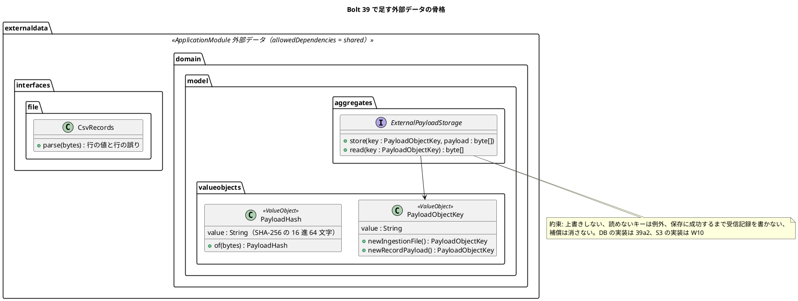

# Bolt 39 計画 - 外部データのコンテキストの骨格（構造、規則、payload の保存のポート、仮の CSV の解析）

## 基本情報

| 項目 | 内容 |
| :--- | :--- |
| Bolt | 第 39 回（W7 の 2 本目。開始準備で 39 を 39（構造とポートと解析）と 39a2（表と DB の実装）に分けた 1 つ目） |
| 予定 | W7（2026-11-16 の週。前倒しで着手できる）。作業は約 3.7 時間（`check`・SonarQube・CI とステップごとの承認の待ちを除く） |
| アプローチ | 規則の部分（ステップ 2・3）は開発戦略 :122 の技術タスク（テストの入口は ArchUnit という検証の手段）。ポートと解析（ステップ 4・5）はインサイドアウト（ドメインの値とポート → interfaces の解析）。開発戦略 :120 のインサイドアウトは「データ → ドメイン」の順だが、データ（`external_data` の表、39a2）より先にポートを置くのは、保存の約束を契約のテストで先に固め、39a2 の DB の実装と W10 の S3 の実装に継がせるため（:125 の規則で理由を書く）。この Bolt は DB を使わない |
| 対象 | (1) 新しいコンテキスト `externaldata` のパッケージと `package-info`、ModularityTest のモジュール一覧と型の依存の規則（許可リスト）、(2) MapperSchemaArchitectureTest の「コンテキスト → スキーマ」の対応表、(3) コンテキストの一覧の写しの一致の規則（W6 横断レビュー M-3）、(4) payload の保存のポートと約束、オブジェクトキーとハッシュの値、テスト用のメモリの実装と契約のテスト、(5) 仮の CSV の解析（RFC 4180。`externaldata.interfaces.file`）、(6) ADR-004 の改訂、分類 3 つと書いた文書の直し、architecture_backend（担当範囲の判定の置き方の既定。M-1）、用語集。見える振る舞いは変えない |
| トレース | US-14 AC1（原本と payload の保存の前提）、UC-15 2a、ADR-004、W7 の節の設計の決定（取込の置き場所、payload の保存、取込ファイルの形式、コンテキスト名とスキーマ名の違い）・確認ポイント 1・5・6・22 |
| GitHub | [#18](https://github.com/k2works/practical-domain-driven-design-in-enterpris-application/issues/18)（US-14。クローズは 39h） |
| SP | 0 |
| 承認ゲート | **ステップごとに止める**（外部原本の取込。`/goal` の下でも外さない。W5・W6 の締めの決定）。構造（新しいコンテキスト、規則のテストの変更）、ADR、新しいファイル。スキーマは 39a2 |
| 開始準備で決めたこと | 2026-11-02、human:kakimomokuri: (1) 39（構造とポートと解析。DB を使わない）と 39a2（`external_data` の表と DB の実装と一覧の残り。データベースの承認ゲートを 1 つに集める）に分ける、(2) ADR は ADR-004 を改訂する、(3) W6 横断レビューの M-1・M-3 は 39 で行い、M-2 は 39b の開始準備で決める、(4) 仮の CSV は RFC 4180 の引用符を許し、依存を足さずに自前で解析する、(5) 原本はファイル全体と行の payload の両方を保存し（キーの前置きで区別）、補償は消さない（巻き戻っても原本は残し、受信記録から参照されない原本は照合で数える）、必要な列のないファイルも原本を保存したうえで形式の誤りとして隔離する（UC-15 2a のとおり。隔離は 39b）、(6) 型の依存の規則は許可リストにし、「業務のコンテキスト」を `ApplicationModules` から `shared` と `platform` を除いたものと定義して一覧を一致させる、(7) 外部データの `allowedDependencies` は今は `shared` だけにし、`platform :: web` は 39c、`domain.events` の名前付きインターフェースは 39b で足す、(8) `PublicApiArchitectureTest` の型の依存の規則の汎用化（#50）は、最初の下流の依存を足す 39b で M-2 と一緒に扱う |

## Bolt ゴール

39a2 以降が外部原本の取込を組み立てられるよう、外部データのコンテキストの置き場所と依存の規則、原本の保存の約束、仮の形式の解析を、見える振る舞いを変えずに固める。

### 開始準備で確かめたこと

- **骨格の前例**: 一番新しく小さいコンテキストは notification（`notification/package-info.java:7-10`。`@ApplicationModule(displayName="通知", allowedDependencies={"shared"})`、依存の理由の Javadoc）。名前付きインターフェースは `<ctx>.domain.events/package-info` に `@NamedInterface("events")`（booking・quotation・routing の :5）。パッケージは `domain.{events,model.{aggregates,valueobjects,entities,rules}}`、`application.internal.{commands,…}`、`infrastructure.{config,persistence,…}`、`interfaces.{web,api,api.internal}`。`interfaces.file` はまだどのコンテキストにもない。`platform/package-info.java` により platform も `ApplicationModule`
- **ModularityTest**: :20-23 でモジュール名の一覧を `contains(...)` で確かめる。:26-28 の `modules.verify()` は `allowedDependencies` が実在の名前付きインターフェースを指さないと落ちる。型の依存の規則の前例は :30-90 の 4 本（相手を名前で並べる形。:75-78 の Javadoc「`allowedDependencies` だけでは相手の宣言を書き換えれば通るため、型の依存でも確かめる」）。`archunit.properties` はないので、対象のクラスがない規則は「対象がない」ことで落ちる（行 2 の Red の理由になる）
- **MapperSchemaArchitectureTest**: :28-29 `SCHEMAS = Set.of("quotation","routing","identity","booking","tracking","notification","platform")`（スキーマ名の集合。`platform` を含む）、:44 でマッパーのディレクトリ名をコンテキスト名にする、:85 `SCHEMAS.contains(schema) && !schema.equals(context)` が違反。単体のテストは :54-78 の形
- **コンテキストの一覧の写し（M-3）**: `ModularityTest:22`、`MapperSchemaArchitectureTest:29`、`AcceptanceStepArchitectureTest:28`（`CONTEXTS`。notification がない。コンテキストごとの規則は :31-43 の手書きの `@ArchTest`）、`SchemaCommentIntegrationTest:28-29`（`BUSINESS_SCHEMAS`）、`AppendOnlyGrantIntegrationTest:35-47`、`afterMigrate__grant_app_user.sql:26-27`、`ops/scripts/design_docs.js:24`。SQL・GRANT・SchemaSpy の一覧はスキーマを作る 39a2 で直す
- **ポートの前例**: `quotation/domain/model/aggregates/RequiredDocumentStorage.java:14-21`（`String store(TransportRequestId, byte[])`・`byte[] read(String)`。:10-12 に集約の隣に置いた理由）。実装 `LocalFileSystemRequiredDocumentStorage.java`（キーは `quotation/{輸送要求 ID}/{UUID}`、形の正規表現 :21・:54、`CREATE_NEW` で上書きしない :37、保存先の外を指すキーを拒む :58）。前例のテストに上書きのテストはなく、読めないキーの例外はメモリの実装が `NoSuchElementException`、ファイルの実装が `UncheckedIOException` で揃っていない。前例の語は「オブジェクトキー」（data_model の `payload_object_key`・`file_object_key`）
- **ADR-010 の補償**: :37-41 は「検証 → 保存（トランザクションの外）→ DB、失敗したら保存したキーを消す（:38）、取りこぼしは後で消す（:39）」。外部原本は ADR-004 :27 が消失 0 件を求め、W10 は Object Lock（RET-03）なので、消す補償は使えない
- **原本の保存の単位**: data_model の `ingestion.file_object_key`（:1012、NOT NULL）と `external_record`・`receipt` の `payload_object_key`（:1026・:1036）。ADR-004 :34「原本を無加工で保存」。ハッシュは `payload_hash`・`file_hash`（64 文字）
- **UC-15 2a**: system_usecase :522「形式・署名を検証できない → 隔離して通知」。6a（:527）は分類を 3 つと書く
- **層の規則**: LayerArchitectureTest :85-88（application から interfaces に依存しない）、:86（interfaces をほかの層から呼ばせない）、:276-288（application が `org.springframework.web..` などに依存しない）、:303-308（`platform.web` は画面の層だけ）。`application.internal.commands` のクラスには `@Command` が要る（DddAnnotationArchitectureTest :32-43）
- **CSV**: build.gradle :36-57 に CSV のライブラリはない
- **用語集と分類**: domain_model の情報源 `DataSource`（:312）、外部原本 `ExternalRecord`（:313。分類を 3 つと書き、分類を外部原本が持つと書く）、:1460（`ExternalRecord` の要素表。分類 4 つ）。data_model :1121-1122 では分類は `receipt.classification` で、`external_record` は最初の payload のハッシュを持つ。受信記録・取込・隔離・差異は用語集にない。`Receipt` は通知の公開 API の結果の型（`PasswordResetMailReceipt` など。:300）と語が重なる。分類を 3 つと書く箇所: ADR-004 の description（:4）・決定 2・3、domain_model :313、requirements_definition の BR-12（:732）、architecture_backend の ARCH-HO-03（:446・:449）、system_usecase の UC-15 6a（:527）
- **担当範囲の判定の置き方（M-1）**: 経路設計と追跡は荷主企業を自分の行に写して自分で判定し（`RoutingCaseScope.java:31`、`TrackingRecordScope.java:31`）、予約も自分の行があれば自分で判定する（`BookingQueryService:105`）。上流の見積りの公開 API に主体を渡して判定させるのは、本予約の確定の前の照会だけ（ADR-016 :34・:78。理由は「範囲の判定をほかの理由とロックより先に置く」、条件は「主体は認可にだけ使い、写しに入れない」）。主体を持たない読み出しは判定を通さない（`RoutingCaseScope.java:17`）。外部データは担当範囲で絞らない（W7 の確認ポイント 3）
- **開発戦略**: W7 の行は :349。39a2 の行がない

## 設計の決定（案）

| 項目 | 決定 | 根拠 |
| :--- | :--- | :--- |
| パッケージ | `com.example.cargotracker.externaldata`。`package-info` は `@ApplicationModule(displayName = "外部データ", allowedDependencies = {"shared"})`。Javadoc に「外部データはほかのコンテキストに依存しない上流。採用値・隔離・判断をイベントで公開する（39b 以降）。経路設計の表を書かない」と書く。`platform :: web` は画面を作る 39c、`domain.events` の `@NamedInterface("events")` は最初のイベントを作る 39b で足す。W7 の決定の「`shared`・`platform :: web` だけ」は許す範囲の上限と読む | 開始準備の決定 (7) |
| 下流の `allowedDependencies`【前の決定の変更】 | 下流（identity・経路設計・追跡）に `externaldata :: events` を足すのは、各 listener を作る Bolt（identity は 39b、経路設計は 39e、追跡は 39g）にする。W7 の節の 39 の行の「4 つのコンテキストの `allowedDependencies`」を変える | 開始準備の決定 (7) |
| 型の依存の規則 | ModularityTest に許可リストの規則を 1 本足す: 「`externaldata..` のクラスは、`java..`・`externaldata..`・`shared..` と、フレームワーク（`org.springframework..`・`org.jmolecules..` など。今の依存の前例の範囲）にだけ依存する」。モジュール一覧に `externaldata` を足す | 開始準備の決定 (6) |
| スキーマの対応表 | MapperSchemaArchitectureTest に `SCHEMA_OF = Map.of("externaldata", "external_data")` を足し、:85 を `!schema.equals(SCHEMA_OF.getOrDefault(context, context))` にする。`SCHEMAS` に `external_data` を足す。単体のテストを 2 本足す | W7 の設計の決定「コンテキスト名とスキーマ名の違い」 |
| コンテキストの一覧の一致（M-3） | テストの補助に、`ApplicationModules` から「業務のコンテキスト」（モジュールから `shared` と `platform` を除いたもの）を求める部品を 1 つ置き、(a) `AcceptanceStepArchitectureTest` の `CONTEXTS` がそれと一致する、(b) `MapperSchemaArchitectureTest` の `SCHEMAS` が「業務のコンテキストを対応表で写した集合 ∪ {platform}」と一致する、を確かめる規則を足す。`CONTEXTS` に `notification` と `externaldata` を足す（ステップ定義の置き場所の規則が通知と外部データにもかかる）。規則の手書きの `@ArchTest`（:31-43）を一覧から作る形に変えることはしない | 開始準備の決定 (6)、W6 横断レビュー M-3 |
| 原本の保存のポート | `externaldata.domain.model.aggregates.ExternalPayloadStorage`: `void store(PayloadObjectKey key, byte[] payload)`・`byte[] read(PayloadObjectKey key)`。キーは呼び手が作る（`PayloadObjectKey.newIngestionFile()`・`newRecordPayload()`。形は `externaldata/ingestions/{UUID}`・`externaldata/records/{UUID}`。前例の前置きがコンテキスト名なので、スキーマ名でなくコンテキスト名にする）。約束（Javadoc）: 同じキーを上書きしない（`IllegalStateException`）、読めないキーは `NoSuchElementException`、保存に成功するまで受信記録を書かない（呼び手は「保存 → 受信記録」の順。形式の誤りで隔離する行とファイルも先に保存する）、補償は消さない（トランザクションが巻き戻っても原本は残し、受信記録から参照されない原本は照合で数える）。外部データは集約を持たない（トランザクションスクリプト。ADR-002）ので、置き場所の理由は CLAUDE.md の「外部の技術のポートは `domain.model.aggregates`」（ADR-017 :47）だと Javadoc に書く。テスト用にメモリの実装（`test` の側）と、約束を確かめる契約のテスト（抽象クラス。39a2 の DB の実装と W10 の S3 の実装が継ぐ）。DB の実装は 39a2 | 開始準備の決定 (5)、W7 の設計の決定「payload の保存」 |
| オブジェクトキーとハッシュの値 | `PayloadObjectKey`（`domain.model.valueobjects`、`@ValueObject`。形の検査で保存先の外を指すキーを作れない）、`PayloadHash`（同。SHA-256 の 16 進 64 文字。`PayloadHash.of(byte[])`。保存の前に呼び手が計算する。data_model の `payload_hash`・`file_hash`） | W7 の節の設計の決定（キーとハッシュ） |
| 仮の CSV の解析 | `externaldata.interfaces.file.CsvRecords`: RFC 4180（カンマ区切り、引用符で囲んだ値、値の中の `""`、CRLF・LF、BOM を除く）を行の値の並びにする。引用符の閉じ忘れ・列数の違う行は、例外ではなく行番号と理由の付いた行の誤りの値で返し、ほかの行は読む。ヘッダーの検証（`external_id`・`external_version`・`acquired_at`・値の列、主要実績は `tracking_number`）は列名から位置への写し（Java 標準の `Map`）か、ファイルの誤り（形式の誤りの理由）を値で返す。ファイルの誤りも 39b で原本を保存したうえで隔離する（UC-15 2a）。application に渡す値の組の型は 39b で決める | 開始準備の決定 (4)・(5)、W7 の確認ポイント 5・6 |
| ADR-004 の改訂 | 改訂の節（2026-11-02、W7）を足す: 外部データは新しいコンテキスト `externaldata`（スキーマ `external_data`。対応表で規則に合わせる）、原本はファイル全体と行の payload の両方を保存のポートを通して保存し、W7 は DB、W10 で S3（Object Lock、RET-03）に差し替える（決定 1 の保存先を W10 まで変える）、補償は消さない（ADR-010 の消す補償とは違う。受信記録から参照されない原本は照合で数える）、分類は採用・重複・隔離・差異の 4 つ（決定 2・3 を変える）、形式を検証できないファイルと行も原本を保存して隔離する、解析は `interfaces.file` で行い application に値だけを渡す、外部原本の採否の監査は identity がイベントを受けて書く。決定 1〜3 の行と description（:4）とコンプライアンスの IaC の行（:66）に改訂の印を付ける。改訂の後に `verified` を付け直す | 開始準備の決定 (2)・(5) |
| 分類 3 つの箇所 | ステップ 1 で 4 つに直す: domain_model :313（と分類を受信記録が持つこと）、requirements_definition の BR-12（:732）、architecture_backend の ARCH-HO-03（:446・:449）、system_usecase の UC-15 6a（:527）と 2a の注（仮の形式と原本の保存）、requirements_definition の OQ-02 の注（W7 の決定の仮の形式）。data_model の payload の注（:1127）は表を作る 39a2 で直す | W7 の確認ポイント 1 |
| architecture_backend | 外部データのコンテキストの節（:130・ARCH-HO-03 の分類 4 つ・依存の向き）と、担当範囲の判定の置き方の既定（M-1）を ADR-016 の文言に合わせて 1 行で: 「担当範囲の判定は、下流が判定の材料（荷主企業）を自分の行に写して自分で判定するのを既定にする。上流の公開 API に主体を渡して判定させるのは、範囲の判定を上流のほかの理由とロックより先に置く必要があるときに限り、主体は認可にだけ使い写しに入れない（ADR-016 :34・:78）。主体を持たない読み出しと外部データは判定を通さない」 | W6 横断レビュー M-1 |
| 用語集 | 足す・直す: 外部原本（`ExternalRecord`。冪等性キーごとの原本で、最初の payload のハッシュを持つ。分類は持たない）、受信記録（受け取るたびの記録で分類を持つ。クラス名は通知の `…Receipt` と紛れないよう 39a2 で決める）、取込（`Ingestion`）、隔離（`QUARANTINED`）、差異（`DISCREPANCY`。US-15 の復旧照合の差異 `reconciliation_discrepancy` と区別する）、外部原本の保存（`ExternalPayloadStorage`）、原本のオブジェクトキー（`PayloadObjectKey`）、原本のハッシュ（`PayloadHash`）。:1460 の要素表の分類を受信記録に移すことは 39a2（表と一緒に） | W7 の確認ポイント 1・22 |

## ふりかえりと前の Bolt からの引き継ぎ

| 出典 | 内容 | この Bolt での扱い |
| :--- | :--- | :--- |
| W6 の Try T-204・T-212、Bolt 38h の T-227 | サブエージェントへの指示の最初に heredoc と標準入力を待つコマンド（空のコマンドを含む）を使わないと書く | 任せるときの指示の最初に書く |
| W6 の Try T-217 | 本体を直す前に Red を流し、落ちた理由を記録する | ステップ 2〜5（行 2 は「対象のクラスがない」で落ちる見込み） |
| W6 の Try T-225・T-213 | push の前に `check` | ステップ 6 |
| W6 の Try T-182・T-211・T-216 | 状態の組み合わせの表に出口・誤った入力の行を置く | 下の表（解析の誤り、ポートの約束） |
| W6 の Try T-215・T-222 | Gradle を流す担当を 1 つに、計画の初稿を先にコミット | 初稿を `79f5443cc` でコミットした |
| W6 の Try T-219 | 変異の対象に単体・統合・契約のテストを入れる | 下の変異の表（契約のテスト） |
| Bolt 38h の T-226 | 帯の中に要素を足すときは前例のクラスを探す | 画面を作らないので当たらない |
| W5 の Try T-125 | 規則に当たったら止めて諮る | ステップごとのゲートで止める |
| W6 横断レビュー M-1・M-3 | 担当範囲の判定の置き方の既定、コンテキストの一覧の写し | この Bolt |
| W6 横断レビュー M-2・#50 の `PublicApiArchitectureTest` の汎用化・identity の監査の listener の毒入りのメッセージ【前の決定の変更】 | W6 横断レビュー :93・:94 は「39 の確認ポイント」「39 で一緒に扱う」としていた | 39b の開始準備で扱う（開始準備の決定 (3)・(8)。最初の下流の依存と監査の書き手が加わる Bolt） |

## 状態の組み合わせ（行ごとにテストを 1 本。T-182）

| 行 | 状況 | 期待 | 確かめ方 |
| :--- | :--- | :--- | :--- |
| 1 | `externaldata` のパッケージがある | ModularityTest のモジュール一覧に出て、`modules.verify()` が緑 | `ModularityTest` |
| 2 | 外部データのクラスが許可リストの外（経路設計の型）に依存する（試しに置いた場合） | 型の依存の規則が落ちる | `ModularityTest` の新しい規則（変異 V1） |
| 3 | 外部データのマッパーが `external_data` を読む | 違反にならない | `MapperSchemaArchitectureTest` の単体のテスト |
| 4 | 外部データのマッパーが `tracking` を読む | 違反になる | 同上 |
| 5 | 業務のコンテキストを足したのに `CONTEXTS` に足し忘れた、`SCHEMAS` に写しを足し忘れた | 一致の規則が落ちる | 一覧の一致の規則（変異 V2） |
| 6 | ファイル全体と行の payload を、それぞれのキーで保存して読み戻す | 同じバイト列が返る。キーの前置きが `externaldata/ingestions/`・`externaldata/records/` | 契約のテスト（メモリの実装で流す） |
| 7 | 同じキーに 2 回書く | 上書きせず `IllegalStateException`、1 回目のバイト列が残る | 同上（変異 V4） |
| 8 | 保存していないキーを読む | `NoSuchElementException` | 同上 |
| 8b | 形の違う文字列（保存先の外を指す `..` を含む、前置きが違う）からキーを作る | 作れない | `PayloadObjectKeyTest` |
| 8c | 同じバイト列と違うバイト列のハッシュ | 同じなら同じ 64 文字、違えば違う | `PayloadHashTest` |
| 9 | 引用符で囲んだ値（カンマ・改行・`""` を含む）の CSV | 1 つの値として読む | `CsvRecordsTest` |
| 10 | BOM 付き・CRLF・最後の行に改行なし | 同じ行と値になる | 同上 |
| 11 | 引用符の閉じ忘れ・列数の違う行 | 例外にせず、行番号と理由の付いた行の誤りとして返し、ほかの行は読む | 同上 |
| 12 | ヘッダーに必要な列（`external_id` など）がない、主要実績のファイルに `tracking_number` がない | ファイルの誤り（形式の誤りの理由）として値で返す（隔離は 39b） | ヘッダーの検証のテスト |

## スコープ

### 入れるもの

- 行 1〜12（8b・8c を含む）のテスト、`externaldata` のパッケージと `package-info`、ModularityTest・MapperSchemaArchitectureTest・AcceptanceStepArchitectureTest の変更と一覧の一致の規則、`ExternalPayloadStorage`・`PayloadObjectKey`・`PayloadHash`、メモリの実装と契約のテスト、`CsvRecords` とヘッダーの検証
- 設計の文書: ADR-004 の改訂、architecture_backend（外部データの節、ARCH-HO-03 の分類 4 つ、M-1 の 1 行）、domain_model（用語集と :313）、requirements_definition（BR-12、OQ-02 の注）、system_usecase（UC-15 2a・6a）、release_plan（W7 の節の 39 の行と「39 で 4 つのコンテキストの `allowedDependencies`」の直し、39a2 の行）、開発戦略 :349（39a2）

### 入れないもの

- `external_data` の表と DB の実装、data_model の payload の注（:1127）、domain_model :1460 の要素表、受信記録のクラス名、`SchemaCommentIntegrationTest`・`AppendOnlyGrantIntegrationTest`・`afterMigrate`・SchemaSpy の一覧（39a2）
- 分類と取込のサービス、形式の誤りの隔離、DE-14、`domain.events`、identity の監査の listener、下流の `allowedDependencies`、M-2、`PublicApiArchitectureTest` の汎用化（39b 以降）
- 照合で参照されない原本を数える仕組み（39b 以降の照合。W10 の監視と一緒に決める）
- 画面と `platform :: web`（39c・39d）、マニュアル（見える振る舞いを変えない）

## 設計（この Bolt の範囲）

- ER 図: 表は 39a2 で作るので省く
- 状態遷移図: 状態を持たないので省く
- 画面遷移図: 画面を作らないので省く

## ステップ計画（ステップごとに止める）

- [x] **1. 設計の文書**（`b9a87c0cf`。2026-11-02 に human:kakimomokuri が承認した）: ADR-004 の改訂、分類 3 つの箇所、architecture_backend、domain_model の用語集、release_plan・開発戦略の直し（完了の判定: 文書の差分。**承認ゲート**）
- [x] **2. パッケージと規則（Red → Green）**（`ca44e5f74`。2026-11-02 に human:kakimomokuri が承認した。許可リストのフレームワークは今の依存を確かめて `org.springframework..` だけにした）: 行 1・2 のテスト（ModularityTest のモジュール一覧と許可リストの規則）を先に足して落ちることを確かめ（行 2 は対象のクラスがないことで落ちる見込み。落ちた理由を記録する）、パッケージと `package-info` を置く（完了の判定: 期待した理由で落ちた後に緑。**承認ゲート**）
- [ ] **3. スキーマの対応表とコンテキストの一覧（Red → Green）**: 行 3〜5 のテストを先に足して落ちることを確かめ、対応表と一覧の一致の規則と `CONTEXTS` の追加を作る（完了の判定: 同上。**承認ゲート**）
- [ ] **4. 原本の保存のポート（Red → Green）**: 行 6〜8c のテストを先に書き、空の実装で落ちることを確かめてからポートと値とメモリの実装を作る（完了の判定: 同上。`LivingGlossaryConsistencyTest` が緑。**承認ゲート**）
- [ ] **5. 仮の CSV の解析（Red → Green）**: 行 9〜12 のテストを先に書き、解析の部品とヘッダーの検証を作る（完了の判定: 同上。**承認ゲート**）
- [ ] **6. 品質ゲートと開発レビュー**: 変異、`check`、その後に SonarQube、開発レビューとその直し。push の前に `check`（T-225）。`uiTest` は画面を変えないので CI の `ui` の段で確かめる
- [ ] **7. 終了報告**: push して CI と MkDocs とデモ環境の配備を確かめる。release_plan・開発の索引・mkdocs を直す

### 時間の配分と打ち切り

| # | 目安 | 打ち切り |
| :--- | :--- | :--- |
| 1 | 50 分 | — |
| 2 | 20 分 | — |
| 3 | 35 分 | — |
| 4 | 35 分 | — |
| 5 | 40 分 | — |
| 6 | 30 分（待ちを除く） | — |
| 7 | 15 分（CI の待ちを除く） | — |

合計 225 分（約 3.7 時間。ステップごとの承認の待ちを除く）。

## 確認ポイント（計画の承認の場でまとめて確認する。Try T-6）

| # | 確認すること | 場所 | 推奨 |
| :--- | :--- | :--- | :--- |
| 1 | **分け方（開始準備の決定 (1)）** | release_plan | 39（この Bolt）・39a2（`external_data` の表と DB の実装と一覧の残り）。W7 の Bolt の表と開発戦略に 39a2 の行を足す |
| 2 | **下流の `allowedDependencies` と外部データの宣言【前の決定の変更】** | ステップ 1・2 | 開始準備の決定 (7) のとおり |
| 3 | **型の依存の規則（構造）** | ステップ 2 | 許可リスト（`java..`・`externaldata..`・`shared..`・フレームワーク） |
| 4 | **規則の変更（MapperSchemaArchitectureTest の対応表、一覧の一致の規則、`CONTEXTS` に notification・externaldata）** | ステップ 3 | 開始準備の決定 (6) のとおり |
| 5 | **ポートの名前と約束** | ステップ 4 | `ExternalPayloadStorage`・`PayloadObjectKey`・`PayloadHash`。キーは呼び手が作る、上書きしない、読めないキーは `NoSuchElementException`、保存 → 受信記録の順、補償は消さない |
| 6 | **解析の誤りの返し方** | ステップ 5 | 行の誤りは行番号と理由の値でほかの行を読む。ファイルの誤りは形式の誤りの理由の値で返し、39b で原本を保存して隔離する |
| 7 | **ADR-004 の改訂の範囲【前の決定の変更】** | ステップ 1 | 設計の決定のとおり（決定 1〜3、description、IaC の行、補償の形） |
| 8 | **M-1 の 1 行** | ステップ 1 | 設計の決定のとおり（ADR-016 :34・:78 の文言に合わせる） |
| 9 | **変異** | ステップ 6 | 下の 6 つ。スクリプトはバイトのまま読み書きし、gradlew.bat を絶対パスで呼び、結果の XML を消してから流す（T-164・T-178・T-200） |

### 変異と落ちる見込みのテスト

| # | 変異 | 落ちる見込み |
| :--- | :--- | :--- |
| V1 | 外部データのクラスに経路設計の型への依存を足す | 行 2 |
| V2 | `CONTEXTS` から 1 つ消す | 行 5 |
| V3 | 対応表を外す（`getOrDefault` を `context` だけにする） | 行 3 |
| V4 | メモリの実装が同じキーへの書き込みを上書きする | 行 7（契約のテスト） |
| V5 | 解析が `""` を 1 つの `"` にしない | 行 9 |
| V6 | 解析が列数の違う行で例外を投げる | 行 11 |

## 完了条件

- [ ] 上のステップ 1〜7 の完了の判定を満たす（ステップごとの承認を受ける）
- [ ] 行 1〜12（8b・8c を含む）に、それを名乗るテストがある
- [ ] `check` が緑、SonarQube が PASS、CI が緑、デモ環境が新しい版で動く
- [ ] 見える振る舞いが変わらない（画面の層は CI の `ui` の段で緑のまま。マニュアルは変えない）
- [ ] 終了報告が承認される

## 更新履歴

| 日付 | 更新内容 | 更新者 |
| :--- | :--- | :--- |
| 2026-11-02 | 計画を承認した（確認ポイント 1〜9 を推奨のとおり。承認は検証の結果の前に受け、検証の指摘で変わった決定は開始準備の追加の決定 (5)〜(8) として人が決めた） | anthropic/claude-opus-5-5、承認 human:kakimomokuri |
| 2026-11-02 | 整合性検証の指摘を反映した（重大 0・中 13・軽 17）。開始準備の追加の決定 (5)〜(8)（原本の保存の単位と消さない補償と形式の誤りの隔離、許可リストと一覧の定義、外部データの宣言は `shared` だけ、`PublicApiArchitectureTest` の汎用化は 39b）は human:kakimomokuri。決定を変えない直し（行番号、`PayloadObjectKey` の名前と呼び手が作るキー、`PayloadHash`、アプローチの理由、分類 3 つの箇所、用語集の外部原本と受信記録、39a2 の行、時間の合計）を反映した | anthropic/claude-opus-5-5 |
| 2026-11-02 | 初版作成（承認待ち）。開始準備で、39 と 39a2 に分け、ADR-004 を改訂し、M-1・M-3 を 39 で行い M-2 は 39b に送り、CSV は RFC 4180 の引用符を許して自前で解析すると決めた（human:kakimomokuri） | anthropic/claude-opus-5-5 |

## 関連ドキュメント

- [リリース計画](release_plan.md)（W7 の節の設計の決定・確認ポイント・39 の行）
- [ADR-004](../../adr/cargo-tracker/004-external-data-ingestion.md)、[ADR-010](../../adr/cargo-tracker/010-required-document-storage-transaction.md)、[ADR-017](../../adr/cargo-tracker/017-notification-module-and-mail.md)
- [W6 横断レビュー](../../review/cargo-tracker/w6_review_20261102.md)（M-1・M-2・M-3）
- [Bolt 38h 終了報告](bolt_38h_report.md)
- [アーキテクチャ設計（バックエンド）](../../design/cargo-tracker/architecture_backend.md)、[ドメインモデル](../../design/cargo-tracker/domain_model.md)、[データモデル](../../design/cargo-tracker/data_model.md)
