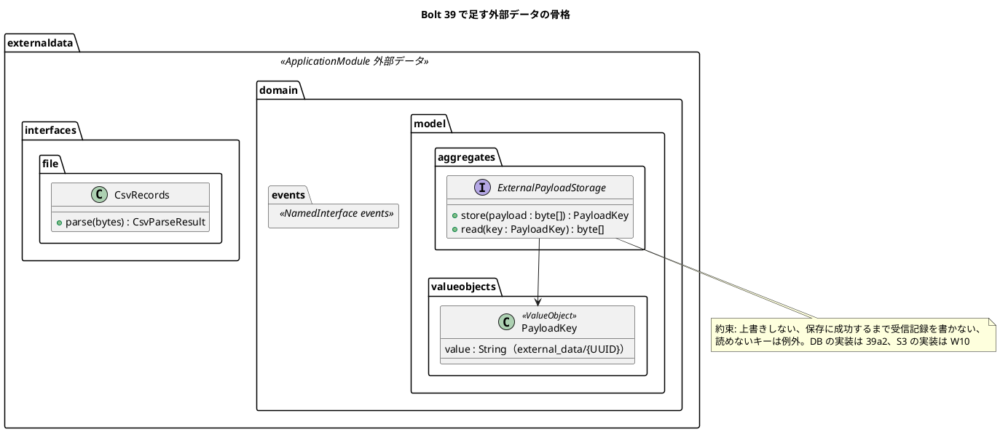

# Bolt 39 計画 - 外部データのコンテキストの骨格（構造、規則、payload の保存のポート、仮の CSV の解析）

## 基本情報

| 項目 | 内容 |
| :--- | :--- |
| Bolt | 第 39 回（W7 の 2 本目。開始準備で 39 を 39（構造とポート）と 39a2（表と DB の実装）に分けた 1 つ目） |
| 予定 | W7（2026-11-16 の週。前倒しで着手できる）。作業は約 3.1 時間（`check`・SonarQube・CI の待ちを除く） |
| アプローチ | インサイドアウト（外部データの骨格。release_plan の W7 の節の 39 の行、開発戦略 :348）。この Bolt は DB を使わない（ポートの約束と解析を単体テストで固め、表は 39a2） |
| 対象 | (1) 新しいコンテキスト `externaldata` のパッケージと `package-info`、ModularityTest のモジュール一覧と型の依存の規則、(2) MapperSchemaArchitectureTest の「コンテキスト → スキーマ」の対応表、(3) コンテキストの一覧の写しを 1 か所に（W6 横断レビュー M-3）、(4) payload の保存のポート（`externaldata.domain.model.aggregates`）とその約束、テスト用のメモリの実装、(5) 仮の CSV の解析（RFC 4180。`externaldata.interfaces`）、(6) ADR-004 の改訂、architecture_backend（担当範囲の判定の置き方の既定。M-1）、用語集。見える振る舞いは変えない |
| トレース | US-14 AC1（原本と payload の保存の前提）、ADR-004、W7 の節の設計の決定（取込の置き場所、payload の保存、取込ファイルの形式、コンテキスト名とスキーマ名の違い）・確認ポイント 1・5・22 |
| GitHub | [#18](https://github.com/k2works/practical-domain-driven-design-in-enterpris-application/issues/18)（US-14。クローズは 39h） |
| SP | 0 |
| 承認ゲート | **ステップごとに止める**（外部原本の取込。`/goal` の下でも外さない。W5・W6 の締めの決定）。構造（新しいコンテキスト、規則のテストの変更）、ADR、新しいファイル。スキーマは 39a2 |
| 開始準備で決めたこと | 2026-11-02、human:kakimomokuri: (1) 39（構造とポートと解析。DB を使わない）と 39a2（`external_data` の表と DB の実装。データベースの承認ゲートを 1 つに集める）に分ける、(2) ADR は ADR-004 を改訂する（新しい ADR は作らない）、(3) W6 横断レビューの M-1（担当範囲の判定の置き方の既定を architecture_backend に 1 行で書く）と M-3（コンテキストの一覧の写し）は 39 で行い、M-2（「書き手は 1 か所」の規則の整理）は 39b の開始準備で決める、(4) 仮の CSV は RFC 4180 の引用符を許し、依存を足さずに自前で解析する |

## Bolt ゴール

39a2 以降が外部原本の取込を組み立てられるよう、外部データのコンテキストの置き場所と依存の規則、payload の保存の約束、仮の形式の解析を、見える振る舞いを変えずに固める。

### 開始準備で確かめたこと

- **骨格の前例**: 一番新しく小さいコンテキストは notification（`notification/package-info.java:7-10`。`@ApplicationModule(displayName="通知", allowedDependencies={"shared"})`、依存の理由の Javadoc）。名前付きインターフェースは `<ctx>.domain.events/package-info` に `@NamedInterface("events")`（booking・quotation・routing の :5）、`<ctx>.interfaces.api/package-info` に `@NamedInterface("api")`。パッケージは `domain.{events,model.{aggregates,valueobjects,entities,rules}}`、`application.internal.{commands,commandservices,queryservices,eventhandlers,outboundservices.acl}`、`infrastructure.{config,persistence,…}`、`interfaces.{web,api,api.internal}`。`interfaces.file` はまだどのコンテキストにもない
- **ModularityTest**: :20-23 でモジュール名の一覧を `contains(...)` で確かめる（テストのメソッド名もコンテキストを列挙する）。:26-28 の `modules.verify()` は `allowedDependencies` が実在の名前付きインターフェースを指さないと落ちる。型の依存の規則の前例は :30-90 の 4 本（:79-90 の Javadoc「`allowedDependencies` だけでは相手の宣言を書き換えれば通るため、型の依存でも確かめる」）
- **MapperSchemaArchitectureTest**: :28-29 `SCHEMAS = Set.of("quotation","routing","identity","booking","tracking","notification","platform")`、:44 でマッパーのディレクトリ名（`src/main/resources/com/example/cargotracker/<ctx>/infrastructure/persistence/`）をコンテキスト名にする、:85 `SCHEMAS.contains(schema) && !schema.equals(context)` が違反。単体のテストは :54-78 の形
- **コンテキストの一覧の写し（M-3）**: `ModularityTest:22`、`MapperSchemaArchitectureTest:29`、`AcceptanceStepArchitectureTest:28`（`CONTEXTS`。足し忘れても落ちない）、`SchemaCommentIntegrationTest:28-29`（`BUSINESS_SCHEMAS`。:45 で空振りを確かめる）、`AppendOnlyGrantIntegrationTest:35-47`（表の一覧）、`afterMigrate__grant_app_user.sql:26-27`（GRANT のスキーマ。:9「スキーマを足したら更新する」）、`ops/scripts/design_docs.js:24`（SchemaSpy）。名前で選ぶ規則（LayerArchitectureTest・PublicApiArchitectureTest・DomainEventArchitectureTest・DomainArchitectureTest・DddAnnotationArchitectureTest）はパターンで選ぶので足さなくてよい。SQL・GRANT・SchemaSpy の一覧はスキーマを作る 39a2 で直す
- **ポートの前例**: `quotation/domain/model/aggregates/RequiredDocumentStorage.java:14-21`（`String store(TransportRequestId, byte[])`・`byte[] read(String)`。:10-12 に aggregates に置いた理由）。実装 `quotation/infrastructure/storage/LocalFileSystemRequiredDocumentStorage.java`（キーの形の正規表現 :21・:54、`CREATE_NEW` で上書きしない :37、保存先の外を指すキーを拒む :58）、設定 `DocumentStorageProperties`、組み立て `QuotationConfiguration:44・66-67`、テスト `LocalFileSystemRequiredDocumentStorageTest`（3 本）と受入用の `InMemoryRequiredDocumentStorage`。削除の操作はなく、補償は ADR-010 :37-41（検証 → 保存（トランザクションの外）→ DB、失敗したら後始末、取りこぼしは後で片付ける。実装は W10）
- **層の規則**: LayerArchitectureTest :86（interfaces をほかの層から呼ばせない）、:276-288（application が `org.springframework.web..` などに依存することを禁じる）。解析を interfaces の側に置き、application には値だけを渡す（W7 の確認ポイント 5）
- **CSV**: build.gradle :36-57 に CSV のライブラリはない（`csv|opencsv|commons-csv|jackson-dataformat` で検索）
- **用語集**: domain_model :89-325。あるもの: 情報源 `DataSource`（:310）、外部原本 `ExternalRecord`（:311。分類を 3 つと書く。W7 の確認ポイント 1 で直す行）、冪等性キー（:312）、採用値 `AdoptedValue`（:315）。ないもの: 受信記録・取込・隔離・差異（`Receipt|Ingestion|Quarantin|Discrepanc` で :89-325 を検索）。`LivingGlossaryConsistencyTest` は `@AggregateRoot`・`@Entity`・`@ValueObject` の付いたクラスの英語名が用語集にあり、Javadoc の最初の語が日本語名と一致することを求める
- **ADR-004**: 決定 1（Inbox に原本を無加工でオブジェクトストレージに保存し、保存に成功するまで受け付けない）、決定 2・3（分類は重複・隔離・採用の 3 つ）、外部データは原本と採否の記録だけを持つ（:38）、パイロットは `interfaces.file` だけを作る。architecture_backend :130（外部データ → 経路設計・追跡: 公開ホスト + 公表された言語）、:441-451 の ARCH-HO-03（分類 3 つ :447・:450、`interfaces.file` :451・:473）
- **担当範囲の判定の置き方（M-1）**: 経路設計と追跡は荷主企業を自分の行に写して自分で判定し（`RoutingCaseScope.java:31`、`TrackingRecordScope.java:31`）、予約は `AuthenticatedActor` を見積りの公開 API に渡して上流に判定させる（ADR-016 の 38f2 の改訂）。外部データは担当範囲で絞らない（W7 の確認ポイント 3）
- **名前付きインターフェースを先に作るか**: 外部データのイベント（DE-12・DE-13・DE-14 と判断のイベント）は 39b・39d で作る。今 `externaldata :: events` を下流の `allowedDependencies` に書くには、中身のない名前付きインターフェースが要る

## 設計の決定（案）

| 項目 | 決定 | 根拠 |
| :--- | :--- | :--- |
| パッケージ | `com.example.cargotracker.externaldata`。`package-info` は `@ApplicationModule(displayName = "外部データ", allowedDependencies = {"shared", "platform :: web"})`。Javadoc に「外部データはほかのコンテキストに依存しない上流。採用値・隔離・判断をイベントで公開する。経路設計の表を書かない」と依存の理由を書く。`domain.events` に `@NamedInterface("events")` の `package-info` を置く（中身のイベントは 39b・39d） | W7 の設計の決定「取込の置き場所」 |
| 下流の `allowedDependencies` | 下流（identity・経路設計・追跡）に `externaldata :: events` を足すのは、各 listener を作る Bolt（identity は 39b、経路設計は 39e、追跡は 39g）にする。この Bolt では足さない（使わない依存の宣言を先に置かない。W7 の節の「39 で 4 つのコンテキストの `allowedDependencies`」を変える） | 確認ポイント 2 |
| ModularityTest | モジュール一覧に `externaldata` を足す。型の依存の規則を 1 本足す: 「外部データは見積り・予約・経路設計・追跡・identity・通知の型に依存しない」（:79-90 の前例の形） | W7 の節、:79-90 |
| MapperSchemaArchitectureTest | 「コンテキスト → スキーマ」の対応表 `SCHEMA_OF = Map.of("externaldata", "external_data")` を足し、:85 を `!schema.equals(SCHEMA_OF.getOrDefault(context, context))` にする。`SCHEMAS` に `external_data` を足す。単体のテストを 2 本足す（「externaldata は external_data を読める」「externaldata が tracking を読めば違反」） | W7 の設計の決定「コンテキスト名とスキーマ名の違い」 |
| コンテキストの一覧（M-3） | テストの補助に、Spring Modulith の `ApplicationModules` から業務のコンテキスト名を求める部品を 1 つ置き（`architecture` のテストのパッケージ）、`AcceptanceStepArchitectureTest` の `CONTEXTS` と MapperSchemaArchitectureTest の一覧がそれと一致することを確かめる規則を足す（足し忘れると落ちる）。`SchemaCommentIntegrationTest` の `BUSINESS_SCHEMAS`・`afterMigrate`・SchemaSpy はスキーマを作る 39a2 で直す | W6 横断レビュー M-3 |
| payload の保存のポート | `externaldata.domain.model.aggregates.ExternalPayloadStorage`: `PayloadKey store(byte[] payload)`・`byte[] read(PayloadKey key)`。`PayloadKey`（`domain.model.valueobjects`。`@ValueObject`。形は `external_data/{UUID}`）。約束（Javadoc）: 同じキーを上書きしない、保存に成功するまで受信記録を書かない（呼び手は「検証 → 保存 → DB」の順。ADR-010 の補償の形）、読めないキーは例外。テスト用にメモリの実装（受入用、`test` の側）と、ポートの約束を確かめる契約のテスト（抽象クラス。39a2 の DB の実装と W10 の S3 の実装が継ぐ）。DB の実装は 39a2 | W7 の設計の決定「payload の保存」、`RequiredDocumentStorage` の前例 |
| 仮の CSV の解析 | `externaldata.interfaces.file.CsvRecords`: RFC 4180（カンマ区切り、引用符で囲んだ値、値の中の `""`、CRLF・LF、BOM を除く）を `List<List<String>>` にする。引用符の閉じ忘れ・行の列数の不一致は、例外ではなく行番号と理由の付いた誤りの値で返す（39b で形式の誤りの行を隔離する。UC-15 2a）。ヘッダーの行の列名（`external_id`・`external_version`・`acquired_at`・値の列、主要実績は `tracking_number`）から行を値の組に写す部品も interfaces に置く。application に渡すのは値だけ（39b の取込のサービスの引数の形は 39b で決める） | 開始準備の決定 (4)、W7 の確認ポイント 5・6 |
| ADR-004 の改訂 | 改訂の節（2026-11-02、W7）を足す: 外部データは新しいコンテキスト `externaldata`（スキーマ `external_data`。対応表で規則に合わせる）、payload は保存のポートを通し W7 は DB に置き W10 で S3（Object Lock、RET-03）に差し替える（決定 1 の保存先を W10 まで変える。補償は ADR-010 の形）、分類は採用・重複・隔離・差異の 4 つ（決定 2・3 を変える）、解析は `interfaces.file` で行い application に値だけを渡す、外部原本の採否の監査は identity がイベントを受けて書く。【前の決定の変更】として決定 1〜3 の行に改訂の印を付ける | 開始準備の決定 (2)、W7 の設計の決定 |
| architecture_backend | 外部データのコンテキストの節（:130・ARCH-HO-03 の分類 4 つ・依存の向き）、担当範囲の判定の置き方の既定（M-1）を 1 行で: 「担当範囲の判定は、下流が判定の材料（荷主企業）を自分の行に写して自分で判定するのを既定にする。上流の公開 API に主体を渡して判定させるのは、下流が判定の材料を持てず、上流の状態と同じ時点で判定する必要があるときに限る（ADR-016 の本予約の確定）」 | W6 横断レビュー M-1 |
| 用語集 | 足す: 受信記録（`Receipt`）、取込（`Ingestion`）、隔離、差異（受信記録の分類。US-15 の復旧照合の差異と区別する。W7 の確認ポイント 22）、外部原本の payload の保存（`ExternalPayloadStorage`）、payload のキー（`PayloadKey`）。:311 の分類を 4 つに直す | W7 の確認ポイント 1・22 |

## ふりかえりと前の Bolt からの引き継ぎ

| 出典 | 内容 | この Bolt での扱い |
| :--- | :--- | :--- |
| W6 の Try T-204・T-212、Bolt 38h の T-227 | サブエージェントへの指示の最初に heredoc と標準入力を待つコマンド（空のコマンドを含む）を使わないと書く | 任せるときの指示の最初に書く |
| W6 の Try T-217 | 本体を直す前に Red を流し、落ちた理由を記録する | ステップ 2〜5 |
| W6 の Try T-225・T-213 | push の前に `check` | ステップ 6 |
| W6 の Try T-182・T-211・T-216 | 状態の組み合わせの表に出口・誤った入力の行を置く | 下の表（解析の誤り、ポートの約束） |
| W6 の Try T-215・T-222 | Gradle を流す担当を 1 つに、計画の初稿を先にコミット | この計画を先にコミットする |
| W6 の Try T-219 | 変異の対象に単体・統合・契約のテストを入れる | 下の変異の表（契約のテスト） |
| W5 の Try T-125 | 規則に当たったら止めて諮る | ステップごとのゲートで止める |
| W6 横断レビュー M-1・M-3 | 担当範囲の判定の置き方の既定、コンテキストの一覧の写し | この Bolt |
| W6 横断レビュー M-2 | 「書き手は 1 か所」の規則の整理 | 39b の開始準備（監査の書き手が加わるとき） |
| W6 横断レビュー（アーキテクト）の懸念 | identity の監査の listener が再配信の下で例外を返し続けると毒入りのメッセージになる | 39b の確認ポイントにする（この Bolt では listener を作らない） |

## 状態の組み合わせ（行ごとにテストを 1 本。T-182）

| 行 | 状況 | 期待 | 確かめ方 |
| :--- | :--- | :--- | :--- |
| 1 | `externaldata` のパッケージがある | ModularityTest のモジュール一覧に出て、`modules.verify()` が緑 | `ModularityTest` |
| 2 | 外部データの型が経路設計の型に依存する（試しに置いた場合） | 型の依存の規則が落ちる | `ModularityTest` の新しい規則（変異 V1） |
| 3 | 外部データのマッパーが `external_data` を読む | 違反にならない | `MapperSchemaArchitectureTest` の単体のテスト |
| 4 | 外部データのマッパーが `tracking` を読む | 違反になる | 同上 |
| 5 | コンテキストを足したのに `AcceptanceStepArchitectureTest` の一覧に足し忘れた | 一致の規則が落ちる | 一覧の一致の規則（変異 V2） |
| 6 | payload を保存して読み戻す | 同じバイト列が返る。キーは `external_data/{UUID}` | 契約のテスト（メモリの実装で流す） |
| 7 | 同じキーに 2 回書こうとする（実装の内側） | 上書きしない（例外） | 同上 |
| 8 | ない・形の違うキーを読む | 例外（保存先の外を指さない） | 同上 |
| 9 | 引用符で囲んだ値（カンマ・改行・`""` を含む）の CSV | 1 つの値として読む | `CsvRecordsTest` |
| 10 | BOM 付き・CRLF・最後の行に改行なし | 同じ行と値になる | 同上 |
| 11 | 引用符の閉じ忘れ・列数の違う行 | 例外にせず、行番号と理由の付いた誤りとして返し、ほかの行は読む | 同上 |
| 12 | ヘッダーに必要な列（`external_id` など）がない、主要実績のファイルに `tracking_number` がない | ファイルの誤り（全体を受け付けない理由）として返す | 行を値の組に写す部品のテスト |

## スコープ

### 入れるもの

- 行 1〜12 のテスト、`externaldata` のパッケージと `package-info`（ルートと `domain.events`）、ModularityTest・MapperSchemaArchitectureTest・AcceptanceStepArchitectureTest の変更と一覧の一致の規則、`ExternalPayloadStorage`・`PayloadKey`、メモリの実装と契約のテスト、`CsvRecords` と行を値の組に写す部品
- 設計の文書: ADR-004 の改訂、architecture_backend（外部データの節、ARCH-HO-03 の分類 4 つ、M-1 の 1 行）、domain_model（用語集 6 行と :311、:1458 の分類 4 つの確かめ）、W7 の節の 39 の行と「39 で 4 つのコンテキストの `allowedDependencies`」の直し

### 入れないもの

- `external_data` の表と DB の実装、`SchemaCommentIntegrationTest`・`AppendOnlyGrantIntegrationTest`・`afterMigrate`・SchemaSpy の一覧（39a2）
- 分類と取込のサービス、DE-14、identity の監査の listener、下流の `allowedDependencies`（39b 以降）
- 画面（39c・39d）、マニュアル（見える振る舞いを変えない）

## 設計（この Bolt の範囲）

- ER 図: 表は 39a2 で作るので省く
- 状態遷移図: 状態を持たないので省く
- 画面遷移図: 画面を作らないので省く

## ステップ計画（ステップごとに止める）

- [ ] **1. 設計の文書**: ADR-004 の改訂、architecture_backend、domain_model の用語集、W7 の節の直し（完了の判定: 文書の差分。**承認ゲート**）
- [ ] **2. パッケージと規則（Red → Green）**: 行 1・2 のテスト（ModularityTest のモジュール一覧と型の依存の規則）を先に足して落ちることを確かめ、パッケージと `package-info` を置く（完了の判定: 期待した理由で落ちた後に緑。**承認ゲート**）
- [ ] **3. スキーマの対応表とコンテキストの一覧（Red → Green）**: 行 3〜5 のテストを先に足して落ちることを確かめ、対応表と一覧の一致の規則を作る（完了の判定: 同上。**承認ゲート**）
- [ ] **4. payload の保存のポート（Red → Green）**: 行 6〜8 の契約のテストを先に書き、メモリの実装で落ちることを確かめてからポートと `PayloadKey` と実装を作る（完了の判定: 同上。`LivingGlossaryConsistencyTest` が緑。**承認ゲート**）
- [ ] **5. 仮の CSV の解析（Red → Green）**: 行 9〜12 のテストを先に書き、解析の部品と行を値の組に写す部品を作る（完了の判定: 同上。**承認ゲート**）
- [ ] **6. 品質ゲートと開発レビュー**: 変異、`check`、その後に SonarQube、開発レビューとその直し。push の前に `check`（T-225）。`uiTest` は画面を変えないので、CI の `ui` の段で確かめる
- [ ] **7. 終了報告**: push して CI と MkDocs とデモ環境の配備を確かめる。release_plan・開発の索引・mkdocs を直す

### 時間の配分と打ち切り

| # | 目安 | 打ち切り |
| :--- | :--- | :--- |
| 1 | 40 分 | — |
| 2 | 25 分 | Spring Modulith が中身のない名前付きインターフェースを受け付けないときは、`domain.events` の `package-info` を 39b に送る（報告に書く） |
| 3 | 30 分 | — |
| 4 | 30 分 | — |
| 5 | 40 分 | — |
| 6 | 30 分（待ちを除く） | — |
| 7 | 15 分（CI の待ちを除く） | — |

合計 210 分（約 3.5 時間。ステップごとの承認の待ちを除く）。

## 確認ポイント（計画の承認の場でまとめて確認する。Try T-6）

| # | 確認すること | 場所 | 推奨 |
| :--- | :--- | :--- | :--- |
| 1 | **分け方（開始準備の決定 (1)）** | release_plan | 39（この Bolt）・39a2（`external_data` の表と DB の実装と一覧の残り）。W7 の Bolt の表に 39a2 の行を足す |
| 2 | **下流の `allowedDependencies` を後に回す【前の決定の変更】** | ステップ 1・2 | W7 の節の 39 の行は「4 つのコンテキストの `allowedDependencies`」だったが、使わない依存の宣言を先に置かず、listener を作る Bolt（39b・39e・39g）で足す。外部データ自身の `allowedDependencies` はこの Bolt で決める |
| 3 | **型の依存の規則（構造）** | ステップ 2 | 外部データは見積り・予約・経路設計・追跡・identity・通知の型に依存しない（`shared` と `platform :: web` だけ） |
| 4 | **規則の変更（MapperSchemaArchitectureTest の対応表、一覧の一致の規則）** | ステップ 3 | 開始準備の決定（W7 の設計の決定）のとおり。一覧の一致は `ApplicationModules` から求める |
| 5 | **ポートの名前と約束** | ステップ 4 | `ExternalPayloadStorage`・`PayloadKey`。上書きしない、保存に成功するまで受信記録を書かない、読めないキーは例外。契約のテストを抽象クラスにして 39a2 と W10 の実装が継ぐ |
| 6 | **解析の誤りの返し方** | ステップ 5 | 行の誤り（引用符・列数）は行番号と理由の値で返してほかの行を読む。ファイルの誤り（必要な列がない）は全体を受け付けない理由で返す。例外にしない |
| 7 | **ADR-004 の改訂の範囲【前の決定の変更】** | ステップ 1 | 決定 1（保存先を W10 まで DB）・決定 2・3（分類 4 つ）を改訂の節で変え、置き場所・解析・監査の決定を足す |
| 8 | **M-1 の 1 行** | ステップ 1 | 設計の決定のとおり（下流が写して自分で判定するのを既定にし、上流に判定させるのは ADR-016 の本予約の確定の条件に限る） |
| 9 | **変異** | ステップ 6 | 下の 6 つ。スクリプトはバイトのまま読み書きし、gradlew.bat を絶対パスで呼び、結果の XML を消してから流す（T-164・T-178・T-200） |

### 変異と落ちる見込みのテスト

| # | 変異 | 落ちる見込み |
| :--- | :--- | :--- |
| V1 | 外部データのクラスに経路設計の型への依存を足す | 行 2 |
| V2 | `AcceptanceStepArchitectureTest` の一覧から 1 つ消す | 行 5 |
| V3 | 対応表を外す（`getOrDefault` を `context` だけにする） | 行 3 |
| V4 | メモリの実装が同じキーへの書き込みを上書きする | 行 7（契約のテスト） |
| V5 | 解析が `""` を 1 つの `"` にしない | 行 9 |
| V6 | 解析が列数の違う行で例外を投げる | 行 11 |

## 完了条件

- [ ] 上のステップ 1〜7 の完了の判定を満たす（ステップごとの承認を受ける）
- [ ] 行 1〜12 に、それを名乗るテストがある
- [ ] `check` が緑、SonarQube が PASS、CI が緑、デモ環境が新しい版で動く
- [ ] 見える振る舞いが変わらない（画面の層は CI の `ui` の段で緑のまま。マニュアルは変えない）
- [ ] 終了報告が承認される

## 更新履歴

| 日付 | 更新内容 | 更新者 |
| :--- | :--- | :--- |
| 2026-11-02 | 初版作成（承認待ち）。開始準備で、39 と 39a2 に分け、ADR-004 を改訂し、M-1・M-3 を 39 で行い M-2 は 39b に送り、CSV は RFC 4180 の引用符を許して自前で解析すると決めた（human:kakimomokuri） | anthropic/claude-opus-5-5 |

## 関連ドキュメント

- [リリース計画](release_plan.md)（W7 の節の設計の決定・確認ポイント・39 の行）
- [ADR-004](../../adr/cargo-tracker/004-external-data-ingestion.md)、[ADR-010](../../adr/cargo-tracker/010-required-document-storage-transaction.md)、[ADR-017](../../adr/cargo-tracker/017-notification-module-and-mail.md)
- [W6 横断レビュー](../../review/cargo-tracker/w6_review_20261102.md)（M-1・M-2・M-3）
- [Bolt 38h 終了報告](bolt_38h_report.md)
- [アーキテクチャ設計（バックエンド）](../../design/cargo-tracker/architecture_backend.md)、[ドメインモデル](../../design/cargo-tracker/domain_model.md)、[データモデル](../../design/cargo-tracker/data_model.md)
