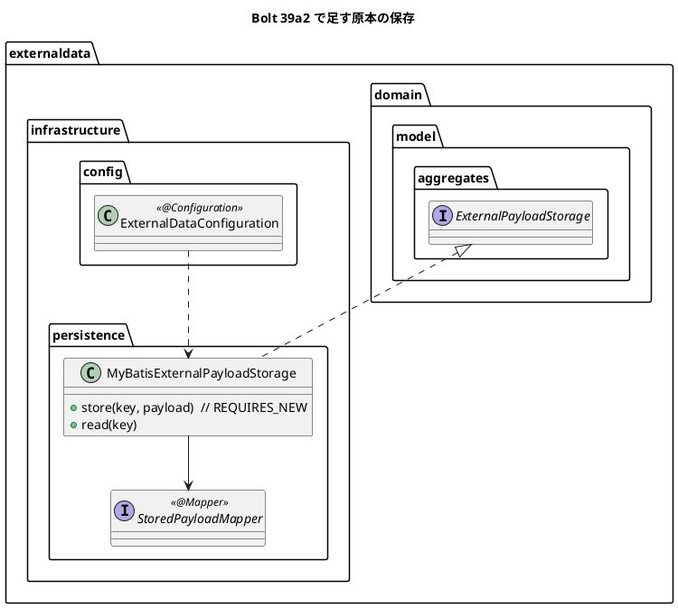
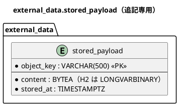

# Bolt 39a2 計画 - 外部原本の保存の DB の実装（原本の表、独立したトランザクション、層別の許可リスト）

## 基本情報

| 項目 | 内容 |
| :--- | :--- |
| Bolt | 第 39a2 回（W7 の 3 本目。開始準備で 39a2 を 39a2（原本の表と DB の実装）と 39a3（残りの 6 表）に縦に分けた 1 つ目） |
| 予定 | W7（2026-11-16 の週。前倒しで着手できる）。作業は約 2.7 時間（`check`・SonarQube・CI とステップごとの承認の待ちを除く） |
| アプローチ | インサイドアウト（データ → 永続化の実装。開発戦略 :120）。不確かな所（バイナリの型と独立したトランザクション）を先に通す |
| 対象 | (1) `external_data` のスキーマと原本の表（ベンダー別の DDL）、(2) `ExternalPayloadStorage` の DB の実装（独立したトランザクション、契約のテストを継ぐ）、(3) 型の依存の許可リストを層別にし MyBatis を infrastructure だけに許す、(4) スキーマの一覧の 4 か所、(5) 設計の文書（data_model の payload の注と原本の表、ADR-007 の例外、ADR-004 の改訂）。見える振る舞いは変えない |
| トレース | US-14 AC1（原本の保存）、PV-01（消失 0 件）、ADR-004（改訂の経緯）、ADR-007、Bolt 39 の終了報告の議題 3 |
| GitHub | [#18](https://github.com/k2works/practical-domain-driven-design-in-enterpris-application/issues/18)（US-14。クローズは 39h） |
| SP | 0 |
| 承認ゲート | **ステップごとに止める**（外部原本の取込）。スキーマ（新しいスキーマと表、ベンダー別の DDL）、構造（規則の層別）、ADR（ADR-007 の例外、ADR-004 の改訂） |
| 開始準備で決めたこと | 2026-11-02、human:kakimomokuri: (1) 原本は受信記録とは独立したトランザクション（REQUIRES_NEW）で保存し、外側が巻き戻っても残す（S3（W10）と同じ振る舞い）、(2) 型の依存の許可リストを層別にし、MyBatis は infrastructure だけに許す、(3) 受信記録はクラス `ReceivedRecord`・表 `external_data.received_record`、判断の表は `external_data.received_record_decision`（39a3。data_model の `receipt` を改める）、(4) 縦に分ける（39a2 は原本の表と DB の実装、39a3 は data_source・ingestion・external_record・received_record・received_record_decision・adopted_value と文書の改名・要素表・用語集）、(5) 原本の表のバイナリの列はベンダー別の DDL（PostgreSQL は `BYTEA`、H2 は `LONGVARBINARY`）にし、ADR-007 の例外として記録する、(6) 開発データとテストの情報源と DATA_STEWARD の開発利用者は 39b で入れる |

## Bolt ゴール

39b 以降の取込のサービスが原本を DB に保存できるよう、外部原本の保存の DB の実装を、外側のトランザクションが巻き戻っても原本が残る形で作り、規則と一覧と文書を合わせる。見える振る舞いは変えない。

### 開始準備で確かめたこと

- **ポートと契約**（Bolt 39）: `externaldata/domain/model/aggregates/ExternalPayloadStorage`（`store`・`read`。約束: キーは呼び手が作る、上書きしない＝`IllegalStateException`、読めないキー＝`NoSuchElementException`、保存 → 受信記録の順、補償は消さない。巻き戻りとの関係は 39a2 で決めると注）。契約のテスト `ExternalPayloadStorageContract`（空・バイナリ（0x00・0xFF）・防御の写し・null を含む）とメモリの実装
- **data_model**: external_data の ER 図 :990-1116 に原本のバイト列を置く表はない。payload の注 :1127 は「S3 に置き、DB にはキーとハッシュだけ。開発はローカルのファイル」。列の日本語コメントの規則 :1162、追記専用の印 :1163、追記専用の一覧 :173
- **新しいスキーマの前例**: `V20261015100000__create_notification.sql`（`CREATE SCHEMA IF NOT EXISTS`、制約の名前は `pk_`・`uk_`・`ck_`、表と列の日本語の COMMENT、追記専用の印 `'<日本語名> [append-only]'`）。common の最新は `V20261029101000__set_routing_case_shipper_company_not_null.sql`
- **バイナリの型**: 業務の表にバイナリの前例はない（`BYTEA|bytea|BLOB|VARBINARY|byte[]` で db と Row の型を検索）。Spring Session の表だけが `migration/postgresql`（`BYTEA`）と `migration/h2`（`LONGVARBINARY`）に分けている（V20261006140100 :21）。ADR-007 :53「BYTEA・BLOB などの型は DB ごとに違い共通部分では書けないので、フレームワークの DDL はベンダー別に、業務の表は共通の置き場所に」
- **一覧の 4 か所**: `afterMigrate__grant_app_user.sql` :26-27（スキーマの一覧。:9 に足す注）と :30-39（追記専用の印で REVOKE）、`SchemaCommentIntegrationTest` :28-29（`BUSINESS_SCHEMAS`）、`AppendOnlyGrantIntegrationTest` :35-41（`APPEND_ONLY_TABLES`）、`ops/scripts/design_docs.js` :24（SchemaSpy。足し忘れると :150 で失敗する）。MapperSchemaArchitectureTest の対応表は Bolt 39 で足し済み
- **MyBatis の前例**: notification の `NotificationMapper`（`@Mapper`、行は record）、XML は `src/main/resources/com/example/cargotracker/notification/infrastructure/persistence/NotificationMapper.xml`（:3-4「H2 と PostgreSQL の共通の構文。RETURNING と ON CONFLICT は使わない」、:24-32 `INSERT ... SELECT ... WHERE NOT EXISTS`）、`MyBatisNotificationRepository`、統合テスト `MyBatisNotificationRepositoryIntegrationTest`（`@SpringBootTest @Import(TestcontainersConfiguration.class) @Transactional`、postgres:18.6。リポジトリのテストは H2 で書かない。ADR-007 :84）
- **独立したトランザクションの前例**: `MyBatisTransportRequestNumberIssuer` :34-36（`TransactionTemplate` に `PROPAGATION_REQUIRES_NEW`）、:56-60（`DuplicateKeyException` を捕まえる）、`MyBatisRoutingCaseNumberIssuer` :29、`SpringSessionUserSessionRevoker` :16。Javadoc :19-21「外側の接続を握ったまま 2 本目を取るので、プールの大きさ以上の同時実行で枯渇しうる」。接続プールは設定がなく既定（10）。Bolt 4 の報告 :139「プールの大きさ（10）を超える 16 本の同時の採番でも止まらない」。ADR-019 の「外側のトランザクションの中では拒む」形（`AssignedScopeDenialService` :41-44）は、原本の保存では取らない（39b の取込のサービスは外側のトランザクションの中から呼ぶため）
- **許可リスト**: ModularityTest :101-121 `外部データは共有カーネルとJavaとフレームワークにだけ依存する`（externaldata 全体に一律。`java..`・`externaldata..`・`shared..`・`org.springframework..`）。LayerArchitectureTest の層の定義 :75-92、:277-288（application は `org.apache.ibatis..`・`org.mybatis..` に依存しない）、:605-611（platform の onlyDependOn に `org.apache.ibatis..`）。層別の許可リストの前例はない
- **`receipt` の箇所**: data_model :173・:1030・:1045・:1091・:1122・:1185、domain_model :315・:1469、operation.md :269、ADR-004 :77。改名は 39a3（表を作るとき）

## 設計の決定（案）

| 項目 | 決定 | 根拠 |
| :--- | :--- | :--- |
| 原本の表 | `external_data.stored_payload`: `object_key VARCHAR(500)`（主キー。`PayloadObjectKey` の値）、`content`（PostgreSQL は `BYTEA`、H2 は `LONGVARBINARY`。NOT NULL。0 バイトを許す）、`stored_at TIMESTAMPTZ NOT NULL`。追記専用（`'外部原本の保存 [append-only]'`）。ハッシュは持たない（ハッシュは 39a3 の `ingestion.file_hash`・`external_record.payload_hash`・`received_record.payload_hash` が持つ）。W10 で S3 に差し替えたら使わなくなる表（data_model の注に書く） | 開始準備の決定 (5) |
| マイグレーションの置き場所 | `CREATE SCHEMA IF NOT EXISTS external_data` は common（業務のスキーマ）。原本の表は `migration/postgresql` と `migration/h2` に同じ版の番号で置く（ADR-007 の例外。Spring Session の前例の形）。コメントは両方に書く | 開始準備の決定 (5)、ADR-007 :53 |
| DB の実装 | `externaldata.infrastructure.persistence.MyBatisExternalPayloadStorage`（`ExternalPayloadStorage` を実装）と `StoredPayloadMapper`（XML は `src/main/resources/com/example/cargotracker/externaldata/infrastructure/persistence/`）。`store` は `TransactionTemplate`（`PROPAGATION_REQUIRES_NEW`）の中で `INSERT`。主キーの違反（`DuplicateKeyException`）は `IllegalStateException` に変える（上書きしない）。`read` は行がなければ `NoSuchElementException`。読み書きで配列を写す（防御の写し）。外側のトランザクションの中から呼べる（拒まない） | 開始準備の決定 (1)、`MyBatisTransportRequestNumberIssuer` の前例 |
| 組み立て | `externaldata.infrastructure.config` に `@Configuration` を置き、DB の実装を `ExternalPayloadStorage` の Bean にする（`QuotationConfiguration` の前例） | Bolt 39 の決定（メモリの実装は test の側） |
| 層別の許可リスト | ModularityTest の許可リストの規則を 2 本にする: (a) `externaldata..` のうち `..infrastructure..` でないクラスは `java..`・`externaldata..`・`shared..`・`org.springframework..` にだけ依存する、(b) `externaldata..infrastructure..` のクラスは (a) に加えて `org.apache.ibatis..`・`org.mybatis..` に依存してよい。Javadoc に「フレームワークの許可は使う Bolt で、使う層に限って足す（W10 の AWS SDK も infrastructure に）」と書く | 開始準備の決定 (2) |
| 一覧の 4 か所 | `afterMigrate` のスキーマの一覧と :9 の注、`SchemaCommentIntegrationTest` の `BUSINESS_SCHEMAS`、`AppendOnlyGrantIntegrationTest` の `APPEND_ONLY_TABLES` に `external_data.stored_payload`、`design_docs.js` の `schemas` に `external_data` | Bolt 39 の既知の課題 |
| 文書 | data_model（external_data の節に `stored_payload` の行と注、:1127 の payload の注を「W7〜W9 は DB の `stored_payload`（独立したトランザクション）、W10 で S3」に）、ADR-007（業務の表のベンダー別の DDL の例外: 原本の表。理由と W10 で使わなくなること）、ADR-004 の改訂の経緯（巻き戻りとの関係: 原本は独立したトランザクションで保存する。39a2 で決めた）、`ExternalPayloadStorage` の Javadoc の注（「39a2 で決める」を決まった内容に）、release_plan（W7 の Bolt の表の 39a2 の行を直し、39a3 の行を足す）、開発戦略の W7 の行（39a3） | 開始準備の決定 (1)・(4)・(5) |

## ふりかえりと前の Bolt からの引き継ぎ

| 出典 | 内容 | この Bolt での扱い |
| :--- | :--- | :--- |
| W6 の Try T-204・T-212、Bolt 38h の T-227 | サブエージェントへの指示の最初に heredoc と標準入力を待つコマンド（空のコマンドを含む）を使わないと書く | 任せるときの指示の最初に書く |
| W6 の Try T-217 | 本体を直す前に Red を流し、落ちた理由を記録する | ステップ 2〜4 |
| W6 の Try T-225・T-213 | push の前に `check` | ステップ 5 |
| W6 の Try T-219 | 変異の対象に単体・統合・契約のテスト | 下の変異の表（契約と独立したトランザクション） |
| Bolt 39 の T-228 | 状態の組み合わせの表に、誤りや巻き戻りの「後」に来る操作の行を置く | 行 4・5（巻き戻りの後の読み出し、上書きの拒否の後の読み出し） |
| Bolt 39 の終了報告の議題 3 | 補償とトランザクション、許可リストの層別、DB の実装 | この Bolt |
| Bolt 39 の既知の課題 | 一覧の 4 か所、data_model の payload の注 | この Bolt。要素表・用語集の分類 4 つ・`receipt` の改名は 39a3 |

## 状態の組み合わせ（行ごとにテストを 1 本。T-182）

| 行 | 状況 | 期待 | 確かめ方 |
| :--- | :--- | :--- | :--- |
| 1 | 契約のテスト（保存と読み戻し、上書きしない、読めないキー、空、バイナリ、防御の写し、null）を DB の実装で流す | Bolt 39 の契約のとおり | `MyBatisExternalPayloadStorageIntegrationTest`（`ExternalPayloadStorageContract` を継ぐ。PostgreSQL） |
| 2 | 外側のトランザクションの中で保存し、外側を巻き戻す | 巻き戻した後も読める | 同上（外側を `TransactionTemplate` で開いて `setRollbackOnly`） |
| 3 | 外側のトランザクションの中で保存し、外側をコミットする | 読める（1 行だけ） | 同上 |
| 4 | 同じキーに 2 回保存する（2 回目は別のトランザクション） | 2 回目は `IllegalStateException`、読み直すと 1 回目のバイト列 | 同上 |
| 5 | 外側のトランザクションの中で同じキーに 2 回保存し、2 回目の例外を捕まえて外側をコミットする | 外側のトランザクションは巻き戻し専用にならずにコミットでき、1 回目のバイト列が残る | 同上 |
| 6 | 原本の表は追記専用 | アプリの利用者に UPDATE・DELETE の権限がない | `AppendOnlyGrantIntegrationTest` |
| 7 | 原本の表と列に日本語のコメントがある | 欠けがない | `SchemaCommentIntegrationTest` |
| 8 | H2 のマイグレーションが流れる | dev プロファイルで起動できる | `H2DevProfileSmokeTest` |
| 9 | 外部データの domain が MyBatis に依存する（試しに置いた場合） | 層別の許可リストの (a) が落ちる | `ModularityTest`（変異 V3） |
| 10 | 外部データの infrastructure が MyBatis に依存する | (b) で許される | `ModularityTest` |

## スコープ

### 入れるもの

- 行 1〜10 のテスト、マイグレーション（common のスキーマ、postgresql と h2 の原本の表）、`MyBatisExternalPayloadStorage`・`StoredPayloadMapper` と XML、組み立ての `@Configuration`、ModularityTest の層別の規則、一覧の 4 か所
- 設計の文書: data_model、ADR-007、ADR-004 の改訂の経緯、`ExternalPayloadStorage` の Javadoc、release_plan（39a2 と 39a3 の行）、開発戦略の W7 の行

### 入れないもの

- data_source・ingestion・external_record・received_record・received_record_decision・adopted_value、`receipt` の改名、domain_model の要素表と用語集の分類 4 つ（39a3）
- 開発データの情報源と DATA_STEWARD の開発利用者（39b）
- 取込のサービス（39b）、画面（39c・39d）、マニュアル（見える振る舞いを変えない）

## 設計（この Bolt の範囲）

- 状態遷移図: 状態を持たないので省く
- 画面遷移図: 画面を作らないので省く

## ステップ計画（ステップごとに止める）

- [ ] **1. 設計の文書**: data_model、ADR-007 の例外、ADR-004 の改訂の経緯、release_plan・開発戦略（完了の判定: 文書の差分。**承認ゲート**）
- [ ] **2. 層別の許可リスト（Red → Green）**: 行 9・10 のテストを先に書き換えて落ちることを確かめ（行 10 は infrastructure にクラスがないので対象のクラスがないことで落ちる見込み）、規則を 2 本にする（完了の判定: 期待した理由で落ちた後に緑。**承認ゲート**）
- [ ] **3. スキーマと原本の表（Red → Green）**: 行 6・7 の一覧（`AppendOnlyGrantIntegrationTest`・`SchemaCommentIntegrationTest`）に先に足して落ちることを確かめ、マイグレーション（common・postgresql・h2）と afterMigrate・SchemaSpy の一覧を作る。行 8 で H2 も流れることを確かめる（完了の判定: 同上。**承認ゲート**）
- [ ] **4. DB の実装（Red → Green）**: 行 1〜5 の統合テストを先に書き、空の実装で落ちることを確かめてから、マッパー・XML・実装・組み立てを作る（完了の判定: 同上。**承認ゲート**）
- [ ] **5. 品質ゲートと開発レビュー**: 変異、`check`、その後に SonarQube、開発レビューとその直し。push の前に `check`（T-225）。`uiTest` は画面を変えないので CI の `ui` の段で確かめる
- [ ] **6. 終了報告**: push して CI と MkDocs とデモ環境の配備（PostgreSQL への新しいスキーマのマイグレーション）を確かめる。release_plan・開発の索引・mkdocs を直す

### 時間の配分と打ち切り

| # | 目安 | 打ち切り |
| :--- | :--- | :--- |
| 1 | 30 分 | — |
| 2 | 20 分 | — |
| 3 | 35 分 | H2 で `LONGVARBINARY` の 0 バイトや大きさが通らないときは、止めて報告する（型の判断を諮り直す） |
| 4 | 45 分 | 独立したトランザクションが外側の巻き戻し専用の印を残す（行 5 が通らない）ときは、止めて報告する |
| 5 | 25 分（待ちを除く） | — |
| 6 | 15 分（CI の待ちを除く） | — |

合計 170 分（約 2.8 時間。ステップごとの承認の待ちを除く）。

## 確認ポイント（計画の承認の場でまとめて確認する。Try T-6）

| # | 確認すること | 場所 | 推奨 |
| :--- | :--- | :--- | :--- |
| 1 | **分け方（開始準備の決定 (4)）** | release_plan | 39a2（この Bolt）・39a3（残りの 6 表と改名）。W7 の Bolt の表に 39a3 の行を足す |
| 2 | **原本の表の名前と列（スキーマ）** | ステップ 3 | `external_data.stored_payload`（`object_key` 主キー、`content`、`stored_at`。ハッシュは持たない）。追記専用 |
| 3 | **ベンダー別の DDL（ADR-007 の例外）** | ステップ 1・3 | 原本の表だけ postgresql（`BYTEA`）と h2（`LONGVARBINARY`）に分け、ADR-007 に例外として記録する |
| 4 | **独立したトランザクションと接続（ADR-004 の改訂）** | ステップ 4 | `REQUIRES_NEW` で保存し、外側の中から呼べる。外側の接続を握ったまま 2 本目を取るので、プールの大きさ（既定 10）以上の同時の取込で枯渇しうる。取込は 1 日 1〜4 ファイル（non_functional :50）で同時に走らない想定なので受け入れ、W10 の性能テストで確かめる |
| 5 | **層別の許可リスト（構造）** | ステップ 2 | 規則を 2 本（infrastructure 以外、infrastructure）にし、MyBatis は infrastructure だけ |
| 6 | **変異** | ステップ 5 | 下の 5 つ。スクリプトはバイトのまま読み書きし、gradlew.bat を絶対パスで呼び、結果の XML を消してから流す |

### 変異と落ちる見込みのテスト

| # | 変異 | 落ちる見込み |
| :--- | :--- | :--- |
| V1 | 保存を `REQUIRES_NEW` でなく外側のトランザクションに参加させる（`PROPAGATION_REQUIRED`） | 行 2 |
| V2 | 主キーの違反を捕まえずに上書き（`UPDATE`）する | 行 4 |
| V3 | 外部データの domain に MyBatis の型への依存を足す | 行 9 |
| V4 | 原本の表のコメントから `[append-only]` を外す | 行 6 |
| V5 | 読み出しで配列を写さない | 行 1（契約の防御の写し） |

## 完了条件

- [ ] 上のステップ 1〜6 の完了の判定を満たす（ステップごとの承認を受ける）
- [ ] 行 1〜10 に、それを名乗るテストがある
- [ ] `check` が緑、SonarQube が PASS、CI が緑、デモ環境が新しい版で動く（PostgreSQL に `external_data` のスキーマと原本の表ができる）
- [ ] 見える振る舞いが変わらない
- [ ] 終了報告が承認される

## 更新履歴

| 日付 | 更新内容 | 更新者 |
| :--- | :--- | :--- |
| 2026-11-02 | 初版作成（承認待ち）。開始準備で、原本は独立したトランザクションで保存し、許可リストを層別にし、受信記録と判断の表の名前を決め、39a2 と 39a3 に縦に分け、原本の表はベンダー別の DDL にし、情報源は 39b で入れると決めた（human:kakimomokuri） | anthropic/claude-opus-5-5 |

## 関連ドキュメント

- [リリース計画](release_plan.md)（W7 の節の 39a2 の行）
- [Bolt 39 計画](bolt_39_plan.md)・[Bolt 39 終了報告](bolt_39_report.md)
- [ADR-004](../../adr/cargo-tracker/004-external-data-ingestion.md)、[ADR-007](../../adr/cargo-tracker/007-postgresql-mybatis-flyway.md)、[ADR-010](../../adr/cargo-tracker/010-required-document-storage-transaction.md)
- [データモデル](../../design/cargo-tracker/data_model.md)
