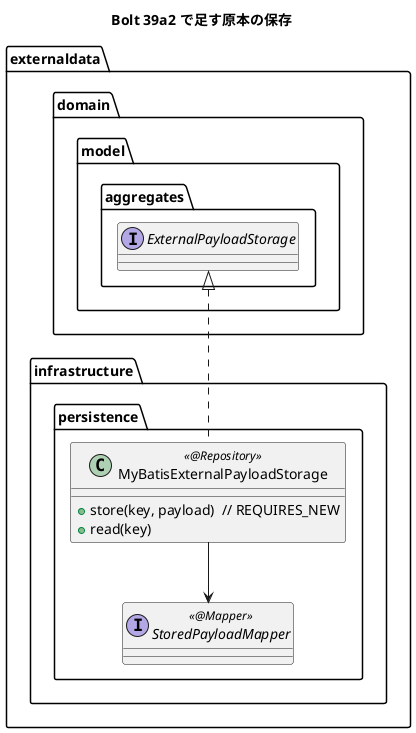
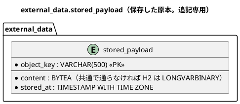

# Bolt 39a2 計画 - 外部原本の保存の DB の実装（原本の表、独立したトランザクション、層別の許可リスト）

## 基本情報

| 項目 | 内容 |
| :--- | :--- |
| Bolt | 第 39a2 回（W7 の 3 本目。開始準備で 39a2 を 39a2（原本の表と DB の実装）と 39a3（残りの 6 表）に縦に分けた 1 つ目） |
| 予定 | W7（2026-11-16 の週。前倒しで着手できる）。作業は約 3.0 時間（`check`・SonarQube・CI とステップごとの承認の待ちを除く） |
| アプローチ | 原本の表と DB の実装はインサイドアウト（データ → 永続化の実装。開発戦略 :120）。規則の層別（ステップ 3 の最初）は :122 の技術タスク（テストの入口は ArchUnit）。不確かな所（バイナリの型と独立したトランザクション）を先に通す |
| 対象 | (1) `external_data` のスキーマと原本の表、(2) `ExternalPayloadStorage` の DB の実装（独立したトランザクション、契約のテストを継ぐ）、(3) 型の依存の許可リストを層別にし MyBatis を infrastructure だけに許す、(4) スキーマの一覧の 4 か所、(5) 設計の文書。見える振る舞いは変えない |
| トレース | US-14 AC1（原本の保存）、PV-01（消失 0 件）、ADR-004（改訂の経緯）、ADR-007、Bolt 39 の終了報告の議題 3 |
| GitHub | [#18](https://github.com/k2works/practical-domain-driven-design-in-enterpris-application/issues/18)（US-14。クローズは 39h） |
| SP | 0 |
| 承認ゲート | **ステップごとに止める**（外部原本の取込）。スキーマ（新しいスキーマと表）、構造（規則の層別）、ADR（ADR-004 の改訂。バイナリの型によっては ADR-020） |
| 開始準備で決めたこと | 2026-11-02、human:kakimomokuri: (1) 原本は受信記録とは独立したトランザクション（REQUIRES_NEW）で保存し、外側が巻き戻っても残す（S3（W10）と同じ振る舞い）。行ごとに独立したトランザクションになる量（1 ファイル 1 万件で約 1 万回のコミット）は 39b の PERF-06 の計測で確かめ、足りなければ 39b で一括の保存をポートに足す。S3 の実装の接続の扱い（ADR-010 の「外部への通信の間に接続を握らない」との違い）は W10 の開始準備で決める、(2) 型の依存の許可リストを層別にし、MyBatis は infrastructure だけに許す、(3) 受信記録はクラス `ReceivedRecord`・表 `external_data.received_record`、判断の表は `external_data.received_record_decision`（39a3）【前の決定の変更: data_model の `receipt`（:173・:1030 ほか）と W7 の確認ポイント 2 の例 `receipt_decision`】、(4) 縦に分ける（39a2 は原本の表と DB の実装、39a3 は data_source・ingestion・external_record・received_record・received_record_decision・adopted_value と文書の改名・要素表・用語集）【前の決定の変更: W7 の Bolt の表の 39a2 の範囲（release_plan :931）】、(5) 原本の表のバイナリの列は、先に共通の置き場所の `BYTEA` が H2 と PostgreSQL の両方で通るかを確かめる。通れば共通の置き場所に置き、ADR-007 を変えない。通らなければベンダー別（PostgreSQL は `BYTEA`、H2 は `LONGVARBINARY`）に分け、ADR-007 :45 のとおり新しい ADR（ADR-020）に記録する【前の決定の変更（通らない場合）: ADR-007 :53 の「業務の表は共通の置き場所」】、(6) 開発データとテストの情報源と DATA_STEWARD の開発利用者は 39b で入れる |

## Bolt ゴール

39b 以降の取込のサービスが原本を DB に保存できるよう、外部原本の保存の DB の実装を、外側のトランザクションが巻き戻っても原本が残る形で作り、規則と一覧と文書を合わせる。見える振る舞いは変えない。

### 開始準備で確かめたこと

- **ポートと契約**（Bolt 39）: `ExternalPayloadStorage`（`store`・`read`。約束: キーは呼び手が作る、上書きしない＝`IllegalStateException`、読めないキー＝`NoSuchElementException`、保存 → 受信記録の順、補償は消さない。巻き戻りとの関係は 39a2 で決めると注）。契約のテスト `ExternalPayloadStorageContract`（:53-74 の防御の写し、:87-96 の上書きの拒否を含む）とメモリの実装
- **data_model**: external_data の ER 図 :990-1116 に原本のバイト列を置く表はない。原本は S3 と書く所は :35・:1127。スキーマの内容 :131、追記専用の一覧 :173、時刻の型 :146（`TIMESTAMPTZ` の略記は H2 で使えないので DDL では `TIMESTAMP WITH TIME ZONE`）、マイグレーションの構成 :1141-1159（ベンダー別の置き場所はフレームワークの表だけと書く）、列の日本語コメント :1162、追記専用の印 :1163。表の日本語名は ER 図に合わせる（:1162）
- **新しいスキーマの前例**: `V20261015100000__create_notification.sql`（`CREATE SCHEMA IF NOT EXISTS`、制約の名前は `pk_`・`uk_`・`ck_`、表と列の日本語の COMMENT、追記専用の印 `'<日本語名> [append-only]'`）。common の最新は `V20261029101000__set_routing_case_shipper_company_not_null.sql`
- **バイナリの型**: 業務の表にバイナリの前例はない。Spring Session の表だけが `migration/postgresql`（`BYTEA`）と `migration/h2`（`LONGVARBINARY`）に分けている（V20261006140100 :21）。ADR-007 :53「フレームワークの DDL はベンダー別に、業務の表は共通の置き場所に」、:45 と data_model :151「PostgreSQL にしかない機能は別の ADR で判断する」。Flyway は `{vendor}` で h2 か postgresql の片方だけを読み（application.properties :4、application-dev.properties :6）、同じ版を 2 か所に置ける。H2 2.x が `BYTEA` を別名として受けるかは未検証
- **一覧の 4 か所**: `afterMigrate__grant_app_user.sql` :26-27（スキーマの一覧。:9 に足す注）と :27・:37（全権を与えてから UPDATE・DELETE を外すので INSERT は許される）と :30-39（印で REVOKE）、`SchemaCommentIntegrationTest` :28-29、`AppendOnlyGrantIntegrationTest` :35-41（足し忘れは :172-182 が検出する）、`ops/scripts/design_docs.js` :24（:150 で失敗する）。MapperSchemaArchitectureTest は Bolt 39 で足し済み
- **MyBatis の前例**: notification の `NotificationMapper`（`@Mapper`、行は record）、XML の置き場所、`MyBatisNotificationRepository`（`@Repository`。MyBatis のアダプター 21 個はすべて `@Repository` の部品探索）、統合テスト `MyBatisNotificationRepositoryIntegrationTest`（:21 にクラスの `@Transactional`。リポジトリのテストは H2 で書かない。ADR-007 :84）。`byte[]` は MyBatis の標準の型ハンドラーで読み書きできる見込み（独自の型ハンドラーは `UuidTypeHandler` だけ）
- **独立したトランザクションの前例**: `MyBatisTransportRequestNumberIssuer` :34-36（`PROPAGATION_REQUIRES_NEW`）、:56-60（`DuplicateKeyException` を `execute` の外で捕まえる）、`MyBatisRoutingCaseNumberIssuer` :29、`SpringSessionUserSessionRevoker` :16。Javadoc :19-21「外側の接続を握ったまま 2 本目を取るので、プールの大きさ以上の同時実行で枯渇しうる」。接続プールは設定がなく既定（10）。Bolt 4 の報告 :139「16 本の同時の採番でも止まらない」は、年の行を起動時に用意して REQUIRES_NEW の経路を通さない対策（D-13、data_model :189）の結果で、REQUIRES_NEW の経路の同時実行は確かめていない。ADR-010 :28・:56「外部への通信の間に接続を保持しない」。ADR-019 の「外側のトランザクションの中では拒む」形は取らない（39b は外側の中から呼ぶ）
- **量**: 1 ファイル 1 万件以下（non_functional :50）、PERF-06 は 1 万件を 5 分以内（:62）。原本はファイル全体と行の両方を保存する（ADR-004 :75）ので、行ごとに 2 本目の接続とコミットが要る
- **規則の重なり**: ModularityTest :101-121 の許可リスト（externaldata 全体に一律。`java..`・`externaldata..`・`shared..`・`org.springframework..`）。`DomainArchitectureTest.java:20-28` はすべての `..domain..` を `java..`・ドメイン・DDD の注釈だけに限り、`LayerArchitectureTest.java:276-288` は application から MyBatis への依存を禁じる。そのため許可リストの (a) だけが守る層は `externaldata.interfaces`。`@Mapper` は `org.apache.ibatis`（`org.mybatis..` は使わない見込み）
- **「39a2 で決める」と書いた箇所**: architecture_backend :131（層別に許すか）・:447（補償は消さない。独立したトランザクションが書かれていない）、domain_model :314・:315（クラス名）・:1469（要素表）、Bolt 39 の終了報告 :19・:102、release_plan :931（39a2 の範囲に 6 表と `receipt`）

## 設計の決定（案）

| 項目 | 決定 | 根拠 |
| :--- | :--- | :--- |
| 原本の表 | `external_data.stored_payload`（日本語名「保存した原本」）: `object_key VARCHAR(500)`（主キー。「原本のオブジェクトキー」。`PayloadObjectKey` の値）、`content`（「原本の内容」。バイト列。NOT NULL。0 バイトを許す）、`stored_at TIMESTAMP WITH TIME ZONE NOT NULL`（「保存した時刻」。値は Clock から取りマイクロ秒に切り捨てる。BR-10、ADR-007 :56）。追記専用（`'保存した原本 [append-only]'`）。ハッシュは持たない（39a3 の `ingestion.file_hash`・`external_record.payload_hash`・`received_record.payload_hash` が持つ）。W10 で S3 に差し替えたら使わなくなる表（data_model の注に書く） | 開始準備の決定 (5) |
| バイナリの型とマイグレーションの置き場所 | ステップ 2 の最初に、common に `content BYTEA` の DDL を置いて、PostgreSQL（統合テスト）と H2（dev の起動と、H2 で 0 バイト・0x00・0xFF を保存して読む手の確かめ。ADR-007 :84 によりリポジトリのテストは H2 で書かないので、スクラッチパッドの使い捨ての確かめにし、結果を報告に書く）で通るか確かめる。通れば共通の置き場所のまま。通らなければ原本の表を `migration/postgresql`（`BYTEA`）と `migration/h2`（`LONGVARBINARY`）に同じ版の番号で置き、2 つの DDL の列の名前・NULL・コメントが同じことを目で確かめ、ADR-020 に記録する。`CREATE SCHEMA` は common で、版は原本の表より小さくする | 開始準備の決定 (5) |
| DB の実装 | `externaldata.infrastructure.persistence.MyBatisExternalPayloadStorage`（`@Repository`。前例の 21 個のアダプターに合わせ、`@Configuration` の `@Bean` では組み立てない）と `StoredPayloadMapper`（`@Mapper`。XML は `src/main/resources/com/example/cargotracker/externaldata/infrastructure/persistence/`）。`store` は `TransactionTemplate`（`PROPAGATION_REQUIRES_NEW`）の中で `INSERT`。主キーの違反（`DuplicateKeyException`）は `execute` の外で捕まえて `IllegalStateException` に変える（上書きしない。前例 :56-60）。`read` は行がなければ `NoSuchElementException`。読み書きで配列を写す（防御の写し。MyBatis の 1 次キャッシュで同じ SqlSession の中の 2 回の読み出しが同じ配列を返すため）。外側のトランザクションの中から呼べる（拒まない） | 開始準備の決定 (1) |
| 層別の許可リスト | ModularityTest の許可リストの規則を 2 本にする: (a) `externaldata..` のうち `..infrastructure..` でないクラスは `java..`・`externaldata..`・`shared..`・`org.springframework..` にだけ依存する、(b) `externaldata..infrastructure..` のクラスは (a) に加えて `org.apache.ibatis..` に依存してよい。Javadoc に、(a) が守る層は実質 `interfaces`（domain は DomainArchitectureTest、application は LayerArchitectureTest が先に守る）であることと、「フレームワークの許可は使う Bolt で、使う層に限って足す（W10 の AWS SDK も infrastructure に）」を書く | 開始準備の決定 (2) |
| 一覧の 4 か所 | `afterMigrate` のスキーマの一覧と :9 の注、`SchemaCommentIntegrationTest` の `BUSINESS_SCHEMAS`、`AppendOnlyGrantIntegrationTest` の `APPEND_ONLY_TABLES` に `external_data.stored_payload`、`design_docs.js` の `schemas` に `external_data` | Bolt 39 の既知の課題 |
| 文書 | data_model（:35・:1127 の原本は S3 の記述を「W7〜W9 は DB の `stored_payload`（独立したトランザクション）、W10 で S3」に、:131 のスキーマの内容と :173 の追記専用の一覧に `stored_payload`、external_data の ER 図に `stored_payload`、ベンダー別に分けた場合は :1141-1159 に業務の表の例外）、ADR-004 の改訂の経緯（巻き戻りとの関係は独立したトランザクション、行ごとの量は 39b で測る、S3 の接続の扱いは W10 で決める）、`ExternalPayloadStorage` の Javadoc の注、architecture_backend（:131 に層別の決定、:447 に独立したトランザクション）、domain_model（:315 に決まった名前 `ReceivedRecord`、:314・:1469 の指し先を 39a3 に）、Bolt 39 の終了報告 :19・:102 の指し先を 39a3 に、release_plan（39a2 の行を直し、39a3 の行を足す）、開発戦略の W7 の行（39a3） | 開始準備の決定 (1)〜(5) |

## ふりかえりと前の Bolt からの引き継ぎ

| 出典 | 内容 | この Bolt での扱い |
| :--- | :--- | :--- |
| W6 の Try T-204・T-212、Bolt 38h の T-227 | サブエージェントへの指示の最初に heredoc と標準入力を待つコマンド（空のコマンドを含む）を使わないと書く | 任せるときの指示の最初に書く |
| W6 の Try T-217 | 本体を直す前に Red を流し、落ちた理由を記録する | ステップ 2〜3 |
| W6 の Try T-225・T-213 | push の前に `check` | ステップ 4 |
| W6 の Try T-219 | 変異の対象に単体・統合・契約のテスト | 下の変異の表（契約と独立したトランザクション） |
| Bolt 39 の T-228 | 状態の組み合わせの表に、誤りや巻き戻りの「後」に来る操作の行を置く | 行 2・5（巻き戻りの後の読み出し、上書きの拒否の後のコミット） |
| Bolt 39 の終了報告の議題 3 | 補償とトランザクション、許可リストの層別、DB の実装 | この Bolt |
| Bolt 39 の既知の課題 | 一覧の 4 か所、data_model の payload の注 | この Bolt。要素表・用語集の分類 4 つ・`receipt` の改名は 39a3 |

## 状態の組み合わせ（行ごとにテストを 1 本。T-182）

統合テスト `MyBatisExternalPayloadStorageIntegrationTest` は、クラスに `@Transactional` を付けない（付けると外側の `TransactionTemplate` がテストのトランザクションに合流し、巻き戻りを確かめられない）。キーは乱数の UUID なので、コミットされて残った行どうしは干渉しない。

| 行 | 状況 | 期待 | 確かめ方 |
| :--- | :--- | :--- | :--- |
| 1 | 契約のテスト（保存と読み戻し、上書きしない、読めないキー、空、バイナリ、防御の写し、null）を DB の実装で流す | Bolt 39 の契約のとおり | `MyBatisExternalPayloadStorageIntegrationTest`（`ExternalPayloadStorageContract` を継ぐ。PostgreSQL） |
| 2 | 外側のトランザクション（`TransactionTemplate`）の中で保存し、外側を巻き戻す | 巻き戻した後も読める | 同上 |
| 3 | 外側のトランザクションの中で保存し、外側をコミットする | 読める（1 行だけ） | 同上 |
| 4 | 外側のトランザクションの中で同じキーに 2 回保存し、2 回目の例外を捕まえて外側をコミットする | 外側は巻き戻し専用にならずにコミットでき、1 回目のバイト列が残る | 同上 |
| 5 | 外側のトランザクションの中で 2 回読み、1 回目に読んだ配列を書き換える | 2 回目に読んだ配列は元のまま（1 次キャッシュの配列を返さない） | 同上 |
| 6 | 原本の表は追記専用 | アプリの利用者に UPDATE・DELETE の権限がなく、INSERT はできる | `AppendOnlyGrantIntegrationTest` |
| 7 | 原本の表と列に日本語のコメントがある | 欠けがない | `SchemaCommentIntegrationTest` |
| 8 | H2 のマイグレーションが流れる | dev プロファイルで起動できる | `H2DevProfileSmokeTest`（H2 でのバイナリの読み書きは、設計の決定の手の確かめ） |
| 9 | 外部データの interfaces が MyBatis に依存する（試しに置いた場合） | 層別の許可リストの (a) が落ちる | `ModularityTest`（変異 V3） |
| 10 | 外部データの infrastructure が MyBatis に依存する | (b) で許される | `ModularityTest` |

## スコープ

### 入れるもの

- 行 1〜10 のテスト、マイグレーション（common のスキーマと原本の表。分けた場合は postgresql と h2）、`MyBatisExternalPayloadStorage`・`StoredPayloadMapper` と XML、ModularityTest の層別の規則、一覧の 4 か所
- 設計の文書: 上の「文書」の行（data_model、ADR-004 の改訂の経緯、分けた場合の ADR-020、`ExternalPayloadStorage` の Javadoc、architecture_backend、domain_model の指し先、Bolt 39 の終了報告の指し先、release_plan、開発戦略）

### 入れないもの

- data_source・ingestion・external_record・received_record・received_record_decision・adopted_value、`receipt` の改名、domain_model の要素表と用語集の分類 4 つ（39a3）
- 一括の保存（39b の PERF-06 の計測で要るとなったら 39b）、S3 の実装の接続の扱い（W10）
- 開発データの情報源と DATA_STEWARD の開発利用者（39b）
- 取込のサービス（39b）、画面（39c・39d）、マニュアル（見える振る舞いを変えない）

## 設計（この Bolt の範囲）

- 状態遷移図: 状態を持たないので省く
- 画面遷移図: 画面を作らないので省く

## ステップ計画（ステップごとに止める）

- [x] **1. 設計の文書**（`376e1ceb4`。2026-11-02 に human:kakimomokuri が承認した）: 上の「文書」の行のうち、バイナリの型によらない分（ベンダー別の記述と ADR-020 はステップ 2 の結果の後）（完了の判定: 文書の差分。**承認ゲート**）
- [ ] **2. スキーマと原本の表（Red → Green）**: 行 6・7 の一覧（`AppendOnlyGrantIntegrationTest`・`SchemaCommentIntegrationTest`）に先に足して落ちることを確かめ、共通の `BYTEA` の DDL で PostgreSQL と H2 を確かめ、通らなければベンダー別に分けて ADR-020 を書く。afterMigrate・SchemaSpy の一覧。行 8（完了の判定: 期待した理由で落ちた後に緑。バイナリの型の確かめの結果。**承認ゲート**）
- [ ] **3. 層別の許可リストと DB の実装（Red → Green）**: 行 1〜5 の統合テストと、行 9・10 の層別の規則を先に書き、空の実装（マッパーを持つ空のクラス）で落ちることを確かめてから（行 10 の (b) の規則は infrastructure のクラスができて対象を持つ。本当の Red は「今の 1 本の規則が、マッパーを足すと落ちる」こと）、マッパー・XML・実装を作り、規則を 2 本にする（完了の判定: 同上。**承認ゲート**）
- [ ] **4. 品質ゲートと開発レビュー**: 変異、`check`、その後に SonarQube、開発レビューとその直し。push の前に `check`（T-225）。`uiTest` は画面を変えないので CI の `ui` の段で確かめる
- [ ] **5. 終了報告**: push して CI と MkDocs とデモ環境の配備（PostgreSQL への新しいスキーマのマイグレーション）を確かめる。release_plan・開発の索引・mkdocs を直す

### 時間の配分と打ち切り

| # | 目安 | 打ち切り |
| :--- | :--- | :--- |
| 1 | 35 分 | — |
| 2 | 45 分 | H2 でも `LONGVARBINARY` でも 0 バイトや 0x00・0xFF が通らないときは、止めて報告する（型の判断を諮り直す） |
| 3 | 60 分 | 行 4 が通らない（独立したトランザクションの違反が外側に巻き戻し専用の印を残す）ときは、止めて報告する |
| 4 | 25 分（待ちを除く） | — |
| 5 | 15 分（CI の待ちを除く） | — |

合計 180 分（約 3.0 時間。ステップごとの承認の待ちを除く）。

## 確認ポイント（計画の承認の場でまとめて確認する。Try T-6）

| # | 確認すること | 場所 | 推奨 |
| :--- | :--- | :--- | :--- |
| 1 | **分け方（開始準備の決定 (4)）【前の決定の変更】** | release_plan | 39a2（この Bolt）・39a3（残りの 6 表と改名）。W7 の Bolt の表の 39a2 の行を直し、39a3 の行を足す |
| 2 | **原本の表の名前と列（スキーマ）** | ステップ 2 | `external_data.stored_payload`（保存した原本。`object_key` 主キー、`content`、`stored_at`。ハッシュは持たない）。追記専用 |
| 3 | **バイナリの型（開始準備の決定 (5)）** | ステップ 2 | 先に共通の `BYTEA` を試す。通らなければベンダー別に分けて ADR-020（ADR-007 :45 のとおり別の ADR） |
| 4 | **独立したトランザクションと接続と量（ADR-004 の改訂）** | ステップ 3 | `REQUIRES_NEW` で保存し、外側の中から呼べる。外側の接続を握ったまま 2 本目を取るので、プールの大きさ（既定 10）以上の同時の取込で枯渇しうる（REQUIRES_NEW の経路の同時実行は前例でも確かめていない）。取込は 1 日 1〜4 ファイルで同時に走らない想定なので受け入れる。行ごとのコミットの量は 39b の PERF-06 の計測で確かめ、足りなければ 39b で一括の保存を足す。S3 の接続の扱いは W10 で決める |
| 5 | **層別の許可リスト（構造）** | ステップ 3 | 規則を 2 本（infrastructure 以外、infrastructure）にし、MyBatis（`org.apache.ibatis..`）は infrastructure だけ |
| 6 | **組み立て** | ステップ 3 | `@Repository` の部品探索（前例の 21 個に合わせる。`@Configuration` の `@Bean` で二重に登録しない） |
| 7 | **変異** | ステップ 4 | 下の 5 つ。スクリプトはバイトのまま読み書きし、gradlew.bat を絶対パスで呼び、結果の XML を消してから流す |

### 変異と落ちる見込みのテスト

| # | 変異 | 落ちる見込み |
| :--- | :--- | :--- |
| V1 | 保存を `REQUIRES_NEW` でなく外側のトランザクションに参加させる（`PROPAGATION_REQUIRED`） | 行 2（巻き戻りで消える）、行 4（外側で一意制約の違反が起き、コミットが `UnexpectedRollbackException`） |
| V2 | 主キーの違反を捕まえずに上書き（`UPDATE`）する | 行 1（契約の上書きの拒否） |
| V3 | 外部データの `interfaces.file` に MyBatis の型への依存を足す | 行 9 |
| V4 | 原本の表のコメントから `[append-only]` を外す | 行 6 |
| V5 | 読み出しで配列を写さない | 行 5 |

## 完了条件

- [ ] 上のステップ 1〜5 の完了の判定を満たす（ステップごとの承認を受ける）
- [ ] 行 1〜10 に、それを名乗るテストがある
- [ ] `check` が緑、SonarQube が PASS、CI が緑、デモ環境が新しい版で動く（PostgreSQL に `external_data` のスキーマと原本の表ができる）
- [ ] 見える振る舞いが変わらない
- [ ] 終了報告が承認される

## 更新履歴

| 日付 | 更新内容 | 更新者 |
| :--- | :--- | :--- |
| 2026-11-02 | 計画を承認した（確認ポイント 1〜7 を推奨のとおり） | anthropic/claude-opus-5-5、承認 human:kakimomokuri |
| 2026-11-02 | 整合性検証の指摘を反映した（承認待ち。重大 1・中 12・軽 13）。開始準備の決定 (1) に行ごとの量と W10 の S3 の接続を足し、(5) を「先に共通の `BYTEA` を試し、通らなければベンダー別と ADR-020」に改めた（human:kakimomokuri）。決定を変えない直し: 統合テストに `@Transactional` を付けない、行 5（1 次キャッシュの防御の写し）、V1・V3・V5 の落ちる先、規則の重なり、ステップ 2・3 の順（規則の層別を DB の実装と合わせる）、`TIMESTAMP WITH TIME ZONE` と Clock、表の日本語名「保存した原本」、`@Repository`、`org.mybatis..` を外す、Bolt 4 の前例の読み違い、直す文書の漏れ、【前の決定の変更】の印、時間 | anthropic/claude-opus-5-5 |
| 2026-11-02 | 初版作成（承認待ち）。開始準備で、原本は独立したトランザクションで保存し、許可リストを層別にし、受信記録と判断の表の名前を決め、39a2 と 39a3 に縦に分け、原本の表はベンダー別の DDL にし、情報源は 39b で入れると決めた（human:kakimomokuri） | anthropic/claude-opus-5-5 |

## 関連ドキュメント

- [リリース計画](release_plan.md)（W7 の節の 39a2 の行）
- [Bolt 39 計画](bolt_39_plan.md)・[Bolt 39 終了報告](bolt_39_report.md)
- [ADR-004](../../adr/cargo-tracker/004-external-data-ingestion.md)、[ADR-007](../../adr/cargo-tracker/007-postgresql-mybatis-flyway.md)、[ADR-010](../../adr/cargo-tracker/010-required-document-storage-transaction.md)
- [データモデル](../../design/cargo-tracker/data_model.md)
