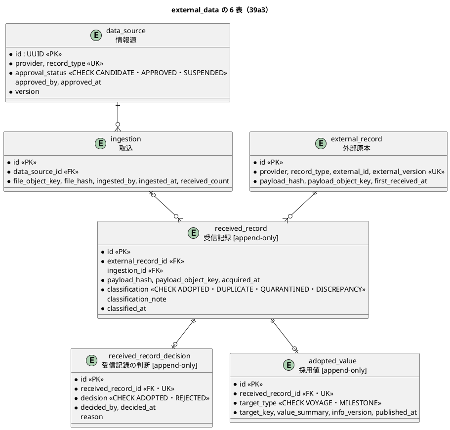

# Bolt 39a3 計画 - 外部データの残りの 6 表（情報源・取込・外部原本・受信記録・判断・採用値）と改名

## 基本情報

| 項目 | 内容 |
| :--- | :--- |
| Bolt | 第 39a3 回（W7 の 4 本目。Bolt 39a2 の開始準備で 39a2 から縦に分けた 2 つ目） |
| 予定 | W7（2026-11-16 の週。前倒しで着手できる）。作業は約 2.5 時間（`check`・SonarQube・CI とステップごとの承認の待ちを除く） |
| アプローチ | インサイドアウト（データから。一意制約と分類の表。開発戦略 :121、W7 の行 :350） |
| 対象 | (1) `external_data` の 6 表（`data_source`・`ingestion`・`external_record`・`received_record`・`received_record_decision`・`adopted_value`）の DDL（制約・索引・日本語のコメント・追記専用の印・一覧）、(2) `receipt` の改名（data_model・domain_model・operation・ADR-004）、(3) domain_model の要素表と用語集の分類 4 つ。見える振る舞いは変えない |
| トレース | US-14 AC1・AC2・AC3・AC4・AC5（原本・情報源の承認・受信記録・分類・判断の置き場所）、BR-12（冪等性キー）、BR-18（情報源の承認）、ED-INV-01〜03 |
| GitHub | [#18](https://github.com/k2works/practical-domain-driven-design-in-enterpris-application/issues/18)（US-14。クローズは 39h） |
| SP | 0 |
| 承認ゲート | **ステップごとに止める**（外部原本の取込）。スキーマ（6 表） |
| 開始準備で決めたこと | 2026-11-02〜03、human:kakimomokuri: (1) 39a3 は 6 表の DDL と文書だけにし、MyBatis のマッパーと読み書きは使う Bolt（分類と取込のサービスの 39b、判断の 39d）で作る、(2) 判断の表 `received_record_decision` は受信記録 1 件につき 1 つ（一意制約）。判断のやり直しは提供元からの再送（新しい受信記録）で扱う（隔離を採用した後の再送の扱いは 39d で未決。W7 の確認ポイント 2）、(3) `data_source` に一意制約（provider, record_type）を足す。`external_record` は情報源への外部キーを張らない（冪等性キーは情報源の承認の状態と独立し、出典は受信記録 → 取込 → 情報源でたどれる。理由を data_model に書く）、(4) 追記専用の印は `received_record`・`received_record_decision`・`adopted_value` の 3 表。`external_record` は 39d の再送の扱いが決まるまで付けない、(5) 判断の値は `VARCHAR(30)` で `ADOPTED`・`REJECTED`（前例の `review_record` の過去分詞にそろえる）。前の決定（Bolt 39a2 の開始準備）: 受信記録はクラス `ReceivedRecord`・表 `received_record`、判断の表は `received_record_decision` |

## Bolt ゴール

39b 以降が取込と分類と判断を作れるよう、外部データの残りの 6 表を、data_model の定義と W7 の決定（分類 4 つ、受信記録と判断の名前、判断は 1 件につき 1 つ）に合わせて作り、`receipt` と書いた設計の文書を改める。見える振る舞いは変えない。

### 開始準備で確かめたこと

- **data_model の定義**: `data_source`（:1000）、`ingestion`（:1010）、`external_record`（:1020。一意制約 (provider, record_type, external_id, external_version)、BR-12。`data_source` への外部キーはない）、`receipt`（:1038。`classification` は 4 値、`ingestion_id` は NULL 可）、`adopted_value`（:1050。`receipt_id` FK・UK）。制約の表 :1131、索引 :1194（`receipt` の (ingestion_id)・(classification)）、追記専用の一覧 :175、時刻の型 :148（`TIMESTAMP WITH TIME ZONE`）、区分値の型 :151（`VARCHAR(30)`）、状態の CHECK の凍結の規則 :1174、CHECK の差し替えの前例 :988。範囲外の `reconciliation_discrepancy`（US-15）が `receipt_id` を参照する（:1099）。ER 図の多重度 :1114（`||--o{`。`ingestion_id` は NULL 可なのに）・:1115（`||--|{`）は列の NULL と合わない
- **判断の表**: 定義はない（W7 の確認ポイント 2: 判断・判断者・時刻・理由、追記専用）。前例の判断の表 `review_record` の値は過去分詞（`APPROVED`・`SENT_BACK`）
- **情報源の単位**: （提供元、原本種別）（release_plan :886）。`data_source` に一意制約がない
- **`receipt` と書いた設計の文書**: data_model :175・:1038・:1050・:1099・:1130（`stored_payload` の行の `receipt.payload_hash`）・:1131（改名の注）・:1194、domain_model :316（外部原本の行の「39a3 で受信記録に移す」）・:317・:1471、operation.md :269（追記専用の一覧。`receipt` のほか `stored_payload`・`review_record`・`required_document`・`processed_command` も欠けている）、ADR-004 :79（Bolt 39 の改訂の経緯）。決定の記録（release_plan、Bolt 39・39a2 の計画と報告）の `receipt` は履歴なので直さない
- **DDL の前例**: Bolt 39a2 の `V20261102100000__create_external_data.sql`（共通の置き場所、制約の名前 `pk_`・`uk_`・`ck_`・`fk_`、日本語の COMMENT、追記専用の印）。外部キーに ON DELETE を付けない前例（保持期限の削除は所有者の運用タスクで子の表から消す）
- **スキーマの統合テストの前例**: `com.example.cargotracker.integration.BookingSchemaIntegrationTest`（:35 で正しい値が入ることを確かめる。SQLState 23505・23514・23503）。違反の後の PostgreSQL は同じトランザクションの文を受け付けない（ADR-007 :55）。テストのデータを残さない前例は `AppendOnlyGrantIntegrationTest` :123（Bolt 26b P-5。ロールバック）。共有の DB に APPROVED の情報源が残ると 39b の ED-INV-01（承認済みが 0 件）のテストを汚す
- **一覧**: `SchemaCommentIntegrationTest`（`external_data` は 39a2 で足し済み）、`AppendOnlyGrantIntegrationTest` の `APPEND_ONLY_TABLES`、afterMigrate は印で表を選ぶので直さない、SchemaSpy（design_docs.js :24）は足し済み
- **用語集**: 採用（別名 採用済み）・隔離・差異はある。「重複」はない。受信記録の英語名は `ReceivedRecord`。`LivingGlossaryConsistencyTest` :35 は英語名をクラス名の形で読む

## 設計の決定（案）

| 項目 | 決定 | 根拠 |
| :--- | :--- | :--- |
| 6 表の DDL | data_model の定義どおり（型・NULL・一意制約・外部キー。ON DELETE は付けない）。`receipt` は `received_record`、`adopted_value.receipt_id` は `received_record_id` に改める。足す制約: `uk_data_source`（provider, record_type）。CHECK: `data_source.approval_status`（`CANDIDATE`・`APPROVED`・`SUSPENDED`）、`received_record.classification`（`ADOPTED`・`DUPLICATE`・`QUARANTINED`・`DISCREPANCY`）、`received_record_decision.decision`（`ADOPTED`・`REJECTED`）、`adopted_value.target_type`（`VOYAGE`・`MILESTONE`。港湾は D-92 で Release 1.1） | data_model、開始準備の決定 (3)・(5) |
| 判断の表 | `received_record_decision`（日本語名「受信記録の判断」）: `id UUID` PK、`received_record_id UUID` FK・UK、`decision VARCHAR(30)`（CHECK）、`decided_by UUID`、`decided_at TIMESTAMP WITH TIME ZONE`、`reason VARCHAR(1000)`（NULL 可）。判断の対象（隔離・差異の受信記録だけ）は 39d のサービスが守る | 開始準備の決定 (2)・(5) |
| 追記専用 | `received_record`・`received_record_decision`・`adopted_value` に印。`external_record`・`ingestion`・`data_source` には付けない（`external_record` は 39d の再送の扱いで最初のハッシュを変えうる、`data_source` は承認の状態を変える、`ingestion` は 39b で受け取った件数の書き方を決める）。誤って採用した `ADOPTED` を取り消す経路がスキーマにないことは 39d の既知の課題にする | 開始準備の決定 (4) |
| 索引 | `received_record` の (ingestion_id)・(classification)。外部キーの列のほかの索引は、使う照会が決まる 39b・39d で足す | data_model :1194 |
| マイグレーション | common に 1 つの版（39a2 の `V20261102100000` より後）。表の順は外部キーの向き（data_source → ingestion → external_record → received_record → received_record_decision・adopted_value） | 前例 |
| 改名と設計の文書 | data_model（ER 図と多重度（:1114・:1115 を列の NULL に合わせる）、6 表、判断の表、制約の表（`uk_data_source`、`external_record` に外部キーを張らない理由）、索引、追記専用の一覧、:1130 の `receipt.payload_hash`、:1131 の改名の注を外す、:1099 の `reconciliation_discrepancy` の外部キーの列名）、domain_model（:316・:317 の「39a3」の指し先を外し、:1471 の要素表の分類を受信記録へ。要素表に「受信記録」「受信記録の判断」の行を足す）、operation.md :269（data_model の追記専用の節を指す形に改める）、ADR-004（:79 の Bolt 39 の項は書き換えず、改訂の経緯に 39a3 の改名の注を足す） | Bolt 39a2 の開始準備の決定 (3) |
| 用語集 | 分類 4 つ（採用・重複・隔離・差異）を英語名（`ADOPTED`・`DUPLICATE`・`QUARANTINED`・`DISCREPANCY`）とそろえて載せる（「重複」を足す）。受信記録の行の英語名を `ReceivedRecord` に。受信記録の判断（`ReceivedRecordDecision`。クラスは 39d で作るので仮）を足す | Bolt 39 の終了報告の議題 2、`LivingGlossaryConsistencyTest` :35 |

## ふりかえりと前の Bolt からの引き継ぎ

| 出典 | 内容 | この Bolt での扱い |
| :--- | :--- | :--- |
| W6 の Try T-204・T-212、Bolt 38h の T-227 | サブエージェントへの指示の最初に heredoc と標準入力を待つコマンドを使わないと書く | 任せるときの指示の最初に書く |
| W6 の Try T-217 | 本体を直す前に Red を流す | ステップ 2（表がない段階の Red は 42P01 で落ちるので、期待した理由で落ちることは変異で確かめる） |
| W6 の Try T-225 | push の前に `check` | ステップ 3 |
| Bolt 39a2 の T-229 | 永続化の Bolt の状態の組み合わせに時刻の出どころと同時の書き込みの行を置く | 表だけなので時刻の出どころは 39b。同時の重複は一意制約（行 3・5）で確かめる |
| Bolt 39a2 の既知の課題 | 数えるテストは自分のキーで絞る規約 | 行 2〜6 はロールバックしてデータを残さない（下の表の前置き） |
| Bolt 39 の終了報告の議題 2 | 用語集の「重複」 | この Bolt |

## 状態の組み合わせ（行ごとにテストを 1 本。T-182）

制約は統合テスト `com.example.cargotracker.integration.ExternalDataSchemaIntegrationTest`（PostgreSQL。前例 `BookingSchemaIntegrationTest`）で、生の SQL で確かめる（読み書きのマッパーはまだないため）。共有の DB にデータを残さないよう、1 本の接続で自動コミットを切り、違反を確かめる文はそのテストの最後に置いてロールバックする（または SAVEPOINT）。情報源は `CANDIDATE` で入れる（39b の ED-INV-01 のテストを汚さない）。

| 行 | 状況 | 期待 | 確かめ方 |
| :--- | :--- | :--- | :--- |
| 1 | 6 表と列に日本語のコメントがある | 欠けがない | `SchemaCommentIntegrationTest` |
| 2 | `received_record`・`received_record_decision`・`adopted_value` は追記専用 | UPDATE・DELETE の権限がない | `AppendOnlyGrantIntegrationTest` |
| 3 | 同じ冪等性キーの外部原本を 2 つ、同じ（提供元、原本種別）の情報源を 2 つ入れる | 一意制約で拒まれる（23505） | `ExternalDataSchemaIntegrationTest` |
| 4 | 分類・承認の状態・判断・採用値の対象に、決まっていない値を入れる | CHECK で拒まれる（23514。4 つの CHECK のそれぞれ） | 同上 |
| 4b | 分類 4 値・承認の状態 3 値・判断 2 値・対象 2 値のすべてと、`ingestion_id`・`approved_by`・`approved_at`・`classification_note`・`reason` の NULL を入れる | すべて入る | 同上 |
| 5 | 同じ受信記録に判断を 2 つ、採用値を 2 つ入れる | 一意制約で拒まれる（23505） | 同上 |
| 6 | 外部キーの先がない行（ない情報源の取込、ない外部原本の受信記録、ない受信記録の判断と採用値） | 外部キーで拒まれる（23503） | 同上 |
| 7 | H2 のマイグレーションが流れる | dev で起動できる | `H2DevProfileSmokeTest` |

## スコープ

### 入れるもの

- 行 1〜7（4b を含む）のテスト、マイグレーション（6 表）、`APPEND_ONLY_TABLES` の追加
- 文書: 上の「改名と設計の文書」と「用語集」の行、release_plan（39a3 の行と更新履歴）

### 入れないもの

- MyBatis のマッパーと読み書き（39b・39d）、開発データの情報源と DATA_STEWARD の開発利用者（39b）
- 外部キーの列のほかの索引（39b・39d）
- `reconciliation_discrepancy` ほか US-15 の表（W12）
- 誤って採用した `ADOPTED` を取り消す経路、隔離を採用した後の再送の扱い（39d）

## 設計（この Bolt の範囲）

- 状態遷移図: 受信記録は分類を一度だけ持ち変えない（追記専用）ので省く。分類と判断の流れは 39b・39d
- 画面遷移図: 画面を作らないので省く

## ステップ計画（ステップごとに止める）

- [ ] **1. 設計の文書**: 上の「改名と設計の文書」と「用語集」の行、release_plan（完了の判定: 文書の差分。**承認ゲート**）
- [ ] **2. 6 表（Red → Green）**: 行 2〜6 のテスト（`APPEND_ONLY_TABLES` と `ExternalDataSchemaIntegrationTest`）を先に書いて落ちることを確かめ（表がないので 42P01 で落ちる）、マイグレーションを作る。行 1・7（完了の判定: 緑。期待した理由で落ちることは変異で確かめる。**承認ゲート**）
- [ ] **3. 品質ゲートと開発レビュー**: 変異、`check`、その後に SonarQube、開発レビューとその直し。push の前に `check`
- [ ] **4. 終了報告**: push して CI とデモ環境の配備（PostgreSQL に 6 表ができる）を確かめる。release_plan・開発の索引・mkdocs を直す

### 時間の配分と打ち切り

| # | 目安 | 打ち切り |
| :--- | :--- | :--- |
| 1 | 45 分 | — |
| 2 | 60 分 | — |
| 3 | 30 分（待ちを除く） | — |
| 4 | 15 分（CI の待ちを除く） | — |

合計 150 分（約 2.5 時間）。

## 確認ポイント（計画の承認の場でまとめて確認する。Try T-6）

| # | 確認すること | 場所 | 推奨 |
| :--- | :--- | :--- | :--- |
| 1 | **判断の表の列（スキーマ）** | ステップ 1・2 | `received_record_decision`（受信記録の判断）: `received_record_id` FK・UK、`decision VARCHAR(30)`（`ADOPTED`・`REJECTED`）、`decided_by`、`decided_at`、`reason`（NULL 可）。追記専用 |
| 2 | **情報源の一意制約と、外部原本に外部キーを張らないこと** | ステップ 1・2 | 開始準備の決定 (3) のとおり |
| 3 | **追記専用の範囲** | ステップ 2 | `received_record`・`received_record_decision`・`adopted_value`（開始準備の決定 (4)） |
| 4 | **外部キーの列の改名** | ステップ 1・2 | `adopted_value.receipt_id` を `received_record_id` に。`reconciliation_discrepancy.receipt_id`（まだ作らない）も data_model で改める |
| 5 | **テストのデータを残さない** | ステップ 2 | 1 本の接続で自動コミットを切り、ロールバックする。情報源は `CANDIDATE` で入れる |
| 6 | **変異** | ステップ 3 | 下の 5 つ |

### 変異と落ちる見込みのテスト

| # | 変異 | 落ちる見込み |
| :--- | :--- | :--- |
| V1 | 外部原本の一意制約を外す | 行 3 |
| V2 | 分類の CHECK から `DISCREPANCY` を外す | 行 4b（`DISCREPANCY` が入らない） |
| V3 | 判断の表の一意制約を外す | 行 5 |
| V4 | 採用値の表のコメントから `[append-only]` を外す | 行 2 |
| V5 | 情報源の一意制約を外す | 行 3 |

## 完了条件

- [ ] 上のステップ 1〜4 の完了の判定を満たす（ステップごとの承認を受ける）
- [ ] 行 1〜7（4b を含む）に、それを名乗るテストがある
- [ ] `check` が緑、SonarQube が PASS、CI が緑、デモ環境が新しい版で動く
- [ ] `docs/design`・`docs/adr`・`docs/operation` に `receipt`（通知の `…Receipt` の型と、ADR の改訂の経緯の履歴を除く）が残っていない
- [ ] 終了報告が承認される

## 更新履歴

| 日付 | 更新内容 | 更新者 |
| :--- | :--- | :--- |
| 2026-11-03 | 整合性検証の指摘を反映した（承認待ち。重大 2・中 4・軽 8）。開始準備の決定 (3)〜(5)（情報源の一意制約と外部キーを張らない、追記専用は 3 表、判断の値は `ADOPTED`・`REJECTED`）は human:kakimomokuri。決定を変えない直し: 行 4b（正しい値と NULL）と V2 の落ちる先、テストのデータを残さない形、行番号、`receipt` の箇所の漏れと完了条件の範囲、operation.md、テストの置き場所と SQLState、ER 図の多重度、トレースの AC2、用語集の英語名、ADR-004 の書き方、Red の 42P01 | anthropic/claude-opus-5-5 |
| 2026-11-02 | 初版作成（承認待ち）。開始準備で、表と文書だけにし読み書きは使う Bolt で作る、判断は受信記録 1 件につき 1 つと決めた（human:kakimomokuri） | anthropic/claude-opus-5-5 |

## 関連ドキュメント

- [リリース計画](release_plan.md)（W7 の節の 39a3 の行）
- [Bolt 39a2 計画](bolt_39a2_plan.md)・[Bolt 39a2 終了報告](bolt_39a2_report.md)
- [データモデル](../../design/cargo-tracker/data_model.md)、[ドメインモデル](../../design/cargo-tracker/domain_model.md)
- [ADR-004](../../adr/cargo-tracker/004-external-data-ingestion.md)
