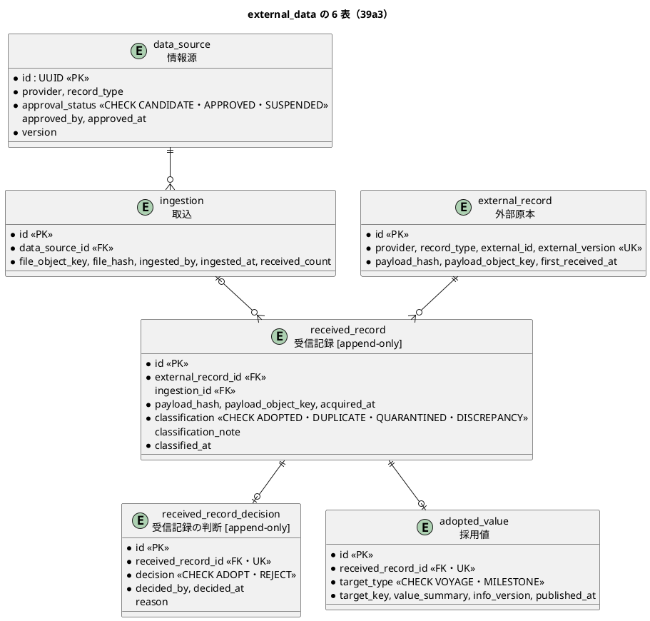

# Bolt 39a3 計画 - 外部データの残りの 6 表（情報源・取込・外部原本・受信記録・判断・採用値）と改名

## 基本情報

| 項目 | 内容 |
| :--- | :--- |
| Bolt | 第 39a3 回（W7 の 4 本目。Bolt 39a2 の開始準備で 39a2 から縦に分けた 2 つ目） |
| 予定 | W7（2026-11-16 の週。前倒しで着手できる）。作業は約 2.3 時間（`check`・SonarQube・CI とステップごとの承認の待ちを除く） |
| アプローチ | インサイドアウト（データから。一意制約と分類の表。開発戦略 :120、W7 の行） |
| 対象 | (1) `external_data` の 6 表（`data_source`・`ingestion`・`external_record`・`received_record`・`received_record_decision`・`adopted_value`）の DDL（制約・索引・日本語のコメント・追記専用の印・一覧）、(2) `receipt` の改名（data_model・domain_model・operation・ADR-004）、(3) domain_model の要素表と用語集の分類 4 つ。見える振る舞いは変えない |
| トレース | US-14 AC1・AC3・AC4・AC5（原本・受信記録・分類・判断の置き場所）、BR-12（冪等性キー）、BR-18（情報源の承認）、ED-INV-01〜03 |
| GitHub | [#18](https://github.com/k2works/practical-domain-driven-design-in-enterpris-application/issues/18)（US-14。クローズは 39h） |
| SP | 0 |
| 承認ゲート | **ステップごとに止める**（外部原本の取込）。スキーマ（6 表） |
| 開始準備で決めたこと | 2026-11-02、human:kakimomokuri: (1) 39a3 は 6 表の DDL と文書だけにし、MyBatis のマッパーと読み書きは使う Bolt（分類と取込のサービスの 39b、判断の 39d）で作る（使わない口を先に作らない）、(2) 判断の表 `received_record_decision` は受信記録 1 件につき 1 つ（一意制約）。判断のやり直しは提供元からの再送（新しい受信記録）で扱う。前の決定（Bolt 39a2 の開始準備）: 受信記録はクラス `ReceivedRecord`・表 `received_record`、判断の表は `received_record_decision` |

## Bolt ゴール

39b 以降が取込と分類と判断を作れるよう、外部データの残りの 6 表を、data_model の定義と W7 の決定（分類 4 つ、受信記録と判断の名前、判断は 1 件につき 1 つ）に合わせて作り、`receipt` と書いた文書を改める。見える振る舞いは変えない。

### 開始準備で確かめたこと

- **data_model の定義**（:990-1116。Bolt 39a2 の開始準備で集めた）:
  - `data_source`（:998）: `id UUID` PK、`provider VARCHAR(100)`、`record_type VARCHAR(50)`、`approval_status VARCHAR(30)`、`approved_by UUID`（NULL 可）、`approved_at`（NULL 可）、`version BIGINT`。`approval_status IN (CANDIDATE, APPROVED, SUSPENDED)`（BR-18）
  - `ingestion`（:1008）: `id`、`data_source_id` FK、`file_object_key VARCHAR(500)`、`file_hash VARCHAR(64)`、`ingested_by UUID`、`ingested_at`、`received_count INTEGER`
  - `external_record`（:1018）: `id`、`provider`、`record_type`、`external_id VARCHAR(200)`、`external_version VARCHAR(100)`、`payload_hash VARCHAR(64)`、`payload_object_key VARCHAR(500)`、`first_received_at`。一意制約 (provider, record_type, external_id, external_version)（BR-12）。`data_source` への外部キーはない
  - `receipt`（:1030）: `id`、`external_record_id` FK、`ingestion_id` FK（NULL 可）、`payload_hash`、`payload_object_key`、`acquired_at`、`classification VARCHAR(30)`、`classification_note VARCHAR(1000)`（NULL 可）、`classified_at`。`classification IN (ADOPTED, DUPLICATE, QUARANTINED, DISCREPANCY)`、追記専用、索引 (ingestion_id)・(classification)（:1185）
  - `adopted_value`（:1042）: `id`、`receipt_id` FK かつ UK、`target_type VARCHAR(30)`、`target_key VARCHAR(100)`、`value_summary VARCHAR(4000)`、`info_version VARCHAR(100)`、`published_at`。採用した受信記録 1 件につき 1 行
  - 判断の表は定義がない（W7 の確認ポイント 2: 判断・判断者・時刻・理由、追記専用）
  - 範囲外の `reconciliation_discrepancy`（US-15）が `receipt_id` を参照する（:1091）
- **`receipt` と書いた箇所**: data_model :173・:1030・:1037・:1045・:1091・:1122・:1130（39a2 で改名の注）・:1185・:1193、domain_model :315・:1469、operation.md :269、ADR-004 :77
- **DDL の前例**: Bolt 39a2 の `V20261102100000__create_external_data.sql`（共通の置き場所、`TIMESTAMP WITH TIME ZONE`、制約の名前 `pk_`・`uk_`・`ck_`・`fk_`、日本語の COMMENT、追記専用の印）。CHECK の差し替えは別の文（ADR-007）。状態の CHECK は凍結の規則（data_model :1165）
- **一覧**: `SchemaCommentIntegrationTest`（`external_data` は 39a2 で足し済み。新しい表の列のコメントの欠けを検出する）、`AppendOnlyGrantIntegrationTest` の `APPEND_ONLY_TABLES`（受信記録と判断の表を足す）
- **用語集**: domain_model に採用（別名 採用済み）・隔離・差異はある。「重複」の行はない（Bolt 39 の終了報告の議題 2）。受信記録の英語名は `ReceivedRecord` と決まった（39a2）。要素表 :1469 の `ExternalRecord` の分類を受信記録に移す
- **時刻の列**: すべて `TIMESTAMP WITH TIME ZONE`（data_model :146）

## 設計の決定（案）

| 項目 | 決定 | 根拠 |
| :--- | :--- | :--- |
| 6 表の DDL | data_model の定義どおり（型・NULL・一意制約・外部キー）。`receipt` は `received_record`、その外部キーの列 `receipt_id`（`adopted_value`）は `received_record_id` に改める。CHECK: `data_source.approval_status`（3 値）、`received_record.classification`（4 値）、`received_record_decision.decision`（`ADOPT`・`REJECT`）、`adopted_value.target_type`（`VOYAGE`・`MILESTONE`。W7 は航海と主要実績だけ。W7 の確認ポイント 15） | data_model、開始準備の決定、W7 の決定 |
| 判断の表 | `received_record_decision`（日本語名「受信記録の判断」）: `id UUID` PK、`received_record_id UUID` FK・UK（1 件につき 1 つ）、`decision VARCHAR(20)`（CHECK）、`decided_by UUID`、`decided_at TIMESTAMP WITH TIME ZONE`、`reason VARCHAR(1000)`（NULL 可）。追記専用。判断の対象（隔離・差異の受信記録だけ）は 39d のサービスが守る（DB の CHECK では他の表を見られない） | 開始準備の決定 (2)、W7 の確認ポイント 2 |
| 追記専用 | `received_record` と `received_record_decision` に追記専用の印（data_model :173 の一覧を改める）。`external_record`・`ingestion`・`adopted_value`・`data_source` は印を付けない（`data_source` は承認の状態を変える。ほかは 39b で書き方を決める） | data_model :173 |
| 索引 | `received_record` の (ingestion_id)・(classification)（data_model :1185）。外部キーの列のほかの索引は、使う照会が決まる 39b・39d で足す | data_model |
| マイグレーション | common に 1 つの版（`V2026110211xxxx__create_external_data_records.sql`。39a2 の版より後）。表の順は外部キーの向き（data_source → ingestion → external_record → received_record → received_record_decision・adopted_value） | 前例 |
| 改名 | data_model（ER 図・表・制約・索引・追記専用の一覧・`reconciliation_discrepancy` の外部キーの列名・:1130 の注を外す）、domain_model（:315 の「39a3 で改める」を外す、:1469 の要素表の分類を受信記録へ）、operation.md :269、ADR-004 :77 の `receipt.classification` | Bolt 39a2 の開始準備の決定 (3) |
| 用語集 | 分類 4 つ（採用・重複・隔離・差異）を英語名（`ADOPTED`・`DUPLICATE`・`QUARANTINED`・`DISCREPANCY`）とそろえて載せる（「重複」を足す）。受信記録の行の英語名を `ReceivedRecord` に。受信記録の判断（`received_record_decision`）を足す | Bolt 39 の終了報告の議題 2 |

## ふりかえりと前の Bolt からの引き継ぎ

| 出典 | 内容 | この Bolt での扱い |
| :--- | :--- | :--- |
| W6 の Try T-204・T-212、Bolt 38h の T-227 | サブエージェントへの指示の最初に heredoc と標準入力を待つコマンドを使わないと書く | 任せるときの指示の最初に書く |
| W6 の Try T-217 | 本体を直す前に Red を流す | ステップ 2 |
| W6 の Try T-225 | push の前に `check` | ステップ 3 |
| Bolt 39a2 の T-229 | 永続化の Bolt の状態の組み合わせに時刻の出どころと同時の書き込みの行を置く | 表だけなので時刻の出どころは 39b。一意制約で同時の重複を拒むことは行 3・5 の制約で確かめる |
| Bolt 39 の終了報告の議題 2 | 用語集の「重複」 | この Bolt |
| Bolt 39a2 の既知の課題 | 6 表、改名、要素表、用語集 | この Bolt |

## 状態の組み合わせ（行ごとにテストを 1 本。T-182）

制約は統合テスト（PostgreSQL）で、生の SQL の INSERT が拒まれることで確かめる（読み書きのマッパーはまだないため）。

| 行 | 状況 | 期待 | 確かめ方 |
| :--- | :--- | :--- | :--- |
| 1 | 6 表と列に日本語のコメントがある | 欠けがない | `SchemaCommentIntegrationTest` |
| 2 | `received_record`・`received_record_decision` は追記専用 | UPDATE・DELETE の権限がない | `AppendOnlyGrantIntegrationTest` |
| 3 | 同じ冪等性キー（provider, record_type, external_id, external_version）の外部原本を 2 つ入れる | 一意制約で拒まれる | 新しい統合テスト `ExternalDataSchemaIntegrationTest` |
| 4 | 分類・承認の状態・判断・採用値の対象に、決まっていない値を入れる | CHECK で拒まれる（4 つの CHECK のそれぞれ） | 同上 |
| 5 | 同じ受信記録に判断を 2 つ、採用値を 2 つ入れる | 一意制約で拒まれる | 同上 |
| 6 | 外部キーの先がない行（ない情報源の取込、ない外部原本の受信記録） | 外部キーで拒まれる | 同上 |
| 7 | H2 のマイグレーションが流れる | dev で起動できる | `H2DevProfileSmokeTest` |

## スコープ

### 入れるもの

- 行 1〜7 のテスト、マイグレーション（6 表）、`APPEND_ONLY_TABLES` の追加
- 文書: data_model・domain_model（要素表と用語集）・operation.md・ADR-004 の改名、release_plan（39a3 の行と更新履歴）

### 入れないもの

- MyBatis のマッパーと読み書き（39b・39d）、開発データの情報源と DATA_STEWARD の開発利用者（39b）
- 外部キーの列のほかの索引（39b・39d）
- `reconciliation_discrepancy` ほか US-15 の表（W12）

## 設計（この Bolt の範囲）

- 状態遷移図: 受信記録は分類を一度だけ持ち変えない（追記専用）ので省く。分類と判断の流れは 39b・39d
- 画面遷移図: 画面を作らないので省く

## ステップ計画（ステップごとに止める）

- [ ] **1. 設計の文書**: data_model（判断の表を足し、改名、追記専用の一覧、`adopted_value.target_type` の CHECK）、domain_model（要素表と用語集）、operation.md、ADR-004 :77、release_plan（完了の判定: 文書の差分。**承認ゲート**）
- [ ] **2. 6 表（Red → Green）**: 行 2〜6 のテスト（`APPEND_ONLY_TABLES` と `ExternalDataSchemaIntegrationTest`）を先に書いて落ちることを確かめ、マイグレーションを作る。行 1・7（完了の判定: 期待した理由で落ちた後に緑。**承認ゲート**）
- [ ] **3. 品質ゲートと開発レビュー**: 変異、`check`、その後に SonarQube、開発レビューとその直し。push の前に `check`
- [ ] **4. 終了報告**: push して CI とデモ環境の配備（PostgreSQL に 6 表ができる）を確かめる。release_plan・開発の索引・mkdocs を直す

### 時間の配分と打ち切り

| # | 目安 | 打ち切り |
| :--- | :--- | :--- |
| 1 | 40 分 | — |
| 2 | 50 分 | — |
| 3 | 30 分（待ちを除く） | — |
| 4 | 15 分（CI の待ちを除く） | — |

合計 135 分（約 2.3 時間）。

## 確認ポイント（計画の承認の場でまとめて確認する。Try T-6）

| # | 確認すること | 場所 | 推奨 |
| :--- | :--- | :--- | :--- |
| 1 | **判断の表の列（スキーマ）** | ステップ 1・2 | `received_record_decision`（受信記録の判断）: `received_record_id` FK・UK、`decision`（ADOPT・REJECT）、`decided_by`、`decided_at`、`reason`（NULL 可）。追記専用 |
| 2 | **`adopted_value.target_type` の CHECK** | ステップ 2 | `VOYAGE`・`MILESTONE`（W7 は航海と主要実績だけ。港湾は D-92 で Release 1.1） |
| 3 | **外部キーの列の改名** | ステップ 1・2 | `adopted_value.receipt_id` を `received_record_id` に。`reconciliation_discrepancy.receipt_id`（US-15。まだ作らない表）も data_model で改める |
| 4 | **追記専用の範囲** | ステップ 2 | `received_record` と `received_record_decision` だけ |
| 5 | **変異** | ステップ 3 | 下の 4 つ |

### 変異と落ちる見込みのテスト

| # | 変異 | 落ちる見込み |
| :--- | :--- | :--- |
| V1 | 外部原本の一意制約を外す | 行 3 |
| V2 | 分類の CHECK から `DISCREPANCY` を外す（または値を足す） | 行 4 |
| V3 | 判断の表の一意制約を外す | 行 5 |
| V4 | 受信記録の表のコメントから `[append-only]` を外す | 行 2 |

## 完了条件

- [ ] 上のステップ 1〜4 の完了の判定を満たす（ステップごとの承認を受ける）
- [ ] 行 1〜7 に、それを名乗るテストがある
- [ ] `check` が緑、SonarQube が PASS、CI が緑、デモ環境が新しい版で動く
- [ ] docs の `receipt`（通知の `…Receipt` の型を除く）が残っていない
- [ ] 終了報告が承認される

## 更新履歴

| 日付 | 更新内容 | 更新者 |
| :--- | :--- | :--- |
| 2026-11-02 | 初版作成（承認待ち）。開始準備で、表と文書だけにし読み書きは使う Bolt で作る、判断は受信記録 1 件につき 1 つと決めた（human:kakimomokuri） | anthropic/claude-opus-5-5 |

## 関連ドキュメント

- [リリース計画](release_plan.md)（W7 の節の 39a3 の行）
- [Bolt 39a2 計画](bolt_39a2_plan.md)・[Bolt 39a2 終了報告](bolt_39a2_report.md)
- [データモデル](../../design/cargo-tracker/data_model.md)、[ドメインモデル](../../design/cargo-tracker/domain_model.md)
- [ADR-004](../../adr/cargo-tracker/004-external-data-ingestion.md)
