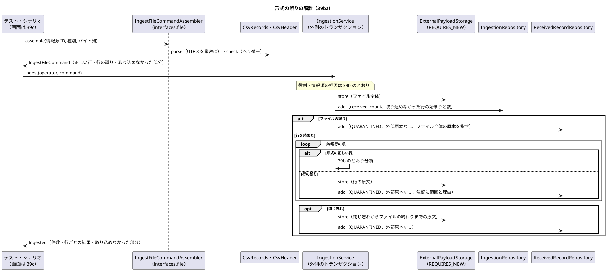
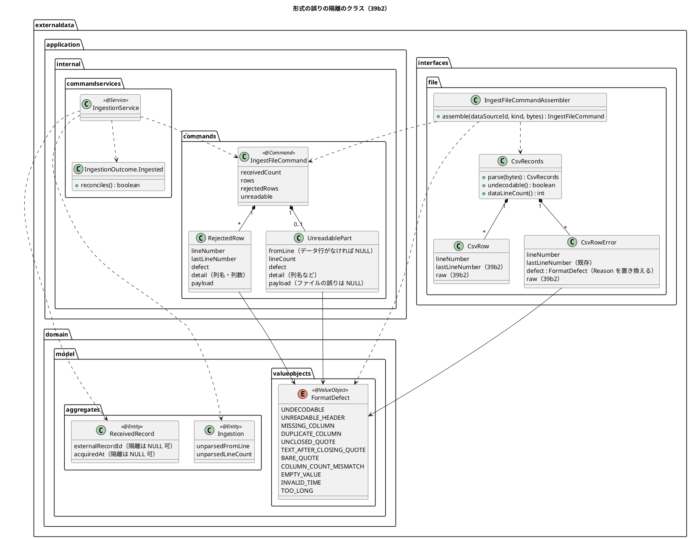
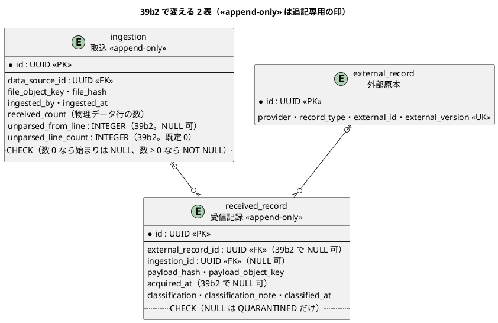

# Bolt 39b2 計画 - 形式の誤りの隔離（ファイル・行・閉じ忘れ・文字コード）と件数の突き合わせ

## 基本情報

| 項目 | 内容 |
| :--- | :--- |
| Bolt | 第 39b2 回（W7 の 6 本目。release_plan の 39b2 の行（:940）を開始準備で縦に 2 本（39b2・39b2b）に分けた 1 つ目） |
| 予定 | W7（2026-11-16 の週。前倒しで着手できる）。作業は約 4 時間（`check`・SonarQube・CI とステップごとの承認の待ちを除く） |
| アプローチ | インサイドアウト（スキーマとポート、解析、取込のサービス、組み立て、受入シナリオの順。開発戦略の W7 の行） |
| 対象 | (1) 形式の誤りの隔離: ファイルの誤り（文字コード・ヘッダーが読めない・必要な列がない・同じ名前の列）と行の誤り（列数・閉じた引用符の後の文字・引用符で囲まない値の中の引用符・空の値・取得時刻の書式・長すぎる外部 ID と外部版）を、原本を保存してからキーのない隔離の受信記録にする、(2) 引用符の閉じ忘れを取込全体の要確認にし、取り込めなかった行の範囲と数を示す、(3) 誤りの理由を業務の言葉で注記に書く（39b の隔離の注記の時刻の書式を含む）、(4) 受け取った件数と取り込んだ・誤り・取り込めなかった行の突き合わせ、(5) `CsvRecords` から `IngestFileCommand` を組み立てる処理（`interfaces.file`。application は値だけを受ける）、(6) スキーマの変更（キーのない隔離と、取込の取り込めなかった行） |
| トレース | UC-15 2a（system_usecase :523）、BR-12 の件数照合（復旧照合 US-15 の土台。照合は 39h）、US-14 AC1 のうち原本と取込履歴の関連付け（形式の誤りの行も原本を失わない）、ED-INV-02、ADR-004 の改訂の経緯の「形式の誤り」（:81）・「補償」（:79） |
| GitHub | [#18](https://github.com/k2works/practical-domain-driven-design-in-enterpris-application/issues/18)（US-14。クローズは 39h） |
| SP | 0 |
| 承認ゲート | **ステップごとに止める**（外部原本の取込。W7 の決定。release_plan :940 の「ステップごと（スキーマ）」）。データベース（キーのない隔離の CHECK、取込の列）、構造（新しいクラスと値オブジェクト、受入シナリオ）。注: 2026-11-03 の人の指示「Recommend 承認で進めて」により、各ステップの終わりで止めて推奨の案を承認として記録する（人が個別に見ていないことが分かるように「推奨のとおり（Recommend 承認の指示による）」と書く）。ステップを飛ばしたり束ねたりはしない。下の「人に諮ること」は推奨で進めず、人の回答を待つ |
| 開始準備で決めたこと | 2026-11-03、推奨のとおり（Recommend 承認の指示による。human:kakimomokuri）: (1) **キーのない隔離**: `received_record.external_record_id` を NULL 可にし、CHECK（NULL は分類が `QUARANTINED` のときだけ）を足す。取得時刻を読めない行のため `acquired_at` も同じ CHECK で NULL 可にする（確認ポイント 1）。行の誤りの受信記録は、行の原文（物理行の範囲）を payload として保存して指す。ファイルの誤り（文字コード・ヘッダーが読めない・必要な列がない・同じ名前の列）は、ファイル全体の原本（取込の `file_object_key`）を指す受信記録を 1 つ隔離で書く。理由と物理行の範囲は `classification_note` に業務の言葉で書く。代わりの案（別の表）は確認ポイント 1 で比べた、(2) **取込全体の要確認**: 解析は取込の行を書く前に終わらせ、取込の行に取り込めなかった行の始まりと数の列を持たせる（スキーマ。確認ポイント 2）。閉じ忘れの範囲の原文も保存し、キーのない隔離の受信記録を 1 つ書く（S-17 の一覧に出すため）、(3) **値の列（仮の形式。OQ-02）**: 航海は外部 ID を航海番号とし、寄港の列を 1 列持つ。主要実績は追跡番号・種類・場所・発生時刻を持つ。形は下の「値の列の仮の形式」に決め、作るのは 39b2b（(6)）。時刻はどの列も ISO 8601 のオフセット付き（確認ポイント 5）、(4) **文字コード**: UTF-8（BOM 可）だけを受け、不正なバイト列はファイルの誤りにする（確認ポイント 4）、(5) **件数の突き合わせ**: `IngestionOutcome.Ingested` で、受け取った件数 ＝ 取り込んだ行と誤りの行の物理行の数 ＋ 取り込めなかった物理行の数を示す（単位は「人に諮ること」1）、(6) **分け方**: 作業を見積もると約 5 時間 45 分で半日を超えるので縦に 2 本に分ける。39b2（この計画）は形式の誤りの隔離・閉じ忘れ・文字コード・業務の言葉・件数の突き合わせ・スキーマと、キーの列（外部 ID・外部版・取得時刻）だけの組み立て。39b2b は値の列（航海の寄港の列、主要実績の種類・場所・発生時刻・追跡番号の形式）とその検証、値の列の長さの上限、`CsvFileKind` の必要な列の追加、追跡番号の形の写しを守るテスト。release_plan の 39b2 の行を 2 本に分けて :953 の順序に足すのは計画の初稿のコミットで行う |

## Bolt ゴール

データ責任者が取り込んだファイルの形式が誤っていても原本を失わず、ファイルの誤りはファイル全体の原本を、行の誤りはその行の原文を保存してから、外部原本を持たない隔離の受信記録として理由と物理行の範囲を業務の言葉で残し、引用符の閉じ忘れは取込全体を要確認にして取り込めなかった行の範囲と数を示し、受け取った件数と突き合わせられることを、`interfaces.file` の組み立てと取込のサービスと DB の読み書きと受入シナリオで確かめる。画面は作らない（39c）。

### 開始準備で確かめたこと

- **release_plan の 39b2 の行**（:940）: 形式の誤りの隔離（ファイル・行）、値の列（航海・主要実績。仮の形式、OQ-02）の検証、閉じ忘れの要確認と取り込めなかった件数、業務の言葉、件数の突き合わせ、文字コード、`external_record_id` を NULL 可にすることを 1 本に持ち、半日を超える（:953 の「半日を超えそうな Bolt は開始準備で分ける」）。解析は `externaldata.interfaces`、application には値だけを渡す（W7 の確認ポイント 5、:903）。形式の検証に失敗した行は隔離して理由を残し、W7 は S-17 の一覧に出す（確認ポイント 6、:904）
- **前の Bolt の既知の課題**: Bolt 39b の 39b2（[終了報告](bolt_39b_report.md) :98。組み立て、形式の誤りの隔離と値の列、隔離の注記の時刻の書式（同 :67）、OQ-02 の 6 点、参照されない原本を数える仕組みと VARCHAR の上限）。Bolt 39 の 39b への申し送り（[終了報告](bolt_39_report.md) :104。値の列・閉じ忘れ・業務の言葉・突き合わせ・文字コード）と OQ-02 の 6 点（同 :105）。閉じ忘れは推測で読み直さず、範囲を示して人に判断させる（同 :92）
- **OQ-02 の 6 点**（bolt_39_report :105）: (a) 提供元が 1 ファイル 1 種別の CSV を出せるか（EDI なら変換は誰か）、(b) 外部 ID と外部版を持つか、(c) 取得時刻の意味と時差、(d) 列の名前と順は固定か、(e) 誤りの差し戻しの運用、(f) 取込の頻度と件数の目安。回答はまだない。release_plan :864 の決定（回答がなければ仮の形式で作り差し替えの Bolt を足す）と :887 の仮の形式に従う。この Bolt は問いの文面を requirements_definition の OQ-02 の注（:827）に残し、人が業務責任者に送る（確認ポイント 11）
- **解析の今の形**: `CsvRecords.parse`（:32-35）は `new String(bytes, StandardCharsets.UTF_8)`（:33）で読み、不正なバイト列を黙って置き換える（文字コードの誤りを見つけられない）。先頭の BOM（U+FEFF）は外す（:34）。閉じ忘れはファイルの終わりまでを 1 つの誤りにする（:123）。`CsvRow`（:11）は始まりの行と値だけを持ち、終わりの行と原文を持たない。`CsvRowError`（:13）は終わりの物理行（`lastLineNumber`）を既に持ち、原文を持たない。`CsvRowError.Reason`（:28-37）は 4 つ、`CsvHeader.Reason`（:69-76）は 3 つ。`CsvFileKind`（:10-12）の必要な列は航海が外部 ID・外部版・取得時刻、主要実績がそれに追跡番号
- **取込のサービスの今の形**: `IngestionService`（:76-96）は形式の正しい行だけを受け、行ごとに原本を保存してから分類する（:115-141）。隔離の注記は `Instant` の `toString` をそのまま埋める（:46・:147）。`ReceivedRecord`（:40）と `IngestionOutcome.RowResult`（:49）は外部原本 ID を必須にしている。`IngestFileCommand`（:20）は形式の正しい行の並びと受け取った件数だけを持つ
- **スキーマ**: マイグレーション `V20261103100000__create_external_data_records.sql` の受信記録（:75-91）は `external_record_id`（:77）・`acquired_at`（:81）が NOT NULL、`ingestion_id`（:78）は NULL 可、`classification_note` は `VARCHAR(1000)`（:83）。外部原本の `external_id` は `VARCHAR(200)`（:56）、`external_version` は `VARCHAR(100)`（:57）。取込の `received_count` は NOT NULL（:38）。受信記録と取込は追記専用（`V20261103130000`）
- **data_model**: 取込の制約（:1142。「39b2 で形式の誤りの行が受信記録にならなくなっても意味を変えない」）、受信記録の制約（:1145）、ER 図の取込（:1013-1022）・受信記録（:1041-1052）・関連（:1126-1127）、原本の注（:1151）。値の列の行き先は `routing.voyage`（:461-470）・`routing.port_call`（:471-478。`port_unlocode CHAR(5)`、到着・出発は NULL 可）・`tracking.milestone`（:650-662。`kind`・`location_unlocode CHAR(5)`・`occurred_at`）、`milestone.kind` の 6 値（:770）
- **domain_model**: 用語集の受信記録（:318）・取込（:320）・隔離（:331。「形式を検証できないファイルと行（UC-15 2a）」を含む）、要素表の取込（:1481）・受信記録（:1483）、DE-12（:1642。航海番号・採用値）・DE-13（:1643。追跡番号・実績）、航海（:140）・寄港（:144）・主要実績（:173）
- **ADR-004**: 形式の誤りも原本を保存したうえで隔離する（:81）、解析は `interfaces.file`（:82）、受信記録から参照されない原本は照合で数える（:79）
- **層の規則**: interfaces はほかの層から参照できない（LayerArchitectureTest :85-86）。interfaces は application と domain を参照してよい（:87-90）ので、`interfaces.file` の組み立てが `application.internal.commands` のコマンドを作れる。interfaces はリポジトリを直接使わない（:243）。外部データのインフラストラクチャ層の外は `java`・`externaldata`・`shared`・`org.springframework` だけ（ModularityTest :107-121）なので、UN/LOCODE は `shared.domain.Location`（:14 の形）を使えるが、追跡の `TrackingNumber`（`tracking.domain.model.valueobjects.TrackingNumber` :16）と `MilestoneKind`（:7-19）は参照できない（39b2b で扱う）
- **時刻の表示の前例**: 社内の画面は「2026-10-05 10:00 Asia/Tokyo（UTC+09:00）（UTC 2026-10-05 01:00）」（`platform.web.DateTimeDisplay` :29-31）。`platform.web` は画面の層からだけ参照する（LayerArchitectureTest :301-305）ので、注記の文言は外部データの中で作る
- **要件**: US-14 の受入条件（user_story :558-562）に形式の誤りの行はなく、UC-15 2a（system_usecase :523）が出典になる。シナリオの置き場所は `external_data/`（test_strategy :141）

## 設計の決定（案）

| 項目 | 決定 | 根拠 |
| :--- | :--- | :--- |
| キーのない隔離（スキーマ） | common の新しい版で `received_record.external_record_id` と `acquired_at` を NULL 可にし、CHECK `ck_received_record_keyless_quarantine`（`classification = 'QUARANTINED' OR (external_record_id IS NOT NULL AND acquired_at IS NOT NULL)`）を足す。新しい列に `COMMENT ON COLUMN` を付け直す（SchemaCommentIntegrationTest）。既存の 2 列の COMMENT（外部原本 ID :98・取得時刻 :102）に「隔離は NULL 可」を足し、`received_count` の COMMENT（:50 の「受信件数」）に物理データ行の数であることを書く。H2 と PostgreSQL が同じ `ALTER COLUMN ... DROP NOT NULL` を受けるかをステップ 2 の Red で確かめ、受けなければ vendor の場所に分ける | 確認ポイント 1、開始準備の決定 (1) |
| 取り込めなかった行（スキーマ） | 同じ版で `ingestion` に `unparsed_from_line INTEGER`（NULL 可）と `unparsed_line_count INTEGER NOT NULL DEFAULT 0` を足し、CHECK（`(unparsed_line_count = 0 AND unparsed_from_line IS NULL) OR (unparsed_line_count > 0 AND unparsed_from_line IS NOT NULL)`）を足す。取込の行を書くときに入れ、更新しない（追記専用のまま）。取込全体の要確認は「取り込めなかった物理行の数（`unparsed_line_count`）> 0、またはファイルの誤りの隔離の受信記録がある」と定める（列は足さない）。ファイルの誤りのときの 2 列は、データ行がなければ `unparsed_from_line` を NULL、`unparsed_line_count` を 0 にし（0 バイト・BOM だけ・ヘッダーだけで列が足りない。要確認はファイルの誤りの受信記録で表す）、データ行があれば最初のデータ行と受け取った件数のすべてにする（推奨のとおり。Recommend 承認の指示による） | 確認ポイント 2 |
| ポートが受け渡す型 | `ReceivedRecord` の `externalRecordId` と `acquiredAt` を NULL 可にし、コンストラクタで「NULL は隔離だけ」を確かめる（表の CHECK と同じ規則）。`Ingestion` に取り込めなかった行（始まりと数）を足す。追記専用のポートに更新・削除のメソッドを足さない | ED-INV-02、確認ポイント 1・2 |
| 形式の誤りの理由 | `externaldata.domain.model.valueobjects.FormatDefect`（形式の誤り。`@ValueObject` の enum。Javadoc は「形式の誤り」で始める）に理由を置き、業務の言葉の注記を作る関数を持たせる。値: 文字コード（`UNDECODABLE`）・ヘッダーが読めない（`UNREADABLE_HEADER`）・必要な列がない（`MISSING_COLUMN`）・同じ名前の列（`DUPLICATE_COLUMN`）・引用符の閉じ忘れ（`UNCLOSED_QUOTE`）・閉じた引用符の後の文字（`TEXT_AFTER_CLOSING_QUOTE`）・引用符で囲まない値の中の引用符（`BARE_QUOTE`）・列数の違い（`COLUMN_COUNT_MISMATCH`）・空の値（`EMPTY_VALUE`）・時刻の書式（`INVALID_TIME`）・長すぎる値（`TOO_LONG`）。`CsvRowError.Reason`・`CsvHeader.Reason` はこの値に置き換え、解析・ヘッダーの検証・組み立てが `FormatDefect` を直接持つ（interfaces は domain を参照してよい。LayerArchitectureTest :89-90。application は interfaces の型を受けられない。:85-86）。同じ値の enum が 3 つ並び、写す処理が要る形を避ける。理由の名前は Bolt 39 で決めた名前（`UNCLOSED_QUOTE`・`TEXT_AFTER_CLOSING_QUOTE`・`BARE_QUOTE`・`COLUMN_COUNT_MISMATCH`・`MISSING_COLUMN`・`DUPLICATE_COLUMN`・`UNREADABLE_HEADER`）を変えない（推奨のとおり。Recommend 承認の指示による） | 確認ポイント 6・7 |
| 注記の文言 | 「<物理行の範囲>: <理由>。<どうすればよいか>」の形。例: 「12 行目: 列の数がヘッダーと違います（ヘッダー 4 列、この行 5 列）。」「12 行目からファイルの終わり（40 行目）まで: 引用符が閉じていないため、29 行を取り込めませんでした。ファイルを確かめてください。」「ファイル: 文字コードが UTF-8 ではありません。UTF-8 で保存し直したファイルを取り込んでください。」「ファイル: 必要な列がありません（tracking_number）。」。時刻は「2026-11-03 04:25:15 UTC」（秒まで、UTC と明記）。39b の隔離の注記（`IngestionService` :46・:147）もこの書式にそろえる。1000 文字（`classification_note` の上限）を超える注記は末尾を「…」で切る | 確認ポイント 6、bolt_39b_report :67 |
| 渡す値 | `IngestFileCommand` に、行の誤りの並び `rejectedRows`（入れ子の record `RejectedRow`: 物理行の始まりと終わり、形式の誤り、注記の詳細（列名・列数）、原文のバイト列）と、取り込めなかった部分 `unreadable`（入れ子の record `UnreadablePart`: 始まりの行、物理行の数、形式の誤り、注記の詳細（列名など）、原文のバイト列。ファイルの誤りは原文を持たずファイル全体の原本を指し、データ行がなければ始まりは NULL で数は 0。取り込めなかった部分がなければ `unreadable` は NULL）を足す。形式の正しい行 `IngestedRow` に終わりの物理行を足す。値の列は 39b2b で `IngestedRow` に足す | W7 の確認ポイント 5、開始準備の決定 (1)・(2) |
| 解析の変更 | `CsvRecords.parse` は `CharsetDecoder`（`CodingErrorAction.REPORT`）で UTF-8 を厳密に読み、読めなければ文字コードの誤りを持つ `CsvRecords` を返す（BOM は今のとおり外す。UTF-16 の BOM は不正なバイト列として誤りになる）。`CsvRow` に終わりの物理行と原文、`CsvRowError` に原文だけを足す（`CsvRowError` は `lastLineNumber` を既に持つ。:10・:13）。原文はレコードの始まりから終わりまで（最後の行末の改行を除く。引用符の中の改行は含む）。物理データ行の数（ヘッダーの後の物理行のうち、レコードの外の空行を除いた数）を `CsvRecords` が返す。文字コードの誤りのときは、バイト列の最初の LF までをヘッダーとし、その後を空行は除いて LF で数える。閉じた引用符の後の文字・引用符で囲まない値の中の引用符の行を読み飛ばす途中で、引用符が閉じないままファイルの終わりまで飲み込んだら、閉じ忘れと同じく取り込めなかった部分（その行の始まりからファイルの終わりまで）にし、取込全体を要確認にする（行 6b。推奨のとおり。Recommend 承認の指示による） | 確認ポイント 3・4、Bolt 39b の確認ポイント 3 |
| 組み立て | `externaldata.interfaces.file.IngestFileCommandAssembler`（解析とヘッダーの検証の結果から `IngestFileCommand` を作る。Spring に依存しない関数）。キーの列（外部 ID・外部版・取得時刻）を検証し、空（空白だけの値も空とみなす。値は加工しない）・長すぎる（外部 ID 200 文字、外部版 100 文字。マイグレーション :56-57）・時刻の書式の誤りは行の誤りにする。原文は UTF-8 のバイト列にして渡す。リポジトリは使わない（LayerArchitectureTest :243） | W7 の確認ポイント 5、確認ポイント 8 |
| 処理の順 | 39b の順（役割 → 情報源 → ファイル全体の原本 → 取込の行）は変えない。取込の行に取り込めなかった行の列を入れる。次に物理行の順に、形式の正しい行は 39b のとおり分類し、行の誤りは原文を保存してからキーのない隔離の受信記録を書く。ファイルの誤りは行を読まず、ファイル全体の原本を指すキーのない隔離の受信記録を 1 つ書く。閉じ忘れは、その前の行を処理した後に範囲の原文を保存し、キーのない隔離の受信記録を 1 つ書く | ADR-004 :78（保存に成功するまで受信記録を書かない）、開始準備の決定 (2) |
| 同じキーの誤りの行と正しい行 | 誤りの行は冪等性キーで外部原本を引かず、作らない（キーを信用できないため）。正しい行は誤りの行の前後によらず 39b のとおり分類する | ED-INV-02 |
| 件数の突き合わせ | `IngestionOutcome.Ingested` に取り込めなかった部分（始まり・物理行の数・受信記録 ID）と行ごとの終わりの物理行を足し、`RowResult` の外部原本 ID を NULL 可にする（キーのない隔離）。「受け取った件数 ＝ 行の結果（形式の正しい行と行の誤り）の物理行の数の合計 ＋ 取り込めなかった物理行の数」を確かめる関数 `reconciles()` を持たせる。ファイルの誤りと閉じ忘れの受信記録は行の結果に入れず、取り込めなかった部分として返す。分類別の件数は今のとおり受信記録から数える（キーのない隔離を含む）。分類別の件数（受信記録の数）と `received_count`（物理行の数）は単位が違い、突き合わせは物理行で行う | 確認ポイント 9、人に諮ること 1 |
| 参照されない原本 | 数え方を data_model に書く（`stored_payload` のオブジェクトキーのうち、`ingestion.file_object_key` と `received_record.payload_object_key` のどちらからも参照されないもの。W10 の S3 では一覧と突き合わせる）。作るのは照合を作る Bolt（39h）。この Bolt は巻き戻った取込の原本が参照されずに残ることを統合テストで確かめる | ADR-004 :79、確認ポイント 10 |
| 用語集 | domain_model の用語集に、形式の誤り `FormatDefect`、取込の組み立て `IngestFileCommandAssembler` を足す。隔離（:331）にキーのない隔離、取込（:320）に取り込めなかった行と要確認、取込の結果（:326）に取り込めなかった部分と `reconciles()`、受信記録（:318）の定義をキーのない隔離に合わせ（外部原本を持たない隔離を含む）、原本のオブジェクトキー（:334）にファイルの誤りの受信記録が `externaldata/ingestions/{UUID}` のキーを指すことを書く。コードの `Classification` の隔離の Javadoc（:17）も形式の誤りを含めて直す | LivingGlossaryConsistencyTest |
| 受入シナリオ | `src/test/resources/features/external_data/quarantine_malformed_records.feature`。Feature に `@US-14`・`@must`、シナリオに `@BR-12`（件数の突き合わせ）と `@ED-INV-02`。UC-15 2a はシナリオの説明に書く（タグの形は AcceptanceCriteriaCoverageTest の許す形に合わせ、ステップ 6 で確かめる）。ステップ定義は `externaldata.acceptance` の新しいクラス（例 `ExternalRecordFormatErrorSteps`）に分ける（39b の `ExternalRecordIngestionSteps` は既に 209 行）。シナリオは CSV のバイト列から組み立てを通して取り込む | test_strategy :141、確認ポイント 12 |

### 値の列の仮の形式（OQ-02。作るのは 39b2b）

| 種別 | 列 | 形と検証 | 行き先（data_model） |
| :--- | :--- | :--- | :--- |
| 航海 `VOYAGE` | `external_id` | 航海番号。1〜30 文字（`voyage_number VARCHAR(30)`） | `routing.voyage`（:461-470） |
| 航海 | `port_calls` | 寄港ごとに `\|` で区切り、寄港の中は `;` で区切った「UN/LOCODE;到着;出発」。到着・出発は空を許す（:476-477 の NULL 可）。寄港は 1 つ以上。時刻は下の書式。到着が出発より後なら行の誤り。例: `JPTYO;;2026-11-20T08:00:00+09:00\|USLAX;2026-12-01T06:00:00-08:00;` | `routing.port_call`（:471-478） |
| 主要実績 `MILESTONE` | `tracking_number` | 追跡番号の形（`CT` と英大文字・数字 12 桁。追跡の型は参照できないので外部データの中で同じ形を確かめる） | `tracking.milestone.tracking_number`（:651） |
| 主要実績 | `kind` | `PICKUP`・`RECEIPT_AT_ORIGIN`・`DEPARTURE`・`TRANSSHIPMENT`・`ARRIVAL`・`DELIVERY`（:770） | `milestone.kind`（:654） |
| 主要実績 | `location_unlocode` | UN/LOCODE（`shared.domain.Location`） | `milestone.location_unlocode`（:655） |
| 主要実績 | `occurred_at` | 下の書式 | `milestone.occurred_at`（:656） |
| 両方 | `acquired_at` | 下の書式（この Bolt で作る） | `received_record.acquired_at` |

時刻の書式: ISO 8601 のオフセット付き（例 `2026-11-20T08:00:00+09:00`、`2026-11-19T23:00:00Z`）。秒と小数は省略可、オフセットのない値は行の誤り（時差の意味は OQ-02 の (c) で確かめるまで推測しない）。マイクロ秒より細かい桁は切り捨てる（`ClockConfiguration` と PostgreSQL の精度にそろえる）。この形は OQ-02 の回答が届くまでの仮の形式で、回答が届いたら差し替えの Bolt を足す（release_plan :887）。

## ふりかえりと前の Bolt からの引き継ぎ

| 出典 | 内容 | この Bolt での扱い |
| :--- | :--- | :--- |
| W6 の Try T-204・T-212、Bolt 38h の T-227、Bolt 39b の T-233 | サブエージェントへの指示の最初に heredoc（`<<`）と標準入力を待つコマンドを使わないと書く（39b でも 2 回再発した。仕組みで守る案は W7 の締め） | 任せるときの指示の最初に書く。ファイルは Write・Edit で書く |
| W6 の Try T-217 | 本体を直す前に Red を流し、落ちた理由を記録する | ステップ 2〜6 の各 Red（落ちた理由をステップの記録に書く） |
| W6 の Try T-225・T-213 | push の前に `check` | ステップ 7 |
| W6 の Try T-182・T-211・T-216、Bolt 39 の T-228 | 状態の組み合わせの表に重複・隔離と出口・誤った入力の行を置く。解析器の表には各誤りの「後」に来る入力（改行を含む値、空行、ファイルの終わり）の行を置く | 下の表（行 1〜22。5b・6b を含む） |
| W6 の Try T-219 | 変異の対象に単体・統合・契約のテスト | 下の変異の表 |
| W6 の Try T-191 | 環境の前提に設定ファイルの行を添える | H2 は PostgreSQL 互換モード（application-dev.properties :2）、マイグレーションの場所は common と vendor（同 :6）。統合テストの PostgreSQL は `TestcontainersConfiguration` :14-15（`postgres:18.6`）。時刻は ClockConfiguration :17-23（UTC、マイクロ秒に切り捨て） |
| W6 の Try T-215・T-222 | Gradle を流す担当を 1 つに、計画の初稿を先にコミット | Gradle は人の側の 1 か所で流す。初稿（release_plan の 39b2 の行の分割を含む）をコミットしてから実装に入る |
| Bolt 39a2 の T-229 | 永続化の Bolt の状態の組み合わせに時刻の出どころと同時の書き込みの行を置く | 行 20（注記の時刻）、時刻は 39b のとおり Clock から 1 回取る。同時の書き込みは 39b の行 9b から変えない |
| Bolt 39a3 の T-230 | 入ることを確かめる行のデータはドメインの規則に合う組み合わせにする | 主要実績の行は追跡番号の形（`CTABCDEFGH2345` など）、航海の行は持たない。取得時刻は取込時刻より前。情報源は `APPROVED` |
| Bolt 39b の T-231 | `@Transactional` は契約のクラスに付ける。継ぐ側だけに付けない | ステップ 2 の契約のテスト（キーのない隔離と取込の列の往復）は契約のクラスに付けたまま足す |
| Bolt 39b の T-232 | 本体のクラスを足したステップは、承認の前に `spotbugsMain` を流す | ステップ 2〜5 の完了の判定に入れる |

## 状態の組み合わせ（行ごとにテストを 1 本。T-182）

単体は解析（`CsvRecordsTest`）、組み立て（`IngestFileCommandAssemblerTest`）、取込のサービス（`IngestionServiceTest`。メモリの実装と固定の Clock）で確かめる。契約は受信記録と取込のポートの契約（`ExternalDataRecordRepositoriesContract`）を、メモリ・H2・PostgreSQL の実装で継ぐ。スキーマは `ExternalDataSchemaIntegrationTest`。統合は PostgreSQL（`ExternalDataIngestionIntegrationTest`。提供元の名前に自分の UUID を含めて絞る）。テストの名前は「行 N_」で始める。

| 行 | 状況 | 期待 | 確かめ方 |
| :--- | :--- | :--- | :--- |
| 1 | ヘッダーが読めない（ヘッダーの中の閉じた引用符の後の文字・引用符で囲まない値の中の引用符） | ファイルの誤り。ファイル全体の原本を指すキーのない隔離 1 件、注記「ファイル: ヘッダーを読めません」、行は読まない。取込の取り込めなかった行は、データ行があれば最初のデータ行と受け取った件数のすべて、なければ NULL と 0。ファイルの誤りの受信記録があるので要確認 | 単体（組み立て・サービス） |
| 2 | 必要な列がない（航海の `acquired_at` がない）、同じ名前の列 | ファイルの誤り。注記に列名。行は読まない | 単体（組み立て）、Cucumber |
| 3 | 主要実績に追跡番号の列がない | ファイルの誤り（`MISSING_COLUMN`、`tracking_number`） | 単体（組み立て） |
| 4 | 列数の違う行（多い・少ない） | その行だけ行の誤り。原文を保存してからキーのない隔離、ほかの行は分類 | 単体（組み立て）、Cucumber |
| 5 | 引用符の閉じ忘れ（中ほどの行で。後の行を飲み込む） | 前の行は分類する。閉じ忘れの行からファイルの終わりまでの原文を保存し、キーのない隔離 1 件。取込の取り込めなかった行の始まりと数を書き、要確認。後の行は推測で読み直さない | 単体（解析・組み立て・サービス）、統合（取込の列の往復）、Cucumber |
| 5b | 閉じ忘れが最初のデータ行・最後の行（改行なし）・ヘッダー | 最初のデータ行: 全データ行を取り込めない。最後の行: 1 行。ヘッダー: 行 1 のファイルの誤り | 単体（解析・組み立て） |
| 6 | 閉じた引用符の後の文字、その後に改行を含む値の行と空行（T-228） | その行だけ行の誤り。後の行は読む。行の範囲は引用符の対応を追った終わりまで | 単体（解析・組み立て） |
| 6b | 閉じた引用符の後の文字・引用符で囲まない値の中の引用符の行を読み飛ばす途中で、引用符が閉じないままファイルの終わりまで飲み込む | 閉じ忘れ（行 5）と同じく、その行の始まりからファイルの終わりまでを取り込めなかった部分にし、原文を保存してキーのない隔離 1 件、取込の取り込めなかった行の始まりと数を書き、要確認。前の行は分類する | 単体（解析・組み立て・サービス） |
| 7 | 引用符で囲まない値の中の引用符 | その行だけ行の誤り | 単体（解析・組み立て） |
| 8 | キーの列の検証の失敗: 取得時刻にオフセットがない・日付として誤り（`2026-02-30T…`） | 行の誤り（`INVALID_TIME`）。注記に列名 | 単体（組み立て） |
| 9 | 空の値（外部 ID・外部版・取得時刻が空、空白だけ） | 行の誤り（`EMPTY_VALUE`）。空白だけの値も空とみなす。空でない値は加工しない（前後の空白を外さずに渡す。原本を加工しない） | 単体（組み立て） |
| 10 | 空のファイル（0 バイト、BOM だけ、ヘッダーだけ、ヘッダーだけで列が足りない、ヘッダーの閉じ忘れ） | 0 バイト・BOM だけ・ヘッダーだけで列が足りない: ファイルの誤り（必要な列がない）。受け取った件数 0、取込の取り込めなかった行は NULL と 0、ファイル全体の原本を指すキーのない隔離 1 件があるので要確認。ヘッダーだけ（列はそろう）: 39b の行 12 のとおり件数 0・受信記録なし・要確認でない。ヘッダーの閉じ忘れ: ヘッダーが読めないファイルの誤り（行 1）。データ行があれば最初のデータ行と受け取った件数のすべて、なければ NULL と 0、要確認 | 単体（組み立て・サービス） |
| 11 | UTF-8 の BOM 付きのファイル | BOM を外して読み、行の原文に BOM を含めない。ファイル全体の原本は BOM を含むまま保存する | 単体（解析・組み立て） |
| 12 | Shift_JIS の日本語を含むファイル、UTF-16 の BOM、途中で切れた UTF-8 | ファイルの誤り（`UNDECODABLE`）。ファイル全体の原本を指すキーのない隔離 1 件、要確認。受け取った件数は、最初の LF までをヘッダーとし、その後を空行は除いて LF で数える。取込の取り込めなかった行は最初のデータ行と受け取った件数のすべて | 単体（解析・組み立て・サービス）、Cucumber（Shift_JIS） |
| 13 | 形式の正しい行と誤りの行の混在 | 行の結果は物理行の順。正しい行は採用・重複・隔離、誤りの行はキーのない隔離 | 単体（サービス）、Cucumber |
| 14 | 同じキーの誤りの行と正しい行（誤りが先・後） | 誤りの行は外部原本を引かず作らない。正しい行は順によらず採用 | 単体（サービス） |
| 15 | 件数の突き合わせ（引用符の中の改行を含む行、レコードの外の空行、閉じ忘れを含む） | 受け取った件数 ＝ 行の結果の物理行の数の合計 ＋ 取り込めなかった物理行の数（`reconciles()` が真）。空行は数えない | 単体（解析・サービス）、統合 |
| 16 | 誤りの行の原本の保存に失敗する | その行の受信記録を書かず、例外のまま上げて取込全体を巻き戻す（39b の行 8 と同じ） | 単体（失敗する保存の偽物） |
| 17 | VARCHAR の上限: 外部 ID 201 文字・外部版 101 文字、注記が 1000 文字を超える（長い列名の並び） | 外部 ID・外部版は行の誤り（`TOO_LONG`）。注記は 1000 文字で切る | 単体（組み立て・サービス）、契約（1000 文字の注記の往復） |
| 18 | キーのない隔離の CHECK | 外部原本 ID・取得時刻が NULL の受信記録は隔離なら入り、採用・重複なら制約の違反 | 契約（往復。H2 は契約を継ぐ `H2ExternalDataRecordRepositoriesTest` で CHECK も確かめる）、スキーマ（PostgreSQL の CHECK。`ExternalDataSchemaIntegrationTest`） |
| 19 | 取込の取り込めなかった行の CHECK | 始まりと数の組み合わせが CHECK に反すれば制約の違反。既存の行は数 0 になる | 契約（H2 は `H2ExternalDataRecordRepositoriesTest`）、スキーマ（PostgreSQL。`ExternalDataSchemaIntegrationTest`） |
| 20 | 注記の時刻の書式（39b の隔離の注記） | 「2026-11-03 04:25:15 UTC」の形 | 単体（サービス・固定の Clock） |
| 21 | 巻き戻った取込の原本 | 外側が巻き戻ると、行の誤りの原文の原本は残り、受信記録からも取込からも参照されない（参照されない原本の数え方の確かめ） | 統合（PostgreSQL） |
| 22 | 層の規則 | application は `interfaces.file` を参照しない。組み立てはリポジトリを使わない。`FormatDefect` は用語集にある | LayerArchitectureTest、ModularityTest、LivingGlossaryConsistencyTest |

### 39b2b に送る行（値の列）

| 行 | 状況 | 期待 | 確かめ方 |
| :--- | :--- | :--- | :--- |
| b1 | UN/LOCODE の形の誤り（小文字・4 文字・数字 1） | 行の誤り | 単体（組み立て） |
| b2 | 発生時刻・寄港の到着・出発の書式の誤り、到着が出発より後 | 行の誤り | 単体（組み立て） |
| b3 | 種類が 6 値の外 | 行の誤り | 単体（組み立て） |
| b4 | 追跡番号の形の誤り | 行の誤り | 単体（組み立て）、Cucumber |
| b5 | 寄港の列の形（寄港が 0、区切りの数の違い、空の寄港） | 行の誤り | 単体（組み立て） |
| b6 | 航海番号が 31 文字、値の列の長さの上限 | 行の誤り | 単体（組み立て） |

## スコープ

### 入れるもの

- 行 1〜22（5b・6b を含む）のテスト、解析の変更、組み立て、形式の誤り、取込のサービスの変更、ポートと MyBatis の実装の変更、受入シナリオ
- マイグレーション: キーのない隔離と取込の取り込めなかった行（common の新しい版。確認ポイント 1・2）
- 文書: 下の「設計文書に直す箇所」（ステップ 1）

### 入れないもの

- 値の列とその検証、値の列の長さの上限、`CsvFileKind` の必要な列の追加、追跡番号の形の写し（外部データの中の形）が追跡の `TrackingNumber` と同じであることを守るテスト（39b2b）
- 参照されない原本を数える照会（39h。数え方の記述と行 21 だけ入れる）
- 採用値、DE-12・DE-13・DE-14、`domain.events`、identity の監査の listener（DE-14 の隔離のイベントにキーのない隔離を含めるかは 39b3 で決める）、外部原本のポートの約束の技術の例外（39b3）
- PERF-06、分類ごとの件数のクエリを 1 本にすること（39b4）
- 画面（取込の入口 S-16 と、取り込めなかった行・注記の表示は 39c、S-17 は 39d）、データ責任者への通知（W9）
- 誤りの理由を表の列（理由の符号）で持つこと（39c・39d で一覧の絞り込みが要れば足す）
- キーのない隔離の判断（既知の課題。39d の開始準備の論点）: キーのない隔離は外部原本も冪等性キーも持たないので採用値を作れない。判断は却下と再送だけか、を 39d の開始準備で決める（release_plan の 39d の行に注を足した。推奨のとおり。Recommend 承認の指示による）

### 設計文書に直す箇所（ステップ 1）

- release_plan: 39b2 の行（:940）を 39b2・39b2b に分けて :953 の順序に足すのは初稿のコミットで済ませ、39b2b の行の範囲（`CsvFileKind` の必要な列・値の列の長さの上限・追跡番号の形の写しを守るテスト）と 39d の行の注（キーのない隔離の判断）は計画の承認で足した。ステップ 1 は更新履歴だけ。確認ポイント 6（:904）に「形式の誤りの受信記録は外部原本を持たない（Bolt 39b2）」の注
- 開発戦略 :350（W7 の行の 39b2 の説明「形式の誤りの隔離と値の列」から値の列を外し、39b2b（値の列。Bolt 39b2 の開始準備で 39b2 から分けた）を足す）
- data_model: ER 図の受信記録（:1044 の `external_record_id`、:1048 の `acquired_at` を NULL 可に）・取込（:1013-1022 に 2 列）・関連（:1127 を外部原本が 0 か 1 に）、取込の制約（:1142。「形式の誤りの行が受信記録にならなくなっても」を「形式の誤りの行はキーのない隔離の受信記録になる」に直し、「形式の誤りのない範囲では分類別の合計が `received_count` と一致し」の文を「分類別の件数と `received_count` は単位が違い（受信記録の数と物理行の数）、突き合わせは物理行で行う」に書き換え、取り込めなかった行の列と CHECK、要確認の意味（取り込めなかった物理行の数 > 0、またはファイルの誤りの隔離の受信記録がある））、受信記録の制約（:1145。CHECK、ファイルの誤りの受信記録は取込の `file_object_key`（`externaldata/ingestions/{UUID}` のキー）を指す注）、原本の注（:1151）に参照されない原本の数え方。Bolt 39b の計画の文面は履歴なので直さない
- 「件数」に「物理行」の注を足す（人に諮ること 1 の決定）: user_story の US-15 の受信件数との照合（:577-578）、system_usecase の UC-15 6a（:528）、requirements_definition の BR-12（:733）、non_functional の PERF-06（:62）、domain_model の復旧照合の受信件数（:338・:1488）。`received_count` の COMMENT はステップ 2 のマイグレーションで直す
- domain_model: 隔離（:331）、取込（:320・:1481）、受信記録（:318・:1483）に外部原本を持たない隔離（:318 の「外部原本を受け取るたびの」の定義をキーのない隔離に合わせる）、取込の結果（:326）に取り込めなかった部分と `reconciles()`、原本のオブジェクトキー（:334）にファイルの誤りの受信記録が `externaldata/ingestions/{UUID}` のキーを指す注、用語集に形式の誤り・取込の組み立て
- requirements_definition の OQ-02 の注（:827）: 6 点の問いの文面、時刻の書式、UTF-8、値の列の仮の形式（上の表）
- system_usecase :523: 形式の誤りの受信記録は外部原本を持たない、閉じ忘れは取込全体の要確認
- architecture_backend :454: 組み立て（`IngestFileCommandAssembler`）の置き場所
- ADR-004: 改訂の経緯に Bolt 39b2 の項（形式の誤りの受信記録は外部原本を持たず、ファイルの誤りはファイル全体の原本を指す。参照されない原本の数え方と、作るのは 39h）。決定は変えない
- コードのコメント（触るステップで直す）: `CsvFileKind` :6、`interfaces/file/package-info` :2-3、`CsvRowError` :6-7、`CsvHeader` :9、`ReceivedRecord` :14、`IngestFileCommand` :11-12・:63-64、`Classification` の隔離 :17（形式の誤りの隔離を含める）

## 設計（この Bolt の範囲）

- 状態遷移図: 受信記録は分類を一度だけ持ち変えず、取込も書いた後に変えない（どちらも追記専用）ので省く。取込全体の要確認は取り込めなかった行の数から導く値で、状態として遷移しない
- 画面遷移図: 画面を作らないので省く（取込の入口 S-16 は 39c、S-17 は 39d）

## ステップ計画（ステップごとに止める）

- [x] **1. 設計の文書**（2026-11-03、推奨のとおり承認として記録した（Recommend 承認の指示による。human:kakimomokuri）。取込の CHECK の名前はステップ 2 で決めて ER 図にそろえる）: 上の「設計文書に直す箇所」（完了の判定: 文書の差分。**承認ゲート**）
- [x] **2. スキーマとポート（Red → Green）**（2026-11-03、推奨のとおり承認として記録した（Recommend 承認の指示による。human:kakimomokuri）。Red はコンパイルの誤りと、コンポーネントだけを足したときの 22 本（規則がない・列がない・NOT NULL の違反・COMMENT）。マイグレーションは common の 1 版、CHECK は `ck_received_record_keyless_quarantine`・`ck_ingestion_unparsed_lines`。`ReceivedRecord` の型の規則のテストは契約のクラスに置いた。spotbugsMain は指摘なし）: 行 18・19 のスキーマのテストと、キーのない隔離・取込の取り込めなかった行の往復の契約のテスト（`@Transactional` は契約のクラスに。T-231）を先に書いて落ちることを確かめ（落ちた理由を記録する。T-217）、common の新しい版、`ReceivedRecord`・`Ingestion` とメモリ・MyBatis の実装を直す（完了の判定: 緑、`spotbugsMain`（T-232）。**承認ゲート**（データベース））
- [ ] **3. 解析（Red → Green）**: 行 5b・6・6b・10〜12・15 の解析の単体のテストを先に書き、厳密な UTF-8、終わりの物理行と原文、物理データ行の数を作る（完了の判定: 緑、`spotbugsMain`。**承認ゲート**）
- [ ] **4. 形式の誤りと取込のサービス（Red → Green）**: 行 1・5・6b・10・12〜17・20 のサービスの単体のテストを先に書き、`FormatDefect`、コマンドと結果の型の変更、キーのない隔離の受信記録、取込の取り込めなかった行、注記の文言、`reconciles()` を作る（完了の判定: 緑、`spotbugsMain`。**承認ゲート**（構造: 新しい値オブジェクト、コマンドと結果の型））
- [ ] **5. 組み立て（Red → Green）**: 行 1〜12（5b・6b を含む）・17 の組み立ての単体のテストを先に書き、`IngestFileCommandAssembler` を作る（完了の判定: 緑、`spotbugsMain`。**承認ゲート**（構造: 新しいクラス））
- [ ] **6. 統合と受入シナリオ（Red → Green）**: 行 5・15・21 の統合テストと、`features/external_data/quarantine_malformed_records.feature`（必要な列がない、列数の違う行と正しい行の混在、閉じ忘れの要確認と件数、Shift_JIS）とステップ定義、行 22 の規則の確かめ（完了の判定: 緑。**承認ゲート**（構造: 受入シナリオ））
- [ ] **7. 品質ゲートと開発レビュー**: 変異、`check`、その後に SonarQube、開発レビューとその直し。push の前に `check`
- [ ] **8. 終了報告**: push して CI とデモ環境の配備を確かめる（デモ環境にスキーマの版が入る）。release_plan・開発の索引・mkdocs を直す。見える振る舞いは変わらないので、マニュアルは直さない（39c で新しい章）

### 時間の配分と打ち切り

| # | 目安 | 打ち切り |
| :--- | :--- | :--- |
| 1 | 25 分 | — |
| 2 | 35 分 | H2 と PostgreSQL で `DROP NOT NULL` の書き方が違い vendor に分けるなら、その分の 10 分を足す |
| 3 | 35 分 | — |
| 4 | 45 分 | — |
| 5 | 45 分 | ステップ 5 の開始で合計 2 時間 30 分を超えていたら、行 17 の外部版の上限と行 9 の空白だけの値を 39b2b に送る |
| 6 | 30 分 | ステップ 6 の開始で合計 3 時間 30 分を超えていたら、Shift_JIS のシナリオを単体だけにする（統合テストは残す） |
| 7 | 20 分（待ちを除く） | — |
| 8 | 10 分（CI の待ちを除く） | — |

合計 245 分（約 4 時間）。分ける前の見積り（値の列を含む）は約 345 分（約 5 時間 45 分）で、39b2b は約 100 分（組み立ての値の検証 50 分、受入シナリオ 15 分、文書 10 分、品質ゲートと報告 25 分）。

## 確認ポイント（計画の承認の場でまとめて確認する。Try T-6）

| # | 確認すること | 場所 | 推奨 |
| :--- | :--- | :--- | :--- |
| 1 | **キーのない隔離の持ち方（スキーマ）** | ステップ 1・2 | 推奨のとおり（Recommend 承認の指示による。human:kakimomokuri）。受信記録の `external_record_id` と `acquired_at` を NULL 可にし、CHECK（NULL は隔離だけ）を足す。代わりの案は形式の誤りの別の表（例 `external_data.format_rejection`。取込・物理行の範囲・理由・原本を持つ）。別の表は受信記録の意味（外部原本を受け取るたびの記録）を保てるが、S-17 の隔離の一覧と判断（`received_record_decision` は受信記録への外部キー。data_model :1146）を 2 表に分けることになり、判断の表に外部キーの分岐か 2 つ目の判断の表が要る。照合の分類別の件数も 2 表を足すことになる。NULL 可の案は CHECK で「外部原本のない記録は隔離だけ」を表で守れ、一覧・判断・件数が 1 表で済む。`acquired_at` も NULL 可にするのは、取得時刻を読めない行（行 8・9）と、ファイルの誤り（行がない）のため（代わりに取込時刻を入れると取得時刻の意味が変わる。OQ-02 の (c)） |
| 2 | **取込全体の要確認の持ち方（スキーマ）** | ステップ 1・2 | 推奨のとおり（Recommend 承認の指示による。human:kakimomokuri）。取込の行に `unparsed_from_line`・`unparsed_line_count` を足し、CHECK を足す。解析は取込の行を書く前に終わるので、書くときに入れて更新しない（追記専用のまま）。取込全体の要確認は「取り込めなかった物理行の数 > 0、またはファイルの誤りの隔離の受信記録がある」と定める（スキーマは今の案のまま）。ファイルの誤りのときの 2 列は、データ行がなければ NULL と 0、あれば最初のデータ行と受け取った件数のすべて（設計の決定「取り込めなかった行」、状態の組み合わせの行 1・10。2026-11-03 の整合性検証の指摘を反映。推奨のとおり。Recommend 承認の指示による）。代わりの案（受信記録の分類と注記だけで表す）は列を足さないが、要確認かどうかと取り込めなかった数を注記の文から読むことになり、39c の画面と 39h の照合が文に依存する。閉じ忘れの範囲のキーのない隔離の受信記録は、S-17 の一覧に出すために両方の案で書く |
| 3 | **行の原文（payload）の中身** | ステップ 3 | 推奨のとおり。Bolt 39b の確認ポイント 3 のとおり、レコードの物理行の原文（始まりから終わりまで。最後の行末の改行を除き、引用符の中の改行は含む。UTF-8）。BOM とヘッダーは含めない。閉じ忘れの範囲は閉じ忘れの行の始まりからファイルの終わりまで（最後の改行を除く） |
| 4 | **文字コード** | ステップ 3 | 推奨のとおり。UTF-8（BOM 可）だけを受け、`CharsetDecoder` の REPORT で不正なバイト列を見つけたらファイルの誤りにする。Shift_JIS の推測や変換はしない（原本を加工しない。OQ-02 の (a) で提供元の形式を確かめる）。注記で UTF-8 で保存し直すよう示す |
| 5 | **時刻の書式** | ステップ 5 | 推奨のとおり。ISO 8601 のオフセット付き（`Z` を含む）。秒と小数は省略可、オフセットのない値は行の誤り、マイクロ秒に切り捨てる。値の列（39b2b）も同じ。OQ-02 の注に仮の形式として残す |
| 6 | **注記の文言と時刻の書式** | ステップ 4 | 推奨のとおり。「<物理行の範囲>: <理由>。<どうすればよいか>」、時刻は「2026-11-03 04:25:15 UTC」。保存した文は見る人のタイムゾーンで変えられないので UTC と明記し、画面（39c・39d）は外部原本の最初の受信時刻を `DateTimeDisplay` で併せて示す。39b の隔離の注記もこの書式にそろえる（39b の確認ポイント 11 の「理由の言葉の全体は 39b2 で揃える」）。1000 文字を超えたら切る |
| 7 | **形式の誤りの型の置き場所（構造）** | ステップ 4 | 推奨のとおり。`externaldata.domain.model.valueobjects.FormatDefect`（`@ValueObject` の enum、用語集に足す）。interfaces の理由の enum をそのまま渡す形は、application が interfaces を参照できない（LayerArchitectureTest :85-86）ので取れない。`CsvRowError.Reason`・`CsvHeader.Reason` は `FormatDefect` に置き換える（interfaces は domain を参照してよい。:89-90）。interfaces に理由の enum を残して写す形は、同じ値の enum が 3 つ並び写す処理が要るので取らない。理由の名前は Bolt 39 で決めた名前を変えない（2026-11-03 の整合性検証の指摘を反映。推奨のとおり。Recommend 承認の指示による）。application に置く形は、注記の文言（業務の言葉）がドメインの知識なので取らない |
| 8 | **組み立ての置き場所と形（構造）** | ステップ 5 | 推奨のとおり。`externaldata.interfaces.file.IngestFileCommandAssembler`。Spring の部品にしない（39c の画面の層がつなぐ）。キーの列の検証もここで行い、application はキーの列の形を確かめ直さない（コマンドの不変条件は NULL と行番号だけ） |
| 9 | **件数の突き合わせの形** | ステップ 4 | 推奨のとおり（単位は「人に諮ること」1 の回答による: 物理行。human:kakimomokuri）。`Ingested.reconciles()` で「受け取った件数 ＝ 行の結果の物理行の数の合計 ＋ 取り込めなかった物理行の数」。ファイルの誤りと閉じ忘れの受信記録は取り込めなかった部分として返し、行の結果に入れない。DB の側の突き合わせ（取込の `received_count` と受信記録）は照合の 39h で作る |
| 10 | **参照されない原本を数える仕組み** | ステップ 1・6 | 推奨のとおり。数え方（`stored_payload` のキーのうち取込と受信記録のどちらからも参照されないもの。S3 では一覧と突き合わせる）を data_model :1151 の後に書き、照会は使う Bolt（39h の照合）で作る。この Bolt は行 21 で、巻き戻りで参照されない原本が残ることを確かめる |
| 11 | **OQ-02 の 6 点** | ステップ 1 | 推奨のとおり。問いの文面を requirements_definition の OQ-02 の注（:827）に書き、人が業務責任者に送る。回答を待たず仮の形式で進める（release_plan :864）。回答で形式が変われば差し替えの Bolt を足す |
| 12 | **受入シナリオの置き場所（構造）** | ステップ 6 | 推奨のとおり。`features/external_data/quarantine_malformed_records.feature`（39b の `ingest_external_records.feature` と分ける。UC-15 2a の形式の誤りは US-14 の受入条件と別の関心のため）。ステップ定義は新しいクラス（例 `ExternalRecordFormatErrorSteps`、`externaldata.acceptance`）に分ける（39b の `ExternalRecordIngestionSteps` は既に 209 行。2026-11-03 の整合性検証の指摘を反映。推奨のとおり。Recommend 承認の指示による）。AcceptanceStepArchitectureTest の外部データの規則は 39b で足したものをそのまま使う |
| 13 | **分け方** | 計画の初稿 | 推奨のとおり。値の列とその検証を 39b2b に分ける（開始準備の決定 (6)）。39b2 を先にするのは、値の検証の失敗も行の誤りとして隔離するので、行の誤りの隔離の仕組みが先に要るため |
| 14 | **変異** | ステップ 7 | 下の 10 個 |

### 人に諮ること（推奨で進めず回答を待つ）

| # | 諮ること | 推奨 | 諮る理由 |
| :--- | :--- | :--- | :--- |
| 1 | **受け取った件数の単位と突き合わせの式** | 「物理データ行」は改行で区切った物理行（ヘッダーとレコードの外の空行を除く）のまま変えず、突き合わせも物理行で数える（受け取った件数 ＝ 行の結果の物理行の数の合計 ＋ 取り込めなかった物理行の数）。分類別の件数（受信記録の数）は別に示す | Bolt 39b の確認ポイント 1（人の承認）は `received_count` を「ファイルの物理データ行の数」と決め、開始準備の指示は「受け取った件数 ＝ 分類別の受信記録の件数の合計 ＋ 取り込めなかった行の数」とした。引用符の中に改行を含む値の行は 1 件の受信記録で 2 つ以上の物理行になるので、2 つは両立しない。閉じ忘れの範囲はレコードの境目が分からず物理行でしか数えられないので、推奨は物理行にそろえる。業務の「件数」（PERF-06 の 1 万件、BR-12 の受信件数との照合）がレコードの数を指すなら、`received_count` の意味をレコードの数に変える（【前の決定の変更】）か、列を足すことになるので、業務の意味として人に決めてもらう。**決定**: 2026-11-03、human:kakimomokuri が「物理行のまま」と決めた（個別に諮った回答）。仕様のほかの箇所の「件数」には「物理行」と注を足す |

### 変異と落ちる見込みのテスト

| # | 変異 | 落ちる見込み |
| :--- | :--- | :--- |
| V1 | 行の誤りの原文を保存せずに受信記録を書く | 行 4・16（単体） |
| V2 | キーのない隔離の CHECK を外す | 行 18（スキーマ） |
| V3 | 閉じ忘れの取り込めなかった行の数を 1 にする | 行 5・15（単体・統合） |
| V4 | `CsvRecords.parse` を `new String(bytes, UTF_8)` に戻す | 行 12（単体・Cucumber） |
| V5 | 誤りの行で冪等性キーの外部原本を引く | 行 14（単体） |
| V6 | 物理データ行の数にレコードの外の空行を入れる | 行 15（単体） |
| V7 | 行の原文に最後の行末の改行を含める | 行 11（単体）、行 3 の確認ポイントの原文の比較 |
| V8 | オフセットのない時刻を UTC として受ける | 行 8（単体） |
| V9 | 注記を 1000 文字で切らない | 行 17（契約） |
| V10 | ファイルの誤りで行も読む | 行 1・2（単体） |

## 完了条件

- [ ] 上のステップ 1〜8 の完了の判定を満たす（ステップごとの承認を受ける）
- [ ] 行 1〜22（5b・6b を含む）に、それを名乗るテストがある
- [ ] 「人に諮ること」1 の回答が計画とテストに反映されている
- [ ] `check` が緑、SonarQube が PASS、CI が緑、デモ環境が新しい版で動く
- [ ] 外部データの追記専用の表のポートに更新・削除のメソッドがない
- [ ] 終了報告が承認される

## 更新履歴

| 日付 | 更新内容 | 更新者 |
| :--- | :--- | :--- |
| 2026-11-03 | 計画を承認した。受け取った件数の単位（物理行）は human:kakimomokuri が個別に決めた。整合性検証の指摘（詳細: 重大 1・中 6・軽 7、横断: 中 4・軽 10）を反映し、要確認の表し方・飲み込みの扱い・ステップ定義の分け方・理由の型を含め推奨のとおり（Recommend 承認の指示による） | anthropic/claude-opus-5-5、承認 human:kakimomokuri |
| 2026-11-03 | 初版作成（承認待ち）。開始準備の決定: キーのない隔離は受信記録の外部原本 ID と取得時刻を NULL 可にし CHECK（NULL は隔離だけ）、取込全体の要確認は取込の取り込めなかった行の列、値の列の仮の形式と時刻の書式、UTF-8 だけを受ける、件数の突き合わせを `IngestionOutcome` で示す、値の列を 39b2b に縦に分ける（推奨のとおり。Recommend 承認の指示による。human:kakimomokuri）。受け取った件数の単位は人に諮る | anthropic/claude-opus-5-5 |

## 関連ドキュメント

- [リリース計画](release_plan.md)（W7 の節の 39b2 の行）
- [Bolt 39b 計画](bolt_39b_plan.md)・[Bolt 39b 終了報告](bolt_39b_report.md)、[Bolt 39 終了報告](bolt_39_report.md)
- [データモデル](../../design/cargo-tracker/data_model.md)、[ドメインモデル](../../design/cargo-tracker/domain_model.md)
- [ADR-004](../../adr/cargo-tracker/004-external-data-ingestion.md)
- [ユーザーストーリー](../../requirements/cargo-tracker/user_story.md)（US-14）、[システムユースケース](../../requirements/cargo-tracker/system_usecase.md)（UC-15）、[要件定義](../../requirements/cargo-tracker/requirements_definition.md)（OQ-02）
