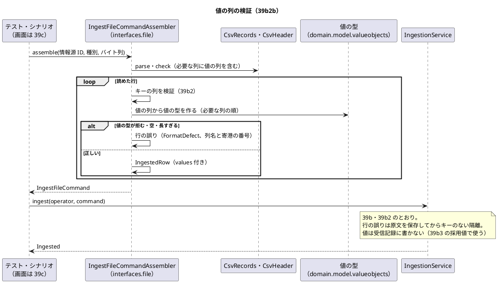
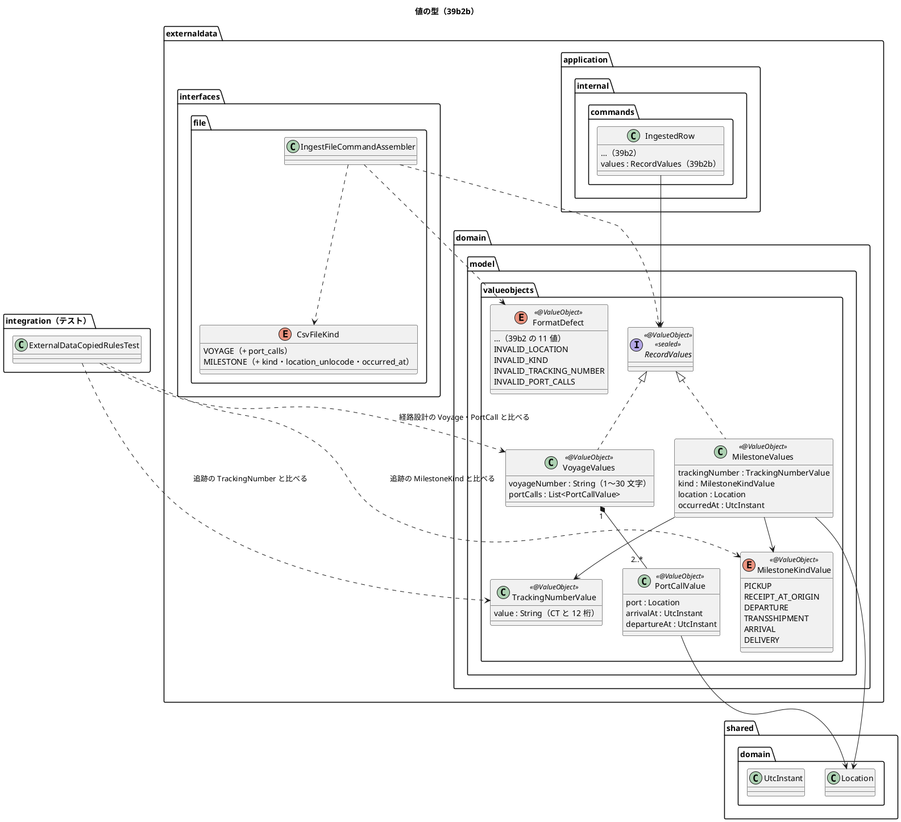

# Bolt 39b2b 計画 - 値の列（航海・主要実績）の検証と写しを守るテスト

## 基本情報

| 項目 | 内容 |
| :--- | :--- |
| Bolt | 第 39b2b 回（W7 の 7 本目。release_plan の 39b2 の行を Bolt 39b2 の開始準備で縦に 2 本に分けた 2 つ目。39b2b の行 :943） |
| 予定 | W7（2026-11-16 の週。前倒しで着手できる）。作業は約 3 時間（`check`・SonarQube・CI とステップごとの承認の待ちを除く） |
| アプローチ | インサイドアウト（値の型、写しを守るテスト、必要な列と組み立て、統合と受入シナリオの順。開発戦略の W7 の行） |
| 対象 | (1) 値の列（仮の形式。OQ-02）: 航海の航海番号（外部 ID）と寄港の列 `port_calls`、主要実績の追跡番号・種類・場所・発生時刻、(2) 値の検証（UN/LOCODE・時刻・種類・追跡番号の形・寄港の列の形と到着と出発の順・寄港の重複・空の値・長さの上限）に失敗した行を、39b2 の形のまま行の誤りとして隔離する（原文を保存してからキーのない隔離、注記は業務の言葉と「どうすればよいか」）、(3) `CsvFileKind` の必要な列に値の列を足す、(4) 値の型を `externaldata.domain.model.valueobjects` に置き、取り込む行（`IngestedRow`）に載せる（受信記録の列には書かない）、(5) 追跡の `TrackingNumber` の形・`MilestoneKind` の値の集合と、外部データの中の写しが一致することを守るテスト |
| トレース | UC-15 2a（system_usecase :523）、US-14 AC1 のうち値の検証（user_story :558）、DE-12（domain_model :1645。航海番号・採用値）・DE-13（同 :1646。追跡番号・実績）の属性の出どころ、ED-INV-02、OQ-02 の仮の形式（requirements_definition :827） |
| GitHub | [#18](https://github.com/k2works/practical-domain-driven-design-in-enterpris-application/issues/18)（US-14。クローズは 39h） |
| SP | 0 |
| 承認ゲート | **ステップごとに止める**（外部原本の取込。W7 の決定。release_plan :943 の「ステップごと（構造）」）。構造（新しい値オブジェクト、取り込む行の型、写しを守るテスト、受入シナリオ）。スキーマは変えない。注: 2026-11-03 の人の指示「Recommend 承認で進めて」により、各ステップの終わりで止めて推奨の案を承認として記録する（人が個別に見ていないことが分かるように「推奨のとおり（Recommend 承認の指示による）」と書く）。ステップを飛ばしたり束ねたりはしない。下の「人に諮ること」は推奨で進めず、人の回答を待つ |
| 開始準備で決めたこと | 2026-11-03、推奨のとおり（Recommend 承認の指示による。human:kakimomokuri）: (1) **値の列の仮の形式**: Bolt 39b2 の計画の「値の列の仮の形式」と requirements_definition の OQ-02 の注（:827）に従う。航海は外部 ID を航海番号（1〜30 文字）とし寄港の列 `port_calls` を持つ。主要実績は追跡番号 `tracking_number`・種類 `kind`（`milestone.kind` の 6 値）・場所 `location_unlocode`（UN/LOCODE）・発生時刻 `occurred_at` を持つ。時刻の書式は 39b2 と同じ（ISO 8601 のオフセット付き、秒と小数は省略可、オフセットのない値は行の誤り、マイクロ秒に切り捨て）。ただし寄港の数の下限と到着・出発の両方が空の寄港は、経路設計の規則と食い違うので人に諮る（「人に諮ること」1）、(2) **値の検証の置き場所**: 組み立て（`interfaces.file`）が行の形（列の値の文字列）を確かめ、値の型は `externaldata.domain.model.valueobjects` に置く（航海の値・寄港の値・主要実績の値・追跡番号の値・実績の種類の値と、行の値をまとめる取込の値）。用語集に足す（確認ポイント 1）、(3) **写しを守るテスト**: 追跡の `TrackingNumber` の形と `MilestoneKind` の値の集合が外部データの写しと一致することを、ArchUnit ではなく普通の単体テストで確かめる。置き場所は両方のコンテキストを参照できる `com.example.cargotracker.integration`（コンテキストをまたぐテストの前例。`DomainEventSerializationContractTest` :21-28）。テストのクラスは層とモジュールの規則の対象外（ModularityTest :21・LayerArchitectureTest :47 の `DoNotIncludeTests`、TestPlacementArchitectureTest は identity の spy だけ :27-35）なので人に諮らない（確認ポイント 5）、(4) **値は受信記録の列に書かない**: 39b2 の決定（受信記録は原本と分類だけを持つ。値は payload の行の原文に残る）を変えない。値の型は取り込む行に載せ、採用値（39b3）と DE-12・DE-13 の属性に使う（確認ポイント 2）、(5) **分け方**: 見積りは約 3 時間で半日を超えないので分けない。超えそうなら下の「時間の配分と打ち切り」の案で縦に分ける |

## Bolt ゴール

データ責任者が取り込んだ航海と主要実績のファイルの値の列（寄港・追跡番号・種類・場所・発生時刻）が誤っていても原本を失わず、その行の原文を保存してから外部原本を持たない隔離の受信記録として、どの列のどこが誤りでどうすればよいかを業務の言葉で残し、正しい値は採用値（39b3）に使える型で取り込む行に載ることを、組み立てと取込のサービスと DB の読み書きと受入シナリオで確かめる。外部データの中に写した追跡番号の形と実績の種類が追跡の規則と食い違えばテストが落ちる。画面は作らない（39c）。

### 開始準備で確かめたこと

- **release_plan の 39b2b の行**（:943）: 値の列（航海・主要実績。仮の形式、OQ-02）とその検証（UN/LOCODE・時刻・種類・追跡番号・寄港の列）、`CsvFileKind` の必要な列の追加、値の列の長さの上限、追跡番号の形の写しが追跡の `TrackingNumber` と同じであることを守るテスト。順序は 39b2 → 39b2b → 39b3（:955）。形式の検証に失敗した行は隔離して理由を残す（W7 の確認ポイント 6、:906）。解析は `externaldata.interfaces`、application には値だけを渡す（確認ポイント 5、:905）
- **前の Bolt の既知の課題**: Bolt 39b2 の 39b2b（[終了報告](bolt_39b2_report.md) :103。値の列とその検証、`CsvFileKind` の必要な列の追加、値の列の長さの上限、追跡番号の形の写しを守るテスト）。Bolt 39b2 の計画の「39b2b に送る行」（[計画](bolt_39b2_plan.md) :127-136。b1〜b6）と「値の列の仮の形式」（同 :65-77）。39b2 の「渡す値」は「値の列は 39b2b で `IngestedRow` に足す」（同 :55）
- **OQ-02**: 6 点の問いの回答はまだない。仮の形式は requirements_definition の OQ-02 の注（:827）と release_plan の「取込ファイルの形式」（:889。回答が届いたら差し替えの Bolt を足す）に従う
- **組み立ての今の形**: `IngestFileCommandAssembler`（:29-184）はキーの列（外部 ID・外部版・取得時刻）だけを列の順に検証し、最初の誤りを行の誤りにする（:122-139）。空（空白だけを含む）は `EMPTY_VALUE`、上限の文字数（コードポイント）より長い値は `TOO_LONG`（:151-160）、時刻は `OffsetDateTime` の ISO 8601 で読みマイクロ秒に切り捨てる（:170-182）。値は加工しない。Javadoc に「値の列は 39b2b」（:27）
- **必要な列の今の形**: `CsvFileKind`（:8-24）の航海は外部 ID・外部版・取得時刻（:10）、主要実績はそれに追跡番号（:12）。追跡番号の列は必要な列にあるが値を確かめていない。Javadoc に「値の列は Bolt 39b2b で足す」（:6）
- **取り込む行の今の形**: `IngestedRow`（`IngestFileCommand` :95-101）は行番号・外部 ID・外部版・取得時刻・payload を持つ。Javadoc に「主要実績の追跡番号は payload の中にだけある（値の列は 39b2b）」（:84-86）。`IngestedRow` を作るのは本体 2 か所（組み立て・コマンド）とテスト 4 クラス（`IngestionServiceTest` 4 か所、`IngestFileCommandAssemblerTest` 3 か所、`ExternalRecordIngestionSteps` 1 か所、`ExternalDataIngestionIntegrationTest` 1 か所）
- **形式の誤り**: `FormatDefect`（:16-41）は 11 値。行の誤りの注記は「<範囲>: <理由>（<詳細>）。<どうすればよいか>」（:92-94・:108-115）。どうすればよいかを示せない行の誤りは「提供元に確かめてください。」（:44-50）。時刻の書式の誤りは「オフセット付きの ISO 8601（例 2026-11-03T09:00:00+09:00）で書いてください。」（:39）
- **写しの元**: 追跡の `TrackingNumber` は `CT[A-HJKMNP-Z2-9]{12}`（`tracking.domain.model.valueobjects.TrackingNumber` :16。予約の `TrackingNumber` :20 も同じ形で、追跡は予約の型を参照しない写し。Bolt 25）。`MilestoneKind`（`tracking.domain.model.valueobjects.MilestoneKind` :7-19）は 6 値。UN/LOCODE は `shared.domain.Location`（:14。`[A-Z]{2}[A-Z2-9]{3}`）、時刻は `shared.domain.UtcInstant` を使える
- **経路設計の規則（寄港）**: 航海 `routing.domain.model.aggregates.Voyage` は寄港を 2 つ以上要する（:26-27）。寄港 `routing.domain.model.valueobjects.PortCall` は到着予定か出発予定の少なくとも一方を要し（:20-22）、出発予定が到着予定より前なら拒む（:23-24。同じ時刻は受ける）。始港は到着予定を、終港は出発予定を持たない（:9。コンストラクタでは確かめていない）。仮の形式の「寄港は 1 つ以上」「到着・出発は空を許す」と食い違う（「人に諮ること」1）
- **層の規則**: 外部データのインフラストラクチャ層の外は `java`・`externaldata`・`shared`・`org.springframework` だけ（ModularityTest :107-121）なので、追跡の `TrackingNumber`・`MilestoneKind` と経路設計の `PortCall`・`Voyage` は参照できない。interfaces は domain を参照してよい（LayerArchitectureTest :89-90）。interfaces はリポジトリを使わない（:243）。アーキテクチャのテストはテストのクラスを読まない（ModularityTest :21、LayerArchitectureTest :47）
- **data_model**: 値の列の行き先は `routing.voyage`（:461-470。`voyage_number VARCHAR(30)`）・`routing.port_call`（:471-478。`port_unlocode CHAR(5)`、到着・出発は NULL 可）・`tracking.milestone`（:650-662。`tracking_number VARCHAR(20)`、`kind VARCHAR(30)`・`location_unlocode CHAR(5)`・`occurred_at`）、`milestone.kind` の 6 値（:770）。受信記録の制約（:1149）に値の列はない。スキーマは変えない
- **domain_model**: 用語集の寄港（:144）・追跡番号（:158）・実績の種類（:174）・形式の誤り（:332）・取込の組み立て（:334）・採用値（`AdoptedValue`）。用語集の検査は英語名の単純名で引く（LivingGlossaryConsistencyTest :40-62）ので、外部データの写しは経路設計・追跡の型と同じ単純名にしない
- **要件**: US-14 の受入条件（user_story :558-562）に値の誤りの行はなく、UC-15 2a（system_usecase :523）が出典になる。シナリオの置き場所は `external_data/`（test_strategy :141）

## 設計の決定（案）

| 項目 | 決定 | 根拠 |
| :--- | :--- | :--- |
| 値の型 | `externaldata.domain.model.valueobjects` に、取込の値 `RecordValues`（sealed interface。航海の値か主要実績の値）、航海の値 `VoyageValues`（航海番号 1〜30 文字、寄港の値の並び）、寄港の値 `PortCallValue`（`Location`、到着 `UtcInstant`、出発 `UtcInstant`）、主要実績の値 `MilestoneValues`（追跡番号の値・実績の種類の値・`Location`・発生時刻 `UtcInstant`）、追跡番号の値 `TrackingNumberValue`（`CT[A-HJKMNP-Z2-9]{12}`）、実績の種類の値 `MilestoneKindValue`（enum。6 値）を置く（`@ValueObject`。Javadoc は用語集の日本語名で始める）。各型はコンストラクタで規則を確かめ、反すれば `IllegalArgumentException`。名前は経路設計・追跡の型と同じ単純名にしない（用語集の検査）（推奨のとおり。Recommend 承認の指示による） | 開始準備の決定 (2)、確認ポイント 1 |
| 値を載せる先 | `IngestedRow` に `values`（`RecordValues`、NOT NULL）を足す。取込のサービスは受け取るだけで使わない（39b のとおり分類し、受信記録の列に値を書かない。値は payload の行の原文に残る）。採用値（39b3）は `values` から作る（application は `interfaces.file` を参照できないので、行の原文を application で読み直さない）。テストで `IngestedRow` を作る 4 クラスには値の既定を作るテストの部品を足す | 開始準備の決定 (4)、Bolt 39b2 の計画 :55、確認ポイント 2 |
| 形式の誤りの値 | `FormatDefect` に 4 値を足す（範囲はどれも行）: 場所の形 `INVALID_LOCATION`（「場所の形が違います」「UN/LOCODE（国コード 2 文字 + 地点コード 3 文字。例 JPTYO）で書いてください。」）、種類 `INVALID_KIND`（「種類が違います」「PICKUP・RECEIPT_AT_ORIGIN・DEPARTURE・TRANSSHIPMENT・ARRIVAL・DELIVERY のどれかで書いてください。」）、追跡番号の形 `INVALID_TRACKING_NUMBER`（「追跡番号の形が違います」「CT と英大文字・数字 12 桁（0・O・1・I・L を除く）で書いてください。」）、寄港の列の形 `INVALID_PORT_CALLS`（「寄港の列の形が違います」「寄港ごとに \| で区切り、寄港の中は UN/LOCODE;到着;出発 で書いてください。」）。空の値は `EMPTY_VALUE`、時刻は `INVALID_TIME`、航海番号の長さは `TOO_LONG` を使い回す。詳細に列名と寄港の番号（例「port_calls、2 つ目の寄港」「到着より前に出発しています」）を書く | 確認ポイント 3、Bolt 39b2 の確認ポイント 6 |
| 検証の順 | キーの列（39b2 のとおり）を先に確かめ、次に値の列を必要な列の順（`CsvFileKind` の並び）に確かめ、最初の 1 つの誤りを行の誤りにする（39b2 の「列の順で最初の 1 つ」と同じ）。寄港の列の中は寄港の順、寄港の中は区切り → UN/LOCODE → 到着 → 出発 → 到着と出発の順。寄港の重複は寄港をすべて読んだ後 | 確認ポイント 4 |
| 組み立ての形 | 組み立ては文字列を読み、値の型のコンストラクタの拒否（`IllegalArgumentException`）を形式の誤りに写す。`Location` を変えずに使う（共有カーネルに判定の関数を足さない）。どの列の誤りかは組み立てが知っているので、型を作る前に空・長さを確かめ、形の誤りは型の拒否で受ける。値は加工しない（前後の空白・小文字を直さない。`" PICKUP"`・`pickup` は種類の誤り） | Bolt 39b2 の確認ポイント 8、確認ポイント 8 |
| 必要な列 | `CsvFileKind` の航海に `port_calls`、主要実績に `kind`・`location_unlocode`・`occurred_at` を足す（主要実績の `tracking_number` は既にある）。ヘッダーにない列はファイルの誤り（`MISSING_COLUMN`、列名。39b2 のまま）。ヘッダーの列の名前と順は固定しない（OQ-02 の (d) の回答まで。39 のとおり） | 39b2b の行 :943 |
| 値の列の長さの上限 | 表の列の上限に当たるのは航海番号だけ（`voyage_number VARCHAR(30)`。外部 ID の 200 文字より先に効く）。追跡番号（14 文字）・UN/LOCODE（5 文字）・種類（6 値）は形で長さが決まる。寄港の数の上限は置かない（1 ファイルの件数と大きさは PERF-06 の 39b4 と OQ-02 の (f) で決める） | 確認ポイント 7 |
| 寄港の重複 | 同じ港・同じ到着・同じ出発の寄港が 2 つ以上あれば行の誤り（`INVALID_PORT_CALLS`、「同じ寄港があります」）。同じ港で時刻が違う寄港（周回の航路）は受ける。寄港をまたぐ時刻の順（前の寄港の出発が次の寄港の到着より前か）は確かめない（経路設計の航海も確かめていない。Voyage :21-29） | 確認ポイント 6 |
| 写しを守るテスト | `com.example.cargotracker.integration.ExternalDataCopiedRulesTest`（Spring を使わない単体のテスト）。追跡番号は正規表現の文字列ではなく振る舞いで比べる: 英大文字と数字のすべての文字を 3 文字目と 14 文字目に置いた値、13 文字・15 文字、接頭辞の違い・小文字について、追跡の `TrackingNumber` が受けるかと `TrackingNumberValue` が受けるかが一致する。種類は `MilestoneKind` と `MilestoneKindValue` の名前の集合が一致する。寄港の規則も同じ形で比べる（経路設計の `Voyage`・`PortCall` と `VoyageValues`・`PortCallValue` が同じ入力で同じ可否。下限は「人に諮ること」1 の回答による） | 開始準備の決定 (3)、確認ポイント 5 |
| 隔離の形 | 39b2 の行の誤りのまま: 値の誤りの行は外部原本を冪等性キーで引かず作らない（キーの列が正しくても）、行の原文を保存してからキーのない隔離の受信記録を書く。同じキーの正しい行は前後によらず 39b のとおり分類する | ED-INV-02、Bolt 39b2 の設計の決定「同じキーの誤りの行と正しい行」 |
| 用語集 | domain_model の用語集（:334 の後）に取込の値・航海の値・寄港の値・主要実績の値・追跡番号の値・実績の種類の値を足す。形式の誤り（:332）に 4 値、取込の組み立て（:334）に値の列の検証を足す。寄港（:144）・追跡番号（:158）・実績の種類（:174）のコンテキストの欄に「外部データに写しを持つ（Bolt 39b2b。写しを守るテスト）」を足す | LivingGlossaryConsistencyTest |
| 受入シナリオ | `src/test/resources/features/external_data/quarantine_malformed_records.feature` に値の誤りのシナリオを足す（追跡番号の形の誤り・寄港の列の誤りと正しい行の混在）。ステップ定義は `ExternalRecordFormatErrorSteps` を使い、足すステップがあればそこに置く。39b2 の既存のシナリオのヘッダーには値の列を足す | test_strategy :141、Bolt 39b2 の確認ポイント 12 |

```text
航海の行の例（仮の形式）:
external_id,external_version,acquired_at,port_calls
V2611E,3,2026-11-19T23:00:00Z,JPTYO;;2026-11-20T08:00:00+09:00|USLAX;2026-12-01T06:00:00-08:00;

主要実績の行の例:
external_id,external_version,acquired_at,tracking_number,kind,location_unlocode,occurred_at
M-0001,1,2026-11-19T23:00:00Z,CTABCDEFGH2345,DEPARTURE,JPTYO,2026-11-20T08:00:00+09:00
```

## ふりかえりと前の Bolt からの引き継ぎ

| 出典 | 内容 | この Bolt での扱い |
| :--- | :--- | :--- |
| W6 の Try T-204・T-212、Bolt 38h の T-227、Bolt 39b の T-233 | サブエージェントへの指示の最初に heredoc（`<<`）と標準入力を待つコマンドを使わないと書く | 任せるときの指示の最初に書く。ファイルは Write・Edit で書く |
| W6 の Try T-217、Bolt 39b2 の Try | 本体を直す前に Red を流し、落ちた理由を記録する。Red の記録に、直したテストの一覧を添える（39b2 で行 13 のテストの期待を Red の前に直し忘れた） | ステップ 2〜5 の各 Red。必要な列の追加で落ちる既存のテスト（ヘッダーに値の列のないもの）も一覧にし、Red の前に期待を直す |
| W6 の Try T-225・T-213 | push の前に `check` | ステップ 6 |
| W6 の Try T-182・T-211・T-216 | 状態の組み合わせの表に重複・隔離と出口・誤った入力の行を置く | 下の表（行 1〜26。寄港の重複・値の誤りの隔離・空の値・長さの上限を含む） |
| W6 の Try T-219 | 変異の対象に単体・統合・契約のテスト | 下の変異の表 |
| W6 の Try T-215・T-222 | Gradle を流す担当を 1 つに、計画の初稿を先にコミット | Gradle は人の側の 1 か所で流す。初稿をコミットしてから実装に入る |
| Bolt 39a2 の T-229 | 永続化の Bolt の状態の組み合わせに時刻の出どころと同時の書き込みの行を置く | 発生時刻・寄港の時刻はファイルの値でマイクロ秒に切り捨てる（行 12）。取込時刻は 39b のとおり Clock から 1 回取る。同時の書き込みは 39b の行 9b から変えない（スキーマを変えない） |
| Bolt 39a3 の T-230 | 入ることを確かめる行のデータはドメインの規則に合う組み合わせにする | 主要実績の行は追跡番号の形（`CTABCDEFGH2345` など）と 6 種類、航海の行は寄港 2 つ以上で始港の到着と終港の出発を空にする。発生時刻と取得時刻は取込時刻より前。情報源は `APPROVED` |
| Bolt 39b の T-231 | `@Transactional` は契約のクラスに付ける | この Bolt は契約のテストを足さない（スキーマとポートを変えない）。統合テストは 39b2 のクラスに足す |
| Bolt 39b の T-232 | 本体のクラスを足したステップは、承認の前に `spotbugsMain` を流す | ステップ 2・4 の完了の判定に入れる（ステップ 3 はテストだけ、ステップ 5 は本体を変えれば流す） |
| Bolt 39b2 の T-234 | 本体のクラスを足したステップでは、承認の前に SonarQube の規則（少なくとも `sonar-local:check` の新しい違反）も見る | ステップ 2・4 の完了の判定に入れる |

## 状態の組み合わせ（行ごとにテストを 1 本。T-182）

単体は値の型（`VoyageValuesTest`・`PortCallValueTest`・`MilestoneValuesTest`・`TrackingNumberValueTest`）、組み立て（`IngestFileCommandAssemblerTest`）、ヘッダー（`CsvHeaderTest`）、取込のサービス（`IngestionServiceTest`。メモリの実装と固定の Clock）、写し（`ExternalDataCopiedRulesTest`）で確かめる。統合は PostgreSQL（`ExternalDataIngestionIntegrationTest`。提供元の名前に自分の UUID を含めて絞る）。テストの名前は「行 N_」で始める。

| 行 | 状況 | 期待 | 確かめ方 |
| :--- | :--- | :--- | :--- |
| 1 | 航海の正しい行（寄港 2 つ: 始港の到着が空・終港の出発が空、寄港 3 つ、到着と出発が同じ時刻） | 取り込む行に航海の値（航海番号・寄港の並び。時刻は UTC に直しマイクロ秒に切り捨て）。分類は 39b のとおり | 単体（組み立て）、Cucumber（混在の中の正しい行） |
| 2 | 寄港が 1 つの航海の行 | 「人に諮ること」1 の回答による（推奨: 行の誤り `INVALID_PORT_CALLS`「寄港が足りません（2 つ以上）」）。回答が「1 つ以上のまま」なら正しい行 | 単体（組み立て・値の型） |
| 3 | 寄港の列の区切りの誤り（寄港の中の `;` が 1 つ・3 つ、空の寄港 `\|\|`、末尾の `\|`） | 行の誤り（`INVALID_PORT_CALLS`、寄港の番号）。原文を保存してからキーのない隔離 | 単体（組み立て） |
| 4 | 寄港の UN/LOCODE の誤り（小文字 `jptyo`、4 文字、数字 1 を含む） | 行の誤り（`INVALID_LOCATION`、`port_calls` と寄港の番号） | 単体（組み立て） |
| 5 | 寄港の到着と出発の順（出発が到着より前）、到着と出発の両方が空 | 出発が前: 行の誤り（`INVALID_PORT_CALLS`「到着より前に出発しています」）。両方が空: 「人に諮ること」1 の回答による（推奨: 行の誤り「到着か出発が要ります」） | 単体（組み立て・値の型） |
| 6 | 寄港の時刻の書式の誤り（オフセットなし、日付として誤り `2026-02-30T…`） | 行の誤り（`INVALID_TIME`、`port_calls` と寄港の番号と到着・出発） | 単体（組み立て） |
| 7 | 寄港の重複（同じ港・同じ到着・同じ出発の寄港が 2 つ）と、同じ港で時刻の違う寄港 | 重複: 行の誤り（`INVALID_PORT_CALLS`「同じ寄港があります」）。時刻の違う同じ港: 正しい行 | 単体（組み立て・値の型） |
| 8 | 主要実績の正しい行（6 種類のそれぞれ） | 取り込む行に主要実績の値（追跡番号・種類・場所・発生時刻）。分類は 39b のとおり | 単体（組み立て、6 種類のパラメータ化）、Cucumber |
| 9 | 種類の誤り（6 値の外 `LOADED`、小文字 `pickup`、前後の空白 `" PICKUP"`） | 行の誤り（`INVALID_KIND`、`kind`）。値は加工しない | 単体（組み立て） |
| 10 | 場所の誤り（小文字・4 文字・数字 1） | 行の誤り（`INVALID_LOCATION`、`location_unlocode`） | 単体（組み立て） |
| 11 | 追跡番号の形の誤り（紛らわしい文字 0・O・1・I・L、13 桁・15 桁、`ct` の小文字、接頭辞 `CX`） | 行の誤り（`INVALID_TRACKING_NUMBER`、`tracking_number`） | 単体（組み立て・値の型）、Cucumber |
| 12 | 発生時刻の書式の誤り（オフセットなし、日付として誤り）と、ナノ秒を含む正しい値 | 誤り: 行の誤り（`INVALID_TIME`、`occurred_at`）。ナノ秒はマイクロ秒に切り捨てる | 単体（組み立て） |
| 13 | 空の値（`port_calls`・`tracking_number`・`kind`・`location_unlocode`・`occurred_at` が空、空白だけ） | 行の誤り（`EMPTY_VALUE`、列名）。空白だけの値も空とみなす | 単体（組み立て） |
| 14 | 長さの上限（航海番号（外部 ID）30 文字・31 文字、補助文字を含む 30 コードポイント） | 30 は正しい行、31 は行の誤り（`TOO_LONG`、`external_id`、30 文字まで）。数え方はコードポイント（39b2 のとおり） | 単体（組み立て・値の型） |
| 15 | 必要な列の追加（航海のヘッダーに `port_calls` がない、主要実績に `kind`・`location_unlocode`・`occurred_at` のどれかがない） | ファイルの誤り（`MISSING_COLUMN`、列名）。行は読まない（39b2 の行 2 のとおり） | 単体（ヘッダー・組み立て）、Cucumber（39b2 の必要な列のシナリオを値の列で） |
| 16 | キーの列と値の列の両方に誤り、値の列の 2 つに誤り | キーの列の誤りを先に、値の列は必要な列の順で最初の 1 つ | 単体（組み立て） |
| 17 | 形式の正しい行と値の誤りの行の混在（値の誤りの行の後に、改行を含む値の行と空行） | 行の結果は物理行の順。正しい行は採用・重複・隔離、値の誤りの行はキーのない隔離。後の行は読む。`reconciles()` が真 | 単体（組み立て・サービス）、Cucumber |
| 18 | 同じキーの値の誤りの行と正しい行（誤りが先・後） | 値の誤りの行は外部原本を引かず作らない（キーの列が正しくても）。正しい行は順によらず採用 | 単体（サービス） |
| 19 | 値の誤りでも原本は保存されて隔離 | 行の原文を保存してからキーのない隔離の受信記録。注記「12 行目: 追跡番号の形が違います（tracking_number）。CT と英大文字・数字 12 桁（0・O・1・I・L を除く）で書いてください。」。原本の保存に失敗すれば取込全体を巻き戻す（39b2 の行 16 から変えない） | 統合（PostgreSQL）、Cucumber |
| 20 | 値を受信記録の列に書かない | 受信記録の payload は行の原文と同じバイト列。値は取り込む行にだけあり、受信記録・外部原本の型と表に値の列がない | 単体（サービス） |
| 21 | 写しの一致（追跡番号の形） | 英大文字と数字のすべての文字を 3 文字目・14 文字目に置いた値、13・15 文字、接頭辞・小文字で、追跡の `TrackingNumber` と `TrackingNumberValue` の可否が一致する | 単体（写し） |
| 22 | 写しの一致（実績の種類） | `MilestoneKind` と `MilestoneKindValue` の名前の集合が一致する | 単体（写し） |
| 23 | 写しの一致（寄港の規則） | 寄港の数（1・2）、到着と出発の両方が空、出発が到着より前・同じ時刻で、経路設計の `Voyage`・`PortCall` と `VoyageValues`・`PortCallValue` の可否が一致する（下限は「人に諮ること」1 の回答による） | 単体（写し） |
| 24 | 値の型の規則（NULL、航海番号の空・31 文字、寄港の並びの空、変えられない並び） | コンストラクタで拒む。寄港の並びは写しを持つ | 単体（値の型） |
| 25 | 取り込む行の値の種別とファイルの種別の組み合わせ | 航海のファイルの行は航海の値、主要実績のファイルの行は主要実績の値（組み立てが種別で選ぶ） | 単体（組み立て） |
| 26 | 層の規則 | 外部データの本体は追跡・経路設計の型を参照しない（ModularityTest :107-121）。値の型は用語集にあり Javadoc が日本語名で始まる。組み立てはリポジトリを使わない | ModularityTest、LivingGlossaryConsistencyTest、LayerArchitectureTest |

## スコープ

### 入れるもの

- 行 1〜26 のテスト、値の型、`FormatDefect` の 4 値、`CsvFileKind` の必要な列、組み立ての値の検証、`IngestedRow` の値、写しを守るテスト、受入シナリオ
- 必要な列の追加で落ちる既存のテスト（ヘッダーに値の列のないもの）の直し（Red の記録に一覧を添える。T-217）
- 文書: 下の「設計文書に直す箇所」（ステップ 1）

### 入れないもの

- スキーマの変更（値の列を受信記録・外部原本に持たない）
- 採用値、DE-12・DE-13・DE-14、`domain.events`、identity の監査の listener（39b3）
- 寄港をまたぐ時刻の順、始港の到着・終港の出発の有無の検証（経路設計の航海も確かめていない）
- 航海番号の形（文字の種類）の検証（経路設計に規則がない。OQ-02 の回答で決める）
- 主要実績の追跡番号が予約・追跡に存在するかの照合（外部データはほかのコンテキストを参照しない。追跡の listener（39g）で扱う）
- PERF-06、1 ファイルの件数と寄港の数の上限（39b4、OQ-02 の (f)）
- 画面（取込の入口 S-16 と注記の表示は 39c、S-17 は 39d）

### 設計文書に直す箇所（ステップ 1）

- release_plan: ステップ 1 は更新履歴だけ（39b2b の行 :943 の計画と終了報告のリンクは終了報告で足す）。「人に諮ること」1 の回答で仮の形式が変われば、「取込ファイルの形式」（:889）に【前の決定の変更】の注
- requirements_definition の OQ-02 の注（:827）: 寄港の数の下限と到着・出発の両方が空の寄港（「人に諮ること」1 の回答）、値は加工しない（前後の空白・小文字を直さない）、寄港の重複の意味、航海番号の上限 30 文字
- domain_model: 用語集（:334 の後）に 6 用語、形式の誤り（:332）に 4 値、取込の組み立て（:334）に値の列の検証、寄港（:144）・追跡番号（:158）・実績の種類（:174）に外部データの写しの注、DE-12（:1645）・DE-13（:1646）の属性は取り込む行の値から作る注（作るのは 39b3）
- data_model: 受信記録の制約（:1149）に「値の列は持たず、値は payload の行の原文に残る（Bolt 39b2b）」の注
- system_usecase :523: 値の検証（UN/LOCODE・時刻・種類・追跡番号の形・寄港の列）の誤りも行の誤りとして隔離する
- architecture_backend :454: 値の型の置き場所（`externaldata.domain.model.valueobjects`）と、追跡・経路設計の規則の写しを守るテスト（`integration`）
- ADR-004: 改訂の経緯に Bolt 39b2b の項（外部データは追跡番号の形・実績の種類・寄港の規則を写しとして持ち、写しを守るテストで一致を確かめる。決定は変えない）
- コードのコメント（触るステップで直す）: `CsvFileKind` :6、`IngestFileCommandAssembler` :20-28、`IngestFileCommand` :84-86、`interfaces/file/package-info` :1-5

## 設計（この Bolt の範囲）





- ER 図: スキーマを変えないので省く（値の列は受信記録・外部原本に持たず、payload の行の原文に残る。行き先の `routing.voyage`・`routing.port_call`・`tracking.milestone` に書くのは 39e・39g）
- 状態遷移図: 値の型は変えられない値で、受信記録・取込も追記専用のまま遷移しないので省く
- 画面遷移図: 画面を作らないので省く（取込の入口 S-16 は 39c、S-17 は 39d）

## ステップ計画（ステップごとに止める）

- [ ] **1. 設計の文書**: 上の「設計文書に直す箇所」（「人に諮ること」1 の回答を反映する）（完了の判定: 文書の差分。**承認ゲート**）
- [ ] **2. 値の型（Red → Green）**: 行 2・5・7・11・14・24 の値の型の単体のテストを先に書いて落ちることを確かめ（落ちた理由を記録する。T-217）、`RecordValues`・`VoyageValues`・`PortCallValue`・`MilestoneValues`・`TrackingNumberValue`・`MilestoneKindValue` と `FormatDefect` の 4 値（注記の言葉）を作る（完了の判定: 緑、`spotbugsMain`（T-232）、`sonar-local:check` の新しい違反（T-234）。**承認ゲート**（構造: 新しい値オブジェクト））
- [ ] **3. 写しを守るテスト（Red → Green）**: 行 21〜23 の `ExternalDataCopiedRulesTest` を書く。既に緑なら、写しを壊す変異（V1・V2・V4）で落ちることを確かめて記録する（完了の判定: 緑。**承認ゲート**（構造: コンテキストをまたぐテストの置き場所））
- [ ] **4. 必要な列と組み立て（Red → Green）**: 行 1〜20・25 の組み立てとヘッダーとサービスの単体のテストを先に書く。必要な列の追加で落ちる既存のテストを一覧にし、Red の前に期待を直す（T-217）。`CsvFileKind` の必要な列、組み立ての値の検証、`IngestedRow` の `values` と値の既定を作るテストの部品を作る（完了の判定: 緑、`spotbugsMain`、`sonar-local:check` の新しい違反。**承認ゲート**（構造: 取り込む行の型））
- [ ] **5. 統合と受入シナリオ（Red → Green）**: 行 19 の統合テストと、`quarantine_malformed_records.feature` に値の誤りのシナリオ（追跡番号の形の誤り、寄港の列の誤りと正しい行の混在）、39b2 の既存のシナリオのヘッダーに値の列、行 26 の規則の確かめ（完了の判定: 緑。本体を変えたら `spotbugsMain`。**承認ゲート**（構造: 受入シナリオ））
- [ ] **6. 品質ゲートと開発レビュー**: 変異、`check`、その後に SonarQube、開発レビューとその直し。push の前に `check`
- [ ] **7. 終了報告**: push して CI とデモ環境の配備を確かめる。release_plan（39b2b の行の計画と終了報告のリンク）・開発の索引・mkdocs を直す。見える振る舞いは変わらないので、マニュアルは直さない（39c で新しい章）

### 時間の配分と打ち切り

| # | 目安 | 打ち切り |
| :--- | :--- | :--- |
| 1 | 20 分 | — |
| 2 | 45 分 | — |
| 3 | 15 分 | — |
| 4 | 50 分 | ステップ 4 の開始で合計 1 時間 50 分を超えていたら、行 7（寄港の重複）と行 16（誤りが 2 つの順）を 39b3 の前の小さな Bolt に送る |
| 5 | 25 分 | ステップ 5 の開始で合計 2 時間 40 分を超えていたら、寄港の列の混在のシナリオを単体だけにする（追跡番号のシナリオと統合テストは残す） |
| 6 | 20 分（待ちを除く） | — |
| 7 | 10 分（CI の待ちを除く） | — |

合計 185 分（約 3 時間）。半日を超えないので分けない。半日を超えそうになったときの分け方の案（推奨）: 39b2b を主要実績の値（追跡番号・種類・場所・発生時刻と写しを守るテスト）と、39b2c の航海の値（寄港の列・寄港の重複・寄港の規則の写し）に縦に分ける（主要実績のほうが列が単純で、39b3 の DE-13 の前提になる）。Bolt 39b2 の計画の見積り（約 100 分）より増えたのは、値の型を domain に置くこと、`IngestedRow` に値を載せること、寄港の規則の写しを足したため。

## 確認ポイント（計画の承認の場でまとめて確認する。Try T-6）

| # | 確認すること | 場所 | 推奨 |
| :--- | :--- | :--- | :--- |
| 1 | **値の型の置き場所と名前（構造）** | ステップ 2 | 推奨のとおり（Recommend 承認の指示による。human:kakimomokuri）。`externaldata.domain.model.valueobjects` に 6 型（設計の決定「値の型」）。経路設計・追跡の型と同じ単純名にしない（用語集の検査は単純名で引く。LivingGlossaryConsistencyTest :40-62）。代わりの案（組み立ての中の文字列の検証だけで型を作らない）は、39b3 の採用値が文字列を読み直すことになり、application は `interfaces.file` を参照できないので取らない |
| 2 | **値を取り込む行に載せる（受信記録には書かない）** | ステップ 4 | 推奨のとおり。`IngestedRow.values`（NOT NULL）。取込のサービスは使わない（39b3 で使う）。受信記録・外部原本の列に値を書かない 39b2 の決定を確かめる（行 20）。代わりの案（39b3 で足す）は、値の検証の結果を型として確かめる出口がこの Bolt になくなり、テストが「誤りでない」ことしか確かめられないので取らない |
| 3 | **形式の誤りの値と注記の言葉** | ステップ 2 | 推奨のとおり。4 値（`INVALID_LOCATION`・`INVALID_KIND`・`INVALID_TRACKING_NUMBER`・`INVALID_PORT_CALLS`）を足し、空・時刻・長さは 39b2 の値を使い回す。寄港の誤り（区切り・順・重複・数）は `INVALID_PORT_CALLS` 1 つにまとめ、詳細の言葉で分ける（理由の値を増やしすぎない。誤りの理由を表の列で持つのは 39c・39d で要れば） |
| 4 | **検証の順** | ステップ 4 | 推奨のとおり。キーの列 → 値の列（必要な列の順）、最初の 1 つ（39b2 の「列の順で最初の 1 つ」と同じ） |
| 5 | **写しを守るテストの置き場所と比べ方（構造）** | ステップ 3 | 推奨のとおり。`com.example.cargotracker.integration.ExternalDataCopiedRulesTest`（コンテキストをまたぐテストの前例。Spring は使わない）。規則に当たらないので人に諮らない（開始準備の決定 (3)）。追跡番号は正規表現の文字列ではなく振る舞い（全文字・長さ・接頭辞）で比べる（追跡の `FORMAT` は private で、正規表現の書き方が違っても同じ形なら通すため）。寄港の規則も同じテストで経路設計と比べる（39b2b の行の範囲の「写しを守るテスト」を寄港に広げる。外部データで受けた航海を 39e の経路設計の listener が拒む毒入りのメッセージを防ぐ） |
| 6 | **寄港の重複の意味** | ステップ 4 | 推奨のとおり。同じ港・同じ到着・同じ出発の寄港が 2 つ以上なら誤り、同じ港で時刻の違う寄港は受ける（周回の航路）。寄港をまたぐ時刻の順は確かめない（経路設計も確かめていない） |
| 7 | **値の列の長さの上限** | ステップ 2・4 | 推奨のとおり。航海番号 30 文字（`voyage_number VARCHAR(30)`、コードポイント）だけ。ほかは形で決まる。寄港の数の上限は置かない（PERF-06 の 39b4） |
| 8 | **値は加工しない** | ステップ 4 | 推奨のとおり。前後の空白・小文字を直さず誤りにする（39b2 の「値は加工しない」。原本を加工しない）。OQ-02 の注に書く |
| 9 | **分け方** | 計画の初稿 | 推奨のとおり。約 3 時間で分けない。超えそうなら主要実績の値と航海の値に縦に分ける（上の「時間の配分と打ち切り」） |
| 10 | **変異** | ステップ 6 | 下の 9 個 |

### 人に諮ること（推奨で進めず回答を待つ）

| # | 諮ること | 推奨 | 諮る理由 |
| :--- | :--- | :--- | :--- |
| 1 | **寄港の規則を経路設計の航海・寄港にそろえるか**（寄港の数の下限、到着と出発の両方が空の寄港） | 【前の決定の変更】仮の形式の「寄港は 1 つ以上」を「2 つ以上」に、「到着・出発は空を許す」を「到着か出発の少なくとも一方が要る」に直す。経路設計の航海は寄港を 2 つ以上要し（`Voyage` :26-27）、寄港は到着予定か出発予定を要する（`PortCall` :20-22）。外部データで 1 つの寄港や両方が空の寄港を受けると、39e の経路設計の listener が採用値（DE-12）を拒み、毒入りのメッセージになる。写しを守るテスト（行 23）で経路設計の規則と一致させ続ける | 仮の形式は Bolt 39b2 の計画の承認（2026-11-03、Recommend 承認の指示による）で requirements_definition の OQ-02 の注（:827）と Bolt 39b2 の計画（:70）に「寄港は 1 つ以上」「到着・出発は空を許す」として記録され、前の人の決定を変えることになる。代わりの案（仮の形式のまま 1 つ以上を受け、経路設計の側で 1 つの寄港の航海を隔離する）は、外部データの検証と経路設計の規則が食い違ったまま残る |

### 変異と落ちる見込みのテスト

| # | 変異 | 落ちる見込み |
| :--- | :--- | :--- |
| V1 | `TrackingNumberValue` の文字の範囲に 0・O を入れる | 行 11（単体）、行 21（写し） |
| V2 | `MilestoneKindValue` から `DELIVERY` を外す | 行 8（単体）、行 22（写し） |
| V3 | 寄港の出発と到着の比較を逆にする | 行 1・5（単体） |
| V4 | 寄港の数の下限を変える（推奨の 2 なら 1 に） | 行 2（単体）、行 23（写し） |
| V5 | 航海番号の上限を 31 文字にする | 行 14（単体） |
| V6 | 値の列をキーの列より先に確かめる | 行 16（単体） |
| V7 | オフセットのない発生時刻を UTC として受ける | 行 12（単体） |
| V8 | 値の誤りの行で冪等性キーの外部原本を引く | 行 18（単体） |
| V9 | 寄港の重複の検査を外す | 行 7（単体） |

## 完了条件

- [ ] 上のステップ 1〜7 の完了の判定を満たす（ステップごとの承認を受ける）
- [ ] 行 1〜26 に、それを名乗るテストがある
- [ ] 「人に諮ること」1 の回答が計画・OQ-02 の注・テストに反映されている
- [ ] `check` が緑、SonarQube が PASS、CI が緑、デモ環境が新しい版で動く
- [ ] 受信記録・外部原本に値の列がない（スキーマを変えていない）
- [ ] 終了報告が承認される

## 更新履歴

| 日付 | 更新内容 | 更新者 |
| :--- | :--- | :--- |
| 2026-11-03 | 初版作成（承認待ち）。開始準備の決定: 値の列の仮の形式は Bolt 39b2 の計画と OQ-02 の注に従う、値の検証は組み立てで行い値の型は `externaldata.domain.model.valueobjects` に置く、写しを守るテストは `integration` の普通のテスト、値は受信記録の列に書かず取り込む行に載せる、約 3 時間で分けない（推奨のとおり。Recommend 承認の指示による。human:kakimomokuri）。寄港の規則を経路設計にそろえるかは人に諮る | anthropic/claude-opus-5-5 |

## 関連ドキュメント

- [リリース計画](release_plan.md)（W7 の節の 39b2b の行）
- [Bolt 39b2 計画](bolt_39b2_plan.md)・[Bolt 39b2 終了報告](bolt_39b2_report.md)
- [データモデル](../../design/cargo-tracker/data_model.md)、[ドメインモデル](../../design/cargo-tracker/domain_model.md)
- [ADR-004](../../adr/cargo-tracker/004-external-data-ingestion.md)
- [ユーザーストーリー](../../requirements/cargo-tracker/user_story.md)（US-14）、[システムユースケース](../../requirements/cargo-tracker/system_usecase.md)（UC-15）、[要件定義](../../requirements/cargo-tracker/requirements_definition.md)（OQ-02）
