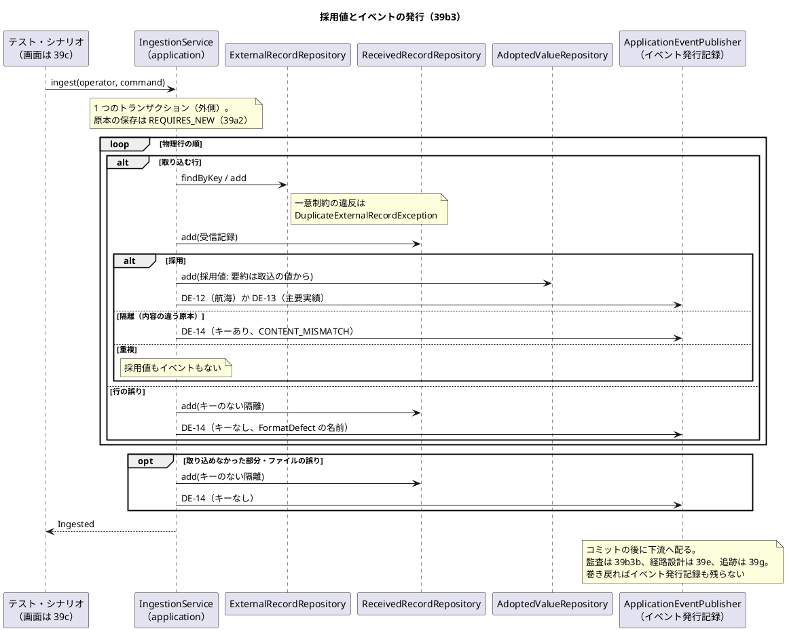
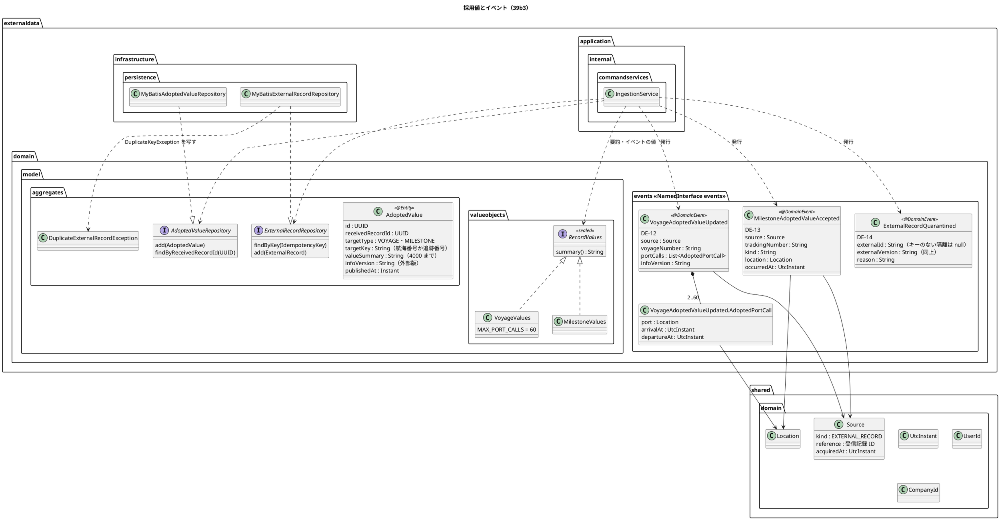
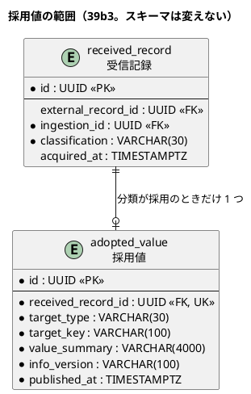

# Bolt 39b3 計画 - 採用値と DE-12・DE-13・DE-14 の発行

## 基本情報

| 項目 | 内容 |
| :--- | :--- |
| Bolt | 第 39b3 回（W7 の 8 本目。release_plan の初案の 39b3 の行を、この計画の開始準備で縦に 2 本（39b3 :946・39b3b :947）に分けた 1 つ目） |
| 予定 | W7（2026-11-16 の週。前倒しで着手できる）。作業は約 3 時間 20 分（`check`・SonarQube・CI とステップごとの承認の待ちを除く） |
| アプローチ | インサイドアウト（外部原本のポートの約束、採用値、イベント、統合と受入シナリオの順。開発戦略の W7 の行） |
| 対象 | (1) 採用値（`adopted_value`）の作成: 分類が採用の受信記録に 1 つ付ける（US-14 AC1 の「採用値」）、(2) DE-12（航海の採用値を更新した）・DE-13（主要実績の採用値を受け付けた）・DE-14（外部原本を隔離した。キーのない隔離を含む）の発行と、`externaldata.domain.events` の名前付きインターフェース `events`、(3) イベントの直列化の契約、(4) 外部原本のポートの約束を Spring の `DuplicateKeyException` から名前付きの例外に直す（Bolt 39b の懸念）、(5) 寄港の数の上限（60）と `value_summary`（VARCHAR(4000)）。identity の監査の listener・毒入りのメッセージ・W6 横断レビュー M-2・`PublicApiArchitectureTest` の汎用化・手書きの規則の写しは 39b3b に送る（開始準備の決定 (1)） |
| トレース | US-14 AC1 の採用値（user_story :558）・AC3 の「採用値を重複生成せず」（同 :560）、DE-12（domain_model :1652）・DE-13（同 :1653）・DE-14（同 :1654）、採用値 `AdoptedValue`（同 :348・:1495）、ED-INV-02、AUD-01（non_functional :198。監査を書くのは 39b3b） |
| GitHub | [#18](https://github.com/k2works/practical-domain-driven-design-in-enterpris-application/issues/18)（US-14。クローズは 39h） |
| SP | 0 |
| 承認ゲート | **ステップごとに止める**（外部原本の取込。W7 の決定。release_plan :946 の「ステップごと（監査・構造）」）。構造（名前付きの例外、採用値の集約とリポジトリ、イベントと名前付きインターフェース、受入シナリオ）。スキーマは変えない（`adopted_value` は Bolt 39a3 で作った。V20261103100000__create_external_data_records.sql :129-142）。注: 2026-11-03 の人の指示「Recommend 承認で進めて」により、各ステップの終わりで止めて推奨の案を承認として記録する（人が個別に見ていないことが分かるように「推奨のとおり（Recommend 承認の指示による）」と書く）。ステップを飛ばしたり束ねたりはしない。下の「人に諮ること」は推奨で進めない（1・2 と確認ポイント 5 は 2026-11-03 に human:kakimomokuri が決めた） |
| 開始準備で決めたこと | 2026-11-03、推奨のとおり（Recommend 承認の指示による。human:kakimomokuri）: (1) **分け方**: release_plan の 39b3 の行をそのまま 1 本にすると約 6 時間 20 分で半日を超えるので、縦に 2 本に分ける。39b3（この計画）は採用値とイベントの発行（外部データの中で閉じる縦。下流の listener がなくても、発行をコミットの後にだけ受ける記録で確かめられる）。39b3b は identity の監査の listener（`externaldata :: events`。配信まで確かめる。T-184）と毒入りのメッセージ、M-2、`PublicApiArchitectureTest` の汎用化、手書きの規則の写し（コンテキストをまたぐ依存と書き手の規則をまとめて扱う。監査の書き手が加わる Bolt で M-2 の表に行を足す）。3 本（採用値とイベント／監査の listener／M-2 と規則の汎用化）に分ける案は、監査の listener の Bolt が約 1 時間半と小さく、新しい書き手の規則を M-2 の表の前に手書きで足すことになるので取らない、(2) **採用値を作る場所**: 取込のサービスの分類（`IngestionService.classify` :148-175）で、分類が採用のときに同じトランザクションで採用値を追記し、続けてイベントを発行する（隔離した行の採用（39d）の判断の採用値は 39d）、(3) **イベントの発行**: 取込のサービスが `ApplicationEventPublisher` で発行する（前例 `QuotationCommandService`。イベント発行記録は業務データと同じトランザクション。ADR-003）。外部データの application は Spring に依存してよい（ModularityTest :107-121）、(4) **外部原本のポートの約束**: 名前付きの例外 `DuplicateExternalRecordException` を `externaldata.domain.model.aggregates` に置き、MyBatis の実装が `DuplicateKeyException` を写す（前例 `DuplicateBookingException` :3-8）、(5) **DE-14 はキーのない隔離にも出す**（Bolt 39b2 計画 :150 の宿題）: 行の誤りとファイルの誤り・取り込めなかった部分も隔離なので、冪等性キーを空にして出す。重複はイベントを出さない（採用値に影響しない。domain_model :330） |

## Bolt ゴール

データ責任者が承認済みの情報源のファイルを取り込むと、分類が採用の受信記録ごとに採用値が 1 つ追記され、航海なら DE-12、主要実績なら DE-13 が、隔離（内容の違う原本・形式の誤りの行・ファイルの誤り）なら DE-14 が、取込と同じトランザクションで発行される。重複には採用値もイベントもない。取込が巻き戻ると原本だけが残り、採用値もイベントも残らない。イベントは Java の標準と共有カーネルの型だけで表し（DE-12・DE-13 は出典 `Source`（外部原本、受信記録 ID、取得時刻）を持つ）、固定した JSON から復元できる。下流（監査 39b3b、経路設計 39e、追跡 39g）は `externaldata :: events` だけを参照して受けられる。画面は作らない（39c）。

### 開始準備で確かめたこと

- **release_plan の 39b3 の行**（初案の :946。分けた後は 39b3 :946・39b3b :947）: 採用値と DE-12・DE-13・DE-14、`domain.events`、identity の監査の listener（`externaldata :: events`）と毒入りのメッセージ、W6 横断レビュー M-2、`PublicApiArchitectureTest` の汎用化、手書きの規則の写し（AC1 の採用値）。承認ゲートは「ステップごと（監査・構造）」。順序は 39b2b → 39b3 → 39b4（初案の :957。分けた後は 39b2b → 39b3 → 39b3b → 39b4、:958）
- **W7 の設計の決定**: 外部データは採用値と隔離と判断を DE-12・DE-13・DE-14 と判断のイベントで公開し、下流が listener で受ける。下流が `externaldata :: events` を足すのは各 listener を作る Bolt（identity は 39b3。:892）。外部原本の採否の監査（AUD-01）は、外部データが隔離（DE-14）と判断のイベントを出すだけにし、identity の listener が監査記録を書く（:896。ADR-004 :83 も同じ）
- **確認ポイント**: 1 は分類 4 つ（:903）。2 は判断を別の表に置き「採用の判断で `adopted_value` を作り、DE-12・DE-13 を出す」（:904。39d）。6 は形式の誤りの隔離に DE-14（:908。DE-14 は 39b3）。10 は DE-18 の T-184 を W9 に（:912。この Bolt には当たらない）。11 は DE-12 の属性に取得時刻を足す（`routing.voyage.acquired_at` は NOT NULL。:913）。19 は DE-09・DE-10 を ADR-014 の形に（:921。39g2。この Bolt はイベントの形の前例として読むだけ）
- **前の Bolt の既知の課題**: Bolt 39 の 39b（[終了報告](bolt_39_report.md) :104。M-2・`PublicApiArchitectureTest` の汎用化・手書きの規則の写し・identity の監査の listener の毒入りのメッセージ・`domain.events`）。Bolt 39b の 39b3（[終了報告](bolt_39b_report.md) :69・:99。外部原本のポートの約束の技術の例外、採用値と DE-12〜DE-14、identity の監査の listener）。Bolt 39b2 の 39d（[終了報告](bolt_39b2_report.md) :105。キーのない隔離は採用値を作れない）。Bolt 39b2b の 39b3（[終了報告](bolt_39b2b_report.md) :97。DE-12・DE-13 に値の型を載せると下流は `externaldata :: events` しか参照できない、寄港の数に上限がなく `value_summary` に入らない航海がありうる。[計画](bolt_39b2b_plan.md) :148-149）
- **採用値の表**: `adopted_value`（data_model :1067-1076・:1152、V20261103100000 :129-142）は受信記録ごとに 1 つ（`uk_adopted_value_received_record`）、`target_type` IN（`VOYAGE`、`MILESTONE`）、`target_key VARCHAR(100)`、`value_summary VARCHAR(4000)`、`info_version VARCHAR(100)`、`published_at`。追記専用（data_model :177、`AppendOnlyGrantIntegrationTest` :46）。採用値と分類の整合は表で守らずアプリケーションで判定する（:1152）。外部版の上限は 100 文字（`IngestFileCommandAssembler` :60）なので `info_version` に入る
- **分類の今の形**: `IngestionService.classify`（:148-175）は外部原本を引き、`Classification.classify`（:156）で採用・重複・隔離に分け、採用なら外部原本を足して受信記録を書く。行の誤りは `quarantine`（:177-185）、取り込めなかった部分とファイルの誤りは `quarantine`（:191-212）がキーのない隔離を書く（:214-228）。値は `IngestedRow.values`（Bolt 39b2b）にあり、まだ使っていない
- **イベントの前例**: 各コンテキストの `domain.events` は `@NamedInterface("events")`（`quotation.domain.events` の package-info :5、architecture_backend :285）。イベントは Java の標準と共有カーネルの型だけを持つ（DomainEventArchitectureTest :47-59。architecture_backend :285 は「UUID と共有カーネルの型だけ」と書き、規則とずれているのでステップ 1 で直す）。トップレベルのクラスは `@DomainEvent` の record（同 :31-41。入れ子の record は許す）。判断は文字列で持つ（`TransportRequestReviewed` :10、domain_model :1634）。追跡番号も文字列（`BookingConfirmed`。DomainEventSerializationContractTest :71-76）。直列化の契約は固定した JSON から復元できることを確かめる（同 :21-28）
- **外部原本のポートの約束**: `ExternalRecordRepository.add`（:15-21）の Javadoc が `DuplicateKeyException` を名指しし、MyBatis の実装（:12-14・:31-43）はそのまま上げる。テストの側は契約（`ExternalDataRecordRepositoriesContract` :163）、メモリの実装（`InMemoryExternalRecordRepository` :13・:28）、取込のサービスの単体（`IngestionServiceTest` :398・:407）が Spring の型で確かめている
- **寄港の上限と `value_summary`**: `VoyageValues` は航海番号の上限（:19）と寄港の下限（:22）を公開の定数で持ち、寄港の数の上限はない（Bolt 39b2b の確認ポイント 7。推奨のとおり）。寄港 1 つを UN/LOCODE と UTC のマイクロ秒の 6 桁で書くと最大 61 文字、区切りを入れて 62 文字なので、64 を超える寄港は `value_summary` に入らない
- **監査の側（39b3b で作る）**: `identity.audit_record` は `action VARCHAR(100)`・`reason VARCHAR(100)`（V20261006140000__create_identity_users.sql :50-61）、`target_type VARCHAR(50)`・`target_id VARCHAR(100)`・`target_version VARCHAR(50)`・`after_state VARCHAR(4000)`（V20261016100000 :5-9）、索引 `ix_audit_record_target`（V20261027100000 :5）。外部版（100 文字まで）は `target_version` に入らない。監査の一意制約は data_model の `event_id`（:878・:936。イベントの再配信による重複記録を防ぐ）だが、今の `audit_record` の列にはない（冪等の取り方は 39b3b の開始準備で諮る）。39b3b の監査の listener は、イベントから監査記録を書く最初の listener になる（今ある identity のイベントの listener は KPI の計測記録を書くもので、前例は `KpiObservationEventHandler` の毒入りのメッセージの扱いだけ。:34-41。再配信で記録を変えない、:44-47。再配信で直る欠けは例外を投げ、直らないものは ERROR のログを残して捨てる）。完了していない配信は起動のときに配り直す（application.properties :54、ADR-003 :92）。イベントに監査の項目（操作者）が要るので、イベントの形はこの Bolt で決める
- **下流の要るもの**: 経路設計の DE-12 の listener（39e）は航海番号・寄港・取得時刻（確認ポイント 11）・情報版を要る。追跡の DE-13 の listener（39g）は追跡番号・種類・場所・発生時刻・出典を要る。どちらも `externaldata :: events` だけを参照できる（:892）
- **要件**: US-14 AC1 は「採用値…が関連付けて保存される」（user_story :558）、AC3 は「採用値を重複生成せず」（同 :560）。テスト戦略の統合テストは「同じファイルの再取込で件数と採用値が変わらない」（test_strategy :325）

## 設計の決定

| 項目 | 決定 | 根拠 |
| :--- | :--- | :--- |
| 採用値の型 | `externaldata.domain.model.aggregates.AdoptedValue`（record、`@Entity`。`@AggregateRoot` にしない。取込はトランザクションスクリプトで、既存の 4 型 `DataSource`・`ExternalRecord`・`Ingestion`・`ReceivedRecord` と同じ。Javadoc は「採用値」で始める）: 採用値 ID、受信記録 ID、対象の種類（`VOYAGE`・`MILESTONE`。取込の値の型から決める）、対象のキー、値の要約、情報版、公開した時刻。コンストラクタで要約の上限（4000 コードポイント）を確かめ、超えれば `IllegalArgumentException`。リポジトリ `AdoptedValueRepository` は追記（`add`）と受信記録 ID での照会だけ（前例 `IngestionRepository`、domain_model :322）。MyBatis の実装とメモリの実装を作り、契約のテストを継ぐ（`@Transactional` は契約のクラスに付ける。T-231） | 開始準備の決定 (2)、data_model :1152 |
| 対象のキーと情報版 | 対象のキーは航海なら航海番号、主要実績なら追跡番号（39h の既存の採用値との矛盾の判定と、39g の追跡の照合で引くため）。情報版は外部版、公開した時刻は取込の時刻（Clock から 1 回取った値） | 確認ポイント 3 |
| 値の要約 | 正規の文字列にする: 航海は寄港を `\|` で区切った「UN/LOCODE;到着;出発」（時刻は UTC の ISO 8601、マイクロ秒の 6 桁に固定、空は空）、主要実績は「種類;場所;発生時刻」。取込の値の型（`RecordValues`）に要約を返すメソッドを足す（加工しない原文ではなく、値から作る。原文は payload に残る） | 確認ポイント 4 |
| 寄港の数の上限 | 【前の決定の変更】（2026-11-03、human:kakimomokuri が決めた）Bolt 39b2b の確認ポイント 7（寄港の数の上限は置かない。推奨のとおり。Recommend 承認の指示による）を変え、`VoyageValues.MAX_PORT_CALLS = 60`（要約は最大 3719 文字）を足す。超える行は行の誤り（`INVALID_PORT_CALLS`。理由の値 `VoyageValuesRejectionReason.TOO_MANY_PORT_CALLS`、詳細「寄港が多すぎます（60 まで）」）として隔離する。経路設計の `Voyage` は寄港の数の上限を持たないので、経路設計と意図して食い違う外部データの片側だけの規則（`ExternalDataCopiedRulesTest` は守らない。39e に申し送る）。OQ-02 の注に書く。1 ファイルの件数（PERF-06）は 39b4 のまま | 確認ポイント 5、data_model :1152 |
| イベントの型 | 案 (a)（2026-11-03、human:kakimomokuri が決めた。下の「人に諮ること」1）: `externaldata.domain.events` に 3 つの record を置き、Java の標準と共有カーネルの型だけで値の写しを持つ。DE-12 `VoyageAdoptedValueUpdated`（採用値 ID、取込 ID、情報源 ID、出典 `Source`、航海番号、寄港の並び（入れ子の record `AdoptedPortCall`: 港 `Location`、到着 `UtcInstant`、出発 `UtcInstant`。空は null）、情報版、操作者 `UserId`・`CompanyId`、公開した時刻）。DE-13 `MilestoneAdoptedValueAccepted`（採用値 ID、取込 ID、情報源 ID、出典 `Source`、追跡番号（文字列）、種類（文字列）、場所 `Location`、発生時刻、外部 ID、情報版、操作者、公開した時刻）。DE-14 `ExternalRecordQuarantined`（受信記録 ID、取込 ID、情報源 ID、提供元、原本種別、外部 ID・外部版（キーのない隔離は null）、理由の区分（文字列。内容の違う原本は `CONTENT_MISMATCH`、形式の誤りは `FormatDefect` の名前。用語集の DE-14 の行で定義する）、物理行の範囲の始まりと終わり（ファイルの誤りは null）、操作者、隔離した時刻）。入れ子の record は経路設計の `PortCall` と同じ単純名にしない（Bolt 39b2b の確認ポイント 1）。入れ子の record と `Location` を持つイベントは既存のイベントに前例がない（規則上は可。DomainEventArchitectureTest :31-41 は入れ子を許す）ので、直列化の契約で部品名を固める | 人に諮ること 1、DomainEventArchitectureTest :31-41・:47-59 |
| 出典 | DE-12・DE-13 は共有カーネルの `Source(EXTERNAL_RECORD, 参照, 取得時刻)`（shared/domain/Source.java :14、`SourceKind.EXTERNAL_RECORD`。参照は 200 文字まで、:17）を持つ。参照は受信記録 ID（UUID の文字列。36 文字）、取得時刻はファイルの値。提供元・受信記録 ID・取得時刻のばらの項目は持たず `Source` に寄せる（提供元は受信記録から引ける）。下流は出典を `source_kind`・`source_ref`（追跡の `uk_milestone_source`。data_model :771）に写すので、同じ受信記録の再配信で主要実績が重ならない（39e・39g に申し送る） | 指摘の反映（重大）、domain_model :1495 の採用値の「出典」 |
| 発行の順と単位 | 行ごとに、受信記録 → 採用値 → イベントの順に、物理行の順で発行する（同じ取込の複数の採用は行ごとに 1 つずつ）。重複は発行しない。取り込めなかった部分の DE-14 は最後（`quarantine` の順のまま）。すべて取込のトランザクションの中で発行し、巻き戻ればイベント発行記録も残らない。採用値は追記だけで版を持たないので、DE-12・DE-13 は発行元の集約の版を持たない（domain_model :1629 の B-INV-12 の「版」は情報版で代える）。同じ航海の DE-12 が 2 つ非同期に届いたときの順の守り方（情報版の比べ方）は 39e・39h に送る | 開始準備の決定 (3)・(5)、domain_model :1629・B-INV-12（:1023） |
| 名前付きインターフェース | `externaldata.domain.events` の package-info に `@NamedInterface("events")`（新しいファイル。前例 `quotation.domain.events` :5）。Spring Modulith はイベントの型を完全修飾クラス名で保存するので、型を移動しないと Javadoc に書く。identity の `allowedDependencies` に `externaldata :: events` を足すのは 39b3b（listener を作る Bolt） | release_plan :892 |
| 外部原本の一意制約 | `DuplicateExternalRecordException`（`RuntimeException`、原因を持つ）。MyBatis の実装が `DuplicateKeyException` を捕まえて写し、メモリの実装も同じ例外を投げる。取込のサービスは捕まえずに上げ、取込全体を巻き戻す（Bolt 39b の確認ポイント 7 の振る舞いは変えない）。`MyBatisExternalPayloadStorage` の `DuplicateKeyException`（原本の保存の冪等）は内部で扱っていてポートの約束に出ないので変えない | 確認ポイント 2、前例 `DuplicateBookingException` |
| 直列化の契約 | `DomainEventSerializationContractTest` に 3 つのイベントの固定した JSON を足す（寄港の並び `AdoptedPortCall`、出典 `Source`、キーのない DE-14 の null、`Location`・`UtcInstant` の部品名）。外部データのイベントは初版なので v1 だけ | DomainEventSerializationContractTest :21-28 |
| 用語集と DE の表 | DE-12・DE-13・DE-14（domain_model :1652-1654）の主な属性を上の型に合わせ、英語名を足す。DE-12・DE-13 の受け手に「監査（39b3b）」を足す。DE-14 の受け手は「監査（39b3b）、データ責任者への表示（39c・39d）」のまま、キーのない隔離も出す（キーのない隔離にも「外部原本を隔離した」を使う注）と書き、理由の区分（`CONTENT_MISMATCH` と `FormatDefect` の名前）を DE-14 の行で定義する。採用値（:348・:1495）に対象のキー・値の要約・情報版の意味を書き、:1495 の「出典」は受信記録と情報源から導くと書く。要素表・用語集に `AdoptedValueRepository`、`DuplicateExternalRecordException`、3 つのイベント（前例 :236 `PasswordResetRequested`）を足す。イベントの図（:1610-1611・:1621-1622）に「外部原本を隔離した」を足す | LivingGlossaryConsistencyTest :69-71（`@Entity` も対象。`AdoptedValue` の Javadoc を用語集の日本語名で始める） |

```text
航海の採用値の要約の例（寄港 2 つ、始港の到着と終港の出発が空）:
JPTYO;;2026-11-19T23:00:00.000000Z|USLAX;2026-12-01T14:00:00.000000Z;

主要実績の採用値の要約の例:
DEPARTURE;JPTYO;2026-11-19T23:00:00.000000Z
```

## ふりかえりと前の Bolt からの引き継ぎ

| 出典 | 内容 | この Bolt での扱い |
| :--- | :--- | :--- |
| W6 の Try T-204・T-212、Bolt 38h の T-227、Bolt 39b の T-233 | サブエージェントへの指示の最初に heredoc（`<<`）と標準入力を待つコマンドを使わないと書く | 任せるときの指示の最初に書く。ファイルは Write・Edit で書く |
| W6 の Try T-217、Bolt 39b2 の Try | 本体を直す前に Red を流し、落ちた理由を記録する。Red の記録に、直したテストの一覧を添える | ステップ 2〜5 の各 Red。例外の型を変えて落ちる既存のテスト（`ExternalDataRecordRepositoriesContract` :163、`InMemoryExternalRecordRepository` :28、`IngestionServiceTest` :398・:407）はステップ 2 で一覧にし、Red の前に期待を直す。寄港の上限で落ちる既存のテストはステップ 3 の開始で grep して一覧にする |
| W6 の Try T-225・T-213 | push の前に `check` | ステップ 6 |
| W6 の Try T-182・T-211・T-216 | 状態の組み合わせの表に重複・隔離と出口・誤った入力の行を置く | 下の表（行 1〜16。重複・隔離・キーのない隔離・巻き戻り・上限を含む） |
| W6 の Try T-184 | listener は配信まで確かめる | この Bolt は listener を作らない。発行はテストの中のコミットの後にだけ受ける記録（`@TransactionalEventListener`）で確かめる（行 9）。identity の監査の listener の配信は 39b3b（行 b1）。経路設計・追跡の listener は 39e・39g |
| W6 の Try T-219 | 変異の対象に単体・統合・契約のテスト | 下の変異の表 |
| W6 の Try T-215・T-222 | Gradle を流す担当を 1 つに、計画の初稿を先にコミット | Gradle は人の側の 1 か所で流す。初稿をコミットしてから実装に入る |
| W6 の Try T-191 | 環境の前提に設定ファイルの行を添える | 統合テストの PostgreSQL は `TestcontainersConfiguration` :12-18（`postgres:18.6`、`@ServiceConnection`）、完了していないイベントの配り直しは application.properties :54（`spring.modulith.events.republish-outstanding-events-on-restart=true`。39b3b の配信で使う）、採用値の追記専用の権限は `AppendOnlyGrantIntegrationTest` :46 |
| Bolt 39a2 の T-229 | 永続化の Bolt の状態の組み合わせに時刻の出どころと同時の書き込みの行を置く | 公開した時刻は取込の時刻（Clock から 1 回）、取得時刻と寄港・発生時刻はファイルの値（行 6・7・13）。同時の書き込みは外部原本の一意制約の名前付きの例外（行 12）。採用値の一意制約（受信記録ごとに 1 つ）は同じ受信記録に 2 回書く道がないので行を置かない |
| Bolt 39a3 の T-230 | 入ることを確かめる行のデータはドメインの規則に合う組み合わせにする | 主要実績は `CTABCDEFGH2345` などと 6 種類、航海は寄港 2 つ以上で始港の到着と終港の出発を空にする。取得時刻は取込時刻より前。情報源は `APPROVED` |
| Bolt 39b の T-231 | `@Transactional` は契約のクラスに付ける | 採用値のリポジトリの契約のクラスに付ける（ステップ 3） |
| Bolt 39b の T-232 | 本体のクラスを足したステップは、承認の前に `spotbugsMain` を流す | ステップ 2〜4 の完了の判定に入れる（ステップ 5 は本体を変えれば流す） |
| Bolt 39b2 の T-234 | 本体のクラスを足したステップでは、承認の前に SonarQube の規則（少なくとも `sonar-local:check` の新しい違反）も見る | ステップ 2〜4 の完了の判定に入れる |
| Bolt 39b2b の T-236 | 「起きないこと」を確かめるテストは、件数ではなく呼び出しの記録で確かめる | 重複・隔離に採用値もイベントもないこと（行 2・3・4・5）、巻き戻ったらイベントがないこと（行 9）は、メモリのリポジトリの追記の呼び出しの記録と、発行の記録（単体は記録する publisher、統合はコミットの後にだけ受ける記録）で確かめ、件数の差で確かめない |

## 状態の組み合わせ（行ごとにテストを 1 本。T-182）

単体は採用値（`AdoptedValueTest`）、取込の値の要約（`VoyageValuesTest`・`MilestoneValuesTest`）、組み立て（`IngestFileCommandAssemblerTest`）、取込のサービス（`IngestionServiceTest`。メモリの実装と固定の Clock と記録する publisher）で確かめる。契約は `AdoptedValueRepositoryContract`・`ExternalDataRecordRepositoriesContract`（メモリと MyBatis）。統合は PostgreSQL（`ExternalDataIngestionIntegrationTest`。提供元の名前に自分の UUID を含めて絞る）と `DomainEventSerializationContractTest`。テストの名前は「行 N_」で始める。

| 行 | 状況 | 期待 | 確かめ方 |
| :--- | :--- | :--- | :--- |
| 1 | 分類が採用の受信記録（航海・主要実績） | 採用値が 1 つ（受信記録 ID、対象の種類、対象のキー、要約、情報版、公開した時刻）。受信記録 ID で引ける | 単体（サービス）、契約、統合 |
| 2 | 重複の受信記録 | 採用値もイベントもない（追記と発行の呼び出しの記録で確かめる。T-236）。同じファイルの再取込で採用値の数が変わらない（test_strategy :325） | 単体（サービス）、統合 |
| 3 | 内容の違う原本の隔離 | 採用値はない。DE-14（冪等性キーあり、理由の区分 `CONTENT_MISMATCH`、物理行の範囲）が 1 つ | 単体（サービス） |
| 4 | 行の誤りの隔離（キーのない隔離） | 採用値はない。DE-14（外部 ID・外部版は null、理由の区分は `FormatDefect` の名前、物理行の範囲）が 1 つ | 単体（サービス） |
| 5 | ファイルの誤りと、取り込めなかった部分（引用符の閉じ忘れ） | 採用値はない。DE-14 がそれぞれ 1 つ（キーは null。ファイルの誤りは範囲も null、閉じ忘れは始まりの物理行と終わり） | 単体（サービス） |
| 6 | 航海の採用 | DE-12（航海番号、寄港の並び（UTC・マイクロ秒、空は null）、情報版、出典（`EXTERNAL_RECORD`、受信記録 ID、ファイルの取得時刻）、操作者、採用値 ID）が 1 つ。DE-13 は出ない | 単体（サービス） |
| 7 | 主要実績の採用 | DE-13（追跡番号、種類の文字列、場所、発生時刻、外部 ID、情報版、出典（同上）、操作者）が 1 つ。DE-12 は出ない | 単体（サービス） |
| 8 | 同じ取込の中の複数の採用と、同じキーの 2 行（先が採用、後が重複・隔離）と、間の行の誤り | 採用値とイベントは採用の行ごとに 1 つずつ、物理行の順。後の同じキーは重複なら何もなく、隔離なら DE-14。行の誤りは DE-14 | 単体（サービス）、統合 |
| 9 | 取込の途中で失敗（原本の保存の失敗、外部原本の一意制約の違反） | 取込・受信記録・採用値は残らず、原本だけ残る（39b の行 9 のまま）。コミットの後にだけ受ける記録にイベントが届かない。成功した取込はコミットの後に届く | 統合（`inRolledBackTransaction` :420 の前例と、テストの中の `@TransactionalEventListener`） |
| 10 | イベントの直列化（3 つ。寄港の並び、出典、キーのない DE-14） | 固定した JSON から同じ値に復元できる | 統合（`DomainEventSerializationContractTest`） |
| 11 | 要約の上限（寄港 60・61、主要実績、要約が 4000・4001 コードポイント） | 寄港 60 は採用値になり要約は 4000 以内。61 は行の誤り（`INVALID_PORT_CALLS`、理由の値 `TOO_MANY_PORT_CALLS`、詳細「寄港が多すぎます（60 まで）」）。採用値は 4001 の要約を拒む | 単体（値の型・組み立て・採用値） |
| 12 | 外部原本の一意制約の違反（同時の取込） | `DuplicateExternalRecordException`（原因に元の例外）。メモリと MyBatis が同じ例外。取込のサービスは上げて取込全体を巻き戻す | 契約、単体（サービス） |
| 13 | 時刻の出どころ | 公開した時刻と DE-12・DE-13 の公開した時刻・DE-14 の隔離した時刻は取込の時刻（Clock から 1 回）。取得時刻・寄港・発生時刻はファイルの値 | 単体（サービス。固定の Clock） |
| 14 | 対象のキー | 航海は航海番号（外部 ID と同じ）、主要実績は追跡番号（外部 ID とは別） | 単体（サービス） |
| 15 | 採用値のリポジトリは追記だけ | 更新・削除のメソッドを持たない。同じ受信記録の 2 つ目は一意制約で拒む（MyBatis）。PostgreSQL では UPDATE・DELETE の権限がない（`AppendOnlyGrantIntegrationTest` :46 のまま） | 契約、統合 |
| 16 | 規則 | イベントは `domain.events` の `@DomainEvent` の record で Java の標準と共有カーネルの型だけ（DomainEventArchitectureTest :31-41・:47-59）。`externaldata :: events` が名前付きインターフェースとして認識される。外部データは identity を含むほかのコンテキストに依存しない（ModularityTest :42・:107-121）。`AdoptedValue` は用語集にあり Javadoc が日本語名で始まる | DomainEventArchitectureTest、ModularityTest、LivingGlossaryConsistencyTest |

### 39b3b に送る行（この計画の承認で範囲を決める）

| 行 | 状況 | 期待 | 確かめ方 |
| :--- | :--- | :--- | :--- |
| b1 | 監査の listener が DE-12・DE-13・DE-14 の配信を受ける（T-184） | 取込のコミットの後に非同期に受け、監査記録（形は 39b3b の開始準備で諮る。「人に諮ること」2）ができ、配信が完了する | 統合（前例 `TransportRequestSubmittedDeliveryIntegrationTest` :45-61。待つ条件は自分の受信記録 ID に限る） |
| b2 | 同じイベントの再配信 | 監査記録は増えない（冪等の取り方は 39b3b の開始準備で諮る。選択肢は「人に諮ること」2） | 単体（listener）、統合 |
| b3 | 監査の listener の失敗の扱い（毒入りのメッセージ） | 技術の失敗は例外を投げて配信を未完了に残し、起動のときに配り直す（ADR-003 :92）。内容のせいで書けない（必須の値がない）ものは ERROR のログを残して捨てる（前例 `KpiObservationEventHandler` :44-47）。監査記録の列の上限（`reason` 100、`target_version` 50）に当たる値を入れない形にし、内容で落ちる道を作らない | 単体（listener） |
| b4 | キーのない隔離の DE-14 の監査 | 外部 ID・外部版のない監査記録（対象は受信記録） | 単体（listener） |
| b5 | 依存の宣言 | identity の `allowedDependencies` に `externaldata :: events`（identity の package-info :8）。外部データは identity に依存しない | ModularityTest :42 |
| b6 | W6 横断レビュー M-2 | 「書き手は 1 か所」の規則（LayerArchitectureTest :329-445）を表とヘルパーにまとめ、外部データの監査の書き手の行を足す | LayerArchitectureTest |
| b7 | `PublicApiArchitectureTest` の汎用化（#50） | 予約 → 見積りの 1 組（:58-70）を、すべての組に広げる（ほかのコンテキストへの依存は `interfaces.api` と `domain.events` だけ。`BusinessContexts` :18-23 から作る） | PublicApiArchitectureTest |
| b8 | 手書きの規則の写し | AcceptanceStepArchitectureTest のコンテキストごとの規則（:31-48）を、一覧（:28-29）から作る 1 つの規則にする（:46・:86 のコメントの宿題） | AcceptanceStepArchitectureTest |

## スコープ

### 入れるもの

- 行 1〜16 のテスト、`DuplicateExternalRecordException`、`AdoptedValue` と `AdoptedValueRepository`（MyBatis・メモリ・契約）、取込の値の要約、寄港の数の上限、3 つのイベントと名前付きインターフェース、取込のサービスの採用値と発行、直列化の契約、受入シナリオ（採用値ができること）
- 例外の型を変えて落ちる既存のテストの直し（ステップ 2。T-217）
- 文書: 下の「設計文書に直す箇所」（ステップ 1）

### 入れないもの

- スキーマの変更（`adopted_value` は既にある）
- identity の監査の listener・毒入りのメッセージ・M-2・`PublicApiArchitectureTest` の汎用化・手書きの規則の写し（39b3b。上の行 b1〜b8）
- 判断（採用・却下）の記録、隔離した行の採用の採用値、判断のイベント（39d）。キーのない隔離の採用（39d の論点のまま）
- 差異（`DISCREPANCY`）と既存の採用値との比較（39h）
- 経路設計・追跡の listener（39e・39g）
- W6 横断レビュー M-4（トランザクションの外で監査記録を書く 3 か所を 1 つの部品に）: 39b3b の監査の listener は listener のトランザクションの中で書くので 3 か所とは別。#50 に残す
- PERF-06、行ごとのコミットの量（39b4）
- 画面（39c・39d）

### 申し送り（既知の課題・入れないもの）

| 送り先 | 課題 | 扱い |
| :--- | :--- | :--- |
| 39b3b | 監査の listener、M-2、規則の汎用化、手書きの規則の写し | 上の行 b1〜b8。この計画の「人に諮ること」2 の決定（DE-12・DE-13・DE-14 を監査する）を持ち込み、監査記録の形と冪等の取り方は 39b3b の開始準備で人に諮る。domain_model の `AuditAction`（:232）に外部原本の採否の操作を足すことと、IA-INV（イベント経由の監査）の直しは 39b3b の設計文書に直す箇所に入れる。「人に諮ること」3 は 39b3b の開始準備で諮る |
| 39d・39b3b | 39d の隔離した行の採用では、採用値の DE-12・DE-13 と判断のイベントの両方が出るので、監査が二重になりうる | 39d と 39b3b の開始準備で、どちらのイベントで採用を監査するか（片方を監査しない、または監査記録の操作を分ける）を決める |
| 39d・39h | 採用値の要約は値から作った正規の文字列で、隔離した行の採用（39d）と既存の採用値との比較（39h）で読み直すかは決めていない | 39d の開始準備の論点（Bolt 39b2b の申し送りの選択肢）に、要約を読む案を足す |
| 39e・39g | 下流は DE-12・DE-13 の値の写し（文字列と共有カーネルの型）を自分の型に直す | 39e・39g の listener で、受けた値が自分の規則に合わないときの扱い（毒入りのメッセージにしない）を決める。写しの一致は `ExternalDataCopiedRulesTest` が守る（寄港の数の上限 60 は経路設計と意図して食い違う片側だけの規則で、このテストは守らない。39e で経路設計の `Voyage` に上限を足すかを決める） |
| 39e・39g | DE-12・DE-13 の出典 `Source(EXTERNAL_RECORD, 受信記録 ID, 取得時刻)` | 下流は出典を `source_kind`・`source_ref` に写す（追跡は `uk_milestone_source`。data_model :771）。再配信で同じ受信記録の実績を重ねない |
| 39e・39h | 採用値は追記だけで版を持たない。同じ航海の DE-12 が 2 つ非同期に届いたときの順 | 39e の listener と 39h の差異の判定で、情報版の比べ方（古い情報版を適用しない。B-INV-12 の版の代わり）を決める |
| 39e | H2 のイベント発行記録の `platform.event_publication.serialized_event` は VARCHAR(4000)（h2/V20261001090300__create_event_publication.sql :9。PostgreSQL は TEXT）。DE-12 の JSON は寄港 1 つでおよそ 110 文字なので、寄港 60 の航海は 4000 を超える見込み（Bolt 39b3 のステップ 4 で見つけた。この Bolt では直さない） | 経路設計の DE-12 の listener を作ると発行記録が書かれるので、39e の開始準備で、H2 の列を広げる（スキーマの変更）か、H2 で動かすデモ環境（ADR-013）の扱いを人に諮る。寄港 60 の DE-12 が H2 の列に入るかを直列化の契約のテストで確かめる |

### 設計文書に直す箇所（ステップ 1）

- release_plan: 39b3 の行の分割（:946・:947）、順序（:958）の 39b3b と「39e・39f は採用値の DE-12（取込での自動の採用は 39b3、隔離した行の採用は 39d）を受け」、更新履歴は計画の承認で直した（開始準備の決定 (1)）。ステップ 1 で直すもの: :896（外部原本の採否の監査）に【前の決定の変更】の注（2026-11-03、human:kakimomokuri が決めた。DE-14 と判断のイベントに加え DE-12・DE-13（取込での自動の採用）も監査する。監査は 39b3b。監査記録の形と冪等は 39b3b の開始準備で諮る）を足し、「今の `quotation :: events` と同じ形」を「依存の宣言は `quotation :: events` と同じ形（イベントから監査記録を書く listener は 39b3b が最初）」に直す。:892（取込の置き場所）に【前の決定の変更】の注（identity の監査の listener と identity の `externaldata :: events` は 39b3 から分けた 39b3b で足す）
- development_strategy :350 の W7 の行の 39b3b と更新履歴は計画の承認で直した
- domain_model: DE-12（:1652）・DE-13（:1653）・DE-14（:1654）の主な属性と英語名（DE-12・DE-13 は出典 `Source`（参照は受信記録 ID）、DE-14 はキーのない隔離も出す（キーのない隔離にも「外部原本を隔離した」を使う注）、重複は出さない、理由の区分 `CONTENT_MISMATCH` と `FormatDefect` の名前を DE-14 の行で定義）、DE-12・DE-13 の受け手に「監査（39b3b）」、採用値（:348・:1495）の対象のキー・要約・情報版・公開した時刻と「出典は受信記録と情報源から導く」、航海の値（:336）と取込の値（:1494）に寄港は 60 まで、`FormatDefect`（:332）の `INVALID_PORT_CALLS` に寄港の数の上限、`ExternalRecordRepository`（:323）の `DuplicateKeyException` の名指しを `DuplicateExternalRecordException` に、要素表・用語集に `AdoptedValueRepository`・`DuplicateExternalRecordException`・3 つのイベント（前例 :236 `PasswordResetRequested`）、イベントの図（:1610-1611・:1621-1622）に「外部原本を隔離した」、:1629 の「イベントは発行元の集約の版を持ち」（B-INV-12）に、採用値は追記だけで版を持たず DE-12・DE-13 は情報版で代える（順の守り方は 39e・39h）の注。`AuditAction`（:232）と IA-INV（イベント経由の監査）は 39b3b の直す箇所
- data_model :1152: `target_key` は航海番号か追跡番号、`value_summary` は正規の文字列（例と上限）、`info_version` は外部版、`published_at` は取込の時刻
- requirements_definition の OQ-02 の注（:827）: 【前の決定の変更】（2026-11-03、human:kakimomokuri が決めた）寄港は 60 まで（`value_summary` の上限から。Bolt 39b2b の確認ポイント 7 を変える）。経路設計の `Voyage` は上限を持たないので、経路設計と意図して食い違う外部データの片側だけの規則
- architecture_backend :132: 名前付きインターフェース `events` は 39b3 で足し、identity の listener は 39b3b。:285 の「UUID と共有カーネルの型だけ」を規則（DomainEventArchitectureTest :47-59 の Java の標準と共有カーネルの型）に合わせる
- ADR-004: :83（監査）に確定の注（【前の決定の変更】2026-11-03、human:kakimomokuri が決めた。DE-12・DE-13 も監査する。監査は 39b3b）。改訂の経緯（Bolt 39b2b の項 :96 の後）に Bolt 39b3 の項（39b3 と 39b3b に分けた、イベントの型は値の写しを Java の標準と共有カーネルの型で持ち出典は `Source`（human:kakimomokuri が決めた）、採否の監査の範囲に DE-12・DE-13（同）、寄港の上限 60（同）、DE-14 はキーのない隔離にも出す、外部原本のポートの約束は名前付きの例外）
- Bolt 39b2b の計画 :305（確認ポイント 7）: 「寄港の数の上限は置かない」に変更の印（【前の決定の変更】Bolt 39b3 で上限 60 に変えた。[Bolt 39b3 計画](bolt_39b3_plan.md)）の注だけを足す
- コードのコメント（触るステップで直す）: `externaldata/package-info` :2（「39b 以降」）、`ExternalRecordRepository` :15-20、`MyBatisExternalRecordRepository` :12-14、`VoyageValues` の Javadoc（寄港の上限）、`ExternalDataCopiedRulesTest` の Javadoc の「このテストが守らないもの」（:36）に寄港の数の上限 60（経路設計と意図して食い違う。ステップ 3）

## 設計（この Bolt の範囲）







- 状態遷移図: 採用値・受信記録・取込は追記専用で遷移しないので省く（判断で状態が変わる見せ方は 39d）
- 画面遷移図: 画面を作らないので省く（S-16 は 39c、S-17 は 39d）
- 監査のシーケンス図: listener は 39b3b なので、39b3b の計画で描く

## ステップ計画（ステップごとに止める）

- [x] **1. 設計の文書**（2026-11-03、推奨のとおり承認として記録した（Recommend 承認の指示による。human:kakimomokuri）。リポジトリ・例外・イベントは用語集に足し、外部データの要素表は採用値の行だけを直した。承認済みの Bolt 39b2b の計画は :305 にだけ変更の印を付けた）: 上の「設計文書に直す箇所」（「人に諮ること」1・2 と確認ポイント 5 の決定を【前の決定の変更】の注として反映する。release_plan :896・:892、DE-12〜DE-14 の属性と出典、採用値の意味、OQ-02 の注の寄港の上限、ADR-004 :83 と改訂の経緯、architecture_backend :285、Bolt 39b2b の計画 :305 の変更の印）（完了の判定: 文書の差分。**承認ゲート**）
- [x] **2. 外部原本のポートの約束（Red → Green）**（2026-11-03、推奨のとおり承認として記録した（Recommend 承認の指示による。human:kakimomokuri）。Red はテストのコンパイルの誤り 7 個。取込のサービスは計画のとおり例外を捕まえずに上げる。PostgreSQL で元の例外を原因に持つことを確かめた。SonarQube は PASS）: 行 12 の契約と単体のテストを先に直し（`ExternalDataRecordRepositoriesContract` :163、`InMemoryExternalRecordRepository` :28、`IngestionServiceTest` :398・:407 の期待を `DuplicateExternalRecordException` に。T-217 の一覧）、落ちることを確かめてから、例外の型、MyBatis の実装の写し、ポートの Javadoc を作る（完了の判定: 緑、`spotbugsMain`（T-232）、`sonar-local:check` の新しい違反（T-234）。**承認ゲート**（構造: ポートの約束））
- [x] **3. 採用値（Red → Green）**（2026-11-03、推奨のとおり承認として記録した（Recommend 承認の指示による。human:kakimomokuri）。先に直したテストは取込のサービスの呼び出しの順の期待 3 か所とコンストラクタ（T-217）。Red はテストのコンパイルの誤り 64 個。重複・隔離で採用値を作らないことは呼び出しの記録で確かめた（T-236）。採用値の H2 の契約のテストはステップ 6 で足す。SonarQube は PASS）: 行 1・2・11・14・15 の単体と契約のテストを先に書いて落ちることを確かめ（寄港の上限で落ちる既存のテストを一覧にする。T-217）、`AdoptedValue`・`AdoptedValueRepository`（MyBatis の mapper と実装、メモリの実装、契約）、取込の値の要約、`VoyageValues.MAX_PORT_CALLS` と理由の値 `VoyageValuesRejectionReason.TOO_MANY_PORT_CALLS`（詳細「寄港が多すぎます（60 まで）」）と組み立ての行の誤り（`INVALID_PORT_CALLS`）、取込のサービスの採用値の追記を作る。`ExternalDataCopiedRulesTest` の Javadoc の「このテストが守らないもの」（:36）に寄港の数の上限 60（経路設計の `Voyage` は上限を持たず、意図して食い違う。39e に申し送る）を足す（完了の判定: 緑、`spotbugsMain`、`sonar-local:check` の新しい違反。**承認ゲート**（構造: 新しい集約とリポジトリ））
- [x] **4. イベント（Red → Green）**（2026-11-03、許可リストに `ApplicationEventPublisher` の 1 クラスだけを足すことは human:kakimomokuri が個別に決めた。ほかは推奨のとおり承認として記録した（Recommend 承認の指示による）。先に直したテストは呼び出しの記録の期待 4 か所とコンストラクタ（T-217）。Red はテストのコンパイルの誤り 70 個と、組み立てのクラスを拒む ModularityTest。起きないことは発行の記録で確かめた（T-236）。SonarQube は 1 件直して PASS）: 行 3〜8・10・13・16 の単体と直列化の契約のテストを先に書いて落ちることを確かめ、`externaldata.domain.events` の package-info（`@NamedInterface("events")`）と 3 つの record、取込のサービスの発行（記録する publisher で単体を確かめる。T-236）、組み立て（`ExternalDataConfiguration`）に publisher を渡す（完了の判定: 緑、`spotbugsMain`、`sonar-local:check` の新しい違反。**承認ゲート**（構造: 公表された言語と名前付きインターフェース））
- [ ] **5. 統合と受入シナリオ（Red → Green）**: 行 1・2・8・9・15 の統合テスト（コミットの後にだけ受ける記録で発行と巻き戻りを確かめる）と、`ingest_external_records.feature` に採用値ができ再取込で増えないシナリオ（`@US-14`。ステップ定義は `ExternalRecordIngestionSteps`）（完了の判定: 緑。本体を変えたら `spotbugsMain`。**承認ゲート**（構造: 受入シナリオ））
- [ ] **6. 品質ゲートと開発レビュー**: 変異、`check`、その後に SonarQube、開発レビューとその直し。push の前に `check`
- [ ] **7. 終了報告**: push して CI とデモ環境の配備を確かめる。release_plan（39b3 の行の計画と終了報告のリンク）・開発の索引・mkdocs を直す。終了報告の既知の課題に 39b3b の行 b1〜b8 を書く。見える振る舞いは変わらないので、マニュアルは直さない（39c で新しい章）

### 時間の配分と打ち切り

| # | 目安 | 打ち切り |
| :--- | :--- | :--- |
| 1 | 25 分 | — |
| 2 | 15 分 | — |
| 3 | 50 分 | — |
| 4 | 50 分 | ステップ 4 の開始で合計 1 時間 50 分を超えていたら、DE-14 のファイルの誤り・取り込めなかった部分（行 5）を 39b3b の前の小さな Bolt に送る（行の誤りと内容の違う原本の DE-14 は残す） |
| 5 | 30 分 | ステップ 5 の開始で合計 2 時間 40 分を超えていたら、受入シナリオを採用値ができることだけにする（再取込は統合テストで確かめる） |
| 6 | 20 分（待ちを除く） | — |
| 7 | 10 分（CI の待ちを除く） | — |

合計 200 分（約 3 時間 20 分）。39b3b の見積りは約 3 時間（監査の listener と冪等の照会と配信の統合テスト 100 分、M-2 と 2 つの規則の汎用化 50 分、文書・品質ゲート・終了報告 30 分）。分けずに 1 本にすると約 6 時間 20 分で半日を超える（開始準備の決定 (1)）。

## 確認ポイント（計画の承認の場でまとめて確認する。Try T-6）

| # | 確認すること | 場所 | 推奨 |
| :--- | :--- | :--- | :--- |
| 1 | **分け方** | 計画の初稿 | 推奨のとおり（Recommend 承認の指示による。human:kakimomokuri）。39b3（採用値とイベント）と 39b3b（監査の listener、M-2、規則の汎用化、手書きの規則の写し）の 2 本（開始準備の決定 (1)）。3 本に分ける案は取らない |
| 2 | **外部原本のポートの約束（構造）** | ステップ 2 | 推奨のとおり。`DuplicateExternalRecordException` を `domain.model.aggregates` に置く（前例 `DuplicateBookingException`）。代わりの案（`DuplicateKeyException` のまま Javadoc だけ直す）は、ポートの約束が Spring の型を名指しし続け、メモリの実装とテストが `org.springframework.dao` に依存し続けるので取らない |
| 3 | **採用値の対象のキー・情報版・公開した時刻** | ステップ 3 | 推奨のとおり。対象のキーは航海番号か追跡番号、情報版は外部版、公開した時刻は取込の時刻。代わりの案（対象のキーを外部 ID にする）は、主要実績の外部 ID が追跡番号と別で、39g・39h が追跡番号で採用値を引けないので取らない |
| 4 | **値の要約の形** | ステップ 3 | 推奨のとおり。値から作る正規の文字列（UTC、マイクロ秒の 6 桁に固定）。代わりの案（行の原文をそのまま入れる）は、列の位置がヘッダーにしかなく（Bolt 39b2b の申し送り）、時刻の書き方が提供元によって揺れるので取らない。JSON にする案は、読む側（39d・39h）がまだないので YAGNI |
| 5 | **寄港の数の上限【前の決定の変更】** | ステップ 3 | **決定**（2026-11-03、human:kakimomokuri が決めた）。60（要約は最大 3719 文字で 4000 に収まる）。超える行は行の誤り（`INVALID_PORT_CALLS`、理由の値 `TOO_MANY_PORT_CALLS`）。Bolt 39b2b の確認ポイント 7（上限を置かない。推奨のとおり。Recommend 承認の指示による）を変え、OQ-02 の注に書く。経路設計の `Voyage` は上限を持たないので、経路設計と意図して食い違う外部データの片側だけの規則（`ExternalDataCopiedRulesTest` は守らない。39e に申し送る）。代わりの案（要約を切り詰める、または要約を件数とハッシュだけにする）は、採用値が値を失い 39h の比較に使えないので取らない。代わりの案（列を広げる）はスキーマの変更になり、上限のない値を残すので取らない |
| 6 | **DE-14 をキーのない隔離にも出す** | ステップ 4 | 推奨のとおり（開始準備の決定 (5)）。外部 ID・外部版は null、理由の区分は `FormatDefect` の名前。domain_model の DE-14 の属性「冪等性キー、理由」（:1654）を「冪等性キー（キーのない隔離は空）、理由の区分、物理行の範囲」に直す。代わりの案（キーのある隔離だけに出す）は、形式の誤りの隔離（確認ポイント 6、:908）が監査（AUD-01 の「外部原本の採否」）とデータ責任者への表示から漏れるので取らない |
| 7 | **イベントに操作者を載せる** | ステップ 4 | 推奨のとおり。DE-12〜DE-14 に操作者（`UserId`・`CompanyId`）を載せる（監査の操作者。AUD-02 の項目）。下流の経路設計・追跡は使わない。代わりの案（監査の listener が取込 ID から操作者を引く）は、identity が外部データの公開 API に依存することになり、:896 の「`externaldata :: events` だけ」を越えるので取らない |
| 8 | **発行の順と巻き戻り** | ステップ 4・5 | 推奨のとおり。行ごとに受信記録 → 採用値 → イベント、物理行の順。すべて取込のトランザクションの中で発行する（イベント発行記録と業務データが同じトランザクション。ADR-003） |
| 9 | **変異** | ステップ 6 | 下の 10 個 |
| 10 | **外部データのインフラストラクチャ層にイベントの発行を許す（構造）** | ステップ 4 | **決定**（2026-11-03、human:kakimomokuri が個別に決めた）。組み立て（`ExternalDataConfiguration`）が取込のサービスに `ApplicationEventPublisher` を渡すと、ModularityTest の外部データのインフラストラクチャ層の許可リスト（`org.springframework.context.annotation..` まで）に拒まれた。`org.springframework.context.ApplicationEventPublisher` の 1 クラスだけをクラス名の完全一致で許可リストに足す。`org.springframework.context` のパッケージ全体は許さない |

### 人に諮ること

| # | 諮ること | 決定 | 諮った理由 |
| :--- | :--- | :--- | :--- |
| 1 | **決定済み: DE-12・DE-13 に値をどの型で載せるか**（下流は `externaldata :: events` しか参照できない。release_plan :892） | **案 (a)**（2026-11-03、human:kakimomokuri が決めた）: `externaldata.domain.events` の中に値の写しを、Java の標準と共有カーネルの型（文字列・`UUID`・`Source`・`Location`・`UtcInstant`・`UserId`・`CompanyId`）で持つ。寄港は `externaldata.domain.events` の中の入れ子の record `VoyageAdoptedValueUpdated.AdoptedPortCall` にする（経路設計の `PortCall` と同じ単純名にしない。Bolt 39b2b の確認ポイント 1）。比べた案: **(b)** 名前付きインターフェース `events` に値の型（`domain.model.valueobjects` の `VoyageValues` など）を含める → イベントがコンテキストのドメインの型を持つことになり、層の規則（DomainEventArchitectureTest :47-59「Java 標準と共有カーネルの型だけ」、architecture_backend :285）の例外が要る。値の型の変更（39e の写しの直しなど）で保存済みのイベント発行記録を復元できなくなる。**(c)** イベントは識別子（採用値 ID）だけにし、下流が公開 API で値を引く → 外部データに公開 API（`interfaces.api`）を新しく作り、下流の `allowedDependencies` に `externaldata :: api` が要る（:892 の決定の変更）。listener が引くときに採用値が変わらない（追記専用）ので整合の問題はないが、配信の後の呼び出しが 1 つ増え、外部データが止まると下流の listener が失敗する。(a) は前例（`TransportRequestReviewed` :10 の判断の文字列、`BookingConfirmed` の追跡番号の文字列）と同じ形で、規則の例外も決定の変更も要らない | (b) は層の規則の例外、(c) は W7 の設計の決定（:892）の変更に当たる。(a) を選んでも、イベントの形は下流 3 つ（監査・経路設計・追跡）の契約になり、直列化の契約で固定されるので、公表された言語の決定として人に確かめる |
| 2 | **決定済み（範囲）・39b3b で諮る（形と冪等）: 外部原本の採否の監査の範囲と監査記録の形**（39b3b で作るが、イベントの項目（操作者）がこの Bolt で決まるので、範囲はここで決める） | **決定**（2026-11-03、human:kakimomokuri が決めた）: (i) 監査の listener は DE-14 に加えて DE-12・DE-13（取込での自動の採用）も受け、監査記録を書く（AUD-01 の「外部原本の採否」の「採」。non_functional :198）。ADR-004 :83 と release_plan :896 の W7 の決定「外部原本の採否の監査」を変える（【前の決定の変更】。ステップ 1）。監査は 39b3b。**未決（39b3b の開始準備で人に諮る）**: 監査記録の形（操作の種類・記録の形）と冪等の取り方。下の (ii)・(iii) は初稿の推奨で、選択肢に「data_model :878・:936 の `event_id` の一意制約に合わせて監査の表に `event_id` の列を足す（スキーマ）」と「data_model を直す（`event_id` を持たず、操作と対象で冪等にする）」を入れる。初稿の推奨: (ii) 操作 `EXTERNAL_RECORD_ADOPTED`・`EXTERNAL_RECORD_QUARANTINED`、操作者はイベントの操作者（データ責任者）、時刻は取込の時刻、結果は成功、対象の種類 `RECEIVED_RECORD`・対象の ID は受信記録 ID、理由は理由の区分（100 文字以内）、変更後の要約に提供元・原本種別・外部 ID・外部版（または「キーなし」）を書く。外部版（100 文字まで）は `target_version`（50 文字）に入れない（内容で書けない毒入りのメッセージを作らない）。(iii) 冪等は操作と対象で引いて、あれば書かない（`AuditRecordRepository` :13・:16・:23 に照会を 1 つ足す。索引 `ix_audit_record_target` を使い、スキーマは変えない）。代わりの案: (i') DE-14 だけを監査し、採用の監査は 39d の判断のイベントからにする（ADR-004 :83 と release_plan :896 の文言どおり）→ 取込での自動の採用（US-14 AC1）が監査に残らず、AUD-04（業務の状態変更と監査記録の件数の照合。non_functional :201）で採用値の件数と合わない | (i) は ADR-004 :83 と release_plan :896 の「隔離と判断のイベント」を広げる決定の変更で、監査の新しい判断（監査記録の操作の種類と対象の形）でもある |
| 3 | **39b3b の開始準備で諮る: 層の規則の変更**（この計画の承認では決めていない） | **推奨**: (i) `PublicApiArchitectureTest` の予約 → 見積りの規則（:58-70）を、すべてのコンテキストの組に広げる（ほかのコンテキストへの依存は `interfaces.api` と `domain.events` だけ。一覧は `BusinessContexts` :18-23 から作る）。今ある依存で落ちたら、置き場所を動かさず止めて諮る（T-125、ADR-017）。(ii) 外部データの監査の書き手の規則（`AuditRecord` の新しい作り方を呼ぶのは監査の listener だけ）を、M-2 でまとめた表に 1 行足す（前例 LayerArchitectureTest :358-391。T-205） | 層の規則の変更（規則を強める・書き手の規則を足す）に当たる。39b3b の開始準備で諮ってもよいが、この計画の承認で決めれば 39b3b の開始準備の論点が減る |

毒入りのメッセージの扱い（39b3b の行 b3）は前例（`KpiObservationEventHandler` :44-47。再配信で直る欠けは例外、直らないものは ERROR のログで捨てる）と同じ判断なので、人に諮らない。

### 変異と落ちる見込みのテスト

| # | 変異 | 落ちる見込み |
| :--- | :--- | :--- |
| V1 | 重複でも採用値を作る | 行 2（単体の呼び出しの記録、統合の再取込） |
| V2 | 内容の違う原本の隔離で DE-14 を出さない | 行 3（単体） |
| V3 | キーのない隔離で DE-14 を出さない（行の誤り・取り込めなかった部分） | 行 4・5（単体） |
| V4 | DE-12 の取得時刻に取込の時刻を入れる | 行 6・13（単体） |
| V5 | 採用値の追記を独立したトランザクション（REQUIRES_NEW）にする | 行 9（統合） |
| V6 | 寄港の上限を 61 にする | 行 11（単体） |
| V7 | MyBatis の実装が `DuplicateKeyException` を写さない | 行 12（契約の MyBatis 側） |
| V8 | 主要実績の対象のキーを外部 ID にする | 行 14（単体） |
| V9 | 同じ取込の 2 つ目以降の採用でイベントを出さない | 行 8（単体・統合） |
| V10 | DE-12 の部品名 `portCalls` を `calls` に変える | 行 10（直列化の契約） |

## 完了条件

- [ ] 上のステップ 1〜7 の完了の判定を満たす（ステップごとの承認を受ける）
- [ ] 行 1〜16 に、それを名乗るテストがある
- [ ] 「人に諮ること」1・2 と確認ポイント 5 の決定が計画・release_plan・domain_model・requirements_definition・ADR-004 に反映されている（2 の監査記録の形と冪等、3 は 39b3b の開始準備で諮る）
- [ ] `check` が緑、SonarQube が PASS、CI が緑、デモ環境が新しい版で動く
- [ ] スキーマを変えていない
- [ ] 終了報告が承認され、39b3b の行 b1〜b8 が既知の課題に書かれている

## 更新履歴

| 日付 | 更新内容 | 更新者 |
| :--- | :--- | :--- |
| 2026-11-03 | 計画を承認した。イベントの型・採否の監査の範囲・寄港の上限は human:kakimomokuri が個別に決めた。整合性検証の指摘（詳細: 重大 1・中 5・軽 5、横断: 重大 3・中 6・軽 6）を反映し、出典の参照は受信記録 ID ほか推奨のとおり（Recommend 承認の指示による）。監査記録の形と冪等は 39b3b の開始準備で諮る | anthropic/claude-opus-5-5、承認 human:kakimomokuri |
| 2026-11-03 | 初版作成（承認待ち）。開始準備の決定: 39b3 を採用値とイベント（39b3）と監査の listener・M-2・規則の汎用化（39b3b）に縦に分ける、採用値は取込の分類で作る、イベントは取込のサービスが発行する、外部原本のポートの約束は名前付きの例外、DE-14 はキーのない隔離にも出す（推奨のとおり。Recommend 承認の指示による。human:kakimomokuri）。イベントの型、採否の監査の範囲と形、層の規則の変更は人に諮る | anthropic/claude-opus-5-5 |

## 関連ドキュメント

- [リリース計画](release_plan.md)（W7 の節の 39b3 の行）
- [Bolt 39b2b 計画](bolt_39b2b_plan.md)・[Bolt 39b2b 終了報告](bolt_39b2b_report.md)
- [Bolt 39b 終了報告](bolt_39b_report.md)・[Bolt 39b2 終了報告](bolt_39b2_report.md)・[Bolt 39 終了報告](bolt_39_report.md)
- [W6 横断レビュー](../../review/cargo-tracker/w6_review_20261102.md)（M-2・M-4）
- [データモデル](../../design/cargo-tracker/data_model.md)、[ドメインモデル](../../design/cargo-tracker/domain_model.md)、[バックエンドアーキテクチャ](../../design/cargo-tracker/architecture_backend.md)
- [ADR-003](../../adr/cargo-tracker/003-inter-context-integration.md)、[ADR-004](../../adr/cargo-tracker/004-external-data-ingestion.md)
- [ユーザーストーリー](../../requirements/cargo-tracker/user_story.md)（US-14）、[要件定義](../../requirements/cargo-tracker/requirements_definition.md)（OQ-02）、[非機能要件](../../design/cargo-tracker/non_functional.md)（AUD-01）
