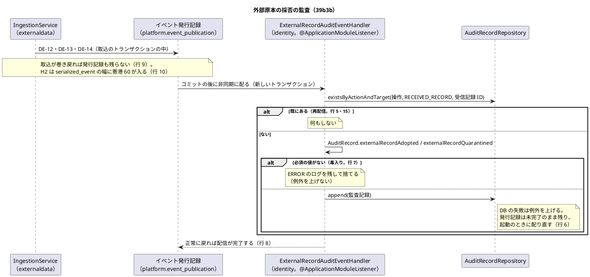
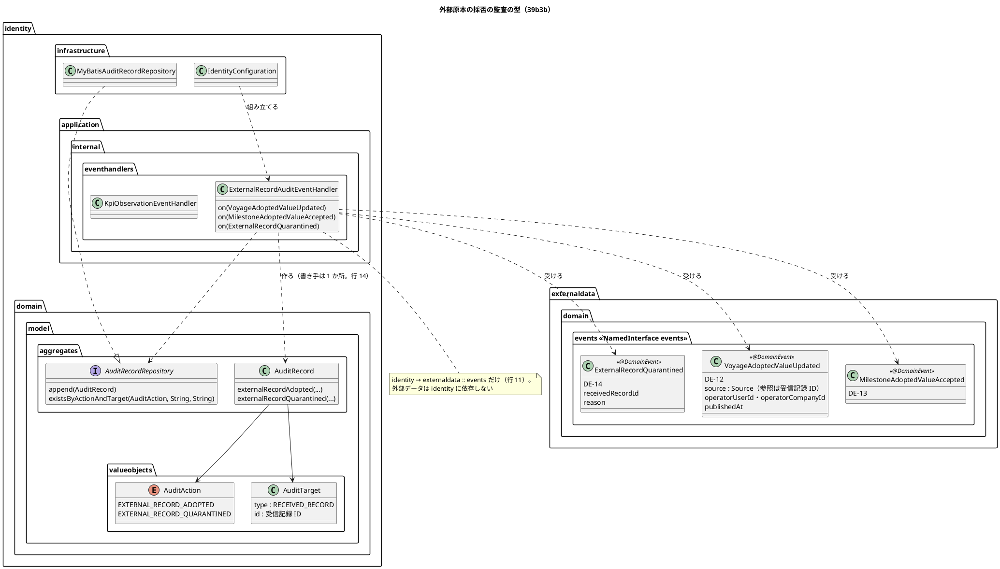
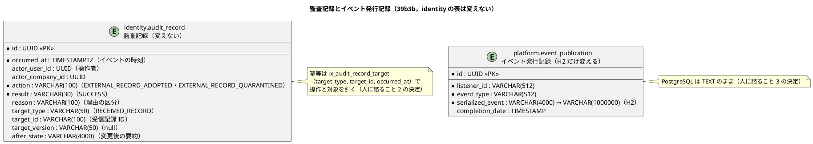

# Bolt 39b3b 計画 - 外部原本の採否の監査と層の規則の汎用化

## 基本情報

| 項目 | 内容 |
| :--- | :--- |
| Bolt | 第 39b3b 回（W7 の 9 本目。Bolt 39b3 の開始準備で release_plan の初案の 39b3 の行を縦に 2 本に分けた 2 つ目。release_plan :949） |
| 予定 | W7（2026-11-16 の週。前倒しで着手できる）。作業は約 3 時間 45 分（`check`・SonarQube・CI とステップごとの承認の待ちを除く） |
| アプローチ | インサイドアウト（監査記録の作り方と冪等の照会、監査の listener、H2 のイベント発行記録、配信の統合テスト、層の規則の順。開発戦略の W7 の行） |
| 対象 | (1) identity の監査の listener: DE-12・DE-13・DE-14 を受けて監査記録を書く（イベントから監査記録を書く最初の listener。取込での自動の採用も監査する。2026-11-03、human:kakimomokuri が決めた。Bolt 39b3 計画の「人に諮ること」2）、(2) identity の `allowedDependencies` に `externaldata :: events`、(3) 配信まで確かめる統合テスト（T-184）、(4) 毒入りのメッセージの扱い（前例 `KpiObservationEventHandler`）、(5) H2 の `platform.event_publication.serialized_event` VARCHAR(4000) と寄港 60 の DE-12、(6) W6 横断レビュー M-2（「書き手は 1 か所」の規則を表とヘルパーに）、(7) `PublicApiArchitectureTest` の汎用化、(8) 手書きの規則の写し（AcceptanceStepArchitectureTest）、(9) `AuditAction` と IA-INV（イベント経由の監査）の設計文書の直し |
| トレース | AUD-01 の「外部原本の採否」（non_functional :198）、AUD-02 の記録の項目（同 :199）、AUD-04 の欠落の検知（同 :201）、DE-12（domain_model :1660）・DE-13（同 :1661）・DE-14（同 :1662）の受け手「監査（Bolt 39b3b）」、IA-INV-07（同 :1431）、ADR-004 :83・:103、ADR-003 :90（再起動しても失われず二重処理もされない）、W6 横断レビュー M-2（w6_review_20261102 :48）。層の規則の汎用化（M-2・`PublicApiArchitectureTest`・手書きの規則の写し）の出典は Bolt 39 の決定 (3)・(8) と [Bolt 39 終了報告](bolt_39_report.md) :70・:104 |
| GitHub | [#18](https://github.com/k2works/practical-domain-driven-design-in-enterpris-application/issues/18)（US-14。クローズは 39h）、#50（M-2・`PublicApiArchitectureTest` の汎用化） |
| SP | 0 |
| 承認ゲート | **ステップごとに止める**（release_plan :949 の「ステップごと（監査・構造・スキーマ（H2））」）。構造（監査記録の新しい操作と作り方、依存の宣言、層の規則の変更）。スキーマ（H2）: identity の表は変えず、H2 の `platform.event_publication.serialized_event` の幅だけを広げる（下の「人に諮ること」2・3。2026-11-03、human:kakimomokuri が決めた）。注: 2026-11-03 の人の指示「Recommend 承認で進めて」により、各ステップの終わりで止めて推奨の案を承認として記録する（人が個別に見ていないことが分かるように「推奨のとおり（Recommend 承認の指示による）」と書く）。ステップを飛ばしたり束ねたりはしない。下の「人に諮ること」1〜6 は human:kakimomokuri が個別に決めた |
| 開始準備で決めたこと | 2026-11-03、推奨のとおり（Recommend 承認の指示による。human:kakimomokuri）: (1) **分け方**: 1 本にする。見積りは約 3 時間 45 分で半日に収まる（Bolt 39b3 計画 :356 の見積り約 3 時間に、H2 の列と寄港 60 の確認 20 分、監査記録の形の文書 15 分を足した）。半日を超えそうなら縦に分ける（下の「時間の配分と打ち切り」: ステップ 6 の開始で合計 2 時間 45 分を超えていたら、`PublicApiArchitectureTest` の汎用化と AcceptanceStepArchitectureTest の汎用化を 39b3c に送る。M-2 の表と監査の書き手の 1 行は 39b3b に残す。39b3b は監査の listener と配信と監査の書き手の規則で閉じた縦になる）、(2) **listener の置き場所**: `identity.application.internal.eventhandlers.ExternalRecordAuditEventHandler`（前例 `KpiObservationEventHandler` :20-29。`@Service` は JIG の印、組み立ては `IdentityConfiguration`）。`@ApplicationModuleListener` で、発行元のコミットの後に非同期に新しいトランザクションで書く（ADR-003）、(3) **毒入りのメッセージ**: 前例（`KpiObservationEventHandler` の Javadoc :44-47、処理 :54-61）と同じ判断にする。技術の失敗（DB の失敗）は例外をそのまま上げて配信を未完了に残し、起動のときに配り直す（application.properties :54）。内容のせいで書けないもの（必須の値がない）は ERROR のログを残して捨てる。監査記録の列の上限に当たる値を入れない形（「人に諮ること」1 の決定）にして、内容で落ちる道を作らない、(4) **監査記録の時刻**: 発生時刻はイベントの時刻（DE-12・DE-13 の公開した時刻、DE-14 の隔離した時刻。どれも取込の時刻）。listener の Clock は使わない（再配信で時刻が変わらない） |

## Bolt ゴール

データ責任者が承認済みの情報源のファイルを取り込むと、取込のコミットの後に identity の監査の listener が DE-12・DE-13・DE-14 を非同期に受け、受信記録ごとに外部原本の採否の監査記録を 1 つ書き、イベント発行記録が完了になる。同じイベントが再び届いても監査記録は増えない。巻き戻った取込には監査記録がない。寄港 60 の DE-12 も H2（ローカル起動・デモ環境）と PostgreSQL のイベント発行記録に入る。外部データは identity に依存しない。あわせて、「書き手は 1 か所」の規則を表とヘルパーにまとめて監査の書き手の行を足し、公開 API の規則をすべてのコンテキストの組に広げ、受入のステップ定義の規則を `*.acceptance..` 全体に当てる 1 つの規則にする。画面は作らない（39c）。

### 開始準備で確かめたこと

- **release_plan の 39b3b の行**（:949）: identity の監査の listener（`externaldata :: events`。DE-12・DE-13・DE-14 を監査する）、配信の確認（T-184）、毒入りのメッセージ、W6 横断レビュー M-2、`PublicApiArchitectureTest` の汎用化、手書きの規則の写し。開始準備で監査記録の形と冪等の取り方を諮る。承認ゲートは「ステップごと（監査・構造）」。順序は 39b3 → 39b3b → 39b4（:960）
- **W7 の設計の決定**: 外部原本の採否の監査（release_plan :898）は、外部データが DE-14 と判断のイベントを出し、identity の listener が監査記録を書く。【前の決定の変更】（2026-11-03、human:kakimomokuri）で DE-12・DE-13 も監査する。イベントから監査記録を書く listener は 39b3b が最初。ADR-004 :83・:103 も同じ
- **Bolt 39b3 の申し送り**: 39b3b に送る行 b1〜b8（[Bolt 39b3 計画](bolt_39b3_plan.md) :112-123）、申し送り（同 :148・:149・:154）、終了報告の既知の課題（[終了報告](bolt_39b3_report.md) :96）。H2 の列の件の送り先は開発レビューで 39e から 39b3b に直した（同 :63）
- **イベントの形**（Bolt 39b3 で作った）: DE-12 `VoyageAdoptedValueUpdated`（VoyageAdoptedValueUpdated.java :29-39。受信記録 ID は出典 `Source` の参照に入り、ばらの部品はない）、DE-13 `MilestoneAdoptedValueAccepted`（MilestoneAdoptedValueAccepted.java :31-44）、DE-14 `ExternalRecordQuarantined`（ExternalRecordQuarantined.java :30-43。受信記録 ID、提供元、原本種別、外部 ID・外部版（キーのない隔離は null）、理由、物理行）。どれも操作者 `operatorUserId`・`operatorCompanyId` を持つ。イベントは ID を持たない（Spring Modulith のイベント発行記録の ID は listener に渡らない）
- **監査記録の表**: `identity.audit_record` は `action VARCHAR(100)`・`result`（`SUCCESS`・`FAILURE`）・`reason VARCHAR(100)`・`correlation_id VARCHAR(100)`（V20261006140000__create_identity_users.sql :50-61）、`target_type VARCHAR(50)`・`target_id VARCHAR(100)`・`target_version VARCHAR(50)`・`before_state`・`after_state VARCHAR(4000)`（V20261016100000__add_identity_audit_record_target.sql :5-9）、索引 `ix_audit_record_target`（`target_type`、`target_id`、`occurred_at`。V20261027100000 :5）。**`event_id` の列はない**。data_model は ER 図に `event_id : UUID <<UK>>`（:878）と `source_ref`・`approval_ref`（:875-876）を描き、制約の表で「`event_id` の一意制約で、イベントの再配信による重複記録を防ぐ」（:936）と書くが、表と食い違っている
- **監査の作り方の今の形**: 操作は `AuditAction`（AuditAction.java :7-89。外部原本の採否の値はない。domain_model :232）、対象は `AuditTarget`（AuditTarget.java :16。種類と ID は必須）、監査記録は操作ごとの作り方（AuditRecord.java :95-505）。リポジトリは追記と操作者での照会と今の停止の記録の照会だけ（AuditRecordRepository.java :13・:16・:23）。実装は MyBatis だけ（`MyBatisAuditRecordRepository`）、照会の契約の前例は `AuditRecordSuspensionContract`
- **監査の書き方の不変条件**: IA-INV-08（domain_model :1432）は認証・権限外の試行を「ドメインイベントを経ずに同じ request の中で同期に」書く規則で、イベント経由の監査の規則はまだない（IA-INV は :1425-1438 の IA-INV-14 まで）
- **依存の宣言**: identity の `allowedDependencies` は `shared`・`quotation :: events`・`platform :: web`・`notification :: api`（identity の package-info :6-8）。外部データは `shared` だけ。`externaldata :: events` は名前付きインターフェースとして認識される（ModularityTest :50-58）。依存の検証は ModularityTest :47
- **H2 のイベント発行記録**: `platform.event_publication.serialized_event VARCHAR(4000) NOT NULL`（h2/V20261001090300__create_event_publication.sql :9）、索引 `(listener_id, serialized_event)`（同 :15）。PostgreSQL は TEXT（postgresql/V20261001090300 :7）。Spring Modulith の表の作成は切ってあり（application.properties :14）、表は Flyway の vendor ごとの置き場所（`db/migration/{vendor}`。application.properties :4）にある。H2 だけの列の幅の変更の前例は h2/V20261006150000__widen_spring_session_principal_name.sql :3（`ALTER COLUMN … SET DATA TYPE VARCHAR(320)`）。DE-12 の JSON は寄港 1 つでおよそ 110 文字（Bolt 39b3 計画 :154）なので、寄港 60 はおよそ 6,700 文字になり 4000 を超える。DE-12 を購読する最初の listener がこの Bolt の監査なので、この Bolt から H2 で寄港の多い航海の取込が発行記録の INSERT で巻き戻る
- **デモ環境は H2**: Heroku のデモ環境は dev プロファイルの H2 のインメモリで動く（ADR-013 :29・:50）。ローカル起動も H2（application-dev.properties :2・:6）。dev プロファイルの H2 のテストの前例は `H2AdoptedValueRepositoryTest` :20-22（`@SpringBootTest`・`@ActiveProfiles("dev")`）
- **配信の統合テストの前例**: `TransportRequestSubmittedDeliveryIntegrationTest` :45-64（listener の書いた記録を待ち、`CompletedEventPublications` で配信の完了を待つ）。統合テストの PostgreSQL は `TestcontainersConfiguration` :13-15（`postgres:18.6`、`@ServiceConnection`）。取込の統合テストは `ExternalDataIngestionIntegrationTest`（巻き戻りの前例 `inRolledBackTransaction` :417）
- **層の規則**: 「書き手は 1 か所」の規則は LayerArchitectureTest :329-600（範囲外の試行・範囲外の企業・招待の用途・担当範囲の外の記録・その読み出しと応答の部品。W6 横断レビュー M-2 は :330-594 を指す）。`PublicApiArchitectureTest` の組の規則は予約 → 見積りの 1 組だけ（:58-70。Javadoc :56 に「ほかのコンテキストの組は #50 の残り」）。今ある名前付きインターフェースは各コンテキストの `api`・`events` と `platform :: web` だけ（各 package-info）。AcceptanceStepArchitectureTest は一覧 `CONTEXTS`（:28-29。7 つ）に対して手書きの規則が 6 つ（:31-48。通知 `notification` の規則がない）で、一覧と実モジュールの一致だけを確かめている（:88-91。宿題のコメント :46・:86）。業務のコンテキストの一覧は `BusinessContexts.all()`（BusinessContexts.java :18-23）
- **W6 横断レビュー M-4**（トランザクションの外で監査記録を書く 3 か所を 1 つの部品に。w6_review :50）: この Bolt の listener は listener のトランザクションの中で書くので 3 か所とは別。#50 に残す（Bolt 39b3 計画 :140 のまま）

## 設計の決定

| 項目 | 決定 | 根拠 |
| :--- | :--- | :--- |
| 監査記録の形 | 「人に諮ること」1 の決定（2026-11-03、human:kakimomokuri が決めた）: 操作 `EXTERNAL_RECORD_ADOPTED`（DE-12・DE-13）・`EXTERNAL_RECORD_QUARANTINED`（DE-14）を `AuditAction` に足す。結果は `SUCCESS`。操作者はイベントの操作者、発生時刻はイベントの時刻。対象 `AuditTarget` は種類 `RECEIVED_RECORD`・ID は受信記録 ID（DE-12・DE-13 は出典の参照、DE-14 は受信記録 ID）・版は持たない（外部版は 100 文字まで、`target_version` は 50 文字）・変更前は持たない・変更後は正規の要約。理由は DE-14 の理由の区分（`CONTENT_MISMATCH` か `FormatDefect` の名前）、採用は持たない | AUD-02（non_functional :199）、AuditTarget.java :16 |
| 変更後の要約 | `key=value` を `;` でつなぐ正規の文字列。要約は人が読むためのもので、機械では解析しない。採否で項目をそろえる。DE-12: `recordType=VOYAGE;targetKey=<航海番号>;infoVersion=<情報版>;ingestionId=<取込 ID>;dataSourceId=<情報源 ID>;adoptedValueId=<採用値 ID>`。DE-13: 同じ形で `recordType=MILESTONE;targetKey=<追跡番号>;externalId=<外部 ID>` を加える。DE-14: `provider`・`recordType`・`externalId`・`externalVersion`（キーのない隔離は `-`）・`lines=<始まり>-<終わり>`（ファイルの誤りは `-`）・`ingestionId`・`dataSourceId`。出典（AUD-02）は要約の `dataSourceId` で代える。各部品の上限（提供元 100、外部 ID 200、外部版 100 など）の合計は 4000 に収まる | data_model :942（変更前後は要約。4000 を超えたら見直す） |
| 監査記録の作り方 | `AuditRecord.externalRecordAdopted(…)`・`AuditRecord.externalRecordQuarantined(…)`（前例 `userSuspended` :355）。どちらも操作者・発生時刻・受信記録 ID・要約を受け、必須の値がなければ `IllegalArgumentException`（listener が毒入りとして捨てる）。ステップ 7 の直しで、欠けを専用の型 `AuditRecord.MissingEventValueException`（`IllegalArgumentException` の子）にし、listener はこの型だけを捨てる（プログラムの誤りを毒入りとして捨てない）。listener は内容を確かめて（記録を作って）から照会し、受信記録 ID がなければ DB に問い合わせない。要約の部品は、キーのない隔離の外部 ID・外部版・物理行（`-`）のほかは必須で、欠けは要約に「null」と入れずに内容の欠けとして捨てる | 前例 AuditRecord.java :355-402 |
| 冪等の取り方 | 「人に諮ること」2 の決定（2026-11-03、human:kakimomokuri が決めた）: 操作と対象で引いてあれば書かない。`AuditRecordRepository` に `existsByActionAndTarget(AuditAction, String targetType, String targetId)` を足す（既存の索引 `ix_audit_record_target` を使う。スキーマは変えない）。前提は「（操作、受信記録）ごとにイベントは 1 つ」（39d で隔離した行を採用すると、同じ受信記録に DE-14 と DE-12・DE-13 が出るので、受信記録ごとに 1 つではない）。（操作、`RECEIVED_RECORD`、受信記録 ID）が 1 つのイベントを表す。39d はこの不変条件を守る（申し送り） | ADR-003 :90、AuditRecordRepository.java :13 |
| listener | `ExternalRecordAuditEventHandler`（開始準備の決定 (2)）に `on(VoyageAdoptedValueUpdated)`・`on(MilestoneAdoptedValueAccepted)`・`on(ExternalRecordQuarantined)` の 3 つ。照会してあれば何もせず、なければ作って追記する。作り方の `IllegalArgumentException` は ERROR のログを残して捨てる（受信記録 ID・取込 ID・操作をログに出し、値の中身は出さない）。DB の例外はそのまま上げる（開始準備の決定 (3)） | 前例 KpiObservationEventHandler.java :34-61 |
| 依存の宣言 | identity の package-info :8 の `allowedDependencies` に `externaldata :: events` を足し、Javadoc :2-4 に外部データの公表された言語を足す。外部データの宣言は変えない（identity に依存しない） | release_plan :894・:898 |
| H2 のイベント発行記録 | 「人に諮ること」3 の決定（2026-11-03、human:kakimomokuri が決めた）: H2 だけの Flyway のマイグレーション（`db/migration/h2/V20261116100000__widen_event_publication_serialized_event.sql`。版は作るときの日時）で `serialized_event` を `VARCHAR(1000000)`（H2 の VARCHAR の上限）に広げる。索引 `(listener_id, serialized_event)` が広げた列で作り直せることを Red で確かめ、だめなら止めて諮る。PostgreSQL は TEXT のまま変えない。ADR-007 に記録し、ADR-013 に「デモ環境でも寄港 60 の航海を取り込める」の注を足す | 前例 h2/V20261006150000 :3、ADR-007、ADR-013 |
| 39d の二重の監査 | 確認ポイント 5 の推奨: 39b3b の冪等（操作と対象）により、採用の監査 `EXTERNAL_RECORD_ADOPTED` は受信記録ごとに 1 つ（隔離した行の採用では同じ受信記録に隔離の監査と採用の監査が 1 つずつ）。39d の判断のイベントは判断（人の承認）の監査として別の操作（例 `EXTERNAL_RECORD_DECIDED`）で書き、二重の採用の記録にしない。決めるのは 39d の開始準備 | Bolt 39b3 計画 :149 |
| 層の規則 | 「人に諮ること」4・5 の決定（2026-11-03、human:kakimomokuri が決めた）: (i) 「書き手は 1 か所」の規則を、書き手の表（書き手のクラス、呼び出しの述語、理由）と、表の行から「ほかは呼ばない」と「書き手は実在して呼ぶ」の 2 つの規則を作るヘルパーにまとめ、外部原本の採否の監査（`AuditRecord.externalRecordAdopted`・`externalRecordQuarantined` を呼ぶのは `ExternalRecordAuditEventHandler` だけ）の行を足す（M-2。前例 LayerArchitectureTest :358-385）、(ii) `PublicApiArchitectureTest` の予約 → 見積りの規則（:58-70）を、`BusinessContexts.all()` のすべての組（A → B。A は B の `interfaces.api` と `domain.events` のほかに依存しない。`interfaces.api.internal` は公開 API に含めない）に広げる。今ある依存で落ちたら置き場所を動かさず止めて諮る（T-125、ADR-017）、(iii) AcceptanceStepArchitectureTest の手書きの規則（:31-48）を、`*.acceptance..` 全体に当てる 1 つの規則にし、依存元のパッケージからコンテキストを決める（通知の規則の抜けが埋まり、acceptance のない通知に空の規則を作って落ちることもない） | w6_review :48、CLAUDE.md の層の規則の取り決め |
| 用語集と設計の文書 | `AuditAction` の 2 つの値、`ExternalRecordAuditEventHandler`、IA-INV-15（イベント経由の監査: 取込のコミットの後に非同期に書く、操作と対象で冪等、内容の欠けは捨てて ERROR のログ、技術の失敗は配り直す）を domain_model に足す | LivingGlossaryConsistencyTest |

```text
外部原本の採否の監査記録の例（DE-12、取込での自動の採用）:
action=EXTERNAL_RECORD_ADOPTED, result=SUCCESS, actor=データ責任者, occurred_at=取込の時刻
target_type=RECEIVED_RECORD, target_id=<受信記録 ID>, target_version=null, before_state=null
after_state=recordType=VOYAGE;targetKey=V001;infoVersion=9;ingestionId=<取込 ID>;dataSourceId=<情報源 ID>;adoptedValueId=<採用値 ID>

DE-14（行の誤りのキーのない隔離）:
action=EXTERNAL_RECORD_QUARANTINED, reason=INVALID_PORT_CALLS
after_state=provider=<提供元>;recordType=VOYAGE;externalId=-;externalVersion=-;lines=12-12;ingestionId=<取込 ID>;dataSourceId=<情報源 ID>
```

## ふりかえりと前の Bolt からの引き継ぎ

| 出典 | 内容 | この Bolt での扱い |
| :--- | :--- | :--- |
| W6 の Try T-204・T-212、Bolt 38h の T-227、Bolt 39b の T-233 | サブエージェントへの指示の最初に heredoc（`<<`）と標準入力を待つコマンドを使わないと書く | 任せるときの指示の最初に書く。ファイルは Write・Edit で書く |
| W6 の Try T-217、Bolt 39b2 の Try | 本体を直す前に Red を流し、落ちた理由を記録する。Red の記録に、直したテストの一覧を添える | ステップ 2〜6 の各 Red。`AuditAction` の値を足して落ちる既存のテスト（列挙の網羅など）と、規則の汎用化で落ちる既存の依存は、各ステップの開始で grep して一覧にする |
| W6 の Try T-225・T-213 | push の前に `check` | ステップ 7 |
| W6 の Try T-182・T-211・T-216 | 状態の組み合わせの表に重複・隔離と出口・誤った入力の行を置く | 下の表（行 1〜16。再配信・毒入り・巻き戻り・キーのない隔離を含む） |
| W6 の Try T-184 | listener は配信まで確かめる | 行 8（取込のコミットの後に listener が動き、イベント発行記録が完了になる。前例 `TransportRequestSubmittedDeliveryIntegrationTest` :45-64。待つ条件は自分の受信記録 ID に限る） |
| W6 の Try T-219 | 変異の対象に単体・統合・契約のテスト | 下の変異の表 |
| W6 の Try T-215・T-222 | Gradle を流す担当を 1 つに、計画の初稿を先にコミット | Gradle は人の側の 1 か所で流す。初稿をコミットしてから実装に入る |
| Bolt 39a2 の T-229 | 永続化の Bolt の状態の組み合わせに時刻の出どころと同時の書き込みの行を置く | 発生時刻はイベントの時刻（行 15）。同じイベントの同時の配信は、照会してから追記するので二重になりうる（配り直しは起動のときだけ（application.properties :54 の `republish-outstanding-events-on-restart=true`）で、定期の再配信はない。ShedLock は未実装（ADR-003 :50 の決定とコードの食い違い。リスク台帳）。今は単一インスタンス（デモは Heroku の 1 台・H2 のインメモリ）なので同時の配信は起きない。ステップ 7 の直しで前提を事実に直した）ことを行 15 で確かめ、残る危険を「人に諮ること」2 に書く |
| Bolt 39a3 の T-230 | 入ることを確かめる行のデータはドメインの規則に合う組み合わせにする | 寄港 60 の航海は始港の到着と終港の出発を空にし、時刻は順に並べる。主要実績は 6 種類のどれか。情報源は `APPROVED` |
| Bolt 39b の T-231 | `@Transactional` は契約のクラスに付ける | 監査記録の照会の契約のクラスに付ける（ステップ 2） |
| Bolt 39b の T-232 | 本体のクラスを足したステップは、承認の前に `spotbugsMain` を流す | ステップ 2〜4 の完了の判定に入れる（ステップ 5・6 は本体を変えれば流す） |
| Bolt 39b2 の T-234 | 本体のクラスを足したステップでは、承認の前に SonarQube の規則（少なくとも `sonar-local:check` の新しい違反）も見る | ステップ 2〜4 の完了の判定に入れる |
| Bolt 39b2b の T-236 | 「起きないこと」を確かめるテストは、件数ではなく呼び出しの記録で確かめる | 再配信で書かないこと（行 5）と毒入りで書かないこと（行 7）は、記録するリポジトリの追記の呼び出しの記録で、巻き戻った取込で書かれないこと（行 9）はイベント発行記録がないことと、listener の呼び出しの記録（テストの中の spy）で確かめ、件数の差で確かめない |
| Bolt 39b3 の T-237 | 本体のクラスを足したステップでは、承認の前に `checkstyleMain` も流す（T-232・T-234 と並べる） | ステップ 2〜4 の完了の判定に入れる（ステップ 5・6 は本体を変えれば流す） |
| Bolt 39b3 の T-238 | サブエージェントへの指示は、計画の決定を言い換えず計画の行を指す | 任せるときは「設計の決定」の行と「状態の組み合わせ」の行番号を指し、決定を書き直さない |

## 状態の組み合わせ（行ごとにテストを 1 本。T-182）

単体は監査記録（`AuditRecordTest`）、listener（`ExternalRecordAuditEventHandlerTest`。記録するリポジトリと固定の時刻のイベント）で確かめる。契約は監査記録の照会（`AuditRecordEventAuditContract`。前例 `AuditRecordSuspensionContract`）を PostgreSQL と H2 で継ぐ。統合は PostgreSQL（`ExternalRecordAuditDeliveryIntegrationTest`。提供元の名前に自分の UUID を含めて絞る）と dev プロファイルの H2（`H2EventPublicationCapacityTest`）。規則は ModularityTest・LayerArchitectureTest・PublicApiArchitectureTest・AcceptanceStepArchitectureTest。テストの名前は「行 N_」で始める。

| 行 | 状況 | 期待 | 確かめ方 |
| :--- | :--- | :--- | :--- |
| 1 | DE-12（航海の採用） | 監査記録が 1 つ（`EXTERNAL_RECORD_ADOPTED`、`SUCCESS`、操作者、発生時刻はイベントの公開した時刻、対象 `RECEIVED_RECORD`・出典の参照の受信記録 ID、版なし、変更後の要約） | 単体（監査記録・listener） |
| 2 | DE-13（主要実績の採用） | 監査記録が 1 つ（行 1 と同じ操作。変更後の要約に追跡番号と外部 ID） | 単体（listener） |
| 3 | DE-14（内容の違う原本の隔離。キーあり） | 監査記録が 1 つ（`EXTERNAL_RECORD_QUARANTINED`、理由 `CONTENT_MISMATCH`、外部版は変更後の要約に入り `target_version` に入れない） | 単体（listener）、契約（100 文字の外部版が書ける） |
| 4 | DE-14（キーのない隔離: 行の誤り・ファイルの誤り） | 監査記録が 1 つ（理由は `FormatDefect` の名前、外部 ID・外部版は `-`、ファイルの誤りは行も `-`） | 単体（listener） |
| 5 | 同じイベントの再配信 | 監査記録は増えない（追記の呼び出しの記録が 1 回。T-236）。照会は操作と対象で引く | 単体（listener）、契約（照会）、統合（同じイベントを 2 回渡す） |
| 6 | 監査記録の追記の技術の失敗（DB の例外） | listener は例外を上げる。イベント発行記録は完了にならない（起動のときに配り直す） | 単体（listener。投げるリポジトリ）、統合（完了しない発行記録が残る） |
| 7 | 内容のせいで書けないイベント（毒入り: 受信記録 ID・操作者がない） | 例外を上げず、ERROR のログを 1 つ残して捨てる。追記を呼ばない（T-236） | 単体（listener。ログの記録） |
| 8 | 配信まで（T-184） | 取込のコミットの後に listener が非同期に動き、受信記録ごとの監査記録ができ、DE-12・DE-13・DE-14 のイベント発行記録が完了になる（待つ条件は自分の受信記録 ID） | 統合（PostgreSQL） |
| 9 | 巻き戻った取込 | 監査記録は書かれない。イベント発行記録が残らず、listener が呼ばれない（呼び出しの記録） | 統合（PostgreSQL。`inRolledBackTransaction` の前例） |
| 10 | 寄港 60 の DE-12 | H2（dev プロファイル）と PostgreSQL のイベント発行記録に入り、取込がコミットされ、監査記録ができる。広げる前の H2 では入らないことを Red で確かめる | 統合（H2・PostgreSQL） |
| 11 | 依存の宣言 | identity は `externaldata :: events` だけに依存し、外部データは identity を含むほかのコンテキストに依存しない | ModularityTest :47 |
| 12 | 規則の汎用化 | すべての業務のコンテキストの組で、ほかのコンテキストの `interfaces.api`（`interfaces.api.internal` を除く）と `domain.events` の外を呼ばない | PublicApiArchitectureTest |
| 13 | 手書きの規則の写し | 受入のステップ定義の規則は `*.acceptance..` 全体に当てる 1 つで、依存元のパッケージからコンテキストを決める（コンテキストごとの手書きの規則がなく、acceptance のない通知でも空の規則で落ちない）。一覧は業務のコンテキストに一致する（通知を含む 7 つ） | AcceptanceStepArchitectureTest |
| 14 | 監査の書き手は 1 か所 | 外部原本の採否の監査記録を作るのは監査の listener だけ。書き手が実在して呼ぶ（M-2 の表の行） | LayerArchitectureTest |
| 15 | 時刻の出どころと同時の書き込み（T-229） | 発生時刻はイベントの時刻で、listener の時刻ではない（再配信でも同じ）。同じイベントを 2 つのトランザクションで続けて渡すと、後の方は照会で書かない | 単体（listener）、統合 |
| 16 | 規則と用語 | `AuditAction` の 2 つの値と `ExternalRecordAuditEventHandler` が用語集にあり、Javadoc が日本語名で始まる | LivingGlossaryConsistencyTest |

## スコープ

### 入れるもの

- 行 1〜16 のテスト、`AuditAction` の 2 つの値、`AuditRecord` の 2 つの作り方、`AuditRecordRepository` の照会（MyBatis の実装と契約）、`ExternalRecordAuditEventHandler` と組み立て、identity の `allowedDependencies`、H2 のイベント発行記録の列（「人に諮ること」3 の決定）、M-2 の表とヘルパー、`PublicApiArchitectureTest` の汎用化、AcceptanceStepArchitectureTest の 1 つの規則
- 文書: 下の「設計文書に直す箇所」（ステップ 1）

### 入れないもの

- identity の `audit_record` のスキーマの変更（「人に諮ること」2 の決定で変えない）
- 判断（採用・却下）のイベントとその監査（39d）。39d の二重の監査は確認ポイント 5 の申し送り
- 経路設計・追跡の listener（39e・39g）
- W6 横断レビュー M-4（#50 に残す。上の「開始準備で確かめたこと」）
- 監査証跡の照会の画面（US-17）、AUD-04 の照合
- 画面（39c・39d）。マニュアルは変えない（見える振る舞いを変えない）

### 申し送り（既知の課題・入れないもの）

| 送り先 | 課題 | 扱い |
| :--- | :--- | :--- |
| 39d | 隔離した行の採用で、採用値の DE-12・DE-13 と判断のイベントの両方が出る。同じ受信記録に DE-14 と DE-12・DE-13 が出る | 確認ポイント 5 の推奨を 39d の開始準備に持ち込む（採用の監査は受信記録ごとに 1 つ、判断は別の操作で人の承認として残す）。冪等の前提の不変条件「（操作、受信記録）ごとにイベントは 1 つ」を守る（同じ受信記録を 2 回採用しない。破るなら冪等の取り方を見直す） |
| 39e・39g | 経路設計・追跡の listener の毒入りのメッセージ | この Bolt の扱い（内容の欠けは捨てて ERROR、技術の失敗は配り直す）を前例として使う |
| #50 | M-4 | 変えない |
| W10 | 本番の PostgreSQL のイベント発行記録の大きさ | TEXT なので列の上限はない。PERF-06（39b4）の 1 ファイルの件数と合わせて見る |
| W10 | 複数インスタンスでの監査の二重（ステップ 7 の直し。「人に諮ること」2 の注） | 今は単一インスタンスなので同時の配信は起きない。ShedLock は未実装（ADR-003 :50・architecture_backend :378・tech_stack :59 の決定とコードの食い違い）。複数インスタンスにする前に、監査の表の一意制約（`event_id` か（操作、対象）の一意制約）か ShedLock を入れる（release_plan の W10 の行とリスク台帳） |
| W10 | 監査の欠落の検知（ステップ 7 の直し） | 毒入りのイベントを捨てたときは ERROR のログだけで、AUD-04 の照合は提案のまま。DB の失敗で未完了の発行記録は次の再起動まで配り直されない。**ERROR のログの通知先と AUD-04 の照合は W10 の監視で作る**（release_plan の W10 の行） |

### 設計文書に直す箇所（ステップ 1）

- domain_model: `AuditAction`（:232）に `EXTERNAL_RECORD_ADOPTED`・`EXTERNAL_RECORD_QUARANTINED`、`AuditTarget`（:233）に対象の種類 `RECEIVED_RECORD`（外部原本の採否では受信記録 ID、版と変更前は持たない）、監査記録（:315）に外部原本の採否の対象（`RECEIVED_RECORD`）と作り方、要素表・用語集に `ExternalRecordAuditEventHandler`、IA-INV-15（イベント経由の監査。上の「用語集と設計の文書」）を IA-INV-14（:1438）の後に足し、IA-INV-08（:1432）に「イベント経由の監査は IA-INV-15」の注、DE-12〜DE-14（:1660-1662）の受け手「監査（Bolt 39b3b）」に監査記録の操作の名前
- data_model: 監査記録の ER 図の `event_id : UUID <<UK>>`（:878）を「人に諮ること」2 の決定に合わせて直し、`approval_ref`・`source_ref`（:875-876）は実際の表にないと注を付ける（外部原本の採否の出典は変更後の要約の `dataSourceId` で代える）。制約の表の `audit_record` の行（:936）を 1 行まるごと書き直す（UPDATE・DELETE の権限なし。イベント経由の監査は操作と対象で冪等にする（（操作、受信記録）ごとにイベントは 1 つ。既存の索引 `ix_audit_record_target`）。`event_id` の列は作っていない。認証の失敗と権限外のアクセス試行は同期で書く）。`audit_record` の作った列の説明（:949・:955 の続き）に Bolt 39b3b の外部原本の採否の行（対象・理由・変更後の要約）。「人に諮ること」3 の決定で H2 のイベント発行記録の列の注
- test_strategy :275: IA-INV-07 の行の「`event_id` の一意」を「操作と対象での冪等（イベント経由の監査。IA-INV-15）」に直す
- non_functional :198: AUD-01 に「外部原本の採否はイベント経由で非同期に記録する（IA-INV-15）」を足す
- release_plan: :898（外部原本の採否の監査）に、監査記録の形と冪等の決定（2026-11-03、human:kakimomokuri が決めた）
- architecture_backend :132: 行の見出し「外部データ → 経路設計・追跡」に I（アクセス・監査）を足すか、「外部データ → アクセス・監査」の行を分け、identity の listener（`externaldata :: events`）を 39b3b で足したことを書く。「人に諮ること」4 の決定で、公開 API の組の規則をすべての組に広げたこと
- ADR-004: :103（採否の監査の範囲）に、監査記録の形と冪等の取り方の決定。改訂の経緯に Bolt 39b3b の項
- ADR-007: H2 のイベント発行記録の列を Spring Modulith の H2 の定義から広げたこと（「人に諮ること」3 の決定）。コンプライアンス :84 の「H2 でリポジトリのテストを書かない」を今の運用（契約のテストを PostgreSQL と H2 で継ぐ。デモ環境とローカル起動が H2）に合わせて改訂し、改訂の経緯を足す（「人に諮ること」6 の決定）
- ADR-013: 「デモ環境でも寄港 60 の航海を取り込める（H2 の `serialized_event` を広げた。Bolt 39b3b）」の注
- コードのコメント（触るステップで直す）: identity の package-info :2-4、`AuditAction` の Javadoc :3-6、`AuditTarget` の Javadoc（対象の種類に `RECEIVED_RECORD`）、`PublicApiArchitectureTest` の Javadoc :53-57、AcceptanceStepArchitectureTest の :46・:86 の宿題のコメント

## 設計（この Bolt の範囲）







- 状態遷移図: 監査記録は追記専用で遷移しない。イベント発行記録の未完了 → 完了は Spring Modulith の振る舞いで、シーケンス図に描いたので省く
- 画面遷移図: 画面を作らないので省く（監査証跡の照会の画面は US-17）

## ステップ計画（ステップごとに止める）

- [x] **1. 設計の文書**（2026-11-04、推奨のとおり承認として記録した（Recommend 承認の指示による。human:kakimomokuri）。ADR-007 に改訂の経緯の節を作った。まだ作っていない規則の汎用化と H2 のマイグレーションを決定として書いたので、ステップ 4・6 で中身が変わったら合わせて直す）: 上の「設計文書に直す箇所」（「人に諮ること」1〜6 の決定を反映する。ADR-007 の改訂を含む）（完了の判定: 文書の差分。**承認ゲート**）
- [x] **2. 監査記録の作り方と冪等の照会（Red → Green）**（2026-11-04、推奨のとおり承認として記録した（Recommend 承認の指示による。human:kakimomokuri）。先に直したテストはポートの偽の実装 9 個（T-217）。Red はテストのコンパイルの誤り。冪等の照会は `COUNT(*) > 0`（スキーマは変えない）。契約を H2・PostgreSQL で継いだ）: 行 1〜4 の監査記録の単体、行 3・5 の照会の契約（PostgreSQL と H2。`@Transactional` は契約のクラスに付ける。T-231）を先に書いて落ちることを確かめ（`AuditAction` の値を足して落ちる既存のテストを一覧にする。T-217）、`AuditAction` の 2 つの値、`AuditRecord` の 2 つの作り方、`AuditRecordRepository.existsByActionAndTarget` と MyBatis の実装を作る（完了の判定: 緑、`spotbugsMain`（T-232）、`checkstyleMain`（T-237）、`sonar-local:check` の新しい違反（T-234）。**承認ゲート**（構造: 監査記録の新しい操作））
- [x] **3. 監査の listener と依存の宣言（Red → Green）**（2026-11-04、推奨のとおり承認として記録した（Recommend 承認の指示による）。Red は listener のテストのコンパイルの誤りと、`allowedDependencies` のない ModularityTest の行 11。監査の listener で受け手ごとの発行記録が増え、既存の統合テストの行 8 の数え方を受け手で絞る形に直した（T-217 の一覧の漏れ）。SonarQube は 1 件直して PASS）: 行 1〜7・11・15・16 の単体と ModularityTest を先に書いて落ちることを確かめ、`ExternalRecordAuditEventHandler`、`IdentityConfiguration` の組み立て、identity の `allowedDependencies` を作る（完了の判定: 緑、`spotbugsMain`、`checkstyleMain`、`sonar-local:check` の新しい違反。**承認ゲート**（構造: 依存の宣言とイベントから監査を書く最初の listener））
- [x] **4. H2 のイベント発行記録（Red → Green）**（2026-11-04、推奨のとおり承認として記録した（Recommend 承認の指示による。human:kakimomokuri）。Red は寄港 60 の取込の発行記録の INSERT が長過ぎて落ちるのと列の幅。版は作るときの日時の V20261104103700。索引は ALTER の後も残った。件数を数える既存のテストに直すものはなかった）: 行 10 の H2 の統合テスト（寄港 60 の取込がコミットされる）を先に書き、広げる前の H2 で INSERT が落ちることを確かめてから、「人に諮ること」3 の決定のマイグレーションを足す（完了の判定: 緑、dev プロファイルの起動（`DevSampleDataSmokeTest`）、`spotbugsMain`・`checkstyleMain`・`sonar-local:check`（本体を変えたら）。**承認ゲート**（スキーマ（H2）: イベント発行記録の列））
- [x] **5. 配信の統合テスト（Red → Green）**（2026-11-04、推奨のとおり承認として記録した（Recommend 承認の指示による）。既に緑だったので、listener の Bean を外す変異と冪等の照会を外す変異で落ちることを確かめた。行 5 は前の配信の完了を待ってから再発行する形に直した。行 9 は監査記録のリポジトリの spy で呼ばれないことを確かめた。SonarQube は 9 件直して PASS）: 行 5・6・8・9・10（PostgreSQL）・15 の統合テスト（前例 `TransportRequestSubmittedDeliveryIntegrationTest` :45-64）。既に緑なら、変異（listener の登録を外す・照会を外す）で落ちることを確かめる（完了の判定: 緑。本体を変えたら `spotbugsMain`・`checkstyleMain`。**承認ゲート**（構造: 配信））
- [x] **6. 層の規則（Red → Green）**（2026-11-04、推奨のとおり承認として記録した（Recommend 承認の指示による。human:kakimomokuri）。規則に反する依存をわざと足す変異 5 つで落ちることを確かめた（前の手書きの規則は通知のステップ定義の違反を見落としていた）。広げた規則は今ある依存でそのまま緑。書き手の表は 7 行で、アダプターと読み出しの行に「書き手は実在して触る」が新たに付いた。SonarQube は PASS）: 行 12〜14 の規則。M-2 の表とヘルパーに置き換える前後で同じ規則が同じ違反を捕まえることを、書き手の行を 1 つ外す変異で確かめる。`PublicApiArchitectureTest` の汎用化で今ある依存が落ちたら、置き場所を動かさず止めて諮る（T-125、ADR-017）（完了の判定: 緑。**承認ゲート**（構造: 層の規則））
- [x] **7. 品質ゲートと開発レビュー**（`4e60babf5`。開発レビューの高 1・中 2・低 4 とテストの穴を直した。ShedLock の前提の誤りを事実に直した）: 変異、`check`、その後に SonarQube、開発レビューとその直し。push の前に `check`
- [x] **8. 終了報告**（[終了報告](bolt_39b3b_report.md)を 2026-11-04 に承認として記録した。Recommend 承認の指示による）: push して CI とデモ環境の配備を確かめる（デモ環境で寄港の多い航海を取り込めることは、画面がないので統合テストで代える）。release_plan（39b3b の行の計画と終了報告のリンク）・開発の索引・mkdocs を直す。見える振る舞いは変わらないので、マニュアルは直さない

### 時間の配分と打ち切り

| # | 目安 | 打ち切り |
| :--- | :--- | :--- |
| 1 | 25 分 | — |
| 2 | 35 分 | — |
| 3 | 35 分 | — |
| 4 | 20 分 | 索引が広げた列で作り直せなければ止めて諮る（「人に諮ること」3 で比べた (b)・(c) か、索引の変更） |
| 5 | 30 分 | ステップ 5 の開始で合計 2 時間を超えていたら、行 6 の統合テスト（未完了の発行記録が残る）を単体だけにする |
| 6 | 50 分 | ステップ 6 の開始で合計 2 時間 45 分を超えていたら、`PublicApiArchitectureTest` の汎用化（行 12）と AcceptanceStepArchitectureTest の汎用化（行 13）だけを 39b3c に送る（開始準備の決定 (1)）。M-2 の表とヘルパー、監査の書き手の 1 行（行 14）は 39b3b に残す |
| 7 | 20 分（待ちを除く） | — |
| 8 | 10 分（CI の待ちを除く） | — |

合計 225 分（約 3 時間 45 分）。半日に収まるので 1 本にする。分ける場合は 39b3b（ステップ 1〜5・7・8 とステップ 6 の M-2 と行 14）と 39b3c（行 12・13 と品質ゲート・報告）。39b3c に分けたときは、release_plan の 39b3b の行（範囲から `PublicApiArchitectureTest` の汎用化と手書きの規則の写しを外し、39b3c の行を足す）と順序（:960 に 39b3c を 39b3b の後に入れる）、development_strategy :350（W7 の行の 39b3b の説明に 39b3c を足す）を直す。

## 確認ポイント（計画の承認の場でまとめて確認する。Try T-6）

| # | 確認すること | 場所 | 推奨 |
| :--- | :--- | :--- | :--- |
| 1 | **分け方** | 計画の初稿 | 推奨のとおり（Recommend 承認の指示による。human:kakimomokuri）。1 本（約 3 時間 45 分）。打ち切りで層の規則を 39b3c に送る（開始準備の決定 (1)） |
| 2 | **listener の置き場所** | ステップ 3 | 推奨のとおり。`identity.application.internal.eventhandlers`（前例 `KpiObservationEventHandler`）。代わりの案（`identity.infrastructure` に置く）は、ほかの listener と置き場所が分かれるので取らない |
| 3 | **毒入りのメッセージ** | ステップ 3 | 推奨のとおり。前例と同じ（内容の欠けは ERROR のログで捨てる、技術の失敗は配り直す）。人に諮らない（Bolt 39b3 計画 :381） |
| 4 | **監査記録の時刻** | ステップ 3 | 推奨のとおり。イベントの時刻（取込の時刻）。代わりの案（listener の Clock）は、再配信と非同期の遅れで発生時刻が操作の時刻から離れ、AUD-02 の「日時」が取込の操作の時刻でなくなるので取らない |
| 5 | **39d の二重の監査** | 申し送り | 推奨: 採用の監査（`EXTERNAL_RECORD_ADOPTED`）は受信記録ごとに 1 つ（行 5 の冪等で守る）。39d の判断のイベントは人の判断の監査として別の操作で書く。決めるのは 39d の開始準備 |
| 6 | **変異** | ステップ 7 | 下の 9 個 |

### 人に諮ること（2026-11-03、human:kakimomokuri が個別に決めた）

| # | 諮ったこと | 決定と比べた案 | 諮った理由 |
| :--- | :--- | :--- | :--- |
| 1 | **監査記録の形**（操作の種類、対象、理由、外部版、操作者） | **決定 (a)**（human:kakimomokuri が決めた。選んだ選択肢の説明の範囲すべて）: 操作は採用と隔離の 2 つ（`EXTERNAL_RECORD_ADOPTED`・`EXTERNAL_RECORD_QUARANTINED`）、対象は受信記録（`RECEIVED_RECORD`、受信記録 ID）、理由は DE-14 の理由の区分（採用は持たない）、外部版は `target_version`（50 文字）に入れず変更後の要約に入れる、操作者はイベントの操作者（データ責任者）。比べた案: **(b)** 操作を原本種別で分ける（`VOYAGE_ADOPTED`・`MILESTONE_ADOPTED`・`EXTERNAL_RECORD_QUARANTINED`）→ 種別は変更後の要約で分かり、AUD-04 の照合（採用値の件数と採用の監査の件数）が 2 つの操作の和になる。**(c)** 対象を採用値（`ADOPTED_VALUE`、採用値 ID）にする → 隔離には採用値がなく、採用と隔離で対象の種類が分かれ、39d の隔離した行の採用で同じ受信記録の隔離と採用を対象で並べられない。**(d)** 外部版を `target_version` に入れ、列を 100 文字に広げる → identity のスキーマの変更で、ほかの操作の版（app_user の版）と意味の違う値が同じ列に入る。(a) の理由: 列の上限に当たる値を入れず（内容で落ちる毒入りを作らない）、受信記録 1 つに監査 1 つで AUD-04 の照合が単純 | 監査の新しい判断（監査記録の操作の種類と対象の形）で、AUD-04 の照合と US-17 の照会の契約になる。Bolt 39b3 計画 :378 で 39b3b の開始準備に送った |
| 2 | **冪等の取り方**（data_model :878・:936 は `event_id` の一意制約だが、表に `event_id` の列がない。V20261006140000 :50-61・V20261016100000 :5-9） | **決定 (b)＋(c)**（human:kakimomokuri が決めた）: 操作と対象で引いてあれば書かない（`existsByActionAndTarget`。索引 `ix_audit_record_target` を使う。スキーマは変えない）。data_model の `event_id` の記述（ER 図 :878 と制約の表の `audit_record` の行 :936 まるごと）を実際に合わせ「イベント経由の監査は操作と対象で冪等にする（（操作、受信記録）ごとにイベントは 1 つ）。`event_id` の列は作っていない」に直す。比べた案: **(a)** 監査の表に `event_id UUID` の列と一意制約（NULL を許す）を足す → 同時の配信でも DB で二重を防げるが、イベントは ID を持たず（Spring Modulith の発行記録の ID は listener に渡らない）、ID をイベントに足すと Bolt 39b3 で固めた直列化の契約の変更（v2）になる。採用値 ID・受信記録 ID を `event_id` に入れると意味が「イベントの ID」でなくなる。既存の行は NULL のまま（追記だけの表なので列の追加は既存の行を変えない。V20261016100000 :3 と同じ）。**(c) だけ**（data_model を直すが冪等にしない）→ 再配信で監査が二重になり、ADR-003 :90 と AUD-04 の照合に反する。(b) の残る危険: 同じイベントを 2 つのインスタンスが同時に配ると照会と追記の間で二重になりうる。二重が見つかれば AUD-04 の照合で分かる。**注（ステップ 7 の直し、2026-11-04。推奨のとおり（Recommend 承認の指示による））**: 決定のときの前提「再配信は ShedLock で 1 インスタンスに限る（ADR-003 :50）ので、通常の配信と起動のときの配り直しが重なる場合に限られる」は誤りだった。ShedLock は build.gradle にも main のコードにもなく、定期の再配信もない（あるのは起動のときの配り直し `republish-outstanding-events-on-restart=true` だけ）。今は単一インスタンス（デモは Heroku の 1 台・H2 のインメモリ）なので同時の配信は起きず、決定 (b)＋(c) は変えない。複数インスタンスにする前（W10 の運用準備）に、監査の表の一意制約（`event_id` か（操作、対象）の一意制約）か ShedLock を入れる（release_plan の W10 の行とリスク台帳） | data_model の決定（`event_id` の一意制約）の変更か、スキーマの変更（確認必須: データベース）のどちらかになる |
| 3 | **H2 の `serialized_event` VARCHAR(4000)**（h2/V20261001090300 :9。デモ環境は H2 のインメモリ。ADR-013 :29・:50） | **決定 (a)**（human:kakimomokuri が決めた）: H2 だけのマイグレーション（`db/migration/h2`。前例 h2/V20261006150000 :3）で `VARCHAR(1000000)` に広げる。Spring Modulith の表の定義は Flyway の vendor ごとの置き場所にあり（application.properties :4・:14）、PostgreSQL（TEXT）と本番は変わらない。ADR-007 に記録し、ADR-013 に「デモ環境でも寄港 60 の航海を取り込める」の注を足す。比べた案: **(b)** 寄港の上限を 30 程度に下げる → 2026-11-03 に human:kakimomokuri が決めた上限 60（Bolt 39b3 計画の確認ポイント 5）の変更で、H2 の都合で業務の規則を変えることになる。**(c)** DE-12 の値を減らす（寄港を持たず採用値 ID だけにする）→ 2026-11-03 に human:kakimomokuri が決めたイベントの型（同「人に諮ること」1 の案 (a)）の変更で、下流（39e）が公開 API で値を引くことになる。(a) の理由: ローカル起動とデモ環境が本番と同じ取込を受けられ、前の 2 つの人の決定を変えない | スキーマの変更（確認必須: データベース）。Spring Modulith の H2 の定義（spring-modulith-events-jdbc の schema-h2.sql。h2/V20261001090300 :1）から外れる |
| 4 | **層の規則の変更** | **決定 (a)**（human:kakimomokuri が決めた）: (i) `PublicApiArchitectureTest` の予約 → 見積りの規則（:58-70）を、`BusinessContexts.all()` のすべての組に広げる（ほかのコンテキストへの依存は `interfaces.api` と `domain.events` だけ。`interfaces.api.internal` は公開 API に含めない。行 12 の期待）。今ある依存で落ちたら、置き場所を動かさず止めて諮る（T-125、ADR-017）。(ii) 「書き手は 1 か所」の規則を表とヘルパーにまとめ（M-2。LayerArchitectureTest :329-600）、M-2 の表に外部原本の採否の監査の書き手（`ExternalRecordAuditEventHandler`）の行を 1 つ足す（T-205）。比べた案: **(b)** 組の規則を広げず、Spring Modulith の `allowedDependencies`（ModularityTest :47）に任せる → 名前付きインターフェースの中身（`api`・`events` に置いてよいもの）は ArchUnit の別の規則が守るが、組の規則の名前で違反の理由が読めなくなり、#50 の残りが閉じない。**(c)** M-2 をせず、監査の書き手の規則を今の書き方で 2 つ足す → 書き手の規則が 12 個を超えて写しが積み上がる（W6 横断レビューの議論 1。w6_review :88） | 層の規則の変更（規則を強める・書き手の規則を足す）。Bolt 39b3 計画 :379 で 39b3b の開始準備に送った |
| 5 | **AcceptanceStepArchitectureTest の汎用化** | **決定**（human:kakimomokuri が決めた）: 手書きの規則（:31-48）を、`*.acceptance..` 全体に当てる 1 つの規則にし、依存元のパッケージからコンテキストを決める。コンテキストの一覧から規則を作る形は、acceptance のない通知（`notification`）で空の規則が落ちるので取らない（行 13） | 層の規則の変更。計画の初稿はコンテキストごとの規則（通知を含む 7 つ）で、詳細整合性検証で acceptance のない通知の規則が空で落ちる（ArchUnit の既定の failOnEmptyShould）と分かった |
| 6 | **ADR-007 の「H2 でリポジトリのテストを書かない」**（ADR-007 :84） | **決定**（human:kakimomokuri が決めた）: 今の運用（契約のテストを PostgreSQL と H2 で継ぐ。デモ環境とローカル起動が H2）に合わせて改訂し、改訂の経緯を足す（ステップ 1） | ADR の決定の改訂。行 3・5 の契約を H2 でも継ぐので、今の文面と食い違う |

### 変異と落ちる見込みのテスト

| # | 変異 | 落ちる見込み |
| :--- | :--- | :--- |
| V1 | 冪等の照会を外す（いつも追記する） | 行 5・15（単体の呼び出しの記録、統合） |
| V2 | 毒入りで例外を上げる | 行 7（単体） |
| V3 | DB の例外を握りつぶす | 行 6（単体・統合） |
| V4 | 発生時刻に listener の時刻を入れる | 行 1・15（単体） |
| V5 | 外部版を `target_version` に入れる | 行 3（契約。100 文字の外部版） |
| V6 | H2 のマイグレーションを外す | 行 10（H2） |
| V7 | identity の `allowedDependencies` から `externaldata :: events` を外す | 行 11（ModularityTest） |
| V8 | 規則のヘルパーが書き手の表の 1 行を読み落とす | 行 14（LayerArchitectureTest） |
| V9 | DE-14 の listener の登録を外す | 行 8（統合。発行記録が完了にならない） |

## 完了条件

- [ ] 上のステップ 1〜8 の完了の判定を満たす（ステップごとの承認を受ける）
- [ ] 行 1〜16 に、それを名乗るテストがある
- [ ] 「人に諮ること」1〜6 の決定が計画・release_plan・domain_model・data_model・test_strategy・non_functional・architecture_backend・ADR-004・ADR-007・ADR-013 に反映されている（上の「設計文書に直す箇所」）
- [ ] `check` が緑、SonarQube が PASS、CI が緑、デモ環境が新しい版で動く
- [ ] identity の `audit_record` のスキーマは「人に諮ること」2 の決定のとおり変えていない
- [ ] 終了報告が承認されている

## 更新履歴

| 日付 | 更新内容 | 更新者 |
| :--- | :--- | :--- |
| 2026-11-03 | 計画を承認した。監査記録の形・冪等・H2 の発行記録の列・規則の汎用化（AcceptanceStep を含む）・ADR-007 の改訂は human:kakimomokuri が個別に決めた。整合性検証の指摘（詳細: 中 4・軽 9、横断: 中 7・軽 7）を反映し、ほかは推奨のとおり（Recommend 承認の指示による） | anthropic/claude-opus-5-5、承認 human:kakimomokuri |
| 2026-11-03 | 初版作成（承認待ち）。開始準備の決定: 1 本にする（約 3 時間 45 分。打ち切りで層の規則を 39b3c に）、listener は `identity.application.internal.eventhandlers`、毒入りのメッセージは前例のとおり、監査記録の時刻はイベントの時刻（推奨のとおり。Recommend 承認の指示による。human:kakimomokuri）。監査記録の形、冪等の取り方、H2 のイベント発行記録の列、層の規則の変更は人に諮る | anthropic/claude-opus-5-5 |

## 関連ドキュメント

- [リリース計画](release_plan.md)（W7 の節の 39b3b の行）
- [Bolt 39b3 計画](bolt_39b3_plan.md)（39b3b に送る行 b1〜b8 と申し送り）・[Bolt 39b3 終了報告](bolt_39b3_report.md)
- [W6 横断レビュー](../../review/cargo-tracker/w6_review_20261102.md)（M-2・M-4）
- [データモデル](../../design/cargo-tracker/data_model.md)、[ドメインモデル](../../design/cargo-tracker/domain_model.md)、[バックエンドアーキテクチャ](../../design/cargo-tracker/architecture_backend.md)、[非機能要件](../../design/cargo-tracker/non_functional.md)（AUD-01・AUD-02・AUD-04）、[テスト戦略](../../design/cargo-tracker/test_strategy.md)（IA-INV-07）
- [ADR-003](../../adr/cargo-tracker/003-inter-context-integration.md)、[ADR-004](../../adr/cargo-tracker/004-external-data-ingestion.md)、[ADR-007](../../adr/cargo-tracker/007-postgresql-mybatis-flyway.md)、[ADR-013](../../adr/cargo-tracker/013-heroku-demo-environment.md)
