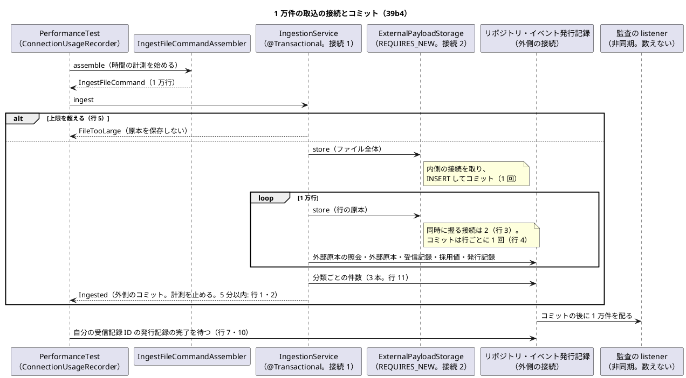
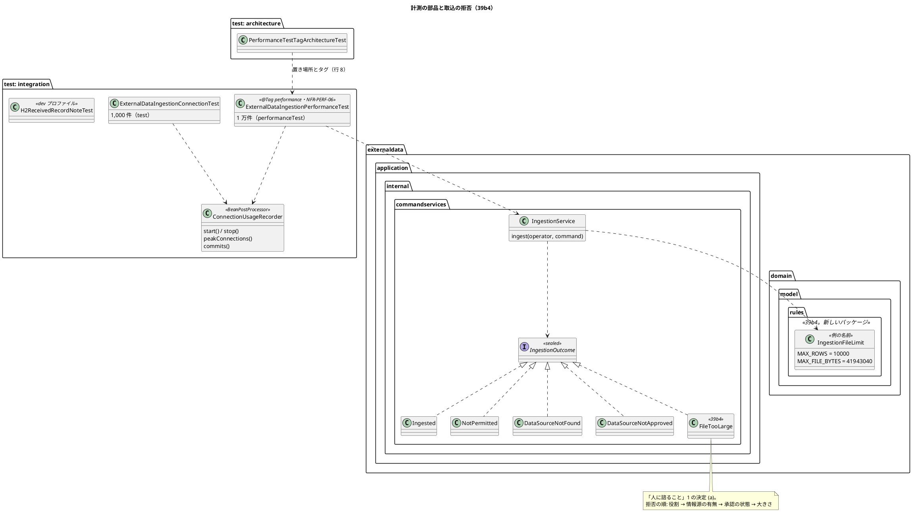

# Bolt 39b4 計画 - 外部原本の取込の性能（PERF-06）と量・接続の計測

## 基本情報

| 項目 | 内容 |
| :--- | :--- |
| Bolt | 第 39b4 回（W7 の 10 本目。Bolt 39b の開始準備で初案の 39b を縦に 4 本に分けた 4 つ目。release_plan :952） |
| 予定 | W7（2026-11-16 の週。前倒しで着手できる）。作業は約 3 時間 10 分（`check`・`performanceTest`・SonarQube・CI とステップごとの承認の待ちを除く） |
| アプローチ | インサイドアウト（接続とコミットを数える計測の部品、1 万件の計測、原本の大きさの上限、H2 の補助文字の順。開発戦略の W7 の行 :350） |
| 対象 | (1) PERF-06（1 万件のファイルを 5 分以内に分類・採用）を測る統合テスト（PostgreSQL。航海と主要実績の両方）、(2) 取込の経路が同時に握る接続の数（外側 1・内側 1）と行ごとのコミットの量、(3) 足りなければ一括の保存（`ExternalPayloadStorage` にポートを足す。構造。下の「時間の配分と打ち切り」で 39b4b に送る）、(4) 原本の大きさの上限（ファイル全体で物理データ行 10,000 件と 41,943,040 バイト。超えるファイルは原本を保存せずに拒否する。「人に諮ること」1 の決定）、(5) 数えるテストは自分のキーで絞る規約（test_strategy に）、(6) 分類ごとの件数の照会を 1 本にするか（Bolt 39b の申し送り）、(7) H2 の `classification_note VARCHAR(1000)` と補助文字（Bolt 39b2 の申し送り）、(8) 計測のテストの置き場所とタグ |
| トレース | PERF-06（non_functional :62）、規模の前提「1 ファイル 1 万件以下」（同 :50）、DB の 1 文の上限（同 :81。取込・照合の一括処理は 60 秒）、W7 の確認ポイント 4（release_plan :910）、ADR-004 の改訂の経緯の Bolt 39a2 の項の「接続」（:86）・「量」（:87）と Bolt 39b の項の分け方の注（:92）、リスク台帳の PERF-06 の行（release_plan :1075。同じ追跡番号への集中は 39g） |
| GitHub | [#18](https://github.com/k2works/practical-domain-driven-design-in-enterpris-application/issues/18)（US-14。クローズは 39h） |
| SP | 0 |
| 承認ゲート | **ステップごとに止める**（release_plan :952 の「ステップごと（構造）」）。構造（計測の部品と Gradle のタスク、取込の拒否の追加、要れば保存のポートの追加）。スキーマ（H2）はステップ 5 の Red で H2 が補助文字を受けなかったときだけ（H2 だけのマイグレーション）。注: 2026-11-04 の人の指示「Recommend 承認で進めて」（重ねての指示）により、各ステップの終わりで止めて推奨の案を承認として記録する（人が個別に見ていないことが分かるように「推奨のとおり（Recommend 承認の指示による）」と書く）。ステップを飛ばしたり束ねたりはしない。下の「人に諮ること」1 も推奨のとおり (a) に決めた（推奨のとおり。Recommend 承認の指示による）。業務の判断なので、終了報告の承認の議題の先頭に置き、人が改めて見る |
| 開始準備で決めたこと | 2026-11-04、推奨のとおり（Recommend 承認の指示による。human:kakimomokuri）: (1) **分け方**: 1 本にする。見積りは約 3 時間 10 分で半日に収まる。半日を超えそうなら縦に分ける（下の「時間の配分と打ち切り」: ステップ 3 の計測で 1 万件の取込が 2 分 30 秒を超えたら、一括の保存を 39b4b に送る。39b4 は計測・上限・規約・H2 で閉じた縦になる）、(2) **計測の範囲**: CSV の組み立て（`IngestFileCommandAssembler.assemble`。IngestFileCommandAssembler.java :77）から取込のコミットまで（解析・組み立て・分類・原本の保存（REQUIRES_NEW で行ごと）・受信記録・採用値・イベントの発行（イベント発行記録の INSERT）を含む）。監査の listener の配信はコミットの後の非同期で、PERF-06 の「分類・採用」の外なので時間に含めず、配信がすべて完了するまでを待って参考の値として記録する（行 10）、(3) **代表**: 航海と主要実績の両方を 1 万件ずつ測る（航海は行と DE-12 が大きく、主要実績は追跡番号の列がある。どちらかだけでは片方の量を見落とす）、(4) **置き場所とタグ**: 1 万件の計測は `com.example.cargotracker.integration.ExternalDataIngestionPerformanceTest`（前例 `ExternalDataIngestionIntegrationTest` と同じ置き場所）に `@Tag("performance")` と `@Tag("NFR-PERF-06")`（test_strategy :121 のタグの規約）を付け、`test` から外して新しいタスク `performanceTest` で動かす（タスクを分ける前例は `uiTest`・`documentationTest`（build.gradle :111-121・:123-135・:182-199）。`check` に入れない前例は `uiTest` だけ（`documentationTest` は `check` が依存する。:201-202））。`check` と CI には入れない（CI の共有の実行環境の時間は揺れ、5 分の判定が不安定になる。性能の継続的な確認は W10 の負荷テスト。test_strategy :409）。接続とコミットの数は 1,000 件の構造のテストで `test` に入れ、CI で毎回守る、(5) **接続とコミットの数え方**: テストだけの `DataSource` の包み（`BeanPostProcessor` で包む）で、取込を呼んだスレッドが同時に握る接続の最大とコミットの回数を数える（監査の listener の非同期のスレッドは数えない）、(6) **分類ごとの件数の照会**: 3 本のまま変えない（`Classification` は採用・重複・隔離の 3 値。Classification.java :14-21。差異を足す 39h で 4 本になる。索引 `ix_received_record_ingestion`。V20261103100000 :93）。ステップ 3 で 1 万件の取込の 3 本の照会の合計を測り、1 秒を超えたら 1 本（`GROUP BY`）にする、(7) **数えるテストの規約**: 「数えるテストは自分のキー（自分の取込 ID・提供元・オブジェクトキー、発行記録は受け手とイベントの値）で絞り、原本・受信記録・発行記録を全体で数えない」を test_strategy :480 に書く。今ある数える SQL はすべて絞っている（例: ExternalDataIngestionIntegrationTest :217・:224・:351・:406・:638・:693・:701・:712・:872・:892、MyBatisExternalPayloadStorageIntegrationTest :74、ExternalRecordAuditDeliveryIntegrationTest :167・:271。grep で確かめた）ので、規約を文書にし、規則のテストは作らない（SQL の文字列を読む規則は連結の書き方で壊れやすい）、(8) **H2 の補助文字**: ステップ 5 の Red で、dev プロファイルの H2 に補助文字 1,000 コードポイントの注記が入るかを確かめる。入らなければ H2 だけのマイグレーションで `classification_note` を広げる（前例 h2/V20261104103700 :4）。PostgreSQL は文字（コードポイント）で数えるので変えない |

## Bolt ゴール

データ責任者が承認済みの情報源の 1 万件のファイル（航海・主要実績）を取り込むと、解析から取込のコミットまでが 5 分以内に終わり、取込の経路が同時に握る接続は外側 1・内側 1 の 2 本を超えず、コミットの回数は行の数に比例する（行ごとの原本の保存）ことが統合テストで分かる。上限（物理データ行 10,000 件・41,943,040 バイト。「人に諮ること」1 の決定）を超えるファイルは原本を保存せずに拒否する。数えるテストは自分のキーで絞る規約を test_strategy に置き、H2（ローカル起動・デモ環境）の受信記録の注記が補助文字でも PostgreSQL と同じだけ入る。計測のテストは `performanceTest` で動かし、`check` の時間を延ばさない。画面は作らない（39c）。負荷テストは W10。

### 開始準備で確かめたこと

- **release_plan の 39b4 の行**（:952）: PERF-06（1 万件を 5 分以内）、行ごとのコミットの量と接続の数、要れば一括の保存、原本 1 件の大きさの上限、数えるテストは自分のキーで絞る規約。承認ゲートは「ステップごと（構造）」。順序は 39b3b → 39b4 → 39c（:962）
- **確認ポイント 4**（release_plan :910）: 1 ファイルを 1 つの取込とし、行ごとに分類して受信記録を書く。1 ファイル 1 万件以下（non_functional :50）、DB の 1 文の上限（同 :81）の中に収める。【前の決定の変更】Bolt 39b の開始準備の決定 (1) で 1 万件の時間を測る統合テストは 39b4。同じ追跡番号への集中は 39g、負荷テストは W10
- **PERF-06**（non_functional :62）: 「1 万件のファイルを 5 分以内に分類・採用」、状態は提案、件数はファイルの物理データ行の数（Bolt 39b2）。DB の 1 文は 5 秒、取込・照合の一括処理は 60 秒、接続の取得は 3 秒（同 :81・:82）。**application.properties に接続のプールと文の timeout の設定はない**（application.properties :1-68 を読んで確かめた。プールは HikariCP の既定の大きさ 10。ADR-004 :86 と同じ前提）。取込の文は行ごとの小さな文なので 60 秒に当たらない。timeout の設定は W10 の運用準備に送る
- **ADR-004 の改訂の経緯**: 保存は受信記録とは独立したトランザクション（REQUIRES_NEW）で、外側の接続を握ったまま 2 本目の接続を取る（:85・:86）。1 万件で約 1 万回のコミットになり、量は PERF-06 の計測で確かめ、足りなければ一括の保存をポートに足す（:87）。計測は 39b4（:92）
- **前の Bolt の既知の課題**: Bolt 39a3（[終了報告](bolt_39a3_report.md) :90。「39b: … PERF-06」は ADR-004 :92 の分け方の注で 39b4 に届く）、Bolt 39a2（[終了報告](bolt_39a2_report.md) :70・:99。行ごとのコミットの量と接続の数、一括の保存、原本 1 件の大きさの上限、`stored_payload` を数えるテストは自分のキーで絞る規約）、Bolt 39b（[終了報告](bolt_39b_report.md) :68・:100。分類の数だけ件数のクエリを流す、1 取込の間に接続 2 本、原本を全体で数えるテストを書かない規約）、Bolt 39b2（[終了報告](bolt_39b2_report.md) :107。H2 の VARCHAR(1000) が補助文字を 2 文字と数えるか。サービスはコードポイントで切る）、Bolt 39b3b（[終了報告](bolt_39b3b_report.md) :99・:104。発行記録は受け手ごとにできるので件数を数えるテストは受け手で絞る。次は 39b4）。Bolt 39b2b・39b3 の既知の課題に 39b4 の行はない（39b2b の寄港の上限は 39b3 で 60 に決めた）
- **取込のサービスの今の形**（IngestionService.java）: `@Transactional` の 1 つの取込（:110-111）で、拒否の順は役割 → 情報源の有無 → 承認の状態、拒否なら原本も保存しない（:52・:112-122）。ファイル全体の原本を保存し（:146-147）、行ごとに原本を保存してから（:168-169）外部原本を引き（:173）、外部原本・受信記録・採用値を書き、DE-12・DE-13・DE-14 を出す（:175-205）。分類ごとの件数は分類の数だけ照会する（:317-324。ReceivedRecordMapper.xml :16-19）。1 万件の取込は、行ごとに保存（独立したコミット）・外部原本の照会・外部原本・受信記録・採用値・発行記録の INSERT のおよそ 6 文になる
- **保存の実装**（MyBatisExternalPayloadStorage.java）: `TransactionTemplate` を REQUIRES_NEW にし（:40-41）、1 回の保存で 1 回の INSERT と 1 回のコミット（:45-55。StoredPayloadMapper.xml :7-10）。ポートは `store` と `read` だけ（ExternalPayloadStorage.java :35・:42）。Javadoc に「行ごとの保存の量は 39b の PERF-06 で測り、足りなければ一括の保存を足す」（同 :24-25）
- **原本の列と H2**: `stored_payload.content` は `BYTEA`（V20261102100000 :10。H2 は別名として受けて `binary varying` になる。data_model :1150 は「H2 の `binary varying` には長さの上限がある」と書く）。使っている H2 は 2.4.240（Gradle のキャッシュにある版はこれだけ）で、`org.h2.engine.Constants.MAX_STRING_LENGTH` は 1,000,000,000（jar の Constants.class を javap で読んで確かめた）。1 万件のファイル全体の原本は H2 でも長さの上限に当たらない。同じ事実から、ADR-007 :92 と data_model :1167 の「`VARCHAR(1000000)`（H2 の VARCHAR の上限）」は誤りで、上限ではなく広げた値（ステップ 1 で事実に直す。マイグレーションは変えない）
- **注記の列**: `received_record.classification_note VARCHAR(1000)`（V20261103100000 :83）。サービスはコードポイントで 1,000 文字に切る（IngestionService.java :60-61・:309-315）。PostgreSQL の VARCHAR の長さは文字（コードポイント）で数える。H2 が UTF-16 の単位で数えるかは未確認で、ステップ 5 の Red で確かめる
- **アップロードの上限**: multipart は 1 回 55 MB（application.properties :48-49。必要書類のための値）。取込の画面（39c）はこの範囲で受ける
- **非同期の配信**: 監査の listener（Bolt 39b3b）が DE-12・DE-13・DE-14 を受けるので、1 万件の取込はコミットの後に 1 万件の配信を残す。配信を待たずにテストを終えると、後のテストに非同期の書き込みと接続の使用が残る。配信の完了の待ち方の前例は `ExternalRecordAuditDeliveryIntegrationTest` :134-135・:163（`awaitCompletedAuditPublication`）
- **テストの前例**: PostgreSQL は `TestcontainersConfiguration` :13-15（`postgres:18.6`、`@ServiceConnection`）。取込の統合テストは `ExternalDataIngestionIntegrationTest`（`@SpringBootTest` :80、巻き戻りの `inRolledBackTransaction` :123）。dev プロファイルの H2 の統合テストは `H2EventPublicationCapacityTest` :46-48。`test` のヒープは 1 GB（build.gradle :119）
- **タグの前例**: JUnit の `@Tag` は `documentation` だけ（AcceptanceCriteriaCoverageTest :31、LivingGlossaryConsistencyTest :29）。`test` は `ui`・`documentation` を外し（build.gradle :113-115）、別のタスクで含める（:123-135・:182-199）。CI は `check` と `uiTest` を別のジョブで動かす（cargo-tracker-ci.yml :86・:135）。`@NFR-<ID>` のタグの規約は test_strategy :121
- **test_strategy**: 非機能要件のテストの PERF-01〜09 は負荷テストで、ステージングでパイロット開始前（:409）。統合・E2E のテストデータは「テストごとにデータを作り、テストの順序に依存しない」（:480）。外部原本の取込の統合テスト（:325）

## 設計の決定

| 項目 | 決定 | 根拠 |
| :--- | :--- | :--- |
| 計測の範囲と判定 | 開始準備の決定 (2)。時間は `System.nanoTime()` で組み立ての前から取込のサービスが戻るまで（取込のコミットを含む）を測り、5 分以内を判定する。測った値（全体・組み立て・取込）と行の数をテストのログに出し、終了報告と non_functional :62 の根拠に書く。判定は 5 分のまま。2 分 30 秒を超えたら一括の保存を 39b4b で作る（本番の DB は網越しでコミットごとの往復が増えるので、半分の余裕を見る） | PERF-06（non_functional :62） |
| 計測のデータ | 航海は寄港 5 の行（実在する航路の規模。行 12 は上限の最悪の場合として寄港 60）、主要実績は 6 種類を順に回す行。外部 ID は行ごとに違え、すべて採用になる（重複・隔離のない最も重い経路: 外部原本・採用値・イベントを書く）。提供元の名前に自分の UUID を含めて絞る（T-230。情報源は `APPROVED`、時刻は順に並べる） | Bolt 39a3 の T-230 |
| 接続とコミットを数える部品 | テストだけの `ConnectionUsageRecorder`（`BeanPostProcessor` で `DataSource` を包み、スレッドごとに今握る接続の数・その最大・`commit()` の回数を数える）。取込を呼ぶスレッドで記録を始めて止める。期待: 最大 2（外側 1・内側 1）、コミットは「行の数 ＋ 2」（行ごとの原本、ファイル全体の原本、外側）。重複の行も原本を保存するので同じ。部品を使うテストは既存の取込の統合テストと同じ `@Import` の組（`TestcontainersConfiguration` など）にして Spring の文脈を共有する（共有できなければ文脈が 1 つ増えることを「時間の配分と打ち切り」の表に書く） | ADR-004 :86・:87 |
| 計測のテストの置き場所 | 開始準備の決定 (4)。1 万件は `ExternalDataIngestionPerformanceTest`（`performance`・`NFR-PERF-06`）、1,000 件の接続とコミットは `ExternalDataIngestionConnectionTest`（タグなし。`test` で毎回）。Gradle は `test` の `excludeTags` に `performance` を足し、`performanceTest`（`includeTags 'performance'`、`excludeEngines 'archunit', 'junit-platform-suite'`、ヒープ 1 GB、`outputs.upToDateWhen { false }`（測るたびに流す。前例 `manualScreenshots` :151・`demoVideo` :169）、`shouldRunAfter 'test'`（前例 `uiTest` :134））を足す。`check` に入れない（前例 `uiTest`） | build.gradle :111-121・:123-135・:182-199 |
| 共有の DB の他の行 | 数えるのは自分の取込 ID・提供元・受信記録 ID で絞り、全体で数えない（開始準備の決定 (7)）。テストの終わりに、自分の取込の発行記録がすべて完了になるまで待つ（後のテストに配信を残さない。T-184）。待つ上限は 1 万件の配信で例 10 分、1,000 件で例 2 分とし、超えたら落とす（ステップ 3 で測った値で見直す） | test_strategy :480 |
| 原本の大きさの上限 | 「人に諮ること」1 の決定 (a)（推奨のとおり。Recommend 承認の指示による。human:kakimomokuri）: 上限はファイル全体で決め、物理データ行 10,000 件と 41,943,040 バイト（40 MiB。multipart の 55MB と同じ 2 進の単位）。行の原本はファイルの一部なので、ファイルの上限を超えない。超えるファイルは承認の状態の確かめの後、原本を保存する前に拒否する（`IngestionOutcome.FileTooLarge`。拒否の順は役割 → 情報源の有無 → 承認の状態 → 大きさ）。【前の決定の変更】release_plan :952 の「原本 1 件の大きさの上限」はファイル全体で決めた。40 MiB はステップ 3 で寄港 60 の航海 1 万件のファイルの大きさを測って確かめ（行 12）、収まらなければ止めて諮る | non_functional :50、IngestionService.java :52 |
| 拒否の位置 | 取込のサービスでの判定だけにする（(i)。横断 B7。推奨のとおり。Recommend 承認の指示による）。拒否の順（役割 → 情報源 → 承認 → 大きさ）を守るため、組み立てや画面では判定しない。アップロードは application.properties :48-49 の 55MB で既に切られる。判定のバイト数は IngestionService.java :145 で取る `file`（`command.filePayload()`）の長さ、件数は `command.receivedCount()`（:156。物理データ行） | IngestionService.java :52・:145・:156 |
| 上限の定数の置き場所 | `externaldata.domain.model.rules` に置く（詳細 #7。推奨のとおり。Recommend 承認の指示による。前例 `identity.domain.model.rules` の `SessionPolicy`・`LockPolicy`）。新しいパッケージなので `package-info` を作る（新規ファイル）。クラスの名前は例 `IngestionFileLimit`（ステップ 4 で用語集と合わせて決める）。domain_model の用語集（:93）に足す | identity.domain.model.rules |
| 一括の保存 | 作らない（ステップ 3 で 2 分 30 秒以内なら）。超えたら 39b4b で、`ExternalPayloadStorage` に複数の原本を 1 つの独立したトランザクションで保存する操作を足す（「保存に成功するまで受信記録を書かない」約束を守るため、取込のサービスはまとめて保存してから受信記録を書く順に変わる）。ADR-004 :87 の「足りなければ一括の保存」の送り先を 39b4b にする（【前の決定の変更】の注を ADR-004 に残す） | ADR-004 :87 |
| 分類ごとの件数の照会 | 開始準備の決定 (6)。3 本のまま（`Classification` は 3 値。差異は 39h で 4 本）。ステップ 3 の 1 万件で 3 本の合計を測る | IngestionService.java :317-324 |
| H2 の補助文字 | 開始準備の決定 (8)。H2 が受けなければ `db/migration/h2/` に `classification_note` を `VARCHAR(2000)` に広げるマイグレーションを足す（1,000 コードポイントの補助文字は UTF-16 で 2,000 単位。上限の判定はサービスのコードポイントのまま）。ADR-007 に記録する | 前例 h2/V20261104103700 :4 |

```text
計測のログの形（1 万件の航海。数字は形を示す仮の値で、測った値ではない）:
PERF-06 voyage rows=10000 assemble=1.2s ingest=48.3s total=49.5s limit=300s
connections peak=2 commits=10002 classification-count-queries=3 (0.03s)
audit delivery completed in 71.0s (reference, outside PERF-06)
```

## ふりかえりと前の Bolt からの引き継ぎ

| 出典 | 内容 | この Bolt での扱い |
| :--- | :--- | :--- |
| W6 の Try T-204・T-212、Bolt 38h の T-227、Bolt 39b の T-233 | サブエージェントへの指示の最初に heredoc（`<<`）と標準入力を待つコマンドを使わないと書く | 任せるときの指示の最初に書く。ファイルは Write・Edit で書く |
| W6 の Try T-217、Bolt 39b2 の Try | 本体を直す前に Red を流し、落ちた理由を記録する。Red の記録に、直したテストの一覧を添える | ステップ 2〜5 の各 Red。既に緑の計測（行 1〜4・8・10）は、変異で落ちることを確かめて Red の代わりにする（前例 Bolt 39b3b のステップ 5）。`test` からタグを外して落ちる既存のテスト、`IngestionOutcome` に値を足して落ちる既存のテスト（switch の網羅など）は、各ステップの開始で grep して一覧にする |
| W6 の Try T-225・T-213 | push の前に `check` | ステップ 6（`performanceTest` も流す） |
| W6 の Try T-182・T-211・T-216 | 状態の組み合わせの表に重複・隔離と出口・誤った入力の行を置く | 下の表（行 1〜12。上限の境界と超過、上限の最悪の場合、共有の DB の他の行を含む） |
| W6 の Try T-184 | listener は配信まで確かめる | 行 10（1 万件の監査の配信がすべて完了するまで待つ。待つ条件は自分の取込の受信記録 ID に限る） |
| W6 の Try T-219 | 変異の対象に単体・統合・契約のテスト | 下の変異の表 |
| W6 の Try T-215・T-222 | Gradle を流す担当を 1 つに、計画の初稿を先にコミット | Gradle は人の側の 1 か所で流す（`performanceTest` を含む）。初稿をコミットしてから実装に入る |
| Bolt 39a2 の T-229 | 永続化の Bolt の状態の組み合わせに時刻の出どころと同時の書き込みの行を置く | 時刻は今のとおり Clock から 1 回（IngestionService.java :123）で変えない。同時の取込は想定しない（ADR-004 :86）が、取込の経路が同時に握る接続の数（行 3）で、2 つの取込が同時に走ったときに要る接続（4 本と監査の配信の分）を終了報告に書く |
| Bolt 39a3 の T-230 | 入ることを確かめる行のデータはドメインの規則に合う組み合わせにする | 寄港は 2 つ以上で時刻を順に並べ、始港の到着と終港の出発を空にする。主要実績は 6 種類のどれか。情報源は `APPROVED` |
| Bolt 39b の T-231 | `@Transactional` は契約のクラスに付ける | 契約は足さない。H2 の注記の確かめ（行 9）を契約にするなら契約のクラスに付ける |
| Bolt 39b の T-232 | 本体のクラスを足したステップは、承認の前に `spotbugsMain` を流す | ステップ 4（`IngestionOutcome` の値）と、本体を変えたステップの完了の判定に入れる |
| Bolt 39b2 の T-234 | 本体のクラスを足したステップでは、承認の前に SonarQube の規則（少なくとも `sonar-local:check` の新しい違反）も見る | ステップ 2〜5（テストの部品も新しいコードとして見る） |
| Bolt 39b2b の T-236 | 「起きないこと」を確かめるテストは、件数ではなく呼び出しの記録で確かめる | 上限を超えたファイルで原本を保存しないこと（行 5）は、保存のポートの呼び出しの記録で確かめる |
| Bolt 39b3 の T-237 | 本体のクラスを足したステップでは、承認の前に `checkstyleMain` も流す（T-232・T-234 と並べる） | ステップ 4 と、本体を変えたステップの完了の判定に入れる |
| Bolt 39b3 の T-238 | サブエージェントへの指示は、計画の決定を言い換えず計画の行を指す | 任せるときは「設計の決定」の行と「状態の組み合わせ」の行番号を指し、決定を書き直さない |
| Bolt 39b3b の T-239 | 人に諮る選択肢の説明に書く前提（ライブラリ・設定・運用）は、書く前にコードと設定で確かめ、出典の行を添える | 「人に諮ること」1 の前提（拒否の順、multipart の上限、H2 の長さの上限、規模の前提）に出典の行を添えた。H2 の上限は jar で確かめ、前の文書の誤り（「H2 の VARCHAR の上限」）を見つけた |
| Bolt 39b3b の T-240 | 表から作る規則には、全部の行が規則に入ることを確かめるテストを添える | この Bolt は表から規則を作らない（数えるテストの規約は文書にし、規則のテストを作らない。開始準備の決定 (7)）。ステップ 5 で H2 の列を広げるなら、広げる列の一覧（表）を作らず `classification_note` の 1 つにする |

## 状態の組み合わせ（行ごとにテストを 1 本。T-182）

単体は取込のサービス（`IngestionServiceTest`。メモリのリポジトリと記録する保存のポート）で確かめる。統合は PostgreSQL（`ExternalDataIngestionConnectionTest` は `test`、`ExternalDataIngestionPerformanceTest` は `performanceTest`。提供元の名前に自分の UUID を含めて絞る）と dev プロファイルの H2（`H2ReceivedRecordNoteTest`）。規則は ArchUnit（`PerformanceTestTagArchitectureTest`）。テストの名前は「行 N_」で始める。

| 行 | 状況 | 期待 | 確かめ方 |
| :--- | :--- | :--- | :--- |
| 1 | 1 万件の航海の取込（すべて採用） | 組み立てから取込のコミットまで 5 分以内。受信記録・採用値が 1 万件、分類別の件数は採用 10,000 | 統合（PostgreSQL。`performanceTest`） |
| 2 | 1 万件の主要実績の取込（すべて採用） | 行 1 と同じ（5 分以内、採用 10,000） | 統合（PostgreSQL。`performanceTest`） |
| 3 | 接続の数 | 取込を呼んだスレッドが同時に握る接続は最大 2（外側 1・原本の保存の内側 1）。保存を入れ子にすると 3 になって落ちる | 統合（PostgreSQL。1,000 件は `test`、1 万件は `performanceTest` でも記録） |
| 4 | 行ごとのコミットの量 | 取込 1 つのコミットは「行の数 ＋ 2」（1,000 件で 1,002）。同じファイルの再取込（すべて重複）も同じ数（重複の行も原本を保存する） | 統合（PostgreSQL。`test`） |
| 5 | 原本の大きさの上限を超えるファイル（物理データ行 10,001 件、または 41,943,041 バイト） | `FileTooLarge` で拒否し、原本を保存しない（保存のポートの呼び出しなし。T-236）。取込・受信記録・イベントがない。拒否の順は承認の状態の後（承認されていない情報源の大きすぎるファイルは `DataSourceNotApproved`） | 単体（取込のサービス） |
| 6 | 上限ちょうど（物理データ行 10,000 件、41,943,040 バイトちょうど） | 受けて取り込む（境界の直前・同じ・直後のうち、同じを受ける） | 単体（取込のサービス。大きさは値だけで、1 万行の原本を組み立てない） |
| 7 | 計測のテストが共有の DB の他の行に左右されない | 前に別の提供元の取込をコミットしておいても、件数（受信記録・採用値・原本・発行記録）が自分の取込の分だけになる。テストの終わりに自分の取込の発行記録がすべて完了している | 統合（PostgreSQL。`test` の 1,000 件で、前もって別の取込を 1 つコミットする） |
| 8 | 計測のテストの置き場所とタグ | 名前が `*PerformanceTest` のクラスは `..integration..` にあり、`performance` のタグと `NFR-` で始まるタグを持つ（タグで選ぶ規則にすると、タグを外したとき対象が空になって通るので、名前で選ぶ）。`test` のタスクで動かず `performanceTest` で動く（Gradle の結果の一覧で確かめる） | 規則（ArchUnit）、Gradle の結果 |
| 9 | H2 の補助文字 | dev プロファイルの H2 に、補助文字 1,000 コードポイント（UTF-16 で 2,000 単位）の注記を持つ受信記録を書いて読める（PostgreSQL と同じ）。1,001 コードポイントはサービスが切る | 統合（H2。Red で広げる前の H2 の振る舞いを確かめる） |
| 10 | 監査の配信（参考。PERF-06 の外） | 1 万件の取込の DE-12・DE-13 の監査の発行記録がすべて完了になり、完了までの時間をログに出す（判定はしない） | 統合（PostgreSQL。`performanceTest`。待つ条件は自分の受信記録 ID） |
| 11 | 分類ごとの件数の照会 | 1 万件の取込で、分類別の件数が行の結果の分類と一致し、3 本の照会の合計時間をログに出す（1 秒を超えたら止めて 1 本にする） | 統合（PostgreSQL。`performanceTest`） |
| 12 | 寄港 60 の航海 1 万件の取込（上限の最悪の場合） | 組み立てから取込のコミットまで 5 分以内。ファイルの大きさが 41,943,040 バイト以下（40 MiB の確かめ）で、大きさをログに出す | 統合（PostgreSQL。`performanceTest`） |

## スコープ

### 入れるもの

- 行 1〜12 のテスト、`ConnectionUsageRecorder`（テストだけ）、`performanceTest` のタスクと `test` の除外、`IngestionOutcome.FileTooLarge` と取込のサービスの上限の判定、上限の定数（`externaldata.domain.model.rules` と `package-info`）、H2 の注記の列のマイグレーション（行 9 の Red で要るとき）
- 文書: 下の「設計文書に直す箇所」（ステップ 1）

### 入れないもの

- 一括の保存（ステップ 3 で 2 分 30 秒を超えたときだけ 39b4b。下の「時間の配分と打ち切り」）
- 同じ追跡番号への実績の集中と版の競合（39g。リスク台帳 :1075）
- 負荷テスト・同時の取込・ステージングでの計測（W10。test_strategy :409）、接続のプールと文の timeout の設定（W10）
- 取込の画面とアップロードの上限の案内（39c）。マニュアルは変えない（画面がなく、見える振る舞いは画面の Bolt で書く）
- 参照されない原本を数える照会（39h。ADR-004 :95）

### 申し送り（既知の課題・入れないもの）

| 送り先 | 課題 | 扱い |
| :--- | :--- | :--- |
| 39b4b | 一括の保存（ステップ 3 で 2 分 30 秒を超えたときだけ作る） | ポートの操作、MyBatis のまとめた INSERT、取込のサービスの順の変更、契約、再計測。超えなければ作らず、ADR-004 に「計測で要らなかった」と書く |
| 39c | 上限を超えたファイルの画面の案内（`FileTooLarge`。「分けて取り込んでください」の文）、multipart の上限（application.properties :48。55 MB）と取込の上限 40 MiB（41,943,040 バイト）の関係 | 39c の開始準備で画面の文と上限の示し方を決める |
| 39e・39g | 経路設計・追跡の listener が DE-12・DE-13 を受けると、1 万件の取込で配信が受け手の数だけ増える | 39e・39g で行 10 の参考の値を測り直す（`performanceTest`） |
| W10 | 負荷テスト（ステージング）、同時の取込で要る接続（取込 1 つで 2 本、監査の配信の非同期のスレッドの分）と接続のプールの大きさ、文の timeout の設定（non_functional :81） | release_plan の W10 の行に足す |

### 設計文書に直す箇所（ステップ 1）

- non_functional: :62 の PERF-06 の根拠に「Bolt 39b4 の統合テスト（`performanceTest`、`NFR-PERF-06`）で航海・主要実績の 1 万件を測る。範囲は組み立てから取込のコミットまで、監査の配信は含めない」（測った値はステップ 7 で足す）。:50 の規模の前提に「1 ファイルの物理データ行 1 万件・41,943,040 バイト（40 MiB）を超えるファイルは受け付けない（Bolt 39b4）。上限を超えるファイルは受付の前に拒否し、PV-01 の消失に数えない」（RCV-02（:102）にも同じ注）。:81 の DB の 1 文に「取込は行ごとの小さな文で、60 秒の一括の文はない。timeout の設定は W10」
- user_story: US-14 の AC1（:558）の注に「上限（物理データ行 1 万件・40 MiB）を超えるファイルは原本を保存せず拒否し、データ責任者がファイルを分けて取り込む（Bolt 39b4）」
- system_usecase: UC-15 の拡張（:518-529）に行を足す（上限を超えるファイル → 原本を保存せず拒否し、データ責任者がファイルを分ける）
- requirements_definition: OQ-02 の注（:827）に、提供元とのファイルの取り決め（1 ファイル 1 万件・40 MiB 以下）を足す
- data_model: :1150 の `stored_payload` の行に原本の大きさの上限（ファイル全体 41,943,040 バイト、行の原本はファイルの一部）と、H2 の `binary varying` の上限の事実（H2 2.4.240 の 1,000,000,000 バイト。1 万件のファイルは当たらない）。:1157 の原本の注に、取込 1 つで同時に握る接続 2 本とコミット「行の数 ＋ 2」。:1167 の「`VARCHAR(1000000)`（H2 の VARCHAR の上限）」を「`VARCHAR(1000000)`（寄港 60 の DE-12 が入る幅。H2 の上限は 1,000,000,000）」に直す（事実の訂正）。:1151 の `classification_note` に H2 の数え方（ステップ 5 の結果で書く）
- domain_model: :330 の `IngestionOutcome` に拒否 `FileTooLarge`（説明に物理データ行 10,000 件と 41,943,040 バイトの両方を書く）。用語集（:93）に上限の定数のクラス（`externaldata.domain.model.rules`）
- test_strategy: :480 の統合・E2E の行に「数えるテストは自分のキー（取込 ID・提供元・オブジェクトキー・受信記録 ID、発行記録は受け手とイベントの値）で絞り、原本・受信記録・発行記録を全体で数えない（共有の PostgreSQL に追記専用の行が残るため。Bolt 39b4）」。:409 の PERF の行に「PERF-06 は Bolt 39b4 から統合テスト（`performanceTest`。`check` と CI に入れない）でも測る」。:121 の `@NFR-<ID>` の例に JUnit の `@Tag("NFR-PERF-06")` を足す
- release_plan: :910 の確認ポイント 4 に計測の結果と上限の決定の注。:952 の 39b4 の行の範囲に分類ごとの件数の照会と H2 の補助文字を足し、承認ゲートに要るときの「スキーマ（H2）」を足し、「原本 1 件の大きさの上限 → ファイル全体で決めた」の【前の決定の変更】の注を置く。W10 の行に上の申し送り
- ADR-004: 改訂の経緯に Bolt 39b4 の項（接続の数とコミットの量の計測の結果、一括の保存の要否と送り先 39b4b（【前の決定の変更】:87 の「39b で一括の保存」）、原本の大きさの上限（上限を超えるファイルは受付の前に拒否し、PV-01 の消失に数えない））
- ADR-007: :92 の「H2 の VARCHAR の上限」を事実に直す（事実の訂正の注）。ステップ 5 で H2 の列を広げたら、H2 の注記の列を広げたことを足す
- architecture_backend :448: 「行ごとの保存の量は 39b4 の PERF-06 で測る」を計測の結果に直す（ステップ 7）
- コードのコメント（触るステップで直す）: `ExternalPayloadStorage` の Javadoc :24-25（「39b の PERF-06 で測り」を結果に）、`IngestionService` の Javadoc :52（拒否の順に大きさ）、build.gradle :112（`test` から外すタグの理由に性能）

## 設計（この Bolt の範囲）





- ER 図: 表を変えない（H2 の `classification_note` の幅だけをステップ 5 の Red の結果で変えるかもしれず、変えても列の型の幅だけで関係は変わらない）ので省く
- 状態遷移図: 取込・受信記録は追記専用で遷移しない。拒否は結果の値で、状態を持たないので省く
- 画面遷移図: 画面を作らないので省く（S-16 は 39c）

## ステップ計画（ステップごとに止める）

- [ ] **1. 設計の文書**: 上の「設計文書に直す箇所」（「人に諮ること」1 の決定を反映する。測った値と H2 の結果はステップ 3・5・7 で足す）（完了の判定: 文書の差分。**承認ゲート**）
- [ ] **2. 接続とコミットを数える部品（Red → Green）**: `ConnectionUsageRecorder` と、行 3・4・7 の 1,000 件の統合テスト（`ExternalDataIngestionConnectionTest`）を書く。今のコードで緑なら、変異（保存を外側のトランザクションで書く・保存の中で REQUIRES_NEW を入れ子にする・件数を全体で数える）で落ちることを確かめて Red の代わりにする（T-217）（完了の判定: 緑、`sonar-local:check` の新しい違反（T-234）。**承認ゲート**（構造: テストの部品））
- [ ] **3. 1 万件の計測（Red → Green）**: 行 1・2・8・10・11・12 のテスト（`ExternalDataIngestionPerformanceTest`、`PerformanceTestTagArchitectureTest`）、`test` の `excludeTags` に `performance`、`performanceTest` のタスク（`outputs.upToDateWhen { false }`・`shouldRunAfter 'test'`）。Red は規則（タグのない `*PerformanceTest` のクラス）と、判定を 1 ms にした変異で時間の判定が落ちること。`performanceTest` を流して測った値を記録し、行 12 で寄港 60 の航海 1 万件のファイルの大きさと時間を測る（40 MiB の確かめ。行の最大の大きさも測り、「人に諮ること」1 の見込み 3.4 KB を確かめる。T-239）。2 分 30 秒を超えたら止めて 39b4b を足す（下の「時間の配分と打ち切り」）（完了の判定: `test` と `performanceTest` の緑、測った値の記録、`sonar-local:check`。**承認ゲート**（構造: Gradle のタスク））
- [ ] **4. 原本の大きさの上限（Red → Green）**: 行 5・6 の単体を先に書いて落ちることを確かめ（`IngestionOutcome` に値を足して落ちる既存のテストを一覧にする。T-217）、`IngestionOutcome.FileTooLarge`、上限の定数（`externaldata.domain.model.rules` と `package-info`。新規ファイル）、取込のサービスの判定（承認の状態の確かめの後。バイト数は :145 の `file` の長さ、件数は `command.receivedCount()`）を作る（完了の判定: 緑、`spotbugsMain`（T-232）、`checkstyleMain`（T-237）、`sonar-local:check`（T-234）。**承認ゲート**（構造: 取込の拒否））
- [ ] **5. H2 の補助文字（Red → Green）**: 行 9 の H2 の統合テスト（`H2ReceivedRecordNoteTest`。dev プロファイル）を先に書き、今の H2 で補助文字 1,000 コードポイントの注記が入るかを確かめる。入れば緑のまま記録し、マイグレーションを足さない。入らなければ H2 だけのマイグレーション（`db/migration/h2/V<作るときの日時>__widen_received_record_classification_note.sql`）で `VARCHAR(2000)` に広げる（完了の判定: 緑、dev プロファイルの起動（`DevSampleDataSmokeTest`）。マイグレーションを足したら **承認ゲート**（スキーマ（H2））、足さなければ **承認ゲート**（構造: テスト））
- [ ] **6. 品質ゲートと開発レビュー**: 変異、`check`、`performanceTest`、その後に SonarQube、開発レビューとその直し。push の前に `check`
- [ ] **7. 終了報告**: push して CI とデモ環境の配備を確かめる。測った値を non_functional :62・ADR-004・architecture_backend :448・release_plan :910 に書く。release_plan（39b4 の行の計画と終了報告のリンク）・開発の索引・mkdocs を直す。見える振る舞いは変わらない（拒否の値は画面がまだない）ので、マニュアルは直さない

### 時間の配分と打ち切り

| # | 目安 | 打ち切り |
| :--- | :--- | :--- |
| 1 | 25 分 | — |
| 2 | 40 分 | 接続を数える包みが MyBatis・Spring Modulith の接続を拾えなければ（数が 0 か 1 になる）、Hikari の `HikariPoolMXBean` の使用中の数で代え、スレッドで分けられないことを記録する。`ConnectionUsageRecorder` を既存の `@Import` の組で共有できなければ、Spring の文脈が 1 つ増える（`test` の時間とヒープ 1 GB に効く）ことをここに書く |
| 3 | 35 分（`performanceTest` の待ちを除く） | 1 万件の取込が 2 分 30 秒を超えたら、一括の保存を 39b4b に送る（開始準備の決定 (1)）。5 分を超えたら PERF-06 を満たさないので、止めて諮る。寄港 60 の航海 1 万件のファイルが 41,943,040 バイト（40 MiB）を超えたら、ステップ 4 の前に止めて「人に諮ること」1 の値を諮り直す |
| 4 | 35 分 | — |
| 5 | 25 分 | H2 が `VARCHAR(2000)` でも受けなければ、止めて諮る（H2 の数え方が予想と違う） |
| 6 | 20 分（待ちを除く） | — |
| 7 | 10 分（CI の待ちを除く） | — |

合計 190 分（約 3 時間 10 分）。半日に収まるので 1 本にする。分ける場合は 39b4（ステップ 1〜7）と 39b4b（一括の保存: `ExternalPayloadStorage` の操作と MyBatis の実装と契約、取込のサービスの順の変更、`performanceTest` での再計測、品質ゲート・報告。約 2 時間）。39b4b に分けたときは、release_plan の 39b4 の行（範囲から「要れば一括の保存」を外し、39b4b の行を足す）と順序（:962 に 39b4b を 39b4 の後に入れる）、development_strategy :350（W7 の行の 39b〜39b4 に 39b4b を足す）を直す。

## 確認ポイント（計画の承認の場でまとめて確認する。Try T-6）

| # | 確認すること | 場所 | 推奨 |
| :--- | :--- | :--- | :--- |
| 1 | **分け方** | 計画の初稿 | 推奨のとおり（Recommend 承認の指示による。human:kakimomokuri）。1 本（約 3 時間 10 分）。ステップ 3 の計測で 2 分 30 秒を超えたら一括の保存を 39b4b に送る（開始準備の決定 (1)） |
| 2 | **計測の範囲** | ステップ 3 | 推奨のとおり。組み立てから取込のコミットまで。監査の配信は参考の値（行 10）。代わりの案（配信の完了まで含める）は、PERF-06 の「分類・採用」の外の非同期の処理を含め、下流の listener（39e・39g）が増えるたびに PERF-06 の判定が変わるので取らない |
| 3 | **代表** | ステップ 3 | 推奨のとおり。航海と主要実績の両方。代わりの案（航海だけ）は、主要実績の追跡番号の列と DE-13 の量を見落とすので取らない |
| 4 | **計測のテストの置き場所とタグ** | ステップ 3 | 推奨のとおり。`@Tag("performance")`・`@Tag("NFR-PERF-06")`、`performanceTest` のタスク、`check` と CI に入れない。接続とコミットの 1,000 件は `test`。代わりの案（CI に別のジョブを足す）は、共有の実行環境の時間の揺れで 5 分の判定が不安定になり、外部の CI の設定を変えるので取らない（W10 の負荷テストで扱う） |
| 5 | **分類ごとの件数の照会** | ステップ 3 | 推奨のとおり。3 本のまま（`Classification` は 3 値。索引 `ix_received_record_ingestion`）。1 秒を超えたら 1 本にする |
| 6 | **数えるテストの規約** | ステップ 1 | 推奨のとおり。test_strategy :480 に書き、規則のテストは作らない（今の数える SQL はすべて絞っている） |
| 7 | **H2 の補助文字** | ステップ 5 | 推奨のとおり。Red で確かめ、入らなければ H2 だけ `VARCHAR(2000)` に広げる（PostgreSQL は変えない） |
| 8 | **前の文書の誤り**（ADR-007 :92・data_model :1167 の「H2 の VARCHAR の上限」） | ステップ 1 | 推奨のとおり。事実の訂正として直す（H2 2.4.240 の `MAX_STRING_LENGTH` は 1,000,000,000。マイグレーションは変えない） |
| 9 | **変異** | ステップ 6 | 下の 8 個 |
| 10 | **拒否の位置**（横断 B7） | ステップ 4 | 推奨のとおり（Recommend 承認の指示による。human:kakimomokuri）。取込のサービスでの判定だけ（設計の決定の「拒否の位置」） |
| 11 | **上限の定数の置き場所**（詳細 #7） | ステップ 4 | 推奨のとおり（Recommend 承認の指示による。human:kakimomokuri）。`externaldata.domain.model.rules`（新しいパッケージと `package-info`）。用語集に足す |

### 人に諮ること

| # | 諮ること | 選択肢と推奨 | 諮る理由 |
| :--- | :--- | :--- | :--- |
| 1 | **原本の大きさの上限と、上限を超えるファイルの扱い**（前提: 拒否なら原本も保存しない（IngestionService.java :52）。規模の前提は「1 ファイル 1 万件以下」（non_functional :50）で受付の規則ではない。件数は物理データ行（同 :62）。アップロードの上限は 55 MB（application.properties :48-49）。H2 の `binary varying` の上限は 1,000,000,000 バイト（H2 2.4.240 の Constants）で 1 万件のファイルは当たらない）。**決定（2026-11-04）: (a)。推奨のとおり（Recommend 承認の指示による。human:kakimomokuri）。値は 41,943,040 バイト（40 MiB）。業務の判断なので、終了報告の承認の議題の先頭に置く** | **推奨 (a)**: 上限はファイル全体で、物理データ行 10,000 件と 41,943,040 バイト（40 MiB。寄港 60 の航海の行の最大を見込みでおよそ 3.4 KB とし（測っていない）、× 1 万件を切り上げた値。ステップ 3 の行 12 で測って確かめる。T-239）。超えるファイルは承認の状態の確かめの後、原本を保存せずに拒否し（`FileTooLarge`）、データ責任者が分けて取り込む（案内の文は 39c）。PERF-06 の 5 分を上限の中で保証できる。**(b)** 上限を置かず、data_model に目安だけを書く → 1 万件を超えるファイルで PERF-06 の 5 分とメモリ（`test` のヒープ 1 GB、build.gradle :119）を保証できない。**(c)** 保存してからファイルの誤りとしてキーのない隔離にする → 受け取った原本が必ず残る（PV-01 に強い）が、大きすぎるファイルの 40 MiB をそのたびに保存し、隔離の判断がデータ責任者の作業になり、採用する道がない（キーのない隔離は採用値を作れない。release_plan :954 の 39d の注） | 業務の意味の判断（規模の前提「1 万件以下」を受付の上限に変え、データ責任者にファイルを分けさせる）で、取込の画面（39c）の案内と運用（提供元とのファイルの取り決め）に効く。PV-01（原本の消失 0 件）との関係を人が判断する |

### 変異と落ちる見込みのテスト

| # | 変異 | 落ちる見込み |
| :--- | :--- | :--- |
| V1 | 原本の保存を外側のトランザクションで書く（REQUIRES_NEW を外す） | 行 4（コミットの数） |
| V2 | 原本の保存の中で、さらに REQUIRES_NEW の照会を入れ子にする | 行 3（接続の最大が 3） |
| V3 | 上限の判定を外す | 行 5 |
| V4 | 上限の比べ方を 1 つずらす（`>` を `>=` に） | 行 6 |
| V5 | 計測のテストの件数を全体で数える | 行 7（前もってコミットした取込で数が合わない） |
| V6 | 時間の判定を 1 ms にする | 行 1・2・12 |
| V7 | 計測のテストから `@Tag("performance")` を外す | 行 8（規則。名前が `*PerformanceTest` のクラスで選ぶので空で通らない） |
| V8 | H2 のマイグレーションを外す（ステップ 5 で足したとき） | 行 9（H2） |

## 完了条件

- [ ] 上のステップ 1〜7 の完了の判定を満たす（ステップごとの承認を受ける）
- [ ] 行 1〜12 に、それを名乗るテストがある
- [ ] 1 万件の航海・主要実績の取込が 5 分以内で、測った値が non_functional・ADR-004・終了報告に書いてある
- [ ] 「人に諮ること」1 の決定が計画・release_plan・non_functional・data_model・domain_model・user_story・system_usecase・requirements_definition・ADR-004 に反映されている（上の「設計文書に直す箇所」）
- [ ] 終了報告の承認の議題の先頭に「人に諮ること」1 の決定（推奨のとおり決めた業務の判断）を置いている
- [ ] `check` と `performanceTest` が緑、SonarQube が PASS、CI が緑、デモ環境が新しい版で動く
- [ ] 終了報告が承認されている

## 更新履歴

| 日付 | 更新内容 | 更新者 |
| :--- | :--- | :--- |
| 2026-11-04 | 計画を承認した。原本の大きさの上限 (a)・拒否の位置・定数の置き場所を含め、整合性検証の指摘（詳細: 重大 1・中 6・軽 6、横断: 中 4・軽 7）を反映し、推奨のとおり（Recommend 承認の指示による） | anthropic/claude-opus-5-5、承認 human:kakimomokuri |
| 2026-11-04 | 初版作成（承認待ち）。開始準備の決定: 1 本にする（約 3 時間 10 分。計測で 2 分 30 秒を超えたら一括の保存を 39b4b に）、計測の範囲は組み立てから取込のコミットまで、航海と主要実績の両方、`performance` のタグと `performanceTest` のタスク（`check` と CI に入れない）、分類ごとの件数の照会は 4 本のまま（承認で 3 本に直した。分類は 3 値）、数えるテストの規約は test_strategy に、H2 の補助文字は Red で確かめる（推奨のとおり。Recommend 承認の指示による。human:kakimomokuri）。原本の大きさの上限と上限を超えるファイルの扱いは人に諮る（同日の承認で (a) に決めた） | anthropic/claude-opus-5-5 |

## 関連ドキュメント

- [リリース計画](release_plan.md)（W7 の節の 39b4 の行と確認ポイント 4）
- [Bolt 39b3b 計画](bolt_39b3b_plan.md)・[Bolt 39b3b 終了報告](bolt_39b3b_report.md)
- [Bolt 39a2 終了報告](bolt_39a2_report.md)・[Bolt 39b 終了報告](bolt_39b_report.md)・[Bolt 39b2 終了報告](bolt_39b2_report.md)（39b4 に送った既知の課題）
- [非機能要件](../../design/cargo-tracker/non_functional.md)（PERF-06、規模の前提、timeout）、[データモデル](../../design/cargo-tracker/data_model.md)、[ドメインモデル](../../design/cargo-tracker/domain_model.md)、[テスト戦略](../../design/cargo-tracker/test_strategy.md)、[バックエンドアーキテクチャ](../../design/cargo-tracker/architecture_backend.md)
- [ADR-004](../../adr/cargo-tracker/004-external-data-ingestion.md)、[ADR-007](../../adr/cargo-tracker/007-postgresql-mybatis-flyway.md)
