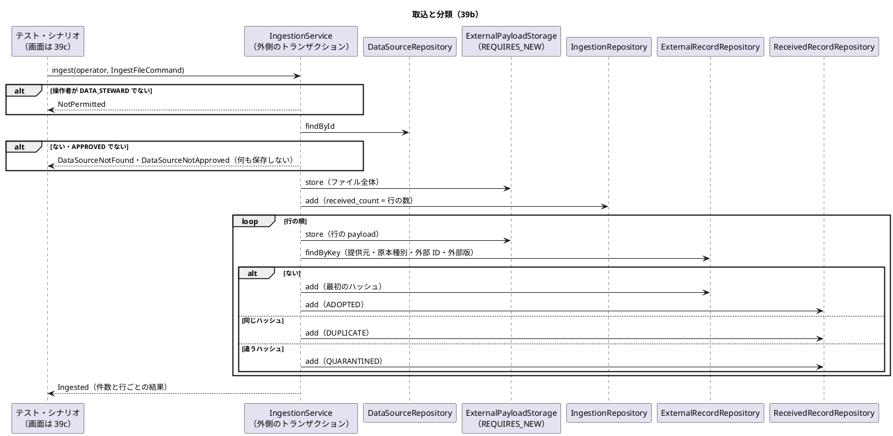
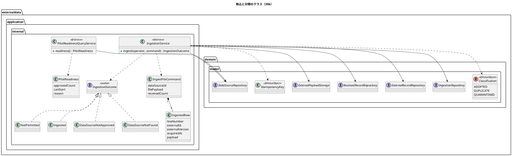
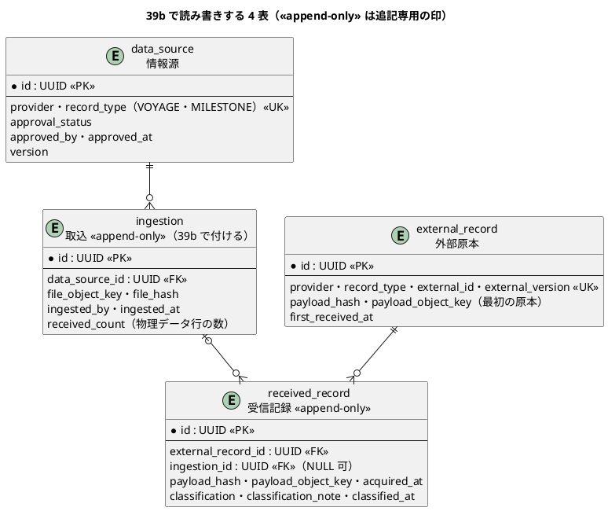

# Bolt 39b 計画 - 外部原本の取込と分類（採用・重複・隔離）と情報源の照会

## 基本情報

| 項目 | 内容 |
| :--- | :--- |
| Bolt | 第 39b 回（W7 の 5 本目。release_plan の 39b の行（:937）を開始準備で縦に 4 本（39b・39b2・39b3・39b4）に分けた 1 つ目） |
| 予定 | W7（2026-11-16 の週。前倒しで着手できる）。作業は約 4 時間（`check`・SonarQube・CI とステップごとの承認の待ちを除く） |
| アプローチ | インサイドアウト（分類の規則と取込のサービスから、MyBatis の読み書き、受入シナリオへ。開発戦略の W7 の行） |
| 対象 | (1) 形式の正しい行を冪等性キーで採用・重複・隔離に分類する取込のサービス（アプリケーションサービスまで。入口の画面は 39c）、(2) 情報源・取込・外部原本・受信記録の MyBatis の読み書き（追記専用の表には更新・削除のメソッドを持たせない）、(3) ファイル全体と行の原本の保存（`ExternalPayloadStorage`。保存に成功してから受信記録を書く）、(4) 承認済みの情報源のない取込の拒否と `PilotReadiness` の照会、(5) 開発データの情報源と DATA_STEWARD の開発利用者、(6) 業務ルール層のシナリオ（`features/external_data/`） |
| トレース | US-14 AC2・AC3・AC4、AC1 のうち原本・提供元・原本種別・外部 ID・外部版・payload・取得時刻・取込履歴の関連付け（採用値は 39b3）、BR-12、BR-18、UC-15 3a・3b、ED-INV-01・ED-INV-02 |
| GitHub | [#18](https://github.com/k2works/practical-domain-driven-design-in-enterpris-application/issues/18)（US-14。クローズは 39h） |
| SP | 0 |
| 承認ゲート | **ステップごとに止める**（外部原本の取込。W7 の決定）。セキュリティ（役割の確かめ）、データベース（追記専用の印、開発データ）、構造（新しいパッケージ、組み立てのクラス、受入テストの規則）。注: W7 の決定は「ステップごとに止める」。2026-11-03 の人の指示「Recommend 承認で進めて」はそれより後の指示で、各ステップの終わりで止めて推奨の案を承認として記録する（人が個別に見ていないことが分かるように「推奨のとおり（Recommend 承認の指示による）」と書く）。ステップを飛ばしたり束ねたりはしない |
| 開始準備で決めたこと | 2026-11-03、推奨のとおり（Recommend 承認の指示による。human:kakimomokuri）: (1) release_plan の 39b の行は半日を超えるので縦に 4 本に分ける。39b（この計画）は形式の正しい行の取込と分類の縦（下の「スコープ」）。39b2 は形式の誤りの隔離（ファイルの誤り・行の誤り。UC-15 2a）と値の列（航海: `voyage_number`・寄港の列、主要実績: `kind`・`location_unlocode`・`occurred_at`。仮の形式。OQ-02）とその検証、引用符の閉じ忘れのファイルを取込全体の要確認にし取り込めなかった件数を示すこと、誤りの理由を業務の言葉で示すこと、受け取った・取り込んだ・誤りの件数の突き合わせ、文字コードの誤り、キーのない誤りの受信記録のため `received_record.external_record_id` を NULL 可にし CHECK（NULL は隔離だけ）を足すスキーマの変更。39b3 は採用値（`adopted_value`）と DE-12・DE-13・DE-14、`domain.events` の名前付きインターフェース、identity の監査の listener（identity に `externaldata :: events`）と毒入りのメッセージ、W6 横断レビュー M-2、`PublicApiArchitectureTest` の汎用化、手書きの規則の写し（AcceptanceStepArchitectureTest）。39b4 は PERF-06（1 万件を 5 分以内）、行ごとのコミットの量と接続の数、足りなければ一括の保存、原本 1 件の大きさの上限、数えるテストは自分のキーで絞る規約、(2) 39b の分類は採用・重複・隔離の 3 つまで。差異（`DISCREPANCY`）は 39h。採用値は 39b3 で作るので、39b の採用は受信記録の分類だけ（AC1 の「採用値」は 39b3）、(3) 承認ゲートはステップごとに止める（W7 の決定）。ただし Recommend 承認の指示により各ゲートは推奨のとおり承認として記録する、(4) 同じファイルの中に同じキーが 2 行ある場合は行の順で処理し、先の行を採用、後の行は同じハッシュなら重複・違えば隔離にする、(5) 1 つの取込は 1 つのトランザクション（外側）。原本は REQUIRES_NEW で独立（ADR-004 の改訂。Bolt 39a2）。外側が巻き戻ったら受信記録は残らず原本だけ残る |

## Bolt ゴール

データ責任者が承認済みの情報源のファイルを取り込むと、形式の正しい行ごとに原本を保存してから、冪等性キー（提供元・原本種別・外部 ID・外部版）で採用・重複・隔離に分類した受信記録を取込に関連付けて残し、承認済みの情報源がなければ取込とパイロットの開始を拒むことを、アプリケーションサービスと DB の読み書きと受入シナリオで確かめる。画面は作らない（39c）。

### 開始準備で確かめたこと

- **release_plan の 39b の行**（:937）: 分類（採用・重複・隔離・差異）、形式の誤りの隔離、`PilotReadiness`、DE-14 と identity の監査の listener、PERF-06、業務ルール層のシナリオを 1 本に持ち、半日を超える（:950 の「半日を超えそうな Bolt（39・39b・39f・39g）は開始準備で分ける」）。取込の単位は 1 ファイル 1 取込で行ごとに分類する（W7 の確認ポイント 4、:900）。解析は `externaldata.interfaces`、application には値だけを渡す（確認ポイント 5、:901）。取込と判断の役割は DATA_STEWARD で、担当範囲では絞らない（確認ポイント 3、:899）
- **前の Bolt の既知の課題**: Bolt 39 の 39b（[終了報告](bolt_39_report.md) :104。値の列・閉じ忘れ・業務の言葉・突き合わせ・文字コード・M-2・`PublicApiArchitectureTest`・手書きの規則の写し・毒入りのメッセージ・`domain.events`）は 39b2・39b3 に分けた。Bolt 39a2 の 39b（[終了報告](bolt_39a2_report.md) :99。PERF-06 の量と接続・一括の保存・大きさの上限・数えるテストの規約は 39b4、開発データの情報源と DATA_STEWARD の開発利用者はこの Bolt）。Bolt 39a3 の 39b（[終了報告](bolt_39a3_report.md) :90。取込の件数の持ち方と、H2 で追記専用を守るリポジトリの形はこの Bolt、値の列は 39b2、PERF-06 は 39b4）
- **data_model**: `ingestion`（:1013-1022。`received_count INTEGER NOT NULL` は :1021）、`data_source` の制約（:1141。承認済みが 0 件ならパイロットを開始しない判定はアプリケーション）、`received_record` の制約（:1144。`ingestion_id` は NULL 可、追記専用）、payload の注（:1150。保存は受信記録とは独立したトランザクション）、索引（:1208。外部キーの列のほかの索引は使う照会が決まる Bolt で足す）。`received_record.ingestion_id` は `ingestion` への外部キーなので、取込の行は受信記録より先に書く（マイグレーション `V20261103100000__create_external_data_records.sql` :88）。`ingestion` は「Bolt 39b で受け取った件数の書き方を決める」ので追記専用の印を付けていない（同 :6-7）
- **domain_model**: 用語集の取込（:320。分類別の件数を持ち照合に使う）・重複（:322）・隔離（:323）・外部原本の保存（:325）・冪等性キー（:328。`IdempotencyKey`）、外部データの要素表（:1472 情報源の ED-INV-01、:1473 取込、:1475 受信記録の ED-INV-02）、開始判定の照会 `PilotReadiness`（:1528。承認済みの情報源の件数を返し、0 件なら開始不可とその理由）、DE-14（:1636。39b3）
- **ADR-004**: 保存は外側のトランザクションの中から呼べる（:85。39b の取込のサービスは外側の中から呼ぶ）、接続の数（:86）と量（:87）は 39b4 で測る
- **要件**: US-14 AC1〜AC4（user_story :558-561。AC3 は「既存結果が返される」）、UC-15 3a・3b（system_usecase :525-526）と 2a（:523。注の「隔離は 39b」は 39b2 に直す）、BR-12（requirements_definition :733）、BR-18（:739）、PERF-06（non_functional :62）
- **test_strategy**: シナリオの置き場所 `external_data/`（:141）、統合テストの「同じファイルの再取込で件数と採用値が変わらない。同じキーで内容の違う原本は隔離される」（:325。採用値は 39b3）、US-14 の SP は 5（:517。W7 の確認ポイント 20 で 8 に直すと決めたが直っていない）、US-15 は 4（:518。5 に直す）
- **層の規則**: interfaces はほかの層から参照できない（LayerArchitectureTest :85-86）ので、application は `interfaces.file` の `CsvRecords`・`CsvRow` を受けられない。application は Web と永続化の技術に依存しない（:276）。`commandservices`・`queryservices` の `…Service` は `@Service` を付ける（:267-272）。外部データのインフラストラクチャ層の外は `java`・`externaldata`・`shared`・`org.springframework` だけ（ModularityTest :107）、インフラストラクチャ層は MyBatis と使う範囲の Spring（:128）。マッパーは `external_data` だけを読み書きする（MapperSchemaArchitectureTest :34）
- **受入テストの規則**: AcceptanceStepArchitectureTest の一覧（:28-29）に `externaldata` はあるが、手書きの規則（:31-44）に外部データの行がない。ステップ定義を作るこの Bolt で 1 つ足す（汎用化は 39b3。:82 のコメント）。自分の `interfaces.file` への依存は禁じていない（`forbidden`。:101-112）
- **用語集の整合**: `@ValueObject`・`@Entity`・`@AggregateRoot` の付いたクラスは用語集に英語名があり、Javadoc の最初の語が日本語名と一致する（LivingGlossaryConsistencyTest :35 で英語名を読む）。`IdempotencyKey`（冪等性キー）を値オブジェクトにするなら Javadoc を「冪等性キー」で始める
- **時刻**: 今の時刻は `ClockConfiguration`（`com.example.cargotracker.ClockConfiguration` :17-23。マイクロ秒に切り捨てる）の `Clock` から取る（T-229）
- **開発データ**: dev だけの場所 `db/dev-data`（application-dev.properties :6）。前例は `V20261009140900__seed_dev_tracking_manager.sql`（利用者と役割。共通・ベンダーの場所に置かないことは `DevDataLocationTest` で守る）。開発利用者の ID は `…0301`〜`…0306` まで使っている。`DATA_STEWARD` は `shared.domain.Role` :20 にあるが、開発利用者はいない
- **受入テストの組み立て**: 業務ルール層は DB を使わずメモリの実装をつなぐ（`acceptance.AcceptanceTestConfiguration`）。原本の保存のメモリの実装 `InMemoryExternalPayloadStorage` と契約のテスト `ExternalPayloadStorageContract` は test の `externaldata.domain.model.aggregates` にある

## 設計の決定（案）

| 項目 | 決定 | 根拠 |
| :--- | :--- | :--- |
| 取込のサービス | `externaldata.application.internal.commandservices.IngestionService`（`@Service`、`@Transactional`。外側のトランザクション）の `ingest(AuthenticatedActor operator, IngestFileCommand command)`。結果は sealed の `IngestionOutcome`（`Ingested`（取込 ID、受け取った件数、分類別の件数、行ごとの結果）・`DataSourceNotApproved`・`DataSourceNotFound`・`NotPermitted`）。前例は `identity.application.internal.queryservices.UserLookup` | 確認ポイント 5・6 |
| 渡す値 | `externaldata.application.internal.commands.IngestFileCommand`（情報源 ID、ファイル全体のバイト列、受け取った件数 `receivedCount`、行の並び）と `IngestedRow`（物理行の番号、外部 ID、外部版、取得時刻 `Instant`、行の payload のバイト列）。受け取った件数は「ファイルの物理データ行の数（ヘッダーを除く）」で、行の並びとは別に持つ（39b2 で形式の誤りの行が並びに入らなくなっても意味を変えない。確認ポイント 1）。主要実績の追跡番号は 39b では payload の中にだけあり、`IngestedRow` の項目にも受信記録の列にもしない（値の列は 39b2）。解析と組み立て（`CsvRecords` → コマンド）は `interfaces.file` で 39b2 に作る（形式の誤りの扱いと一緒に決めるため）。39b ではテストとシナリオがコマンドを直接作る | W7 の確認ポイント 5、LayerArchitectureTest :85-86 |
| 処理の順 | (1) 操作者が DATA_STEWARD か、(2) 情報源があり `APPROVED` か（どちらかで拒否なら何も保存しない）、(3) Clock から今の時刻を 1 回取る、(4) ファイル全体の原本を保存（`PayloadObjectKey.newIngestionFile()`）、(5) 取込の行を書く（`received_count` はコマンドの受け取った件数。書いた後に更新しない）、(6) 行の順に: 行の原本を保存（`newRecordPayload()`）→ 冪等性キーで外部原本を引く → ない: 外部原本を書き受信記録を採用、同じハッシュ: 受信記録を重複、違うハッシュ: 受信記録を隔離 | ED-INV-01・ED-INV-02、`ExternalPayloadStorage` :16、開始準備の決定 (4)・(5) |
| 分類の規則 | `externaldata.domain.model.valueobjects` に冪等性キー `IdempotencyKey`（提供元・原本種別・外部 ID・外部版。`@ValueObject`、Javadoc は「冪等性キー」で始める）と分類 `Classification`（`ADOPTED`・`DUPLICATE`・`QUARANTINED`。`DISCREPANCY` は 39h で足す。enum に `@ValueObject`、Javadoc は「分類」で始める）と、既にある外部原本と今のハッシュから分類を決める関数を置く（トランザクションスクリプトだが、規則を単体のテストで確かめるため純粋な関数にする） | ADR-002、ED-INV-02 |
| 読み書きのポート | `externaldata.domain.model.aggregates` に `DataSourceRepository`（`findById`・`countApproved`。読み取りだけ）、`IngestionRepository`（`add`）、`ExternalRecordRepository`（`findByKey`・`add`）、`ReceivedRecordRepository`（`add`・`countByIngestionAndClassification`）。追記専用の表（`received_record`・`ingestion`。確認ポイント 2）のポートに更新・削除のメソッドを持たせない（H2 は権限で守れないため。前例 `identity.domain.model.aggregates.AuditRecordRepository`）。外部の技術のポートと同じくドメインに置く（ADR-017） | CLAUDE.md、Bolt 39a3 の終了報告の議題 3 |
| ポートが受け渡す型 | `externaldata.domain.model.aggregates` に Java の record で `DataSource`（情報源）・`Ingestion`（取込）・`ExternalRecord`（外部原本）・`ReceivedRecord`（受信記録）。どれも `@Entity` を付け、Javadoc を用語集の日本語名で始める（英語名は用語集 :316-320 にある。LivingGlossaryConsistencyTest :35）。振る舞いは持たせない（トランザクションスクリプト。ADR-002） | ADR-002、LivingGlossaryConsistencyTest |
| 結果の型の置き場所 | `IngestionOutcome` は `IngestionService` と同じ `commandservices` に置く（前例 `UserLookup` は結果の型をサービスと同じパッケージに持つ）。`PilotReadiness` は `queryservices` に置く | 前例 |
| 用語集 | domain_model の用語集に、用語集の英語名にそろえて足す: 情報源のリポジトリ `DataSourceRepository`・取込のリポジトリ `IngestionRepository`・外部原本のリポジトリ `ExternalRecordRepository`・受信記録のリポジトリ `ReceivedRecordRepository`（前例: 利用者の立場のリポジトリ :212）、分類 `Classification`、取込の結果 `IngestionOutcome`、取込のサービス `IngestionService`、開始判定の照会 `PilotReadinessQueryService` | LivingGlossaryConsistencyTest、用語集の整合 |
| 組み立て | アプリケーションのサービスは部品探索の外なので、`externaldata.infrastructure.config` に `@Configuration` の組み立てのクラス `ExternalDataConfiguration`（前例 `notification.infrastructure.config.NotificationConfiguration`）を作り、`@Bean` で `IngestionService`・`PilotReadinessQueryService` を組む。ModularityTest の外部データのインフラストラクチャ層の許可リスト（:128。並びは :133-141）に `org.springframework.context.annotation..` を足すのは規則の変更なので、確認ポイント 14 で人に諮る | ModularityTest :128、前例 |
| 索引 | 39b では足さない。外部原本を冪等性キーで引くのは一意制約、取込ごとの件数は `ix_received_record_ingestion`（data_model :1208）を使う | data_model :1208 |
| パッケージの説明 | `package-info` の最初の語は前例どおり: `application` は「アプリケーション層」、`application.internal` は「アプリケーションサービス」、`commands` は「コマンド」、`commandservices` は「コマンドサービス」、`queryservices` は「クエリサービス」 | 前例（メモリ: application.internal はアプリケーションサービス） |
| MyBatis の実装 | `externaldata.infrastructure.persistence` に `MyBatisDataSourceRepository`・`MyBatisIngestionRepository`・`MyBatisExternalRecordRepository`・`MyBatisReceivedRecordRepository` とマッパー・行の型（前例 `notification.infrastructure.persistence.MyBatisNotificationRepository`・`NotificationMapper`・`NotificationRow`）。外部原本の一意制約の違反は `DuplicateKeyException` のまま上げる（確認ポイント 7） | ModularityTest :128、MapperSchemaArchitectureTest :34 |
| 照会 | `externaldata.application.internal.queryservices.PilotReadinessQueryService`（`@Service`）の `readiness()` が `PilotReadiness`（承認済みの情報源の件数、開始できるか、開始できない理由）を返す。0 件の理由は「承認済みの情報源がありません。情報源を選定し、承認してください」 | domain_model :1528、US-14 AC2 |
| 時刻 | 1 つの取込で Clock から 1 回取った時刻を `ingested_at`・`first_received_at`・`classified_at` に使う（取込を 1 つの時点として再現できる）。`acquired_at` は行の値 | T-229、確認ポイント 8 |
| 情報源の種別 | `data_source.record_type` の値は取込ファイルの種別 `CsvFileKind` の名前（`VOYAGE`・`MILESTONE`）にそろえる。CHECK は足さない（港湾は Release 1.1 で増える。D-92） | CsvFileKind :10-12、確認ポイント 4 |
| 受入シナリオ | `src/test/resources/features/external_data/ingest_external_records.feature`。Feature に `@US-14`・`@must`、シナリオごとに受入条件 `@US-14-AC2`〜`@US-14-AC4`、業務ルール `@BR-12`（AC3・AC4）・`@BR-18`（AC2）、不変条件 `@ED-INV-01`（AC2）・`@ED-INV-02`（AC3・AC4）を付ける。ステップ定義は `externaldata.acceptance`、メモリの実装（情報源・取込・外部原本・受信記録）は単体と契約のテストと共有するため test の `externaldata.domain.model.aggregates`（`InMemoryDataSourceRepository` など。原本の保存の `InMemoryExternalPayloadStorage` と同じ置き場所）に置き、`AcceptanceTestConfiguration` につなぐ。AcceptanceStepArchitectureTest に外部データの規則を手で 1 つ足す | test_strategy :118-125・:141、確認ポイント 10 |
| パッケージ | `externaldata.application`・`application.internal`・`commandservices`・`commands`・`queryservices`・`infrastructure.config` の `package-info`（最初の語は上の「パッケージの説明」。`infrastructure.config` は `notification.infrastructure.config` の前例にそろえる）。新しいパッケージとファイルは構造の承認ゲート | 構造 |

## ふりかえりと前の Bolt からの引き継ぎ

| 出典 | 内容 | この Bolt での扱い |
| :--- | :--- | :--- |
| W6 の Try T-204・T-212、Bolt 38h の T-227 | サブエージェントへの指示の最初に heredoc と標準入力を待つコマンドを使わないと書く（`orchestrating-development` の `PROJECT.md`） | 任せるときの指示の最初に書く |
| W6 の Try T-217 | 本体を直す前に Red を流し、落ちた理由を記録する | ステップ 2〜5 の各 Red（落ちた理由をステップの記録に書く） |
| W6 の Try T-225・T-213 | push の前に `check` | ステップ 6 |
| W6 の Try T-182・T-211・T-216 | 状態の組み合わせの表に重複・隔離と出口・誤った入力の行を置く | 下の表（行 1〜15） |
| W6 の Try T-184 | listener は配信まで確かめる | この Bolt は listener を作らない（39b3） |
| W6 の Try T-219 | 変異の対象に単体・統合・契約のテスト | 下の変異の表 |
| W6 の Try T-215・T-222 | Gradle を流す担当を 1 つに、計画の初稿を先にコミット | Gradle は人の側の 1 か所で流す。初稿をコミットしてから実装に入る |
| W6 の Try T-191 | 環境の前提に設定ファイルの行を添える | 開発データは application-dev.properties :6、時刻は ClockConfiguration :17-23 |
| Bolt 39a2 の T-229 | 永続化の Bolt の状態の組み合わせに時刻の出どころと同時の書き込みの行を置く | 行 10（時刻）・行 9b（同時の同じ新しいキー） |
| Bolt 39a3 の T-230 | 入ることを確かめる行のデータはドメインの規則に合う組み合わせにする | 主要実績の行は payload に追跡番号を持ち、航海の行は持たない（列にはしない。39b2）。情報源は `APPROVED`、取得時刻は取込時刻より前 |
| Bolt 39a3 の終了報告の議題 3 | 取込の件数の持ち方、H2 で追記専用を守るリポジトリの形 | 確認ポイント 1・2、設計の決定の「読み書きのポート」 |
| Bolt 39a2 の終了報告 | 開発データの情報源と DATA_STEWARD の開発利用者 | ステップ 2 |

## 状態の組み合わせ（行ごとにテストを 1 本。T-182）

単体はメモリの実装と固定の Clock でサービスを確かめる（`IngestionServiceTest`）。契約は情報源・取込・外部原本・受信記録のポートの契約のテストを、メモリ・H2・PostgreSQL の実装で継ぐ（前例 `ExternalPayloadStorageContract`）。統合は PostgreSQL（`com.example.cargotracker.integration.ExternalDataIngestionIntegrationTest`）。統合テストの提供元の名前は自分の UUID を含めて絞る（原本の保存は REQUIRES_NEW でコミットされ、受信記録は追記専用で消せないため。行 6 の件数は差で数えてロールバックする）。テストの名前は「行 N_」で始める（前例 `ExternalDataSchemaIntegrationTest`）。

| 行 | 状況 | 期待 | 確かめ方 |
| :--- | :--- | :--- | :--- |
| 1 | 新しい冪等性キーの行 | 外部原本ができ（キー・最初のハッシュとオブジェクトキー・最初の受信時刻）、受信記録は採用で取込に関連付く。原本の保存 → 受信記録の順 | 単体、Cucumber（AC1 の関連付けの部分） |
| 2 | 同じキー・同じハッシュを別の取込で再送 | 受信記録は重複、外部原本は 1 つのまま、結果に既存の外部原本 ID を返す（AC3 の既存結果） | 単体、Cucumber（AC3）、統合（同じファイルの再取込で外部原本の数が変わらない。test_strategy :325） |
| 3 | 同じキー・違うハッシュ | 受信記録は隔離、外部原本の最初のハッシュとオブジェクトキーは変わらない、注記は業務の言葉（確認ポイント 11） | 単体、Cucumber（AC4） |
| 4 | 同じファイルの中に同じキーが 2 行（同じ内容・違う内容） | 先の行が採用、後の行は同じハッシュなら重複・違えば隔離（行の順） | 単体、統合（同じトランザクションで先の行の外部原本が見える） |
| 5 | 情報源が `CANDIDATE`・`SUSPENDED`・ない | `DataSourceNotApproved`・`DataSourceNotFound`。原本・取込・外部原本・受信記録を書かない | 単体、Cucumber（AC2） |
| 5b | 操作者が DATA_STEWARD でない | `NotPermitted`。何も書かない | 単体 |
| 6 | `PilotReadiness`: 情報源が 0 件、`CANDIDATE`・`SUSPENDED` だけ、`APPROVED` が 1 件以上 | 0 件なら開始不可と理由、1 件以上なら開始でき件数を返す（`SUSPENDED` を数えない） | 単体、Cucumber（AC2）、統合（`countApproved` を差で確かめる） |
| 7 | 別の（提供元、原本種別）の情報源で、同じ外部 ID・外部版 | 別のキー。どちらも採用 | 単体、契約（`findByKey` が 4 つの列で引く） |
| 8 | 行の原本の保存に失敗する | その行の受信記録を書かず、取込全体を失敗にする（例外を上げる） | 単体（失敗する保存の偽物） |
| 9 | 行の途中で失敗し、外側が巻き戻る | 取込・外部原本・受信記録は残らず、保存した原本（ファイル全体と前の行）は残る | 統合（PostgreSQL） |
| 9b | 同時の取込で同じ新しいキー（一意制約の違反） | 後の取込が失敗して巻き戻る。取り込み直せば重複か隔離に分類される | 契約（同じキーの 2 回目の `add` は `DuplicateKeyException`）、単体（サービスは例外を上げる） |
| 10 | 取込者と取込時刻 | `ingested_by` は操作者、`ingested_at`・`first_received_at`・`classified_at` は Clock の時刻（マイクロ秒）、`acquired_at` は行の値 | 単体（固定の Clock）、契約（時刻の往復） |
| 11 | 件数 | `received_count` はコマンドの受け取った件数（ファイルの物理データ行の数。ヘッダーを除く）で、書いた後に更新しない。分類別の件数は受信記録から数える。39b の範囲（形式の誤りがない）では分類別の合計が `received_count` と一致する（39b2 では取り込めなかった件数を足して突き合わせる） | 単体、統合 |
| 12 | 空のファイル（ヘッダーだけ。行が 0） | 取込とファイル全体の原本を記録し、件数 0、受信記録なし | 単体、契約（件数 0 の取込の往復） |
| 13 | 取込の表を追記専用にする（確認ポイント 2。【前の決定の変更】） | UPDATE・DELETE の権限がない | `AppendOnlyGrantIntegrationTest` |
| 14 | dev で起動する | 開発データの承認済みの情報源 2 つと DATA_STEWARD の開発利用者が入り、`PilotReadiness` が開始できる | `H2DevProfileSmokeTest`、`DevDataLocationTest` |
| 15 | 層と受入テストの規則 | 外部データのステップ定義は自分のインフラストラクチャ層と他のコンテキストの内部に依存しない。application は `interfaces.file` を参照しない | AcceptanceStepArchitectureTest（足す規則）、LayerArchitectureTest、ModularityTest |

## スコープ

### 入れるもの

- 行 1〜15（5b・9b を含む）のテスト、取込のサービス・照会・分類の規則・ポート・MyBatis の実装、受入シナリオ
- マイグレーション: 取込の表の追記専用の印（確認ポイント 2。common）、開発データ（dev-data。確認ポイント 9）
- 組み立てのクラス `externaldata.infrastructure.config.ExternalDataConfiguration` と ModularityTest の許可リストの変更（確認ポイント 14。人の回答による）
- 文書: 下の「設計文書に直す箇所」（ステップ 1）、release_plan（39b の行を 4 本に分けるのは計画の初稿のコミット b0eced3f0 で済み。ステップ 1 は更新履歴だけ）

### 入れないもの

- `CsvRecords` からコマンドを組み立てる処理、形式の誤りの隔離、値の列とその検証、引用符の閉じ忘れ・文字コードの誤り、件数の突き合わせ、`received_record.external_record_id` を NULL 可にするスキーマの変更（39b2）
- 採用値、DE-12・DE-13・DE-14、`domain.events`、identity の監査の listener、M-2、`PublicApiArchitectureTest` の汎用化、手書きの規則の写し（39b3）
- PERF-06、一括の保存、原本 1 件の大きさの上限、数えるテストの規約（39b4）
- 差異（39h）、画面と認可の URL・CSRF（39c）、開発の DATA_STEWARD の TOTP の資格と dev のログインの口座（39c。確認ポイント 9）
- OQ-02 で業務責任者に確かめる 6 点（39b2 の開始準備）
- 照合で参照されない原本（受信記録のない保存済みの原本）を数える仕組みと、VARCHAR の上限の確かめ（39b2 の突き合わせ）
- 新しい索引（設計の決定の「索引」）

### 設計文書に直す箇所（ステップ 1）

- release_plan: 39b の行（:937）を 39b・39b2・39b3・39b4 に分けて :950 の順序に足すのは b0eced3f0 で済み。ステップ 1 は更新履歴だけ。ほかに【前の決定の変更】の注を足す: :886（`domain.events` と identity の監査の listener は 39b3）、:900（確認ポイント 4 の「39b の統合テストで 1 万件」は 39b4）、:902（確認ポイント 6 の形式の誤りの隔離は 39b2、DE-14 は 39b3）
- 開発戦略 :350（W7 の行の外部データの骨格と分類の Bolt に 39b2〜39b4 を足す）
- data_model: `ingestion.received_count`（:1021）の意味（ファイルの物理データ行の数。ヘッダーを除く。取込の行を書くときに入れ、更新しない。39b2 でも意味を変えない）、追記専用の一覧 :177 に `external_data.ingestion` を足し、「`external_record`・`ingestion`・`data_source` には付けない」を「`external_record`・`data_source` には付けない」に直す（【前の決定の変更】。Bolt 39a3 の開始準備の決定 (4) の「追記専用は 3 表」を変える）、主な制約の表（:1139-1146）に `ingestion` の行（追記専用、`received_count` の意味、受信記録より先に書く）を足す、`data_source.record_type` の値（`VOYAGE`・`MILESTONE`）、:1144 の受信記録の「取込の行を先に書く」順
- domain_model: 取込（:320・:1473）の件数の意味、受信記録（:1475）に同じファイルの中の同じキーの扱い、`PilotReadiness`（:1528）の理由の文言、用語集に設計の決定の「用語集」の行（リポジトリ 4 つ・分類・取込の結果・取込のサービス・開始判定の照会）
- ui_design :144（S-19 情報源の管理に注: 情報源の選定・承認の画面は W10 の運用タスク。39b は開発データで入れる。W7 の決定 release_plan :888）
- ADR-004 :85（「39b の取込のサービス」は取込のサービスの名前に）・:86・:87（39b を 39b4 に）。改訂の経緯は書き換えず、39b の開始準備の分け方の注を足す
- architecture_backend :132（`domain.events` と identity の監査の listener は 39b3）・:448（PERF-06 は 39b4）
- system_usecase :523（「隔離は 39b」を 39b2 に）
- test_strategy :517（US-14 を 8 SP に）・:518（US-15 を 5 SP に）。W7 の確認ポイント 20 の残り
- コードのコメント（触るステップで直す）: `ExternalPayloadStorage` :25（39b4）、マイグレーション `V20261103100000` :6-7（版を変えないのでコメントは直さず data_model に書く）、`CsvFileKind` :6・`interfaces/file/package-info` :3・`CsvRowError` :6-7・`CsvHeader` :9（39b2）、`externaldata/package-info` :2（39b3）、AcceptanceStepArchitectureTest :82（39b3）

## 設計（この Bolt の範囲）

- 状態遷移図: 受信記録は分類を一度だけ持ち変えない（追記専用）ので省く
- 画面遷移図: 画面を作らないので省く（S-16 は 39c、S-19 は W10 の運用タスク）

## ステップ計画（ステップごとに止める）

- [x] **1. 設計の文書**（2026-11-03、推奨のとおり承認として記録した（Recommend 承認の指示による。human:kakimomokuri）。test_strategy :517・:518 は列が受入条件の数で値が正しいので直さず、W7 の確認ポイント 20 に取り下げの注を足した。ADR-004 は改訂の経緯を書き換えず Bolt 39b の項を足した）: 上の「設計文書に直す箇所」と release_plan（完了の判定: 文書の差分。**承認ゲート**）
- [x] **2. 情報源の読み取りと開始判定、開発データ（Red → Green）**（2026-11-03、推奨のとおり承認として記録した（Recommend 承認の指示による。human:kakimomokuri）。Red はテストのコンパイルの誤りと、許可リストを足す前の ModularityTest（`@Configuration`）。`DataSource` は id・提供元・原本種別・承認の状態だけ（YAGNI）、承認の状態は入れ子の enum、`PilotReadiness` は件数の record で開始可否と理由を件数から出す。組み立ては `PilotReadinessQueryService` だけ）: 行 6・14 のテストを先に書いて落ちることを確かめ（落ちた理由を記録する。T-217）、`DataSourceRepository`（メモリ・MyBatis）と `PilotReadinessQueryService`、組み立てのクラス `ExternalDataConfiguration`（確認ポイント 14）、dev-data のマイグレーション（DATA_STEWARD の開発利用者 `…0307` と情報源）を作る（完了の判定: 緑。**承認ゲート**（データベース・開発データ。構造: 組み立てのクラスと ModularityTest の許可リスト））
- [x] **3. 分類の規則と取込のサービス（Red → Green）**（2026-11-03、推奨のとおり承認として記録した（Recommend 承認の指示による。human:kakimomokuri）。Red はテストのコンパイルの誤りと、DddAnnotationArchitectureTest（commands の公開クラスに `@Command`）。`IngestedRow` は `IngestFileCommand` の入れ子の record、受信記録の取込の ID は必須（39b に取込によらない受信がない）、`IngestionService` の組み立てはリポジトリの Bean ができるステップ 4）: 行 1〜5b・7〜8・9b・10〜12 の単体のテストを先に書き、`IdempotencyKey`・`Classification`・コマンド・`IngestionService`・ポートとメモリの実装を作る（完了の判定: 緑。**承認ゲート**（セキュリティ: 役割の確かめ。構造: 新しいパッケージ））
- [x] **4. MyBatis の読み書き（Red → Green）**（2026-11-03、推奨のとおり承認として記録した（Recommend 承認の指示による。human:kakimomokuri）。Red は H2・PostgreSQL の `NoSuchBeanDefinitionException` と追記専用の一覧。契約は 3 つのポートを 1 本にまとめた（前例 `AuthenticationFactorRepositoriesContract`）。継ぐ側の `@Transactional` が契約から継いだテストに効かなかったので契約のクラスに付けた。前例の契約も巻き戻っていない疑いは既知の課題としてステップ 6 で確かめる）: 取込・外部原本・受信記録のポートの契約のテスト（H2・PostgreSQL）を先に書き、マッパーと実装、取込の表の追記専用の印（行 13）を作る（完了の判定: 緑。**承認ゲート**（スキーマ））
- [x] **5. 統合と受入シナリオ（Red → Green）**（2026-11-03、推奨のとおり承認として記録した（Recommend 承認の指示による。human:kakimomokuri）。Red は受入シナリオ 5 本の `UndefinedStepException`。統合テスト 4 本はステップ 3・4 で既に緑だったので、変異（取込の `@Transactional` を外す）で行 9 が落ちることを確かめた。メモリの実装はステップ 3 の置き場所のまま使う。行 9 はテストのあいだだけ承認済みの情報源をコミットし、終わりに消す）: 行 2・4・9・11 の統合テストと、`features/external_data/ingest_external_records.feature`（AC2・AC3・AC4）とステップ定義、AcceptanceStepArchitectureTest の外部データの規則（行 15）（完了の判定: 緑。**承認ゲート**（構造: 受入テストの規則））
- [ ] **6. 品質ゲートと開発レビュー**: 変異、`check`、その後に SonarQube、開発レビューとその直し。push の前に `check`
- [ ] **7. 終了報告**: push して CI とデモ環境の配備を確かめる。release_plan・開発の索引・mkdocs を直す。見える振る舞いは変わらないので、マニュアルは直さない（39c で新しい章）

### 時間の配分と打ち切り

| # | 目安 | 打ち切り |
| :--- | :--- | :--- |
| 1 | 30 分 | — |
| 2 | 35 分 | 開発データが 15 分を超えたら 39c に送る |
| 3 | 55 分 | — |
| 4 | 45 分 | — |
| 5 | 40 分 | ステップ 5 の開始で合計 3 時間を超えていたら、受入シナリオを 39b2 に送る（統合テストは残す） |
| 6 | 25 分（待ちを除く） | — |
| 7 | 10 分（CI の待ちを除く） | — |

合計 240 分（約 4 時間）。

## 確認ポイント（計画の承認の場でまとめて確認する。Try T-6）

| # | 確認すること | 場所 | 推奨 |
| :--- | :--- | :--- | :--- |
| 1 | **取込の件数 `received_count` の持ち方**（Bolt 39a3 の議題 3） | ステップ 1・3 | 推奨のとおり（Recommend 承認の指示による。human:kakimomokuri）。列を残し、意味を「ファイルの物理データ行の数（ヘッダーを除く）」にする。コマンドに行の並びとは別の件数として持たせ、取込の行を書くときに入れて更新しない。39b2 でも意味を変えない。分類別の件数は受信記録から数える。分類別の合計が `received_count` と一致するのは 39b の範囲（形式の誤りがない）に限り、39b2 では取り込めなかった件数を足して突き合わせる。理由: 取込の行を最後に書く形は、受信記録が取込への外部キーを持つ（マイグレーション :88）ので取れない。列を外して受信記録から数える形は、39b2 で形式の誤りや閉じ忘れで受信記録にならない行が出たとき、ファイルが示した件数と突き合わせられない（照合の「受信件数との照合」。BR-12） |
| 2 | **取込の表を追記専用にする（スキーマ）。【前の決定の変更】** | ステップ 1・4 | 推奨のとおり（Recommend 承認の指示による。human:kakimomokuri）。付ける（確認ポイント 1 のとおり更新しないので）。Bolt 39a3 の開始準備の決定 (4)「追記専用は 3 表」を変え、`ingestion` を足して 4 表にする。印のマイグレーション 1 つと `AppendOnlyGrantIntegrationTest` の一覧。ポートは `add` だけ。data_model :177 の追記専用の一覧と「付けない」の文、主な制約の表の `ingestion` の行を直す（ステップ 1） |
| 3 | **行の payload の中身**（ハッシュと重複の判定が決まる） | ステップ 3（記録だけ。作るのは 39b2） | 39b のコマンドは行の payload をバイト列で受ける。`interfaces.file` が切り出す中身は、その行の物理行の原文（行末の改行を除く。UTF-8）にする（無加工の原本。ADR-004 の決定 1）。ヘッダーは含めない（取込のファイル全体の原本から引ける）。39b2 の開始準備で確かめ直す |
| 4 | **情報源の種別の値** | ステップ 1・2 | `record_type` は `CsvFileKind` の名前（`VOYAGE`・`MILESTONE`）にそろえる。CHECK は足さない |
| 5 | **拒否の順と、拒否のときに何も保存しないこと** | ステップ 3 | 役割 → 情報源の有無 → 承認の状態の順に確かめ、拒否なら原本も保存しない（受け付けていないので「原本を失わない」の外）。結果は sealed の型で返し、例外にしない |
| 6 | **役割の確かめ（セキュリティ）** | ステップ 3 | URL の認可（39c）に加えて、サービスでも操作者（`shared.domain.AuthenticatedActor`）が DATA_STEWARD かを確かめる（前例 `UserLookup.NotPermitted`）。担当範囲では絞らない（W7 の確認ポイント 3） |
| 7 | **失敗の扱い** | ステップ 3・5 | 原本の保存の失敗と外部原本の一意制約の違反（同時の取込）は取込全体を失敗にして巻き戻す。保存済みの原本は残り、照合で数える。セーブポイントで勝った側を読み直す形（Bolt 24）は取らない（取込は同時に走らない想定。ADR-004 :86） |
| 8 | **時刻** | ステップ 3 | 1 つの取込で Clock から 1 回取った時刻を `ingested_at`・`first_received_at`・`classified_at` に使う。`acquired_at` は行の値 |
| 9 | **開発データ（データベース）** | ステップ 2 | dev-data に 1 版: DATA_STEWARD の開発利用者（`…0307`、A 社（開発）、担当範囲なし、password は前例の開発用の固定の値）と、架空の提供元の情報源 `VOYAGE`・`MILESTONE` を `APPROVED`（`approved_by` は開発利用者 `…0307`、`approved_at` は版の作成時刻の固定の値）、もう 1 つを `CANDIDATE`（拒否の確かめ用。`approved_by`・`approved_at` は NULL）。`version` はどれも 0。TOTP の資格と dev のログインの口座は、ログインが要る 39c で足す（暗号文と `DevTotpCredentialsDevProfileTest` の一致が要るため） |
| 10 | **受入シナリオの置き場所と規則（構造）** | ステップ 5 | `features/external_data/ingest_external_records.feature`、ステップ定義は `externaldata.acceptance`、メモリの実装を `AcceptanceTestConfiguration` につなぐ。AcceptanceStepArchitectureTest に外部データの規則を手で 1 つ足す（写しを増やすが、汎用化は 39b3 で M-2 と一緒に行う） |
| 11 | **分類の注記の文言** | ステップ 3 | 隔離は「同じ外部 ID・外部版で内容の違う原本を受け取った（最初の受信: 時刻）」、重複は「同じ原本を受け取り済み」、採用は注記なし。理由の言葉の全体は 39b2 で揃える |
| 12 | **テストのデータを残す範囲** | ステップ 4・5 | 統合テストは提供元の名前に UUID を含めて自分の行で絞る。`countApproved` は差で確かめてロールバックする。原本と受信記録は残る（消せない）ことを受け入れる |
| 13 | **変異** | ステップ 6 | 下の 10 個 |
| 14 | **組み立ての規則の変更（構造）** | ステップ 2 | 推奨: 足す（前例の各コンテキストの config と同じ）。`externaldata.infrastructure.config.ExternalDataConfiguration`（`@Configuration`、`@Bean` で `IngestionService`・`PilotReadinessQueryService`）のため、ModularityTest の外部データのインフラストラクチャ層の許可リスト（:128）に `org.springframework.context.annotation..` を足す。2026-11-03 に human:kakimomokuri が「許可リストに足す」と決めた（個別に諮った回答。application は部品探索の外のまま） |

### 変異と落ちる見込みのテスト

| # | 変異 | 落ちる見込み |
| :--- | :--- | :--- |
| V1 | 同じハッシュでも隔離にする | 行 2（単体・Cucumber） |
| V2 | 冪等性キーの比較から外部版を外す | 行 1・7（単体）、契約（`findByKey`） |
| V3 | 情報源の承認の状態を確かめない | 行 5（単体・Cucumber） |
| V4 | `countApproved` が `SUSPENDED` も数える | 行 6（単体・統合） |
| V5 | 行の原本の保存を受信記録の後にする | 行 8（単体） |
| V6 | 取込のサービスの `@Transactional` を外す | 行 9（統合） |
| V7 | 同じファイルの中の先の行の外部原本を見ない（取込の前に引いた一覧で判定する） | 行 4（単体・統合） |
| V8 | 時刻を `Instant.now()` から取る | 行 10（単体） |
| V9 | `received_count` を採用の件数にする | 行 11（単体・統合） |
| V10 | 受信記録のマッパーが `ingestion_id` を書かない | 行 1（契約）、行 11（統合） |

## 完了条件

- [ ] 上のステップ 1〜7 の完了の判定を満たす（ステップごとの承認を受ける）
- [ ] 行 1〜15（5b・9b を含む）に、それを名乗るテストがある
- [ ] `check` が緑、SonarQube が PASS、CI が緑、デモ環境が新しい版で動く
- [ ] 外部データの追記専用の表のポートに更新・削除のメソッドがない
- [ ] 終了報告が承認される

## 更新履歴

| 日付 | 更新内容 | 更新者 |
| :--- | :--- | :--- |
| 2026-11-03 | 計画を承認した。確認ポイント 14（ModularityTest の許可リストに `org.springframework.context.annotation..`）は human:kakimomokuri が個別に決めた。ほかの確認ポイントは推奨のとおり（Recommend 承認の指示による。ポートが受け渡す型を振る舞いのない `@Entity` の record にすることを含む） | anthropic/claude-opus-5-5、承認 human:kakimomokuri |
| 2026-11-03 | 整合性検証の指摘を反映した（詳細: 重大 1・中 4・軽 6、横断: 重大 1・中 7・軽 6）。received_count の意味、ingestion の追記専用【前の決定の変更】、承認ゲートの注は推奨のとおり（Recommend 承認の指示による。human:kakimomokuri）。組み立ての規則の変更は人に諮っている | anthropic/claude-opus-5-5 |
| 2026-11-03 | 初版作成（承認待ち）。開始準備で 39b を 4 本に縦に分け（39b: 取込と分類、39b2: 形式の誤りの隔離と値の列、39b3: 採用値とイベントと監査、39b4: PERF-06）、39b の分類は採用・重複・隔離まで、同じファイルの中の同じキーは行の順で処理、1 つの取込は 1 つのトランザクションで原本は独立と決めた（推奨のとおり。Recommend 承認の指示による。human:kakimomokuri） | anthropic/claude-opus-5-5 |

## 関連ドキュメント

- [リリース計画](release_plan.md)（W7 の節の 39b の行）
- [Bolt 39a3 計画](bolt_39a3_plan.md)・[Bolt 39a3 終了報告](bolt_39a3_report.md)、[Bolt 39a2 終了報告](bolt_39a2_report.md)、[Bolt 39 終了報告](bolt_39_report.md)
- [データモデル](../../design/cargo-tracker/data_model.md)、[ドメインモデル](../../design/cargo-tracker/domain_model.md)
- [ADR-004](../../adr/cargo-tracker/004-external-data-ingestion.md)
- [ユーザーストーリー](../../requirements/cargo-tracker/user_story.md)（US-14）、[システムユースケース](../../requirements/cargo-tracker/system_usecase.md)（UC-15）
