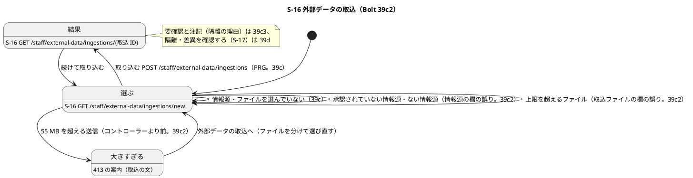
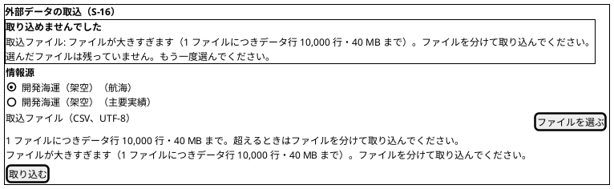
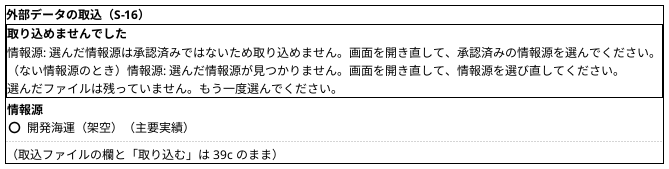
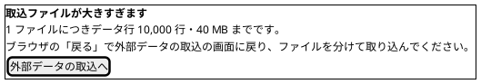
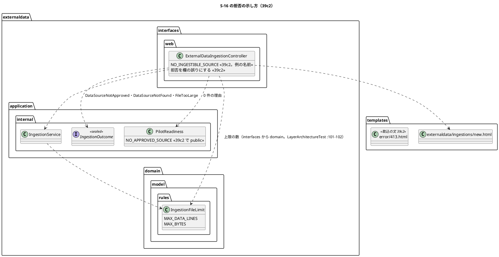

# Bolt 39c2 計画 - S-16 取り込めない送信を理由ごとに示す（情報源の拒否・上限を超えるファイル・413）

## 基本情報

| 項目 | 内容 |
| :--- | :--- |
| Bolt | 第 39c2 回（W7 の 12 本目。release_plan :958 の 39c2 の行を、開始準備で縦に 39c2・39c3 の 2 本に分けた 1 つ目。下の「開始準備で決めたこと」(1)） |
| 状態 | 初稿（承認待ち） |
| 予定 | W7（2026-11-16 の週。前倒しで着手できる）。作業は約 3 時間 35 分（`check`・`uiTest`・`manualScreenshots`・`demoVideo`・`performanceTest`・SonarQube・CI とステップごとの承認の待ちを除く） |
| アプローチ | アウトサイドイン（S-16 から。画面の層の受入シナリオ（`@ui`）の Red から入る。release_plan :958 の 39c2 の行のとおり。取込のサービスの拒否の 4 つ（IngestionOutcome.java :104・:107・:110・:116）は 39b〜39b4 で固まっていて、画面の示し方が受入条件の中心） |
| 対象 | (1) 拒否の理由ごとの文言（承認されていない情報源・ない情報源・上限を超えるファイル `FileTooLarge`）を欄の誤りにし、39c の共通の文言（ExternalDataIngestionController.java :54-55）をやめる、(2) 上限の数（データ行 10,000 行・40 MB）を `IngestionFileLimit`（IngestionFileLimit.java :13・:16）から引き、画面の説明と誤りの文言の 2 か所の直書きをやめる、(3) multipart の 55 MB を超えた送信の 413 の案内（error/413.html）に取込の文を足す、(4) 承認済みの情報源がないときの全文を 1 か所（画面の層の定数）に寄せ、テンプレートとテストはそこから引く（39c の申し送り）、(5) 上限を超えるファイルの受入シナリオ（Bolt 39b4 の申し送り）、(6) 画面の経路で上限いっぱい（データ行 10,000 行）の計測（`performanceTest`。39c の行 18）、(7) マニュアル 12 章の上限と拒否の説明・付録 B の早見表・キャプチャ 1 枚、(8) デモの動画（`@demo-bolt-39c2/too-large`） |
| トレース | US-14 AC1（手動取込）・AC2（承認済みの情報源のない取込の拒否）、UC-15 の主シナリオ 1〜3、PERF-06（non_functional :62）、ui_design の S-16（:141・:190-192、画面イメージ :1745-1812）、エラー要約（ui_design :954）、ACC-01（WCAG 2.2 AA） |
| GitHub | [#18](https://github.com/k2works/practical-domain-driven-design-in-enterpris-application/issues/18)（US-14。クローズは 39h） |
| SP | 0 |
| 承認ゲート | **ステップごとに止める**（release_plan :958 の「ステップごと（画面・スキーマ・新しいファイル）」）。画面（拒否の文言と 413 の案内）、新しいファイル（キャプチャ `docs/manual/assets/12-ingestion-too-large.png`。下の一覧）。スキーマは 39c2 では変えない（受信記録の行の範囲の列は 39c3。開始準備の決定 (6)）。注: 2026-11-04 の人の指示「Recommend 承認で進めて」（重ねての指示）により、各ステップの終わりで止めて推奨の案を承認として記録する（人が個別に見ていないことが分かるように「推奨のとおり（Recommend 承認の指示による）」と書く）。ステップを飛ばしたり束ねたりはしない |
| 開始準備で決めたこと | 2026-11-04、推奨のとおり（Recommend 承認の指示による。human:kakimomokuri）: (1) **分け方**: 縦に 2 本に分ける。release_plan :958 の 39c2 の範囲と Bolt 39c の申し送り（[計画](bolt_39c_plan.md) :150-162、[終了報告](bolt_39c_report.md) :98・:101）を 1 本にすると約 7 時間 40 分（重なる設計の文書・品質ゲート・報告をまとめても約 6 時間 40 分）で半日を超える（下の「時間の配分と打ち切り」）。**39c2** は「取り込めない送信（情報源の拒否・上限を超えるファイル・55 MB を超える送信）を、理由とどうすればよいかで示す」縦（約 3 時間 35 分）、**39c3** は「取り込んだファイルの要確認と注記（隔離の理由）を、業務の言葉で行の順に示す」縦（受信記録の行の範囲の列（スキーマ）、要確認を DB から復元する照会と `requiresReview()` の一致、注記の照会と並び、ファイルの誤りの「どうすればよいか」、0 バイトのファイルと種別の違うファイルの受入シナリオ、マニュアルの注記の読み方。約 4 時間 15 分。39c3 の開始準備で見積り直す）。どちらの縦もマニュアルの更新を完了条件に入れる。代わりの案（39c の計画 :363 の例「行の番号の列と注記の並びだけを 39c3 に送る」）は取らない。取り込めなかった部分の注記（閉じ忘れなど）を画面に出すには、その受信記録を DB で見分ける手段が要るが、いまはファイルの終わりまでの範囲の受信記録も行の誤りの受信記録も外部原本 ID が NULL のキーのない隔離で（IngestionService.java :283-292・:299-311）、見分けられるのは注記の文の頭だけになる。行の範囲の列なしで要確認の注記を出すと、注記の文の形に照会が依存する。要確認と注記は行の範囲の列と同じ縦に置く、(2) **拒否の文言**: 3 つの拒否をエラー要約の欄の誤りにする（ui_design :954 の「表示名: 文言」。見出しは「取り込めませんでした」のまま）。情報源「選んだ情報源は承認済みではないため取り込めません。画面を開き直して、承認済みの情報源を選んでください。」（`DataSourceNotApproved`。選択肢は承認済みだけなので、起きるのは画面を開いた後に情報源が停止されたときと、画面を経ない送信）、情報源「選んだ情報源が見つかりません。画面を開き直して、情報源を選び直してください。」（`DataSourceNotFound` と、controller が取込のサービスを呼ぶ前に見つける ID の形の誤り・ない ID・知らない原本種別（ExternalDataIngestionController.java :101-106）。原本種別は `CsvFileKind` の名前だけ（DataSource.java :13）なので、知らない原本種別は起きない前提で同じ文言にする）、取込ファイル「ファイルが大きすぎます（1 ファイルにつきデータ行 10,000 行・40 MB まで）。ファイルを分けて取り込んでください。」（`FileTooLarge`）。共通の文言 `REFUSED`（:54-55）と大域の誤り（new.html :27）は使わなくなるので外す。`NotPermitted` は 403 のまま（:114）、(3) **上限の数の出どころ**: 画面の説明（new.html :47）と `FileTooLarge` の文言の「10,000 行」「40 MB」を `IngestionFileLimit.MAX_DATA_LINES`・`MAX_BYTES`（IngestionFileLimit.java :13・:16）から作る。画面の層（`interfaces`）が `domain` を読むことは層の規則が許す（LayerArchitectureTest :101-102）。ドメインの規則のクラスは `Repository` で終わらない（:255-260 の規則に当たらない）、(4) **413 の案内**: error/413.html に、パスが `/staff/external-data/ingestions` で始まるときの取込の文を足す（前例は見積依頼の送信 :14-19。ほかは一般の文 :20-24 のまま）。見出し「取込ファイルが大きすぎます」、本文「1 ファイルにつきデータ行 10,000 行・40 MB までです。ブラウザの「戻る」で外部データの取込の画面に戻り、ファイルを分けて取り込んでください。」、リンク「外部データの取込へ」（`/staff/external-data/ingestions/new`）。413 の案内は認証の前の画面と同じレイアウト（error/413.html :2-6）で業務データを出さないので、数は文に書く（定数を引くモデルがない。下の「設計の決定」の 413 の行）、(5) **承認済みの情報源がないときの文言の置き場所**: 全文を画面の層の定数（例 `ExternalDataIngestionController.NO_INGESTIBLE_SOURCE`）にし、理由の部分は `PilotReadiness.NO_APPROVED_SOURCE`（PilotReadiness.java :13。いまはパッケージの中だけで読める）を公開して引く。テンプレート（new.html :17）はモデルの値を出し、テスト（ExternalDataIngestionControllerTest :62 の `NO_SOURCE`）は定数で確かめる。マニュアル（12 章 :93・付録 B :215）は文書なので定数から引けない（マニュアルを読むテストはない。`docs/manual` を読むテストは ManualScreenshotSteps だけ）。ステップ 5 の突き合わせ（T-197）で確かめる、(6) **受信記録の行の範囲の列（スキーマ。実装は 39c3）**: 受信記録に `first_line_number`・`last_line_number`（INTEGER、NULL 可。2 列はそろって NULL かそろって値を持ち、1 以上で始まりが終わり以下の CHECK）を足す。値は行ごとの結果（形式の正しい行と行の誤り。IngestionOutcome.java :67-68 の始まりと終わり）と、ファイルの終わりまで取り込めなかった範囲（始まりからファイルの終わりの物理行まで。IngestionService.java :291-292）。ファイルの誤りの受信記録（ファイル全体の原本を指す。:276-281）と既存の行は NULL（受信記録は追記専用で更新しない。V20261103100000 :96）。注記は行の範囲の順（NULL のファイルの誤りを先）に並べる。DE-14 はすでに同じ物理行の範囲を持つ（IngestionService.java :236-251）。代わりの案は取らない: (a) 注記の文の頭の行の番号を読む（文の形に照会が依存し、注記は 1,000 文字で切られる（:323-329）。ファイルの誤りの文には番号がない）、(b) 原本のキーを決まった順にする（キーは前置きと乱数の形に検査され（PayloadObjectKey.java :19-20）、保存の契約と形の検査を変えることになる）、(c) 分類の時刻で並べる（1 つの取込の受信記録はすべて Clock から 1 回取った同じ時刻（IngestionService.java :127・:203・:309）で、並びを決められない）、(d) 表示の並びを諦める（データ責任者は行の番号で原本のファイルと照らす。S-17 の一覧（39d）も同じ並びが要る）。スキーマの変更なので【前の決定の変更】の注で跡を残す（下）、(7) **変異の検知の偏り（39c の既知の課題）**: テストは足さない。V2（CSRF）を検知する 1 件は行 2 を名乗るテスト、V7（ナビ）を検知する 1 件は行 13 を名乗るテスト（ExternalDataIngestionSecurityIntegrationTest :268）で、落ちたテストの名前が原因を示す。V8（ホーム）は UI の 4 本も止めるが、行 13 のホームのテスト（AuthenticationSecurityIntegrationTest :647）が同時に落ちるので原因を絞れる。既知の課題を閉じる、(8) **上限いっぱいの計測の経路**: `ExternalDataIngestionPerformanceTest`（`@Tag("NFR-PERF-06")`。:54・:61・:64）に、画面の POST（MockMvc の multipart。認証は ExternalDataIngestionSecurityIntegrationTest の POST の書き方）でデータ行 10,000 行のファイルを送り、結果の画面への移動（302）までの 1 本を足す。Tomcat の multipart の受け取りは MockMvc の外なので測らず、計測の範囲に書く。PERF-06 の判定は前例どおり Linux の CI の手動のジョブ（:47-48）、(9) **マニュアル**: 12 章の上限の説明（12-外部データ.md :89。いまは 39c の共通の文言を書いている）を理由ごとの文言に直し、55 MB を超えたときの 413 の案内と、情報源の拒否の 2 つを足す。付録 B の早見表（:215 の近く）に新しい 4 つの文言の行を足す。キャプチャは上限を超えるファイルの拒否の 1 枚を足す（新しいファイル）。413 の案内はキャプチャにしない（一般のレイアウトで、文で足りる） |

【前の決定の変更】(1): release_plan :958 の 39c2 の行（初案。Bolt 39c の開始準備で 39c から分けた範囲）を、この開始準備で 39c2 と 39c3 に縦に分ける。順序（:967）は 39c → 39c2 → 39c3 → 39d にする（2026-11-04、推奨のとおり。Recommend 承認の指示による。human:kakimomokuri）。

【前の決定の変更】(6): 受信記録の表（Bolt 39a3 の V20261103100000 :75-91、data_model :1046-1058・:1151）は行の番号を持たない形で決めた。39c3 で行の範囲の 2 列を足す（共通のマイグレーション。H2 と PostgreSQL の両方で通る形）。受信記録の record（ReceivedRecord.java :29-38）と、受信記録を作る 2 か所（IngestionService.java :194-203・:300-309）と、テストの組み立て（契約 ExternalDataRecordRepositoriesContract の 4 か所、MyBatis の統合テスト 2 つ）が変わる（2026-11-04、推奨のとおり。Recommend 承認の指示による。human:kakimomokuri。スキーマの承認ゲートは 39c3 の計画で通す）。

新しいファイル（39c2）: キャプチャ `docs/manual/assets/12-ingestion-too-large.png`。本体・テストのファイルは足さない（`ExternalDataIngestionController`・`new.html`・`error/413.html`・`PilotReadiness`、`ExternalDataIngestionControllerTest`・`ExternalDataIngestionSecurityIntegrationTest`・`UploadLimitIntegrationTest`（または外部データの側に同じ形のテストを足すかはステップ 2 で決める。足すなら新しいファイルとして諮る）・`ExternalDataIngestionPerformanceTest`・`ingest_external_data_ui.feature`・`ExternalDataIngestionUiSteps`・`manual_screenshots.feature` を直す）。

## Bolt ゴール

データ責任者が S-16 で取り込めない送信をしたとき、エラー要約が理由と次の行動を欄ごとに示す: 上限（データ行 10,000 行・40 MB）を超えるファイルは「取込ファイル: ファイルが大きすぎます（…）。ファイルを分けて取り込んでください。」、画面を開いた後に停止された情報源は「情報源: 選んだ情報源は承認済みではないため取り込めません。…」、ない情報源は「情報源: 選んだ情報源が見つかりません。…」。どれも取込も原本も残らない。55 MB を超える送信は 413 の案内で、取込の画面に戻ってファイルを分けるよう示す。画面の説明と誤りの文言の上限の数は取込の規則と同じ値から作り、承認済みの情報源がないときの文言は 1 か所にある。画面の経路で上限いっぱい（データ行 10,000 行）のファイルを PERF-06 の 5 分以内に取り込める。マニュアル 12 章と付録 B がこの文言と合い、キャプチャとデモの動画がある。取り込んだファイルの要確認と注記（隔離の理由）は 39c3、隔離・差異の判断（S-17）は 39d。

### 開始準備で確かめたこと

- **release_plan の 39c2 の行**（:958）: 「拒否の理由ごとの文言（承認されていない・ない情報源、上限を超えるファイル `FileTooLarge`）と 413 の案内の取込の文、形式の誤り・文字コードの誤り・閉じ忘れの要確認と注記、要確認を DB から復元する照会と `requiresReview()` の一致、ファイルの誤りの「どうすればよいか」、注記の並び（受信記録の行の番号の列。スキーマは開始準備で諮る）、上限いっぱいの画面の経路の計測（PERF-06）、形式の誤り・値の誤りの注記のマニュアルの説明」、アプローチはアウトサイドイン、承認ゲートは「ステップごと（画面・スキーマ・新しいファイル）」。順序は :967、デモ項目は :973（動画は画面の振る舞いが変わる Bolt で撮る）
- **前の Bolt の申し送り**: Bolt 39c（[計画](bolt_39c_plan.md) :150-162 の 39c2 の 10 行、[終了報告](bolt_39c_report.md) :98（既知の課題）・:101（変異 V8））、Bolt 39b2（[終了報告](bolt_39b2_report.md) :87・:104・:108。要確認を DB から復元する照会と `requiresReview()` の一致、注記を画面で読む形、ファイルの誤りの「どうすればよいか」、形式の誤りの注記のマニュアルの説明）、Bolt 39b2b（[終了報告](bolt_39b2b_report.md) :81。値の誤りの注記のマニュアルの説明）、Bolt 39b4（[終了報告](bolt_39b4_report.md) :68・:80・:95。上限を超えるファイルの受入シナリオ、画面での拒否の示し方、マニュアルの上限の説明）。このうち 39c2 は拒否・上限・413・文言の置き場所・計測・変異の偏り、39c3 は要確認と注記（下の申し送り）
- **controller の今の形**（ExternalDataIngestionController.java）: 情報源・ファイルを選ばない誤りは欄の誤り（:90-100）。ID の形の誤り・ない情報源・知らない原本種別はサービスを呼ばずに共通の文言（:101-106・:145-148）。サービスの結果は `Ingested` で PRG、`NotPermitted` で 403、ほかの 3 つは共通の文言（:109-118）。`switch` は sealed の型で網羅を確かめる（IngestionOutcome.java :14）
- **取込のサービスの拒否の順**（IngestionService.java）: 役割（:113-115）→ 情報源の有無（:116-119）→ 承認の状態（:149-151）→ 大きさ（:152-154）。拒否なら原本も保存しない（:53-54 の Javadoc。原本の保存は :126 より後）
- **上限**（IngestionFileLimit.java）: データ行 10,000（:13）、41,943,040 バイト（40 MiB。:16）、ちょうどの値は受ける（:21・:27-29）。画面の説明は new.html :47 に、マニュアルは 12-外部データ.md :42・:89 に直書き
- **multipart と 413**: 1 回 55 MB（application.properties :48-49）、上限の少し上（60 MB）までは Tomcat が読み捨てて 413 の案内を返す（:50-51）。413 の案内（error/413.html）は CSRF の確認が本体を読むのでコントローラーより前で起きる（:2-5）、見積依頼の送信だけに専用の文（:14-19）、ほかは一般の文（:20-24）。前例のテストは `UploadLimitIntegrationTest`（RANDOM_PORT。:23・:33-37・:41-44）。40 MiB を超え 55 MB 以下の送信はコントローラーに届き `FileTooLarge` になる
- **承認済みの情報源がないときの文言**: テンプレート（new.html :17）、テスト（ExternalDataIngestionControllerTest :62）、マニュアル（12-外部データ.md :93、付録B-トラブルシューティング.md :215）の 4 か所に直書き。理由の部分は `PilotReadiness.NO_APPROVED_SOURCE`（PilotReadiness.java :13。パッケージの中だけで読める `static final`。末尾の「。」を持たない）
- **要確認と注記の今の形（39c3 の前提）**: `requiresReview()` は取り込めなかった部分があるか（IngestionOutcome.java :55-61）。ファイルの誤りはデータ行の有無にかかわらず取り込めなかった部分になる（IngestFileCommandAssembler.java :81-88。データ行がなければ始まりは NULL で数 0。CsvRecords.java :33）。DB の定めは「取り込めなかった物理行の数が 0 より大きい、またはファイルの誤りの隔離の受信記録がある」（V20261103150000 :5・:13-17）で、ファイルの誤りの受信記録は取込のファイル全体のキーを持つ（IngestionService.java :276-281）。受信記録は行の番号を持たず（V20261103100000 :75-91）、照会は件数を数えるだけ（ReceivedRecordMapper.xml :16-19）。原本のキーは乱数（PayloadObjectKey.java :30-37）。注記の文の頭にだけ行の範囲がある（IngestionService.java :65・:67、FormatDefect.java :111-113・:123-125）。ファイルの誤りの「どうすればよいか」は必要な列がない・同じ名前の列が空（FormatDefect.java :25・:27）
- **変異の検知（39c）**: V2 は行 2、V7 は行 13（ExternalDataIngestionSecurityIntegrationTest :254・:268）、V8 は行 13 のホーム（AuthenticationSecurityIntegrationTest :647）と UI の 4 本（[39c の終了報告](bolt_39c_report.md) :51・:101）
- **性能のテスト**: `ExternalDataIngestionPerformanceTest`（`@Tag("NFR-PERF-06")`、1 万件 :61、5 分 :64）は組み立てから取込のコミットまでを測る（:41-48。行 1・2・10・11・12 :108・:115・:133）。`performanceTest` は `check` と push の CI に入れない（build.gradle :138-143）
- **マニュアル**: 12 章の節は 12.1 だけ（12-外部データ.md :23 から。小見出しは :25〜:87）。隔離の理由の読み方は「後の版で本章に足します」（:83）。キャプチャは 3 枚（`docs/manual/assets/12-ingestion-new.png`・`12-ingestion-rejected.png`・`12-ingestion-result.png`）

## 設計の決定

| 項目 | 決定 | 根拠 |
| :--- | :--- | :--- |
| 分け方 | 開始準備の決定 (1)。39c2 は拒否・上限・413・文言の置き場所・計測、39c3 は要確認と注記 | 下の「時間の配分と打ち切り」 |
| 拒否の文言 | 開始準備の決定 (2)。欄の誤りとして `rejectValue` する（情報源は `dataSourceId`、上限は `file`）。リンクは各欄へ（情報源は最初のラジオの `dataSourceId`、取込ファイルは `file`）。誤りの画面で選んでいたファイルは「選んだファイルは残っていません。もう一度選んでください。」（new.html :31）をそのまま出す。承認されていない・ない情報源の誤りの後は、選んだ情報源を戻さない（選択肢にない値は戻せない。開き直した選択肢から選ばせる） | ui_design :954、ExternalDataIngestionController.java :92-100 |
| 拒否の網羅（T-240） | 理由ごとの文言は `switch` の 3 つの拒否と controller の手前の拒否から作り、すべての拒否が空でない欄の誤りになることを、拒否の種類ごとのテスト（行 1・2・5・6）で確かめる | IngestionOutcome.java :104・:107・:116 |
| 上限の数 | 開始準備の決定 (3)。「40 MB」は `MAX_BYTES / (1024 * 1024)`、「10,000 行」は `MAX_DATA_LINES` を 3 桁の区切りで書く（画面の説明と誤りの文言の 2 か所）。マニュアルはバイト数（41,943,040 バイト）も書く（12-外部データ.md :89 のまま） | IngestionFileLimit.java :13・:16 |
| 413 の案内 | 開始準備の決定 (4)。413 の案内のテンプレートは `${path}` だけを読む（error/413.html :14・:20）ので、数は文に直書きにし、テスト（行 4）で `IngestionFileLimit` の数と合うことを確かめる。見積依頼の文と一般の文の判定は変えない。60 MB を超えると Tomcat が読み捨てず接続が切れる（application.properties :50-51）のは今と同じで、マニュアルに「ファイルを分けて」を書く | error/413.html :14-24、UploadLimitIntegrationTest :33-44 |
| 0 件の文言 | 開始準備の決定 (5)。`PilotReadiness.NO_APPROVED_SOURCE` を `public` にし、画面の層の定数を「取り込める情報源がありません。」＋理由＋「。承認は運用の手順で行います。」で作る。画面の文言は変えない（39c の文言と 1 字も違えない。ExternalDataIngestionControllerTest :62 と同じ全文） | PilotReadiness.java :13、new.html :17 |
| 画面を開いた後に停止した情報源 | 選ぶ画面を開いた後に情報源が停止（`SUSPENDED`）されると、送信は `DataSourceNotApproved` になる（承認の状態はサービスが送信の時に確かめる。IngestionService.java :149-151）。セキュリティの統合テスト（PostgreSQL）で、自分の UUID を含む情報源を承認済みで作り、停止してから送る（T-230） | IngestionService.java :149-151 |
| 上限を超えるファイルのテストのデータ | 行数の超過は航海のデータ行 10,001 行（寄港 2、数百 KB）で UI まで通す。バイト数の超過（41,943,041 バイト以上 55 MB 以下）はセキュリティの統合テストで 1 本（長い値の 1 行でもよい。大きさの判定は承認の状態の後で、行の形式より前の拒否なので、ファイルの中身の形式を問わない（IngestionService.java :152-154 は組み立ての後だが、拒否なら何も保存しない））。controller のテストは取込のサービスを mock して `FileTooLarge` を返す | IngestionService.java :148-156 |
| 上限いっぱいの計測 | 開始準備の決定 (8)。計測の値はログに「PERF-06 web」で始まる行で出す（前例 :173 の形）。multipart の解析（MockMvc）・組み立て・取込を区切って測る（T-241） | ExternalDataIngestionPerformanceTest :41-48・:173 |
| 変異の偏り | 開始準備の決定 (7)。テストを足さず、既知の課題を閉じる | ExternalDataIngestionSecurityIntegrationTest :268、AuthenticationSecurityIntegrationTest :647 |

## ふりかえりと前の Bolt からの引き継ぎ

| 出典 | 内容 | この Bolt での扱い |
| :--- | :--- | :--- |
| W6 の Try T-204・T-212、Bolt 38h の T-227、Bolt 39b の T-233 | サブエージェントへの指示の最初に heredoc（`<<`）と標準入力を待つコマンドを使わないと書く | 任せるときの指示の最初に書く。ファイルは Write・Edit で書く |
| W6 の Try T-217、Bolt 39b2 の Try | 本体を直す前に Red を流し、落ちた理由を記録する。Red の記録に、直したテストの一覧を添える | ステップ 2 の Red（feature・controller・セキュリティ・413・計測）。共通の文言をやめて落ちる既存のテスト（ExternalDataIngestionControllerTest の行 5 の 39c の分と、`REFUSED` を参照するテスト）を、ステップ 2 の開始で grep して一覧にする |
| W6 の Try T-225・T-213 | push の前に `check` | ステップ 6（`uiTest` も流す） |
| W6 の Try T-182・T-211・T-216 | 状態の組み合わせの表に重複・隔離と出口・誤った入力の行を置く | 下の表（行 1〜23。39c3 の行も先に置き、送り先を書く） |
| W6 の Try T-184 | listener は配信まで確かめる | 拒否は取込のトランザクションでイベントを出さない（IngestionService.java :112-124 は保存の前に返す）。行 1・2・5 の統合テストで、自分の情報源の取込とイベント発行記録がないことを確かめる |
| W6 の Try T-219 | 変異の対象に単体・統合・契約のテスト | 下の変異の表（controller・セキュリティ・413・UI） |
| W6 の Try T-215・T-222 | Gradle を流す担当を 1 つに、計画の初稿を先にコミット | Gradle は人の側の 1 か所で流す（`uiTest`・`manualScreenshots`・`demoVideo`・`performanceTest` を含む）。初稿をコミットしてから実装に入る |
| Bolt 39a2 の T-229 | 永続化の Bolt の状態の組み合わせに時刻の出どころと同時の書き込みの行を置く | 39c2 は書き込みを足さない。画面を開いてから送るまでの間の情報源の停止（同時の変更）を行 5 に置く |
| Bolt 39a3 の T-230 | 入ることを確かめる行のデータはドメインの規則に合う組み合わせにする | 上限を超えるファイルの行は寄港 2 つ以上・時刻の順の航海の行にする（行数だけで拒否されることを確かめるため、ほかの理由で隔離にならない行）。情報源は提供元の名前に自分の UUID を含める |
| Bolt 39b の T-231 | `@Transactional` は契約のクラスに付ける | 39c2 は契約を足さない（39c3 の受信記録の照会で使う） |
| Bolt 39b の T-232 | 本体のクラスを足したステップは、承認の前に `spotbugsMain` を流す | ステップ 3（本体を直す） |
| Bolt 39b2 の T-234 | 本体のクラスを足したステップでは、承認の前に SonarQube の規則（少なくとも `sonar-local:check` の新しい違反）も見る | ステップ 3（テンプレートの重複も見る） |
| Bolt 39b2b の T-236 | 「起きないこと」を確かめるテストは、件数ではなく呼び出しの記録で確かめる | ない情報源（行 6）で取込のサービスを呼ばないこと、拒否（行 1・2・5）で原本の保存を呼ばないことを、呼び出しの記録（controller のテストは mock、統合は spy）で確かめる |
| Bolt 39b3 の T-237 | 本体のクラスを足したステップでは、承認の前に `checkstyleMain` も流す | ステップ 3 |
| Bolt 39b3 の T-238 | サブエージェントへの指示は、計画の決定を言い換えず計画の行を指す | 任せるときは「開始準備で決めたこと」の番号と「状態の組み合わせ」の行番号を指す |
| Bolt 39b3b の T-239 | 人に諮る選択肢の説明に書く前提は、書く前にコードと設定で確かめ、出典の行を添える | 開始準備の決定と設計の決定の前提に出典の行を添えた（拒否の順、上限の定数、413 の判定、層の規則、受信記録の分類の時刻が 1 つであること、原本のキーの形、行の範囲がすでに DE-14 にあること）。人に諮ることはない |
| Bolt 39b3b の T-240 | 表から作る規則には、全部の行が規則に入ることを確かめるテストを添える | 拒否の種類ごとに空でない欄の誤り（行 8）。ファイルの誤りの「どうすればよいか」（39c3 の行 14） |
| Bolt 39b4 の T-241 | 性能の目標を外れたら、直し方を選ぶ前にどの処理に時間がかかっているかを実測する | 行 21 の計測は multipart の解析・組み立て・取込を区切って測る。PERF-06 を外れたら区切りの値から直し方を選ぶ |
| Bolt 39b4 の T-242 | 性能のテストの行には、上限いっぱいの入力の行を必ず入れる | 行 21（画面の経路でデータ行 10,000 行） |
| Bolt 39c の T-243 | 画面の Bolt で状態の数を 0 件にする受入シナリオが要るときは、計画の時点でコントローラーのテストに下ろすと決める | 承認済みの情報源が 0 件の画面（行 7）はコントローラーのテスト（照会を mock）で確かめ、UI とキャプチャにしない（共有の PostgreSQL。39c の計画 :73） |
| 画面の Bolt の前例（memory の manual-in-bolt-done-criteria、Bolt 37f2 の T-197） | 振る舞いが変わる Bolt はマニュアルの更新を完了条件に入れる。マニュアルの文とキャプチャを実装と突き合わせる | 完了条件に 12 章・付録 B とキャプチャを入れる（39c3 の分は 39c3 の完了条件）。ステップ 5 で章の文と画面の文言を突き合わせる（0 件の文言は定数と） |

## 状態の組み合わせ（行ごとにテストを 1 本。T-182）

controller は WebMvc のテスト（`ExternalDataIngestionControllerTest`。取込のサービスと照会は mock）、拒否から DB と原本の保存の呼び出しまではセキュリティの統合テスト（`ExternalDataIngestionSecurityIntegrationTest`。PostgreSQL、提供元の名前に自分の UUID を含めて絞る）、413 は RANDOM_PORT の統合テスト（前例 `UploadLimitIntegrationTest`）、画面の通しは `ingest_external_data_ui.feature`（Feature の `@ui @US-14 @must`、幅 320 px、axe）。テストの名前は「行 N_」で始める（39c の行の番号と区別するため「39c2 行 N_」とはしない。テストのクラスの Javadoc に Bolt 39c2 の行と書く）。送り先が 39c3 の行は 39c3 の計画で書き直す。

| 行 | 状況 | 期待 | 確かめ方 |
| :--- | :--- | :--- | :--- |
| 1 | 上限を超えるファイル（物理データ行 10,001 行） | 選ぶ画面にエラー要約「取込ファイル: ファイルが大きすぎます（1 ファイルにつきデータ行 10,000 行・40 MB まで）。ファイルを分けて取り込んでください。」（取込ファイルの欄へのリンク、欄の下に同じ文言）。取込も原本もない | controller のテスト（`FileTooLarge` を mock）、UI（10,001 行の航海のファイル。Bolt 39b4 の申し送りの受入シナリオ）、セキュリティの統合テスト（自分の情報源の取込がなく、原本の保存を呼ばない。T-236） |
| 2 | 上限を超えるファイル（41,943,041 バイト以上 55 MB 以下） | 行 1 と同じ文言。取込も原本もない | セキュリティの統合テスト（本物の取込のサービス） |
| 3 | 上限ちょうど（データ行 10,000 行・41,943,040 バイト） | 受ける（IngestionFileLimit.java :21） | ステップ 2 の開始で `IngestionFileLimit` のちょうどの値の単体テストがあるかを grep で確かめ、なければ足す。画面の経路のちょうどの行数は行 21 |
| 4 | multipart の 55 MB を超える送信（56 MB） | 413 と取込の案内（見出し「取込ファイルが大きすぎます」、「データ行 10,000 行・40 MB まで」の文が `IngestionFileLimit` の数と合う、リンク「外部データの取込へ」）。見積依頼の案内は出さない。見積依頼の送信には今の案内のまま、ほかの送信には一般の案内のまま | RANDOM_PORT の統合テスト（前例 UploadLimitIntegrationTest :33-44 の形。外部データの送信の 1 本と、一般の案内に取込の文が出ないことの 1 本） |
| 5 | 承認されていない情報源（画面を開いた後に停止された、または画面を経ない候補の情報源の送信） | エラー要約「情報源: 選んだ情報源は承認済みではないため取り込めません。画面を開き直して、承認済みの情報源を選んでください。」。選択肢は開き直した承認済みだけ。取込も原本もない | controller のテスト（`DataSourceNotApproved` を mock）、セキュリティの統合テスト（承認済みで作った自分の情報源を停止してから送る。原本の保存を呼ばない） |
| 6 | ない情報源（ID の形の誤り・ない ID） | エラー要約「情報源: 選んだ情報源が見つかりません。画面を開き直して、情報源を選び直してください。」。取込のサービスを呼ばない（T-236） | controller のテスト（照会を mock して空。サービスの呼び出しの記録）。サービスが返す `DataSourceNotFound` も同じ文言（controller のテスト） |
| 7 | 承認済みの情報源がない | 選ぶ画面に、画面の層の定数の全文を示し、ファイルの欄と「取り込む」を出さない（US-14 AC2。39c の行 4 の文言のまま） | controller のテスト（照会を mock して 0 件。期待の文は定数から。T-243） |
| 8 | 拒否の網羅（T-240） | 取込のサービスの拒否のうち `NotPermitted` のほかの 3 つと controller の手前の拒否が、すべて空でない欄の誤りになり、大域の誤り（共通の文言）を出さない | controller のテスト（拒否の種類ごとのパラメーターのテスト） |
| 9 | ファイルの誤り: 必要な列がない（選んだ情報源と違う種別のファイルを含む） | 39c3: 結果の画面に要確認と注記「ファイル: 必要な列がありません（…）。<どうすればよいか>」。隔離 1 | 39c3（受入シナリオ。39c の終了報告 :98） |
| 10 | ファイルの誤り: 同じ名前の列 | 39c3: 同上（「どうすればよいか」を空でなくする） | 39c3 |
| 11 | ファイルの誤り: 文字コードの誤り | 39c3: 注記「ファイル: 文字コードが UTF-8 ではありません。UTF-8 で保存し直したファイルを取り込んでください。」（FormatDefect.java :21） | 39c3 |
| 12 | ファイルの誤り: 0 バイトのファイル | 39c3: 受け取った件数 0、隔離 1、要確認（データ行がなくても。IngestionOutcome.java :55-61） | 39c3（受入シナリオ。39c の終了報告 :98） |
| 13 | ファイルの誤り: ヘッダーが読めない | 39c3: 注記「ファイル: ヘッダーを読めません。ヘッダーの引用符を確かめてください。」（FormatDefect.java :23） | 39c3 |
| 14 | ファイルの誤りの「どうすればよいか」（T-240） | 39c3: 範囲がファイルの理由（FormatDefect.java :21・:23・:25・:27）はすべて空でない文を持つ | 39c3（単体） |
| 15 | 行の誤り: 列数・空の値 | 39c3: 結果の画面に行の範囲と理由の注記（要確認にしない） | 39c3 |
| 16 | 行の誤り: 値の誤り（時刻・場所・種類・追跡番号・寄港） | 39c3: 同上（Bolt 39b2b の値の誤りの注記） | 39c3 |
| 17 | 閉じ忘れで取り込めなかった部分（要確認） | 39c3: 要確認と「N 行目からファイルの終わりまで: 引用符が閉じていません。M 行を取り込めませんでした。ファイルを確かめてください。」（FormatDefect.java :123-125） | 39c3 |
| 18 | 要確認の DB からの復元 | 39c3: 正しい・行の誤りだけ・ファイルの誤り（データ行あり・0）・閉じ忘れの 5 つで、DB から復元した要確認が `requiresReview()` と一致する（Bolt 39b2 の申し送り） | 39c3（照会の統合テスト） |
| 19 | 注記の並び | 39c3: 注記を物理行の順に示す（受信記録の行の範囲の列。開始準備の決定 (6)） | 39c3 |
| 20 | 形式の正しい行と誤りの行の混在 | 39c3: 分類別の件数（採用と隔離）と、誤りの行だけの注記が行の順に出る | 39c3 |
| 21 | 画面の経路で上限いっぱいのファイル（データ行 10,000 行。T-242） | 画面の POST から結果の画面への移動まで PERF-06 の 5 分以内、採用 10,000（39c の行 18） | `performanceTest`（`ExternalDataIngestionPerformanceTest` に 1 本。開始準備の決定 (8)） |
| 22 | UI の通しと axe | 上限を超えるファイルを選んで取り込むと、エラー要約にフォーカスが移り、取込ファイルの欄へのリンクで示される。続けて上限の中のファイルを選び直して取り込める。幅 320 px。どの画面も axe の違反 0 | `ingest_external_data_ui.feature`（シナリオに `@US-14-AC1 @demo @demo-bolt-39c2/too-large`） |
| 23 | マニュアルのキャプチャ | 12 章に上限を超えるファイルの拒否のキャプチャ（`12-ingestion-too-large.png`）を `@manual` のシナリオで撮る。既存の 3 枚は撮り直されても文言が変わらない（39c の共通の文言の拒否のキャプチャ `12-ingestion-rejected.png` は選ばずに送った誤りなので変わらない）。章の文言と画面の文言が一致する（T-197） | `manual_screenshots.feature`、ステップ 5 の突き合わせ |

## スコープ

### 入れるもの

- 行 1〜8・21〜23 のテスト。`ExternalDataIngestionController` の拒否の文言（欄の誤り）と上限の数、`new.html` の説明と 0 件の文言をモデルから、`PilotReadiness.NO_APPROVED_SOURCE` の公開、`error/413.html` の取込の文、`ExternalDataIngestionPerformanceTest` の画面の経路の 1 本、`ingest_external_data_ui.feature` と Steps の上限を超えるファイルのシナリオ、キャプチャのシナリオ、デモのシナリオ（`@demo @demo-bolt-39c2/too-large`）
- マニュアル: `docs/manual/12-外部データ.md` の 12.1（上限と拒否の説明（:89）、情報源の拒否 2 つ、55 MB を超えたときの案内、キャプチャ 1 枚）、`付録B-トラブルシューティング.md` の早見表（:215 の近くに 4 行）
- 文書: 下の「設計文書に直す箇所」（ステップ 1）

### 入れないもの

- 取り込んだファイルの要確認と注記（行 9〜20。39c3）
- 受信記録の行の範囲の列（決定は開始準備の決定 (6)、実装は 39c3）
- 隔離・差異の判断（S-17。39d）、差異の分類（39h）
- 選ぶ画面での送る前の大きさの確かめ（ブラウザの JavaScript で選んだファイルの大きさを見る）。拒否の文言で足りる（送ってから示す。原本は残らない）

### 申し送り（既知の課題・入れないもの）

| 送り先 | 課題 | 扱い |
| :--- | :--- | :--- |
| 39c3 | 受信記録の行の範囲の列（開始準備の決定 (6)。スキーマ）と、受信記録の照会（取込ごとに、隔離の受信記録を行の範囲の順に。ファイルの誤りを先） | 39c3 の開始準備でスキーマの承認ゲートとして計画に書き、Recommend 承認で扱う。索引は `ix_received_record_ingestion`（data_model :1215）のままで、1 つの取込の受信記録（最大 1 万件）を並べ替える。上限いっぱいで遅ければ実測してから決める（T-241） |
| 39c3 | 要確認を DB から復元する照会（取込の `unparsed_line_count`、またはファイル全体のキーを持つ隔離の受信記録。V20261103150000 :5）と `requiresReview()` の一致のテスト（行 18）、取込の要約（IngestionSummaryView）に要確認と取り込めなかった部分を足す（domain_model :336） | 39c3 |
| 39c3 | 結果の画面に示す注記の範囲。推奨は隔離（形式の誤りと内容の違う原本）の注記だけを行の順に示し、重複の注記は示さない（重複は採用値に影響せず、データ責任者の行動が要らない。IngestionService.java :216-217）。多いとき（最大 1 万件）は最初の 100 件と残りの件数を示し、すべては S-17（39d）の一覧で見る | 39c3 の開始準備で決める |
| 39c3 | ファイルの誤り（必要な列がない・同じ名前の列）の「どうすればよいか」（FormatDefect.java :25・:27 が空。Bolt 39b2 の申し送り）と T-240 の網羅のテスト（行 14） | 39c3。案は必要な列がない「選んだ情報源の種別に合ったファイルか確かめてください。合っていれば提供元に確かめてください。」、同じ名前の列「提供元に確かめてください。」（`Remedy.ASK_PROVIDER`。:61） |
| 39c3 | 0 バイトのファイルと選んだ情報源と違う種別のファイルが隔離 1・要確認になることの受入シナリオ（39c の終了報告 :98。マニュアル :83 は設計の文書を根拠に書いた） | 39c3 の受入シナリオ |
| 39c3 | マニュアル 12 章の要確認と注記の読み方、形式の誤り・値の誤りの注記の説明（Bolt 39b2・39b2b の申し送り。12-外部データ.md :83 の「後の版で本章に足します」） | 39c3 のマニュアルの更新 |
| 39d | 選択肢の並び（DB の照合順序とメモリの実装。39c の計画 :161）、S-17 への入口、隔離・差異の判断 | 39d |
| 39h | 分類別の件数の差異の行 | 39h |
| W10 | 取り込んだファイルの名前を取込に残すか（39c の計画 :165） | W10 の運用準備 |

### 設計文書に直す箇所（ステップ 1）

- ui_design: S-16 の行（:141）の「取り込めないファイルと要確認の示し方は 39c2」を「拒否・上限・413 は 39c2、要確認と注記は 39c3」に、URL の表の POST の行（:191）に理由ごとの 3 つの文言（欄の誤り）と 413 の取込の案内（見出し・本文・リンク）、結果の行（:192）の「要確認・取り込めなかった部分・注記は 39c2」を 39c3 に、S-16 の画面イメージの段落（:1747）の 39c2 を 39c3 に、選ぶ画面の誤りの画面イメージ（:1769-1786）に上限を超えるファイルの拒否の例を足す、結果の画面イメージの注（:1806）の 39c2 を 39c3 に
- data_model: 受信記録の ER（:1046-1058）と表の説明（:1151）に「行の範囲の 2 列は Bolt 39c3 で足す（開始準備の決定 (6)）」の注（【前の決定の変更】(6)）
- domain_model: 取込の要約（:336）の「要確認と取り込めなかった部分は 39c2 で足す」を 39c3 に
- test_strategy: 外部データの取込の行（:384）に 39c2 の上限を超えるファイルの受入シナリオと 413 の統合テスト、「取り込めないファイルと要確認の示し方は 39c2」を「要確認と注記は 39c3」に
- release_plan: 39c2 の行（:958）を 39c2 の範囲に直し、39c3 の行を足す（【前の決定の変更】(1)）。順序（:967）に 39c3。デモ項目（:973）の動画を撮る Bolt に 39c2・39c3
- development_strategy: :350 の W7 の行の画面の Bolt に 39c3 を足す
- コードのコメント（触るステップで直す）: `ExternalDataIngestionController` の Javadoc（:37-39 の「39c では共通の文言で示し、理由ごとの文言は 39c2」）、`new.html` のコメント（:14-16）、`result.html` のコメント（:14 の「要確認と注記は 39c2」を 39c3 に）、`IngestionSummaryView` の Javadoc（:9 の 39c2 を 39c3 に）、`error/413.html` のコメント（:2-5 に取込の送信を足す）

## 設計（この Bolt の範囲）

### 画面遷移図（S-16 の 39c2 の分）

### 画面イメージ

選ぶ画面（上限を超えるファイルを送った）:

選ぶ画面（画面を開いた後に情報源が停止された・ない情報源）:

413 の案内（55 MB を超える送信。認証の前の画面と同じレイアウト）:

画面イメージの名前は説明用の架空の値である（ui_design の画面イメージの決まり）。

### クラスと依存

- ER 図: 39c2 は表と列を変えない（行の範囲の列は 39c3）ので省く
- 状態遷移図: 画面は状態を持たず、取込・受信記録は追記専用で遷移しないので省く

## ステップ計画（ステップごとに止める）

- [ ] **1. 設計の文書**: 上の「設計文書に直す箇所」（開始準備の決定 (1)〜(9) を反映する）（完了の判定: 文書の差分。**承認ゲート**）
- [ ] **2. テストの Red（外側から）**: 行 22 の feature の Red（上限を超えるファイルで、今は共通の文言が出て期待した理由で落ちることを確かめる）、続いて行 1・2・4〜8 の controller・セキュリティ・413 のテストと行 21 の計測のテスト。行 3 のちょうどの値の単体テストの有無を grep で確かめる。共通の文言をやめて落ちる既存のテストを一覧にする（T-217）（完了の判定: 期待した理由で落ちる記録。**承認ゲート**（画面の振る舞いの契約））
- [ ] **3. 実装の Green**: controller の拒否の文言と上限の数、0 件の文言の定数と `PilotReadiness` の公開、`new.html`、`error/413.html`、文言の Javadoc とコメント（完了の判定: 緑、`spotbugsMain`（T-232）、`checkstyleMain`（T-237）、`sonar-local:check`（T-234）。**承認ゲート**（画面））
- [ ] **4. 上限いっぱいの計測**: `performanceTest` で行 21 を流し、区切りの値を記録する（T-241・T-242）。Windows の Docker Desktop では遅れが足されるので、判定は Linux の CI の手動のジョブ `performance` で行う（ExternalDataIngestionPerformanceTest :47-48）（完了の判定: CI のログの「PERF-06 web」の行。5 分以内）
- [ ] **5. マニュアルとキャプチャ**: 12 章の 12.1（:89 の上限と拒否、情報源の拒否 2 つ、55 MB を超えたとき）、付録 B の早見表、`manualScreenshots`（行 23。新しいキャプチャ 1 枚）。章の文言と画面の文言を突き合わせる（T-197。0 件の文言は定数と）（完了の判定: キャプチャの差分と突き合わせの記録。**承認ゲート**（新しいファイル））
- [ ] **6. 品質ゲートと開発レビュー**: 変異、`check`・`uiTest`、その後に SonarQube、開発レビューとその直し。push の前に `check`（T-225）
- [ ] **7. 終了報告**: push して CI とデモ環境の配備を確かめ（デモ環境でデータ責任者でログインし、上限を超えるファイルの拒否の文言を見る）、`demoVideo` で `@demo-bolt-39c2/too-large` を撮る。release_plan（39c2 の行の計画と終了報告のリンク）・開発の索引・mkdocs を直す

### 時間の配分と打ち切り

| # | 目安 | 打ち切り |
| :--- | :--- | :--- |
| 1 | 20 分 | — |
| 2 | 45 分 | 413 のテストを RANDOM_PORT で認証付きにできない（CSRF の確認が本体を読むので、認証の前に 413 になる前提が外れる）ときは、前例（UploadLimitIntegrationTest）と同じく認証なしで送り、パスの判定だけを確かめる。30 分で決まらなければ止めて諮る |
| 3 | 55 分 | 画面の層から `IngestionFileLimit` を読むと ArchUnit（ModularityTest の型の依存の許可リスト、LayerArchitectureTest）が拒むときは、規則を動かさず、ステップを止めて規則の例外を諮る（CLAUDE.md の層の規則の決まり） |
| 4 | 20 分（CI の待ちを除く） | PERF-06 を外れたら、区切りの値を記録して止め、直し方を選ぶ前に諮る（T-241） |
| 5 | 25 分 | — |
| 6 | 30 分（待ちを除く） | — |
| 7 | 10 分（CI と動画の待ちを除く） | — |

合計 205 分（約 3 時間 25 分）に、予備の 10 分を足して約 3 時間 35 分。半日に収まる。39c3（取り込んだファイルの要確認と注記: 設計の文書 20 分、受信記録の行の範囲の列（スキーマ）45 分、要確認の復元の照会と `requiresReview()` の一致 35 分、注記の照会と結果の画面の表示 40 分、ファイルの誤りの「どうすればよいか」15 分、受入シナリオ（0 バイト・種別の違うファイル・閉じ忘れ・混在）25 分、マニュアルとキャプチャ 35 分、品質ゲート 30 分、報告 10 分。約 4 時間 15 分）は、39c3 の開始準備で見積り直し、半日を超えるなら縦に分け直す（例: 注記の多いときの示し方と S-17 への入口を 39d に寄せる）。1 本にした場合（39c2 と 39c3 の合計で約 7 時間 40 分。重なる設計の文書・品質ゲート・報告をまとめても約 6 時間 40 分）は半日を超える。

## 確認ポイント（計画の承認の場でまとめて確認する。Try T-6）

| # | 確認すること | 場所 | 推奨 |
| :--- | :--- | :--- | :--- |
| 1 | **分け方**（【前の決定の変更】(1)） | 開始準備の決定 (1) | 推奨のとおり（Recommend 承認の指示による。human:kakimomokuri）。39c2（取り込めない送信の縦。約 3 時間 35 分）と 39c3（要確認と注記の縦。約 4 時間 15 分。開始準備で見積り直す）。1 本は約 7 時間 40 分（まとめても約 6 時間 40 分）で半日を超える。39c の計画の例（行の範囲の列と注記の並びだけを 39c3 に送る）は、要確認の注記を出すのに行の範囲の列が要るので取らない |
| 2 | **拒否の文言** | 開始準備の決定 (2) | 推奨のとおり。3 つの文言を欄の誤りに（エラー要約の「表示名: 文言」）。共通の文言をやめる |
| 3 | **上限の数の出どころ** | 開始準備の決定 (3) | 推奨のとおり。`IngestionFileLimit` から作る（層の規則が許す）。413 の案内とマニュアルは文で、テストと突き合わせで確かめる |
| 4 | **413 の案内** | 開始準備の決定 (4) | 推奨のとおり。パスで取込の文を出す（見積依頼の前例の形） |
| 5 | **0 件の文言の置き場所** | 開始準備の決定 (5) | 推奨のとおり。画面の層の定数（理由は `PilotReadiness` から）。マニュアルは突き合わせで |
| 6 | **受信記録の行の範囲の列**（スキーマ。【前の決定の変更】(6)） | 開始準備の決定 (6) | 推奨のとおり。2 列（NULL 可）を足し、実装は 39c3。代わりの 4 案（注記の文を読む・キーを決まった順に・分類の時刻・並びを諦める）は取らない（理由と出典は開始準備の決定 (6)）。スキーマの承認ゲートは 39c3 の計画で通す |
| 7 | **変異の偏り** | 開始準備の決定 (7) | 推奨のとおり。テストを足さず既知の課題を閉じる（落ちるテストの名前が原因を示す） |
| 8 | **上限いっぱいの計測の経路** | 開始準備の決定 (8) | 推奨のとおり。MockMvc の multipart で画面の POST から 302 まで。Tomcat の受け取りは範囲の外と書く |
| 9 | **マニュアル** | 開始準備の決定 (9) | 推奨のとおり。12.1 の上限と拒否、付録 B に 4 行、キャプチャ 1 枚。要確認と注記の読み方は 39c3 |
| 10 | **変異** | ステップ 6 | 下の 6 個 |

### 人に諮ること

なし（推奨を 1 つに決められない判断はない。受信記録の行の範囲の列はスキーマの変更だが、代わりの案はどれも出典の行で取れない理由があり推奨が 1 つに決まるので、Recommend 承認の指示で扱い、【前の決定の変更】(6) の注で跡を残した。本番・セキュリティの新しい判断はない。413 の案内は既存の仕組みにパスの文を足すだけで、認可と CSRF を変えない）。

### 変異と落ちる見込みのテスト

| # | 変異 | 落ちる見込み |
| :--- | :--- | :--- |
| V1 | `FileTooLarge` を情報源の欄の誤りにする | 行 1・2・22 |
| V2 | 承認されていない情報源とない情報源の文言を入れ違える | 行 5・6 |
| V3 | 413 の案内のパスの判定を外す（取込の送信に一般の案内が出る） | 行 4 |
| V4 | 0 件の文言をテンプレートの直書きに戻し、1 字違える | 行 7 |
| V5 | 画面の説明の上限の行数を `IngestionFileLimit` から引かず 1,000 にする | 行 1（誤りの文言）・行 22 |
| V6 | ない情報源でも取込のサービスを呼ぶ | 行 6（呼び出しの記録） |

## 完了条件

- [ ] 上のステップ 1〜7 の完了の判定を満たす（ステップごとの承認を受ける）
- [ ] 行 1〜8・21〜23 に、それを名乗るテストがある（行 9〜20 は 39c3 の計画に書き写してある）
- [ ] マニュアル 12 章（12.1 の上限と拒否）・付録 B とキャプチャ（`12-ingestion-too-large.png`）が実装と合っている
- [ ] デモの動画（`@demo-bolt-39c2/too-large`）があり、終了報告のデモ項目からリンクしている
- [ ] `check`・`uiTest` が緑、SonarQube が PASS、CI が緑、`performance` のジョブで行 21 が 5 分以内、デモ環境が新しい版で動く
- [ ] release_plan に 39c3 の行と順序がある
- [ ] 終了報告が承認されている

## 更新履歴

| 日付 | 更新内容 | 更新者 |
| :--- | :--- | :--- |
| 2026-11-04 | 初版作成（承認待ち）。開始準備の決定: 縦に 39c2（取り込めない送信。約 3 時間 35 分）と 39c3（要確認と注記。約 4 時間 15 分）に分ける（【前の決定の変更】）、拒否の理由ごとの文言を欄の誤りに、上限の数を `IngestionFileLimit` から、413 の案内に取込の文、0 件の文言を画面の層の定数に、受信記録の行の範囲の列（スキーマ。実装は 39c3。【前の決定の変更】）、変異の偏りは既知の課題を閉じる、上限いっぱいの計測は画面の POST から、マニュアル 12.1 と付録 B とキャプチャ 1 枚（2026-11-04、推奨のとおり（Recommend 承認の指示による。human:kakimomokuri））。人に諮ることはない | anthropic/claude-opus-5-5 |

## 関連ドキュメント

- [リリース計画](release_plan.md)（W7 の節の 39c2 の行）
- [Bolt 39c 計画](bolt_39c_plan.md)・[Bolt 39c 終了報告](bolt_39c_report.md)（39c2 に送った既知の課題）
- [Bolt 39b2 終了報告](bolt_39b2_report.md)・[Bolt 39b2b 終了報告](bolt_39b2b_report.md)・[Bolt 39b4 終了報告](bolt_39b4_report.md)（39c に送った申し送り）
- [UI 設計](../../design/cargo-tracker/ui_design.md)（S-16）、[データモデル](../../design/cargo-tracker/data_model.md)（受信記録）、[ドメインモデル](../../design/cargo-tracker/domain_model.md)、[テスト戦略](../../design/cargo-tracker/test_strategy.md)、[非機能要件](../../design/cargo-tracker/non_functional.md)（PERF-06）
- [ADR-004](../../adr/cargo-tracker/004-external-data-ingestion.md)
