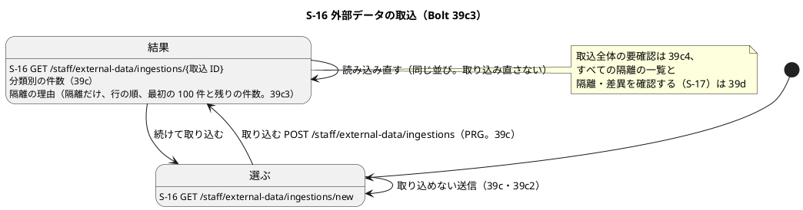
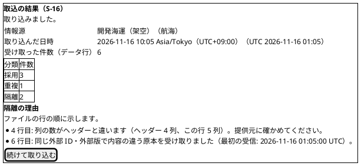
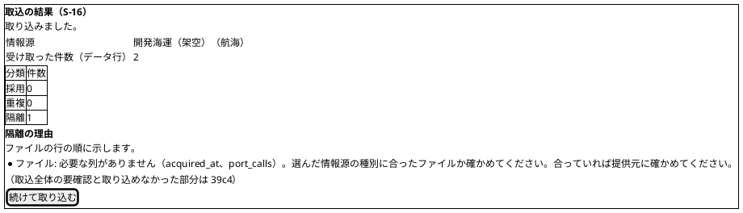
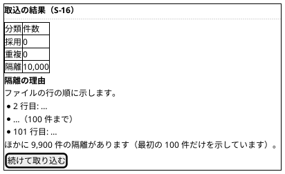
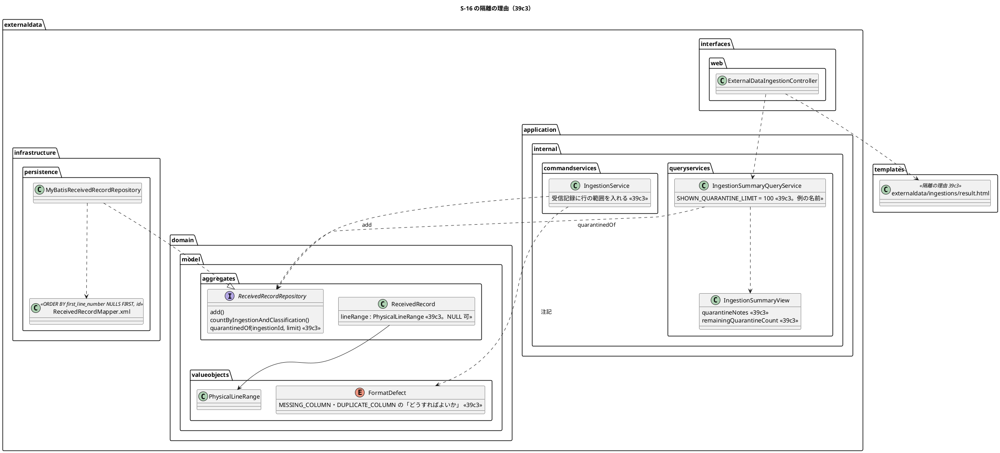
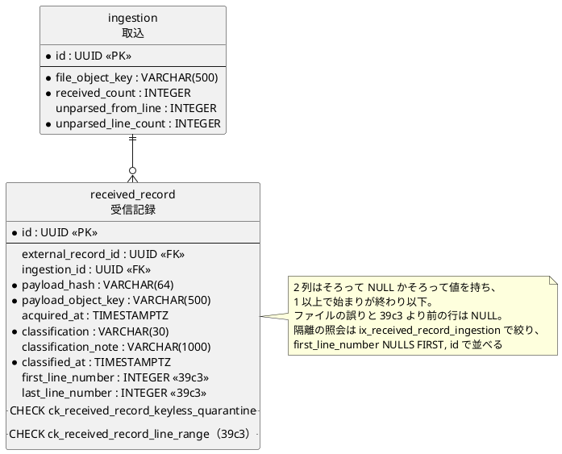

# Bolt 39c3 計画 - S-16 取り込んだファイルの隔離の理由を行の順に示す（受信記録の行の範囲の列）

## 基本情報

| 項目 | 内容 |
| :--- | :--- |
| Bolt | 第 39c3 回（W7 の 13 本目。release_plan :961 の 39c3 の行を、開始準備で縦に 39c3・39c4 の 2 本に分けた 1 つ目。下の「開始準備で決めたこと」(1)） |
| 状態 | 承認待ち |
| 予定 | W7（2026-11-16 の週。前倒しで着手できる）。作業は約 4 時間 15 分（整合性検証の指摘の反映で初稿の約 3 時間 55 分から 20 分増え、目安の 4 時間を約 15 分超える。下の「時間の配分と打ち切り」。`check`・`uiTest`・`manualScreenshots`・`demoVideo`・`performanceTest`・SonarQube・CI とステップごとの承認の待ちを除く） |
| アプローチ | アウトサイドイン（S-16 の結果の画面から。画面の層の受入シナリオ（`@ui`）の Red から入る。release_plan :961 の 39c3 の行のとおり。隔離の受信記録と注記の文は 39b2〜39b3 で固まっていて（IngestionService.java :255-264・:271-297、FormatDefect.java :101-125）、画面での示し方と並びが受入条件の中心） |
| 対象 | (1) 受信記録に行の範囲の 2 列（`first_line_number`・`last_line_number`。Bolt 39c2 の開始準備の決定 (6)。common の新しいマイグレーション）と、取込のサービスが受信記録を書く 2 か所（IngestionService.java :194-203・:299-311）で値を入れる、(2) 取込ごとの隔離の受信記録を行の範囲の順（ファイルの誤りを先）に読むポートの照会、(3) 結果の画面（result.html）に「隔離の理由」の領域を足し、隔離の注記を業務の言葉のまま行の順に示す（多いときは最初の 100 件と残りの件数）、(4) ファイルの誤りの「どうすればよいか」（必要な列がない・同じ名前の列。FormatDefect.java :25・:27 が空）と、範囲がファイルの理由がすべて空でない文を持つことの網羅のテスト（T-240）、(5) 上限いっぱい（行の誤り 10,000 行）の結果の画面の照会の計測（参考の値。T-242）、(6) マニュアル 12 章の隔離の理由の読み方と形式の誤り・値の誤りの注記の説明（Bolt 39b2・39b2b の申し送り）、キャプチャの撮り直し、(7) デモの動画（`@demo-bolt-39c3/notes`） |
| トレース | US-14 AC1（取込と分類の結果）・AC4（隔離した原本をデータ責任者へ示す）・横断の受入条件（入力エラーで理由と修正方法を示す。user_story :39）、UC-15 の代替 2a（形式を検証できないファイルと行。system_usecase :523）・3b（同一の冪等性キーで異なる payload の隔離。内容の違う原本の注記。:527）・2c（ファイルの上限。上限いっぱいの 1 万行の結果の画面の照会の計測（行 19）。:525）、ED-INV-02、BR-12（件数照合）、ui_design の S-16（:141・:192、結果の画面イメージ :1853-1877）、data_model の受信記録（:1046-1059・:1152・:1216）、ACC-01（WCAG 2.2 AA） |
| GitHub | [#18](https://github.com/k2works/practical-domain-driven-design-in-enterpris-application/issues/18)（US-14。クローズは 39h） |
| SP | 0 |
| 承認ゲート | **ステップごとに止める**（release_plan :961 の「ステップごと（画面・スキーマ・新しいファイル）」）。画面（結果の画面の隔離の理由）、スキーマ（受信記録の 2 列と CHECK。ステップ 3）、新しいファイル（下の一覧）。注: 2026-11-04 の人の指示「Recommend 承認で進めて」（重ねての指示）により、各ステップの終わりで止めて推奨の案を承認として記録する（人が個別に見ていないことが分かるように「推奨のとおり（Recommend 承認の指示による）」と書く）。ステップを飛ばしたり束ねたりはしない |
| 開始準備で決めたこと | 2026-11-04、推奨のとおり（Recommend 承認の指示による。human:kakimomokuri）: (1) **分け方**: 縦に 2 本に分ける。release_plan :961 の 39c3 の範囲と Bolt 39c2 の申し送り（[計画](bolt_39c2_plan.md) :109-120 の行 9〜20・:144-150、[終了報告](bolt_39c2_report.md) :95）を 1 本にすると約 4 時間 15 分（39c2 の見積り。[計画](bolt_39c2_plan.md) :326）に、39c2 の見積りになかった注記が多いときの示し方・注記の文字の扱い・上限いっぱいの照会の計測・デモの動画（約 40 分）を足して約 4 時間 55 分になり、目安（2〜4 時間）を超える（下の「時間の配分と打ち切り」）。**39c3** は「取り込んだファイルの隔離の理由（注記）を、業務の言葉で行の順に示す」縦（受信記録の行の範囲の列（スキーマ）、隔離の照会と並び、結果の画面の隔離の理由、ファイルの誤りの「どうすればよいか」、注記が多いとき、マニュアルの隔離の理由の読み方。初稿で約 3 時間 55 分、整合性検証の指摘の反映の後に約 4 時間 15 分）、**39c4** は「取込全体の要確認（取り込めなかった部分）を示す」縦（要確認を DB から復元する照会と `requiresReview()` の一致、結果の画面の要確認、0 バイトのファイル・種別の違うファイル・閉じ忘れの受入シナリオ、マニュアルの要確認の読み方。約 3 時間 10 分。39c4 の開始準備で見積り直す）。どちらの縦もマニュアルの更新を完了条件に入れる（memory の manual-in-bolt-done-criteria）。行の範囲の列が要るのは注記の並びだけで、要確認の復元は今の列で足りる（取込の `unparsed_line_count`（V20261103150000 :14）と、ファイル全体のキーを持つ隔離の受信記録（IngestionService.java :276-281。V20261103150000 :5 の定め））ので、スキーマは 39c3 に置く。代わりの案は取らない: (a) 指示の例「39c3 はスキーマと復元と注記の並び、39c4 は注記の業務の言葉とマニュアルとキャプチャ」は、39c3 で画面の振る舞いが変わるのにマニュアルとキャプチャが 39c4 に送られ、振る舞いが変わる Bolt のマニュアルを後の Bolt に送らない決まりに反する、(b) 要確認を 39c3 に置き注記を 39c4 にする案は、注記の並びのスキーマと照会が要確認より大きく、39c4 が 4 時間を超える（スキーマ 45 分・照会と画面 40 分・計測を含む）、(c) 注記の表示を 39d（S-17）に寄せる案は、結果の画面の隔離の件数に理由が添わないまま 39d まで残り、データ責任者が取り込んだ直後に提供元へ差し戻す行を見分けられない（US-14 AC4）。39d には「すべての隔離の一覧」だけを寄せる（下の (4)）、(2) **示す注記の範囲**: 隔離の受信記録（形式の誤り（行・ファイル・ファイルの終わりまで）と内容の違う原本）の注記だけを示し、重複の注記は示さない（重複は採用値に影響せず、データ責任者の行動が要らない。IngestionService.java :216-217。Bolt 39c2 の申し送り :146 の推奨）。採用は注記を持たない（IngestionService.java :316）。内容の違う原本の注記の文（IngestionService.java :67）は「どうすればよいか」を持たないが変えない（受信記録は追記専用で、すでに書いた注記を直せず、新旧で文が分かれる）。内容の違う原本の次の行動はマニュアルの早見表で示す（下の (10)）、(3) **並び**: 行の範囲の始まりの順。範囲を持たないファイルの誤り（と、この Bolt より前の受信記録）を先にし、同じ始まりはない（1 つの取込の行の範囲は重ならない。IngestionService.java :135-141 は物理行の順に 1 回ずつ処理する）が、決まった順にするため受信記録 ID で並べ直す。分類の時刻は 1 つの取込で同じ（IngestionService.java :127・:203・:309）なので並びに使えない。並びは照会（SQL の `ORDER BY`）で決め、画面で並べ直さない（39d の S-17 の一覧も同じ照会の順を使える）、(4) **注記が多いとき**: 結果の画面には最初の 100 件を示し、101 件目からは「ほかに N 件の隔離があります（最初の 100 件だけを示しています）。」と残りの件数だけを示す。すべての隔離は S-17（39d）の一覧で見る（39d の行に申し送る）。代わりの案は取らない: (a) すべて示す（上限いっぱいで 1 万件の段落になり、画面の重さと読み上げの長さが業務に合わない）、(b) 結果の画面にページ送りを足す（受信記録の一覧は S-17 の役目で、取込の履歴の一覧も作らない決め（ui_design :141）と重なる）。100 件は照会の定数（`IngestionSummaryQueryService` の定数）に置き、画面とテストはそこから引く。残りの件数は隔離の件数（IngestionSummaryView.java :28 の `quarantinedCount`）から示した数を引く（別に数えない）、(5) **行の範囲の値**（Bolt 39c2 の開始準備の決定 (6) の実装）: 形式の正しい行と行の誤りは行の結果の始まりと終わり（IngestionOutcome.java :67-68。IngestionService.java :220-221・:263）、ファイルの終わりまで取り込めなかった範囲は始まりから「始まり ＋ 数 − 1」（IngestionService.java :291-292）、ファイルの誤りは NULL（ファイル全体の原本を指す。:276-281）。受信記録の record（ReceivedRecord.java :29-38）に `PhysicalLineRange`（PhysicalLineRange.java :13。NULL 可）を 1 つ足し、2 列はそろって NULL かそろって値を持つ（record では型で、表では CHECK で守る）。DE-14 はすでに同じ範囲を持つ（IngestionService.java :236-251、ExternalRecordQuarantined.java :39-40）ので、受信記録と DE-14 の範囲が一致することを確かめる（行 5）、(6) **スキーマ**: 受信記録に `first_line_number INTEGER`・`last_line_number INTEGER`（NULL 可）と CHECK `ck_received_record_line_range`（`(first_line_number IS NULL) = (last_line_number IS NULL) AND (first_line_number IS NULL OR (first_line_number >= 1 AND first_line_number <= last_line_number))`）を足す。common の新しいマイグレーション（版はすべての場所（common・h2・dev-data）の最新（dev-data の V20261104160900）より後。例 V20261104170000）で、1 列ずつ書く（H2 の PostgreSQL 互換モードと PostgreSQL の両方で通る形。V20261103150000 :6 の前例）。2 列に日本語の `COMMENT ON COLUMN` を書く（例 `first_line_number` は「行の範囲の始まり（物理行の番号。ファイルの誤りと Bolt 39c3 より前の行は NULL）」、`last_line_number` は「行の範囲の終わり（物理行の番号。ファイルの誤りと Bolt 39c3 より前の行は NULL）」。業務の表の列に日本語のコメントを求める SchemaCommentIntegrationTest :53-56 が落ちないため。前例 V20261103150000 :19-23）。既存の行は NULL のまま（受信記録は追記専用で更新しない。V20261103100000 :96）。索引は足さない（`ix_received_record_ingestion`（V20261103100000 :93）で 1 つの取込の受信記録（最大 1 万件）を絞ってから並べる。上限いっぱいの照会を行 19 で測り、遅ければ値を記録して止める（T-241））。Bolt 39c2 の開始準備の決定 (6) で決めた形のとおりで、スキーマの承認ゲートはこの計画のステップ 3 で通す（【前の決定の変更】(2)）、(7) **誤りの理由を表の列（理由の符号）で持つか**（[Bolt 39b2 計画](bolt_39b2_plan.md) :153）: 39c3 では持たない。39c3 の画面は注記の文を示すだけで、理由で絞り込む使い手がない。理由の符号はすでに DE-14 の `reason`（ExternalRecordQuarantined.java :12-13・:38）にあり、監査の記録に残る。S-17 の一覧で理由の絞り込みが要るかは 39d の開始準備で決める（そのとき足すと、それより前の受信記録は NULL になる。パイロットの前で業務のデータはない）。代わりの案（行の範囲の列と同じマイグレーションで今足す）は、使い手のない列を先に置くことになり取らない、(8) **ファイルの誤りの「どうすればよいか」**: 必要な列がない（MISSING_COLUMN。FormatDefect.java :25）は「選んだ情報源の種別に合ったファイルか確かめてください。合っていれば提供元に確かめてください。」（選んだ情報源と違う種別のファイルもこの誤りになる。マニュアル 12-外部データ.md :93）、同じ名前の列（DUPLICATE_COLUMN。:27）は `Remedy.ASK_PROVIDER`（:61「提供元に確かめてください。」）。Bolt 39c2 の申し送り（[計画](bolt_39c2_plan.md) :147）の案のとおり。範囲がファイルの理由（`occursIn(Extent.FILE)`。:92-94）はすべて空でない文を持つことを、理由ごとに期待の文まで縛るパラメーターのテストで確かめる（T-240・T-244）。閉じ忘れ（UNCLOSED_QUOTE。:29）は範囲がファイルの終わりまでだけで、注記は範囲の言葉「ファイルを確かめてください。」を持つ（:123-125）ので直さない、(9) **注記の文字の扱い**: 注記には取込ファイルから来た値（同じ名前の列の名前など。FormatDefect.java :101-103 の `details`）が入るので、テンプレートは `th:text` で示す（`th:utext` を使わない）。新しい判断ではなく、既存の画面の決まりのとおり（行 18 で確かめる）、(10) **マニュアル**: 12 章の「取込の結果を読む」（12-外部データ.md :72-95）に「隔離の理由」の項目（表の ⑥ の前）と、隔離の理由の読み方（行の範囲の言葉、理由ごとの「どうすればよいか」の早見表。形式の誤り（ファイル・行）・値の誤り（Bolt 39b2b）・内容の違う原本（注記は次の行動を持たないので、早見表で示す。上の (2)））を足し、:93 と :104 の「後の版で本章に足します」を消す（どちらも隔離の理由の分。要確認の読み方は 39c4 が新しく書く）。マニュアルの用語集（docs/manual/用語集.md。:65 の「隔離」の後）に「隔離の理由」を足す。付録 B は変えない（注記は操作の誤りの文言ではない。付録 B の早見表 :212-219 は画面の誤りの文言）。キャプチャは既存の `12-ingestion-result.png` を撮り直す（取り込むファイルに列数の誤りの行を 1 行足し、隔離の理由が 2 つ写るようにする。manual_screenshots.feature :229-230）。新しいキャプチャは足さない、(11) **情報源の拒否の文言の「画面を開き直して」**（Bolt 39c2 の申し送り。[計画](bolt_39c2_plan.md) :154、[終了報告](bolt_39c2_report.md) :18）: 選ぶ画面は誤りの後に選択肢を引き直して示す（ExternalDataIngestionController.java :170-182・:188-193）ので、文言の「画面を開き直して」を「示された情報源から選び直してください」に変える。マニュアルの付録B-トラブルシューティング.md :215-216 の 2 行は、文言の列（今の文言の写し）にも対処の列（「画面を開き直し、示された情報源から選び直してください」）にも「画面を開き直し」が残るので、2 行の 2 列とも 39c4 で直す。39c3 の縦（結果の画面）の外なので、実装は 39c4 で行う（【前の決定の変更】(3)） |

【前の決定の変更】(1): release_plan :961 の 39c3 の行（初案。Bolt 39c2 の開始準備で 39c2 から分けた範囲）を、この開始準備で 39c3 と 39c4 に縦に分ける。順序（:971。39c4 の行を足して 1 行ずれた）は 39c2 → 39c3 → 39c4 → 39d にする（2026-11-04、推奨のとおり。Recommend 承認の指示による。human:kakimomokuri）。

【前の決定の変更】(2): 受信記録の表（Bolt 39a3 の V20261103100000 :75-91、data_model :1046-1059・:1152）に行の範囲の 2 列と CHECK を足す（Bolt 39c2 の開始準備の決定 (6) で形を決め、スキーマの承認ゲートは 39c3 で通すとした。[Bolt 39c2 計画](bolt_39c2_plan.md) :30）。受信記録の record（ReceivedRecord.java :29-38）、行（ReceivedRecordRow.java :7-16）、MyBatis の INSERT（ReceivedRecordMapper.xml :7-14）と実装（MyBatisReceivedRecordRepository.java :22）、受信記録を作る 2 か所（IngestionService.java :194-203・:300-309）、テストの組み立て（契約 ExternalDataRecordRepositoriesContract :97・:228・:282・:300、MyBatisExternalDataRecordRepositoriesIntegrationTest :143、MyBatisAdoptedValueRepositoryIntegrationTest :97）が変わる。受信記録のポート（ReceivedRecordRepository.java :10-17）と MyBatis の mapper のインターフェース（ReceivedRecordMapper.java）に読む照会を 1 つ足す（追記と数えるだけのポートに読み出しが加わる。更新・削除は持たないまま）（2026-11-04、推奨のとおり。Recommend 承認の指示による。human:kakimomokuri）。

【前の決定の変更】(3): Bolt 39c2 の開始準備の決定 (2) の情報源の拒否の 2 つの文言の「画面を開き直して、…」を「示された情報源から選び直してください。」の形に変える（実装とマニュアル 12 章 :102 と付録 B :215-216 の 2 行の 2 列（文言と対処。どちらも「画面を開き直し」が残る）の直しは 39c4）（2026-11-04、推奨のとおり。Recommend 承認の指示による。human:kakimomokuri）。

新しいファイル（39c3）: マイグレーション `apps/cargo-tracker/src/main/resources/db/migration/common/V20261104170000__add_external_data_received_record_line_range.sql`（版はステップ 3 の時刻で決め、すべての場所（common・h2・dev-data）の最新（dev-data の V20261104160900）より後にする）と、形式の誤りの単体テスト `apps/cargo-tracker/src/test/java/com/example/cargotracker/externaldata/domain/model/valueobjects/FormatDefectTest.java`（行 14。FormatDefect のテストのクラスはまだない）と、取込の要約の照会の単体テスト `apps/cargo-tracker/src/test/java/com/example/cargotracker/externaldata/application/internal/queryservices/IngestionSummaryQueryServiceTest.java`（行 16・17。ポートを mock する。照会のテストのクラスはまだない）。本体のクラスは足さない（`ReceivedRecord`・`ReceivedRecordRow`・`ReceivedRecordRepository`・`MyBatisReceivedRecordRepository`・`ReceivedRecordMapper.java`（インターフェース）・`ReceivedRecordMapper.xml`・`IngestionService`・`FormatDefect`・`IngestionSummaryView`・`IngestionSummaryQueryService`・`result.html` を直す）。テストは `ExternalDataRecordRepositoriesContract`（と継ぐ 3 つの実装のテスト）・`InMemoryReceivedRecordRepository`・`MyBatisExternalDataRecordRepositoriesIntegrationTest`・`MyBatisAdoptedValueRepositoryIntegrationTest`・`ExternalDataSchemaIntegrationTest`（行 6 の CHECK `ck_received_record_line_range`）・`H2ExternalDataRecordRepositoriesTest`・`IngestionServiceTest`・`ExternalDataIngestionControllerTest`・`ExternalDataIngestionSecurityIntegrationTest`・`ExternalDataIngestionPerformanceTest`・`quarantine_malformed_records.feature`・`ingest_external_data_ui.feature`・`ExternalDataIngestionUiSteps`・`manual_screenshots.feature` を直す。

## Bolt ゴール

データ責任者が S-16 でファイルを取り込むと、結果の画面の分類別の件数の下に「隔離の理由」が出て、隔離になった行とファイルの理由が業務の言葉で、ファイルの行の順に並ぶ（ファイルの誤りが先、続いて「4 行目: 列の数がヘッダーと違います（…）。提供元に確かめてください。」「6 行目: 同じ外部 ID・外部版で内容の違う原本を受け取りました（…）。」のように物理行の順。下の画面イメージの例と同じ行番号）。ファイルと行の誤りは次の行動（「どうすればよいか」）も示す。内容の違う原本の注記は今の文のまま変えず（受信記録は追記専用。開始準備の決定 (2)）、次の行動はマニュアルの早見表で示す。必要な列がないファイル・同じ名前の列があるファイルにも「どうすればよいか」が付く。重複の行の注記は出さない。隔離が 100 件を超えると、最初の 100 件と残りの件数を示す。並びは受信記録の行の範囲（新しい 2 列）で決まり、読み込み直しても変わらない。マニュアル 12 章に隔離の理由の読み方と、形式の誤り・値の誤りの理由ごとの「どうすればよいか」があり、キャプチャとデモの動画がある。取込全体の要確認（取り込めなかった部分）は 39c4、すべての隔離の一覧と隔離・差異の判断（S-17）は 39d。

### 開始準備で確かめたこと

- **release_plan の 39c3 の行**（:961）: 「受信記録の行の範囲の列（スキーマ。Bolt 39c2 の開始準備の決定 (6)）、要確認を DB から復元する照会と `requiresReview()` の一致、注記の照会と並び、ファイルの誤りの「どうすればよいか」、0 バイトのファイルと種別の違うファイルの受入シナリオ、形式の誤り・値の誤りの注記のマニュアルの説明」、注「見積り（約 4 時間 15 分）が目安を超えるので、開始準備で再分割が前提（範囲を 39d に寄せるかは 39c3 の開始準備で決める）」、アプローチはアウトサイドイン、承認ゲートは「ステップごと（画面・スキーマ・新しいファイル）」。順序は :971、デモ項目は :977（39c4 の行を足した後の行）（動画は画面の振る舞いが変わる Bolt で撮る）、マニュアルの確認ポイントは :935、局面とアプローチは :893
- **前の Bolt の申し送り**: Bolt 39c2（[計画](bolt_39c2_plan.md) :109-120 の行 9〜20、:144-150 の 39c3 の 7 行、:154 の文言の候補、[終了報告](bolt_39c2_report.md) :95 の既知の課題の 39c3）、Bolt 39b2（[計画](bolt_39b2_plan.md) :153 の理由の符号）。このうち 39c3 は行の範囲の列・照会と並び・注記の範囲・多いとき・ファイルの誤りの「どうすればよいか」・理由の符号の判断・マニュアルの隔離の理由、39c4 は要確認の復元・要確認の表示・0 バイトと種別の違うファイルと閉じ忘れの受入シナリオ・文言の候補（下の申し送り）
- **受信記録の今の形**: 表は行の番号を持たない（V20261103100000 :75-91）。索引は `ix_received_record_ingestion`（取込 ID。:93）と `ix_received_record_classification`（:94）。追記専用の印（:96）。キーのない隔離の CHECK の書き方（V20261103150000 :9-11）。H2 だけ注記を VARCHAR(2000) に広げた（h2 の V20261104145000 :4。common と h2 の版ではこれが最新で、すべての場所の最新は dev-data の V20261104160900（データ責任者の TOTP の資格の開発用のデータ））。record は 9 つの値（ReceivedRecord.java :29-38）、行は 9 列（ReceivedRecordRow.java :7-16）、MyBatis は INSERT と数えることだけ（ReceivedRecordMapper.xml :7-19）、ポートは追記と数えることだけ（ReceivedRecordRepository.java :10-17）
- **受信記録を書く場所と範囲**（IngestionService.java）: 形式の正しい行は :194-203 で書き、行の範囲は行の結果（:220-221）にある。行の誤りとファイルの終わりまでの範囲とファイルの誤りは `addKeylessQuarantine`（:299-311）で書き、範囲は呼び手が持つ（行の誤りは :262-263、ファイルの終わりまでは :291-292、ファイルの誤りは NULL :274-281）。DE-14 は同じ範囲を持つ（:236-251・:294-295）。行は物理行の順に 1 回ずつ処理する（:135-141）。時刻は Clock から 1 回（:127）
- **注記の文**: 内容の違う原本「<範囲>: 同じ外部 ID・外部版で内容の違う原本を受け取りました（最初の受信: <UTC>）。」（IngestionService.java :67・:318-319）、重複「<範囲>: 同じ原本を受け取り済みです。」（:65・:317）、採用は NULL（:316）。形式の誤りは「<範囲>: <理由>（<詳細>）。<どうすればよいか>」（FormatDefect.java :11・:111-113）、ファイルの誤りは「ファイル: …」（:101-103）、ファイルの終わりまでは「N 行目からファイルの終わりまで: <理由>。M 行を取り込めませんでした。ファイルを確かめてください。」（:123-125）。注記は 1,000 文字（コードポイント）で切る（IngestionService.java :61-62・:323-329）。「どうすればよいか」が空なのは MISSING_COLUMN・DUPLICATE_COLUMN・UNCLOSED_QUOTE（FormatDefect.java :25・:27・:29）で、UNCLOSED_QUOTE は範囲がファイルの終わりまでだけ（:29）
- **結果の画面の今の形**: 照会は取込と情報源と 3 つの件数を読む（IngestionSummaryQueryService.java :41-57）。値は 8 つ（IngestionSummaryView.java :20-28。:9 に「要確認と取り込めなかった部分は 39c3 で足す」）。controller は値を画面に渡すだけ（ExternalDataIngestionController.java :159-168）。テンプレートは件数の表まで（result.html :24-46。コメント :12-14 に「要確認と注記は 39c3」）。controller のテストは照会を mock する（ExternalDataIngestionControllerTest :540-547）。照会の統合テストはない（照会を呼ぶテストは controller のテストだけ）
- **要確認（39c4 の前提）**: `requiresReview()` は取り込めなかった部分があるか（IngestionOutcome.java :55-61）。ファイルの誤りはデータ行の有無にかかわらず取り込めなかった部分になり、始まりは最初のデータ行、数は受け取った件数（IngestFileCommandAssembler.java :81-88）。DB の定め（V20261103150000 :5）は行の範囲の列がなくても照会できる（取込の `unparsed_line_count`（:14）と、取込のファイルのキー（IngestionService.java :276-281）を持つ隔離の受信記録）
- **理由の符号**: DE-14 の `reason` は内容の違う原本が `CONTENT_MISMATCH`、形式の誤りは理由の名前（ExternalRecordQuarantined.java :12-13・:38・:46）
- **直す既存のテスト（T-217）**: 必要な列がない注記を全文で確かめる受入シナリオ（quarantine_malformed_records.feature :27）と取込のサービスのテスト（IngestionServiceTest :948）は「どうすればよいか」を足すと落ちる。頭だけを確かめるテスト（IngestionServiceTest :1338、H2ReceivedRecordNoteTest :62、ExternalDataRecordRepositoriesContract :236・:279 は注記を直接書く）は落ちない見込み。ステップ 2 の開始で grep して一覧を確かめる
- **性能のテスト**: `ExternalDataIngestionPerformanceTest`（`@Tag("NFR-PERF-06")` :82、画面の POST の行 21 :212、ログの「PERF-06 web」:244）。結果の画面の照会は PERF-06 の範囲の外（302 まで。non_functional :62）
- **マニュアル**: 12 章の結果の読み方（12-外部データ.md :72-95）、隔離の行の「後の版で本章に足します」（:93）、注意・補足の「誤りの行の読み方は、後の版で」（:104）。キャプチャ 4 枚（`12-ingestion-new`・`12-ingestion-rejected`・`12-ingestion-too-large`・`12-ingestion-result`。manual_screenshots.feature :221-230）。結果の画面のキャプチャは同じ外部 ID・外部版で内容の違う 2 行のファイル（:229）

## 設計の決定

| 項目 | 決定 | 根拠 |
| :--- | :--- | :--- |
| 分け方 | 開始準備の決定 (1)。39c3 は隔離の理由（注記）と行の範囲の列、39c4 は取込全体の要確認 | 下の「時間の配分と打ち切り」 |
| 受信記録の範囲の型 | `ReceivedRecord` に `PhysicalLineRange lineRange`（NULL 可）を足す（2 つの整数でなく値の型で、そろって NULL かそろって値を持つことを型で守る）。行（`ReceivedRecordRow`）は 2 つの `Integer`。ファイルの誤りの受信記録は NULL、ほかは必ず範囲を持つ（ファイルの誤りかどうかは record が知らないので、record では確かめず、取込のサービスのテスト（行 1〜4）で確かめる） | PhysicalLineRange.java :13-22、ReceivedRecord.java :29-38 |
| 読む照会 | ポートに `List<ReceivedRecord> quarantinedOf(UUID ingestionId, int limit)` を足す（その取込の隔離の受信記録を、行の範囲の始まりの順（NULL を先）、同じなら受信記録 ID の順に、最大 `limit` 件）。SQL は `ORDER BY first_line_number NULLS FIRST, id` と `LIMIT`（H2 の PostgreSQL 互換モードと PostgreSQL の共通の構文。ADR-007）。メモリの実装も同じ順（契約で縛る。T-231 で `@Transactional` は契約のクラスのまま。ExternalDataRecordRepositoriesContract :25-29） | ReceivedRecordRepository.java :10-17、ReceivedRecordMapper.xml :16-19 |
| 照会の値 | `IngestionSummaryView` に `List<String> quarantineNotes`（示す注記。行の順）と `int remainingQuarantineCount`（示さなかった隔離の数 ＝ 隔離の件数 − 示した数）を足す。示す上限 100 は `IngestionSummaryQueryService` の定数。隔離が 0 件なら照会を呼ばない（T-236。行 17） | IngestionSummaryView.java :20-28、IngestionSummaryQueryService.java :41-57 |
| 結果の画面 | 分類別の件数の表の後に、隔離が 1 件以上のときだけ領域（見出し `h2`「隔離の理由」、説明「ファイルの行の順に示します。」、注記の `ul`）を出す。注記は `th:text`（行 18）。残りがあれば「ほかに N 件の隔離があります（最初の 100 件だけを示しています）。」（N は 3 桁の区切り）。「続けて取り込む」は領域の後のまま。隔離・差異を確認する（S-17）への入口は 39d | result.html :24-47、ui_design :192 |
| 示す注記の範囲 | 開始準備の決定 (2)。隔離だけ（重複は示さない） | IngestionService.java :216-217 |
| 並び | 開始準備の決定 (3)。照会で決める（画面で並べ直さない） | IngestionService.java :127・:135-141 |
| 多いとき | 開始準備の決定 (4)。最初の 100 件と残りの件数。すべては S-17（39d） | ui_design :141 |
| スキーマ | 開始準備の決定 (6)。2 列と CHECK、索引は足さない | V20261103100000 :93、V20261103150000 :6-11 |
| 理由の符号 | 開始準備の決定 (7)。39c3 では持たず、39d の開始準備で決める | ExternalRecordQuarantined.java :38 |
| ファイルの誤りの「どうすればよいか」 | 開始準備の決定 (8)。網羅は `FormatDefectTest`（新しいファイル）のパラメーターのテストで、範囲がファイルの理由ごとに期待する注記の全文まで縛る（T-244） | FormatDefect.java :21-27・:92-94 |
| 上限いっぱいの照会 | 隔離が 1 万件の取込（行の誤りのデータ行 10,000 行。T-230 で値の誤りだけの行にし、ほかの理由が混ざらない形）の結果の画面の GET（MockMvc）を `performanceTest` で測り、ログの「PERF-06 notes」で始まる行に照会と画面の時間を区切って出す（T-241）。目安の NFR はない（参考の値）。1 秒を超えたら値を記録して止め、索引（取込 ID と始まりの行）を足すかを諮る | ExternalDataIngestionPerformanceTest :212・:244 |

## ふりかえりと前の Bolt からの引き継ぎ

| 出典 | 内容 | この Bolt での扱い |
| :--- | :--- | :--- |
| W6 の Try T-204・T-212、Bolt 38h の T-227、Bolt 39b の T-233 | サブエージェントへの指示の最初に heredoc（`<<`）と標準入力を待つコマンドを使わないと書く | 任せるときの指示の最初に書く。ファイルは Write・Edit で書く |
| W6 の Try T-217、Bolt 39b2 の Try | 本体を直す前に Red を流し、落ちた理由を記録する。Red の記録に、直したテストの一覧を添える | ステップ 2 の Red（feature・controller・契約・取込のサービス・セキュリティ・`FormatDefectTest`・計測）。「どうすればよいか」を足して落ちる既存のテスト（quarantine_malformed_records.feature :27、IngestionServiceTest :948）と、record の値が増えてコンパイルが通らなくなる組み立て（契約の 4 か所、MyBatis の統合テスト 2 つ、controller のテストの `summary()` :540-541）を、ステップ 2 の開始で grep して一覧にする |
| W6 の Try T-191 | 環境の前提に設定ファイルの行を添える | マイグレーションの版の順（すべての場所の最新は dev-data の V20261104160900。新しい版はそれより後）と、H2 と PostgreSQL の共通の構文（V20261103150000 :6）を開始準備で確かめたことと設計の決定に添えた |
| W6 の Try T-225・T-213 | push の前に `check` | ステップ 8（`uiTest` も流す） |
| W6 の Try T-182・T-211・T-216 | 状態の組み合わせの表に重複・隔離と出口・誤った入力の行を置く | 下の表（行 1〜26。39c4 の行も先に置き、送り先を書く）。重複（行 8）・隔離（行 1〜4・7・10〜15）・出口（行 16・17）・誤った入力（行 6 の CHECK、行 18 の注記の文字） |
| W6 の Try T-184 | listener は配信まで確かめる | 39c3 はイベントを足さない。DE-14 の範囲と受信記録の範囲が一致することを行 5 で確かめる（監査の listener の配信は 39b3b で確かめてあり、変えない） |
| W6 の Try T-219 | 変異の対象に単体・統合・契約のテスト | 下の変異の表（契約・取込のサービス・controller・UI・`FormatDefectTest`） |
| W6 の Try T-215・T-222 | Gradle を流す担当を 1 つに、計画の初稿を先にコミット | Gradle は人の側の 1 か所で流す（`uiTest`・`manualScreenshots`・`demoVideo`・`performanceTest` を含む）。初稿をコミットしてから実装に入る |
| Bolt 39a2 の T-229 | 永続化の Bolt の状態の組み合わせに時刻の出どころと同時の書き込みの行を置く | 時刻: 1 つの取込の受信記録は同じ分類の時刻（IngestionService.java :127）なので、並びは行の範囲で決める（行 7）。同時の書き込み: 受信記録は追記専用で、1 つの取込は 1 つのトランザクション（IngestionService.java :54）なので、取込の途中の行を別の画面が読むことはない（読む照会は取込の後の PRG の行き先だけ） |
| Bolt 39a3 の T-230 | 入ることを確かめる行のデータはドメインの規則に合う組み合わせにする | 混在のファイル（行 9）の正しい行は寄港 2 つ以上・時刻の順の航海の行にし、誤りの行は 1 つの理由だけを持つ形にする。上限いっぱいの照会（行 19）は値の誤りだけの行。情報源は提供元の名前に自分の UUID を含める |
| Bolt 39b の T-231 | `@Transactional` は契約のクラスに付ける | 足す照会の契約（行 7・8）は `ExternalDataRecordRepositoriesContract`（:29 に付いている）に置く |
| Bolt 39b の T-232 | 本体のクラスを足したステップは、承認の前に `spotbugsMain` を流す | ステップ 3・4・5（本体のクラスを直す。足すクラスはないが、record と照会を変える） |
| Bolt 39b2 の T-234 | 本体のクラスを足したステップでは、承認の前に SonarQube の規則（少なくとも `sonar-local:check` の新しい違反）も見る | ステップ 3・4（record の値の数（java:S107 の対象かどうか）とテンプレートも見る） |
| Bolt 39b2b の T-236 | 「起きないこと」を確かめるテストは、件数ではなく呼び出しの記録で確かめる | 隔離が 0 件のとき照会 `quarantinedOf` を呼ばないこと（行 17。照会の単体テストでポートを mock）、重複の注記を示さないことは注記の一覧の全体の一致で確かめる（行 8） |
| Bolt 39b3 の T-237 | 本体のクラスを足したステップでは、承認の前に `checkstyleMain` も流す | ステップ 3・4・5 |
| Bolt 39b3 の T-238 | サブエージェントへの指示は、計画の決定を言い換えず計画の行を指す | 任せるときは「開始準備で決めたこと」の番号と「状態の組み合わせ」の行番号を指す |
| Bolt 39b3b の T-239 | 人に諮る選択肢の説明に書く前提は、書く前にコードと設定で確かめ、出典の行を添える | 開始準備の決定と設計の決定の前提に出典の行を添えた（行の範囲がすでに行の結果と DE-14 にあること、分類の時刻が 1 つであること、要確認の復元に行の範囲の列が要らないこと、理由の符号が DE-14 にあること、「どうすればよいか」が空の理由、マイグレーションの版の順）。人に諮ることはない |
| Bolt 39b3b の T-240 | 表から作る規則には、全部の行が規則に入ることを確かめるテストを添える | 範囲がファイルの理由がすべて空でない「どうすればよいか」を持つ（行 14） |
| Bolt 39b4 の T-241 | 性能の目標を外れたら、直し方を選ぶ前にどの処理に時間がかかっているかを実測する | 行 19 の計測は照会と画面の描画を区切って測る。遅ければ区切りの値から直し方を選ぶ |
| Bolt 39b4 の T-242 | 性能のテストの行には、上限いっぱいの入力の行を必ず入れる | 行 19（隔離 1 万件の結果の画面） |
| Bolt 39c の T-243 | 画面の Bolt で状態の数を 0 件にする受入シナリオが要るときは、計画の時点でコントローラーのテストに下ろすと決める | 隔離が 0 件の結果の画面（行 17）は UI でも作れる（すべて採用のファイル）が、領域を出さないことは controller のテスト（照会を mock）で確かめ、照会を呼ばないことは照会の単体テストで確かめる。UI の 39c のシナリオ（ingest_external_data_ui.feature :15）はすべて採用で、領域が出ないことを 1 行足して確かめる |
| Bolt 39c2 の T-244 | パラメーターのテストは、入力と期待する出力の組み合わせ（どの欄にどの文言）まで縛る | 行 14（理由ごとの全文）、行 16（隔離の件数ごとの示す数と残りの件数）、行 10（行の誤りの理由ごとの注記の全文） |
| 画面の Bolt の前例（memory の manual-in-bolt-done-criteria、Bolt 37f2 の T-197） | 振る舞いが変わる Bolt はマニュアルの更新を完了条件に入れる。マニュアルの文とキャプチャを実装と突き合わせる | 完了条件に 12 章とキャプチャを入れる（要確認の分は 39c4 の完了条件）。ステップ 7 で章の早見表の文と `FormatDefect` の文を突き合わせる |

## 状態の組み合わせ（行ごとにテストを 1 本。T-182）

受信記録の範囲は取込のサービスのテスト（`IngestionServiceTest`。メモリの実装）と契約（`ExternalDataRecordRepositoriesContract`。メモリ・H2・PostgreSQL）、照会の値は照会の単体テスト（ポートを mock）、画面は WebMvc のテスト（`ExternalDataIngestionControllerTest`。照会は mock）、取込から画面までの DB の通しはセキュリティの統合テスト（`ExternalDataIngestionSecurityIntegrationTest`。PostgreSQL、提供元の名前に自分の UUID を含めて絞る）、画面の通しは `ingest_external_data_ui.feature`（Feature の `@ui @US-14 @must`、幅 320 px、axe）。テストの名前は「行 N_」で始め、既存のテストのクラスでは 39c3 の行のテストを `@Nested class Bolt39c3_…`（例 `Bolt39c3_隔離の理由`）にまとめ、39c・39c2 の同じ番号の行と名前が衝突しないようにする（Bolt 39c2 の前例。[計画](bolt_39c2_plan.md) :97）。送り先が 39c4 の行は 39c4 の計画で書き直す。

| 行 | 状況 | 期待 | 確かめ方 |
| :--- | :--- | :--- | :--- |
| 1 | 形式の正しい行（採用・重複・内容の違う隔離。1 物理行の行と、引用符の中の改行で 2 物理行にまたがる行） | 受信記録の行の範囲が行の結果の範囲（`RowResult` の始まりと終わり）と同じ | 取込のサービスのテスト（メモリ）と、契約（書いた範囲の往復。H2・PostgreSQL） |
| 2 | 行の誤り（列数・値の誤り。2 物理行にまたがる行を含む） | 受信記録の行の範囲が行の誤りの範囲と同じ | 取込のサービスのテスト |
| 3 | ファイルの終わりまで取り込めなかった範囲（閉じ忘れ。例 12 行目から 29 行） | 受信記録の範囲が始まりから「始まり ＋ 数 − 1」（例 12〜40） | 取込のサービスのテスト（境界: 数が 1 のとき始まりと終わりが同じ） |
| 4 | ファイルの誤り（データ行あり・データ行 0・文字コードの誤り） | 受信記録の範囲が NULL（ファイル全体の原本を指す） | 取込のサービスのテスト（3 つの組み合わせ）、契約（NULL の往復） |
| 5 | DE-14 と受信記録の範囲（T-184） | 隔離のすべての種類（内容の違う原本・行の誤り・ファイルの終わりまで・ファイルの誤り）で、DE-14 の `firstLine`・`lastLine` と受信記録の範囲が一致する | 取込のサービスのテスト（イベントの記録と受信記録の突き合わせ） |
| 6 | 表の CHECK（片方だけ NULL・始まり 0・始まりが終わりより後） | DB が書き込みを拒む。2 列とも NULL と、始まり＝終わりは受ける。CHECK `ck_received_record_line_range` が表にある | `ExternalDataSchemaIntegrationTest`（PostgreSQL。前例 :210・:226 の行 18 のキーのない隔離の CHECK の違反と `constraintExists`）と H2 のテスト（`H2ExternalDataRecordRepositoriesTest`）。ポートを通さず SQL で書く（record は型で拒むため）。2 列の日本語のコメントは SchemaCommentIntegrationTest :53-56（既存）が確かめる |
| 7 | 注記の並び（T-229） | その取込の隔離を、範囲が NULL のもの（ファイルの誤り）を先に、続いて始まりの行の順に返す（書いた順と違う順で書いても）。ほかの取込の隔離は返さない。読み直しても同じ順 | 契約（メモリ・H2・PostgreSQL。書く順を逆にした 4 件と、別の取込の 1 件。4 件のうち範囲が NULL は 1 件だけにする（範囲が同じ NULL どうしは受信記録 ID（乱数）の順で、期待の順をテストで決められないため）） |
| 8 | 示すのは隔離だけ | 採用・重複の受信記録を返さない（重複の注記を示さない） | 契約（採用・重複・隔離を混ぜた取込で、返る一覧の全体が隔離だけと一致） |
| 9 | 形式の正しい行と誤りの行の混在（UI） | 結果の画面に分類別の件数（採用と隔離）と、「隔離の理由」に誤りの行と内容の違う原本の注記だけが行の順に出る。重複の注記は出ない | `ingest_external_data_ui.feature`（シナリオに `@US-14-AC1 @US-14-AC4 @demo @demo-bolt-39c3/notes`。航海の 6 行: 採用 3・重複 1・列数の誤り 1・内容の違う原本 1）。既存の内容の違う行のシナリオ（ingest_external_data_ui.feature :29-30）にも「隔離の理由」に内容の違う原本の注記が出ることを 1 行足して確かめる |
| 10 | 行の誤りの注記の文（行の範囲を持つ理由（`occursIn(Extent.ROW)`。FormatDefect.java :31-55 の 10 の理由）のすべて: 閉じた引用符の後の文字（TEXT_AFTER_CLOSING_QUOTE）・囲まない値の中の引用符（BARE_QUOTE）・列数・空の値・時刻・長すぎる値・場所・種類（INVALID_KIND）・追跡番号（INVALID_TRACKING_NUMBER）・寄港。値の誤りは Bolt 39b2b。種類と追跡番号は主要実績のファイルで） | 結果の画面の注記が、理由ごとに期待する全文（範囲の言葉 ＋ 理由 ＋ どうすればよいか）と一致し、行の順に並ぶ（T-244）。期待の組が行の範囲を持つ理由をすべて含む（T-240） | セキュリティの統合テスト（PostgreSQL。航海と主要実績のファイルを 1 つずつ取り込み、画面の `li` の並びの全体を期待の一覧と比べる。理由と期待の全文の組のパラメーターのテストにし、`occursIn(Extent.ROW)` の理由の数が組の数と同じことを 1 本で確かめる） |
| 11 | ファイルの誤り: 必要な列がない（選んだ情報源と違う種別のファイルを含む） | 注記「ファイル: 必要な列がありません（…）。選んだ情報源の種別に合ったファイルか確かめてください。合っていれば提供元に確かめてください。」が「隔離の理由」の先頭に出る | 取込のサービスのテスト（IngestionServiceTest :948 を直す）、受入シナリオ（quarantine_malformed_records.feature :27 を直す）、セキュリティの統合テスト（航海の情報源に主要実績のファイル） |
| 12 | ファイルの誤り: 同じ名前の列 | 注記「ファイル: 同じ名前の列があります（…）。提供元に確かめてください。」 | 取込のサービスのテスト |
| 13 | ファイルの誤り: 文字コードの誤り・ヘッダーが読めない | 注記が今の「どうすればよいか」のまま（FormatDefect.java :21・:23）画面に出る | controller のテスト（照会を mock して注記 2 つ。テンプレートが文を変えないこと） |
| 14 | ファイルの誤りの「どうすればよいか」の網羅（T-240） | 範囲がファイルの理由（`occursIn(Extent.FILE)`）はすべて空でない「どうすればよいか」を持ち、注記の全文が理由ごとに期待と一致する（4 つ） | `FormatDefectTest`（新しいファイル。理由と期待の全文の組のパラメーターのテストと、範囲がファイルの理由の数が組の数と同じことの 1 本） |
| 15 | 閉じ忘れで取り込めなかった部分 | 注記「N 行目からファイルの終わりまで: 引用符が閉じていません。M 行を取り込めませんでした。ファイルを確かめてください。」が「隔離の理由」の最後に出る（前の行の注記の後）。取込全体の要確認の表示は 39c4 | セキュリティの統合テスト（閉じ忘れの前に列数の誤りの行を 1 行置く） |
| 16 | 注記が多いとき（T-244） | 隔離 100 件: 100 件を示し残りの文を出さない。101 件: 100 件と「ほかに 1 件の隔離があります（…）。」。10,000 件: 100 件と「ほかに 9,900 件…」 | 照会の単体テスト（ポートを mock。件数と示す数と残りの組のパラメーターのテスト）、controller のテスト（残りの文と 3 桁の区切り） |
| 17 | 隔離が 0 件（T-243・T-236） | 「隔離の理由」の領域を出さない。照会 `quarantinedOf` を呼ばない | controller のテスト（照会を mock）、照会の単体テスト（呼び出しの記録）、UI の 39c のシナリオ（ingest_external_data_ui.feature :15）に 1 行 |
| 18 | 注記の文字の扱い | 注記に取込ファイルから来た `<script>` などの文字があっても、文字として示す（`th:text`） | controller のテスト（照会を mock して `<b>` を含む注記。応答の本文にエスケープした文字がある） |
| 19 | 上限いっぱいの隔離（行の誤り 10,000 行。T-242） | 結果の画面の GET が 100 件を示し、照会と画面の時間をログの「PERF-06 notes」の行に出す（参考の値。1 秒を超えたら止める） | `performanceTest`（`ExternalDataIngestionPerformanceTest` に 1 本） |
| 20 | UI の幅と axe | 結果の画面（隔離の理由あり）が幅 320 px で横スクロールを出さず、axe の違反 0 | `ingest_external_data_ui.feature`（幅 320 px のシナリオ :59 に結果の画面の隔離の理由を足す） |
| 21 | マニュアルのキャプチャ | `12-ingestion-result.png` を撮り直し、隔離の理由（内容の違う原本と列数の誤り）が写る。ほかの 3 枚は撮り直されても変わらない。章の早見表の文と `FormatDefect` の文が一致する（T-197） | `manual_screenshots.feature`（:229 の取り込むファイルに列数の誤りの行を 1 行足す）、ステップ 7 の突き合わせ |
| 22 | 0 バイトのファイル | 39c4: 受け取った件数 0、隔離 1、要確認（データ行がなくても。IngestionOutcome.java :55-61） | 39c4（受入シナリオ。39c の終了報告 :98）。あわせて、空のファイル・ヘッダーのないファイルが必要な列がない（MISSING_COLUMN）の注記になるとき、その「どうすればよいか」（開始準備の決定 (8)）が業務として合うかを確かめる（申し送り） |
| 23 | 選んだ情報源と違う種別のファイル | 39c4: 隔離 1、要確認（注記の文は行 11 で 39c3 が確かめる） | 39c4（受入シナリオ） |
| 24 | 要確認の DB からの復元 | 39c4: 正しい・行の誤りだけ・ファイルの誤り（データ行あり・0）・閉じ忘れの 5 つで、DB から復元した要確認が `requiresReview()` と一致する（Bolt 39b2 の申し送り。行の範囲の列は使わない） | 39c4（照会の統合テスト） |
| 25 | 取込全体の要確認の表示 | 39c4: 結果の画面に要確認と取り込めなかった部分（始まりと数）を示す | 39c4 |
| 26 | 情報源の拒否の文言 | 39c4: 「示された情報源から選び直してください」の形（【前の決定の変更】(3)） | 39c4（controller のテストの 39c2 の行 5・6 の期待を直す） |

## スコープ

### 入れるもの

- 行 1〜21 のテスト。マイグレーション（2 列と CHECK と 2 列の日本語のコメント）、`ReceivedRecord`・`ReceivedRecordRow`・`ReceivedRecordMapper.java`（インターフェース）・`ReceivedRecordMapper.xml`・`MyBatisReceivedRecordRepository`・`InMemoryReceivedRecordRepository` の範囲、ポートの照会 `quarantinedOf`、`IngestionService` の 2 か所の範囲、`FormatDefect` の 2 つの「どうすればよいか」、`IngestionSummaryView`・`IngestionSummaryQueryService` の注記と残りの件数、`result.html` の「隔離の理由」、`ExternalDataIngestionPerformanceTest` の照会の 1 本、`ingest_external_data_ui.feature` と Steps の混在のシナリオ、キャプチャのシナリオの直し、デモのシナリオ（`@demo @demo-bolt-39c3/notes`）
- マニュアル: `docs/manual/12-外部データ.md` の 12.1（「取込の結果を読む」の項目の表に「隔離の理由」、隔離の理由の読み方と理由ごとの「どうすればよいか」の早見表、:93・:104 の「後の版で」を消す（どちらも隔離の理由の分）、キャプチャの撮り直し）、`docs/manual/用語集.md`（:65 の「隔離」の後に「隔離の理由」）
- 文書: 下の「設計文書に直す箇所」（ステップ 1）

### 入れないもの

- 取込全体の要確認と取り込めなかった部分の表示、要確認の DB からの復元（行 22〜25。39c4）
- 情報源の拒否の文言の直し（行 26。39c4）
- すべての隔離の一覧、隔離・差異の判断（S-17。39d）、差異の分類（39h）
- 誤りの理由を表の列（理由の符号）で持つこと（開始準備の決定 (7)。39d の開始準備で決める）
- 重複の注記の表示（開始準備の決定 (2)）

### 申し送り（既知の課題・入れないもの）

| 送り先 | 課題 | 扱い |
| :--- | :--- | :--- |
| 39c4 | 要確認を DB から復元する照会（取込の `unparsed_line_count`、またはファイル全体のキーを持つ隔離の受信記録。V20261103150000 :5）と `requiresReview()` の一致のテスト（行 24）、`IngestionSummaryView` に要確認と取り込めなかった部分を足す（domain_model :336）、結果の画面の要確認の表示（行 25） | 39c4 の開始準備で計画に書く |
| 39c4 | 0 バイトのファイルと選んだ情報源と違う種別のファイルと閉じ忘れが隔離 1・要確認になることの受入シナリオ（行 22・23。39c の終了報告 :98）。行 22 で、MISSING_COLUMN の文言（開始準備の決定 (8)）が空・ヘッダーのないファイルに業務として合うか | 39c4 の受入シナリオ。文言が合わなければ 39c4 の開始準備で直し方を決める |
| 39c4 | 情報源の拒否の文言の「画面を開き直して」（【前の決定の変更】(3)。行 26） | 39c4 で controller・テスト・マニュアル 12 章 :102・付録B-トラブルシューティング.md :215-216 の 2 行の 2 列（文言と対処。どちらも「画面を開き直し」が残る）を直す |
| 39c4 | マニュアル 12 章の要確認の読み方（:93・:104 の「後の版で」は 39c3 で消える） | 39c4 のマニュアルの更新で、要確認の読み方を新しく書く |
| 39d | すべての隔離の一覧（結果の画面は最初の 100 件。開始準備の決定 (4)）と、結果の画面からの入口。並びは 39c3 の照会の順を使える | 39d |
| 39d | 誤りの理由を表の列（理由の符号）で持つか（開始準備の決定 (7)） | 39d の開始準備で、S-17 の一覧の絞り込みが要るかと合わせて決める |
| 39d | 選択肢の並び（DB の照合順序とメモリの実装。39c の計画 :161）、隔離・差異の判断 | 39d |
| 既知の課題 | この Bolt より前の受信記録は行の範囲が NULL で、並びはファイルの誤りと同じ「先」になり、受信記録 ID の順（乱数）で並ぶ | パイロットの前で業務のデータはない。開発とデモの環境の古い取込だけに当たる。直さない |
| 既知の課題 | 注記は 1,000 文字で切る（IngestionService.java :323-329）ので、長い詳細を持つ注記は「…」で終わる | 今のまま。すべての詳細は原本（受信記録のキーの先）にある |

### 設計文書に直す箇所（ステップ 1）

- ui_design: S-16 の行（:141）の「取り込んだファイルの要確認と注記は 39c3」を「隔離の理由（注記）は 39c3、要確認は 39c4」に、結果の行（:192）に「隔離の理由」の領域（隔離だけ、行の順、ファイルの誤りを先、最初の 100 件と残りの件数、隔離が 0 件なら出さない）と「要確認・取り込めなかった部分は 39c4」、S-16 の画面イメージの段落（:1751）に 39c3 の分、結果の画面イメージ（:1853-1877）に隔離の理由の領域と注（:1871 の「要確認と注記は 39c3」を「要確認は 39c4」に）、社内業務 Web（外部データ・管理）の画面遷移図（:503-536）に取込の結果の状態（結果 → 取込、結果 → 隔離差異（39d））
- data_model: 受信記録の ER（:1046-1059）の注（:1058）を 2 列（`first_line_number : INTEGER`・`last_line_number : INTEGER`）と CHECK `ck_received_record_line_range` に、表の説明（:1152）に 2 列の値（行の結果・行の誤り・ファイルの終わりまでの範囲、ファイルの誤りは NULL、既存の行は NULL）と並びに使うこと、索引の表（:1216）に隔離の照会が `ix_received_record_ingestion` を使うこと（【前の決定の変更】(2)）
- domain_model: 受信記録の行（:319）に行の範囲（`PhysicalLineRange`。ファイルの誤りと 39c3 より前の受信記録は なし。表は 2 列）、受信記録のリポジトリの行（:325）に読む照会 `quarantinedOf`（その取込の隔離を行の範囲の順（なしを先）に最大 `limit` 件。追記と数えることに読み出しが加わる。更新・削除は持たないまま）、取込の要約の照会の行（:335）に隔離の注記（最初の 100 件。上限は照会の定数）と残りの件数を返すこと（隔離が 0 件なら照会を呼ばない）、取込の要約の行（:336）の「要確認と取り込めなかった部分は 39c3 で足す」を「隔離の理由（注記）と残りの件数は 39c3、要確認と取り込めなかった部分は 39c4」に、形式の誤りの行（:341）に必要な列がない・同じ名前の列の「どうすればよいか」（開始準備の決定 (8)。範囲がファイルの理由はすべて「どうすればよいか」を持つ）、物理行の範囲の行（:342）に受信記録の行の範囲（並び）にも使うこと
- test_strategy: 外部データの取込の画面の行（:347）に 39c3 の隔離の理由（controller・照会・契約・セキュリティの統合テスト）、外部データの取込の行（:384）に 39c3 の混在の受入シナリオ（`@demo-bolt-39c3/notes`）と「要確認は 39c4」
- non_functional: PERF-06 の行（:62）に、結果の画面の照会の計測（Bolt 39c3。参考の値。ログの「PERF-06 notes」。PERF-06 の範囲の外）
- release_plan: 39c3 の行（:961）を 39c3 の範囲に直し、39c4 の行を足す（【前の決定の変更】(1)。済み: 計画の整合性検証の指摘の反映の時に分け、更新履歴に行を足した）。順序（:971）に 39c4。局面とアプローチ（:893）の外部データの画面に 39c4。ユーザーマニュアルの行（:935）の「39c3 は要確認と注記の読み方を足す」を「39c3 は隔離の理由の読み方、39c4 は要確認の読み方を足す」に書き換える。デモ項目（:977）の動画を撮る Bolt に 39c4
- development_strategy: :350 の W7 の行の 39c3 の説明（「取り込んだファイルの要確認と注記（隔離の理由）を行の順に示す縦」）を「取り込んだファイルの隔離の理由（注記）を行の順に示す縦」に書き直し、39c4（取込全体の要確認を示す縦。Bolt 39c3 の開始準備で 39c3 から縦に分けた）を足し、更新履歴に Bolt 39c3 の開始準備の行を足す（前例 :475-476。済み: 計画の整合性検証の指摘の反映の時に直した。:477）
- ADR-004: 改訂の経緯（:74-122）に Bolt 39c3 の項（受信記録の行の範囲の 2 列と CHECK `ck_received_record_line_range`、ファイルの誤りは NULL、隔離を行の範囲の順に読む照会 `quarantinedOf`。決定は変えない）を足す（前例 :93-95 の Bolt 39b2 の項）
- コードのコメント（触るステップで直す）: `IngestionSummaryView` の Javadoc（:9）、`result.html` のコメント（:12-14）、`ReceivedRecord` の Javadoc（:11-27 に行の範囲）、`ReceivedRecordMapper.xml` のコメント（:3-4 に読む照会）、`ReceivedRecordRepository` の Javadoc（:6-9 の「追記し、取込と分類ごとに数える」に読む照会）、`FormatDefect` の Javadoc（:97 の例）

## 設計（この Bolt の範囲）

### 画面遷移図（S-16 の 39c3 の分）

### 画面イメージ

結果の画面（形式の正しい行と誤りの行の混在）:

結果の画面（ファイルの誤り。必要な列がない）:

結果の画面（隔離が 100 件を超える）:

隔離が 0 件のときは「隔離の理由」の領域を出さない（39c の結果の画面のまま）。画面イメージの名前・件数・時刻は説明用の架空の値である（ui_design の画面イメージの決まり）。注記の文の形は FormatDefect.java :106・:111-113 と IngestionService.java :67 のとおり。

### クラスと依存

### ER 図（この Bolt で変える表）

- 状態遷移図: 画面は状態を持たず、取込・受信記録は追記専用で遷移しないので省く

## ステップ計画（ステップごとに止める）

- [x] **1. 設計の文書**（`bc7cdb358`。遷移図の「取込 → 隔離差異」は「取込の結果 → 隔離差異」に置き換えた。推奨のとおり承認として記録した。Recommend 承認の指示による）: 上の「設計文書に直す箇所」（開始準備の決定 (1)〜(11) を反映する）（完了の判定: 文書の差分。**承認ゲート**）
- [x] **2. テストの Red（外側から）**（推奨のとおり承認として記録した。Recommend 承認の指示による）: 行 9 の feature の Red（混在のファイルで、今は「隔離の理由」が出ず期待した理由で落ちることを確かめる）、続いて行 13・16〜18 の controller、行 16・17 の照会、行 1〜8 の取込のサービスと契約と CHECK、行 10・11・15 のセキュリティ、行 14 の `FormatDefectTest`（新しいファイル）。既存のテストのクラスでは `@Nested class Bolt39c3_…` にまとめる。直す既存のテストを一覧にする（T-217）（完了の判定: 期待した理由で落ちる記録。**承認ゲート**（画面の振る舞いの契約、新しいファイル））
- [x] **3. スキーマと受信記録の範囲**（推奨のとおり承認として記録した。Recommend 承認の指示による）: マイグレーション（新しいファイル。2 列と CHECK と 2 列の日本語の `COMMENT ON COLUMN`。開始準備の決定 (6)）、`ExternalDataSchemaIntegrationTest` の CHECK の確かめ（行 6）と SchemaCommentIntegrationTest :53-56 が緑、`ReceivedRecord`・`ReceivedRecordRow`・INSERT・メモリの実装、`IngestionService` の 2 か所、テストの組み立ての直し（【前の決定の変更】(2) の一覧）。行 1〜6 が緑（完了の判定: 緑、`spotbugsMain`（T-232）、`checkstyleMain`（T-237）、`sonar-local:check`（T-234）、H2 と PostgreSQL の両方でマイグレーションが通る。**承認ゲート**（スキーマ））
- [x] **4. 隔離の照会と結果の画面**（推奨のとおり承認として記録した。Recommend 承認の指示による）: ポートの `quarantinedOf`（メモリ・MyBatis の `ReceivedRecordMapper.java` と XML）、`IngestionSummaryView`・`IngestionSummaryQueryService`、`result.html`、Javadoc とコメント。行 7〜10・13・15〜18・20 が緑、UI の 39c・39c2 のシナリオが緑（内容の違う行のシナリオ :29-30 に足した「隔離の理由」の 1 行を含む。行 9）（完了の判定: 緑、`spotbugsMain`・`checkstyleMain`・`sonar-local:check`、S-16 の `uiTest` と axe 違反 0。**承認ゲート**（画面））
- [x] **5. ファイルの誤りの「どうすればよいか」**（推奨のとおり承認として記録した。Recommend 承認の指示による）: `FormatDefect` の 2 つの文（開始準備の決定 (8)）。行 11・12・14 が緑（完了の判定: 緑、`checkstyleMain`。**承認ゲート**（画面の文言））
- [x] **6. 上限いっぱいの照会の計測** → **39c4 に送った**（計画の承認の場で決めた。見積りを目安の 4 時間に収めるため。計測は 39c3 の照会を読むだけで画面の振る舞いもマニュアルも変えないので、後に送っても決まりに触れない。行 19 のテストと計測（T-241・T-242）は 39c4 の計画に書き写す）
- [ ] **7. マニュアルとキャプチャ**: 12 章の 12.1（「取込の結果を読む」の項目の表に「隔離の理由」、隔離の理由の読み方、理由ごとの「どうすればよいか」の早見表（内容の違う原本の次の行動を含む）、:93・:104 の「後の版で」を消す）、用語集（docs/manual/用語集.md）に「隔離の理由」、`manualScreenshots`（行 21。`12-ingestion-result.png` の撮り直し）。章の早見表の文を `FormatDefect` の文と突き合わせる（T-197）（完了の判定: キャプチャの差分と突き合わせの記録。**承認ゲート**（マニュアル））
- [ ] **8. 品質ゲートと開発レビュー**: 変異、`check`・`uiTest`、その後に SonarQube、開発レビューとその直し。push の前に `check`（T-225）
- [ ] **9. 終了報告**: push して CI とデモ環境の配備を確かめ（デモ環境でデータ責任者でログインし、混在のファイルの隔離の理由の並びを見る）、`demoVideo` で `@demo-bolt-39c3/notes` を撮る。release_plan（39c3 の行の計画と終了報告のリンク）・開発の索引・mkdocs を直す

### 時間の配分と打ち切り

| # | 目安 | 打ち切り |
| :--- | :--- | :--- |
| 1 | 25 分（整合性検証の指摘の反映で 5 分増: domain_model の 6 か所、ADR-004 の改訂の経緯、release_plan :935） | — |
| 2 | 35 分（5 分増: 行 10 の 4 つの理由と網羅の 1 本、`IngestionSummaryQueryServiceTest`） | — |
| 3 | 50 分（5 分増: 2 列のコメント、`ExternalDataSchemaIntegrationTest` の CHECK） | H2 の PostgreSQL 互換モードが CHECK の式か `ADD COLUMN` を 1 文で受けないときは、1 列・1 制約ずつの文に分ける（V20261103150000 :6 の前例）。それでも通らなければ止めて諮る（H2 だけのマイグレーションに分けるかは ADR-007 の判断） |
| 4 | 40 分 | `NULLS FIRST` を H2 の PostgreSQL 互換モードが受けないときは `CASE WHEN first_line_number IS NULL THEN 0 ELSE 1 END, first_line_number, id` の共通の構文にする。照会の値の置き場所を層の規則（LayerArchitectureTest・ModularityTest）が拒むときは、置き場所を動かさず、ステップを止めて規則の例外を諮る（CLAUDE.md の層の規則の決まり） |
| 5 | 15 分 | — |
| 6 | 0 分（39c4 に送った。計測の 10 分と行 19 のテストの 5 分） | 39c4 で: 結果の画面の照会が 1 秒を超えたら、区切りの値を記録して止め、索引を足すか（スキーマ）を諮る（T-241） |
| 7 | 35 分（5 分増: 用語集の「隔離の理由」、早見表の内容の違う原本の次の行動） | — |
| 8 | 30 分（待ちを除く） | — |
| 9 | 10 分（CI と動画の待ちを除く） | — |

合計 250 分（約 4 時間 10 分）に、予備の 5 分を足して約 4 時間 15 分（初稿は 230 分と予備 5 分で約 3 時間 55 分。2 つの整合性検証の指摘の反映でステップ 1・2・3・7 が 5 分ずつ増えた）。目安（2〜4 時間）を約 15 分超えるので、計画の承認の場でステップ 6 の計測と行 19 のテスト（計 15 分）を 39c4 に送り、約 4 時間 00 分にした（推奨のとおり。Recommend 承認の指示による。39c4 は約 3 時間 25 分になる）。39c4（取込全体の要確認: 設計の文書 15 分、テストの Red 20 分、要確認を DB から復元する照会と `requiresReview()` の一致（5 つの組み合わせ）35 分、結果の画面の要確認 20 分、受入シナリオ（0 バイト・種別の違うファイル・閉じ忘れ）25 分、情報源の拒否の文言（【前の決定の変更】(3)）10 分、マニュアルとキャプチャ 25 分、品質ゲート 30 分、報告 10 分。約 3 時間 10 分）も目安に収まる見込みで、39c4 の開始準備で見積り直す。1 本にした場合（約 4 時間 55 分。重なる設計の文書・品質ゲート・報告をまとめても約 4 時間 5 分。どちらも初稿の見積りで、指摘の反映の分は含まない）は目安を超える。

## 確認ポイント（計画の承認の場でまとめて確認する。Try T-6）

| # | 確認すること | 場所 | 推奨 |
| :--- | :--- | :--- | :--- |
| 1 | **分け方**（【前の決定の変更】(1)） | 開始準備の決定 (1) | 推奨のとおり（Recommend 承認の指示による。human:kakimomokuri）。39c3（隔離の理由とスキーマ。約 3 時間 55 分。整合性検証の指摘の反映の後に約 4 時間 15 分で、目安を約 15 分超える。下の「時間の配分と打ち切り」）と 39c4（取込全体の要確認。約 3 時間 10 分）。1 本は約 4 時間 55 分で目安を超える。指示の例（マニュアルとキャプチャを 39c4 に送る）は、振る舞いの変わる Bolt のマニュアルを後に送らない決まりに反するので取らない |
| 2 | **示す注記の範囲** | 開始準備の決定 (2) | 推奨のとおり。隔離だけ（重複は示さない） |
| 3 | **並び** | 開始準備の決定 (3) | 推奨のとおり。ファイルの誤りを先、行の範囲の始まりの順、照会で決める |
| 4 | **注記が多いとき** | 開始準備の決定 (4) | 推奨のとおり。最初の 100 件と残りの件数。すべての一覧は S-17（39d） |
| 5 | **行の範囲の値と型** | 開始準備の決定 (5)、設計の決定の「受信記録の範囲の型」 | 推奨のとおり。`PhysicalLineRange`（NULL 可）。ファイルの誤りは NULL |
| 6 | **スキーマ**（【前の決定の変更】(2)） | 開始準備の決定 (6) | 推奨のとおり。2 列（NULL 可）と CHECK、索引は足さず計測で確かめる（Bolt 39c2 の開始準備の決定 (6) で決めた形。代わりの 4 案を取らない理由は [Bolt 39c2 計画](bolt_39c2_plan.md) :26 の (6)）。ポートに読む照会を 1 つ足す |
| 7 | **理由の符号** | 開始準備の決定 (7) | 推奨のとおり。39c3 では持たず、39d の開始準備で決める（使い手がない。理由の符号は DE-14 にある） |
| 8 | **ファイルの誤りの「どうすればよいか」** | 開始準備の決定 (8) | 推奨のとおり。必要な列がない「選んだ情報源の種別に合ったファイルか確かめてください。合っていれば提供元に確かめてください。」、同じ名前の列「提供元に確かめてください。」 |
| 9 | **マニュアル** | 開始準備の決定 (10) | 推奨のとおり。12.1 に隔離の理由の読み方と早見表、`12-ingestion-result.png` の撮り直し。付録 B は変えない。要確認の読み方は 39c4 |
| 10 | **情報源の拒否の文言**（【前の決定の変更】(3)） | 開始準備の決定 (11) | 推奨のとおり。「示された情報源から選び直してください」の形に変え、実装は 39c4 |
| 11 | **変異** | ステップ 8 | 下の 8 個 |

### 人に諮ること

なし（推奨を 1 つに決められない判断はない。受信記録の行の範囲の列はスキーマの変更だが、形は Bolt 39c2 の開始準備で代わりの案を出典の行で退けて決めてあり、推奨が 1 つに決まるので、Recommend 承認の指示で扱い、【前の決定の変更】(2) の注で跡を残した。注記の文字は既存の `th:text` の決まりのとおりで、本番・セキュリティの新しい判断はない。打ち切りの 3 つ（H2 だけのマイグレーション、層の規則の例外、索引の追加）に当たったときは、そのステップで止めて諮る）。

### 変異と落ちる見込みのテスト

| # | 変異 | 落ちる見込み |
| :--- | :--- | :--- |
| V1 | 隔離の照会の `ORDER BY` を外す（書いた順で返す） | 行 7（書く順を逆にした契約）、行 9・10・15 |
| V2 | `NULLS FIRST` を `NULLS LAST` にする（ファイルの誤りが最後） | 行 7、行 11（先頭に出る） |
| V3 | ファイルの終わりまでの範囲の終わりを「始まり ＋ 数」にする（1 つずれる） | 行 3（数が 1 の境界）、行 6 の CHECK は落ちない（始まり ≤ 終わり）ので行 3 が受け持つ |
| V4 | 行の誤りの受信記録の範囲を NULL で書く | 行 2・5、行 7（並びが崩れる） |
| V5 | 照会の分類の絞りを外す（重複・採用も返す） | 行 8、行 9（重複の注記が出る） |
| V6 | 示す上限の 100 を 101 にする、または残りの件数を隔離の件数から引かない | 行 16（100・101・10,000 の組） |
| V7 | `th:text` を `th:utext` にする | 行 18 |
| V8 | MISSING_COLUMN の「どうすればよいか」を空に戻す | 行 14（理由ごとの全文と網羅）、行 11 |

## 完了条件

- [ ] 上のステップ 1〜9 の完了の判定を満たす（ステップごとの承認を受ける）
- [ ] 行 1〜18・20・21 に、それを名乗るテストがある（既存のテストのクラスでは `@Nested class Bolt39c3_…` の中。行 19 と行 22〜26 は 39c4 の計画に書き写してある）
- [ ] マイグレーションが H2 と PostgreSQL の両方で通り、data_model の受信記録の ER と表の説明が 2 列と CHECK と合っている
- [ ] `FormatDefectTest`（新しいファイル）が範囲がファイルの理由をすべて縛っている
- [ ] マニュアル 12 章（12.1 の隔離の理由の読み方と早見表）とキャプチャ（`12-ingestion-result.png`）が実装と合っている
- [ ] デモの動画（`@demo-bolt-39c3/notes`）があり、終了報告のデモ項目からリンクしている
- [ ] `check`・`uiTest` が緑、SonarQube が PASS、CI が緑、デモ環境が新しい版で動く
- [ ] release_plan に 39c4 の行と順序がある
- [ ] 終了報告が承認されている

## 更新履歴

| 日付 | 更新内容 | 更新者 |
| :--- | :--- | :--- |
| 2026-11-04 | 初版作成（承認待ち）。開始準備の決定: 縦に 39c3（隔離の理由とスキーマ。約 3 時間 55 分）と 39c4（取込全体の要確認。約 3 時間 10 分）に分ける（【前の決定の変更】）、示す注記は隔離だけ、ファイルの誤りを先に行の範囲の順、多いときは最初の 100 件と残りの件数（すべては 39d）、受信記録の行の範囲の 2 列と CHECK（スキーマ。【前の決定の変更】）、理由の符号は 39d で決める、ファイルの誤りの「どうすればよいか」、注記は `th:text`、マニュアル 12.1 の隔離の理由とキャプチャの撮り直し、情報源の拒否の文言は 39c4 で直す（【前の決定の変更】）（2026-11-04、推奨のとおり（Recommend 承認の指示による。human:kakimomokuri））。人に諮ることはない | anthropic/claude-opus-5-5 |
| 2026-11-04 | 2 つの整合性検証の指摘（詳細 中 4・軽 6、横断 中 4・軽 9）を反映した（推奨のとおり。Recommend 承認の指示による。human:kakimomokuri）: 2 列の日本語のコメント（決定 (6)・ステップ 3）、マイグレーションの版をすべての場所の最新（dev-data の V20261104160900）より後に（例 V20261104170000）、新しいファイルに `IngestionSummaryQueryServiceTest`、直すクラスに `ReceivedRecordMapper.java`、直すテストに `ExternalDataSchemaIntegrationTest`（行 6 の CHECK）、domain_model の 6 か所の行番号、付録 B :215-216 の 2 行の 2 列を 39c4 に（決定 (11)・【前の決定の変更】(3)）、行 7 の範囲 NULL は 1 件だけ、ゴールの例の行番号を画面イメージにそろえ「ファイルと行の誤りは次の行動も」に狭めた（内容の違う原本の注記は変えない。決定 (2)）、トレースに UC-15 の 3b・2c、release_plan :935 の書き換え・development_strategy の更新履歴・ADR-004 の改訂の経緯を直す箇所に、用語集の「隔離の理由」をステップ 7 に、行 10 を行の範囲を持つ 10 の理由の網羅に（T-240）、行 9 に既存の内容の違う行のシナリオの 1 行、39c4 の申し送り（要確認の読み方を新しく書く、MISSING_COLUMN の文言が空・ヘッダーなしのファイルに合うか）。見積りは約 4 時間 15 分になり、目安を約 15 分超える。release_plan の 39c3 の行を 39c3・39c4 に分け、development_strategy の W7 の行と更新履歴を直した | anthropic/claude-opus-5-5 |
| 2026-11-04 | 見積りの超過（約 15 分）を、ステップ 6 の計測と行 19 のテストを 39c4 に送って目安に収めた（約 4 時間 00 分）。計画を承認した（推奨のとおり。Recommend 承認の指示による。human:kakimomokuri） | anthropic/claude-opus-5-5、承認 human:kakimomokuri |

## 関連ドキュメント

- [リリース計画](release_plan.md)（W7 の節の 39c3 の行）
- [Bolt 39c2 計画](bolt_39c2_plan.md)・[Bolt 39c2 終了報告](bolt_39c2_report.md)（39c3 に送った申し送り）
- [Bolt 39c 計画](bolt_39c_plan.md)・[Bolt 39c 終了報告](bolt_39c_report.md)、[Bolt 39b2 計画](bolt_39b2_plan.md)（理由の符号）
- [UI 設計](../../design/cargo-tracker/ui_design.md)（S-16）、[データモデル](../../design/cargo-tracker/data_model.md)（受信記録）、[ドメインモデル](../../design/cargo-tracker/domain_model.md)、[テスト戦略](../../design/cargo-tracker/test_strategy.md)、[非機能要件](../../design/cargo-tracker/non_functional.md)（PERF-06）
- [ADR-004](../../adr/cargo-tracker/004-external-data-ingestion.md)、[ADR-007](../../adr/cargo-tracker/007-postgresql-mybatis-flyway.md)（H2 と PostgreSQL の共通の構文）
