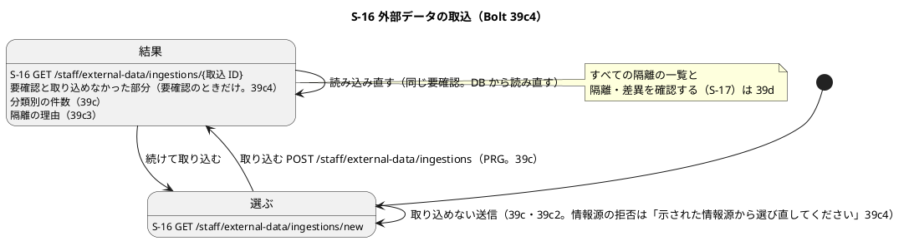
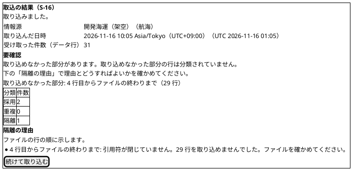
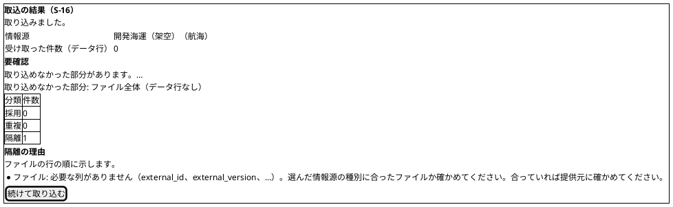
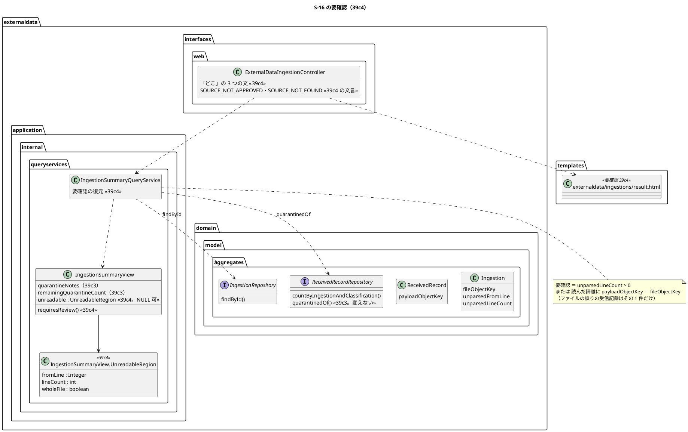
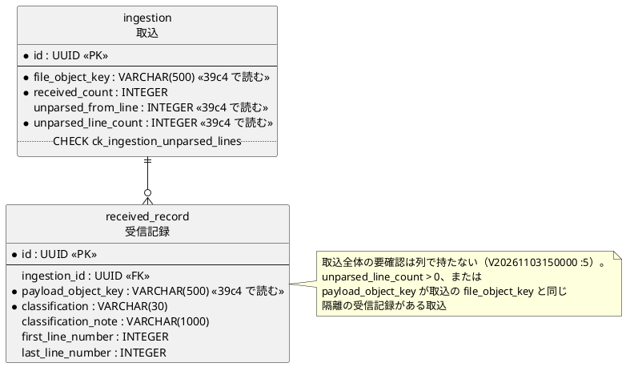

# Bolt 39c4 計画 - S-16 取込全体の要確認（取り込めなかった部分）を示す

## 基本情報

| 項目 | 内容 |
| :--- | :--- |
| Bolt | 第 39c4 回（W7 の 14 本目。release_plan :962 の 39c4 の行。Bolt 39c3 の開始準備で 39c3 から縦に分けた 2 つ目） |
| 状態 | 承認済み（2 つの整合性検証の指摘を反映した。2026-11-05、推奨のとおり。Recommend 承認の指示による。human:kakimomokuri） |
| 予定 | W7（2026-11-16 の週。前倒しで着手できる）。作業は約 4 時間 00 分（下の「時間の配分と打ち切り」。`check`・`uiTest`・`manualScreenshots`・`demoVideo`・`performanceTest`・SonarQube・CI とステップごとの承認の待ちを除く） |
| アプローチ | アウトサイドイン（S-16 の結果の画面から。画面の層の受入シナリオ（`@ui`）の Red から入る。release_plan :962 の 39c4 の行のとおり。取込全体の要確認の規則は 39b2 で固まっていて（IngestionOutcome.java :55-61、V20261103150000 :5）、画面での示し方と DB からの復元の一致が受入条件の中心） |
| 対象 | (1) 取込全体の要確認と取り込めなかった部分を DB から復元する照会（取込の `unparsed_from_line`・`unparsed_line_count` と、ファイル全体の原本を指す隔離の受信記録）と、取込のサービスの `requiresReview()` との一致（Bolt 39b2 の申し送り。39c3 の行 24）、(2) 結果の画面（result.html）に「要確認」の領域（取り込めなかった部分の始まりと数）を足す（39c3 の行 25）、(3) 0 バイトのファイル・選んだ情報源と違う種別のファイル・ヘッダーのないファイル・閉じ忘れの受入シナリオ（39c の終了報告 :98。39c3 の行 22・23）、(4) 情報源の拒否の文言の「画面を開き直して」を「示された情報源から選び直してください」の形に（39c3 の【前の決定の変更】(3)。39c3 の行 26）、(5) 上限いっぱい（隔離 1 万件）の結果の画面の照会の計測（39c3 の行 19。T-241・T-242。CI の手動のジョブ `performance` で記録する）、(6) マニュアル 12 章の要確認の読み方、:153 と付録 B :215-216 の文言、用語集、新しいキャプチャ、(7) デモの動画（`@demo-bolt-39c4/review`） |
| トレース | US-14 AC1（取込と分類の結果）・AC4（隔離した原本をデータ責任者へ示す）・横断の受入条件（入力エラーで理由と修正方法を示す。user_story :39）、UC-15 の代替 2a（形式を検証できないファイルと行。system_usecase :523）・2c（ファイルの上限。上限いっぱいの照会の計測。注: 上限を超えるファイルではなく、上限の内側の最悪の場合（T-242））、PERF-06（結果の画面の照会の計測。参考の値。non_functional :62）、ED-INV-02、BR-12（件数照合）、ui_design の S-16（:141・:191・:192、結果の画面イメージ :1855-1885、拒否の画面イメージ :1829-1830）、data_model の取込（:1151）、ACC-01（WCAG 2.2 AA） |
| GitHub | [#18](https://github.com/k2works/practical-domain-driven-design-in-enterpris-application/issues/18)（US-14。クローズは 39h） |
| SP | 0 |
| 承認ゲート | **ステップごとに止める**（release_plan :962 の「ステップごと（画面）」）。画面（結果の画面の要確認、拒否の文言）、新しいファイル（下の一覧）。スキーマは変えない（下の開始準備の決定 (2)）。注: 人の指示「Recommend 承認で進めて」により、各ステップの終わりで止めて推奨の案を承認として記録する（人が個別に見ていないことが分かるように「推奨のとおり（Recommend 承認の指示による）」と書く）。ステップを飛ばしたり束ねたりはしない。「人に諮ること」はない（開始準備の決定 (6) は【業務の判断】として推奨のとおり記録し、終了報告の議題の先頭に置く） |
| 開始準備で決めたこと | 2026-11-05、推奨のとおり（Recommend 承認の指示による。human:kakimomokuri）: (1) **分け方**: 1 本のまま（縦に分けない）。39c3 の計画の見積り（約 3 時間 10 分。[計画](bolt_39c3_plan.md) :410）に、39c3 から送った上限いっぱいの照会の計測（15 分。[計画](bolt_39c3_plan.md) :391・:410）と、ヘッダーのないファイルの例・新しいキャプチャ・デモの動画の分（約 20 分）を足して約 3 時間 45 分で、目安（2〜4 時間）に収まる（下の「時間の配分と打ち切り」。2 つの整合性検証の指摘の反映で約 4 時間 00 分になり、目安の内側にある）。代わりの案（計測を 39d に送る）は取らない。計測は 39c3 の照会の参考の値で、遅ければ索引（スキーマ）の判断になり、隔離の一覧（S-17）を作る 39d の前に値があるほうがよい、(2) **要確認の復元（スキーマは変えない）**: 取込全体の要確認は「取込の `unparsed_line_count` > 0、またはファイル全体の原本を指す（受信記録の `payload_object_key` が取込の `file_object_key` と同じ）隔離の受信記録がある」（V20261103150000 :5 の定め）。ファイルの誤りの受信記録はファイル全体の原本を指し（IngestionService.java :282-288）、ファイルの誤りのときは行を読まないので受信記録はその 1 件だけになる（IngestFileCommandAssembler.java :81-88 は行と行の誤りを空にする）。この 1 件は範囲を持たず隔離の照会の先頭に来る（IngestionService.java :281・:288、ReceivedRecordRepository.java :20-24 の `quarantinedOf`）ので、照会はすでに読んでいる隔離の受信記録の中にファイル全体の原本を指すものがあるかで見分け、ポートに読み出しを足さない。データ行のあるファイルの誤りは `unparsed_line_count` も 0 より大きい（IngestionService.java :164-174）が、0 バイトのファイルは数が 0 で（CsvRecords.java の `firstDataLineNumber` が NULL）、受信記録でしか見分けられない（39b2 の行 10）。代わりの案は取らない: (a) ポートに `hasFileQuarantine(ingestionId)` を足す（SQL で取込の行と突き合わせる）は、照会がすでに手元に持つ事実をもう一度読む、(b) 範囲が NULL の隔離をファイルの誤りとみなす（39c3 の列を使う）は、39c3 より前の受信記録も範囲が NULL で（39c3 の計画 :158 の既知の課題）、要確認でない取込を要確認に見せる、(c) 取込に要確認の列を足す（スキーマ）は、39b2 の確認ポイント 2（[計画](bolt_39b2_plan.md) :370）で列で持たないと決めてあり、追記専用の取込に同じ事実を 2 か所で持つ、(3) **照会の値**: `IngestionSummaryView` に、取り込めなかった部分 `UnreadableRegion`（入れ子の record。`Integer fromLine`・`int lineCount`・`boolean wholeFile`。要確認でなければ `null`）を 1 つ足し（名前は取込の結果の `IngestionOutcome.Unreadable` と分ける。取込の結果の値は取り込めなかった部分の受信記録 ID を持ち `wholeFile` を持たず、照会の値は `wholeFile` を持ち受信記録 ID を持たない。違いは domain_model :336 に書く）、`requiresReview()` は「`unreadable` が `null` でない」（取込の結果の `IngestionOutcome.Ingested.requiresReview()`（IngestionOutcome.java :59-61）と同じ形）。`wholeFile` はファイルの誤り（ファイル全体の原本を指す隔離がある）、`fromLine`・`lineCount` は取込の列のまま（ファイルの誤りでデータ行があれば最初のデータ行と受け取った件数、0 バイトなら NULL と 0。IngestFileCommandAssembler.java :81-88）、(4) **結果の画面の要確認**: 要確認のときだけ、受け取った件数の `dl` の後・分類別の件数の表の前に領域（見出し `h2`「要確認」、文「取り込めなかった部分があります。取り込めなかった部分の行は分類されていません。下の「隔離の理由」で理由とどうすればよいかを確かめてください。」、「取り込めなかった部分: <どこ>」）を出す。<どこ> は、ファイルの終わりまで（閉じ忘れなど）は「12 行目からファイルの終わりまで（29 行）」、ファイルの誤りでデータ行があれば「ファイル全体（データ行 9 行）」、データ行がなければ「ファイル全体（データ行なし）」（数は 3 桁の区切り。文は controller の定数に置き、テンプレートは `th:text`。39c3 の残りの件数の文（ExternalDataIngestionController.java :80・:171-176）と同じ置き方）。表の前に置くのは、データ責任者が件数を読む前に「このファイルは全部取り込めていない」と分かるため（件数照合 BR-12 の前提が崩れていることを先に示す）。`role="alert"` は使わない（PRG の後の静的な画面で、動的な知らせではない）。代わりの案（`dl` に「取り込めなかった部分」の項目を足すだけ）は、要確認が件数の 1 項目に埋もれて見落としやすく取らない、(5) **受入シナリオ**: `ingest_external_data_ui.feature` にシナリオテンプレート 1 本（例 4 つ: 0 バイトのファイル・選んだ情報源と違う種別のファイル（航海の情報源に主要実績のファイル）・ヘッダーのないファイル・閉じ忘れ）を足し、結果の画面の受け取った件数・隔離の件数・要確認の「どこ」・隔離の理由の先頭（または最後）の注記を確かめる（39c の終了報告 :98、39c3 の行 22・23）。閉じ忘れの例にデモの印（`@demo @demo-bolt-39c4/review`）を付ける。サービスの層の受入シナリオ（quarantine_malformed_records.feature :16 の必要な列がない、:51 の閉じ忘れ）は `requiresReview()` を確かめてあり（ExternalRecordFormatErrorSteps.java :93（要確認）・:102（要確認でない））、変えない、(6) **0 バイト・ヘッダーのないファイルの注記の文**（39c3 の申し送り。[計画](bolt_39c3_plan.md) :152）: 今の文（必要な列がない MISSING_COLUMN の「選んだ情報源の種別に合ったファイルか確かめてください。合っていれば提供元に確かめてください。」。FormatDefect.java :28）のままにし、マニュアルの早見表に「中身が空のファイル、ヘッダーの行がないファイルもこの理由になる（足りない列の名前にすべての列が並ぶ）」を 1 行足す（下の「業務の判断の記録」の (a)）。【業務の判断】終了報告の議題の先頭に置き、人が後から見直せるようにする（前例 Bolt 39b4 の上限）、(7) **情報源の拒否の文言**（39c3 の【前の決定の変更】(3) の実装）: 承認されていない「選んだ情報源は承認済みではないため取り込めません。示された情報源から選び直してください。」、ない「選んだ情報源が見つかりません。示された情報源から選び直してください。」（ExternalDataIngestionController.java :76・:77）。選ぶ画面は誤りの後に選択肢を引き直して示す（同 :180-192・:198-203）ので「画面を開き直して」は要らない。拒否の後に承認済みの情報源が 0 件になるときも文言は変えない（注: Bolt 39c2 の決定（[計画](bolt_39c2_plan.md)）で、拒否の理由を先に、その下に 0 件の全文を示し、エラー要約のリンクは 0 件の段落へ向くので、次の行動が示される。状態の組み合わせ 行 19 で確かめる。T-243）。マニュアル 12 章 :153、付録 B :215-216 の 2 行の 2 列（文言の列と対処の列）、ui_design :191・:1829-1830 を直す、(8) **上限いっぱいの照会の計測**（39c3 の行 19 をそのまま書き写す）: 行の誤り（値の誤りだけ。T-230）のデータ行 10,000 行の取込の結果の画面の GET（MockMvc）を `ExternalDataIngestionPerformanceTest` に 1 本足し、ログの「PERF-06 notes」で始まる行に照会（`summaryOf`）と画面の描画の時間を区切って出す（T-241）。値は CI の手動のジョブ `performance`（cargo-tracker-ci.yml :161-164。`gh workflow run cargo-tracker-ci.yml --ref develop -f job=performance`）で記録し、終了報告に書く。目安の NFR はない（参考の値。non_functional :62）。1 秒を超えたら値を記録して止め、索引（取込 ID と始まりの行）を足すか（スキーマ）を諮る、(9) **マニュアル**: 12 章の「取込の結果を読む」（12-外部データ.md :72-96）の項目の表に「要確認」（④ の後）を足して番号を振り直し、「要確認を読む」の項（「隔離の理由を読む」:98 の前）に、要確認の意味（取り込めなかった部分があり、件数の合計が受け取った件数と合わない）、「どこ」の 3 つの形、次の行動（隔離の理由のどうすればよいかに従う）を書く。:153 の文言を直す。用語集（docs/manual/用語集.md :66 の「隔離の理由」の後）に「要確認（取込）」を足す。付録 B :215-216 を直す（文言が画面の誤りの文言なので付録 B の早見表の対象）。キャプチャは新しい `12-ingestion-review.png`（閉じ忘れのファイルの結果の画面）を 1 枚足し、既存の 4 枚（manual_screenshots.feature :225-231）は撮り直されても変わらないことを確かめる。直した行を取り込み直したときの扱い（39c3 の終了報告 :102）は書かない（実装で確かめていない。39d の再送の扱いと合わせる） |

【前の決定の変更】(1): Bolt 39c2 の開始準備の決定 (2) の情報源の拒否の 2 つの文言を、39c3 の【前の決定の変更】(3)（[計画](bolt_39c3_plan.md) :31）で決めた「示された情報源から選び直してください。」の形にする実装をこの Bolt で行う（controller の定数、テストの期待（ExternalDataIngestionControllerTest :292-293、ExternalDataIngestionSecurityIntegrationTest :309）、ui_design :191・:1829-1830、マニュアル 12 章 :153、付録 B :215-216 の 2 行の 2 列）（2026-11-05、推奨のとおり。Recommend 承認の指示による。human:kakimomokuri）。

【前の決定の変更】(2): 取込の要約の値（`IngestionSummaryView`。domain_model :336）に取り込めなかった部分を足し、39c3 の値（隔離の注記と残りの件数）に加える。照会（`IngestionSummaryQueryService`。domain_model :335）は隔離の受信記録をすでに読んでいるときだけ、その中のファイル全体の原本を指すものでファイルの誤りを見分ける（ポートは変えない。開始準備の決定 (2)）（2026-11-05、推奨のとおり。Recommend 承認の指示による。human:kakimomokuri）。

新しいファイル（39c4）: キャプチャ `docs/manual/assets/12-ingestion-review.png`（行 18。`manualScreenshots` が作る）と、デモの動画 `docs/assets/demo/bolt-39c4/review.webm`（`demoVideo` が作る）。テストのクラスは足さない（`IngestionSummaryQueryServiceTest`（39c3 で足した）・`ExternalDataIngestionControllerTest`・`ExternalDataIngestionSecurityIntegrationTest`・`ExternalDataIngestionPerformanceTest`・`ingest_external_data_ui.feature`・`ExternalDataIngestionUiSteps`・`manual_screenshots.feature` を直す）。本体のクラスも足さない（`IngestionSummaryView`・`IngestionSummaryQueryService`・`ExternalDataIngestionController`・`result.html` を直す）。

## Bolt ゴール

データ責任者が S-16 で取り込んだファイルに取り込めなかった部分があると、結果の画面の分類別の件数の前に「要確認」が出て、取り込めなかった部分が「12 行目からファイルの終わりまで（29 行）」「ファイル全体（データ行 9 行）」「ファイル全体（データ行なし）」のように示され、下の「隔離の理由」で理由とどうすればよいかを確かめるよう案内される。要確認は DB から読み直して決まり、取込のサービスが返した `requiresReview()` と一致する（読み込み直しても変わらない）。0 バイトのファイル・選んだ情報源と違う種別のファイル・ヘッダーのないファイル・閉じ忘れが、画面で隔離 1 件（閉じ忘れは前の行も分類）と要確認になる。情報源の拒否の文言は「示された情報源から選び直してください」になる。上限いっぱい（隔離 1 万件）の結果の画面の照会の時間が記録されている。マニュアル 12 章に要確認の読み方があり、キャプチャとデモの動画がある。すべての隔離の一覧と隔離・差異の判断（S-17）は 39d。

### 開始準備で確かめたこと

- **release_plan の 39c4 の行**（:962）: 「要確認を DB から復元する照会と `requiresReview()` の一致、結果の画面の要確認と取り込めなかった部分、0 バイトのファイル・選んだ情報源と違う種別のファイル・閉じ忘れの受入シナリオ、情報源の拒否の文言を「示された情報源から選び直してください」の形に（実装・マニュアル 12 章・付録 B）、マニュアルの要確認の読み方、上限いっぱいの結果の画面の照会の計測（39c3 の行 19）」、アプローチはアウトサイドイン、承認ゲートは「ステップごと（画面）」。順序は :971（39c3 → 39c4 → 39d）、デモ項目は :977、マニュアルの確認ポイントは :935（「39c4 は要確認の読み方を足す」）
- **前の Bolt の申し送り**: Bolt 39c3（[計画](bolt_39c3_plan.md) :125-129 の行 22〜26、:151-154 の 39c4 の 4 行、:391・:405 の計測、[終了報告](bolt_39c3_report.md) :21（MISSING_COLUMN の文が空・ヘッダーなしのファイルに合うか）・:100（既知の課題の 39c4））、Bolt 39c2（[計画](bolt_39c2_plan.md) :112・:117・:118・:145・:148、[終了報告](bolt_39c2_report.md) :95）、Bolt 39b2（[計画](bolt_39b2_plan.md) :51・:370 の要確認の定め、:112 の空のファイル）、Bolt 39c（[終了報告](bolt_39c_report.md) :98 の 0 バイト・種別の違うファイルの受入シナリオ）
- **要確認の今の形**: `requiresReview()` は取り込めなかった部分があるか（IngestionOutcome.java :55-61）。取込の行は取り込めなかった行の始まりと数を書き、更新しない（IngestionService.java :160-177、Ingestion.java :22-24・:48-52、IngestionMapper.xml :15-16・:22・:29-31 で読み書きしている）。ファイルの誤りは取り込めなかった部分の始まりを最初のデータ行、数を受け取った件数にし、行と行の誤りを空にする（IngestFileCommandAssembler.java :81-88）。ファイルの誤りの受信記録はファイル全体の原本のキーを持ち、範囲は NULL（IngestionService.java :281-288）。0 バイト・BOM だけ・ヘッダーだけで列が足りないファイルは必要な列がない（CsvHeader.java :39-44。必要な列がすべて足りない列に並ぶ）
- **結果の画面の今の形**: 照会は取込・情報源・3 つの件数と、隔離があれば隔離の受信記録を最大 100 件読む（IngestionSummaryQueryService.java :41-67）。値は 10 個（IngestionSummaryView.java :25-35。Javadoc :11-12 に「要確認と取り込めなかった部分は 39c4 で足す」）。controller は残りの件数の文を組み立てる（ExternalDataIngestionController.java :163-178）。テンプレートは件数の表と隔離の理由の領域（result.html :17-55。コメント :15 に「要確認は 39c4 で足す」）
- **拒否の文言**: controller の定数（ExternalDataIngestionController.java :76・:77）、テストの期待（ExternalDataIngestionControllerTest :292-293、ExternalDataIngestionSecurityIntegrationTest :309）、ui_design :191（取込の行）・:1829-1830、マニュアル 12-外部データ.md :153、付録B-トラブルシューティング.md :215-216（2 列とも「画面を開き直し」が残る）。`grep "画面を開き直して"` でほかに外部データの箇所はない（session-warning.html :29 と ui_design :1920・:2186 は別の画面）
- **受入シナリオの今の形**: UI（ingest_external_data_ui.feature）は 39c の取込（:15）・内容の違う行（:31）・混在（:42。`@demo-bolt-39c3/notes`）・選ばない（:48）・上限を超える（:58）・幅 320 px（:69）。サービスの層（quarantine_malformed_records.feature）に必要な列がない（:16）と閉じ忘れ（:51）があり、要確認を取込の結果で確かめる。0 バイトのファイルはサービスのテスト（IngestionServiceTest :936）にだけある
- **性能のテスト**: `ExternalDataIngestionPerformanceTest`（`@Tag("performance")`・`@Tag("NFR-PERF-06")` :81-82、画面の POST の行 21 の 1 本とログの「PERF-06 web」）。CI の手動のジョブ `performance`（cargo-tracker-ci.yml :161-164）。non_functional :62 に 39c3 から送った計測の記述がある（「1 秒を超えたら値を記録して止め、索引を足すかを諮る」）
- **マニュアル**: 12 章の結果の読み方（12-外部データ.md :72-96。項目の表 :78-86 の ① 〜 ⑦）、隔離の理由の読み方（:98-146）、注意・補足（:148-）の拒否の文言（:153）。キャプチャ 4 枚（manual_screenshots.feature :225・:227・:229・:231）。用語集の「隔離の理由」（用語集.md :66）。「要確認」の用語はマニュアルにない
- **マイグレーション**: common の最新は V20261104170000（39c3）。この Bolt はスキーマを変えない

## 設計の決定

| 項目 | 決定 | 根拠 |
| :--- | :--- | :--- |
| 分け方 | 開始準備の決定 (1)。1 本 | 下の「時間の配分と打ち切り」 |
| 要確認の復元 | 開始準備の決定 (2)。`unparsed_line_count > 0` か、読んだ隔離の受信記録にファイル全体の原本を指すものがあるか。ポートとスキーマは変えない | V20261103150000 :5、IngestionService.java :282-288 |
| 照会の値 | 開始準備の決定 (3)。`IngestionSummaryView.UnreadableRegion(Integer fromLine, int lineCount, boolean wholeFile)`（NULL 可）と `requiresReview()`。取込の結果の `IngestionOutcome.Unreadable`（受信記録 ID を持つ）と名前を分ける | IngestionOutcome.java :59-61・:101 |
| 結果の画面 | 開始準備の決定 (4)。要確認のときだけ、`dl` の後・表の前に `section`（`h2`「要確認」）。「どこ」の 3 つの形は controller の定数 | result.html :17-25、ExternalDataIngestionController.java :80・:171-176 |
| 受入シナリオ | 開始準備の決定 (5)。UI のシナリオテンプレート 1 本（例 4 つ） | ingest_external_data_ui.feature :42、39c の終了報告 :98 |
| 空・ヘッダーなしのファイルの注記の文 | 開始準備の決定 (6)。今の文のまま、マニュアルの早見表に 1 行（(a)。推奨のとおり）。【業務の判断】終了報告の議題の先頭に置く | FormatDefect.java :28、CsvHeader.java :39-44 |
| 拒否の文言 | 開始準備の決定 (7)。【前の決定の変更】(1)。拒否の後に情報源が 0 件でも文言は変えない（行 19） | ExternalDataIngestionController.java :76-77・:180-203 |
| 上限いっぱいの照会 | 開始準備の決定 (8)。「PERF-06 notes」の行に照会と描画を区切って出す | ExternalDataIngestionPerformanceTest :81-82 |
| マニュアル | 開始準備の決定 (9)。12.1 の「要確認を読む」、:153、付録 B、用語集、新しいキャプチャ 1 枚 | 12-外部データ.md :72-96・:153 |

## ふりかえりと前の Bolt からの引き継ぎ

| 出典 | 内容 | この Bolt での扱い |
| :--- | :--- | :--- |
| W6 の Try T-204・T-212、Bolt 38h の T-227、Bolt 39b の T-233、Bolt 39c3 の Problem | サブエージェントへの指示の最初に heredoc（`<<`）と標準入力を待つコマンド（引数のない `cat >` など）を使わないと書く | 任せるときの指示の最初に書く。私が計画を直すときもファイルは Write・Edit で書く（39c3 の終了報告 :95 の Problem） |
| W6 の Try T-217、Bolt 39b2 の Try | 本体を直す前に Red を流し、落ちた理由を記録する。直したテストの一覧を添える | ステップ 2。拒否の文言を変えて落ちる既存のテスト（ExternalDataIngestionControllerTest :292-293 の定数を使う 39c2 の行 5・6、ExternalDataIngestionSecurityIntegrationTest :309）と、View の値が増えてコンパイルが通らなくなる組み立て（ExternalDataIngestionControllerTest :542 の `summary()`・:626 の `summaryWith()` の 2 か所、`IngestionSummaryQueryServiceTest`）を、ステップ 2 の開始で grep して一覧にする |
| W6 の Try T-191 | 環境の前提に設定ファイルの行を添える | CI の手動のジョブ（cargo-tracker-ci.yml :161-164）を開始準備の決定 (8) に添えた |
| W6 の Try T-225・T-213 | push の前に `check` | ステップ 9（`uiTest` も流す） |
| W6 の Try T-182・T-211・T-216 | 状態の組み合わせの表に重複・隔離と出口・誤った入力の行を置く | 下の表（行 1〜19）。隔離と要確認（行 1〜13）、出口（行 8 の要確認でない取込）、誤った入力（行 10〜13 の空・違う種別・ヘッダーなし・閉じ忘れ、行 14・15・19 の拒否） |
| W6 の Try T-184 | listener は配信まで確かめる | 39c4 はイベントを足さない。変えない |
| W6 の Try T-219 | 変異の対象に単体・統合・契約のテスト | 下の変異の表（照会の単体・セキュリティの統合・controller・UI） |
| W6 の Try T-215・T-222 | Gradle を流す担当を 1 つに、計画の初稿を先にコミット | Gradle は人の側の 1 か所で流す（`uiTest`・`manualScreenshots`・`demoVideo`・`performanceTest` を含む）。初稿をコミットしてから実装に入る |
| Bolt 39a2 の T-229 | 永続化の Bolt の状態の組み合わせに時刻の出どころと同時の書き込みの行を置く | 時刻: 読むだけで時刻を作らない。同時の書き込み: 取込と受信記録は 1 つのトランザクションで書かれ追記専用（IngestionService.java :113）なので、読む照会は取込の後の PRG の行き先だけで、途中の行を読まない |
| Bolt 39a3 の T-230 | 入ることを確かめる行のデータはドメインの規則に合う組み合わせにする | 閉じ忘れの例（行 13）の前の行は寄港 2 つ以上・時刻の順の航海の行にする。上限いっぱいの照会（行 16）は値の誤りだけの行。情報源は提供元の名前に自分の UUID を含める |
| Bolt 39b の T-231 | `@Transactional` は契約のクラスに付ける | 契約は変えない（ポートを変えない） |
| Bolt 39b の T-232・Bolt 39b2 の T-234・Bolt 39b3 の T-237 | 本体を直したステップは承認の前に `spotbugsMain`・`checkstyleMain`・`sonar-local:check` | ステップ 3・4・6（View の値の数が 10 から 11 に増える。java:S107 の対象かどうかを `sonar-local:check` で見る。39c3 の 10 個は PASS） |
| Bolt 39b2b の T-235 | テストの名前の「行 N_」に Bolt の接頭辞を付けるかを W7 の締めで決める（[終了報告](bolt_39b2b_report.md) :93） | W7 の締めで決める。39c4 は `@Nested` の前例に従う（既存のテストのクラスでは `@Nested class Bolt39c4_…`。契約のテストに触るときは名前の頭に `Bolt39c4_`（39c3 の前例）） |
| Bolt 39b2b の T-236 | 「起きないこと」を確かめるテストは、件数ではなく呼び出しの記録で確かめる | 隔離が 0 件で要確認でない取込は `quarantinedOf` を呼ばない（39c3 の行 17）ことを、要確認の値を足した後も照会の単体テストで確かめる（行 7） |
| Bolt 39b3 の T-238 | サブエージェントへの指示は計画の決定を言い換えず計画の行を指す | 任せるときは「開始準備で決めたこと」の番号と「状態の組み合わせ」の行番号を指す |
| Bolt 39b3b の T-239 | 人に諮る選択肢の前提はコードで確かめ、出典の行を添える | 開始準備の決定と「人に諮ること」の前提に出典の行を添えた（ファイルの誤りの受信記録が 1 件だけでファイル全体のキーを持つこと、0 バイトが必要な列がないになること、拒否の後に選択肢を引き直すこと、計測のジョブ） |
| Bolt 39b3b の T-240 | 表から作る規則には、全部の行が規則に入ることを確かめるテストを添える | 「どこ」の 3 つの形（行 9）を、取り込めなかった部分の種類（ファイルの終わりまで・ファイル全体でデータ行あり・なし）のすべてで縛る |
| Bolt 39b4 の T-241 | 性能の目標を外れたら、どの処理に時間がかかっているかを実測する | 行 16 の計測は照会と描画を区切る |
| Bolt 39b4 の T-242 | 性能のテストの行には、上限いっぱいの入力の行を必ず入れる | 行 16（隔離 1 万件の結果の画面） |
| Bolt 39c の T-243 | 状態の数を 0 件にする受入シナリオが要るときは、計画の時点でコントローラーのテストに下ろすと決める | 要確認でない結果の画面（行 8）は controller のテスト（照会を mock）と、UI の 39c のシナリオ（:15）に要確認が出ないことを 1 行 |
| Bolt 39c2 の T-244 | パラメーターのテストは、入力と期待する出力の組み合わせまで縛る | 行 1〜5（取込の種類ごとの要確認と取り込めなかった部分の値）、行 9（種類ごとの「どこ」の全文）、行 10〜13（例ごとの件数・どこ・注記） |
| Bolt 39c3 の T-245 | 並びの規則を足すテストは、書く順を行の順と逆にしたデータを契約のテストに置く | 39c4 は並びの規則を足さない（39c3 の照会の順を使う）。要確認の見分けは並びに頼らない（ファイル全体の原本のキーで見分ける。開始準備の決定 (2)） |
| 画面の Bolt の前例（memory の manual-in-bolt-done-criteria、Bolt 37f2 の T-197） | 振る舞いが変わる Bolt はマニュアルの更新を完了条件に入れる。マニュアルの文を実装と突き合わせる | 完了条件に 12 章・付録 B・用語集・キャプチャを入れる。ステップ 8 で「どこ」の 3 つの形と拒否の 2 つの文言を controller の定数と突き合わせる |

## 状態の組み合わせ（行ごとにテストを 1 本。T-182）

要確認の復元の DB の通しはセキュリティの統合テスト（`ExternalDataIngestionSecurityIntegrationTest`。PostgreSQL。取込のサービス（:120 で注入済み）で取り込み、取込の要約の照会で読み直して、取込の結果と比べる。提供元の名前に自分の UUID を含める）、照会の値は照会の単体テスト（`IngestionSummaryQueryServiceTest`。ポートを mock）、画面は WebMvc のテスト（`ExternalDataIngestionControllerTest`。照会は mock）、画面の通しは `ingest_external_data_ui.feature`（Feature の `@ui @US-14 @must`、幅 320 px、axe）。既存のテストのクラスでは 39c4 の行のテストを `@Nested class Bolt39c4_…`（例 `Bolt39c4_要確認`）にまとめる（39c2・39c3 の前例。ExternalDataIngestionControllerTest :288-289・:618-619）。契約のテストに触るときは名前の頭に `Bolt39c4_`（39c3 の前例）。

| 行 | 状況 | 期待 | 確かめ方 |
| :--- | :--- | :--- | :--- |
| 1 | 要確認の復元: 形式の正しいファイル（39c3 の行 24） | 照会の `requiresReview()` が偽で、取込の結果の `requiresReview()`（偽）と一致する。`unreadable` は `null` | セキュリティの統合テスト（PostgreSQL。行 1〜5 は取込の種類と期待の値の組のパラメーターのテスト。T-244） |
| 2 | 要確認の復元: 行の誤りだけ（列数の誤りの行を含む） | 偽で一致する（行の誤りは隔離の理由で示す。IngestionOutcome.java :57） | 同上 |
| 3 | 要確認の復元: ファイルの誤り（データ行あり。必要な列がない） | 真で一致し、`wholeFile` が真、始まりが最初のデータ行、数が受け取った件数 | 同上 |
| 4 | 要確認の復元: ファイルの誤り（データ行 0。0 バイト） | 真で一致し、`wholeFile` が真、始まり `null`、数 0（`unparsed_line_count` が 0 でも、ファイル全体の原本を指す隔離で見分ける） | 同上 |
| 5 | 要確認の復元: 閉じ忘れ（前に正しい行と列数の誤りの行） | 真で一致し、`wholeFile` が偽、始まりが閉じ忘れの行、数がファイルの終わりまでの物理行の数 | 同上 |
| 6 | 照会の値の組み立て | 取込の列（始まり・数）と、読んだ隔離の受信記録にファイル全体の原本のキーがあるかの組（4 つ: 数 0・キーなし／数 0・キーあり／数あり・キーなし／数あり・キーあり）から、`UnreadableRegion` の値（`null`・ファイル全体（データ行なし）・ファイルの終わりまで・ファイル全体（データ行あり））になる | 照会の単体テスト（ポートを mock。組と期待のパラメーターのテスト） |
| 7 | 隔離が 0 件（T-236） | 要確認でなく、`quarantinedOf` を呼ばない（隔離のない取込はファイルの誤りも閉じ忘れも持たない） | 照会の単体テスト（呼び出しの記録。39c3 の行 17 のテストに要確認の期待を足す） |
| 8 | 要確認でない結果の画面（T-243） | 「要確認」の領域を出さない | controller のテスト（照会を mock）、UI の 39c のシナリオ（:15）に 1 行 |
| 9 | 「どこ」の文（T-240・T-244） | ファイルの終わりまで「12 行目からファイルの終わりまで（29 行）」、ファイル全体でデータ行あり「ファイル全体（データ行 1,234 行）」（3 桁の区切り）、データ行なし「ファイル全体（データ行なし）」。領域は `dl` の後・表の前にあり、見出し `h2`「要確認」と案内の文を持つ。期待の組が `UnreadableRegion` の 3 つの形をすべて含む | controller のテスト（照会を mock。形と期待の全文の組のパラメーターのテスト） |
| 10 | 0 バイトのファイル（UI。39c3 の行 22） | 受け取った件数 0、隔離 1、要確認「ファイル全体（データ行なし）」、隔離の理由の先頭に「ファイル: 必要な列がありません（…）。選んだ情報源の種別に合ったファイルか確かめてください。合っていれば提供元に確かめてください。」 | `ingest_external_data_ui.feature`（シナリオテンプレートの例 1） |
| 11 | 選んだ情報源と違う種別のファイル（UI。航海の情報源に主要実績の 2 行のファイル。39c3 の行 23） | 受け取った件数 2、隔離 1、要確認「ファイル全体（データ行 2 行）」、隔離の理由の先頭に必要な列がないの注記 | 同上（例 2） |
| 12 | ヘッダーのないファイル（UI。航海のデータ行だけの 2 行。1 行目の値はすべて違い、列の名前と重ならない（CsvHeader.java :36-44 は同じ名前の列を必要な列より先に判定するので、値が重なると列の重複の注記になる）） | 受け取った件数 1（1 行目をヘッダーとして読む）、隔離 1、要確認「ファイル全体（データ行 1 行）」、必要な列がないの注記（開始準備の決定 (6) の今の文） | 同上（例 3） |
| 13 | 閉じ忘れ（UI。正しい航海 2 行の後に閉じ忘れの行） | 採用 2・隔離 1、要確認「4 行目からファイルの終わりまで（N 行）」、隔離の理由の最後に閉じ忘れの注記 | 同上（例 4。`@demo @demo-bolt-39c4/review`） |
| 14 | 情報源の拒否: 承認されていない（39c3 の行 26） | エラー要約と欄に「選んだ情報源は承認済みではないため取り込めません。示された情報源から選び直してください。」 | controller のテスト（39c2 の行 5 の期待を直す）、セキュリティの統合テスト（:309 の期待を直す） |
| 15 | 情報源の拒否: ない | 「選んだ情報源が見つかりません。示された情報源から選び直してください。」 | controller のテスト（39c2 の行 6 の期待を直す） |
| 16 | 上限いっぱいの隔離（行の誤り 10,000 行。39c3 の行 19。T-242） | 結果の画面の GET が 100 件を示し、照会と描画の時間をログの「PERF-06 notes」の行に出す（参考の値。1 秒を超えたら止める） | `performanceTest`（`ExternalDataIngestionPerformanceTest` に 1 本）。値は CI の手動のジョブ `performance` で記録する |
| 17 | UI の幅と axe | 結果の画面（要確認と隔離の理由あり）が幅 320 px で横スクロールを出さず、axe の違反 0 | `ingest_external_data_ui.feature`（幅 320 px のシナリオ :69 に要確認の結果の画面を足す） |
| 18 | マニュアルのキャプチャ | 新しい `12-ingestion-review.png`（閉じ忘れの結果の画面。要確認と隔離の理由が写る）。既存の 4 枚は撮り直されても変わらない。マニュアルの「どこ」の 3 つの形と拒否の 2 つの文言が controller の定数と一致する（T-197） | `manual_screenshots.feature`（:231 の後に 1 本）、ステップ 8 の突き合わせ |
| 19 | 情報源の拒否の後に承認済みの情報源が 0 件（開始準備の決定 (7) の注。Bolt 39c2 の決定） | 拒否の理由（行 14・15 の文言のまま）が先、その下に 0 件の全文。エラー要約のリンクは 0 件の段落へ向く | controller のテスト（照会を mock。T-243） |

## スコープ

### 入れるもの

- 行 1〜19 のテスト。`IngestionSummaryView` の `UnreadableRegion` と `requiresReview()`、`IngestionSummaryQueryService` の要確認の復元、`ExternalDataIngestionController` の「どこ」の文と拒否の 2 つの文言、`result.html` の「要確認」の領域、`ExternalDataIngestionPerformanceTest` の照会の 1 本、`ingest_external_data_ui.feature` と Steps のシナリオテンプレート、キャプチャのシナリオ、デモのシナリオ（`@demo @demo-bolt-39c4/review`）
- マニュアル: `docs/manual/12-外部データ.md` の 12.1（項目の表に「要確認」、「要確認を読む」の項、:153 の文言、早見表に空・ヘッダーなしのファイルの 1 行（開始準備の決定 (6)。【業務の判断】））、`docs/manual/付録B-トラブルシューティング.md` :215-216、`docs/manual/用語集.md`（「要確認（取込）」）、新しいキャプチャ
- 文書: 下の「設計文書に直す箇所」（ステップ 1）

### 入れないもの

- すべての隔離の一覧、隔離・差異の判断、隔離した payload の再送の扱い（S-17。39d）、差異の分類（39h）
- 誤りの理由を表の列（理由の符号）で持つこと（39c3 の開始準備の決定 (7)。39d の開始準備で決める）
- 直した行を取り込み直したときの扱いのマニュアルの説明（39c3 の終了報告 :102。39d の再送の扱いと合わせる）
- 要確認を取込の列で持つこと（開始準備の決定 (2) の (c)）

### 申し送り（既知の課題・入れないもの）

| 送り先 | 課題 | 扱い |
| :--- | :--- | :--- |
| 39d | すべての隔離の一覧（結果の画面は最初の 100 件）と結果の画面からの入口、隔離・差異の判断、理由の符号の列、選択肢の並び | 39d の開始準備（39c3 の計画 :155-157 のまま） |
| 39d | 直した行を取り込み直したとき・新しい外部版で送り直したときに採用になるか（39c3 の終了報告 :102） | 39d の再送の扱いと合わせて確かめ、マニュアルに書く |
| 39d（条件付き） | 行 16 の照会が 1 秒を超えたときの索引（取込 ID と始まりの行。スキーマ） | 39c4 では値を記録して止めて諮る。足すと決めたら 39d の開始準備で置き場所を決める |
| 既知の課題 | 行の範囲が NULL どうし（39c3 より前の受信記録）の並びは受信記録 ID（乱数）の順（39c3 の終了報告 :101） | 直さない（パイロットの前で業務のデータはない）。要確認の見分けは範囲に頼らないので影響しない |

### 設計文書に直す箇所（ステップ 1）

- ui_design: S-16 の行（:141）の「要確認は 39c4」を 39c4 の分として書き直す、結果の行（:192）に「要確認」の領域（要確認のときだけ、`dl` の後・表の前、見出し `h2`「要確認」、案内の文、「取り込めなかった部分: <どこ>」の 3 つの形）、取込の行（:191）と拒否の画面イメージ（:1829-1830）の文言を「示された情報源から選び直してください」に、結果の画面イメージ（:1855-1885）に要確認の画面イメージ（閉じ忘れの例）を足し、注（:1881）の「要確認は 39c4」を消す、画面遷移図の状態（:510）の「要確認は 39c4」を直す、S-16 の画面イメージの段落（:1754）に 39c4 の分
- domain_model: 取込の結果の行（:330）に取込全体の要確認の定義（取り込めなかった部分があるか。行の誤りは隔離の理由で示し要確認にしない）と `requiresReview()`、取込の要約の照会の行（:335）に要確認の復元（取込の `unparsed_line_count` と、読んだ隔離の受信記録のファイル全体の原本のキー。ポートは変えない）、取込の要約の行（:336）の「要確認と取り込めなかった部分は 39c4」を値（`UnreadableRegion`・`requiresReview()`）に（【前の決定の変更】(2)）し、取込の結果の `IngestionOutcome.Unreadable` との違い（照会の値は `wholeFile` を持ち、受信記録 ID を持たない）を書く
- system_usecase: UC-15 の代替 2a の注（:523）に、ファイルの誤りはデータ行がなくても（0 バイトのファイルも）取込全体の要確認になり、結果の画面に「要確認」と取り込めなかった部分を示すことを足す
- data_model: 取込の表の説明（:1151）に、要確認を列で持たず DB から復元する定め（V20261103150000 :5）を結果の画面が使うこと（スキーマは変えない）
- test_strategy: 外部データの取込の画面の行（:347）に 39c4 の要確認（照会の単体・controller・セキュリティの統合テストの要確認の復元の一致）、外部データの取込の行（:384）に 39c4 のシナリオテンプレート（0 バイト・違う種別・ヘッダーなし・閉じ忘れ。`@demo-bolt-39c4/review`）
- non_functional: PERF-06 の行（:62）の結果の画面の照会の計測を「Bolt 39c4 で測った（値はステップ 7）」に。値はステップ 7 で書く（data_model :1218 と一緒に）
- release_plan: 39c4 の行（:962）の受入シナリオに「ヘッダーのないファイル」を足す（0 バイトのファイル・選んだ情報源と違う種別のファイル・ヘッダーのないファイル・閉じ忘れ）。計画へのリンクは計画の承認のときに足した
- ADR-004: 改訂の経緯（:74-125）に Bolt 39c4 の項（取込全体の要確認を列で持たず、取込の取り込めなかった行の数とファイル全体の原本を指す隔離の受信記録から照会で復元する。決定は変えない）を足す（前例 :122 の Bolt 39c3 の項）
- コードのコメント（触るステップで直す）: `IngestionSummaryView` の Javadoc（:11-12）、`IngestionSummaryQueryService` の Javadoc（:16-21）、`result.html` のコメント（:12-15）、`ExternalDataIngestionController` の `sourceRefused` の Javadoc（:194-196）

## 設計（この Bolt の範囲）

### 画面遷移図（S-16 の 39c4 の分）

### 画面イメージ

結果の画面（閉じ忘れ。正しい航海 2 行の後に閉じ忘れの行）:

結果の画面（0 バイトのファイル）:

要確認でないときは「要確認」の領域を出さない（39c3 の結果の画面のまま）。画面イメージの名前・件数・時刻・列の名前は説明用の架空の値である（ui_design の画面イメージの決まり）。注記の文の形は FormatDefect.java :28・:105・:127 のとおり。

### クラスと依存

### ER 図（この Bolt で読む列。表は変えない）

- 状態遷移図: 画面は状態を持たず、取込・受信記録は追記専用で遷移しないので省く

## ステップ計画（ステップごとに止める）

- [x] **1. 設計の文書**（ui_design・domain_model・system_usecase・data_model・test_strategy・non_functional・release_plan・ADR-004。推奨のとおり承認として記録した。Recommend 承認の指示による）: 上の「設計文書に直す箇所」（開始準備の決定 (1)〜(9) を反映する）（完了の判定: 文書の差分。**承認ゲート**）
- [x] **2. テストの Red（外側から）**（推奨のとおり承認として記録した。Recommend 承認の指示による）: 行 10〜13 の feature の Red（今は「要確認」が出ず期待した理由で落ちることを確かめる）、続いて行 8・9・14・15・19 の controller、行 6・7 の照会、行 1〜5 のセキュリティの統合テスト、行 16 の計測（`performanceTest` は人の側で流す。Red は描画の区切りのログがないことで確かめる）。既存のテストのクラスでは `@Nested class Bolt39c4_…` にまとめる。直す既存のテストを一覧にする（T-217。ExternalDataIngestionControllerTest :542 の `summary()`・:626 の `summaryWith()`、:292-293 の定数を使う 39c2 の行 5・6、ExternalDataIngestionSecurityIntegrationTest :309、`IngestionSummaryQueryServiceTest`）（完了の判定: 期待した理由で落ちる記録。**承認ゲート**（画面の振る舞いの契約））
- [x] **3. 要確認の復元**（推奨のとおり承認として記録した。Recommend 承認の指示による）: `IngestionSummaryView` の `UnreadableRegion` と `requiresReview()`、`IngestionSummaryQueryService` の復元、Javadoc。行 1〜7 が緑（完了の判定: 緑、`spotbugsMain`・`checkstyleMain`・`sonar-local:check`（T-232・T-237・T-234）。**承認ゲート**）
- [x] **4. 結果の画面の要確認**（推奨のとおり承認として記録した。Recommend 承認の指示による）: controller の「どこ」の文、`result.html` の領域とコメント。行 8・9・17 が緑、UI の 39c・39c2・39c3 のシナリオが緑（完了の判定: 緑、`spotbugsMain`・`checkstyleMain`・`sonar-local:check`、S-16 の `uiTest` と axe 違反 0。**承認ゲート**（画面））
- [x] **5. 受入シナリオ**（推奨のとおり承認として記録した。Recommend 承認の指示による）: シナリオテンプレートの 4 つの例と Steps。行 10〜13 が緑（完了の判定: `uiTest` の緑。**承認ゲート**（画面））
- [x] **6. 情報源の拒否の文言**（推奨のとおり承認として記録した。Recommend 承認の指示による）: controller の 2 つの定数と `sourceRefused` の Javadoc、テストの期待。行 14・15・19 が緑（完了の判定: 緑、`checkstyleMain`。**承認ゲート**（画面の文言））
- [ ] **7. 上限いっぱいの照会の計測**: 行 16 の 1 本（照会と描画の区切り。T-241）。CI の手動のジョブ `performance` で値を記録し、non_functional :62 と data_model :1218（取込ごとの隔離を読む照会の索引）に書く。cargo-tracker-ci.yml :167-168 の性能のジョブの注の本数（今の注は「3 本」で、性能のテストは 4 本。39c4 で 5 本）と上限 60 分の見込みを確かめて直す（完了の判定: CI のログの「PERF-06 notes」の行。1 秒を超えたら止めて諮る。**承認ゲート**）
- [x] **8. マニュアルとキャプチャ**（12.1 の要確認の項と早見表の 1 行、拒否の文言、付録 B の 2 行 2 列、用語集、新しいキャプチャ 12-ingestion-review.png（別のシナリオで撮った）。実装の文と突き合わせて一致。推奨のとおり承認として記録した。Recommend 承認の指示による）: 12 章の 12.1（項目の表、「要確認を読む」、:153、早見表の 1 行）、付録 B :215-216、用語集、`manualScreenshots`（行 18。新しい `12-ingestion-review.png`）。「どこ」の文と拒否の文言を controller の定数と突き合わせる（T-197）。突き合わせにはマニュアル :94（分類別の件数の表の隔離の行）も入れ、「要確認を読む」では :96 の件数の不一致（受け取った件数と分類別の件数の合計が合わないことがある）と区別して書く（完了の判定: キャプチャの差分と突き合わせの記録。**承認ゲート**（マニュアル、新しいファイル））
- [ ] **9. 品質ゲートと開発レビュー**: 変異、`check`・`uiTest`、その後に SonarQube、開発レビューとその直し。push の前に `check`（T-225）
- [ ] **10. 終了報告**: push して CI とデモ環境の配備を確かめ（デモ環境でデータ責任者でログインし、閉じ忘れのファイルの要確認を見る）、`demoVideo` で `@demo-bolt-39c4/review` を撮る（新しいファイル）。release_plan（39c4 の行の計画と終了報告のリンク）・開発の索引・mkdocs を直す

### 時間の配分と打ち切り

| # | 目安 | 打ち切り |
| :--- | :--- | :--- |
| 1 | 20 分（整合性検証の指摘の反映で 5 分増: domain_model :330、system_usecase :523、release_plan :962） | — |
| 2 | 25 分（39c3 の見積りの 20 分に行 16 の Red の 5 分） | — |
| 3 | 35 分 | 照会の値の置き場所を層の規則（LayerArchitectureTest・ModularityTest）が拒むときは、置き場所を動かさず、ステップを止めて規則の例外を諮る（CLAUDE.md の層の規則の決まり） |
| 4 | 20 分 | — |
| 5 | 25 分（ヘッダーのないファイルの例を含む） | 0 バイトのファイルを Playwright の `setInputFiles` で送れないとき（名前のある 0 バイトは受ける。ExternalDataIngestionController.java :211 の Javadoc）は、例 1 を controller のテストに下ろし、理由を記録する（T-243 の前例） |
| 6 | 15 分（整合性検証の指摘の反映で 5 分増: 行 19 の controller のテスト） | — |
| 7 | 20 分（計測の 10 分と行 16 のテストの 5 分。39c3 から送った分。整合性検証の指摘の反映で 5 分増: data_model :1218、cargo-tracker-ci.yml :167-168） | 結果の画面の照会が 1 秒を超えたら、区切りの値を記録して止め、索引を足すか（スキーマ）を諮る（T-241） |
| 8 | 30 分（39c3 の見積りの 25 分に、付録 B と用語集の 5 分） | — |
| 9 | 30 分（待ちを除く） | — |
| 10 | 10 分（CI と動画の待ちを除く） | — |

合計 230 分（約 3 時間 50 分）に、予備の 10 分を足して約 4 時間 00 分（初稿は 215 分と予備 10 分で約 3 時間 45 分。2 つの整合性検証の指摘の反映でステップ 1・6・7 が 5 分ずつ増えた）。目安（2〜4 時間）に収まるので縦に分けない（開始準備の決定 (1)）。初稿と 39c3 の計画の見積り（約 3 時間 10 分。[計画](bolt_39c3_plan.md) :410）との差 35 分は、39c3 から送った計測 15 分（ステップ 7）、行 16 の Red 5 分（ステップ 2）、ヘッダーのないファイルの例 5 分（ステップ 5 の 25 分の内数。表の外に足していない）、付録 B と用語集 5 分（ステップ 8）、予備の 5 分から 10 分への 5 分。実装の中でさらに増えて 4 時間を超えるときは、ステップ 7（計測）を 39d の開始準備に送るのではなく、ステップ 5 の例 3（ヘッダーのないファイル）を controller のテストに下ろす案を先に検討する（計測は 39c3 から 1 度送っている）。

## 確認ポイント（計画の承認の場でまとめて確認する。Try T-6）

| # | 確認すること | 場所 | 推奨 |
| :--- | :--- | :--- | :--- |
| 1 | **分け方** | 開始準備の決定 (1) | 推奨のとおり（Recommend 承認の指示による。human:kakimomokuri）。1 本（約 4 時間 00 分。初稿は約 3 時間 45 分）。計測は 39d に送らない |
| 2 | **要確認の復元**（スキーマを変えない） | 開始準備の決定 (2) | 推奨のとおり。`unparsed_line_count > 0` か、読んだ隔離の受信記録にファイル全体の原本を指すものがあるか。ポート・スキーマは変えない（代わりの 3 案を取らない理由は決定 (2)） |
| 3 | **照会の値**（【前の決定の変更】(2)） | 開始準備の決定 (3) | 推奨のとおり。`IngestionSummaryView.UnreadableRegion` と `requiresReview()`（取込の結果と同じ形。名前は `IngestionOutcome.Unreadable` と分ける） |
| 4 | **結果の画面の要確認** | 開始準備の決定 (4) | 推奨のとおり。要確認のときだけ、`dl` の後・表の前に `h2`「要確認」、案内の文、「どこ」の 3 つの形 |
| 5 | **受入シナリオ** | 開始準備の決定 (5) | 推奨のとおり。UI のシナリオテンプレート 1 本（例 4 つ）、閉じ忘れにデモの印 |
| 6 | **空・ヘッダーなしのファイルの注記の文** | 開始準備の決定 (6) | 推奨のとおり (a)。今の文のまま、マニュアルの早見表に 1 行。【業務の判断】終了報告の議題の先頭に置き、人が後から見直せるようにする（下の「業務の判断の記録」） |
| 7 | **情報源の拒否の文言**（【前の決定の変更】(1)） | 開始準備の決定 (7) | 推奨のとおり。39c3 の【前の決定の変更】(3) の実装 |
| 8 | **上限いっぱいの照会の計測** | 開始準備の決定 (8) | 推奨のとおり。照会と描画を区切って CI の手動のジョブで記録。1 秒を超えたら止めて諮る |
| 9 | **マニュアル** | 開始準備の決定 (9) | 推奨のとおり。12.1 の「要確認を読む」、:153、付録 B :215-216、用語集、新しいキャプチャ `12-ingestion-review.png` |
| 10 | **変異** | ステップ 9 | 下の 6 個 |

### 人に諮ること

なし（初稿の 1 件は、計画の承認の場で (a) を推奨のとおり承認として記録した。2026-11-05、Recommend 承認の指示による。human:kakimomokuri）。

### 業務の判断の記録

1. 【業務の判断】**0 バイト・ヘッダーのないファイルの注記の文**（業務の言葉。決定は (a)。終了報告の議題の先頭に置き、人が後から見直せるようにする。前例 Bolt 39b4 の上限。39c3 の申し送り。[計画](bolt_39c3_plan.md) :152、[終了報告](bolt_39c3_report.md) :21）: 0 バイト・BOM だけ・ヘッダーのないファイルは、必要な列がない（MISSING_COLUMN）になり（CsvHeader.java :39-44）、注記は「ファイル: 必要な列がありません（<すべての必要な列>）。選んだ情報源の種別に合ったファイルか確かめてください。合っていれば提供元に確かめてください。」（FormatDefect.java :28・:105）。ヘッダーのないファイルは 1 行目のデータをヘッダーとして読み、受け取った件数が 1 少なくなる（行 12）。データ責任者が「中身のない（または違う）ファイルを選んだ」と気づけるかの業務の判断。選択肢:
   - (a) 【推奨・決定】今の文のまま。マニュアル 12.1 の早見表に「中身が空のファイル、ヘッダーの行がないファイルもこの理由になります（足りない列の名前に、すべての列が並びます）」を 1 行足す。結果の画面の要確認「ファイル全体（データ行なし）」（0 バイト）が空のファイルであることを示す。変えるのはマニュアルだけで、ステップ 5 の期待は今の文
   - (b) 空のファイル（ヘッダーの行もない）を新しい理由（例 `EMPTY_FILE`「ファイルが空です」。「取り込むファイルを選び直してください。」）にする。`FormatDefect` に値が増え、DE-14 の `reason`（ExternalRecordQuarantined.java :38）に新しい符号が出る。ヘッダーのないファイルは (a) のまま。見積りに約 20 分増え、約 4 時間 05 分で目安を超える
   - (c) MISSING_COLUMN の「どうすればよいか」を「選んだファイルと情報源の種別を確かめてください（中身が空のファイル、ヘッダーの行がないファイルもこの誤りになります）。合っていれば提供元に確かめてください。」に変える。受信記録は追記専用なので、それより前の注記と文が分かれる（39c3 の開始準備の決定 (2) と同じ事情）

打ち切りの 3 つ（層の規則の例外、0 バイトを UI で送れない、照会が 1 秒を超えて索引を足すか）に当たったときは、そのステップで止めて諮る。本番・セキュリティの新しい判断はない（拒否の文言は文だけで、認可は変えない）。

### 変異と落ちる見込みのテスト

| # | 変異 | 落ちる見込み |
| :--- | :--- | :--- |
| V1 | 要確認の復元でファイル全体の原本を指す隔離を見ない（`unparsed_line_count > 0` だけ） | 行 4（0 バイト）、行 6（数 0・キーあり）、行 10 |
| V2 | 要確認の復元で `unparsed_line_count` を見ない（ファイル全体の隔離だけ） | 行 5（閉じ忘れ）、行 6（数あり・キーなし）、行 13 |
| V3 | `wholeFile` を常に偽にする | 行 3・4、行 9（「ファイル全体」の 2 つの形）、行 11 |
| V4 | 「要確認」の領域の `th:if` を外す（いつも出す） | 行 8（controller と UI の 39c のシナリオ） |
| V5 | 「どこ」の数の 3 桁の区切りを外す | 行 9（1,234 行） |
| V6 | 拒否の文言を「画面を開き直して」の形に戻す | 行 14・15 |

## 完了条件

- [ ] 上のステップ 1〜10 の完了の判定を満たす（ステップごとの承認を受ける）
- [ ] 行 1〜19 に、それを名乗るテストがある（既存のテストのクラスでは `@Nested class Bolt39c4_…` の中）
- [ ] 要確認の復元が、5 つの取込の種類で取込のサービスの `requiresReview()` と一致する（PostgreSQL）
- [ ] 上限いっぱいの照会の値（照会と描画）が CI の手動のジョブ `performance` で記録され、non_functional と終了報告にある
- [ ] マニュアル 12 章（12.1 の要確認の読み方、:153）・付録 B :215-216・用語集とキャプチャ（`12-ingestion-review.png`）が実装と合っている
- [ ] デモの動画（`@demo-bolt-39c4/review`）があり、終了報告のデモ項目からリンクしている
- [ ] `check`・`uiTest` が緑、SonarQube が PASS、CI が緑、デモ環境が新しい版で動く
- [ ] 【業務の判断】（開始準備の決定 (6)）が終了報告の議題の先頭にある
- [ ] 終了報告が承認されている

## 更新履歴

| 日付 | 更新内容 | 更新者 |
| :--- | :--- | :--- |
| 2026-11-05 | 初版作成（承認待ち）。開始準備の決定: 1 本（約 3 時間 45 分）、要確認は取込の取り込めなかった行の数とファイル全体の原本を指す隔離の受信記録から照会で復元する（ポート・スキーマは変えない）、`IngestionSummaryView.Unreadable` と `requiresReview()`（【前の決定の変更】）、結果の画面の「要確認」の領域、UI のシナリオテンプレート（0 バイト・違う種別・ヘッダーなし・閉じ忘れ）、情報源の拒否の文言の実装（【前の決定の変更】）、上限いっぱいの照会の計測、マニュアル 12.1 の要確認の読み方と新しいキャプチャ（2026-11-05、推奨のとおり（Recommend 承認の指示による。human:kakimomokuri））。人に諮ること 1 件（0 バイト・ヘッダーのないファイルの注記の文） | anthropic/claude-opus-5-5 |
| 2026-11-05 | 2 つの整合性検証の指摘（詳細 中 3・軽 7、横断 中 2・軽 7）を反映し、計画を承認した（推奨のとおり。Recommend 承認の指示による。human:kakimomokuri）。空・ヘッダーなしのファイルの注記の文は (a) を【業務の判断】として記録し「人に諮ること」をなしに、拒否の後に情報源が 0 件のとき文言を変えない（行 19）、トレースに PERF-06 と 2c の注、照会の値を `IngestionSummaryView.UnreadableRegion` に改名、ステップ 1・7・8 の直す箇所を足し、見積りを約 4 時間 00 分に | anthropic/claude-opus-5-5、承認 human:kakimomokuri |
| 2026-11-05 | 照会の値の名前を `UnreadableRegion` にした（`IngestFileCommand.UnreadablePart`（IngestFileCommand.java :247）と重なるため。View の項目の名前は `unreadable` のまま。推奨のとおり。Recommend 承認の指示による。human:kakimomokuri） | anthropic/claude-opus-5-5、承認 human:kakimomokuri |

## 関連ドキュメント

- [リリース計画](release_plan.md)（W7 の節の 39c4 の行）
- [Bolt 39c3 計画](bolt_39c3_plan.md)・[Bolt 39c3 終了報告](bolt_39c3_report.md)（39c4 に送った申し送り）
- [Bolt 39c2 計画](bolt_39c2_plan.md)・[Bolt 39c2 終了報告](bolt_39c2_report.md)、[Bolt 39b2 計画](bolt_39b2_plan.md)（要確認の定め）、[Bolt 39c 終了報告](bolt_39c_report.md)（0 バイト・種別の違うファイルの受入シナリオ）
- [UI 設計](../../design/cargo-tracker/ui_design.md)（S-16）、[データモデル](../../design/cargo-tracker/data_model.md)（取込）、[ドメインモデル](../../design/cargo-tracker/domain_model.md)、[テスト戦略](../../design/cargo-tracker/test_strategy.md)、[非機能要件](../../design/cargo-tracker/non_functional.md)（PERF-06）
- [ADR-004](../../adr/cargo-tracker/004-external-data-ingestion.md)
