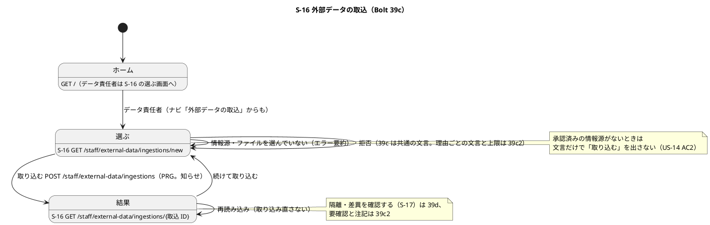
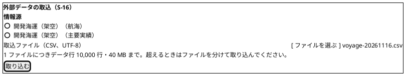
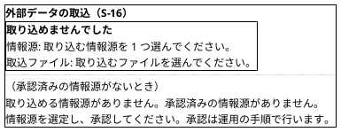
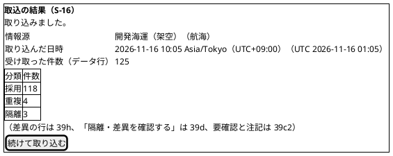
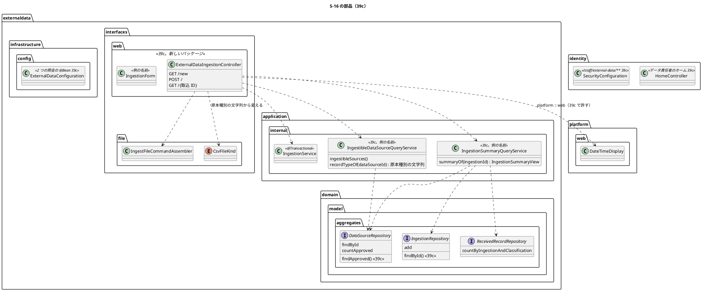

# Bolt 39c 計画 - S-16 外部データの取込の画面（選択・取込・分類別の件数・認可とナビゲーション）

## 基本情報

| 項目 | 内容 |
| :--- | :--- |
| Bolt | 第 39c 回（W7 の 11 本目。release_plan :955 の 39c の行を、開始準備で縦に 39c・39c2（:956）の 2 本に分けた 1 つ目。下の「開始準備で決めたこと」(1)） |
| 状態 | 承認済み（2026-11-04、推奨のとおり。Recommend 承認の指示による。human:kakimomokuri。詳細整合性検証と横断整合性検証の指摘を反映した） |
| 予定 | W7（2026-11-16 の週。前倒しで着手できる）。作業は約 4 時間（`check`・`uiTest`・`manualScreenshots`・`demoVideo`・SonarQube・CI とステップごとの承認の待ちを除く） |
| アプローチ | アウトサイドイン（S-16 から。画面の層の受入シナリオ（`@ui`）の Red から入る。W7 の局面とアプローチの段落 release_plan :889 の理由: 画面の振る舞いと認可が受入条件の中心で、内側は 39〜39b4 で固まっている） |
| 対象 | (1) S-16 の選ぶ画面（承認済みの情報源のラジオとファイルの選択。情報源がファイルの種別（航海・主要実績）を決める）と取込の POST（PRG）、(2) 取込の結果の画面（DB から読む。受け取った件数と分類別の件数）、(3) 認可（`/staff/external-data/**` はデータ責任者だけ）と CSRF、(4) ナビゲーション（データ責任者のホームを S-16 にし、社内のナビに項目を足す。データ責任者を持たない利用者には出さない）、(5) 画面で見る誤り（ファイルを選ばない・情報源を選ばない）と承認済みの情報源がないときの文言、(6) 外部データの `allowedDependencies` に `platform :: web` を足し、型の依存の許可リストの規則を画面の層に広げる（規則の変更）、(7) 開発データの DATA_STEWARD の TOTP の資格と dev のログインの口座（Bolt 39b で 39c に送った。V20261103120900 :4）、(8) UI テストと axe、(9) マニュアルの新しい章（12 章）とキャプチャ、(10) デモの動画（`@demo-bolt-39c/<名前>`） |
| トレース | US-14 AC1（手動取込と取込履歴）・AC2（承認済みの情報源のない取込の拒否）、UC-15 の主シナリオ 1〜3、W7 の確認ポイント 3（release_plan :911）・23（同 :931）、ui_design の S-16（:141、画面イメージ :1742-1764）と画面遷移図（:498-528）、ACC-01（WCAG 2.2 AA） |
| GitHub | [#18](https://github.com/k2works/practical-domain-driven-design-in-enterpris-application/issues/18)（US-14。クローズは 39h） |
| SP | 0 |
| 承認ゲート | **ステップごとに止める**（release_plan :955 の「ステップごと（認可・画面・新しいファイル）」）。認可（`/staff/external-data/**` の新しい URL と CSRF、ホームの行き先）、画面（新しい 2 つの画面）、構造（外部データの `allowedDependencies` と型の依存の許可リストの規則の変更）、データベース（開発データの TOTP の資格。dev だけのマイグレーション）、新しいファイル（下の一覧）。スキーマ（本番の表）は変えない。注: 2026-11-04 の人の指示「Recommend 承認で進めて」（重ねての指示）により、各ステップの終わりで止めて推奨の案を承認として記録する（人が個別に見ていないことが分かるように「推奨のとおり（Recommend 承認の指示による）」と書く）。ステップを飛ばしたり束ねたりはしない |
| 開始準備で決めたこと | 2026-11-04、推奨のとおり（Recommend 承認の指示による。human:kakimomokuri）: (1) **分け方**: 縦に 2 本に分ける。初案の 39c の範囲（release_plan :955 と Bolt 39b〜39b4 の申し送り）を 1 本にすると約 8 時間で半日を超える（画面の Bolt はマニュアルとキャプチャと動画で大きくなる）。**39c** は「データ責任者が承認済みの情報源のファイルを取り込み、分類別の件数を見る」縦（約 4 時間）、**39c2** は「取り込めないファイルと要確認を、理由とどうすればよいかで示す」縦（上限を超えるファイル `FileTooLarge` と 413、承認されていない情報源の送信、形式の誤り・文字コードの誤り・閉じ忘れの要確認と注記、要確認を DB から復元する照会と `requiresReview()` の一致、ファイルの誤りの「どうすればよいか」、受信記録の行の番号の列、上限いっぱいの画面の経路の計測。約 4 時間。下の「時間の配分と打ち切り」）。どちらの縦もマニュアルの更新を完了条件に入れる（マニュアルを後の Bolt に送らない）、(2) **URL**: `GET /staff/external-data/ingestions/new`（選ぶ画面）、`POST /staff/external-data/ingestions`（取込）、`GET /staff/external-data/ingestions/{取込 ID}`（結果。PRG の行き先）。ui_design の URL の決まり（作成は `/new`、提出後の画面は資源の ID の下。:151-153）に合わせる。結果を POST の応答で描くと、再読み込みで同じファイルをもう一度取り込む（すべて重複の取込が 1 つ増え、ファイル全体の原本をもう一度保存する）ので PRG にする、(3) **ファイルの種別**: 選ぶのは情報源だけにし、ファイルの種別は情報源の原本種別（`data_source.record_type`。DataSource.java :13・:17。値は `CsvFileKind` の名前）から決める。種別を別に選ばせると、情報源と種別の食い違いという新しい誤りを画面に足すことになる（情報源は（提供元、原本種別）の単位。release_plan :900）、(4) **情報源の選択肢**: 承認済みの情報源だけをラジオ（`fieldset` と `legend`）で並べる（ui_design :952 の「選択肢の入力」。ui_design :1742-1764 の画面イメージの選択の欄（`^…^`）はステップ 1 でラジオに直す）。名前は「提供元（原本種別の名前）」（例「開発海運（架空）（航海）」）、並びは提供元・原本種別の順、(5) **取込の履歴の一覧**: 作らない。ui_design の S-16 の行（:141「承認済みファイルを取り込み、分類結果を見る」）と画面イメージ（:1742-1764）に履歴はない。オブジェクトの表（:74）の「一覧 ○」は受信記録の一覧で、隔離・差異の一覧（S-17、39d）が担うことをステップ 1 で注に書く、(6) **分類別の件数**: 採用・重複・隔離の 3 行にする（`Classification` は 3 値。差異の行は差異を作る 39h で足す）。画面イメージの「差異」の行と「隔離・差異を確認する」のボタン（S-17 は 39d）はステップ 1 で「39h・39d で足す」と注を付けて外す（押しても行き先のないボタンを出さない）。受け取った件数（物理データ行）は分類別の件数（受信記録の数）と単位が違うので、表の外に「受け取った件数（データ行）」として分けて示す（US-15 の注、user_story :584）、(7) **ホームとナビ**: データ責任者のホーム（HomeController.java :21-26）を S-16 の選ぶ画面にし、社内のナビ（layout/staff.html :35-74）にデータ責任者を持つ利用者だけに出る項目「外部データの取込」を足す。データ責任者はほかの業務の役割と重ねられる（重ねられないのはシステム管理者・監査担当者だけ。RoleAssignmentPolicy.java :12・:24-30・:40）ので、重ねた利用者のホームは HOMES の先に当たる役割、ナビには両方の項目が出る。ui_design の画面遷移図の「業務ホーム → S-19 → S-16」（:514-515）は、S-19 を画面にしない W7 の決定（release_plan :900 の反映の欄）に合わせ「業務ホーム → S-16」に直す、(8) **モジュールの境界**: 外部データの `allowedDependencies` に `platform :: web` を足す（package-info.java :5-7。release_plan :898 の「`platform :: web` は画面を作る 39c」のとおり）。型の依存の許可リストの規則（ModularityTest :144-158）に、画面の層（`externaldata.interfaces.web..`）に限って `com.example.cargotracker.platform.web..` を足す（規則の変更。【前の決定の変更】下の注）、(9) **開発データ**: データ責任者（`...0307`）の TOTP の資格を dev だけのマイグレーションで足し、`cargotracker.dev-login.accounts[8]`（application-dev.properties :17-49 の形）にデータ責任者を足す（新しいファイル。データベースの承認ゲート） |

【前の決定の変更】(8): ModularityTest :137-143 の Javadoc は「フレームワークの許可は、使う Bolt で、使う層に限って足す」と書く。この Bolt で、画面の層（`interfaces.web`）に限って基盤（`platform.web`）を許す（2026-11-04、推奨のとおり。Recommend 承認の指示による。human:kakimomokuri）。規則の名前は「外部データのインフラストラクチャ層の外は共有カーネルとJavaとSpringにだけ依存する」（:145）のままでは画面の層の許しを読めないので、画面の層の規則を別の 1 本に分ける（例「外部データの画面の層は共有カーネルと画面の基盤とJavaとSpringにだけ依存する」）。`platform.web` を参照できるのは画面の層だけという全体の規則（LayerArchitectureTest :313-317）はそのまま守る。

新しいファイル（39c）: 本体は `externaldata/interfaces/web/package-info.java`・`ExternalDataIngestionController.java`・`IngestionForm.java`（例の名前）、`externaldata/application/internal/queryservices/IngestionSummaryQueryService.java`・`IngestionSummaryView.java`・`IngestibleDataSourceQueryService.java`・`IngestibleDataSource.java`（例の名前。用語集の「取込の結果 = IngestionOutcome」（domain_model :330）とぶつけない。ステップ 3 で用語集と合わせて決める）、テンプレートは `templates/externaldata/ingestions/new.html`・`result.html`、開発データは `db/dev-data/V<作るときの日時>__seed_dev_data_steward_totp.sql`。テストは `externaldata/interfaces/web/ExternalDataIngestionControllerTest.java`、`externaldata/interfaces/web/ExternalDataIngestionSecurityIntegrationTest.java`、`externaldata/infrastructure/persistence/` の照会の統合テスト（既存の `MyBatisExternalDataRecordRepositoriesIntegrationTest`・`MyBatisDataSourceRepositoryIntegrationTest` に足せるなら足す）、`features/ui/ingest_external_data_ui.feature`、`ui/ExternalDataIngestionUiSteps.java`。文書は `docs/manual/12-外部データ.md` とキャプチャ `docs/manual/assets/12-*.png`。

## Bolt ゴール

データ責任者が、ログインするとホームとして S-16 を開き、承認済みの情報源を 1 つ選んで CSV ファイルを取り込むと、結果の画面（再読み込みしても取り込み直さない）に、情報源・取り込んだ日時・受け取った件数（データ行）と、採用・重複・隔離の件数が出る。承認済みの情報源がなければ、取り込めない理由と次の行動を示し、取り込むボタンを出さない。ファイルや情報源を選ばずに送ると、エラー要約で直し方を示す。S-16 はデータ責任者だけが開け（ほかの役割は A-04、未ログインは A-01）、CSRF のトークンのない送信は取り込まない。ナビとホームの入口はデータ責任者にだけ出る。ローカル起動とデモ環境では、開発用のデータ責任者でログインできる。マニュアルに新しい章（12 章）とキャプチャがあり、デモの動画がある。取り込めないファイルと要確認の理由の示し方は 39c2、隔離・差異の判断（S-17）は 39d。

### 開始準備で確かめたこと

- **release_plan の 39c の行**（:955）: 「S-16 外部データの取込の画面: ファイルの選択、分類別の件数、認可（データ責任者）と CSRF、ナビゲーション、axe、マニュアルの新しい章とキャプチャ」、アプローチはアウトサイドイン、承認ゲートは「ステップごと（認可・画面・新しいファイル）」。順序は 39b4 → 39c → 39d（:964）。動画は画面の振る舞いが変わる Bolt で `@demo-<Bolt>` を撮る（:970）。注: 計画の承認で 39c の行を直し 39c2 の行（:956）を足したので、順序は :965、デモ項目は :971 に移った
- **確認ポイント 3**（:911）: 取込と判断をする役割はデータ責任者（`DATA_STEWARD`。Role.java :20）。S-16 と S-17 の認可、`/staff/external-data/**`、CSRF、ナビゲーション（データ責任者の業務ホームからの入口。ui_design :74・:141-142）とその検証のテスト。担当範囲では絞らない（情報源の単位で、荷主企業を持たない）。この Bolt の認可はこの範囲の中なので、新しいセキュリティの判断ではない
- **確認ポイント 23**（:931）: 外部データの取込と隔離・差異の確認の章を新しく作る（新しいファイル。39c・39d）。振る舞いが変わる Bolt はマニュアルの更新を完了条件に入れる
- **ui_design**: S-16 の行（:141）、S-19 の注（:144。情報源の選定・承認は W10 の運用タスク）、オブジェクトの表の外部データの行（:74。一覧 ○・詳細 ○）、A-04 の行（:199。役割にない領域の一覧にデータ責任者がない）、ホームの行（:201。データ責任者のホームがない）、画面遷移図（:498-528。:514「業務ホーム --> 情報源 : データ責任者」・:515「情報源 --> 取込」・:516「取込 --> 隔離差異」）、画面イメージ（:1742-1764。情報源は選択の欄、差異の行と「隔離・差異を確認する」がある）、エラー要約（:951）、選択肢の入力（:952）、ファイルの選択（:956。ボタンで選べ、ドラッグ & ドロップは補助）
- **認可の今の形**（SecurityConfiguration.java）: `/customer/**` は荷主、`/staff/routing-cases/**`・`/staff/tracking-records/**`・`/staff/users/**` はそれぞれの役割で、`/staff/**` より先に書く（:211-221）。`/staff/**` は営業担当者（:222-223）。`/staff/external-data/**` の行はまだないので、今はデータ責任者が開くと 403 になる。失効の後に戻る画面は `/staff/**` の GET（:118-121）なので、S-16 の GET はそのまま戻り先になる
- **ホーム**（HomeController.java）: 役割とホームの対応は :21-26 だけで、データ責任者の行はない。ない役割は A-04（:34）。ホームの行き先を確かめるテストは `AuthenticationSecurityIntegrationTest`（例 :628-633。`HomeControllerTest` はない）
- **役割の重ね方**（RoleAssignmentPolicy.java）: 職務分離で重ねられないのはシステム管理者・監査担当者と業務の 6 つの役割（:12・:24-30・:40）。データ責任者は業務の役割（:29）で、営業担当者などと重ねられる
- **ナビ**（layout/staff.html）: 役割ごとの項目を `currentActor.hasRole(...)` で出し分ける（:38・:55-56・:61-62・:67-68）
- **外部データのモジュール**: `allowedDependencies = {"shared"}`（package-info.java :5-7）。インターフェース層は `interfaces.file` だけ（interfaces/package-info.java :1-4）。型の依存の許可リスト（ModularityTest :144-158）は、インフラストラクチャ層の外を `java..`・`externaldata..`・`shared..`・`org.springframework..` に限る。`platform.web` は画面の層からだけ参照してよい（LayerArchitectureTest :313-317）
- **取込のサービス**（IngestionService.java）: `ingest(operator, command)`（:112）。拒否の順は役割（:113）→ 情報源の有無 → 承認の状態 → 大きさ（:121・:148）。時刻は Clock から 1 回（:127）。結果は `Ingested`（取込 ID・受け取った件数・分類別の件数・行の結果・取り込めなかった部分。IngestionOutcome.java :25-62）か拒否 4 つ（IngestionOutcome.java :104 `DataSourceNotApproved`・:107 `DataSourceNotFound`・:110 `NotPermitted`・:116 `FileTooLarge`）。サービスは部品探索の外で、`ExternalDataConfiguration` の `@Bean` で組む（ExternalDataConfiguration.java :23-47。前例 `PilotReadinessQueryService` :23-26）
- **組み立て**（IngestFileCommandAssembler.java :77）: `assemble(dataSourceId, CsvFileKind kind, byte[] file)`。種別は呼ぶ側が渡す。情報源の原本種別は `CsvFileKind` の名前（DataSource.java :13）
- **照会の今の形**: 情報源のポートは `findById` と `countApproved` だけ（DataSourceRepository.java :13・:16）。承認済みの情報源の一覧と、取込を ID で引く照会はない。受信記録は件数を数える照会だけ（ReceivedRecordMapper.xml :16-19）。照会のサービスの前例は `PilotReadinessQueryService`（queryservices）
- **原本のキー**: ファイル全体と行の原本のキーはどちらも乱数（PayloadObjectKey.java :30-37）で、受信記録は行の番号を持たない（V20261103100000 :75-84）。注記の文の頭にだけ行の範囲がある（IngestionService.java :65・:67、FormatDefect.java :111-113）。DB から注記を行の順に並べる手段がないので、注記を示す 39c2 で決める（下の申し送り）
- **要確認の定め**: 「取り込めなかった物理行の数が 0 より大きい、またはファイルの誤りの隔離の受信記録がある」（V20261103150000 :5）。ファイルの誤りの受信記録は取込のファイル全体のキーを持つ（IngestionService.java :276-281）。サービスの値は `requiresReview()`（IngestionOutcome.java :59-61）。DB から復元する照会は 39c2
- **multipart と 413**: 1 回 55 MB（application.properties :48-49）、上限の少し上までは 413 の案内（:51）。413 の案内（error/413.html :13-24）は見積依頼の送信だけに専用の文を出し、ほかは一般の文。取込の上限（40 MiB。IngestionFileLimit.java :13・:16）との関係の示し方は 39c2
- **開発データ**: データ責任者（`...0307`、data-steward@dev.cargo-tracker.example）と情報源 3 つ（承認済み 2・候補 1）は Bolt 39b で足した（V20261103120900 :7-22）。「TOTP の資格と dev のログインの口座は、ログインが要る Bolt 39c で足す」（同 :4）。dev のログインの口座は accounts[0]〜[7]（application-dev.properties :17-49）、TOTP の秘密の平文と暗号文の一致は `DevTotpCredentialsDevProfileTest` で確かめる（V20261016100900 :4-5）
- **UI テストと録画とキャプチャ**: `uiTest` は PostgreSQL（Testcontainers。UiTestConfiguration :11・:18-19）。役割ごとの利用者は `UiUsers`（:169・:211）。キャプチャは `manualScreenshots`（build.gradle :157-170。`@manual`）、動画は `demoVideo`（:175-195。`@demo` と `@demo-bolt-<Bolt>/<名前>`）
- **マニュアル**: 章は 11 章まで。`00-はじめに.md` の役割の表（:21-27。データ責任者の行がない）と章の表（:31-45）、`index.md` の章の表（:11-26）、`mkdocs.yml` の nav（:332-346。11 章は :344）
- **前の Bolt の既知の課題（39c に送られたもの）**: Bolt 39b（[終了報告](bolt_39b_report.md) :82-83。画面の章は 39c）、Bolt 39b2（[終了報告](bolt_39b2_report.md) :104・:108。要確認を DB から復元する照会と `requiresReview()` の一致、注記を画面で読む形、ファイルの誤り（必要な列がない・同じ名前の列）の「どうすればよいか」。FormatDefect.java :25・:27 の空の文）、Bolt 39b2b・39b3（動画とマニュアルは 39c）、Bolt 39b3b（[終了報告](bolt_39b3b_report.md) :81。監査記録の見え方は 39c 以降）、Bolt 39b4（[終了報告](bolt_39b4_report.md) :68・:95。上限を超えるファイルの受入シナリオ、画面での拒否の示し方、マニュアルの上限の説明）。このうち 39c で扱うのは画面の章と開発データ、監査記録の見え方は送り先が未決なので台帳（release_plan の引継ぎ ID の台帳 AUD-UI-01）に載せ、ほかは 39c2（下の申し送り）
- **UI テストとキャプチャの DB**: `uiTest`・`manualScreenshots` の PostgreSQL は共有（UiTestConfiguration :11・:18-19）で、開発データの承認済みの情報源（V20261103120900 :7-22）とほかのシナリオの情報源が残るので、承認済みの情報源が 0 件の状態を作れない

## 設計の決定

| 項目 | 決定 | 根拠 |
| :--- | :--- | :--- |
| URL と認可 | 開始準備の決定 (2)。`SecurityConfiguration` に `/staff/external-data/**` を `hasRole(DATA_STEWARD)` で、`/staff/**` より先に書く（前例 `/staff/users/**` :219-221）。ほかの役割は A-04（403）、未ログインは A-01。POST は CSRF のトークンが要る（multipart の本体の `_csrf`。前例は必要書類の添付） | 確認ポイント 3（release_plan :911） |
| 取込の POST の流れ | controller はトランザクションを持たない。(i) 画面で見る誤り（情報源を選ばない、ファイルを選ばない（ファイル名が空））があればサービスを呼ばずに選ぶ画面をエラー要約付きで返す、(ii) 情報源の原本種別を照会で引き（承認の状態は問わない。照会は原本種別の文字列を返し、controller が `CsvFileKind` に変える。照会のサービスは `interfaces.file` に依存しない）、`CsvFileKind` を決めて `IngestFileCommandAssembler.assemble` を呼ぶ、(iii) `IngestionService.ingest` を呼び、`Ingested` なら結果の画面へ PRG（flash の知らせ「取り込みました。」）。拒否（`DataSourceNotFound`・`DataSourceNotApproved`・`FileTooLarge`）の文言は 39c2 で作り、39c では共通の文言（「取り込めませんでした。情報源とファイルを確かめてください。」）でエラー要約を返す（39c2 で理由ごとに分ける）。`NotPermitted` は 403。0 バイトのファイル（名前がある）は受けて組み立てに渡す（ファイルの誤りの隔離になる。受け取ったファイルを原本として残す） | IngestionService.java :112・:121、IngestFileCommandAssembler.java :77 |
| 情報源の照会 | 取込の要約の照会とは別のクラスの照会のサービス（`queryservices`。例 `IngestibleDataSourceQueryService`、値は `IngestibleDataSource`）に「取り込める情報源の一覧」（承認済み、提供元・原本種別の順）と「原本種別を引く」（ID から。承認の状態を問わない。原本種別の文字列（`data_source.record_type`）を返す）を置く。ポート `DataSourceRepository` に `findApproved()` を足し、MyBatis・メモリの実装と契約のテストを直す（T-231。契約のクラスに `@Transactional`）。`ExternalDataConfiguration` に `@Bean` を足す（ステップ 3） | DataSourceRepository.java :13・:16、ExternalDataConfiguration.java :23-26 |
| 取込の要約の照会 | 照会のサービス（例 `IngestionSummaryQueryService`、値は「取込の要約」`IngestionSummaryView`。用語集の「取込の結果 = IngestionOutcome」（domain_model :330）とぶつけない）に、取込 ID から、情報源の提供元と原本種別、取り込んだ日時、受け取った件数、分類別の件数 3 つを返す照会を置く。ポート `IngestionRepository` に `findById` を足す。分類別の件数は今の照会（ReceivedRecordMapper.xml :16-19。3 本）を使う。ない取込 ID・形の誤りは共通の 404。`ExternalDataConfiguration` に `@Bean` を足す（ステップ 3） | IngestionRepository.java :11 |
| 選ぶ画面 | 見出し「外部データの取込」。`fieldset`「情報源」に承認済みの情報源のラジオ（開始準備の決定 (4)）、ファイルの欄「取込ファイル（CSV、UTF-8）」（ボタンで選ぶ。`accept=".csv,text/csv"`）と説明「1 ファイルにつきデータ行 10,000 行・40 MB まで。超えるときはファイルを分けて取り込んでください。」（上限の示し方。Bolt 39b4 の申し送り。「40 MB」はエクスプローラーの表示と同じ 2 進の単位で 41,943,040 バイト。マニュアルにバイト数を書く）、ボタン「取り込む」。承認済みの情報源がないときは「取り込める情報源がありません。承認済みの情報源がありません。情報源を選定し、承認してください。承認は運用の手順で行います。」を示し、ファイルの欄とボタンを出さない（US-14 AC2）。文の中ほどは既存の `PilotReadiness` の理由（PilotReadiness.java :13）に合わせた。情報源を選定・承認するのはデータ責任者（BR-18）で、W10 までは S-19 の画面がなく運用の手順（運用のタスク）で行う（ui_design :144 の S-19 の注）。画面の文に週の名前は書かない | ui_design :952・:956、PilotReadiness.java :13 |
| 画面で見る誤りの文言 | エラー要約の見出し「取り込めませんでした」、リンクは「表示名: 文言」で文言は表示名で始めない（ui_design :951）。情報源「取り込む情報源を 1 つ選んでください。」、取込ファイル「取り込むファイルを選んでください。」。両方を選ばないときは 2 件をまとめて示す。誤りの画面では選んだ情報源を戻す（ファイルはブラウザの決まりで戻せないので、要約の文で選び直しを求める） | ui_design :951 |
| 結果の画面 | 見出し「取込の結果」。flash の知らせ（`role="status"`）「取り込みました。」（再読み込みでは出ない）。項目は情報源（「提供元（原本種別の名前）」）、取り込んだ日時（`DateTimeDisplay.staff`。社内の画面なので UTC を併記。書式は「2026-11-16 10:05 Asia/Tokyo（UTC+09:00）（UTC 2026-11-16 01:05）」。DateTimeDisplay.java :29-31）、受け取った件数（データ行）。表の caption「分類別の件数（受信記録の数）」に採用・重複・隔離の 3 行（開始準備の決定 (6)）。リンク「続けて取り込む」（選ぶ画面へ）。要確認・取り込めなかった部分・注記は 39c2 で足す | ui_design :1742-1764、user_story :584 |
| ホームとナビ | 開始準備の決定 (7)。`HomeController` の HOMES（:21-26）の最後にデータ責任者 → `/staff/external-data/ingestions/new` を足す（上から順に、持っている役割で最初に当たるものを使う（:20））。データ責任者はほかの業務の役割と重ねられる（重ねられないのはシステム管理者・監査担当者だけ。RoleAssignmentPolicy.java :12・:24-30・:40）ので、重ねた利用者（例: 営業担当者とデータ責任者）のホームは HOMES の先に当たる役割（例: 営業担当者のホーム）になり、ナビには両方の項目が出る。ナビの項目「外部データの取込」（`active == 'external-data'`）はデータ責任者を持つ利用者だけに出す。注: 初稿の「データ責任者は職務分離でほかの業務の役割と重ねない前提」は誤りだった（T-239 の違反。整合性検証で直した） | HomeController.java :20-26、layout/staff.html :35-74、RoleAssignmentPolicy.java :12・:24-30 |
| モジュールの境界 | 開始準備の決定 (8) と【前の決定の変更】の注 | package-info.java :5-7、ModularityTest :144-158 |
| 開発データ | 開始準備の決定 (9)。TOTP の秘密は前例と同じ作り（ASCII の "dev-totp-secret-" と利用者 ID の末尾 4 桁を Base32 にし、dev の鍵で利用者 ID を AAD にして暗号化。V20261016100900 :4）。値はステップ 4 で計算して `DevTotpCredentialsDevProfileTest` で一致を確かめる | V20261103120900 :4 |
| UI テストのデータ | 承認済みの情報源は、シナリオごとに提供元の名前に自分の UUID を含めて作る（T-230。共有の DB の他の情報源の数に左右されない）。ラジオの選択はその名前で選ぶ。ファイルは寄港 2 つ以上・時刻の順のドメインの規則に合う航海の行（T-230）と、同じファイルの 2 度目（すべて重複）、同じ外部 ID・外部版で内容の違う行（隔離）。`uiTest`・`manualScreenshots` の PostgreSQL は共有で承認済みの情報源が 0 件の状態を作れないので、0 件の画面はコントローラーのテスト（照会を mock）で確かめ、UI のシナリオとキャプチャにしない（マニュアルは文言で説明する） | Bolt 39a3 の T-230、UiTestConfiguration :11・:18-19 |
| 画面の POST から監査の配信まで | 取込のサービスは `@Transactional` で、画面の POST から呼ぶと DE-12・DE-13・DE-14 が出て identity の監査の listener が配る。セキュリティの統合テストで、画面の POST の後に自分の取込 ID の発行記録がすべて完了するまで待つ（T-184。前例 `ExternalRecordAuditDeliveryIntegrationTest` の `awaitCompletedAuditPublication`） | Bolt 39b3b |

## ふりかえりと前の Bolt からの引き継ぎ

| 出典 | 内容 | この Bolt での扱い |
| :--- | :--- | :--- |
| W6 の Try T-204・T-212、Bolt 38h の T-227、Bolt 39b の T-233 | サブエージェントへの指示の最初に heredoc（`<<`）と標準入力を待つコマンドを使わないと書く | 任せるときの指示の最初に書く。ファイルは Write・Edit で書く |
| W6 の Try T-217、Bolt 39b2 の Try | 本体を直す前に Red を流し、落ちた理由を記録する。Red の記録に、直したテストの一覧を添える | ステップ 2 の Red（feature・controller・セキュリティ・照会）。ナビとホームと開発データを足して落ちる既存のテストは、ステップ 2 の一覧（`AuthenticationSecurityIntegrationTest` :635-644 と `DevTotpCredentialsDevProfileTest` :43）に加え、ステップ 2 の開始で grep して一覧にする |
| W6 の Try T-225・T-213 | push の前に `check` | ステップ 6（`uiTest` も流す） |
| W6 の Try T-182・T-211・T-216 | 状態の組み合わせの表に重複・隔離と出口・誤った入力の行を置く | 下の表（行 1〜20。39c2 の行も先に置き、送り先を書く） |
| W6 の Try T-184 | listener は配信まで確かめる | 行 15（画面の POST から監査の配信の完了まで） |
| W6 の Try T-219 | 変異の対象に単体・統合・契約のテスト | 下の変異の表（controller・セキュリティ・照会の契約・UI） |
| W6 の Try T-215・T-222 | Gradle を流す担当を 1 つに、計画の初稿を先にコミット | Gradle は人の側の 1 か所で流す（`uiTest`・`manualScreenshots`・`demoVideo` を含む）。初稿をコミットしてから実装に入る |
| Bolt 39a2 の T-229 | 永続化の Bolt の状態の組み合わせに時刻の出どころと同時の書き込みの行を置く | 取り込んだ日時は取込の行の `ingested_at`（Clock から 1 回。IngestionService.java :127）を示し、画面で時刻を作らない。二重の送信（「取り込む」の連打）は 2 つの取込になり、2 つ目はすべて重複になる（冪等性キー。US-14 AC3）。PRG で再読み込みの再送は防ぐ。連打の防止は足さず、行 6 で 2 つ目の取込がすべて重複になることを確かめる |
| Bolt 39a3 の T-230 | 入ることを確かめる行のデータはドメインの規則に合う組み合わせにする | 上の「UI テストのデータ」 |
| Bolt 39b の T-231 | `@Transactional` は契約のクラスに付ける | 情報源と取込のポートの契約のテストに足す照会の行 |
| Bolt 39b の T-232 | 本体のクラスを足したステップは、承認の前に `spotbugsMain` を流す | ステップ 3・4 |
| Bolt 39b2 の T-234 | 本体のクラスを足したステップでは、承認の前に SonarQube の規則（少なくとも `sonar-local:check` の新しい違反）も見る | ステップ 3・4（テンプレートの重複も見る） |
| Bolt 39b2b の T-236 | 「起きないこと」を確かめるテストは、件数ではなく呼び出しの記録で確かめる | CSRF のトークンのない POST とファイルを選ばない POST で取り込まないこと（行 2・3）は、取込のサービスの呼び出しの記録（controller のテストは mock、統合は spy）で確かめる |
| Bolt 39b3 の T-237 | 本体のクラスを足したステップでは、承認の前に `checkstyleMain` も流す | ステップ 3・4 |
| Bolt 39b3 の T-238 | サブエージェントへの指示は、計画の決定を言い換えず計画の行を指す | 任せるときは「設計の決定」の行と「状態の組み合わせ」の行番号を指す |
| Bolt 39b3b の T-239 | 人に諮る選択肢の説明に書く前提は、書く前にコードと設定で確かめ、出典の行を添える | 開始準備の決定と設計の決定の前提に出典の行を添えた（認可の並び、ホーム、ナビ、許可リストの規則、原本のキーが乱数で行の順を復元できないこと、multipart と 413、開発データの送り）。人に諮ることはない。注: 初稿の「データ責任者は職務分離でほかの業務の役割と重ねない」は出典を確かめずに書いた前提で誤りだった（RoleAssignmentPolicy.java :12・:24-30。T-239 の違反）。整合性検証で直した |
| W6 の Try T-191 | 環境の前提に設定ファイルの行を添える | dev のログインの口座は application-dev.properties :17-49（accounts[0]〜[7]）、データ責任者の TOTP の資格を 39c に送ったことは V20261103120900 :4、UI テストの PostgreSQL は UiTestConfiguration :11・:18-19 を根拠に書いた |
| Bolt 39b3b の T-240 | 表から作る規則には、全部の行が規則に入ることを確かめるテストを添える | 39c は表から規則を作らない。39c2 のファイルの誤りの「どうすればよいか」は、範囲がファイルの理由のすべてが空でない文を持つことを確かめる（行 11） |
| Bolt 39b4 の T-241 | 性能の目標を外れたら、直し方を選ぶ前にどの処理に時間がかかっているかを実測する | 画面の経路の 1 万件（行 18、39c2）が PERF-06 を外れたら、multipart の受け取り・組み立て・取込に区切って測ってから直し方を選ぶ |
| Bolt 39b4 の T-242 | 性能のテストの行には、上限いっぱいの入力の行を必ず入れる | 行 18（39c2。画面の経路でデータ行 10,000 行のファイル） |
| 画面の Bolt の前例（memory の manual-in-bolt-done-criteria、Bolt 37f2 の T-197） | 振る舞いが変わる Bolt はマニュアルの更新を完了条件に入れる。マニュアルの文とキャプチャを実装と突き合わせる | 完了条件に 12 章とキャプチャを入れる（39c2 の分は 39c2 の完了条件）。ステップ 5 で章の文と画面の文言を突き合わせる |

## 状態の組み合わせ（行ごとにテストを 1 本。T-182）

controller は WebMvc のテスト（`ExternalDataIngestionControllerTest`。取込のサービスと照会は mock）、認可・CSRF・画面の POST から DB と配信までは PostgreSQL の統合テスト（`ExternalDataIngestionSecurityIntegrationTest`。提供元の名前に自分の UUID を含めて絞る）、照会は MyBatis の統合テストとメモリの実装の契約、画面の通しは `ingest_external_data_ui.feature`（Feature に `@ui @US-14 @must`、幅 320 px、axe）。テストの名前は「行 N_」で始める。送り先が 39c2 の行は 39c2 の計画で書き直す。

| 行 | 状況 | 期待 | 確かめ方 |
| :--- | :--- | :--- | :--- |
| 1 | 認可 | データ責任者は 3 つの URL を開ける。ほかの 7 つの役割は 3 つの URL で 403（A-04）。未ログインは A-01 へ移る | セキュリティの統合テスト |
| 2 | CSRF のトークンがない POST | 拒否され（前例どおりの案内）、取込のサービスを呼ばず、自分の情報源の取込がない（T-236: spy の呼び出しの記録） | 同上 |
| 3 | ファイルを選ばずに送る・情報源を選ばずに送る（両方を含む） | 選ぶ画面にエラー要約（見出しと全文、各欄へのリンク）。両方なら 2 件。選んだ情報源を戻す。サービスを呼ばない | controller のテスト |
| 4 | 承認済みの情報源がない | 選ぶ画面に全文の文言を示し、ファイルの欄と「取り込む」を出さない（US-14 AC2） | controller のテスト（照会を mock して 0 件にする。UI の PostgreSQL は共有で 0 件の状態を作れないので UI のシナリオにしない）、照会の統合テスト（候補・停止中の情報源を並べない） |
| 5 | 承認されていない・ない情報源の POST（画面を経ない送信） | 39c は共通の文言のエラー要約で、取込も原本もない。39c2 で理由ごとの文言にする | controller のテスト（39c）、39c2 で書き直す |
| 6 | 形式の正しいファイル | 結果の画面へ PRG し、知らせ「取り込みました。」、情報源・取り込んだ日時・受け取った件数（データ行）と採用の件数。結果の画面の再読み込みで取込が増えない。同じファイルの 2 度目はすべて重複（T-229） | controller のテスト（PRG と flash）、セキュリティの統合テスト（DB と件数） |
| 7 | 重複・隔離を含むファイル | 分類別の件数が採用・重複・隔離の 3 行で、`Ingested` の件数と一致する。差異の行はない。注記は 39c2 | 照会の統合テスト、UI |
| 8 | 形式の誤り（ファイルの誤り・行の誤り・閉じ忘れの要確認） | 39c2: 要確認と取り込めなかった部分と行の誤りの注記を業務の言葉で示す | 39c2 |
| 9 | 文字コードの誤り | 39c2: ファイルの誤りの注記（「UTF-8 で保存し直したファイルを取り込んでください。」FormatDefect.java :21） | 39c2 |
| 10 | 要確認を DB から復元する照会 | 39c2: 正しい・行の誤りだけ・ファイルの誤り（データ行あり・0）・閉じ忘れの 5 つで、復元した要確認が `requiresReview()` と一致する（Bolt 39b2 の申し送り） | 39c2（照会の統合テスト） |
| 11 | ファイルの誤りの「どうすればよいか」 | 39c2: 範囲がファイルの理由（FormatDefect.java :21・:23・:25・:27）はすべて空でない文を持つ（T-240） | 39c2（単体） |
| 12 | 上限を超えるファイル（物理データ行 10,001 行、または 41,943,041 バイト〜55 MB）と 55 MB を超える送信 | 39c2: `FileTooLarge` のエラー要約（分けて取り込む案内）と、413 の案内の取込の文。原本を保存しない | 39c2（controller・UI。Bolt 39b4 の申し送りの受入シナリオ） |
| 13 | ナビゲーションとホーム | データ責任者だけを持つ利用者の `GET /` は S-16 の選ぶ画面へ移り、ナビに「外部データの取込」が出る（選ぶ画面と結果の画面で `fw-bold`）。データ責任者を持たない役割のナビには出ない。データ責任者だけを持つ利用者のナビにほかの役割の項目は出ない | `AuthenticationSecurityIntegrationTest` のホームの行（前例 :628-633）、レイアウトのテスト（前例 `layout_ui.feature` か WebMvc） |
| 13b | データ責任者とほかの業務の役割を重ねた利用者（例: 営業担当者とデータ責任者。RoleAssignmentPolicy.java :24-30 で重ねられる） | `GET /` は HOMES の先に当たる役割のホーム（例: 営業担当者のホーム）へ移り、ナビには両方の役割の項目（「外部データの取込」を含む）が出る。S-16 も開ける | `AuthenticationSecurityIntegrationTest` のホームの行、レイアウトのテスト |
| 14 | 存在しない取込 ID・形の誤りの ID | 共通の 404 | controller のテスト |
| 15 | 画面の POST から監査の配信まで | トランザクションの外の POST で取り込め、自分の取込 ID の DE-12・DE-14 の監査の発行記録がすべて完了する（T-184） | セキュリティの統合テスト |
| 16 | UI の通し | ホームから S-16、情報源を選び、ファイルを選んで取り込み、結果の画面に件数。選ばずに送るとエラー要約へフォーカスとリンク。幅 320 px。どの画面も axe の違反 0 | `ingest_external_data_ui.feature`（シナリオに `@US-14-AC1`。承認済みの情報源がないとき（AC2）は共有の PostgreSQL で 0 件の状態を作れないので UI のシナリオにせず、行 4 の controller のテストで確かめる） |
| 17 | 開発用のデータ責任者でログイン | dev プロファイルで、A-01 の開発用の利用者の欄にデータ責任者が出て、TOTP の秘密の平文と暗号文が一致する。ログインすると S-16 が開く | `DevTotpCredentialsDevProfileTest`、`DevSampleDataSmokeTest` |
| 18 | 画面の経路で上限いっぱいのファイル（データ行 10,000 行。T-242） | 39c2: multipart から取込のコミットまで PERF-06 の 5 分以内（`performanceTest`） | 39c2 |
| 19 | 注記の並び | 39c2: 注記を物理行の順に示す（受信記録に行の番号の列を足す。下の申し送り） | 39c2 |
| 20 | マニュアルのキャプチャ | 12 章のキャプチャ（選ぶ画面・誤りの要約・結果の画面の 3 枚）を `@manual` のシナリオで撮る。承認済みの情報源がない画面はキャプチャにせず（共有の PostgreSQL で 0 件の状態を作れない）、章の文で文言と次の行動を説明する。章の文言と画面の文言が一致する（T-197） | `manual_screenshots.feature`、ステップ 5 の突き合わせ（0 件の文言は controller のテストの期待の文と突き合わせる） |

## スコープ

### 入れるもの

- 行 1〜4・6・7・13・13b・14〜17・20 のテストと、行 5 の共通の文言の分。`ExternalDataIngestionController`・フォーム、照会のサービス 2 つ（取り込める情報源・取込の要約）と `ExternalDataConfiguration` の `@Bean`、ポートの照会の追加（`DataSourceRepository.findApproved`・`IngestionRepository.findById`。MyBatis・メモリの実装と契約）、テンプレート 2 つ、`SecurityConfiguration` の行と Javadoc（:68-70）、`HomeController` のホーム、`layout/staff.html` のナビの項目、外部データの `allowedDependencies` と許可リストの規則、開発データの TOTP の資格と dev のログインの口座、`ingest_external_data_ui.feature` と Steps、キャプチャのシナリオ、デモのシナリオ（`@demo @demo-bolt-39c/ingest`）
- マニュアル: 新しい章 `docs/manual/12-外部データ.md`（12 章 外部データ。39c は「12.1 外部データの取込」（画面の説明・操作手順・結果の読み方（受け取った件数と分類別の件数の単位の違い）・上限・承認済みの情報源がないとき）。39d が「隔離・差異の確認」の節を同じ章に足す）、`00-はじめに.md` の役割の表（:21-27 にデータ責任者の行）と章の表（:31-45）、`index.md` の章の表（:11-26）、`mkdocs.yml` の nav（:344 の後）、`02-ログインと共通の画面.md` のホームの行き先とナビの説明（データ責任者）、用語集（取込・情報源・採用・重複・隔離）
- 文書: 下の「設計文書に直す箇所」（ステップ 1）

### 入れないもの

- 取り込めないファイルと要確認の示し方（行 5 の理由ごとの文言・8〜12・18・19。39c2）
- 取込の履歴の一覧（開始準備の決定 (5)）
- 隔離・差異の判断（S-17。39d）、差異の分類（39h）、手動情報と復旧照合（S-18。US-15）、情報源の管理（S-19。W10 の運用タスク）
- 取り込んだファイルの名前を残すこと（取込の表に列がない。スキーマを変えない。下の申し送り）
- 「取り込む」の連打の防止（T-229 の扱い）

### 申し送り（既知の課題・入れないもの）

| 送り先 | 課題 | 扱い |
| :--- | :--- | :--- |
| 39c2 | 拒否の理由ごとの文言（`DataSourceNotFound`・`DataSourceNotApproved`・`FileTooLarge`）と、413 の案内（error/413.html :13-24）に取込の送信の文を足す（55 MB を超えたとき） | 39c2 の開始準備で文言を決める。案は `FileTooLarge`「取込ファイル: ファイルが大きすぎます（データ行 10,000 行・40 MB まで）。ファイルを分けて取り込んでください。」 |
| 39c2 | 上限を超えるファイルの受入シナリオ（`@ui`。Bolt 39b4 の申し送り）。データ行 10,001 行のファイル（数百 KB）で確かめ、バイト数の超過は controller とセキュリティの統合テストで確かめる | 39c2 の受入シナリオ |
| 39c2 | 要確認を DB から復元する照会（取り込めなかった物理行の数、またはファイル全体のキーを持つ隔離の受信記録。V20261103150000 :5）と `requiresReview()` の一致のテスト、注記を画面で読む形（Bolt 39b2 の申し送り） | 39c2 |
| 39c2 | 注記の並び: 受信記録は行の番号を持たず、原本のキーは乱数（PayloadObjectKey.java :30-37）なので、DB から行の順に並べられない。推奨は受信記録に行の範囲の列（例 `first_line_number`・`last_line_number`。NULL 可。ファイルの誤りと既存の行は NULL）を足すこと（スキーマ。S-17 の一覧（39d）も同じ並びを要る）。注記の文の頭の行の番号を読む案は、文の形に照会が依存するので取らない | 39c2 の開始準備でスキーマの承認ゲートとして決める |
| 39c2 | ファイルの誤り（必要な列がない・同じ名前の列）の「どうすればよいか」（FormatDefect.java :25・:27 が空。Bolt 39b2 の申し送り） | 39c2。案は必要な列がない「情報源の種別に合ったファイルか確かめてください。合っていれば提供元に確かめてください。」、同じ名前の列「提供元に確かめてください。」（`Remedy.ASK_PROVIDER`。:61） |
| 39c2 | 1 つの取込の注記が多いとき（最大 1 万件）の示し方 | 39c2 の開始準備で決める。案は物理行の順に最初の 100 件と残りの件数を示し、すべては S-17（39d）の一覧で見る |
| 39c2 | 画面の経路の上限いっぱい（行 18。T-242）の計測 | `performanceTest` に足す |
| 39c2 | 形式の誤り・値の誤りの注記をマニュアルで説明する（Bolt 39b2・39b2b の申し送り） | 39c2 のマニュアルの更新（12 章）。注記を画面に示す 39c2 で、その読み方を書く |
| 未決（台帳） | 外部原本の採否の監査記録の見え方（Bolt 39b3b の申し送り。[終了報告](bolt_39b3b_report.md) :81） | 監査の一覧の画面（S-21 か）をどの週で作るかと合わせ、release_plan の引継ぎ ID の台帳 AUD-UI-01 に未決として載せた。W8 の計画の見直しで決める |
| 39c2 | 承認済みの情報源がないときの全文が、テンプレート（externaldata/ingestions/new.html）・テスト（ExternalDataIngestionControllerTest の `NO_SOURCE`）・マニュアル（12 章・付録 B の早見表）の 3 か所に直書きで、`PilotReadiness` の理由の定数と結び付いていない（ステップ 6 の開発レビュー） | 39c2 で置き場所を 1 か所に寄せる（理由の文を `PilotReadiness` か画面の層の定数から引き、テストはその定数で確かめる） |
| 39c2 | 隔離の読み方: 形式を確かめられないファイルや行もキーのない隔離になる（0 バイトのファイル、選んだ情報源と違う種別のファイル）。39c のマニュアル（12 章・用語集）は「まず情報源とファイルの組み合わせを確かめ、分からなければ提供元に確かめる」までを書いた（ステップ 6 の開発レビュー） | 39c2 で隔離の理由を画面に示し、マニュアルに理由ごとの読み方を書く |
| 39d | 選択肢の並び: 取り込める情報源の照会の `ORDER BY provider` は DB の照合順序で並び、メモリの実装は Java の文字列の順で並ぶので、日本語や大文字小文字の混じる提供元で食い違うことがある（ステップ 6 の開発レビュー） | 39d の隔離・差異の一覧の並びと合わせて、並びの規則（照合順序か、並びのキーを持つか）を決める |
| 既知の課題 | 変異の検知の偏り: V2・V7 を検知するのは 1 件のテストだけ、V8 は S-16 の UI の 4 シナリオをすべて止めるので、落ちたときに原因を絞りにくい（ステップ 6 の変異） | 次に S-16 のテストを直す Bolt（39c2）で、V2・V7 を確かめるテストを足すか、V8 を受ける画面の層のテストを足すかを決める |
| 39d | 結果の画面から S-17 への入口（「隔離・差異を確認する」）、隔離・差異の判断 | 39d |
| 39h | 分類別の件数の差異の行 | 39h（`Classification` に差異を足すとき） |
| W10 | 取り込んだファイルの名前を取込に残すか（今は取込の表に列がなく、結果の画面に出せない） | W10 の運用準備（S-19 の運用タスク）で、提供元とのファイルの取り決め（OQ-02）と合わせて決める |

### 設計文書に直す箇所（ステップ 1）

- ui_design: S-16 の行（:141）に URL と「取込の履歴の一覧は作らない」の注、オブジェクトの表の外部データの行（:74）に「一覧は受信記録の隔離・差異の一覧（S-17、39d）」の注、A-04 の行（:199）にデータ責任者のほかの `/staff/**`・`/customer/**` とほかの役割の `/staff/external-data/**`、ホームの行（:201）にデータ責任者は S-16（Bolt 39c）、URL の表に S-16 の 3 行、画面遷移図（:514-516）を「業務ホーム --> 取込 : データ責任者（Bolt 39c。S-19 は W10 の運用タスク）」に直し、「取込 --> 隔離差異」に 39d の注、状態の「情報源 : S-19」（:508）に「W10 の運用タスク（画面にしない）」の注（:144 の S-19 の注と合わせる）、S-16 の画面イメージ（:1742-1764）を下の「設計」の 3 つの画面イメージに直す（選択の欄をラジオに、差異の行とボタンに 39h・39d の注、受け取った件数を表の外に、上限の説明）
- architecture_backend: :454 の「パイロットではファイル取込（`interfaces.file`）だけを作る」に、画面（`interfaces.web`）は取込の画面の controller で、組み立ては `interfaces.file` を呼ぶことを足す。外部データの依存（`platform :: web`）と許可リストの規則の変更
- architecture_frontend: :53 の「取込・照合 | 外部データ」の行に S-16 のテンプレートの置き場所（`templates/externaldata/`）
- test_strategy: :383 の「外部データの取込 | ファイル取込と分類結果の表示 | US-14」の行に 39c の UI テストと認可の統合テスト、:345 の後に「外部データの取込の画面」の行（WebMvc・セキュリティの統合テスト・UI の範囲）
- domain_model: 用語集（:321・:330 の近く）に取込の要約の照会（例 `IngestionSummaryQueryService`・`IngestionSummaryView`。:330 の「取込の結果 = IngestionOutcome」とぶつけない）と取り込める情報源の照会（例 `IngestibleDataSourceQueryService`・`IngestibleDataSource`）。2 つのポートの行に照会を足す（:322 の情報源のリポジトリに `findApproved`、:323 の取込のリポジトリに `findById`）。ステップ 3 で名前を決めたら直す
- release_plan: 39c の行の分け方（【前の決定の変更】の注）・39c2 の行（:956）・順序（:965）は計画の承認の時に直した。:900 の S-19 の決定の反映の欄に「画面遷移図は Bolt 39c で業務ホーム → S-16 に直した」。:898 の取込の置き場所の決定に「`platform :: web` を 39c で足した」
- development_strategy: :350 の W7 の行の画面の Bolt（39c・39d）に 39c2 を足す
- ADR-004: 改訂の経緯に Bolt 39c の項（画面の層 `interfaces.web` を足し、`platform :: web` を許した。許可リストの規則を画面の層で分けた）
- コードのコメント（触るステップで直す）: `SecurityConfiguration` の Javadoc（:68-70）、`HomeController` の Javadoc（:12-16）、`ModularityTest` の Javadoc（:137-143）、`externaldata/interfaces/package-info.java`（:1-4。file と web）、V20261103120900 :4 は変えない（履歴。足したマイグレーションの注で 39c で足したと書く）

## 設計（この Bolt の範囲）

### 画面遷移図（S-16 の 39c の分）

### 画面イメージ

選ぶ画面（承認済みの情報源がある）:

選ぶ画面（選ばずに送った）と承認済みの情報源がないとき:

結果の画面:

画面イメージの件数と名前は説明用の架空の値である（ui_design の画面イメージの決まり）。受け取った件数（データ行）は物理行で、分類別の件数（受信記録の数）の合計と一致するとは限らない（引用符の中の改行・取り込めなかった部分。user_story :584）。

### クラスと依存

- ER 図: 表と列を変えない（行の番号の列は 39c2 で諮る）ので省く
- 状態遷移図: 取込・受信記録は追記専用で遷移しない。画面は状態を持たないので省く

## ステップ計画（ステップごとに止める）

- [x] **1. 設計の文書**（2026-11-04、推奨のとおり承認として記録した（Recommend 承認の指示による。human:kakimomokuri）。ナビの行（ui_design :237）にも外部データの取込はデータ責任者にだけ出すと足した。照会の名前はステップ 3 で確定し、用語集の「名前はステップ 3 で決める」を外す）: 上の「設計文書に直す箇所」（開始準備の決定 (1)〜(9) を反映する）（完了の判定: 文書の差分。**承認ゲート**）
- [x] **2. テストの Red（外側から）**（2026-11-04、推奨のとおり承認として記録した（Recommend 承認の指示による。human:kakimomokuri）。先に直したテストは AuthenticationSecurityIntegrationTest のホームのない役割の例（監査担当者に）と UI の補助（T-217）。Red は 35 件が期待した理由で落ちた（コントローラー 21・セキュリティ 6・契約 7・ホーム 1・ArchUnit 1・UI 4））: 行 16 の feature の Red（空の controller とテンプレートで、期待した理由で落ちることを確かめる）、続いて行 1〜4・6・7・13・13b・14・15 の controller・セキュリティ・照会の統合・契約のテスト。ナビとホームと開発データで落ちる既存のテストを一覧にする（T-217）。分かっているもの: `AuthenticationSecurityIntegrationTest` の「画面のまだない役割の利用者はログインできてもホームは権限なしになり行き先が循環しない」（:635-644。データ責任者をホームのない役割の例に使う。例を監査担当者かカスタマーサポートに替える）、`DevTotpCredentialsDevProfileTest` :43 の `hasSize(8)`（`accounts[8]` を足すので 9 に。直すのはステップ 4）（完了の判定: 期待した理由で落ちる記録。**承認ゲート**（認可・画面の振る舞いの契約））
- [x] **3. 実装の Green**（2026-11-04、推奨のとおり承認として記録した（Recommend 承認の指示による）。uiTest の S-16 の 4 シナリオと axe は違反 0。SpotBugs は EI_EXPOSE_REP2 を前例どおり除外に足し、NP はコードで直した。SonarQube は 3 件直して PASS。S-16 の feature だけを流すには `JAVA_TOOL_OPTIONS=-Dcucumber.features=...` を使う）: `allowedDependencies` と許可リストの規則（【前の決定の変更】の注）、`SecurityConfiguration` の行、`HomeController` のホーム、ナビの項目、ポートの照会と MyBatis・メモリの実装、照会のサービス 2 つ（取り込める情報源・取込の要約）と `ExternalDataConfiguration` の `@Bean`（ExternalDataConfiguration.java :23-26 の前例。サービスは部品探索の外）、controller とフォーム、テンプレート 2 つ、文言（完了の判定: 緑、`spotbugsMain`（T-232）、`checkstyleMain`（T-237）、`sonar-local:check`（T-234）。**承認ゲート**（認可・画面・構造・新しいファイル））
- [x] **4. 開発データ**（2026-11-04、推奨のとおり承認として記録した（Recommend 承認の指示による。human:kakimomokuri）。Red は DevTotpCredentialsDevProfileTest の件数（9 のはずが 8）。dev だけのマイグレーション V20261104160900 と accounts[8]）: データ責任者の TOTP の資格の dev だけのマイグレーション（新しいファイル）、`accounts[8]`、行 17（完了の判定: 緑、dev プロファイルの起動（`DevSampleDataSmokeTest`）。**承認ゲート**（データベース: 開発データ））
- [x] **5. マニュアルとキャプチャ**（2026-11-04、推奨のとおり承認として記録した（Recommend 承認の指示による）。12 章を新しく作り、00 章・02 章・用語集・索引・mkdocs を合わせた。キャプチャは 3 枚（選ぶ・拒否・結果）を生成 spec で撮り、既存のキャプチャも撮り直された。キャプチャの情報源は「サンプル海運（架空）」（T-230 の UUID の規則の例外））: 12 章（新しいファイル）、`00-はじめに.md`・`index.md`・`mkdocs.yml`・`02-ログインと共通の画面.md`・用語集、`manualScreenshots`（行 20）。章の文言と画面の文言を突き合わせる（T-197）（完了の判定: キャプチャの差分と突き合わせの記録。**承認ゲート**（新しいファイル））
- [ ] **6. 品質ゲートと開発レビュー**: 変異、`check`・`uiTest`、その後に SonarQube、開発レビューとその直し。push の前に `check`（T-225）
- [ ] **7. 終了報告**: push して CI とデモ環境の配備を確かめ（デモ環境でデータ責任者でログインして S-16 を開く）、`demoVideo` で `@demo-bolt-39c/ingest` を撮る。release_plan（39c の行の計画と終了報告のリンク）・開発の索引・mkdocs を直す

### 時間の配分と打ち切り

| # | 目安 | 打ち切り |
| :--- | :--- | :--- |
| 1 | 20 分 | — |
| 2 | 55 分 | 行 1〜15 の Red が 55 分で終わらないときは、照会の統合と契約のテストの Red を Green の後に回し、feature と controller とセキュリティのテストだけを先に落とす（報告に書く） |
| 3 | 75 分 | multipart の CSRF がテストで通らない（トークンを本体から読めない）ときは、前例（必要書類の添付）のテストの書き方を写し、30 分で決まらなければ止めて諮る。許可リストの規則を分けた後に ArchUnit が画面の層の別の依存（`jakarta..` など）を拒むときは、規則を広げずに依存を外せるかを先に見て、外せなければ止めて諮る |
| 4 | 15 分 | — |
| 5 | 35 分 | — |
| 6 | 30 分（待ちを除く） | — |
| 7 | 10 分（CI と動画の待ちを除く） | — |

合計 240 分（約 4 時間）。半日に収まる。39c2（取り込めないファイルと要確認: 設計の文書 20 分、受信記録の行の番号の列（スキーマ）45 分、要確認の復元の照会と `requiresReview()` の一致と注記の照会 40 分、拒否の理由ごとの文言・413・どうすればよいか 45 分、受入シナリオ（上限を超えるファイルを含む）25 分、マニュアル 25 分、上限いっぱいの計測 15 分、品質ゲート 30 分、報告 10 分。約 4 時間 15 分）は、39c2 の開始準備で見積り直し、半日を超えるなら縦に分け直す（例: 行の番号の列と注記の並びを 39c3 に送る）。39c2 は release_plan の 39c の行の後に足し、順序を 39c → 39c2 → 39d にした（計画の承認の時。:956・:965）。

## 確認ポイント（計画の承認の場でまとめて確認する。Try T-6）

| # | 確認すること | 場所 | 推奨 |
| :--- | :--- | :--- | :--- |
| 1 | **分け方** | 計画の初稿 | 推奨のとおり（Recommend 承認の指示による。human:kakimomokuri）。39c（取り込んで件数を見る縦。約 4 時間）と 39c2（取り込めないファイルと要確認の縦。約 4 時間 15 分。開始準備で見積り直す）。代わりの案（1 本）は約 8 時間で半日を超える。代わりの案（画面とマニュアルで横に分ける）は、マニュアルを後の Bolt に送ることになるので取らない |
| 2 | **URL と PRG** | 設計の決定 | 推奨のとおり。3 つの URL、結果は取込 ID の下の GET（PRG）。POST の応答で結果を描く案は、再読み込みですべて重複の取込が増えるので取らない |
| 3 | **ファイルの種別の決め方** | 設計の決定 | 推奨のとおり。情報源の原本種別から決め、種別を別に選ばせない |
| 4 | **情報源の選択肢** | 設計の決定 | 推奨のとおり。承認済みだけをラジオで（ui_design :952）。画面イメージの選択の欄を直す |
| 5 | **取込の履歴の一覧** | 開始準備の決定 (5) | 推奨のとおり。作らない（S-16 の行と画面イメージに履歴がない）。オブジェクトの表の「一覧 ○」は S-17（39d）が担うと注に書く |
| 6 | **分類別の件数の行と S-17 への入口** | 開始準備の決定 (6) | 推奨のとおり。採用・重複・隔離の 3 行、差異は 39h、S-17 への入口は 39d。受け取った件数（データ行）は表の外 |
| 7 | **ホームとナビ** | 開始準備の決定 (7) | 推奨のとおり。データ責任者のホームを S-16 に、ナビの項目はデータ責任者を持つ利用者だけ。ほかの業務の役割と重ねた利用者のホームは HOMES の先に当たる役割、ナビには両方の項目（行 13b）。画面遷移図の「業務ホーム → S-19 → S-16」を W7 の決定（release_plan :900）に合わせて直す |
| 8 | **モジュールの境界と規則の変更**（【前の決定の変更】） | 開始準備の決定 (8) | 推奨のとおり。`platform :: web` を足し、許可リストの規則を画面の層で分ける。`platform.web` を画面の層だけが参照する全体の規則は変えない |
| 9 | **開発データ** | 開始準備の決定 (9) | 推奨のとおり。dev だけのマイグレーションで TOTP の資格、`accounts[8]`（データベースの承認ゲート） |
| 10 | **上限の示し方** | 設計の決定 | 推奨のとおり。選ぶ画面に「データ行 10,000 行・40 MB まで」を常に示す（Bolt 39b4 の申し送りの一部）。拒否の文言と 413 の文は 39c2 |
| 11 | **拒否の文言を 39c で共通にすること** | 設計の決定 | 推奨のとおり。39c は共通の文言、理由ごとの文言は 39c2（画面を経ない送信でしか起きない拒否と、上限の拒否を 39c2 にまとめる） |
| 12 | **マニュアル** | ステップ 5 | 推奨のとおり。新しい章 `12-外部データ.md`（39d が同じ章に隔離・差異の確認の節を足す。章の名前を 39d で変えないため「外部データ」にする）、キャプチャ 3 枚（承認済みの情報源がない画面は共有の PostgreSQL で作れないので文で説明する） |
| 13 | **変異** | ステップ 6 | 下の 8 個 |

### 人に諮ること

なし（推奨を 1 つに決められない判断はない。認可は W7 の確認ポイント 3 で人が決めた範囲の中で、新しいセキュリティの判断はない。本番の表のスキーマは変えない。受信記録の行の番号の列（スキーマ）は 39c2 の開始準備で諮る）。この Bolt の外の判断として、監査の一覧の画面（S-21 か）をどの週で作るか（外部原本の採否の監査記録を見る手段）は、release_plan の引継ぎ ID の台帳 AUD-UI-01 に未決として載せ、W8 の計画の見直しで人に諮る。

### 変異と落ちる見込みのテスト

| # | 変異 | 落ちる見込み |
| :--- | :--- | :--- |
| V1 | `/staff/external-data/**` の行を `/staff/**` の後に書く（営業担当者が開けてデータ責任者が 403） | 行 1 |
| V2 | 取込の POST で CSRF の確かめを外す（`ignoringRequestMatchers` に足す） | 行 2 |
| V3 | ファイルを選ばないときもサービスを呼ぶ | 行 3（呼び出しの記録） |
| V4 | 選ぶ画面に候補・停止中の情報源も並べる | 行 4 |
| V5 | 取込の POST の応答で結果を描く（PRG にしない） | 行 6 |
| V6 | 分類別の件数で重複と隔離を入れ違える | 行 7 |
| V7 | ナビの項目をすべての社内の役割に出す | 行 13 |
| V8 | データ責任者のホームの行を外す（A-04 になる） | 行 13・行 16 |

## 完了条件

- [ ] 上のステップ 1〜7 の完了の判定を満たす（ステップごとの承認を受ける）
- [ ] 行 1〜4・6・7・13・13b・14〜17・20 に、それを名乗るテストがある（行 5 は共通の文言の分。39c2 の行は 39c2 の計画に書き写してある）
- [ ] マニュアル 12 章（新しいファイル）とキャプチャが実装と合い、`00-はじめに.md`・`index.md`・`mkdocs.yml`・2 章・用語集が直っている
- [ ] デモの動画（`@demo-bolt-39c/ingest`）があり、終了報告のデモ項目からリンクしている
- [ ] `check`・`uiTest` が緑、SonarQube が PASS、CI が緑、デモ環境が新しい版で動き、開発用のデータ責任者でログインして S-16 を開ける
- [ ] release_plan に 39c2 の行と順序がある
- [ ] 終了報告が承認されている

## 更新履歴

| 日付 | 更新内容 | 更新者 |
| :--- | :--- | :--- |
| 2026-11-04 | 計画を承認した。整合性検証の指摘（詳細: 重大 1・中 3・軽 7、横断: 中 4・軽 6）を反映し、推奨のとおり（Recommend 承認の指示による）。データ責任者の役割の前提の誤り（T-239）を直した。監査の一覧の画面は台帳に未決として載せた | anthropic/claude-opus-5-5、承認 human:kakimomokuri |
| 2026-11-04 | 初版作成（承認待ち）。開始準備の決定: 縦に 39c（取り込んで件数を見る。約 4 時間）と 39c2（取り込めないファイルと要確認。約 4 時間 15 分）に分ける、URL と PRG、ファイルの種別は情報源の原本種別から、承認済みの情報源をラジオで、取込の履歴の一覧は作らない、分類別の件数は 3 行、データ責任者のホームとナビ、`platform :: web` と許可リストの規則を画面の層で分ける（【前の決定の変更】）、開発データの TOTP の資格と dev のログインの口座（推奨のとおり。Recommend 承認の指示による。human:kakimomokuri）。人に諮ることはない | anthropic/claude-opus-5-5 |

## 関連ドキュメント

- [リリース計画](release_plan.md)（W7 の節の 39c の行と確認ポイント 3・23）
- [Bolt 39b4 計画](bolt_39b4_plan.md)・[Bolt 39b4 終了報告](bolt_39b4_report.md)
- [Bolt 39b 終了報告](bolt_39b_report.md)・[Bolt 39b2 終了報告](bolt_39b2_report.md)・[Bolt 39b3b 終了報告](bolt_39b3b_report.md)（39c に送った既知の課題）
- [Bolt 38b3b 計画](bolt_38b3b_plan.md)（画面の Bolt の前例）
- [UI 設計](../../design/cargo-tracker/ui_design.md)（S-16、画面遷移図）、[バックエンドアーキテクチャ](../../design/cargo-tracker/architecture_backend.md)、[フロントエンドアーキテクチャ](../../design/cargo-tracker/architecture_frontend.md)、[ドメインモデル](../../design/cargo-tracker/domain_model.md)、[テスト戦略](../../design/cargo-tracker/test_strategy.md)
- [ADR-004](../../adr/cargo-tracker/004-external-data-ingestion.md)
