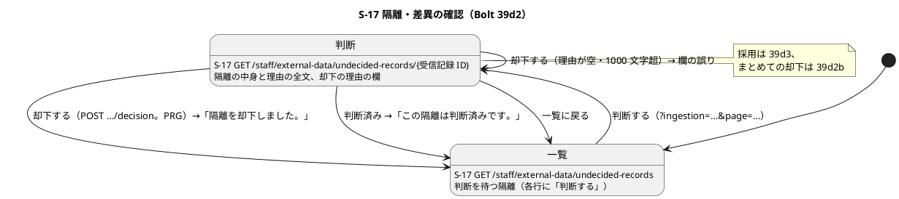
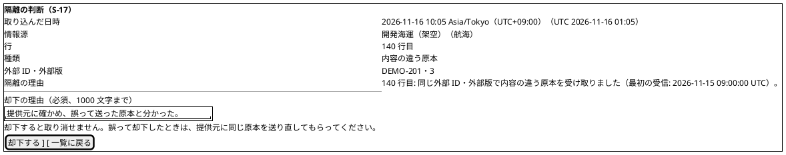
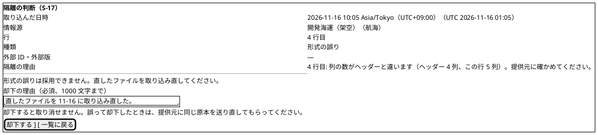
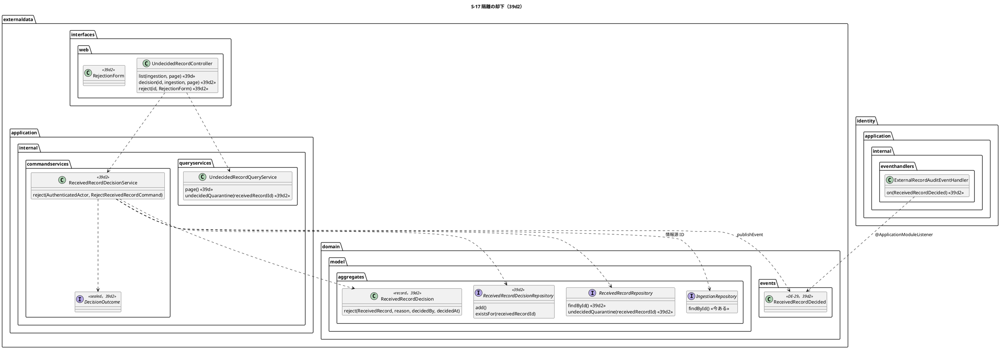
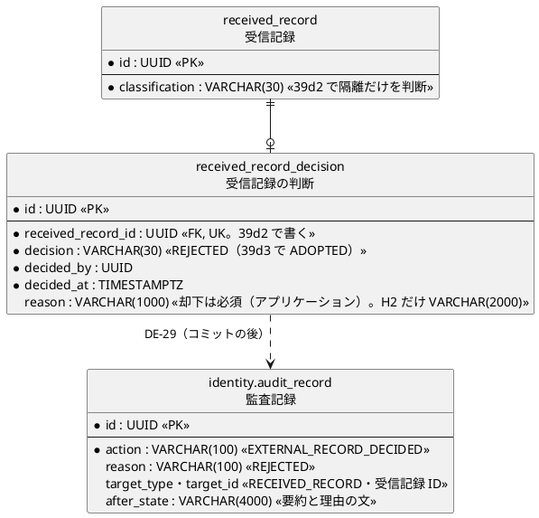

# Bolt 39d2 計画 - S-17 で隔離を却下する（判断の記録・判断のイベントと監査）

## 基本情報

| 項目 | 内容 |
| :--- | :--- |
| Bolt | 第 39d2 回（W7 の 16 本目。release_plan :964 の 39d2 の行。Bolt 39d の開始準備で 39d から縦に分けた 2 本目） |
| 状態 | 承認済み（2 つの整合性検証の指摘を反映した。推奨のとおり。Recommend 承認の指示による。human:kakimomokuri） |
| 予定 | W7（2026-11-16 の週。前倒しで着手できる）。作業は約 4 時間 25 分（目安の 4 時間を 25 分超える。半日の中に収まるので分けない。下の「時間の配分と打ち切り」。`check`・`uiTest`・`manualScreenshots`・`demoVideo`・SonarQube・CI とステップごとの承認の待ちを除く） |
| アプローチ | アウトサイドイン（S-17 の判断から。画面の層の受入シナリオ（`@ui`）の Red から入る。release_plan :964 の 39d2 の行のとおり。一覧と照会は 39d で固まっていて（UndecidedRecordController.java :51-86、ReceivedRecordRepository.java :27-37）、判断の画面と却下の振る舞いが受入条件の中心） |
| 対象 | (1) 受信記録の判断（`ReceivedRecordDecision`）のドメインの型とポート、MyBatis とメモリの実装（追記専用、受信記録 1 件に 1 つ。判断の表は 39a3 からある。V20261103100000 :107-128。理由の列は H2 だけ `VARCHAR(2000)` に広げる。決定 (2)）、(2) 判断するのは隔離（のちに差異も）の受信記録だけをアプリケーションで守る（data_model :1155「判断と分類の整合は表の制約で守らず、アプリケーションで判定する（Bolt 39d2）」）、(3) S-17 の判断の画面 `GET /staff/external-data/undecided-records/{受信記録 ID}` と却下の `POST …/{受信記録 ID}/decision`（PRG で一覧に戻る。CSRF。理由は必須で 1000 文字まで。判断済み・同時の判断は「この隔離は判断済みです。」。キーのない隔離（形式の誤り）の判断の画面には却下だけを示し、「直したファイルを取り込み直してください」の文を添える。【業務の判断】(a)）、(4) 判断のイベント DE-29 `ReceivedRecordDecided` と identity の監査の listener（`EXTERNAL_RECORD_DECIDED`。配信まで確かめる。T-184）、(5) 一覧から判断済みが消えること（メモリの実装も判断のポートを見る）と、39d の申し送りの行 7 を契約のテストに上げること（もう 1 つの申し送りの件数と 1 ページの照会の間に件数が減ったときの示し方は 39d2b に送る。決定 (8)）、(6) マニュアル 12.2 に「隔離を却下する」とキャプチャ、(7) デモの動画（`@demo-bolt-39d2/reject`）。あわせて 1 つの取込に形式の誤りが多いときのまとめての却下をこの開始準備で決める（下の開始準備の決定 (9)。【業務の判断】(g)） |
| トレース | US-14 AC4（隔離しデータ責任者へ示す）、UC-15 の主成功シナリオ 5（データ責任者が差異と採否を確認する）・代替 2a・3b、ED-INV-02、AUD-01（監査記録）・IA-INV-15（イベントを経る監査）、ui_design の S-17（:142・:193）・画面遷移（:530）、data_model の受信記録の判断（:1155）、domain_model の受信記録の判断（:320・:1509）・DE-29（:1679）、ACC-01（WCAG 2.2 AA） |
| GitHub | [#18](https://github.com/k2works/practical-domain-driven-design-in-enterpris-application/issues/18)（US-14。クローズは 39h） |
| SP | 0 |
| 承認ゲート | **ステップごとに止める**（release_plan :964 の「ステップごと（監査・画面）」）。監査（新しい操作 `EXTERNAL_RECORD_DECIDED` と、監査記録の「書き手は 1 か所」の規則の行の変更。開始準備の決定 (6)）、画面（S-17 の判断の画面と却下の POST）、新しいファイル（下の一覧）、スキーマ（判断の理由の列を H2 だけ `VARCHAR(2000)` に広げる H2 だけのマイグレーション。ステップ 3。判断の表はあり、PostgreSQL と共通のマイグレーションは変えない。決定 (2)。【前の決定の変更】(4)）。認可は変えない（決定 (5)）。注: 人の指示「Recommend 承認で進めて」により、各ステップの終わりで止めて推奨の案を承認として記録する（人が個別に見ていないことが分かるように「推奨のとおり（Recommend 承認の指示による）」と書く）。ステップを飛ばしたり束ねたりはしない |
| 開始準備で決めたこと | 2026-11-05、推奨のとおり（Recommend 承認の指示による。human:kakimomokuri）: 下の (1)〜(12)。【業務の判断】(a)・(d)・(e) を実装し、(g) を新しく記録する。2 つの整合性検証の指摘（詳細 重大 1・中 4・軽 4、横断 中 6・軽 5）を反映した（同日、推奨のとおり。Recommend 承認の指示による。human:kakimomokuri） |

### 開始準備の決定

(1) **範囲と見積り**: release_plan :964 の 39d2 の行（Bolt 39d の開始準備の決定 (1) の表。約 4 時間 00 分）に、39d の終了報告の既知の課題（[終了報告](bolt_39d_report.md) :99）の 3 つを加えて引き直すと、まとめての却下を含めて約 6 時間 30 分で半日を超える。まとめての却下（決定 (9)）を縦に分けて **39d2b** にし、39d2 は 1 件ずつの却下と 39d の申し送りの行 7 にする（【前の決定の変更】(1)）。2 つの整合性検証の指摘で、判断の理由の列を H2 だけ広げるマイグレーション（決定 (2)）、判断の画面の中身を ID で絞って読む照会（決定 (3)）、情報源 ID を取込から読むこと（決定 (4)）が加わり、39d2 は約 4 時間 35 分になるので、件数と 1 ページの照会の間に件数が減ったときの示し方（決定 (8)。39d の申し送り）を今のうちに 39d2b へ送ると決め（条件付きにしない）、39d2 を約 4 時間 25 分、39d2b を約 2 時間 45 分（読み直しとそのテストの 15 分を足す）にする（下の「時間の配分と打ち切り」）。

| Bolt | 範囲（縦） | アプローチ | 承認ゲート | 見積り |
| :--- | :--- | :--- | :--- | ---: |
| **39d2**（この計画） | データ責任者が隔離を 1 件ずつ却下する: 判断の型とポート（理由の列を H2 だけ広げる）、判断するのは隔離だけ、判断の画面と却下の POST、DE-29 と `EXTERNAL_RECORD_DECIDED`、一覧から消えること、行 7 を契約のテストに、マニュアル 12.2 の却下とキャプチャ、デモの動画 | アウトサイドイン（S-17 の判断から） | ステップごと（スキーマ・監査・画面） | 約 4 時間 25 分 |
| **39d2b** | データ責任者が 1 つの取込のキーのない隔離をまとめて却下する（決定 (9)。【業務の判断】(g)）: 一覧を取込で絞ったときの「この取込の形式の誤りをまとめて却下する」、理由は 1 つ、受信記録ごとに判断・DE-29・監査を 1 つずつ、上限いっぱい（1 万件）の時間の計測、件数と 1 ページの照会の間に件数が減ったときの示し方（決定 (8)。39d2 から送る）、マニュアルとキャプチャ、デモの動画 | アウトサイドイン（S-17 のまとめての却下から） | ステップごと（画面） | 約 2 時間 45 分 |

順序は 39d → 39d2 → 39d2b → 39d3 → 39d4 → 39e（39d2b は 39d2 の判断のサービスとイベントを使い、39d3 の採用と縦が違う。39d3 は 39d2 の判断の型を使い、39d2b を待たない）。W7 は 25 本前後になる（39d の終了報告の議題 2 の「24 本前後」から 1 本増える）。週の計画の期間（2026-11-16〜11-20）に対して実績は約 2 週先行しているので、バッファ消費ルールの範囲で吸収できる（W7 の週の見直しで確かめる）。代わりの案は取らない: (a) まとめての却下を 39d2 に入れる（約 7 時間。半日を超える）、(b) まとめての却下を作らない（決定 (9) の比べた案）。

(2) **判断の型とポート（理由の列は H2 だけ広げる）**: 判断の表 `external_data.received_record_decision`（V20261103100000 :107-128。`decision` は `ADOPTED`・`REJECTED` の CHECK :118、`reason VARCHAR(1000)` NULL 可 :113、一意制約 `uk_received_record_decision_received_record` :115、追記専用 :121）を、ドメインの record `ReceivedRecordDecision`（`externaldata.domain.model.aggregates`。集約を持たない。ADR-002。前例 ReceivedRecord。受信記録 ID・判断・判断者・判断の時刻・理由。規則は ReceivedRecord の前例どおりコンストラクタの不変条件として持ち、static ファクトリー `reject` は残してよい）とリポジトリのポート `ReceivedRecordDecisionRepository`（`add` と `existsFor(UUID receivedRecordId)`。更新・削除を持たない。前例 ReceivedRecordRepository.java :8-12 の追記専用の書き方）で読み書きする。判断の種類は `DecisionKind`（`externaldata.domain.model.valueobjects`。`ADOPTED`・`REJECTED`）。同じ受信記録への 2 つ目の判断は一意制約の違反を `DuplicateReceivedRecordDecisionException`（前例 DuplicateAdoptedValueException.java・DuplicateExternalRecordException.java）に変える。MyBatis の実装は `MyBatisReceivedRecordDecisionRepository`・`ReceivedRecordDecisionMapper`（.java・.xml）・`ReceivedRecordDecisionRow`（`externaldata.infrastructure.persistence`）。時刻は Clock から取りマイクロ秒に切り捨てる（前例 data_model :1153 の `stored_at`）。**H2 だけのマイグレーション**（【前の決定の変更】(4)）: 理由は 1000 文字をコードポイントで数える（決定 (4)）が、H2 の VARCHAR は UTF-16 の単位で数えるので、補助文字を含む 1000 コードポイントの理由が `reason VARCHAR(1000)`（V20261103100000 :113）に入らない（data_model :1154 の注記と同じ事情）。前例 `db/migration/h2/V20261104145000__widen_received_record_classification_note.sql`（Bolt 39b4）にならい、H2 だけ `received_record_decision.reason` を `VARCHAR(2000)` に広げる。版はすべての場所の最新より後にする（今の最新は common の V20261104170000、dev-data の V20261104160900。例として `db/migration/h2/V20261105100000__widen_received_record_decision_reason.sql`。ステップ 3 の開始で実際の最新を確かめて決める）。PostgreSQL は文字で数えるので `VARCHAR(1000)` のまま。契約のテストに「補助文字を含む 1000 字の理由が往復する」行を足す（行 21。前例 H2ReceivedRecordNoteTest）

(3) **判断するのは隔離だけ**（39a3 の論点。data_model :1155、domain_model :1509）: 却下のファクトリー `ReceivedRecordDecision.reject(ReceivedRecord, reason, decidedBy, decidedAt)` が、受信記録の分類が隔離（`QUARANTINED`）でなければ拒む（差異 `DISCREPANCY` は 39h で足す。採用・重複は判断しない）。受信記録を 1 件読むために `ReceivedRecordRepository` に `findById(UUID)` を足す（今は追記・件数・取込ごとの隔離・判断を待つ隔離の照会だけ。ReceivedRecordRepository.java :16-37）。`findById` は取込で書いた受信記録だけを返す（`ingestion_id` が NULL の受信記録は空。ReceivedRecord は取込 ID を必ず持つ。ReceivedRecord.java :15-16）。表の制約は足さない（data_model :1155 のとおり）。**判断できる受信記録**の定義は GET（判断の画面）と POST（却下）で 1 つにそろえる: 「`findById` で読め（取込で書いた受信記録）、分類が隔離で、判断がない」。読めなければ `NotFound`（404）、隔離でなければ `NotDecidable`（404）、判断があれば `AlreadyDecided`（一覧に戻る）。**判断の画面の GET** は、`findById`（隔離か）と判断のポートの `existsFor`（判断済みか）で行き先を決め（ない受信記録・取込のない受信記録・隔離でない受信記録は 404、判断済みは一覧に戻って「この隔離は判断済みです。」）、中身（一覧と同じ項目と隔離の理由の全文）は ID で絞った照会で読む: 受信記録のポートに `undecidedQuarantine(UUID receivedRecordId)`（`Optional<UndecidedQuarantine>`。`undecidedQuarantines` と同じ SQL に受信記録 ID の絞り込みを足す）を足し、マッパー（`ReceivedRecordMapper` の .java・.xml）・メモリの実装（`InMemoryReceivedRecordRepository`）・契約のテスト（行 4・5 の契約の分。メモリ・H2・PostgreSQL）を作る。照会のサービス `UndecidedRecordQueryService` に 1 件を引くメソッドを足す（下の「クラスと依存」の注）

(4) **却下のサービス**: `ReceivedRecordDecisionService`（`externaldata.application.internal.commandservices`）の `reject(AuthenticatedActor, RejectReceivedRecordCommand)` が 1 つのトランザクションで、役割の確かめ（データ責任者でなければ `NotPermitted`。前例 IngestionService.java :113-117）、受信記録を読む（`findById`。なければ `NotFound`。判断できる受信記録の定義は決定 (3)）、判断済みか（`existsFor` で `AlreadyDecided`）、判断を作って追記し（一意制約の違反も `AlreadyDecided`）、DE-29 を出す。DE-29 の情報源 ID は、受信記録の取込 ID で `IngestionRepository.findById`（IngestionRepository.java :17。今あるポート）を読んで取込の情報源 ID から得る（新しいポートは要らない）。結果は sealed の `DecisionOutcome`（`Rejected`・`NotPermitted`・`NotFound`・`NotDecidable`（隔離でない）・`AlreadyDecided`。前例 IngestionOutcome）。理由は前後の空白を除いて 1〜1000 文字（コードポイント。data_model :1154 の注記の数え方にそろえる）で、空・超過は画面の欄の誤り（サービスに渡す前に controller で拒み、サービスも拒む）。コマンド `RejectReceivedRecordCommand`（`application.internal.commands`）には `@Command` を付ける（DddAnnotationArchitectureTest.java :33-42 の「コマンドには Command を付ける」）

(5) **画面・CSRF・認可（今の規則の中）**: 一覧の各行に「判断する」のリンク（`/staff/external-data/undecided-records/{受信記録 ID}?ingestion=…&page=…`）を足し、判断の画面で隔離の中身（一覧と同じ項目と隔離の理由の全文）と却下の欄（理由の `textarea`、必須、1000 文字まで、`aria-describedby` で説明と誤り）を示す。「却下する」は `POST /staff/external-data/undecided-records/{受信記録 ID}/decision`（Bolt 39d の開始準備の決定 (2) の URL）で、却下したら PRG で一覧（元の `ingestion`・`page`）に戻り「隔離を却下しました。」を示す。判断済み（2 人のデータ責任者・二重送信）は一覧に戻って「この隔離は判断済みです。」、ない受信記録・取込のない受信記録・隔離でない受信記録は 404、判断済みの受信記録の判断の画面は一覧に戻って同じ文（判断できる受信記録の定義は決定 (3)）。パス変数の受信記録 ID は `String` で受け、UUID でなければ 404 にする（型変換の 400 にしない）。POST の後の戻り先の `ingestion`・`page` は、既存の `parseUuid`・`parsePage`（UndecidedRecordController.java :114・:126）を通してから URL を組む（読めない値は捨てて既定にし、受け取った文字列をそのまま URL に入れない）。CSRF は Spring Security の既定の同期トークン（SecurityConfiguration.java :73 の Javadoc「CSRF の同期トークン（既定）」）で、フォームは `th:action` が隠し項目を足す（前例 templates/externaldata/ingestions/new.html :32）。認可は `/staff/external-data/**` のデータ責任者（SecurityConfiguration.java :224-225）の中で、サービスでも役割を確かめる（決定 (4)）。どちらも今の規則の中なので、新しいセキュリティの判断はない。代わりの案（一覧の各行に理由の欄と「却下する」を置く）は、1 ページ 100 個の欄になり、隔離の理由の全文を読んでから判断する流れにならず、39d3 の採用（採用値の中身を示す）を足す場所もないので取らない（【前の決定の変更】(2)。ui_design :530 の「隔離差異 --> 取込 : 判断を記録」を「一覧 → 判断の画面 → 一覧」に直す）

(6) **判断のイベントと監査**（Bolt 39d の開始準備の決定 (12)、domain_model :1679）: DE-29 `ReceivedRecordDecided`（`externaldata.domain.events`）は受信記録 ID、取込 ID、情報源 ID（決定 (4)。取込から読む）、判断（`String` で `REJECTED`。39d3 で `ADOPTED`。ドメインイベントは Java 標準と共有カーネルの型だけを持つ規則（DomainEventArchitectureTest.java :48-59）があるので `DecisionKind` を持たせず名前の文字列にする）、理由、判断者、**判断者の企業**、判断の時刻を持つ（判断者の企業を足す。監査記録は操作者の企業を必須にする（AuditRecord.java :480-497 の `required(actorCompany, …)`）ので、DE-14 の `operatorCompanyId` にそろえる。【前の決定の変更】(3)）。identity の `ExternalRecordAuditEventHandler`（:88-109 の DE-14 の `on` の隣）に `on(ReceivedRecordDecided)` を足し、`AuditAction.EXTERNAL_RECORD_DECIDED`（AuditAction.java :98 の後）で書く。監査記録の `reason` 列は 100 文字まで（V20261006140000 :57）なので、理由の列には判断（`REJECTED`）を入れ、却下の理由の文は変更後（`after_state`、4000 文字まで。V20261016100000 :9）の要約の最後に入れる（`decision=REJECTED;ingestionId=…;dataSourceId=…;reason=<理由の文>`。理由の文に `;` があっても最後なので読み違えない）。（操作、受信記録）ごとに 1 つ（IA-INV-15。`existsByActionAndTarget`。ExternalRecordAuditEventHandler.java :129）。監査記録のファクトリーは `AuditRecord.externalRecordDecided` にし、今ある同じ名前の private のヘルパー（AuditRecord.java :480）を `receivedRecordAudit` に名前を変える（T-246。同じ単純名を避ける）。「書き手は 1 か所」の規則の行（LayerArchitectureTest.java :394-397 の `nameMatching("externalRecordAdopted|externalRecordQuarantined")`）に `externalRecordDecided` を足す（書き手は同じ listener で、書き手を増やさない。規則の行の変更なので承認ゲートで記録する）。配信は `ExternalRecordAuditDeliveryIntegrationTest` に 1 本、イベントの直列化の契約は `DomainEventSerializationContractTest` に v1 を 1 本（T-184）

(7) **行 7 を契約のテストに上げる**（39d の申し送り。[終了報告](bolt_39d_report.md) :68）: 判断のポートができたので、判断の行を JDBC で入れていた行 7（`H2ExternalDataRecordRepositoriesTest`・`MyBatisExternalDataRecordRepositoriesIntegrationTest` :140）を、共有の契約のテスト（`ExternalDataRecordRepositoriesContract`）に移して判断のポートで書く（メモリ・H2・PostgreSQL）。MyBatis の 1 次キャッシュを避けるために件数を先に数えていた書き方は要らなくなる（判断のポートの追記は別のマッパーの文で、同じ session の照会のキャッシュを捨てる。移すときに確かめ、残るなら理由を書く）。メモリの実装（`InMemoryReceivedRecordRepository`）はメモリの判断のリポジトリ（新しいテストのファイル `InMemoryReceivedRecordDecisionRepository`）を受け取り、判断のある受信記録を判断を待つ隔離から除く

(8) **件数と 1 ページの照会の間に件数が減ったとき**（39d の申し送り。[終了報告](bolt_39d_report.md) :69）: **39d2b に送る**（決定 (1)。見積りを目安に収めるため、今のうちに送ると決める。条件付きにしない。39d2 の間は 39d の「0〜0 件目」の振る舞いのまま残り、マニュアルは変えない）。39d2b で作る形は次のとおり。照会のサービス（`UndecidedRecordQueryService.page`）は件数を数えてからページを読む（2 つの文で、PostgreSQL の READ COMMITTED では間の判断が見える）。読んだページが空で件数が 0 より大きいとき（最後のページの隔離がすべて判断された）は、件数を数え直して最後のページに寄せて 1 回だけ読み直す。読み直しても空なら 0 件の文を示す。示す範囲（M〜L 件目）は読んだ件数から作る（UndecidedRecordPage.java :28-35。今のまま）。代わりの案は取らない: (a) 照会を REPEATABLE READ にして 2 つの文を同じスナップショットで読む（コードベースに分離レベルを変える前例がなく、H2 と PostgreSQL で振る舞いを確かめる手間が大きい）、(b) 画面に「一覧が変わりました」を示して読み直させる（データ責任者が理由の分からない文を読む）

(9) **1 つの取込に形式の誤りが多いときのまとめての却下**【業務の判断】(g)（39d の申し送り。[計画](bolt_39d_plan.md) :190、[終了報告](bolt_39d_report.md) :99）: **作る。対象は 1 つの取込の、判断を待つキーのない隔離（形式の誤り・ファイルの誤り・取り込めなかった部分）だけ**で、理由は 1 つを全件に付ける。内容の違う原本（外部原本を持つ隔離）はまとめて却下しない（採用か却下かを 1 件ずつ見る。39d3 で採用を足す）。受信記録ごとに判断・DE-29・監査を 1 つずつ作る（IA-INV-15 の（操作、受信記録）ごとに 1 つを守る。取込も 1 万件の DE-14 を出している。IngestionService.java :268）。実装は 39d2b（決定 (1)）。根拠: キーのない隔離は却下だけ（【業務の判断】(a)）で、直したファイルを取り込み直すのが業務の正しい手で（【業務の判断】(c)）、1 万件の誤りのファイルを 1 件ずつ却下するとデータ責任者の作業が 1 万回になり、判断を待つ一覧が誤りのファイルで埋まって内容の違う原本が見えなくなる。比べた案: (i) 作らない（判断を待つ一覧が埋まる。未判断の警告 OBS-06（W10）が鳴り続ける）、(ii) 取込のすべての隔離（内容の違う原本を含む）をまとめて却下（採用すべき原本まで捨てうる）、(iii) 隔離を判断の外に置き、取り込み直しで自動に却下する（取り込み直したファイルと元のファイルの行を結ぶ規則がなく、分類の規則（【業務の判断】(c)）を変える）

(10) **却下の理由**【業務の判断】(d)（Bolt 39d の開始準備の決定 (11)）: 必須（前後の空白を除いて 1 文字以上）、1000 文字まで（`reason` 列の長さ。V20261103100000 :113。列は NULL 可のまま、アプリケーションで守る。data_model :1155）。理由を後から読む手段は AUD-UI-01（監査の一覧の画面。release_plan :1034。W8 で決める）で、39d2 は判断の表と監査記録に残すまで。S-17 では判断済みの隔離は一覧から消える（判断済みの一覧は作らない）

(11) **判断の取り消し**【業務の判断】(e)（Bolt 39d の開始準備の決定 (13)、台帳 D-95。release_plan :1072）: 作らない。誤って却下したときは同じ原本を送り直してもらう（新しい受信記録が再び隔離になり判断し直せる。39d4 で受入シナリオ）。39d2 はマニュアル 12.2 の注意・補足に「却下は取り消せません。誤って却下したときは、提供元に同じ原本を送り直してもらってください」と書き、判断の画面の「却下する」の近くにも同じ趣旨を示す

(12) **新しい型の名前**（T-246。`apps/cargo-tracker/src` で `ReceivedRecordDecision`・`ReceivedRecordDecided`・`RecordDecision`・`DecisionService`・`DecisionOutcome`・`RejectionForm`・`DecisionForm`・`RejectReceivedRecordCommand` を検索してないことを確かめた。`Decision` を含む enum は quotation の `ReviewDecision` だけなので、判断の種類は `DecisionKind` にして読み違えを避ける。監査記録の private のヘルパー `externalRecordDecided`（AuditRecord.java :480）は public のファクトリーと同じ名前になるので名前を変える。決定 (6)）: 本体 `ReceivedRecordDecision`・`ReceivedRecordDecisionRepository`・`DuplicateReceivedRecordDecisionException`（`domain.model.aggregates`）、`DecisionKind`（`domain.model.valueobjects`）、`ReceivedRecordDecided`（`domain.events`）、`ReceivedRecordDecisionService`・`DecisionOutcome`（`application.internal.commandservices`）、`RejectReceivedRecordCommand`（`application.internal.commands`）、`MyBatisReceivedRecordDecisionRepository`・`ReceivedRecordDecisionMapper`・`ReceivedRecordDecisionRow`（`infrastructure.persistence`）、`RejectionForm`（`interfaces.web`）、テンプレート `templates/externaldata/undecided-records/decision.html`。判断の画面の項目は `UndecidedRecordController` に足し（GET の詳細と POST。同じ URL の下）、新しい controller を作らない

【前の決定の変更】(1): Bolt 39d の開始準備の決定 (1) の 4 本の分け方に、39d2 のまとめての却下を **39d2b** として足し 5 本にする（release_plan の W7 の 39d2 の行の後に 39d2b の行（計画の承認で足した）、順序（:975）に 39d2b、デモ項目の動画の Bolt に 39d2b、「W7 は 24 本前後」を「25 本前後」に直す（ステップ 1）。件数が減ったときの示し方（決定 (8)）も 39d2b に送る）（2026-11-05、推奨のとおり。Recommend 承認の指示による。human:kakimomokuri）。

【前の決定の変更】(2): ui_design :530 の画面遷移「隔離差異 --> 取込 : 判断を記録」と、Bolt 39d の開始準備の決定 (2) の「PRG で一覧に戻る」の前に、判断の画面（`GET …/undecided-records/{受信記録 ID}`）を挟む（一覧 → 判断の画面 → 却下 → 一覧）（2026-11-05、推奨のとおり。Recommend 承認の指示による。human:kakimomokuri）。

【前の決定の変更】(3): domain_model :1679 の DE-29 の属性に「判断者の企業」を足す（監査記録が操作者の企業を必須にするため。DE-14 の `operatorCompanyId` にそろえる）（2026-11-05、推奨のとおり。Recommend 承認の指示による。human:kakimomokuri）。

【前の決定の変更】(4): Bolt 39a3 で決めた判断の表の `reason VARCHAR(1000)`（V20261103100000 :113）を、H2 だけ `VARCHAR(2000)` に広げる（補助文字を含む 1000 コードポイントの理由を H2 でも受けるため。前例 Bolt 39b4 の `classification_note`。PostgreSQL と共通のマイグレーションは変えない。決定 (2)。ステップ 3 のスキーマの承認ゲートで通す）（2026-11-05、推奨のとおり。Recommend 承認の指示による。human:kakimomokuri）。

新しいファイル（39d2）: 本体は決定 (12) の 13 個（.java 12 個とマッパーの .xml 1 個）とテンプレート `decision.html`、H2 だけのマイグレーション `db/migration/h2/V20261105100000__widen_received_record_decision_reason.sql`（版はステップ 3 の開始で確かめる。決定 (2)）。テスト `ReceivedRecordDecisionTest.java`・`ReceivedRecordDecisionServiceTest.java`・`InMemoryReceivedRecordDecisionRepository.java`、受入シナリオ `features/ui/reject_quarantine_ui.feature` と Steps `RejectQuarantineUiSteps.java`。キャプチャ `docs/manual/assets/12-undecided-record-decision.png`（`manualScreenshots` が作る）、デモの動画 `docs/assets/demo/bolt-39d2/reject.webm`（`demoVideo` が作る）。直すもの: `ReceivedRecordRepository`（`findById`・`undecidedQuarantine`）・`MyBatisReceivedRecordRepository`・`ReceivedRecordMapper`（.java・.xml）・`InMemoryReceivedRecordRepository`、`UndecidedRecordQueryService`（ID で 1 件を引く。決定 (3)）、`UndecidedRecordController` とテンプレート `index.html`（「判断する」のリンクと知らせ）、`ExternalDataConfiguration`（サービスとリポジトリの `@Bean`。ExternalDataConfiguration.java :38-42 の前例）、`AuditAction`・`AuditRecord`・`ExternalRecordAuditEventHandler`、`LayerArchitectureTest`（決定 (6) の規則の行）、契約のテスト `ExternalDataRecordRepositoriesContract`・`H2ExternalDataRecordRepositoriesTest`・`MyBatisExternalDataRecordRepositoriesIntegrationTest`（行 7 を移す）、`ExternalDataSchemaIntegrationTest`（判断の表の行を JDBC で入れる :340・:473 はスキーマのテストなので残す）、`ExternalDataIngestionSecurityIntegrationTest`、`ExternalRecordAuditEventHandlerTest`・`AuditRecordTest`・`AuditRecordEventAuditContract`・`ExternalRecordAuditDeliveryIntegrationTest`・`DomainEventSerializationContractTest`、`UndecidedRecordQueryServiceTest`・`UndecidedRecordControllerTest`、`manual_screenshots.feature`、マニュアル 12 章・用語集・付録 B（エラーメッセージ早見表に「この隔離は判断済みです。」の 1 行）、ADR-007（H2 だけ広げる列に判断の理由を足す）。マニュアルは新しいファイルを作らない（12.2 に節を足す）。

## Bolt ゴール

データ責任者が S-17 の一覧で隔離の「判断する」を開くと、判断の画面で隔離の中身と理由の全文を読み、理由を書いて「却下する」と、判断が判断者・時刻・理由とともに記録され、一覧に戻って「隔離を却下しました。」が出て、その隔離は一覧から消える。理由が空・1000 文字を超えると欄の誤りを示す。同じ隔離を 2 人が判断したときや二重に送ったときは、2 つ目に「この隔離は判断済みです。」と示す。隔離でない受信記録は判断できない。却下ごとに DE-29 が出て、監査記録に `EXTERNAL_RECORD_DECIDED` が 1 つ残る。補助文字を含む 1000 文字の理由が H2 でも PostgreSQL でも残る。マニュアル 12.2 に却下の手順があり、キャプチャとデモの動画がある。まとめての却下と件数が減ったときの示し方は 39d2b、採用は 39d3。

### 開始準備で確かめたこと

- **release_plan の 39d2 の行**（:964）: 「S-17 で隔離を却下する縦: 受信記録の判断のポートと MyBatis の実装（追記専用、受信記録 1 件に 1 つ）、判断するのは隔離（のちに差異も）の受信記録だけをアプリケーションで守る、却下の POST（PRG・CSRF・理由は必須）、判断のイベント（DE-29）と identity の監査の listener（`EXTERNAL_RECORD_DECIDED`。配信まで）、一覧から判断済みが消えること、マニュアル 12.2 の却下とキャプチャ、デモの動画」、アプローチはアウトサイドイン（S-17 の判断から）、承認ゲートは「ステップごと（監査・画面）」
- **前の Bolt の申し送り**: Bolt 39d（[計画](bolt_39d_plan.md) :34・:60・:62・:64・:186-197、[終了報告](bolt_39d_report.md) :68-69・:95・:99・:103・:107。範囲と見積り、【業務の判断】(a)・(d)・(e)、DE-29 と `EXTERNAL_RECORD_DECIDED`、行 7、件数が減ったとき、まとめての却下、AUD-UI-01）、Bolt 39a3（判断の表と追記専用、判断のやり直しは再送。data_model :1155）、Bolt 39b3b（監査の listener と（操作、受信記録）ごとに 1 つ。ExternalRecordAuditEventHandler.java :18-27）
- **判断の表の今の形**: V20261103100000 :107-128（上の決定 (2)）。読み書きのクラス・マッパーはない（`apps/cargo-tracker/src` に `ReceivedRecordDecision` はない）。テストでは JDBC で行を入れている（ExternalDataSchemaIntegrationTest :340・:473、MyBatisExternalDataRecordRepositoriesIntegrationTest :140）。追記専用の権限のテストに表がある（AppendOnlyGrantIntegrationTest :45）
- **一覧の今の形**: 判断の表との `NOT EXISTS` で判断を待つ隔離を読む（Bolt 39d。ReceivedRecordRepository.java :27-37）。照会のサービスは件数を数えてからページを読む（UndecidedRecordQueryService の `page`）。示す範囲は読んだ件数から作る（UndecidedRecordPage.java :28-35）。controller は GET だけ（UndecidedRecordController.java :51-86）
- **認可と CSRF**: `/staff/external-data/**` はデータ責任者だけ（SecurityConfiguration.java :224-225）、CSRF は既定の同期トークン（同 :73）。取込の POST は `AuthenticatedActor` を受け（ExternalDataIngestionController.java :123-129）、サービスで役割を確かめる（IngestionService.java :113-117）。PRG は `RedirectAttributes` の知らせ（ExternalDataIngestionController.java :160-163）
- **監査**: `ExternalRecordAuditEventHandler` は DE-12・DE-13・DE-14 を受ける（:45-109）。`AuditAction` の外部原本は `EXTERNAL_RECORD_ADOPTED`・`EXTERNAL_RECORD_QUARANTINED`（AuditAction.java :93-98）。監査記録の `reason` は `VARCHAR(100)`（V20261006140000 :57）、変更後 `after_state` は `VARCHAR(4000)`（V20261016100000 :9）。監査記録のファクトリーの呼び出しは「書き手は 1 か所」の規則が listener だけに許す（LayerArchitectureTest.java :394-397・:460）。AuditRecord の private のヘルパーの名前が `externalRecordDecided`（AuditRecord.java :480）
- **イベント**: DE-28 は TOTP の登録（domain_model :1678）、DE-29 は予約済み（:1679。受信記録 ID、取込 ID、情報源 ID、判断、理由、判断者、判断の時刻）。イベントの直列化の契約（DomainEventSerializationContractTest :265 の DE-14 の前例）と配信のテスト（ExternalRecordAuditDeliveryIntegrationTest）がある
- **マニュアル**: 12.2 は 39d で足した（docs/manual/12-外部データ.md :188-250。節は「この画面でできること・画面の開き方・画面の説明・操作手順・一覧の読み方・判断を待つ隔離がないとき・注意・補足」、キャプチャ :202）
- **マイグレーション**: 判断の表は変えないが、理由の列を H2 だけ `VARCHAR(2000)` に広げる（決定 (2)。【前の決定の変更】(4)）。今の最新の版は common の V20261104170000、dev-data の V20261104160900、h2 の V20261104145000（H2 の VARCHAR は UTF-16 の単位で数える前例。data_model :1154）

## 設計の決定

| 項目 | 決定 | 根拠 |
| :--- | :--- | :--- |
| 範囲と分け方 | 開始準備の決定 (1)。39d2（1 件ずつの却下、約 4 時間 25 分）と 39d2b（まとめての却下と件数が減ったときの示し方、約 2 時間 45 分）（【前の決定の変更】(1)） | 下の「時間の配分と打ち切り」 |
| 判断の型とポート | 決定 (2)。record の `ReceivedRecordDecision`（集約を持たない。ADR-002。規則はコンストラクタの不変条件）・`ReceivedRecordDecisionRepository`、一意制約の違反を例外に。理由の列を H2 だけ `VARCHAR(2000)` に広げる（【前の決定の変更】(4)） | V20261103100000 :107-128・:113、db/migration/h2/V20261104145000 |
| 判断するのは隔離だけ | 決定 (3)。却下のファクトリーで拒む。`ReceivedRecordRepository.findById`（取込で書いた受信記録だけ）と ID で絞った照会を足す。判断できる受信記録の定義を GET と POST で 1 つに | data_model :1155、domain_model :1509 |
| 却下のサービス | 決定 (4)。役割・受信記録・判断済み・一意制約を 1 つのトランザクションで。情報源 ID は `IngestionRepository.findById` から。sealed の結果。コマンドに `@Command` | IngestionService.java :113-117、DddAnnotationArchitectureTest.java :33-42 |
| 画面・CSRF・認可 | 決定 (5)。判断の画面と却下の POST、PRG、パス変数は `String` で受けて 404、戻り先は `parseUuid`・`parsePage` を通す、今の認可と CSRF の中（【前の決定の変更】(2)） | SecurityConfiguration.java :73・:224-225、UndecidedRecordController.java :114・:126 |
| イベントと監査 | 決定 (6)。DE-29（判断は `String`。判断者の企業を足す。【前の決定の変更】(3)）、`EXTERNAL_RECORD_DECIDED`、理由の文は変更後に | DomainEventArchitectureTest.java :48-59、V20261006140000 :57、V20261016100000 :9、LayerArchitectureTest.java :394-397 |
| 行 7 | 決定 (7)。共有の契約のテストに移し、判断のポートで書く | MyBatisExternalDataRecordRepositoriesIntegrationTest :140 |
| 件数が減ったとき | 決定 (8)。39d2b に送る（空のページなら数え直して 1 回読み直す形は 39d2b で作る） | UndecidedRecordPage.java :28-35 |
| まとめての却下 | 決定 (9)。作る（キーのない隔離だけ、39d2b）。【業務の判断】(g) | IngestionService.java :268 |
| 却下の理由 | 決定 (10)。必須、1000 文字まで。【業務の判断】(d) | V20261103100000 :113 |
| 判断の取り消し | 決定 (11)。作らない。マニュアルと画面に書く。【業務の判断】(e) | release_plan :1072（D-95） |
| 型の名前 | 決定 (12)（T-246 で検索した） | — |

## ふりかえりと前の Bolt からの引き継ぎ

| 出典 | 内容 | この Bolt での扱い |
| :--- | :--- | :--- |
| W6 の Try T-204・T-212、Bolt 38h の T-227、Bolt 39b の T-233、Bolt 39d の Problem | サブエージェントへの指示の最初に heredoc と標準入力を待つコマンド（`python -`、引数のない `cat >` など）を使わないと書く | 任せるときの指示の最初に書く（39c4・39d で 3 本続けて流れた。[終了報告](bolt_39d_report.md) :95）。私が計画を直すときもファイルは Write・Edit で書く |
| Bolt 39d の T-247 | 決まりを文章の指示ではなく仕組みで守らせる（heredoc と `python -` を拒むフック） | W7 の締めで決める（39d の終了報告のとおり）。39d2 では任せる範囲を、ファイルを Write・Edit で書く作業と読むだけの検索に絞り、Gradle と git を人の側の 1 か所に残す |
| Bolt 39d の T-248 | `git add` は `git status --short` の出力を使わず、ディレクトリか `git add -u` で指定する | 各ステップのコミットで、本体・テストはパッケージのディレクトリ、文書は `docs/` の下のディレクトリで指定する（日本語のパスのマニュアルは `docs/manual` で指定する） |
| W6 の Try T-217、Bolt 39b2 の Try | 本体を直す前に Red を流し、落ちた理由を記録する。直したテストの一覧を添える | ステップ 2。一覧に「判断する」の列が増えて落ちる既存のテスト（`UndecidedRecordControllerTest` の表の見出し、`review_undecided_records_ui.feature`）と、AuditRecord の private のヘルパーの名前を変えて落ちるものを、ステップ 2 の開始で grep して一覧にする |
| W6 の Try T-191 | 環境の前提に設定ファイルの行を添える | CSRF と認可の行（SecurityConfiguration.java :73・:224-225）、監査の列の長さ（migration の行）を決定 (5)・(6) に添えた |
| W6 の Try T-225・T-213 | push の前に `check` | ステップ 8（`uiTest` も流す） |
| W6 の Try T-182・T-211・T-216 | 状態の組み合わせの表に重複・隔離と出口・誤った入力の行を置く | 下の表（行 1〜22。行 15 は 39d2b に送る）。判断済み・同時（行 5・6）、隔離でない（行 3）、ない受信記録・取込のない受信記録（行 4・22）、誤った入力（行 7・8 の理由の空・超過） |
| W6 の Try T-184 | listener は配信まで確かめる | 行 12（`ExternalRecordAuditDeliveryIntegrationTest` に 1 本） |
| W6 の Try T-219 | 変異の対象に単体・統合・契約のテスト | 下の変異の表 |
| W6 の Try T-215・T-222 | Gradle を流す担当を 1 つに、計画の初稿を先にコミット | Gradle は人の側の 1 か所で流す（`uiTest`・`manualScreenshots`・`demoVideo` を含む）。初稿をコミットしてから実装に入る |
| Bolt 39a2 の T-229 | 永続化の Bolt の状態の組み合わせに時刻の出どころと同時の書き込みの行を置く | 時刻: 判断の時刻は Clock から 1 回取りマイクロ秒に切り捨てる（行 2）。同時の書き込み: 同じ隔離への 2 つの判断（行 6。一意制約）。一覧の件数とページの間の判断（行 15）は 39d2b に送る（決定 (8)） |
| Bolt 39a3 の T-230 | 入ることを確かめる行のデータはドメインの規則に合う組み合わせにする | 内容の違う原本の隔離は寄港 2 つ以上・時刻の順の航海の行を 2 度（同じキー・違う値）取り込んで作る。情報源は提供元の名前に自分の UUID を含める |
| Bolt 39b の T-231 | `@Transactional` は契約のクラスに付ける | 行 7（行 16）と行 21 を契約のクラス（`ExternalDataRecordRepositoriesContract`）に置くとき、トランザクションは契約のクラスの注釈で受ける |
| Bolt 39b の T-232・Bolt 39b2 の T-234・Bolt 39b3 の T-237 | 本体を直したステップは承認の前に `spotbugsMain`・`checkstyleMain`・`sonar-local:check` | ステップ 3〜6 |
| Bolt 39b2b の T-235 | テストの名前の「行 N_」に Bolt の接頭辞を付けるかを W7 の締めで決める | 39d の前例のまま。新しいテストのクラスでは `行N_…`、既存のテストのクラスでは `@Nested class Bolt39d2_…`、契約のテストは名前の頭に `Bolt39d2_` |
| Bolt 39b2b の T-236 | 「起きないこと」を確かめるテストは呼び出しの記録で確かめる | 判断済み・隔離でない・権限なしのとき、判断を追記せずイベントを出さない（行 3〜6・9）ことを、ポートとイベントの発行の呼び出しの記録で確かめる |
| Bolt 39b3 の T-238 | サブエージェントへの指示は計画の決定を言い換えず計画の行を指す | 任せるときは「開始準備の決定」の番号と「状態の組み合わせ」の行番号を指す |
| Bolt 39b3b の T-239、Bolt 39d の Problem | 人に諮る選択肢・主張の前提はコードで確かめ、出典の行を添える | 開始準備の決定と【業務の判断】の前提に出典の行を添えた（判断の表の列と制約、監査の列の長さ、規則の行、private のヘルパーの名前、CSRF と認可の行）。39d で誤った「判断の表がない」の前提を繰り返さないよう、判断の表の行を開いて確かめた |
| Bolt 39b3b の T-240 | 表から作る規則には、全部の行が規則に入ることを確かめるテストを添える | 判断するのは隔離だけ（行 3）を分類のすべて（`ADOPTED`・`DUPLICATE`・`QUARANTINED`・`DISCREPANCY`）のパラメーターのテストで縛る（`DISCREPANCY` は 39h まで拒む）。`DecisionOutcome` のすべての結果が画面の行き先を持つことを controller のテストで縛る |
| Bolt 39b4 の T-241・T-242 | 性能の目標を外れたら区切って測る。上限いっぱいの入力の行を入れる | 1 件の却下は上限の入力がない。上限いっぱい（1 万件のまとめての却下）は 39d2b で測る |
| Bolt 39c の T-243 | 状態の数を 0 件にする受入シナリオは計画の時点で controller のテストに下ろす | 判断して判断を待つ隔離が 0 件になる（行 14）は、取込で絞った一覧で UI で作れる（隔離 1 件の取込を作って却下する） |
| Bolt 39c2 の T-244 | パラメーターのテストは入力と期待する出力の組み合わせまで縛る | 行 7・8（理由の空・空白だけ・1000・1001 文字と欄の誤りの文）、行 3〜6（結果と行き先・知らせの文） |
| Bolt 39c3 の T-245 | 並びの規則を足すテストは書く順を逆にしたデータを置く | 39d2 は並びを足さない。行 7 を移すとき、39d の行 4 の逆の順のデータを使う |
| Bolt 39c4 の T-246 | 新しい型の名前は同じ単純名がないかを検索してから決める | 開始準備の決定 (12) |
| 画面の Bolt の前例（memory の manual-in-bolt-done-criteria、Bolt 37f2 の T-197） | 振る舞いが変わる Bolt はマニュアルの更新を完了条件に入れる。マニュアルの文を実装と突き合わせる | 完了条件に 12.2 の却下・キャプチャ・用語集を入れる。ステップ 7 で知らせ・欄の誤り・判断済みの文を controller の定数とテンプレートに突き合わせる |
| Bolt 39d の開発レビューの低（送った 2 件） | 行 7 の件数を先に数える書き方、件数が減ったときの「0〜0 件目」 | 決定 (7)。件数が減ったときは 39d2b に送る（決定 (8)） |

## 状態の組み合わせ（行ごとにテストを 1 本。T-182）

判断の型の規則はドメインの単体（`ReceivedRecordDecisionTest`）、判断のポートの DB の通しは契約のテスト（`ExternalDataRecordRepositoriesContract`。メモリ・H2・PostgreSQL）、却下のサービスは単体（`ReceivedRecordDecisionServiceTest`。ポートとイベントの発行を mock）、画面は WebMvc のテスト（`UndecidedRecordControllerTest`。サービスと照会は mock）、監査は listener の単体（`ExternalRecordAuditEventHandlerTest`）と監査の契約（`AuditRecordEventAuditContract`）と配信の統合テスト（`ExternalRecordAuditDeliveryIntegrationTest`）、認可・CSRF・DB の通しはセキュリティの統合テスト（`ExternalDataIngestionSecurityIntegrationTest` に `@Nested class Bolt39d2_…`。PostgreSQL）、画面の通しは `reject_quarantine_ui.feature`（Feature の `@ui @US-14 @must`、幅 320 px、axe）。

| 行 | 状況 | 期待 | 確かめ方 |
| :--- | :--- | :--- | :--- |
| 1 | 内容の違う原本の隔離を却下する | 判断（`REJECTED`、判断者、時刻、理由）が 1 つ追記され、一覧に戻って「隔離を却下しました。」、その隔離は一覧から消える | サービスの単体、セキュリティの統合テスト、UI |
| 2 | キーのない隔離（形式の誤り）を却下する | 行 1 と同じ。判断の時刻は Clock から 1 回、マイクロ秒に切り捨て | ドメインの単体、契約のテスト（時刻の往復） |
| 3 | 隔離でない受信記録（採用・重複・差異） | 判断を作らず `NotDecidable`、画面は 404。差異は 39h まで拒む（T-240。分類のすべてのパラメーター） | ドメインの単体、サービスの単体（呼び出しの記録）、controller |
| 4 | ない受信記録 ID・UUID でない ID | `NotFound`、画面は 404（GET の判断の画面と POST の両方。パス変数は `String` で受けて 404。決定 (5)）。ID で絞った照会はない受信記録で空 | サービスの単体、controller、契約のテスト（`findById`・`undecidedQuarantine` が空） |
| 5 | 判断済みの隔離（GET の判断の画面・POST） | 判断を追記せず一覧に戻って「この隔離は判断済みです。」。GET は `findById` と `existsFor` で行き先を決める（決定 (3)）。ID で絞った照会は判断済みで空 | サービスの単体（`existsFor`）、controller、契約のテスト（`undecidedQuarantine` が判断の後に空） |
| 6 | 同時の判断（2 人、二重送信） | 一意制約の違反を `DuplicateReceivedRecordDecisionException` に変え、`AlreadyDecided` で行 5 と同じ文。判断は 1 つだけ | 契約のテスト（2 回追記して 2 つ目が例外。H2・PostgreSQL・メモリ）、サービスの単体 |
| 7 | 理由が空・空白だけ | 判断の画面に戻り、理由の欄に「却下の理由を書いてください。」（`aria-invalid`・`aria-describedby`）。判断を作らない | controller（パラメーター）、ドメインの単体 |
| 8 | 理由が 1000 文字・1001 文字（コードポイント。サロゲートペアを含む） | 1000 は通る、1001 は欄の誤り「却下の理由は 1000 文字までで書いてください。」 | controller・ドメインの単体（パラメーター。T-244） |
| 9 | 権限: データ責任者のほかの役割・未ログイン・CSRF のトークンがない POST | ほかの役割は A-04、未ログインは A-01（`/staff/external-data/**` の今の規則）、トークンなしは 403 で判断を作らない。サービスもデータ責任者でなければ `NotPermitted` | セキュリティの統合テスト、サービスの単体 |
| 10 | DE-29 を出す | 却下 1 つに `ReceivedRecordDecided` が 1 つ（受信記録 ID・取込 ID・情報源 ID・`REJECTED`・理由・判断者・判断者の企業・時刻） | サービスの単体、イベントの直列化の契約（v1） |
| 11 | 監査記録 | `EXTERNAL_RECORD_DECIDED`、結果は成功、操作者と時刻はイベントのもの、対象は受信記録、理由の列は `REJECTED`、変更後は `decision=REJECTED;ingestionId=…;dataSourceId=…;reason=<理由>`（理由の文に `;` を含む例）。同じイベントの再配信で 2 つ目を書かない。内容の欠けは ERROR のログで捨てる | listener の単体、監査の契約 |
| 12 | 配信（T-184） | 却下のコミットの後に listener が受け、監査記録が 1 つある。巻き戻った却下には監査記録がない | `ExternalRecordAuditDeliveryIntegrationTest` |
| 13 | 書き手は 1 か所 | `AuditRecord.externalRecordDecided` を呼ぶのは listener だけ（規則の行に足した名前） | `LayerArchitectureTest` |
| 14 | 判断して 0 件になる | 取込で絞った一覧の最後の隔離を却下すると「この取込に判断を待つ隔離はありません。」 | `reject_quarantine_ui.feature` |
| 15 | 件数とページの間に件数が減る（39d の申し送り） | **39d2b に送る**（決定 (8)）。39d2 では作らない | — |
| 16 | 行 7 を契約のテストに（39d の申し送り） | **39d2b に送る**（計画の承認の場で決めた。見積りを目安に収めるため。テストの付け替えで画面の振る舞いもマニュアルも変えない）。39d2 では作らない | — |
| 17 | 一覧の「判断する」のリンクと戻り先 | 各行に「判断する」（読み上げに行の範囲と外部 ID を含める）。判断の画面の「一覧に戻る」と却下の後の戻り先は元の `ingestion`・`page` | controller、UI |
| 18 | 判断の画面の中身 | 一覧と同じ項目と隔離の理由の全文（`th:text`）、却下は取り消せないことの文。キーのない隔離（形式の誤り）は却下だけを示し、「直したファイルを取り込み直してください」の文を添える（【業務の判断】(a)。下の形式の誤りの画面イメージ） | controller（39c3 の行 18 の前例の HTML の文字。内容の違う原本とキーのない隔離の 2 つ） |
| 19 | UI の幅と axe | 判断の画面と知らせの出た一覧が幅 320 px で横スクロールを出さず、axe の違反 0 | `reject_quarantine_ui.feature` |
| 20 | マニュアルのキャプチャ | 新しい `12-undecided-record-decision.png`（判断の画面）。`12-undecided-records.png` は「判断する」の列が増えて撮り直す。マニュアルの文（知らせ・欄の誤り・判断済み）が実装と一致する（T-197） | `manual_screenshots.feature`、ステップ 7 の突き合わせ |
| 21 | 補助文字を含む 1000 文字の理由（決定 (2)） | 判断が追記でき、読み戻した理由が同じ（H2 は `VARCHAR(2000)` に広げた列、PostgreSQL は `VARCHAR(1000)`） | 契約のテスト（メモリ・H2・PostgreSQL。前例 H2ReceivedRecordNoteTest） |
| 22 | 取込のない受信記録（`ingestion_id` が NULL。判断できる受信記録の定義の外。決定 (3)） | `NotFound`、画面は 404（GET の判断の画面と POST の両方）。判断を作らない | 契約のテスト（JDBC で `ingestion_id` NULL の行を入れて `findById` が空）、サービスの単体、controller |

## スコープ

### 入れるもの

- 行 1〜22 のテスト（行 15 を除く）。決定 (12) の型、H2 だけのマイグレーション（決定 (2)）、`ReceivedRecordRepository.findById`・`undecidedQuarantine`、MyBatis・メモリの実装、`ExternalDataConfiguration` の結線、`UndecidedRecordQueryService` の ID で 1 件を引く照会（決定 (3)）、`UndecidedRecordController` の判断の画面と POST、テンプレート 2 つ、DE-29、監査の操作・ファクトリー・listener、規則の行、受入シナリオと Steps、キャプチャのシナリオ、デモのシナリオ（`@demo @demo-bolt-39d2/reject`）
- マニュアル: `docs/manual/12-外部データ.md` の 12.2 に「隔離を却下する」（操作手順: 一覧で「判断する」→ 判断の画面で理由を書く → 「却下する」→ 一覧に戻る知らせ）、画面の説明に判断の画面、注意・補足に「却下は取り消せない。誤ったときは送り直してもらう」（【業務の判断】(e)）・「判断済みです」が出たとき・形式の誤りは却下だけ（【業務の判断】(a)。直したファイルを取り込み直す）、12.2 の「この画面でできること」を直す、`docs/manual/用語集.md`（「却下」）、付録 B のエラーメッセージ早見表に「この隔離は判断済みです。」の 1 行（主な画面は隔離・差異の確認、対処は一覧を読み直して判断済みかを確かめる。要否: データ責任者が 2 人で同じ隔離を開いたときに必ず出うる文で、早見表は画面に出る文から引く入口なので足す。横断 B5）、新しいキャプチャと撮り直し
- 文書: 下の「設計文書に直す箇所」（ステップ 1）

### 入れないもの

- まとめての却下（39d2b。決定 (9)）、件数と 1 ページの照会の間に件数が減ったときの示し方（39d2b。決定 (8)。行 15）
- 採用の判断、受信記録の値の列（スキーマ）、採用値と DE-12・DE-13（39d3）
- 判断の後に送り直されたときの扱い（39d4）、差異の判断（39h）
- 判断済みの一覧・却下の理由を読む画面（AUD-UI-01。W8）、判断の取り消し（D-95）

### 申し送り（既知の課題・入れないもの）

| 送り先 | 課題 | 扱い |
| :--- | :--- | :--- |
| 39d2b | まとめての却下の 1 万件の時間（判断・DE-29・監査の 1 万件。イベントの発行記録の容量。H2EventPublicationCapacityTest の前例） | 39d2b の開始準備で上限いっぱいの計測を入れる（T-242） |
| 39d2b | 件数と 1 ページの照会の間に件数が減ったときの示し方（39d の申し送り。決定 (8) の形。行 15） | 39d2b の開始準備で見積りに入れる（39d2 の間は「0〜0 件目」のまま。マニュアルは変えない） |
| 39d3 | 採用の判断を同じ判断の画面に足す（`DecisionKind.ADOPTED`、理由は任意。【業務の判断】(d)） | 39d3 |
| 39h | 差異の判断（決定 (3) の分類の規則に `DISCREPANCY` を足す） | 39h |
| W8 | 却下の理由を読む手段（AUD-UI-01） | release_plan :1034 のまま |

### 設計文書に直す箇所（ステップ 1）

- ui_design: S-17 の行（:142）と URL の表（:193 の後）に判断の画面 `GET /staff/external-data/undecided-records/{受信記録 ID}` と却下の `POST …/decision`（PRG・知らせ・欄の誤り・判断済み・404）、画面遷移（:530）を「一覧 → 判断の画面 → 一覧」に（【前の決定の変更】(2)）、S-17 の節（:1927 の近く）に判断の画面の画面イメージ（下の「画面イメージ」）と一覧の「判断する」の列、オブジェクトの表（:74）の 39d2b
- domain_model: 受信記録の判断（:320 の用語集・:1509 の要素表）を「39d2 で作った（却下）」にし、書き方を「record（集約を持たない。ADR-002）。規則はコンストラクタの不変条件」にそろえる（ReceivedRecord の前例）、要素表に `ReceivedRecordDecisionRepository`・`ReceivedRecordDecisionService`・`DecisionKind`、DE-29（:1679）を予約から作ったに直し判断者の企業を足し、判断は `String`（`REJECTED`）と書く（【前の決定の変更】(3)。DomainEventArchitectureTest.java :48-59）、`AuditAction` の行（:232）に `EXTERNAL_RECORD_DECIDED`、監査記録の対象 `AuditTarget`（:233）に受信記録の判断の監査（種類 `RECEIVED_RECORD`）、監査記録 `AuditRecord`（:315）の作り方の名前に `externalRecordDecided`（private のヘルパーを `receivedRecordAudit` に変えること）、`ExternalRecordAuditEventHandler`（:316）が受けるイベントに DE-29、IA-INV-15（:1448）に判断の監査、受信記録の判断の節に判断の状態遷移図（下の「状態遷移図（受信記録の判断）」を移す）、用語集に「却下」
- data_model: 受信記録の判断（:1155）の「アプリケーションで判定する（Bolt 39d2）」を、守る場所（却下のファクトリー）と 39d2 で読み書きを作ったことに直し、`reason` を H2 だけ `VARCHAR(2000)` に広げたこと（`db/migration/h2/V20261105100000__…`。:1154 の注記と同じ事情。ADR-007）を書く。監査記録の形（:961）に `EXTERNAL_RECORD_DECIDED`（DE-29。対象は受信記録、`reason` 列は `REJECTED`、却下の理由の文は `after_state` の要約の最後 `decision=REJECTED;ingestionId=…;dataSourceId=…;reason=<理由の文>`）を足す
- ADR-007: H2 だけ広げる列（:94 の「H2 の受信記録の注記の列」）に判断の理由の列を足す（【前の決定の変更】(4)）
- ADR-004: 改訂の経緯に Bolt 39d2 の項（判断の記録・判断するのは隔離だけ・DE-29 と監査。決定は変えない）。監査の操作が 2 つ（:109 の「監査記録の形」の採用・隔離）から判断を足して 3 つになること、判断の監査の `reason` 列は判断（`REJECTED`）で、却下の理由の文は `after_state` の要約の最後に置くこと（100 文字の `reason` 列に収まらないため）を書く
- manual 付録 B: エラーメッセージ早見表に「この隔離は判断済みです。」の 1 行（ステップ 7。スコープの入れるもの）
- system_usecase（UC-15 の主成功シナリオ 5 と 3b）: S-17 の却下（Bolt 39d2）、まとめての却下（39d2b）
- test_strategy: 外部データの画面の行（:347）に S-17 の却下（ドメイン・サービス・契約・controller・監査の配信・セキュリティの統合・UI。`@demo-bolt-39d2/reject`）
- release_plan: 39d2 の行の後の 39d2b の行は計画の承認で足した。順序（:975）とデモ項目（:981）、「24 本前後」を「25 本前後」に（【前の決定の変更】(1)）、局面とアプローチ（:893）の外部データの画面に 39d2b（アウトサイドイン）を、承認ゲート（:895）の外部原本の取込の範囲に 39d2b を明記する、確認ポイント 23 のユーザーマニュアル（:935）に「39d2b はまとめての却下」を足す
- development_strategy: W7 の行の外部データの画面の 39d2b（アウトサイドイン）は計画の承認で足した

## 設計（この Bolt の範囲）

### 画面遷移図（S-17 の 39d2 の分）

### 状態遷移図（受信記録の判断）

ステップ 1 で [ドメインモデル](../../design/cargo-tracker/domain_model.md) の外部データの節の「受信記録の判断」に移した（横断 B4）。判断を待つ隔離から却下済み（39d2）・採用済み（39d3）に移り、取り消さない（【業務の判断】(e)）。

### 画面イメージ

S-17 の判断の画面（内容の違う原本）:

S-17 の判断の画面（キーのない隔離。形式の誤り。【業務の判断】(a) のとおり却下だけを示す）:

画面イメージの名前・時刻・外部 ID は説明用の架空の値である（ui_design の画面イメージの決まり）。

### クラスと依存

注: 判断の画面の GET は、まず受信記録のポートの `findById`（ない・取込のない受信記録は 404、隔離でなければ 404）と判断のポートの `existsFor`（判断済みは一覧に戻って行 5 の文）で行き先を決め（決定 (3) の判断できる受信記録の定義。POST と同じ）、中身は `UndecidedRecordQueryService` の受信記録 ID で判断を待つ隔離 1 件を引く照会（ポートの `undecidedQuarantine`。`undecidedQuarantines` と同じ SQL に受信記録 ID の絞り込みを足す）で読む。行き先を決めた後に判断されて照会が空になったときも行 5 の文で一覧に戻る。層の規則（LayerArchitectureTest・ModularityTest・MapperSchemaArchitectureTest）が置き場所を拒んだときは置き場所を動かさず止めて諮る。

### ER 図（この Bolt で書く表。表は変えず、H2 だけ理由の列を広げる）

## ステップ計画（ステップごとに止める）

- [x] **1. 設計の文書**（ui_design・domain_model（受信記録の判断の節と状態遷移図）・data_model・ADR-004・ADR-007・system_usecase・test_strategy・release_plan。【業務の判断】(g) の台帳への記載は 39d2b の開始準備で足す。推奨のとおり承認として記録した。Recommend 承認の指示による）（ui_design・domain_model・data_model・system_usecase・test_strategy・release_plan・ADR-004・ADR-007）: 上の「設計文書に直す箇所」（開始準備の決定 (1)〜(12) と【前の決定の変更】(1)〜(4) を反映する）（完了の判定: 文書の差分。**承認ゲート**）
- [x] **2. テストの Red（外側から）**（新しい feature の 3 シナリオが「判断する」のリンクがない理由で落ち、ほかはまだない型でコンパイルが落ちた。推奨のとおり承認として記録した。Recommend 承認の指示による）: 行 14・17・19 の feature の Red（今は「判断する」も判断の画面もなく落ちることを確かめる）、続いて行 3〜5・7・8・17・18・22 の controller、行 1〜6・9・10・22 のサービスとドメイン、行 4〜6・16・21・22 の契約、行 11〜13 の監査、行 1・9 のセキュリティの統合テスト。直す既存のテストを一覧にする（T-217）（完了の判定: 期待した理由で落ちる記録。**承認ゲート**（画面の振る舞いの契約））
- [x] **3. 判断の型とポートとスキーマ**（メモリ・H2・PostgreSQL の契約が緑、H2 だけのマイグレーション V20261105100000。推奨のとおり承認として記録した。Recommend 承認の指示による）: `ReceivedRecordDecision`（record）・`DecisionKind`・`ReceivedRecordDecisionRepository`・例外、MyBatis（H2・PostgreSQL）とメモリの実装、H2 だけのマイグレーション（決定 (2)。版は開始で全部の場所の最新を確かめて決める）、`ReceivedRecordRepository.findById`・`undecidedQuarantine`（マッパー・メモリの実装）、メモリの受信記録のリポジトリが判断を見る、行 7 を契約のテストへ移す。行 2〜6・16・21・22 のドメインと契約が緑（完了の判定: 緑、`spotbugsMain`・`checkstyleMain`・`sonar-local:check`。**承認ゲート**（スキーマ（H2 だけ。【前の決定の変更】(4)）、新しいファイル））
- [x] **4. 却下のサービスとイベント**（緑。判断の画面の行き先は判断のサービスの refusalOf(UUID) が決める（画面はポートを直接呼べないため。クラス図にないメソッド）。推奨のとおり承認として記録した。Recommend 承認の指示による）: `ReceivedRecordDecisionService`（情報源 ID は `IngestionRepository.findById` から）・`DecisionOutcome`・`RejectReceivedRecordCommand`（`@Command`）・DE-29（判断は `String`）、`ExternalDataConfiguration` の `@Bean`、照会のサービスの ID で 1 件を引くメソッド。行 1・3〜6・9・10・22 が緑（完了の判定: 同上。**承認ゲート**）
- [x] **5. 監査**（緑。private のヘルパーは receivedRecordAudit に名前を変えた。推奨のとおり承認として記録した。Recommend 承認の指示による）: `AuditAction.EXTERNAL_RECORD_DECIDED`、`AuditRecord.externalRecordDecided`（private のヘルパーの名前を変える）、listener の `on`、規則の行、配信の統合テスト。行 11〜13 が緑（完了の判定: 同上。**承認ゲート**（監査、規則の行の変更））
- [x] **6. 画面**（緑。S-17・S-16 の UI 17 本、axe 違反 0、test 4,359 件、SonarQube PASS（9 件を直した）。判断の画面にエラー要約を足し、39d のページ送りのステップを Shift+Tab に直した。ページ送りが 100 個の「判断する」の後にある負担は 39d2b で扱う。推奨のとおり承認として記録した。Recommend 承認の指示による）: `UndecidedRecordController` の判断の画面と POST、`RejectionForm`、`decision.html`（キーのない隔離は却下だけと「直したファイルを取り込み直してください」）、一覧の「判断する」と知らせ、パス変数を `String` で受けて 404、戻り先を `parseUuid`・`parsePage` に通す。行 4・5・7・8・14・17〜19・22 が緑、受入シナリオが緑、39d の S-17 と S-16 の UI のシナリオが緑（完了の判定: 緑、`spotbugsMain`・`checkstyleMain`・`sonar-local:check`、`uiTest` と axe 違反 0。**承認ゲート**（画面、新しいファイル））
- [x] **7. マニュアルとキャプチャ**（12.2 に「隔離を却下する」、用語集、付録 B の 1 行、00-はじめに・index の 12 章の概要。12-undecided-record-decision.png を足し、12-undecided-records.png を撮り直した（関係のない 49 枚は時刻の画素だけなので戻した）。controller の定数とテンプレートの文と一字ずつ一致（T-197）。却下した原本の送り直しが重複になり一覧に戻らないおそれは 39d4 の開始準備で確かめる。推奨のとおり承認として記録した。Recommend 承認の指示による）: 12.2 の「隔離を却下する」・画面の説明・注意・補足、用語集、付録 B の早見表の 1 行（「この隔離は判断済みです。」）、`manualScreenshots`（行 20。新しい `12-undecided-record-decision.png` と `12-undecided-records.png` の撮り直し）。知らせ・欄の誤り・判断済みの文を controller の定数とテンプレートに突き合わせる（T-197）（完了の判定: キャプチャの差分と突き合わせの記録。**承認ゲート**（マニュアル、新しいファイル））
- [x] **8. 品質ゲートと開発レビュー**（変異 V1〜V8（V1b・V2b・V3b・V7・V8 を足した）がすべて落ちた。レビューは高 0・中 1・低 5（中の付録 B の 2 行と、低の欄の説明の上限・aria-required を直した）。test 4,360 件、uiTest 193 シナリオ、失敗 0、axe 違反 0、SonarQube PASS（カバレッジ 95.8%、重複 0.02%、違反 0）。推奨のとおり承認として記録した。Recommend 承認の指示による）: 変異、`check`・`uiTest`、その後に SonarQube、開発レビューとその直し。push の前に `check`（T-225）
- [ ] **9. 終了報告**: push して CI とデモ環境の配備を確かめ（デモ環境でデータ責任者でログインし、内容の違う原本の取込から S-17 で 1 件を却下する）、`demoVideo` で `@demo-bolt-39d2/reject` を撮る（新しいファイル）。release_plan（39d2 の行の計画と終了報告のリンク）・開発の索引・mkdocs を直す。【業務の判断】(a)・(d)・(e)・(g) を終了報告の議題の先頭に置く

### 時間の配分と打ち切り

| # | 目安 | 打ち切り |
| :--- | :--- | :--- |
| 1 | 20 分 | — |
| 2 | 20 分 | — |
| 3 | 40 分（行 7 の移し替え（行 16）の 20 分を 39d2b に送った。判断の型・ポート・MyBatis とメモリ、`findById`、行 7 の移し替えの 35 分に、H2 だけのマイグレーションと行 21 の契約と ADR-007 の 15 分（詳細 #1）、ID で絞った照会のポート・マッパー・メモリ・契約と行 22 の 10 分（詳細 #2）） | 判断のポートや例外の置き場所を層の規則が拒むときは、置き場所を動かさず止めて規則の例外を諮る（CLAUDE.md の層の規則の決まり） |
| 4 | 20 分（サービス・結果・コマンド・DE-29 の 15 分に、情報源 ID を取込から読む 5 分（詳細 #7）。照会の読み直しの 10 分は 39d2b に送った（決定 (8)）） | — |
| 5 | 20 分（操作・ファクトリーと名前の変更・listener・規則の行・配信） | 規則の行の変更のほかに「書き手は 1 か所」の表の行の足し方が要るときは止めて諮る（LayerArchitectureTest.java :406-407 の「書き手を足すときは規則の変更として人に諮る」） |
| 6 | 40 分（判断の画面・POST・フォーム・テンプレート 2 つ・受入シナリオの Steps の 35 分に、GET の行き先（`findById`・`existsFor`）とパス変数・戻り先の 5 分（詳細 #2・#8）） | — |
| 7 | 25 分（12.2 の節とキャプチャ 1 枚・撮り直し 1 枚） | — |
| 8 | 30 分（待ちを除く） | — |
| 9 | 10 分（CI と動画の待ちを除く） | — |

合計 245 分に、受入シナリオの例の 15 分（ステップ 6 の外。内容の違う原本の却下・理由の空・取込で絞って 0 件になる・幅 320 px）と予備の 5 分を足して約 4 時間 25 分。2 つの整合性検証の指摘（詳細 #1・#2・#7。計 +35 分）を入れ、行 15（件数が減ったとき。−10 分）を今のうちに 39d2b に送った（決定 (8)。条件付きにしない。画面の振る舞いは 39d の「0〜0 件目」のまま残るが、マニュアルは変えない）。目安（2〜4 時間）を 25 分超えるが半日の中に収まるので、これ以上は分けない。実装の中でさらに増えるときは止めて諮る。マニュアルは後に送らない。39d2b の見積りは開始準備の決定 (1) の表のとおり（約 2 時間 45 分）で、39d2b の開始準備で引き直す。 計画の承認の場で、行 16（行 7 を契約のテストに上げる。−20 分）も 39d2b に送り、合計 225 分と受入シナリオの例 15 分と予備 5 分で約 4 時間 05 分にした（5 分の超過は見積りの誤差の範囲として受け入れる。推奨のとおり。Recommend 承認の指示による。39d2b は約 3 時間 05 分になる）。

## 確認ポイント（計画の承認の場でまとめて確認する。Try T-6）

| # | 確認すること | 場所 | 推奨 |
| :--- | :--- | :--- | :--- |
| 1 | **範囲と分け方**（【前の決定の変更】(1)） | 開始準備の決定 (1) | 推奨のとおり（Recommend 承認の指示による。human:kakimomokuri）。39d2（1 件ずつの却下、約 4 時間 25 分）と 39d2b（まとめての却下と件数が減ったときの示し方、約 2 時間 45 分） |
| 2 | **判断の型とポートとスキーマ**（【前の決定の変更】(4)） | 決定 (2) | 推奨のとおり。record の `ReceivedRecordDecision`（集約を持たない）・`ReceivedRecordDecisionRepository`、一意制約の違反を例外に。理由の列を H2 だけ `VARCHAR(2000)` に広げる（ステップ 3 のスキーマの承認ゲート） |
| 3 | **判断するのは隔離だけ** | 決定 (3) | 推奨のとおり。却下のファクトリーで拒み、`findById`（取込で書いた受信記録だけ）と ID で絞った照会を足す。判断できる受信記録の定義を GET と POST で 1 つに。表の制約は足さない |
| 4 | **却下のサービス** | 決定 (4) | 推奨のとおり。1 つのトランザクションで役割・受信記録・判断済みを確かめ、情報源 ID は `IngestionRepository.findById` から、sealed の結果、コマンドに `@Command` |
| 5 | **画面・CSRF・認可**（【前の決定の変更】(2)） | 決定 (5) | 推奨のとおり。判断の画面を挟み、PRG で一覧に戻る。パス変数は `String` で受けて 404、戻り先は `parseUuid`・`parsePage` を通す。認可と CSRF は今の規則の中 |
| 6 | **判断のイベントと監査**（【前の決定の変更】(3)） | 決定 (6) | 推奨のとおり。DE-29 の判断は `String`、判断者の企業、`EXTERNAL_RECORD_DECIDED`、理由の文は変更後の要約の最後、規則の行に名前を足す |
| 7 | **行 7 を契約のテストに** | 決定 (7) | 推奨のとおり。判断のポートで書き、メモリの実装も判断を見る |
| 8 | **件数が減ったときの示し方** | 決定 (8) | 推奨のとおり。39d2b に送る（条件付きにしない）。形は空のページなら数え直して 1 回読み直す |
| 9 | **まとめての却下** | 決定 (9) | 推奨のとおり (g)。作る（キーのない隔離だけ、理由は 1 つ、39d2b）。【業務の判断】 |
| 10 | **却下の理由** | 決定 (10) | 推奨のとおり (d)。必須、1000 文字まで。【業務の判断】 |
| 11 | **判断の取り消し** | 決定 (11) | 推奨のとおり (e)。作らず、マニュアルと画面に書く。【業務の判断】 |
| 12 | **型の名前** | 決定 (12) | 推奨のとおり。`ReceivedRecordDecision…`・`DecisionKind`、AuditRecord の private のヘルパーの名前を変える |
| 13 | **変異** | ステップ 8 | 下の 6 個（V6 は判断できる受信記録の定義。行 15 の読み直しは 39d2b） |

### 人に諮ること

なし。推奨を 1 つに決められない判断はない（業務の意味を含む (g) は推奨を 1 つに決め、下の「業務の判断の記録」に置く）。新しい本番・セキュリティの判断はない: 却下は状態を変える POST だが、CSRF は Spring Security の既定の同期トークン（SecurityConfiguration.java :73）、認可は `/staff/external-data/**` のデータ責任者（同 :224-225）の今の規則の中で、サービスでも役割を確かめる（前例 IngestionService.java :113-117）。スキーマは判断の表を変えず（V20261103100000 :107-128 にある）、理由の列を H2 だけ広げる（前例 Bolt 39b4 の H2 だけのマイグレーション。【前の決定の変更】(4)。推奨を 1 つに決められるので諮らず、ステップ 3 のスキーマの承認ゲートで記録する）。監査記録の「書き手は 1 か所」の規則は、書き手（listener）を増やさず行の名前の一覧に 1 つ足すだけなので、ステップ 5 の承認ゲートで記録する（書き手を足すことになれば止めて諮る。時間の配分の打ち切り）。

### 業務の判断の記録

終了報告の議題の先頭に置き、人が後から見直せるようにする（前例 Bolt 39d の (a)〜(f)）。39d2 で実装するのは (a)・(d)・(e) で、(g) は新しく記録する。

1. 【業務の判断】(a) **キーのない隔離は却下だけ**（Bolt 39d の開始準備の決定 (7)）: 39d2 は判断の画面で形式の誤りに却下だけを示し、マニュアルに「直したファイルを取り込み直してください」を書く（採用は 39d3 でも出さない）
2. 【業務の判断】(d) **却下の理由は必須、1000 文字まで**（決定 (10)）: 却下は業務に何も残らないので、監査（AUD-01）と引き継ぎで理由を読めるようにする。読む画面は AUD-UI-01（W8）
3. 【業務の判断】(e) **却下は取り消さない**（決定 (11)、台帳 D-95）: 誤って却下したときは提供元に同じ原本を送り直してもらう。判断の画面とマニュアルに書く
4. 【業務の判断】(g) **1 つの取込のキーのない隔離をまとめて却下できるようにする**（決定 (9)）: 対象は判断を待つキーのない隔離だけ、理由は 1 つを全件に、受信記録ごとに判断・イベント・監査を 1 つずつ、実装は 39d2b。比べた案: (i) 作らない（1 万件の誤りのファイルで判断を待つ一覧が埋まり、内容の違う原本が見えなくなる）、(ii) 内容の違う原本も含めてまとめて却下（採用すべき原本まで捨てうる）、(iii) 取り込み直しで自動に却下（元の行と直した行を結ぶ規則がなく、分類の規則を変える）

打ち切りの 2 つ（層の規則の例外、「書き手は 1 か所」の書き手を足すこと）に当たったときは、そのステップで止めて諮る。

### 変異と落ちる見込みのテスト

| # | 変異 | 落ちる見込み |
| :--- | :--- | :--- |
| V1 | 却下のファクトリーの分類の確かめを外す（採用・重複も判断する） | 行 3（ドメインの単体・サービスの単体） |
| V2 | 理由の必須の確かめを外す | 行 7（ドメインの単体・controller） |
| V3 | 理由の長さの上限を 1001 にする | 行 8（パラメーター） |
| V4 | 一意制約の違反を例外に変えずに上げる | 行 6（契約・サービスの単体） |
| V5 | listener の `existsByActionAndTarget` の操作を `EXTERNAL_RECORD_QUARANTINED` にする | 行 11（listener の単体・監査の契約） |
| V6 | `findById` の取込で書いた受信記録だけの絞り込みを外す（`ingestion_id` が NULL の受信記録も読む） | 行 22（契約・controller） |

## 完了条件

- [ ] 上のステップ 1〜9 の完了の判定を満たす（ステップごとの承認を受ける）
- [ ] 行 1〜22（行 15 を除く。39d2b）に、それを名乗るテストがある（既存のテストのクラスでは `@Nested class Bolt39d2_…` の中）
- [ ] 判断のポートが H2・PostgreSQL・メモリの契約のテストで同じ振る舞い（追記、2 つ目の判断の例外、判断のある隔離が一覧に出ない、補助文字を含む 1000 文字の理由の往復）。H2 だけのマイグレーションがスキーマの承認ゲートを通っている
- [ ] 却下ごとに DE-29 が出て、監査記録 `EXTERNAL_RECORD_DECIDED` が配信の統合テストで 1 つ残る
- [ ] マニュアル 12.2 の却下・用語集・付録 B の早見表とキャプチャ（`12-undecided-record-decision.png`、`12-undecided-records.png` の撮り直し）が実装と合っている
- [ ] デモの動画（`@demo-bolt-39d2/reject`）があり、終了報告のデモ項目からリンクしている
- [ ] `check`・`uiTest` が緑、SonarQube が PASS、CI が緑、デモ環境が新しい版で動く
- [ ] 【業務の判断】(a)・(d)・(e)・(g) が終了報告の議題の先頭にある
- [ ] release_plan に 39d2b の行があり、順序とデモ項目が直っている
- [ ] 終了報告が承認されている

## 更新履歴

| 日付 | 更新内容 | 更新者 |
| :--- | :--- | :--- |
| 2026-11-05 | 初版作成（承認待ち）。開始準備の決定: まとめての却下を 39d2b に縦に分ける（【前の決定の変更】）、判断の型とポート（スキーマを変えない）、判断するのは隔離だけを却下のファクトリーで守る、判断の画面を挟んで PRG で一覧に戻る（【前の決定の変更】）、DE-29 に判断者の企業を足す（【前の決定の変更】）と `EXTERNAL_RECORD_DECIDED`、行 7 を契約のテストに、件数が減ったときは数え直して読み直す、まとめての却下はキーのない隔離だけ（【業務の判断】(g)）（2026-11-05、推奨のとおり（Recommend 承認の指示による。human:kakimomokuri））。人に諮ることはなし | anthropic/claude-opus-5-5 |
| 2026-11-05 | 2 つの整合性検証の指摘（詳細 重大 1・中 4・軽 4、横断 中 6・軽 5）を反映し、計画を承認した（推奨のとおり。Recommend 承認の指示による。human:kakimomokuri）。判断の理由の列を H2 だけ `VARCHAR(2000)` に広げる（【前の決定の変更】(4)。ステップ 3 のスキーマの承認ゲート）、判断の画面の GET の行き先と ID で絞った照会、判断できる受信記録の定義（取込のない受信記録は `NotFound`）、DE-29 の判断を `String` に、`ReceivedRecordDecision` を record に、件数が減ったときの示し方を 39d2b に送る、情報源 ID を取込から読む、パス変数と戻り先、`@Command`、39d の終了報告の行番号、設計文書に直す箇所（release_plan・data_model の監査記録の形・domain_model・ADR-004・ADR-007・付録 B・状態遷移図の移動）、キーのない隔離の画面イメージ、新しいファイルの数。見積りは約 4 時間 25 分（目安を 25 分超える） | anthropic/claude-opus-5-5、承認 human:kakimomokuri |
| 2026-11-05 | 見積りの超過（約 25 分）を、行 16（行 7 を契約のテストに上げる）を 39d2b に送って約 4 時間 05 分にした。推奨のとおり。Recommend 承認の指示による。human:kakimomokuri | anthropic/claude-opus-5-5、承認 human:kakimomokuri |

## 関連ドキュメント

- [リリース計画](release_plan.md)（W7 の節の 39d2 の行）
- [Bolt 39d 計画](bolt_39d_plan.md)・[Bolt 39d 終了報告](bolt_39d_report.md)（39d2 の範囲と申し送り、【業務の判断】(a)〜(f)）
- [Bolt 39b3b 計画](bolt_39b3b_plan.md)（監査の listener と不変条件）、[Bolt 39a3 計画](bolt_39a3_plan.md)（判断の表）
- [UI 設計](../../design/cargo-tracker/ui_design.md)（S-17）、[データモデル](../../design/cargo-tracker/data_model.md)（受信記録の判断）、[ドメインモデル](../../design/cargo-tracker/domain_model.md)（DE-29、IA-INV-15）、[テスト戦略](../../design/cargo-tracker/test_strategy.md)、[ユーザーマニュアル 12 章](../../manual/12-外部データ.md)
- [ADR-004](../../adr/cargo-tracker/004-external-data-ingestion.md)、[ADR-007](../../adr/cargo-tracker/007-postgresql-mybatis-flyway.md)（H2 だけ広げる列）
