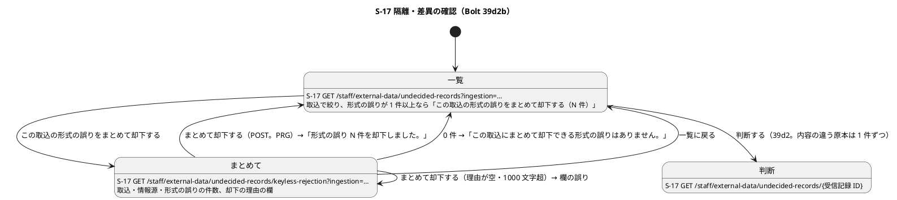
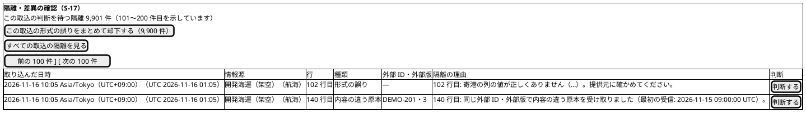
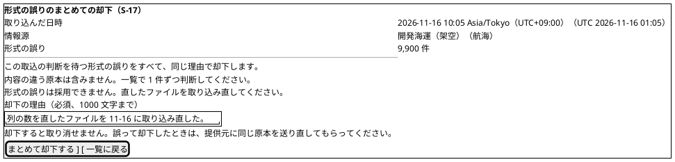
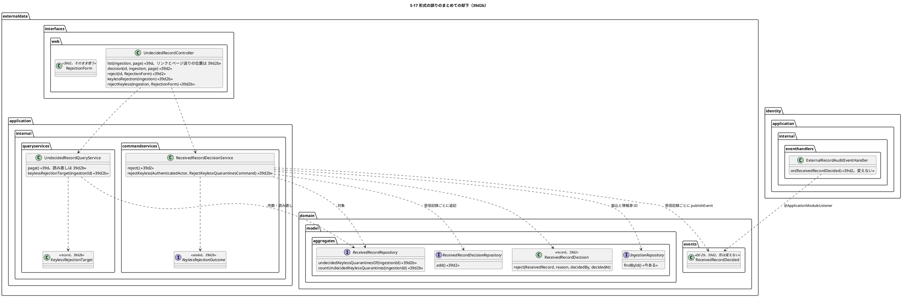
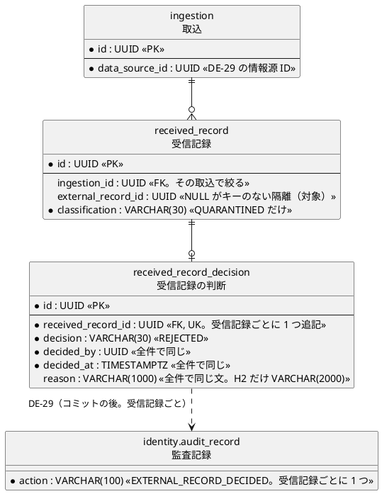

# Bolt 39d2b 計画 - S-17 で 1 つの取込の形式の誤りをまとめて却下する（件数が減ったときの示し方・ページ送り）

## 基本情報

| 項目 | 内容 |
| :--- | :--- |
| Bolt | 第 39d2b 回（W7 の 17 本目。release_plan :965 の 39d2b の行。Bolt 39d2 の開始準備で 39d2 から縦に分けた） |
| 状態 | 初稿（承認待ち。2 つの整合性検証の指摘を反映した） |
| 予定 | W7（2026-11-16 の週。前倒しで着手できる）。作業は約 4 時間 15 分（上限いっぱい（1 万件）の計測をこの Bolt に残し、39d の行 7 を契約のテストに上げる分を 39d4 に送った後。送らなければ約 4 時間 25 分。下の「時間の配分と打ち切り」。`check`・`uiTest`・`manualScreenshots`・`demoVideo`・`performanceTest`（CI の手動のジョブ）・SonarQube・CI とステップごとの承認の待ちを除く） |
| アプローチ | アウトサイドイン（S-17 のまとめての却下から。画面の層の受入シナリオ（`@ui`）の Red から入る。release_plan :965 の 39d2b の行のとおり。1 件ずつの却下のサービス・判断のポート・DE-29・監査は 39d2 で固まっていて（ReceivedRecordDecisionService.java :69-102、MyBatisReceivedRecordDecisionRepository.java :28-42、ExternalRecordAuditEventHandler の `on(ReceivedRecordDecided)`）、まとめての却下の画面と振る舞いが受入条件の中心） |
| 対象 | (1) 1 つの取込の判断を待つキーのない隔離のまとめての却下（【業務の判断】(g)。台帳 D-96）: 取込で絞った一覧の「この取込の形式の誤りをまとめて却下する（N 件）」、まとめての却下の画面 `GET /staff/external-data/undecided-records/keyless-rejection?ingestion={取込 ID}` と `POST` 同じ URL（PRG で取込で絞った一覧に戻る。CSRF。理由は 1 つで必須、1000 文字まで）、受信記録ごとに判断・DE-29・監査を 1 つずつ（今ある 1 件の判断の型とイベントと listener を使う。DE-29 の形は変えない）、(2) 件数と 1 ページの照会の間に件数が減ったときの示し方（39d の申し送り。39d2 の開始準備の決定 (8) の形）、(3) 上限いっぱい（1 万件）のまとめての却下の時間と、そのトランザクションの間の一覧の照会の時間の計測（PostgreSQL。CI の手動のジョブ `performance`。下の開始準備の決定 (1)）、(4) S-17 のページ送りが 100 個の「判断する」の後にあるキーボードの負担（39d2 の開発レビューの低）、(5) マニュアル 12.2 に「形式の誤りをまとめて却下する」とキャプチャ、(6) デモの動画（`@demo-bolt-39d2b/reject-keyless`）。39d の行 7 を契約のテストに上げる分は 39d4 に送る（下の開始準備の決定 (1)・(6)。【前の決定の変更】(1)） |
| トレース | US-14 AC4（隔離しデータ責任者へ示す）と user_story の US-14 の「Bolt 39d2b の決定」の注（ステップ 1 で足す）、UC-15 の主成功シナリオ 5（データ責任者が差異と採否を確認する）・2a（形式を検証できない原本を隔離しデータ責任者へ通知する）・3b、PERF-06（non_functional :62）、ED-INV-02、AUD-01・IA-INV-15（domain_model :1452。（操作、受信記録）ごとに 1 つ）、ui_design の S-17（:142・:193-195・:1932 の節）、domain_model の受信記録の判断（:1522）、台帳 D-96（release_plan :1073）、ACC-01（WCAG 2.2 AA） |
| GitHub | [#18](https://github.com/k2works/practical-domain-driven-design-in-enterpris-application/issues/18)（US-14。クローズは 39h） |
| SP | 0 |
| 承認ゲート | **ステップごとに止める**（release_plan :965 の「ステップごと（画面）」）。画面（まとめての却下の画面と POST、一覧のリンクとページ送りの位置）、新しいファイル（下の一覧）。スキーマは変えない（判断の表と受信記録の表をそのまま使う）。監査は新しい操作を足さず、書き手も規則の行も変えない（DE-29 と `EXTERNAL_RECORD_DECIDED` をそのまま使う）。認可は変えない（決定 (4)）。注: 人の指示「Recommend 承認で進めて」により、各ステップの終わりで止めて推奨の案を承認として記録する（人が個別に見ていないことが分かるように「推奨のとおり（Recommend 承認の指示による）」と書く）。ステップを飛ばしたり束ねたりはしない |
| 開始準備で決めたこと | 下の (1)〜(10)（初稿。推奨を 1 つに決めて書いた。承認待ち）。【業務の判断】(g) を実装し、台帳に D-96 として足した（release_plan :1073）。【業務の判断】(h) を新しく記録し、D-96 の決定の欄に 1 文足した |

### 開始準備の決定

(1) **範囲と見積り**: release_plan :965 の 39d2b の行（まとめての却下、理由は 1 つ、受信記録ごとに判断・DE-29・監査、上限いっぱい（1 万件）の時間の計測、件数が減ったときの示し方、マニュアルとキャプチャ、デモの動画、39d の行 7 を契約のテストに、ページ送りのキーボードの負担）を引き直すと約 4 時間 25 分で、目安（2〜4 時間。CLAUDE.md の「目安 2〜4 時間。半日を超える Bolt は分割する」）を 25 分超える。39d2 の開始準備の決定 (1) の見積り（約 2 時間 45 分。計画の承認で行 7 の 20 分を足して約 3 時間 05 分）より増えるのは、(a) 一覧のボタンから直に却下せず、件数と取込を示すまとめての却下の画面を挟む（決定 (3)。【前の決定の変更】(3)。+20 分）、(b) ページ送りの直し（決定 (7)。39d2 の開発レビューで足した。+10 分）、(c) 状態の組み合わせの表の行が 23 あり、Red・品質ゲート・受入シナリオの例が 39d2 と同じ水準になる（+45 分）、(d) 上限いっぱいの計測にトランザクションの間の一覧の照会を足す（下。計測は 39d2 の見積りの 20 分から 25 分。+5 分）、(e) 設計の文書とマニュアルを 39d2 の前例（ステップ 1 が 20 分、マニュアルが 25 分。bolt_39d2_plan.md の「時間の配分と打ち切り」）に合わせた（+10 分）ため。行 7 は 39d2 の契約の行 5 がほぼ同じことを確かめているので 20 分から 10 分に減る（決定 (6)。−10 分）。

**上限いっぱい（1 万件）のまとめての却下の時間の計測はこの Bolt に残す**（初稿の【前の決定の変更】(1)（計測を 39d4 に送る）を整合性検証の指摘で取り下げた。推奨のとおり。Recommend 承認の指示による）。初稿は取込の 1 万件の時間（Linux の CI で 17.0〜24.3 秒。[Bolt 39b4 終了報告](bolt_39b4_report.md) :50）から危うさは小さいと見積もったが、前提が違った。まとめての却下は受信記録ごとに判断のリポジトリの `add`（MyBatisReceivedRecordDecisionRepository.java :28-30 の `@Transactional(propagation = Propagation.NESTED)`）を呼ぶので、1 つのトランザクションの中でセーブポイントを 1 万回作る。取込は外側の 1 つのトランザクション（IngestionService.java :113 の `@Transactional`）で受信記録を書き、行ごとのセーブポイントを作らないので、取込の時間からは見積もれない（PostgreSQL ではサブトランザクションが 1 つのトランザクションで 64 を超えるとキャッシュから溢れ、ほかの接続の可視性の判定も遅くなりうる）。新しいコードに固有の危うさなので、作った Bolt で測る。

- 測るもの: PostgreSQL（CI の手動のジョブ `performance`。`ExternalDataIngestionPerformanceTest` の前例）で、キーのない隔離 1 万件の取込を準備し、(i) まとめての却下の時間（`rejectKeyless` の呼び出しからコミットまで）、(ii) そのトランザクションの間の一覧の照会（`UndecidedRecordQueryService.page`。別の接続）の時間を測る。監査の配信 1 万件の完了までは参考の値。ログの行は「PERF-06 keyless-rejection」で始める（前例の「PERF-06 voyage」「PERF-06 web」「PERF-06 notes」の行。ExternalDataIngestionPerformanceTest.java :203・:252）。DE-29 の 1 万件が H2 の発行記録の列に入ることは `H2EventPublicationCapacityTest` の前例で確かめる
- 止める条件: (i) が 5 分（PERF-06 の上限。non_functional :62）を超える、または (ii) が 1 秒を超える。そのときは値を記録して止め、分け方（取込の中を区切って複数のトランザクションにする、または判断を一括の追記にしてセーブポイントを使わない）を諮る（T-241 の書き方。区切って測る）
- 計測の後で、CI の性能のジョブの本数の注（.github/workflows/cargo-tracker-ci.yml :167-168。今 5 本）を 6 本に直す

送る候補は 3 つを比べ、**39d の行 7 を契約のテストに上げる分（約 10 分）を 39d4 に送る**（【前の決定の変更】(1)。39d2b は約 4 時間 15 分）を推奨する。テストの付け替えだけで、画面の振る舞いもマニュアルも変えず、39d2 の契約の行 5（ExternalDataRecordRepositoriesContract.java :641-663）が取込で絞った分をすでに確かめているので、寝かせても抜ける確かめは絞らない一覧と件数の分だけになる。比べた案: (i) ページ送りの直し（10 分）を 39h（差異の行を同じ一覧に足す）に送る（キーボードの負担は今のデモ環境の 1 万件の取込で起きていて、撮り直すキャプチャもこの Bolt で一度に済む）、(ii) 何も送らない（約 4 時間 25 分。目安を 25 分超える）。

送った後も目安を 15 分超える。39d2 は 25 分の超過を「半日の中に収まるので分けない」として受け入れ、計画の承認で 5 分の超過を見積りの誤差の範囲として受け入れた（bolt_39d2_plan.md :18・:398）。39d2b の残る 15 分の超過は半日の中に収まり、2 つ目を送ると (i) の理由でキーボードの負担とキャプチャの撮り直しが別の Bolt に残るので、これ以上は分けずに受け入れることを推奨する（下の「確認ポイント」1）。

順序は 39d2 → 39d2b → 39d3 → 39d4（release_plan :975 のまま）。39d2b は 39d2 の判断のサービスとイベントと listener を使い、39d3 の採用と縦が違う。39d4 の見積りは行 7 の約 10 分が増え、39d4 の開始準備で引き直す。

(2) **対象は 1 つの取込の、判断を待つキーのない隔離だけ**（【業務の判断】(g)。台帳 D-96）: 「取込で書いた受信記録で、取込 ID がその取込、分類が隔離、外部原本を持たない（`external_record_id` が NULL）、判断がない」受信記録。形式の誤り・ファイルの誤り・取り込めなかった部分のどれも外部原本を持たない（ReceivedRecord.java :52-57。外部原本を持たないのは隔離だけ）。内容の違う原本（外部原本を持つ隔離）・採用・重複・ほかの取込の受信記録・判断済みは対象に入れない。判断できる受信記録の定め（39d2 の開始準備の決定 (3)。ReceivedRecordDecision.java :48-50 の `decidable`）の中の部分集合で、1 件ずつの判断の規則は変えない。読むのは受信記録のポートに足す 2 つ（`externaldata.domain.model.aggregates.ReceivedRecordRepository`）:

- `undecidedKeylessQuarantinesOf(UUID ingestionId)`: 上の受信記録を行の範囲の始まりの順（範囲のないファイルの誤りを先、同じなら受信記録 ID の順。今の `quarantinedOf` の並び。ReceivedRecordMapper.xml :40-47）に、件数の上限なしで `List<ReceivedRecord>` で返す（1 つの取込のキーのない隔離はデータ行の上限 10,000 件（IngestionFileLimit.java :13）と取り込めなかった部分・ファイルの誤りの数件で、1 万と少しに収まる）
- `countUndecidedKeylessQuarantines(UUID ingestionId)`: 同じ定めの件数

SQL は判断を待つ隔離の断片（ReceivedRecordMapper.xml :66-75 の `undecidedQuarantineSource`）に `AND r.external_record_id IS NULL` を足し、取込 ID を必須にする（断片の `<if>` は通る）。メモリの実装（`InMemoryReceivedRecordRepository`）も同じ定めで、判断のリポジトリを見る。新しい索引は足さない（`ix_received_record_ingestion` で取込の受信記録に絞れる。39d の一覧と同じ）。

(3) **画面: 一覧のリンクとまとめての却下の画面**（【前の決定の変更】(3)）: 取込で絞った一覧（`?ingestion=…`）で、その取込に判断を待つキーのない隔離が 1 件以上あるときだけ、件数の文の後に「この取込の形式の誤りをまとめて却下する（N 件）」（N は 3 桁の区切り）のリンクを出す。絞らない一覧・取込が見つからない一覧・キーのない隔離が 0 件の取込（内容の違う原本だけ）には出さない（押しても行き先のない操作を出さない）。リンクの先は **まとめての却下の画面** `GET /staff/external-data/undecided-records/keyless-rejection?ingestion={取込 ID}`（見出し「形式の誤りのまとめての却下」）で、取り込んだ日時・情報源・「形式の誤り N 件」・「内容の違う原本は含みません。一覧で 1 件ずつ判断してください。」・「形式の誤りは採用できません。直したファイルを取り込み直してください。」（判断の画面と同じ文。decision.html :41）・却下の理由の欄（判断の画面と同じ `textarea`。必須、1000 文字まで、`aria-required`・`aria-describedby`。欄の説明「必須、N 文字まで」の N は controller が渡す `reasonLimit`（`ReceivedRecordDecision.REASON_LIMIT`。UndecidedRecordController.java :203）から示し、欄の誤りの文と食い違わせない。エラー要約は判断の画面と同じ部品（`#error-summary`・`role="alert"`・`transport-request-form.js` でフォーカスを移す。decision.html :9・:18-26）。decision.html :44-49）・「却下すると取り消せません。誤って却下したときは、提供元に同じ原本を送り直してもらってください。」（判断の画面と同じ文。decision.html :51。キーのない隔離は冪等性キーを持たず重複に分類されないので、同じファイルを取り込み直すと再び判断を待つ隔離になる。IngestionService.java :258-271 はキーのない行を外部原本の照合なしに隔離する）・「まとめて却下する」・「一覧に戻る」を示す。「まとめて却下する」は `POST /staff/external-data/undecided-records/keyless-rejection?ingestion={取込 ID}` で、却下したら PRG で取込で絞った一覧の 1 ページ目に戻り「形式の誤り N 件を却下しました。」（N は実際に却下した件数、3 桁の区切り）を示す。

- GET の時点で 0 件（ほかの人がまとめて却下した、全部を 1 件ずつ却下した）と、POST の時点で 0 件（二重送信を含む）は、判断を作らず取込で絞った一覧に戻って「この取込にまとめて却下できる形式の誤りはありません。」を示す
- 取込の指定がない・UUID でない・ない取込は 404（判断の画面の前例。一覧の「指定された取込が見つかりません。」は絞らない一覧を示せるから文にしているが、まとめての却下の画面は取込がないと示すものがない）
- 理由が空・空白だけ・1000 文字（コードポイント）を超えるときは、まとめての却下の画面に戻って判断の画面と同じ欄の誤り（UndecidedRecordController.java :69-71 の 2 つの文）とエラー要約を示す。画面に戻す前に対象を読み直し（`keylessRejectionTarget`）、0 件なら取込で絞った一覧に戻って「この取込にまとめて却下できる形式の誤りはありません。」を、取込がなければ 404 を返す（GET と同じ行き先の決め方。行 23）
- `keyless-rejection` は判断の画面のパス `/{receivedRecordId}`（UndecidedRecordController.java :132）と重なるが、Spring MVC はパスの変数より文字の一致を先に選ぶので、判断の画面に入らない（controller のテストの行 10 で確かめる）
- 項目は `UndecidedRecordController` に足し（GET と POST。同じ URL の下）、新しい controller を作らない。フォームは判断の画面の `RejectionForm`（RejectionForm.java。理由だけを持つ）をそのまま使う

代わりの案は取らない: (i) 一覧のボタンから直に POST する（理由の欄を一覧に置くことになり、件数と情報源を確かめずに 1 万件を取り消せずに却下しうる。39d2 で一覧の各行に理由の欄を置かなかった理由と同じ）、(ii) まとめての却下の画面に対象の行を並べる（1 万行になる。対象の行は一覧で読める）。

(4) **却下のサービス・CSRF・認可（今の規則の中）**: `ReceivedRecordDecisionService` に `rejectKeyless(AuthenticatedActor, RejectKeylessQuarantinesCommand)` を足す（新しいサービスを作らない。組み立ては ExternalDataConfiguration の今の `@Bean` のまま）。1 つのトランザクションで、役割の確かめ（データ責任者でなければ `NotPermitted`。前例 ReceivedRecordDecisionService.java :71-73）、取込を読む（`IngestionRepository.findById`。なければ `NotFound`。情報源 ID もここから得る）、対象を読む（`undecidedKeylessQuarantinesOf`。0 件なら `NothingToReject`）、判断の時刻を Clock から 1 回取り、受信記録ごとに `ReceivedRecordDecision.reject`（ReceivedRecordDecision.java :57-71。理由の規則と隔離だけの規則はそのまま）で判断を作って追記し DE-29 を出す。読んだ後に 1 件ずつ却下された受信記録の一意制約の違反（`DuplicateReceivedRecordDecisionException`。判断のリポジトリがセーブポイントに戻す。MyBatisReceivedRecordDecisionRepository.java :28-42。受信記録ごとにセーブポイントを作るので、1 万件では 1 つのトランザクションで 1 万回になる。その時間は決定 (1) の計測で確かめる）は、とばして数えない（1 件ずつの却下の `AlreadyDecided` と同じ扱い。ReceivedRecordDecisionService.java :85-89）。ほかの例外は握りつぶさず上げ、トランザクションごと巻き戻す（判断も DE-29 も残らない）。全部がとばされたら `NothingToReject`。結果は sealed の `KeylessRejectionOutcome`（`RejectedAll(int count)`・`NotPermitted`・`NotFound`・`NothingToReject`。前例 DecisionOutcome。入れ子の `Rejected` は `DecisionOutcome.Rejected`（DecisionOutcome.java :17）と同じ単純名になるので `RejectedAll` にする。`NotPermitted`・`NotFound` を外側の型ごとに持つのは前例どおり（IngestionOutcome.java :110、DecisionOutcome.java :25・:28））。コマンド `RejectKeylessQuarantinesCommand`（取込 ID と理由。`application.internal.commands`）に `@Command` を付ける（DddAnnotationArchitectureTest の規則）。CSRF は Spring Security の既定の同期トークン（SecurityConfiguration.java の Javadoc :73。CSRF を無効にする設定はない）で、フォームは `th:action` が隠し項目を足す。認可は `/staff/external-data/**` のデータ責任者（SecurityConfiguration.java :224-225）の中で、サービスでも役割を確かめる。どちらも今の規則の中なので、新しいセキュリティの判断はない

(5) **イベントと監査は変えない**: 却下した受信記録ごとに今の DE-29 `ReceivedRecordDecided`（ReceivedRecordDecisionService.java :92-100 と同じ値。判断は `REJECTED`、理由は全件で同じ文、判断の時刻は全件で同じ）を 1 つ出し、identity の `ExternalRecordAuditEventHandler` が受信記録ごとに `EXTERNAL_RECORD_DECIDED` を 1 つ書く（IA-INV-15 の（操作、受信記録）ごとに 1 つ。domain_model :1452 にすでに「まとめての却下（39d2b）も受信記録ごとに判断・DE-29・監査を 1 つずつ」と書いてある）。まとめての却下を示す印は DE-29 にも監査記録にも足さない（DE-29 の v1 の直列化の契約を変えない。まとめたかどうかは同じ判断の時刻・判断者・理由で読める。監査を読む画面は AUD-UI-01（W8））。listener と規則の行（LayerArchitectureTest の「書き手は 1 か所」）は変えない。配信は `ExternalRecordAuditDeliveryIntegrationTest` に 1 本足す（T-184。まとめて 3 件を却下して監査記録が 3 つ）。1 万件の DE-29 の発行記録の大きさは取込の 1 万件の DE-14 と同じ量で、H2 の発行記録の列は Bolt 39b3b で広げてある（db/migration/h2/V20261104103700）

(6) **行 7 を契約のテストに上げる分は 39d4 に送る**（39d の申し送り。39d2 の開始準備の決定 (7)・行 16。決定 (1)。【前の決定の変更】(1)）: 39d2 の契約のテストの行 5（ExternalDataRecordRepositoriesContract.java :641-663。判断のポートで判断を追記すると、取込で絞った一覧と件数から消える。メモリ・H2・PostgreSQL）が、39d の行 7 の取込で絞った分をすでに確かめている。残る差は **絞らない一覧と件数からも消えること**（39d の行 7 の本体の最後の 2 つの確かめ。MyBatisExternalDataRecordRepositoriesIntegrationTest.java :207-210 の、絞らない件数が判断を待つ 1 件だけ増えることと、絞らない一覧の先頭が判断していない隔離であること）だけで、それは JDBC の行 7 が今も確かめている（抜ける確かめはない。付け替えが残るだけ）。39d4 では、契約のテストに `Bolt39d4_…_判断のポートで判断を追記した隔離は絞らない一覧と件数からも消える` を足し、JDBC で判断の行を入れていた 39d の行 7（MyBatisExternalDataRecordRepositoriesIntegrationTest.java :152-163 と本体 :165-211、その本体だけが使う `keylessQuarantine`（:213 以降）、H2ExternalDataRecordRepositoriesTest.java :210-218）を消す。MyBatis の 1 次キャッシュを避けるために件数を先に数えていた書き方（MyBatisExternalDataRecordRepositoriesIntegrationTest.java :184-185 の注）は、判断のポートの追記が同じ session の更新としてキャッシュを捨てるので要らなくなる見込みで、移すときに「追記の前と後に絞らない件数を数え、差が 1」で確かめる（キャッシュが残って落ちるなら、理由を書いて今の順に戻す）。この書き方を 39d4 の行に足す文に入れる（下の「設計文書に直す箇所」の release_plan）

(7) **ページ送りを表の前に移す**（39d2 の開発レビューの低。【前の決定の変更】(2)）: 今のページ送り（index.html :50-55 の `nav`）は表（:21-49）の後にあり、1 ページ 100 個の「判断する」を Tab で越えないと届かない（39d2 で UI のステップを Shift+Tab で画面の終わりから戻る書き方に直した。UndecidedRecordUiSteps.java :144-160）。**ページ送りの `nav` を件数の文・まとめての却下のリンク・「すべての取込の隔離を見る」の後、表の前に移す**（1 つのまま。読み上げの名前「判断を待つ隔離のページ」も変えない。今の「すべての取込の隔離を見る」は件数の文の直後、表の前にある。index.html :18-21）を推奨する。件数の文「N 件（M〜L 件目を示しています）」の直後に前後のページがあると、どこを見ているかと移り方が並んで読める。比べた案: (i) 表の前と後の両方に置く（同じ名前の `nav` が 2 つになり、axe の landmark-unique に当たる。名前を分けると読み上げの一覧に似たものが 2 つ並ぶ）、(ii) 表の前に「ページ送りへ移る」のリンクを置く（リンクが 1 つ増えるだけで、移った先はやはり表の後）、(iii) 1 ページの件数を減らす（39d の開始準備の決定 (3) の 100 件（S-16 の 100 件にそろえた）を変え、1 万件の取込が 100 ページより増える）。UI のステップは Tab で先頭から進める書き方に戻し、Shift+Tab の上限の定数（:28-29）を消す。ui_design の画面イメージ（:1951）とマニュアル 12.2 の画面の説明（12-外部データ.md :208-214 の表。まとめての却下のリンクの行を足し、ページ送りを含めて番号を画面の上からの順に振り直す）・操作手順（:216-223）・「この画面でできること」（:191-195）を直す。キャプチャ `12-undecided-records.png` は、今のシナリオ（形式の誤り 1 件と内容の違う原本 1 件の 2 件。manual_screenshots.feature :246-252）ではページ送りは写らない（12-外部データ.md :214）が、取込で絞った一覧なので「この取込の形式の誤りをまとめて却下する（1 件）」のリンクが写るので撮り直す

(8) **件数と 1 ページの照会の間に件数が減ったとき**（39d の申し送り。39d2 の開始準備の決定 (8) の形のまま）: 照会のサービス（UndecidedRecordQueryService.java :48-71）は件数を数えてから（:53）ページを読む（:59-60）。読んだページが空で件数が 0 より大きいとき（最後のページの隔離がその間にすべて判断された。まとめての却下で起きやすくなる）は、件数を数え直して最後のページに寄せ、1 回だけ読み直す。数え直して 0 件、または読み直しても空なら 0 件の文を示す（ページの記録の件数を 0 にする）。示す範囲（M〜L 件目）は読んだ件数から作る（UndecidedRecordPage.java :28-35。今のまま）。まとめての却下のリンクの件数（決定 (3)）はページと別に数え、ずれても却下はその時点の対象を読み直すので害がない（決定 (4)）。代わりの案は 39d2 の決定 (8) で退けたまま（REPEATABLE READ、「一覧が変わりました」の文）

(9) **却下の理由と取り消し**（【業務の判断】(d)・(e)。39d2 の開始準備の決定 (10)・(11)）: 1 件ずつの却下と同じ（必須、前後の空白を除いて 1〜1000 文字（コードポイント）、取り消さない）。まとめての却下では 1 つの理由を全件に付ける（【業務の判断】(g)）。誤ってまとめて却下したときは、同じファイルを取り込み直せば形式の誤りが再び判断を待つ隔離になる（決定 (3) のコードの事実）。マニュアルにはこの Bolt でも判断の画面と同じ文（提供元に同じ原本を送り直してもらう）を書き、「同じファイルを取り込み直すと再び判断を待つ隔離になる」の受入シナリオは、送り直しの扱いを確かめる 39d4 に送る（39d2 の終了報告の議題 2 と同じ Bolt で確かめる）

(10) **新しい型の名前**（T-246。`apps/cargo-tracker/src` で `Bulk`・`KeylessRejection`・`RejectKeyless`・`rejectKeyless`・`undecidedKeylessQuarantinesOf`・`countUndecidedKeylessQuarantines`・`RejectedAll` を検索して、ないことを確かめた。`KeylessQuarantine` はテストの private のメソッド名（`assertKeylessQuarantine`・`onlyKeylessQuarantine`）と取込のサービスの private の `addKeylessQuarantine` だけで、型にはない）: 本体 `RejectKeylessQuarantinesCommand`（`application.internal.commands`）、`KeylessRejectionOutcome`（`application.internal.commandservices`。入れ子に `RejectedAll`・`NotPermitted`・`NotFound`・`NothingToReject`）、`KeylessRejectionTarget`（`application.internal.queryservices`。まとめての却下の画面の中身: 取込 ID・取り込んだ日時・提供元・原本種別・件数。前例 UndecidedRecordPage）、テンプレート `templates/externaldata/undecided-records/keyless-rejection.html`。フォームは `RejectionForm` を使い、新しいフォームを作らない

【前の決定の変更】(1): release_plan :965 の 39d2b の行の「39d の行 7 を契約のテストに上げる」（39d2 の計画の承認で 39d2 から 39d2b に送った）を 39d4 に送る（39d4 の行に「39d の行 7 を契約のテストに上げる（39d2b から送った）」を足す。ステップ 1）（決定 (1)・(6)）。初稿の【前の決定の変更】(1)（上限いっぱい（1 万件）の時間の計測を 39d4 に送る）は、整合性検証の指摘（取込の時間から見積もった前提が違う）で取り下げ、計測はこの Bolt に残す（推奨のとおり。Recommend 承認の指示による）。

【前の決定の変更】(2): Bolt 39d の開始準備の決定 (3) の S-17 の一覧の画面の、ページ送りを表の後に置く配置（ui_design :1951 の画面イメージ）を、表の前（件数の文・まとめての却下のリンク・「すべての取込の隔離を見る」の後）に移す。39d2 で Shift+Tab に直した UI のステップを Tab に戻す（決定 (7)）。

【前の決定の変更】(3): release_plan :965 と ui_design :193 の「一覧を取込で絞ったときの『この取込の形式の誤りをまとめて却下する』」を、一覧のリンクからまとめての却下の画面を挟む形にする（一覧 → まとめての却下の画面 → 一覧。39d2 の【前の決定の変更】(2) の判断の画面と同じ考え方）（決定 (3)）。

新しいファイル（39d2b）: 本体は決定 (10) の 3 個（.java）とテンプレート `keyless-rejection.html`。テスト: 受入シナリオ `features/ui/reject_keyless_quarantines_ui.feature` と Steps `RejectKeylessQuarantinesUiSteps.java`（新しいテストのクラスはこれだけ。ほかは既存のテストのクラスに `@Nested class Bolt39d2b_…` で足す）。キャプチャ `docs/manual/assets/12-undecided-records-keyless-rejection.png`（`manualScreenshots` が作る）、デモの動画 `docs/assets/demo/bolt-39d2b/reject-keyless.webm`（`demoVideo` が作る）。直すもの: `ReceivedRecordRepository`・`MyBatisReceivedRecordRepository`・`ReceivedRecordMapper`（.java・.xml）・`InMemoryReceivedRecordRepository`（決定 (2)）、`ReceivedRecordDecisionService`（決定 (4)）、`UndecidedRecordQueryService`（まとめての却下の画面の中身、一覧のキーのない隔離の件数、件数が減ったときの読み直し）・`UndecidedRecordPage`（キーのない隔離の件数）、`UndecidedRecordController` とテンプレート `index.html`（リンク・知らせ・ページ送りの位置）、テスト `ExternalDataRecordRepositoriesContract`（行 5）、`ReceivedRecordDecisionServiceTest`・`UndecidedRecordQueryServiceTest`・`UndecidedRecordControllerTest`・`ExternalDataIngestionSecurityIntegrationTest`・`ExternalRecordAuditDeliveryIntegrationTest`、`ExternalDataIngestionPerformanceTest`（行 21。上限いっぱいの計測）、`UndecidedRecordUiSteps`（Tab に戻す）、`manual_screenshots.feature`、CI の定義 `.github/workflows/cargo-tracker-ci.yml`（性能のジョブの本数の注。:167-168）、マニュアル 12 章・付録 B（「この取込にまとめて却下できる形式の誤りはありません。」の 1 行）。マニュアルは新しいファイルを作らない（12.2 に節を足す）。

## Bolt ゴール

データ責任者が S-17 の一覧を取込で絞ると、その取込に形式の誤りがあれば「この取込の形式の誤りをまとめて却下する（N 件）」が出る。開くと、まとめての却下の画面で取込・情報源・件数を確かめ、理由を 1 つ書いて「まとめて却下する」と、その取込の判断を待つ形式の誤りがすべて、同じ判断者・時刻・理由で 1 件ずつ却下として記録され、取込で絞った一覧に戻って「形式の誤り N 件を却下しました。」が出る。内容の違う原本は一覧に残り、1 件ずつ判断する。却下した受信記録ごとに DE-29 が出て、監査記録 `EXTERNAL_RECORD_DECIDED` が 1 つずつ残る。理由が空・1000 文字を超えると欄の誤りを示す。ほかの人が先に却下していれば、残っている分だけを却下し、残っていなければ「この取込にまとめて却下できる形式の誤りはありません。」を示す。最後のページの隔離が読み込みの間に判断されても「0〜0 件目」を出さず、最後のページか 0 件の文を示す。ページ送りは表の前にあり、キーボードで 100 個の「判断する」を越えずに届く。マニュアル 12.2 にまとめての却下の手順があり、キャプチャとデモの動画がある。上限いっぱい（1 万件）のまとめての却下が PostgreSQL で 5 分以内に終わり、その間も一覧の照会が 1 秒以内で返ることを測って記録してある。

### 開始準備で確かめたこと

- **release_plan の 39d2b の行**（:965）: 「1 つの取込のキーのない隔離をまとめて却下する縦（【業務の判断】(g)）: 一覧を取込で絞ったときの『この取込の形式の誤りをまとめて却下する』、理由は 1 つ、受信記録ごとに判断・DE-29・監査を 1 つずつ、上限いっぱい（1 万件）の時間の計測、件数と 1 ページの照会の間に件数が減ったときの示し方、マニュアルとキャプチャ、デモの動画、39d の行 7 を契約のテストに上げる、S-17 のページ送りが 100 個の『判断する』の後にあるキーボードの負担」、アプローチはアウトサイドイン（S-17 のまとめての却下から）、承認ゲートは「ステップごと（画面）」
- **前の Bolt の申し送り**: Bolt 39d2（[計画](bolt_39d2_plan.md) の開始準備の決定 (1)・(7)・(8)・(9) と行 15・16、[終了報告](bolt_39d2_report.md) :19・:20・:71・:77・:98-99・:103）、Bolt 39d（[終了報告](bolt_39d_report.md) の開発レビューの行 7 の件数を先に数える書き方と件数が減ったときの「N 件（0〜0 件目）」）
- **1 件ずつの却下の今の形**: サービスは役割 → `findById` → 隔離か → `existsFor` → 追記（一意制約の違反は `AlreadyDecided`）→ 取込を読んで DE-29（ReceivedRecordDecisionService.java :69-102）。判断のリポジトリの追記はセーブポイント（`NESTED`）の中（MyBatisReceivedRecordDecisionRepository.java :28-42）。判断の不変条件は理由の必須と 1000 文字（ReceivedRecordDecision.java :31・:57-71）。判断の画面の行き先は `refusalOf`（ReceivedRecordDecisionService.java :55-61）
- **キーのない隔離**: 外部原本 ID と取得時刻が NULL の受信記録は隔離だけ（ReceivedRecord.java :52-57）。照会では外部原本を持たない隔離を「形式の誤り」と示す（UndecidedQuarantine.java :44-46、UndecidedRecordController.java :56・:234）。取込はキーのない行を外部原本の照合なしに隔離し DE-14 を出す（IngestionService.java :258-271）ので、同じファイルを取り込み直すと重複にならず再び隔離になる
- **一覧の今の形**: 判断を待つ隔離の断片（ReceivedRecordMapper.xml :66-75）、件数（:87-90）、ページ（:79-85）。照会のサービスは件数を数えてからページを読む（UndecidedRecordQueryService.java :53・:59-60）。ページ送りは表の後（index.html :50-55）。UI のステップは Shift+Tab で画面の終わりから戻る（UndecidedRecordUiSteps.java :144-160）
- **行 7**: JDBC で判断の行を入れる 39d の行 7（MyBatisExternalDataRecordRepositoriesIntegrationTest.java :152-163 と本体 :165-211、H2ExternalDataRecordRepositoriesTest.java :210-218）。39d2 の契約の行 5（ExternalDataRecordRepositoriesContract.java :641-663）が判断のポートで取込で絞った一覧と件数から消えることを確かめている
- **認可と CSRF**: `/staff/external-data/**` はデータ責任者だけ（SecurityConfiguration.java :224-225）、CSRF は既定の同期トークン（同 Javadoc :73。CSRF を無効にする設定はない）
- **計測**: PERF-06 は 1 万件のファイルを 5 分以内（non_functional :62）。取込の 1 万件は Linux の CI で 17.0〜24.3 秒（[Bolt 39b4 終了報告](bolt_39b4_report.md) :50）だが、取込は外側の 1 つのトランザクション（IngestionService.java :113）で行ごとのセーブポイントを作らず、まとめての却下は受信記録ごとにセーブポイントを作る（MyBatisReceivedRecordDecisionRepository.java :28-30）ので、取込の時間からは見積もれない（決定 (1)）。CI の性能のジョブは今 5 本（.github/workflows/cargo-tracker-ci.yml :167-168）。判断を待つ隔離の一覧の上限いっぱいの計測は 39d4（non_functional :57）
- **マニュアル**: 12.2 の「この画面でできること」（docs/manual/12-外部データ.md :191-195）、画面の説明の表（:208-214。⑤ がページ送り）、操作手順（:216-223）、「隔離を却下する」（:253-296）と「注意・補足」（:297）。キャプチャ `12-undecided-records.png` は形式の誤り 1 件と内容の違う原本 1 件の取込で絞った一覧（manual_screenshots.feature :246-252）
- **台帳**: D-95（判断の取り消しを作らない。release_plan :1072）の後に D-96（【業務の判断】(g)）を仮の決定として足した（:1073）

## 設計の決定

| 項目 | 決定 | 根拠 |
| :--- | :--- | :--- |
| 範囲と分け方 | 開始準備の決定 (1)。上限いっぱい（1 万件）の計測はこの Bolt に残し（PostgreSQL。止める条件は 5 分と一覧の照会の 1 秒）、39d の行 7 を契約のテストに上げる分を 39d4 に送り約 4 時間 15 分（【前の決定の変更】(1)） | 下の「時間の配分と打ち切り」、MyBatisReceivedRecordDecisionRepository.java :28-30、IngestionService.java :113、bolt_39d2_plan.md :18・:398 |
| 対象 | 決定 (2)。1 つの取込の判断を待つキーのない隔離だけ。受信記録のポートに 2 つの照会。【業務の判断】(g)（D-96） | ReceivedRecord.java :52-57、ReceivedRecordMapper.xml :66-75 |
| 画面 | 決定 (3)。取込で絞った一覧のリンク → まとめての却下の画面 → PRG で一覧（【前の決定の変更】(3)）。0 件は知らせ、取込がないと 404（POST の理由の誤りでも対象を読み直して同じ行き先）。欄の説明は `reasonLimit` から、`aria-required`、エラー要約は判断の画面と同じ部品 | UndecidedRecordController.java :132・:69-71・:203、decision.html :18-26・:41・:44-49・:51 |
| 却下のサービス | 決定 (4)。今のサービスに `rejectKeyless`。1 つのトランザクション、判断の時刻は 1 回、一意制約の違反はとばす、ほかの例外は巻き戻す。sealed の結果。コマンドに `@Command` | ReceivedRecordDecisionService.java :69-102、MyBatisReceivedRecordDecisionRepository.java :28-42 |
| イベントと監査 | 決定 (5)。DE-29 と `EXTERNAL_RECORD_DECIDED` を受信記録ごとに。形と書き手と規則の行は変えない | domain_model :1452 |
| 行 7 | 決定 (6)。39d4 に送る（契約に絞らない件数の行を足し、JDBC の行 7 を消すのは 39d4）（【前の決定の変更】(1)） | ExternalDataRecordRepositoriesContract.java :641-663、MyBatisExternalDataRecordRepositoriesIntegrationTest.java :165-211 |
| ページ送り | 決定 (7)。表の前（件数の文・まとめての却下のリンク・「すべての取込の隔離を見る」の後）に移す（1 つのまま）（【前の決定の変更】(2)） | index.html :18-21・:50-55、UndecidedRecordUiSteps.java :144-160 |
| 件数が減ったとき | 決定 (8)。空のページなら数え直して 1 回読み直す | UndecidedRecordQueryService.java :48-71、UndecidedRecordPage.java :28-35 |
| 理由と取り消し | 決定 (9)。1 件ずつと同じ。【業務の判断】(c)・(d)・(e) | release_plan :1072（D-95） |
| 状態遷移とナビ | 受信記録の判断の状態遷移は 39d2 のまま変えない（domain_model :1522 の節。判断を待つ隔離 → 却下。まとめての却下も受信記録ごとに同じ遷移）ので、この計画では状態遷移図を省く。ナビは変えない（入口は取込で絞った一覧のリンクだけ） | domain_model :1522 |
| 型の名前 | 決定 (10)（T-246 で検索した） | — |

## ふりかえりと前の Bolt からの引き継ぎ

| 出典 | 内容 | この Bolt での扱い |
| :--- | :--- | :--- |
| W6 の Try T-204・T-212、Bolt 38h の T-227、Bolt 39b の T-233、Bolt 39d・39d2 の Problem | サブエージェントへの指示の最初に heredoc と標準入力を待つコマンド（`python -`、引数のない `cat >` など）を使わないと書く | 任せるときの指示の最初に書く（39c4 から 4 本続けて流れた。[39d2 終了報告](bolt_39d2_report.md) :98）。私が計画を直すときもファイルは Write・Edit で書く |
| Bolt 39d の T-247、Bolt 39d2 の Try | 決まりを文章の指示ではなく仕組みで守らせる（heredoc と `python -` を拒むフック。触らないファイルもフックで守る案を含める） | W7 の締めで最初に諮る（39d2 の終了報告のとおり）。39d2b では任せる範囲を、ファイルを Write・Edit で書く作業と読むだけの検索に絞り、Gradle と git を人の側の 1 か所に残す。任せる指示に触らないもの（`.claude/agent-memory`・`.run/`・`apps/cargo-tracker/.claude/`、ほかの作業のテスト）を名前で書く（39d2 でマニュアルの担当が `.claude/agent-memory` に書いた） |
| Bolt 39d の T-248 | `git add` は `git status --short` の出力を使わず、ディレクトリか `git add -u` で指定する | 各ステップのコミットで、本体・テストはパッケージのディレクトリ、文書は `docs/` の下のディレクトリで指定する（日本語のパスのマニュアルは `docs/manual` で指定する） |
| W6 の Try T-217、Bolt 39b2 の Try | 本体を直す前に Red を流し、落ちた理由を記録する。直したテストの一覧を添える | ステップ 2。ページ送りを表の前に移して落ちる既存のテスト（`UndecidedRecordControllerTest` の HTML の順、`review_undecided_records_ui.feature` のページ送りのステップ）、一覧にまとめての却下のリンクが増えて Tab の順や画面の文が変わるもの（判断の画面へ Tab で進む `reject_quarantine_ui.feature` と `RejectQuarantineUiSteps`、一覧を撮る `manual_screenshots.feature`）と、`UndecidedRecordPage` の項目が増えて直すもの（照会と controller のテストの組み立て）を、ステップ 2 の開始で grep して一覧にする |
| W6 の Try T-191 | 環境の前提に設定ファイルの行を添える | CSRF と認可の行（SecurityConfiguration.java の Javadoc :73・:224-225）、CI の性能のジョブの本数の注（.github/workflows/cargo-tracker-ci.yml :167-168）、H2 の発行記録の列（db/migration/h2/V20261104103700）を決定 (4)・(5) に添えた |
| W6 の Try T-225・T-213 | push の前に `check` | ステップ 7（`uiTest` も流す） |
| W6 の Try T-182・T-211・T-216 | 状態の組み合わせの表に重複・隔離と出口・誤った入力の行を置く | 下の表（行 1〜23。行 17 は 39d4 に送る）。対象の外（行 5）、同時の却下（行 8・9）、取込がない（行 10・23）、誤った入力（行 7・23） |
| W6 の Try T-184 | listener は配信まで確かめる | 行 13（`ExternalRecordAuditDeliveryIntegrationTest` に 1 本） |
| W6 の Try T-219 | 変異の対象に単体・統合・契約のテスト | 下の変異の表 |
| W6 の Try T-215・T-222 | Gradle を流す担当を 1 つに、計画の初稿を先にコミット | Gradle は人の側の 1 か所で流す（`uiTest`・`manualScreenshots`・`demoVideo` と CI の手動のジョブ `performance` の起動を含む）。初稿をコミットしてから実装に入る |
| Bolt 39a2 の T-229 | 永続化の Bolt の状態の組み合わせに時刻の出どころと同時の書き込みの行を置く | 時刻: 判断の時刻は Clock から 1 回取り、全件で同じ（行 4）。同時の書き込み: 読んだ後に 1 件ずつ却下された受信記録（行 8）、まとめての却下の二重送信（行 9）、一覧の件数とページの間の判断（行 15） |
| Bolt 39a3 の T-230 | 入ることを確かめる行のデータはドメインの規則に合う組み合わせにする | 形式の誤りと内容の違う原本が混ざる取込は、寄港 2 つ以上・時刻の順の航海の行と列の数の違う行を同じファイルに置き、同じキー・違う値の行を 2 度取り込んで作る。情報源は提供元の名前に自分の UUID を含める |
| Bolt 39b の T-231 | `@Transactional` は契約のクラスに付ける | 行 5 を契約のクラス（`ExternalDataRecordRepositoriesContract`）に置き、トランザクションは契約のクラスの注釈で受ける |
| Bolt 39b の T-232・Bolt 39b2 の T-234・Bolt 39b3 の T-237 | 本体を直したステップは承認の前に `spotbugsMain`・`checkstyleMain`・`sonar-local:check` | ステップ 3〜5 |
| Bolt 39b2b の T-235 | テストの名前の「行 N_」に Bolt の接頭辞を付けるかを W7 の締めで決める | 39d2 の前例のまま。新しいテストのクラスはない（受入シナリオの Steps だけ）。既存のテストのクラスでは `@Nested class Bolt39d2b_…`、契約のテストは名前の頭に `Bolt39d2b_` |
| Bolt 39b2b の T-236 | 「起きないこと」を確かめるテストは呼び出しの記録で確かめる | 0 件・権限なし・ない取込のとき、判断を追記せずイベントを出さない（行 9〜11）、絞らない一覧でキーのない隔離を数えない（行 2）、件数が減らなければ数え直さない（行 15）を、ポートとイベントの発行の呼び出しの記録で確かめる |
| Bolt 39b3 の T-238 | サブエージェントへの指示は計画の決定を言い換えず計画の行を指す | 任せるときは「開始準備の決定」の番号と「状態の組み合わせ」の行番号を指す |
| Bolt 39b3b の T-239 | 人に諮る選択肢・主張の前提はコードで確かめ、出典の行を添える | 開始準備の決定の前提に出典の行を添えた（キーのない隔離の規則、取込がキーのない行を照合しないこと、判断のリポジトリのセーブポイント、取込の外側のトランザクション、判断の画面の文、ページ送りの位置、行 7 と 39d2 の行 5、取込の 1 万件の時間）。整合性検証の指摘で直した出典の行（decision.html、MyBatisReceivedRecordDecisionRepository.java、MyBatisExternalDataRecordRepositoriesIntegrationTest.java、SecurityConfiguration.java、マニュアル 12.2）は直すたびに開いて確かめた。初稿の計測を送る根拠（取込の時間から見積もる）は前提をコードで確かめずに書いていた（決定 (1)） |
| Bolt 39b3b の T-240 | 表から作る規則には、全部の行が規則に入ることを確かめるテストを添える | 対象（行 5）を分類のすべて（`ADOPTED`・`DUPLICATE`・`QUARANTINED`・`DISCREPANCY`）と外部原本の有無のパラメーターのテストで縛る。`KeylessRejectionOutcome` のすべての結果が画面の行き先を持つことを controller のテストで縛る |
| Bolt 39b4 の T-241・T-242 | 性能の目標を外れたら区切って測る。上限いっぱいの入力の行を入れる | 上限いっぱい（1 万件）のまとめての却下をこの Bolt で測る（行 21。決定 (1)）。5 分を超える、またはそのトランザクションの間の一覧の照会が 1 秒を超えたら、値を記録して止め、区切って測って分け方を諮る |
| Bolt 39c の T-243 | 状態の数を 0 件にする受入シナリオは計画の時点で controller のテストに下ろす | まとめての却下で形式の誤りが 0 件になり、リンクが消える（行 22）は UI で作れる（形式の誤り 2 件と内容の違う原本 1 件の取込を作る）。POST の時点で 0 件（行 9）は controller とサービスのテストに下ろす |
| Bolt 39c2 の T-244 | パラメーターのテストは入力と期待する出力の組み合わせまで縛る | 行 6（件数 1・1,000・10,001 と文）、行 7（理由の空・空白だけ・1000・1001 文字と欄の誤りの文） |
| Bolt 39c3 の T-245 | 並びの規則を足すテストは書く順を逆にしたデータを置く | 行 5 の対象の並び（範囲のないファイルの誤りを先、行の範囲の順）を、書く順を逆にしたデータで確かめる |
| Bolt 39c4 の T-246 | 新しい型の名前は同じ単純名がないかを検索してから決める | 開始準備の決定 (10)（入れ子の `Rejected` を `RejectedAll` にした） |
| 画面の Bolt の前例（memory の manual-in-bolt-done-criteria、Bolt 37f2 の T-197） | 振る舞いが変わる Bolt はマニュアルの更新を完了条件に入れる。マニュアルの文を実装と突き合わせる | 完了条件に 12.2 のまとめての却下・ページ送りの位置・キャプチャ・付録 B を入れる。ステップ 6 で知らせ・欄の誤り・0 件の文を controller の定数とテンプレートに突き合わせる |
| Bolt 39d2 の終了報告の既知の課題と開発レビューの低 | 39d2b: まとめての却下、件数が減ったときの示し方、39d の行 7、ページ送りのキーボードの負担 | 決定 (2)〜(8)（39d の行 7 は 39d4 に送る。決定 (6)） |
| Bolt 39d2 の終了報告の議題 2 | 却下した原本の送り直しが重複になり一覧に戻らないおそれ | 39d4 の開始準備で確かめる（39d2 のとおり）。キーのない隔離はキーを持たないので重複にならない（決定 (3) の出典）が、受入シナリオは 39d4 に送る（決定 (9)） |

## 状態の組み合わせ（行ごとにテストを 1 本。T-182）

対象の照会の DB の通しは契約のテスト（`ExternalDataRecordRepositoriesContract`。メモリ・H2・PostgreSQL）、まとめての却下のサービスは単体（`ReceivedRecordDecisionServiceTest` の `@Nested class Bolt39d2b_…`。ポートとイベントの発行を mock）、照会のサービスは単体（`UndecidedRecordQueryServiceTest`。ポートを mock）、画面は WebMvc のテスト（`UndecidedRecordControllerTest` の `@Nested class Bolt39d2b_…`。サービスと照会は mock）、監査は配信の統合テスト（`ExternalRecordAuditDeliveryIntegrationTest`）、認可・CSRF・DB の通しはセキュリティの統合テスト（`ExternalDataIngestionSecurityIntegrationTest` の `@Nested class Bolt39d2b_…`。PostgreSQL）、上限いっぱいの時間は性能のテスト（`ExternalDataIngestionPerformanceTest`。`@Tag("performance")`、PostgreSQL、CI の手動のジョブ `performance`）、画面の通しは `reject_keyless_quarantines_ui.feature`（Feature の `@ui @US-14 @must`、幅 320 px、axe）。

| 行 | 状況 | 期待 | 確かめ方 |
| :--- | :--- | :--- | :--- |
| 1 | 取込で絞った一覧で、その取込に判断を待つ形式の誤りがある | 件数の文の後に「この取込の形式の誤りをまとめて却下する（N 件）」のリンク（`…/keyless-rejection?ingestion=…`） | controller、UI |
| 2 | 絞らない一覧・取込が見つからない一覧・形式の誤りが 0 件の取込（内容の違う原本だけ） | リンクを出さない。絞らない一覧ではキーのない隔離を数えない（照会の呼び出しの記録） | controller、照会のサービスの単体 |
| 3 | まとめての却下の画面の中身 | 見出し「形式の誤りのまとめての却下」、取り込んだ日時・情報源・「形式の誤り N 件」、内容の違う原本は含まないこと、取り込み直しの案内、理由の欄（必須、1000 文字まで）、取り消せないことの文、「まとめて却下する」「一覧に戻る」（取込で絞った一覧） | controller（HTML の文字） |
| 4 | まとめて却下する | その取込の判断を待つ形式の誤りのすべてに判断（`REJECTED`）が 1 つずつ追記され、判断者・時刻・理由は全件で同じ（時刻は Clock から 1 回、マイクロ秒に切り捨て）。取込で絞った一覧の 1 ページ目に戻って「形式の誤り N 件を却下しました。」（3 桁の区切り）。内容の違う原本は一覧に残る | サービスの単体、セキュリティの統合テスト、UI |
| 5 | 対象の外（内容の違う原本・ほかの取込の隔離・判断済み・採用・重複・差異） | 対象の照会と件数に入らず、判断を作らない。分類のすべてと外部原本の有無のパラメーター（T-240）。並びは範囲のないファイルの誤りを先、行の範囲の順（書く順を逆にしても。T-245） | 契約のテスト（`undecidedKeylessQuarantinesOf`・`countUndecidedKeylessQuarantines`） |
| 6 | 件数の示し方 | 1・1,000・10,001 件で、リンク・画面・知らせの数が 3 桁の区切り（T-244） | controller（パラメーター） |
| 7 | 理由が空・空白だけ・1001 文字（コードポイント。サロゲートペアを含む）、1000 文字 | 空・空白だけ・1001 はまとめての却下の画面に戻り、判断の画面と同じ欄の誤り（「却下の理由を書いてください。」「却下の理由は 1000 文字までで書いてください。」）とエラー要約。サービスを呼ばない。1000 は通る | controller（パラメーター。呼び出しの記録） |
| 8 | 読んだ後に 1 件ずつ却下された受信記録がある（同時の却下） | その受信記録の一意制約の違反をとばし、数えない（N は実際に却下した件数）。ほかの受信記録は却下する。とばした受信記録の DE-29 を出さない | サービスの単体（追記の 2 件目が `DuplicateReceivedRecordDecisionException`） |
| 9 | 0 件（GET の時点・POST の時点・二重送信・全部がとばされた） | 判断を作らずイベントを出さず、取込で絞った一覧に戻って「この取込にまとめて却下できる形式の誤りはありません。」 | サービスの単体（呼び出しの記録）、controller |
| 10 | 取込の指定がない・UUID でない・ない取込 | GET と POST のどちらも 404（型変換の 400 にしない）。`keyless-rejection` は判断の画面の `/{受信記録 ID}` に入らない。サービスはない取込で `NotFound` | controller、サービスの単体 |
| 11 | 権限: データ責任者のほかの役割・未ログイン・CSRF のトークンがない POST | ほかの役割は A-04、未ログインは A-01（`/staff/external-data/**` の今の規則）、トークンなしは 403 で判断を作らない。サービスもデータ責任者でなければ `NotPermitted` | セキュリティの統合テスト、サービスの単体 |
| 12 | DE-29 | 却下した受信記録ごとに `ReceivedRecordDecided` が 1 つ（受信記録 ID・取込 ID・情報源 ID・`REJECTED`・理由・判断者・判断者の企業・時刻。1 件ずつの却下と同じ形） | サービスの単体 |
| 13 | 配信（T-184） | まとめて 3 件を却下したコミットの後に listener が受け、受信記録ごとに監査記録 `EXTERNAL_RECORD_DECIDED` が 1 つずつ、計 3 つある | `ExternalRecordAuditDeliveryIntegrationTest` |
| 14 | 途中の失敗 | 2 件目の追記が DB の失敗（一意制約の違反でない）なら例外を上げる（握りつぶさない）。トランザクションごと巻き戻り、判断も DE-29 も残らない | サービスの単体（例外が上がり、後の受信記録を追記しない）、セキュリティの統合テスト（PostgreSQL。判断のリポジトリを spy にして 2 件目で失敗させ、判断の件数が 0） |
| 15 | 件数とページの間に件数が減る（39d の申し送り） | 読んだページが空で件数が 0 より大きいとき、数え直して最後のページに寄せ、1 回だけ読み直す。示す範囲は読んだ件数から作る（「0〜0 件目」を出さない）。ページが空でなければ数え直さない（呼び出しの記録） | 照会のサービスの単体 |
| 16 | 読み直しても空・数え直して 0 件 | 0 件の文（取込で絞っていれば「この取込に判断を待つ隔離はありません。」） | 照会のサービスの単体、controller |
| 17 | 行 7 を契約のテストに（39d の申し送り） | **39d4 に送る**（決定 (1)・(6)。【前の決定の変更】(1)）。39d2b では作らず、JDBC の行 7 はそのまま残す | — |
| 18 | ページ送りの位置 | ページ送りの `nav`（1 つ、名前は「判断を待つ隔離のページ」）が件数の文・まとめての却下のリンク・「すべての取込の隔離を見る」の後、表の前にある。キーボードで先頭から Tab で進めると、100 個の「判断する」より前に届く | controller（HTML の順）、UI（Tab に戻したステップ） |
| 19 | UI の幅と axe | まとめての却下の画面と知らせの出た一覧が幅 320 px で横スクロールを出さず、axe の違反 0 | `reject_keyless_quarantines_ui.feature` |
| 20 | マニュアルのキャプチャ | 新しい `12-undecided-records-keyless-rejection.png`（まとめての却下の画面）。`12-undecided-records.png` は、取込で絞った一覧に「この取込の形式の誤りをまとめて却下する（1 件）」のリンクが写るので撮り直す（今のシナリオは形式の誤り 1 件と内容の違う原本 1 件の 2 件なので、ページ送りは写らない。manual_screenshots.feature :246-252、12-外部データ.md :214）。マニュアルの文（リンク・知らせ・欄の誤り・0 件）と画面の説明の表の番号（画面の上からの順）が実装と一致する（T-197） | `manual_screenshots.feature`、ステップ 6 の突き合わせ |
| 21 | 上限いっぱい（1 万件）のまとめての却下の時間 | PostgreSQL で、キーのない隔離 1 万件の取込を準備し、(i) `rejectKeyless` の呼び出しからコミットまでの時間（5 分以内）、(ii) そのトランザクションの間の別の接続での一覧の照会（`UndecidedRecordQueryService.page`）の時間（1 秒以内）を測り、「PERF-06 keyless-rejection」で始まるログの行に出す。監査の配信 1 万件の完了までは参考の値。(i) か (ii) を超えたら値を記録して止め、分け方を諮る（決定 (1)） | 性能のテスト（`ExternalDataIngestionPerformanceTest`。CI の手動のジョブ `performance`） |
| 22 | まとめて却下した後の一覧 | 内容の違う原本だけが残り、リンクが消える。内容の違う原本もなければ「この取込に判断を待つ隔離はありません。」 | `reject_keyless_quarantines_ui.feature` |
| 23 | POST の理由の誤り（空・空白だけ・1001 文字）のときの対象 | まとめての却下の画面に戻す前に対象を読み直し（`keylessRejectionTarget`）、0 件なら取込で絞った一覧に戻って「この取込にまとめて却下できる形式の誤りはありません。」、取込がなければ 404（GET と同じ行き先の決め方）。対象があれば行 7 のとおり欄の誤りを示す | controller（照会の結果ごと。呼び出しの記録） |

## スコープ

### 入れるもの

- 行 1〜23 のテスト（行 17 を除く。39d4）。行 21 の計測と CI の性能のジョブの本数の注（.github/workflows/cargo-tracker-ci.yml :167-168）。決定 (10) の型、受信記録のポートの 2 つの照会（マッパー・メモリの実装）、`ReceivedRecordDecisionService.rejectKeyless`、`UndecidedRecordQueryService` のまとめての却下の画面の中身・キーのない隔離の件数・件数が減ったときの読み直し、`UndecidedRecordController` のまとめての却下の画面と POST、テンプレート（`keyless-rejection.html` と `index.html` のリンク・知らせ・ページ送りの位置）、受入シナリオと Steps、キャプチャのシナリオ、デモのシナリオ（`@demo @demo-bolt-39d2b/reject-keyless`）、39d の UI のステップを Tab に戻す
- マニュアル: `docs/manual/12-外部データ.md` の 12.2 に「形式の誤りをまとめて却下する」（いつ使うか（直したファイルを取り込み直した後の片付け）、操作手順: 一覧を取込で絞る → 「この取込の形式の誤りをまとめて却下する」→ まとめての却下の画面で件数と情報源を確かめ理由を書く →「まとめて却下する」→ 一覧に戻る知らせ、内容の違う原本は含まないこと、0 件のとき）、一覧の画面の説明の表（まとめての却下のリンクの行を足し、ページ送りを含めて番号を画面の上からの順に振り直す）、操作手順（:216-223）と「この画面でできること」（:191-195）の番号の参照、注意・補足（取り消せない。【業務の判断】(e)）、付録 B のエラーメッセージ早見表に「この取込にまとめて却下できる形式の誤りはありません。」の 1 行（データ責任者が 2 人で同じ取込をまとめて却下したときに必ず出うる文なので足す。39d2 の「この隔離は判断済みです。」の前例）、新しいキャプチャと撮り直し
- 文書: 下の「設計文書に直す箇所」（ステップ 1）

### 入れないもの

- 39d の行 7 を契約のテストに上げること（39d4。決定 (1)・(6)。行 17）、同じファイルを取り込み直すと再び判断を待つ隔離になる受入シナリオ（39d4。決定 (9)）
- 内容の違う原本のまとめての却下（【業務の判断】(g) の外）、取込をまたぐまとめての却下、まとめての採用
- 判断の画面からまとめての却下へのリンク、S-16 の結果の画面からまとめての却下へのリンク（入口は取込で絞った一覧の 1 つにする）
- 採用の判断（39d3）、判断の後に送り直されたときの扱い（39d4）、差異の判断（39h）、判断済みの一覧・却下の理由を読む画面（AUD-UI-01。W8）、判断の取り消し（D-95）

### 申し送り（既知の課題・入れないもの）

| 送り先 | 課題 | 扱い |
| :--- | :--- | :--- |
| 39d4 | 39d の行 7 を契約のテストに上げる（絞らない一覧と件数からも消えること。追記の前と後の絞らない件数の差が 1。JDBC の行 7 と `keylessQuarantine`、H2 の行 7 を消す） | 39d4 の開始準備で行に入れる（決定 (6) の書き方。約 10 分） |
| 39d4 | 同じファイルを取り込み直すと形式の誤りが再び判断を待つ隔離になる受入シナリオ（取り消せないことの文の裏付け） | 39d4 の開始準備で、39d2 の議題 2（却下した原本の送り直し）と合わせて確かめる。確かめてから、マニュアルの取り消せないことの文に「直したファイルを取り込み直すと、形式の誤りは再び判断を待つ隔離になります」の案内を足すかを決める（39d2b では判断の画面と同じ文のまま。業務の判断の記録 3） |
| 39d3 | 採用の判断を同じ判断の画面に足す（39d2 のとおり） | 39d3 |
| W8 | 却下の理由を読む手段（AUD-UI-01）。まとめた却下は同じ判断の時刻・判断者・理由で読める | release_plan :1034 のまま |

### 設計文書に直す箇所（ステップ 1）

- ui_design: 画面一覧の S-17 の行（:142）に、まとめての却下の画面 `/staff/external-data/undecided-records/keyless-rejection?ingestion=<取込 ID>` の URL を足す。S-17 の URL の表（:193-195 の後）にまとめての却下の画面 `GET /staff/external-data/undecided-records/keyless-rejection?ingestion=…` と `POST`（PRG・知らせ・欄の誤り（POST の理由の誤りでも対象を読み直し、0 件なら一覧、取込がなければ 404）・0 件・404）の 2 行、一覧の行（:193）の「39d2b」の記述を「取込で絞り、形式の誤りが 1 件以上のときだけリンク」と件数が減ったときの示し方を作ったこと、ページ送りの位置（件数の文・まとめての却下のリンク・「すべての取込の隔離を見る」の後、表の前）に直す、画面遷移図（:533-537 の判断の画面の遷移の後）に「一覧 → まとめての却下の画面 → 一覧」の遷移（【前の決定の変更】(3)）、S-17 の節（:1932・:1936 の後）に 39d2b の段落と画面イメージ（下の「画面イメージ」）、一覧の画面イメージ（:1951）のページ送りを表の前に（【前の決定の変更】(2)）
- domain_model: 判断のサービス（:324）に `rejectKeyless`（1 つのトランザクション、受信記録ごとに判断のリポジトリのセーブポイント、一意制約の違反はとばす、`KeylessRejectionOutcome`、`RejectKeylessQuarantinesCommand` に `@Command`）、受信記録のリポジトリの行（:329）に 2 つの照会、照会のサービスの行（:342）に `keylessRejectionTarget` と件数が減ったときの空のページの読み直し（数え直して最後のページを 1 回読み直す）、ページの行（:343）に絞った取込のキーのない隔離の件数（取込で絞ったときだけ数える）、その後に `KeylessRejectionTarget` の行を新しく足す（`externaldata.application.internal.queryservices`。まとめての却下の画面の中身: 取込 ID・取り込んだ日時・提供元・原本種別・件数。前例 `UndecidedRecordPage`）、受信記録の判断の節（:1522）の「まとめて却下できる（39d2b）」を作ったに直す
- user_story: US-14 の受入条件の後（:564-566 の Bolt 39b4 の決定の注の後）に「Bolt 39d2b の決定: 1 つの取込のキーのない隔離はまとめて却下できる（D-96、【業務の判断】(g)・(h)）」の注を足す（前例 user_story.md :564-566）
- system_usecase（UC-15 の主成功シナリオ 5（:408）と 2a（:523））: まとめての却下を作ったこと（Bolt 39d2b）を、主成功シナリオ 5 の注の「39d2b」と 2a（形式を検証できない原本の隔離）の注に書く。3b の注（:527。内容の違う原本はまとめて却下しない）は今のまま
- non_functional: PERF-06 の行（:62）に、まとめての却下の上限いっぱい（1 万件）の時間を 39d2b で PostgreSQL で測り、ログの「PERF-06 keyless-rejection」の行に出すこと（`rejectKeyless` の呼び出しからコミットまでを 5 分で判定、そのトランザクションの間の一覧の照会を 1 秒で判定、監査の配信は参考の値。超えたら止めて分け方を諮る）。測った値はステップ 4 で書く
- test_strategy: 外部データの画面の行（:347）の末尾の「判断の表に行のある隔離を返さないことを契約のテストに上げること（39d の行 7）、件数と 1 ページの照会の間に件数が減ったときの示し方、まとめての却下と上限いっぱい（1 万件）の時間の計測は 39d2b」を、39d2b の確かめ方（上の「状態の組み合わせ」の冒頭の段落。上限いっぱいの計測を含む）と「39d の行 7 を契約のテストに上げることは 39d4」に直す
- release_plan: 39d2b の行（:965）に計画へのリンクと「39d の行 7 を契約のテストに上げる分は 39d4 に送った」の注、39d4 の行（:967）に「39d の行 7 を契約のテストに上げる（39d2b から送った。追記の前と後の絞らない件数の差が 1 で確かめ、JDBC の行 7 を消す）」（【前の決定の変更】(1)）。台帳の D-96（:1073）はこの開始準備で足し、整合性検証の指摘で決定の欄に【業務の判断】(h) の 1 文を足した
- ADR-004: 改訂の経緯の「39d2b の予定」（:136）に「39d2b で作った」の注と Bolt 39d2b 計画へのリンクを足す。判断の記録と監査の形は 39d2 のまま変えない
- データモデル: 変えない（スキーマを変えない）

## 設計（この Bolt の範囲）

### 画面遷移図（S-17 の 39d2b の分）

### 画面イメージ

S-17 の一覧（取込で絞った。ページ送りを表の前に移し、まとめての却下のリンクを足す）:

S-17 のまとめての却下の画面:

画面イメージの名前・時刻・外部 ID は説明用の架空の値である（ui_design の画面イメージの決まり）。

### クラスと依存

注: 一覧のリンクの件数は、照会のサービスの `page` が取込で絞ったときだけ `countUndecidedKeylessQuarantines` で数え、`UndecidedRecordPage` に持たせる（絞らないときは数えない。行 2）。まとめての却下の画面の中身は `keylessRejectionTarget`（取込を `findById`、情報源を引き、件数を数える。取込がなければ空で 404、0 件なら件数 0 で controller が一覧に戻す）。層の規則（LayerArchitectureTest・ModularityTest・MapperSchemaArchitectureTest）が置き場所を拒んだときは置き場所を動かさず止めて諮る。

### ER 図（この Bolt で読み書きする表。表は変えない）

## ステップ計画（ステップごとに止める）

- [x] **1. 設計の文書**（ui_design・domain_model・user_story・system_usecase・non_functional・test_strategy・release_plan・ADR-004 を直した。39d4 の行に同じファイルの取り込み直しの受入シナリオも足した（決定 (9) で送ったもの）。推奨のとおり承認として記録した。Recommend 承認の指示による）（ui_design・domain_model・user_story・system_usecase・non_functional・test_strategy・release_plan・ADR-004）: 上の「設計文書に直す箇所」（開始準備の決定 (1)〜(10) と【前の決定の変更】(1)〜(3) を反映する）（完了の判定: 文書の差分。**承認ゲート**）
- [x] **2. テストの Red（外側から）**（新しい feature の 3 シナリオがまとめての却下のリンクがない理由で、ページ送りのシナリオが Tab の上限で落ちた。単体と統合は 567 件中 50 件が期待した理由で落ちた。推奨のとおり承認として記録した。Recommend 承認の指示による）: 行 1・4・18・19・22 の feature の Red（今は一覧にリンクがなく、ページ送りが表の後にあって落ちることを確かめる）、続いて行 1〜3・6・7・9・10・16・18・23 の controller、行 4・8〜12・14 のサービス、行 2・15・16 の照会のサービス、行 5 の契約、行 13 の配信、行 11・14 のセキュリティの統合テスト。直す既存のテストを一覧にする（T-217。`reject_quarantine_ui.feature`・`RejectQuarantineUiSteps`・`manual_screenshots.feature` を含む）（完了の判定: 期待した理由で落ちる記録。**承認ゲート**（画面の振る舞いの契約））
- [x] **3. 対象の照会**（メモリ・H2・PostgreSQL の契約の行 5 が緑。推奨のとおり承認として記録した。Recommend 承認の指示による）: `undecidedKeylessQuarantinesOf`・`countUndecidedKeylessQuarantines`（ポート・マッパー（.java・.xml）・MyBatis・メモリの実装）、行 5 の契約。行 5 がメモリ・H2・PostgreSQL で緑（行 17 は 39d4。決定 (6)）（完了の判定: 緑、`spotbugsMain`・`checkstyleMain`・`sonar-local:check`。**承認ゲート**）
- [x] **4. まとめての却下のサービスと照会と計測**（緑。ローカルの PostgreSQL で 1 万件の却下 21.5 秒、トランザクションの間の一覧の照会は最大 0.071 秒（止める条件 5 分・1 秒を下回る。CI の値は終了報告の前に）。監査の配信 6.1 秒（参考）。CI の性能のジョブの注を 6 本に。推奨のとおり承認として記録した。Recommend 承認の指示による）: `rejectKeyless`・`KeylessRejectionOutcome`・`RejectKeylessQuarantinesCommand`（`@Command`）、照会のサービスの `keylessRejectionTarget`・`KeylessRejectionTarget`・一覧のキーのない隔離の件数・件数が減ったときの読み直し（決定 (8)）、配信の統合テスト。行 2・4・8〜16 のサービスと照会と配信が緑。続いて行 21 の計測（`ExternalDataIngestionPerformanceTest` に 1 本。CI の手動のジョブ `performance` で流し、「PERF-06 keyless-rejection」の行の値を non_functional の PERF-06 の行に書く。計測の後で CI の性能のジョブの本数の注（cargo-tracker-ci.yml :167-168）を 6 本に直す）（完了の判定: 同上と計測の値。止める条件（5 分、一覧の照会の 1 秒）を超えたら値を記録して止め、分け方を諮る。**承認ゲート**（新しいファイル））
- [x] **5. 画面**（緑。UI 20 シナリオ、axe 違反 0、test 4,440 件、SonarQube PASS。spotbugs の除外の DI の部品の一覧に UndecidedRecordController を足した（ExternalDataIngestionController の前例。設定の変更として推奨のとおり受け入れた）。推奨のとおり承認として記録した。Recommend 承認の指示による）: `UndecidedRecordController` のまとめての却下の画面と POST、`keyless-rejection.html`、一覧のリンクと知らせ、ページ送りを表の前に移す、39d の UI のステップを Tab に戻す、受入シナリオの Steps。行 1〜3・6・7・9〜11・14・16・18・19・22・23 が緑、受入シナリオが緑、39d・39d2 の S-17 と S-16 の UI のシナリオが緑（完了の判定: 緑、`spotbugsMain`・`checkstyleMain`・`sonar-local:check`、`uiTest` と axe 違反 0。**承認ゲート**（画面、新しいファイル））
- [x] **6. マニュアルとキャプチャ**（12.2 に「形式の誤りをまとめて却下する」、一覧の画面の説明を画面の順に振り直した、付録 B・用語集・index。12-undecided-records-keyless-rejection.png を足し 12-undecided-records.png を撮り直した（時刻の画素だけの 52 枚は戻した）。controller の定数とテンプレートの文と一字ずつ一致（T-197）。CI の計測（却下 5.6 秒）を non_functional の PERF-06 に書いた。推奨のとおり承認として記録した。Recommend 承認の指示による）: 12.2 の「形式の誤りをまとめて却下する」・一覧の画面の説明の表（まとめての却下のリンクの行を足し、ページ送りを含めて番号を画面の上からの順に振り直す。12-外部データ.md :208-214）・操作手順（:216-223）と「この画面でできること」（:191-195）の番号の参照・注意・補足、付録 B の早見表の 1 行、`manualScreenshots`（行 20。新しい `12-undecided-records-keyless-rejection.png` と、まとめての却下のリンク（1 件）が写る `12-undecided-records.png` の撮り直し。関係のないキャプチャが時刻の画素だけで変わったら戻す）。リンク・知らせ・欄の誤り・0 件の文を controller の定数とテンプレートに突き合わせる（T-197）（完了の判定: キャプチャの差分と突き合わせの記録。**承認ゲート**（マニュアル、新しいファイル））
- [x] **7. 品質ゲートと開発レビュー**（変異 17 個がすべて落ちた（V5a・V9 は生き残ったのでテストを足した）。レビューは高 0・中 2・低 5。test 4,443 件、uiTest 196 シナリオ、失敗 0、axe 違反 0、SonarQube PASS（カバレッジ 95.8%、重複 0.02%、違反 0）。絞らない一覧から取込で絞る入口は 39h、二重送信の止め方は W8 の共通の部品に送る。推奨のとおり承認として記録した。Recommend 承認の指示による）: 変異、`check`・`uiTest`、その後に SonarQube、開発レビューとその直し。push の前に `check`（T-225）
- [x] **8. 終了報告**（[終了報告](bolt_39d2b_report.md)を 2026-11-05 に推奨のとおり承認として記録した。Recommend 承認の指示による）: push して CI とデモ環境の配備を確かめ（デモ環境でデータ責任者でログインし、形式の誤りと内容の違う原本の混ざる取込を取り込んで、S-17 を取込で絞ってまとめて却下する）、`demoVideo` で `@demo-bolt-39d2b/reject-keyless` を撮る（新しいファイル）。release_plan（39d2b の行の計画と終了報告のリンク）・開発の索引・mkdocs を直す。【業務の判断】(g)・(h) を終了報告の議題の先頭に置く

### 時間の配分と打ち切り

| # | 目安 | 打ち切り |
| :--- | :--- | :--- |
| 1 | 20 分（39d2 の前例。user_story の注と ADR-004 の注を含む） | — |
| 2 | 20 分 | — |
| 3 | 20 分（対象の 2 つの照会のポート・マッパー・メモリ・契約。行 7 の 10 分は 39d4 に送った） | 対象の照会の置き場所を層の規則が拒むときは、置き場所を動かさず止めて規則の例外を諮る（CLAUDE.md の層の規則の決まり） |
| 4 | 60 分（まとめての却下のサービス・結果・コマンドの 15 分、まとめての却下の画面の中身と一覧の件数の照会の 5 分、件数が減ったときの読み直しとそのテストの 15 分、上限いっぱいの計測の 25 分（キーのない隔離 1 万件の取込の準備、却下の時間とトランザクションの間の一覧の照会の時間、ログの行、CI の注）。CI の手動のジョブの待ちを除く） | 1 件ずつの却下（`reject`）の振る舞いを変える必要が出たら止めて諮る。計測が 5 分を超える、または一覧の照会が 1 秒を超えたら、値を記録して止め、分け方（取込の中を区切って複数のトランザクションにする、または一括の追記でセーブポイントを使わない）を諮る（T-241） |
| 5 | 50 分（まとめての却下の画面・POST・テンプレート・受入シナリオの Steps の 25 分、POST の理由の誤りのときの対象の読み直し（行 23）の 5 分、一覧のリンクと知らせの 10 分、ページ送りの位置と UI のステップの 10 分） | — |
| 6 | 25 分（39d2 の前例。12.2 の節と画面の説明の表の番号の振り直し、キャプチャ 1 枚・撮り直し 1 枚、付録 B） | — |
| 7 | 30 分（待ちを除く） | — |
| 8 | 10 分（CI と動画の待ちを除く） | — |

合計 235 分に、受入シナリオの例の 15 分（ステップ 5 の外。形式の誤りのまとめての却下・理由の空・0 件になってリンクが消える・幅 320 px）と予備の 5 分を足して約 4 時間 15 分。39d の行 7 を契約のテストに上げる分（約 10 分）を入れると約 4 時間 25 分なので、それを 39d4 に送った（決定 (1)・(6)。【前の決定の変更】(1)）。送った後も目安（2〜4 時間）を 15 分超えるが、半日の中に収まるので、これ以上は分けない（39d2 の前例。bolt_39d2_plan.md :18・:398。決定 (1)）。39d2 の開始準備の決定 (1) の見積り（約 3 時間 05 分）との差は決定 (1) に書いた。実装の中でさらに増えるときは止めて諮る。マニュアルは後に送らない。

## 確認ポイント（計画の承認の場でまとめて確認する。Try T-6）

| # | 確認すること | 場所 | 推奨 |
| :--- | :--- | :--- | :--- |
| 1 | **範囲と分け方**（【前の決定の変更】(1)） | 開始準備の決定 (1) | 上限いっぱい（1 万件）のまとめての却下の時間の計測はこの Bolt に残す（PostgreSQL。却下の 5 分とトランザクションの間の一覧の照会の 1 秒で止める）。39d の行 7 を契約のテストに上げる分を 39d4 に送り、39d2b を約 4 時間 15 分にする（目安を 15 分超えるが半日の中に収まるので、これ以上は分けない。39d2 の前例） |
| 2 | **対象**（【業務の判断】(g)） | 決定 (2) | 1 つの取込の判断を待つキーのない隔離だけ。受信記録のポートに対象の照会と件数を足す。新しい索引は足さない |
| 3 | **画面**（【前の決定の変更】(3)） | 決定 (3) | 取込で絞った一覧のリンク → まとめての却下の画面 → PRG で一覧。0 件は知らせ、取込がないと 404（POST の理由の誤りでも対象を読み直して同じ行き先）。フォームは `RejectionForm` を使い、欄の説明は `reasonLimit` から、`aria-required`、エラー要約は判断の画面と同じ部品 |
| 4 | **却下のサービス** | 決定 (4) | 今のサービスに `rejectKeyless`。1 つのトランザクション、判断の時刻は 1 回、一意制約の違反はとばし、ほかの例外は巻き戻す。認可と CSRF は今の規則の中 |
| 5 | **イベントと監査** | 決定 (5) | DE-29 と `EXTERNAL_RECORD_DECIDED` を受信記録ごとに。形・書き手・規則の行は変えない。まとめた印は足さない |
| 6 | **行 7**（【前の決定の変更】(1)） | 決定 (6) | 39d4 に送る（契約に絞らない件数の行を足し、JDBC の行 7 を消すのは 39d4） |
| 7 | **ページ送り**（【前の決定の変更】(2)） | 決定 (7) | 表の前（件数の文・まとめての却下のリンク・「すべての取込の隔離を見る」の後）に 1 つだけ置く。UI のステップを Tab に戻す |
| 8 | **件数が減ったとき** | 決定 (8) | 空のページなら数え直して最後のページを 1 回読み直す（39d2 の決定 (8) の形のまま） |
| 9 | **理由と取り消し**（【業務の判断】(c)・(d)・(e)・(h)） | 決定 (3)・(9) | 1 件ずつと同じ。理由は 1 つを全件に。件数の入力などの追加の確かめは求めない。取り込み直しで戻る受入シナリオは 39d4 |
| 10 | **型の名前** | 決定 (10) | `RejectKeylessQuarantinesCommand`・`KeylessRejectionOutcome`（入れ子は `RejectedAll`）・`KeylessRejectionTarget`、テンプレート `keyless-rejection.html` |
| 11 | **変異** | ステップ 7 | 下の 6 個 |

### 人に諮ること

なし。推奨を 1 つに決められない判断はない（業務の意味を含む (g)・(h) は推奨を 1 つに決め、下の「業務の判断の記録」に置き、(g) は台帳 D-96 に仮の決定として載せた）。新しい本番・セキュリティの判断はない: まとめての却下は状態を変える POST だが、CSRF は Spring Security の既定の同期トークン（SecurityConfiguration.java の Javadoc :73。CSRF を無効にする設定はない）、認可は `/staff/external-data/**` のデータ責任者（同 :224-225）の今の規則の中で、サービスでも役割を確かめる（前例 ReceivedRecordDecisionService.java :71-73）。スキーマは変えない。監査は新しい操作を足さず、書き手と規則の行を変えない。39d の行 7 を 39d4 に送ることと、初稿の計測を 39d4 に送る案を取り下げることは前の決定の変更だが、推奨を 1 つに決められるので諮らず、計画の承認で記録する（整合性検証の指摘を反映したときに推奨のとおり決めた。Recommend 承認の指示による）。計測が止める条件（5 分、一覧の照会の 1 秒）を超えたときの分け方は、そのときに諮る。

### 業務の判断の記録

終了報告の議題の先頭に置き、人が後から見直せるようにする（前例 Bolt 39d の (a)〜(f)、Bolt 39d2 の (g)）。39d2b で実装するのは (g)（と 1 件ずつの却下から引き継ぐ (a)・(d)・(e)）で、(h) は新しく記録する。(c)（直した行の取り込み直しは採用になる。Bolt 39d の計画の決定 (10)）は変えずに引き継ぐ（まとめての却下は直したファイルを取り込み直した後の片付け。台帳 D-96）。

1. 【業務の判断】(g) **1 つの取込のキーのない隔離をまとめて却下できるようにする**（39d2 の開始準備の決定 (9)。台帳 D-96。この Bolt の決定 (2)）: 対象は 1 つの取込の判断を待つキーのない隔離（形式の誤り・ファイルの誤り・取り込めなかった部分）だけ、理由は 1 つを全件に、受信記録ごとに判断・DE-29・監査を 1 つずつ。内容の違う原本は 1 件ずつ判断する。比べた案は 39d2 の計画の業務の判断の記録 4 のとおり
2. 【業務の判断】(h) **まとめての却下は確かめの画面を挟み、その時点で残っている分だけを却下する**（決定 (3)・(4)）: 一覧のリンクから直に却下せず、取込・情報源・件数を示す画面で理由を書いてから却下する。件数の入力などの追加の確かめは求めない（件数は画面に示し、取り消せないことの文を「まとめて却下する」の近くに置く。1 件ずつの却下の画面と同じ水準）。画面を開いた後にほかの人が 1 件ずつ却下した分はとばし、実際に却下した件数を知らせる（ほかの人の判断を上書きしない。判断は受信記録 1 件につき 1 つ）。比べた案: (i) 一覧から直に却下する（1 万件を件数と情報源を確かめずに取り消せずに却下しうる）、(ii) 件数を入力させて一致したら却下する（取り消せない操作の確かめを強めるが、画面を開いた後に件数が減ると一致せず、データ責任者が理由の分からない誤りを読む）、(iii) 画面を開いた時点の件数と違えば却下せず画面に戻す（同じく減った分を読み直す手間だけが増え、却下される受信記録の範囲は変わらない）
3. 取り消せないことの文（【業務の判断】(e) を引き継ぐ）: まとめての却下の画面の文は判断の画面と同じ「却下すると取り消せません。誤って却下したときは、提供元に同じ原本を送り直してもらってください。」（decision.html :51）にそろえ、まとめての却下に固有の文を足さない。「同じファイルを取り込み直すと形式の誤りは再び判断を待つ隔離になる」の案内は、39d4 で受入シナリオで確かめてから足す（決定 (9)。申し送りの表の 39d4 の行）

打ち切りの 3 つ（層の規則の例外、1 件ずつの却下の振る舞いの変更、上限いっぱいの計測の止める条件）に当たったときは、そのステップで止めて諮る。

### 変異と落ちる見込みのテスト

| # | 変異 | 落ちる見込み |
| :--- | :--- | :--- |
| V1 | 対象の照会の `external_record_id IS NULL` を外す（内容の違う原本も対象にする） | 行 5（契約。メモリは対応する条件を外す） |
| V2 | 対象の照会の判断の `NOT EXISTS` を外す（判断済みも対象にする） | 行 5（契約）、行 8 の件数（セキュリティの統合テスト） |
| V3 | まとめての却下で一意制約の違反をとばさず上げる | 行 8（サービスの単体） |
| V4 | 一意制約の違反でない例外も握りつぶして続ける | 行 14（サービスの単体） |
| V5 | 一覧のリンクの条件から「取込で絞っている」を外す | 行 2（controller・照会のサービスの単体） |
| V6 | 件数が減ったときの読み直しを外す（読んだページが空でもそのまま返す） | 行 15（照会のサービスの単体） |

## 完了条件

- [ ] 上のステップ 1〜8 の完了の判定を満たす（ステップごとの承認を受ける）
- [ ] 行 1〜23（行 17 を除く。39d4）に、それを名乗るテストがある（既存のテストのクラスでは `@Nested class Bolt39d2b_…` の中、契約のテストは名前の頭に `Bolt39d2b_`）
- [ ] 対象の照会がメモリ・H2・PostgreSQL の契約のテストで同じ振る舞い（キーのない隔離だけ、判断済みとほかの取込を除く、並び）
- [ ] 上限いっぱい（1 万件）のまとめての却下が PostgreSQL で 5 分以内、そのトランザクションの間の一覧の照会が 1 秒以内（CI の手動のジョブ `performance` の「PERF-06 keyless-rejection」の行）で、値が non_functional の PERF-06 の行にあり、CI の性能のジョブの本数の注が実際の本数と合っている
- [ ] まとめての却下で受信記録ごとに DE-29 が出て、監査記録 `EXTERNAL_RECORD_DECIDED` が配信の統合テストで受信記録ごとに 1 つ残る
- [ ] S-17 のページ送りが表の前にあり、39d の UI のステップが Tab で進む
- [ ] マニュアル 12.2 のまとめての却下・ページ送りの位置・付録 B の早見表とキャプチャ（`12-undecided-records-keyless-rejection.png`、`12-undecided-records.png` の撮り直し）が実装と合っている
- [ ] デモの動画（`@demo-bolt-39d2b/reject-keyless`）があり、終了報告のデモ項目からリンクしている
- [ ] `check`・`uiTest` が緑、SonarQube が PASS、CI が緑、デモ環境が新しい版で動く
- [ ] 【業務の判断】(g)・(h) が終了報告の議題の先頭にあり、台帳 D-96（決定の欄に (h)）がある
- [ ] release_plan の 39d4 の行に、39d の行 7 を契約のテストに上げることがある
- [ ] 終了報告が承認されている

## 更新履歴

| 日付 | 更新内容 | 更新者 |
| :--- | :--- | :--- |
| 2026-11-05 | 初版作成（承認待ち）。開始準備の決定: 上限いっぱい（1 万件）の計測を 39d4 に送る（【前の決定の変更】(1)）、対象は 1 つの取込の判断を待つキーのない隔離だけ（【業務の判断】(g)。台帳に D-96 を足した）、一覧のリンクからまとめての却下の画面を挟む（【前の決定の変更】(3)）、今の却下のサービスに `rejectKeyless`（一意制約の違反はとばす）、DE-29 と監査は形を変えず受信記録ごとに、行 7 は絞らない件数の行を契約に足す、ページ送りを表の前に移す（【前の決定の変更】(2)）、件数が減ったときは数え直して 1 回読み直す、確かめの画面を挟み残っている分だけを却下する（【業務の判断】(h)）。見積りは約 3 時間 45 分。人に諮ることはなし | anthropic/claude-opus-5-5 |
| 2026-11-05 | 2 つの整合性検証の指摘（詳細 重大 1・中 3・軽 6、横断 中 4・軽 7）を反映した（推奨のとおり。Recommend 承認の指示による）。重大: 計測を 39d4 に送る根拠（取込の時間から見積もる）の前提が違った（まとめての却下は受信記録ごとにセーブポイントを作る）ので、初稿の【前の決定の変更】(1) を取り下げ、上限いっぱいの計測（却下の 5 分とトランザクションの間の一覧の照会の 1 秒）をこの Bolt に残した（行 21）。代わりに 39d の行 7 を契約のテストに上げる分を 39d4 に送った（新しい【前の決定の変更】(1)。行 17）。POST の理由の誤りのときの対象の読み直し（行 23）を足した。見積りは約 4 時間 15 分（目安を 15 分超えるが半日の中に収まるので分けない）。ほかに出典の行、キャプチャを撮り直す理由、マニュアルの画面の説明の表の番号、user_story・ADR-004・domain_model・ui_design・system_usecase の直す箇所、台帳 D-96 の (h)、業務の判断の (c) の引き継ぎと取り消せないことの文を直した | anthropic/claude-opus-5-5 |
| 2026-11-05 | 計画を承認した。見積りの超過（約 15 分。行 7 を 39d4 に送った後の約 4 時間 15 分）は半日の中に収まり、残る候補（ページ送りの直し）を送るとキーボードの負担とキャプチャの撮り直しが分かれるので、これ以上分けずに受け入れる。【業務の判断】(g)・(h)、【前の決定の変更】(1)〜(3) も推奨のとおり。Recommend 承認の指示による。human:kakimomokuri | anthropic/claude-opus-5-5、承認 human:kakimomokuri |

## 関連ドキュメント

- [リリース計画](release_plan.md)（W7 の節の 39d2b の行、台帳の D-95・D-96）
- [Bolt 39d2 計画](bolt_39d2_plan.md)・[Bolt 39d2 終了報告](bolt_39d2_report.md)（39d2b の範囲と申し送り、【業務の判断】(g)）
- [Bolt 39d 計画](bolt_39d_plan.md)・[Bolt 39d 終了報告](bolt_39d_report.md)（行 7 と件数が減ったときの申し送り、【業務の判断】(a)〜(f)）
- [Bolt 39b4 終了報告](bolt_39b4_report.md)（取込の 1 万件の時間）
- [UI 設計](../../design/cargo-tracker/ui_design.md)（S-17）、[ドメインモデル](../../design/cargo-tracker/domain_model.md)（受信記録の判断、IA-INV-15）、[非機能要件](../../design/cargo-tracker/non_functional.md)（PERF-06）、[テスト戦略](../../design/cargo-tracker/test_strategy.md)、[ユーザーマニュアル 12 章](../../manual/12-外部データ.md)
