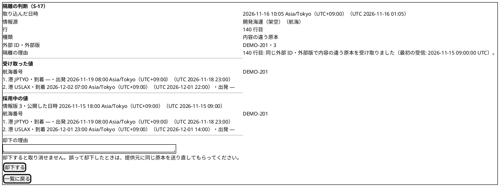
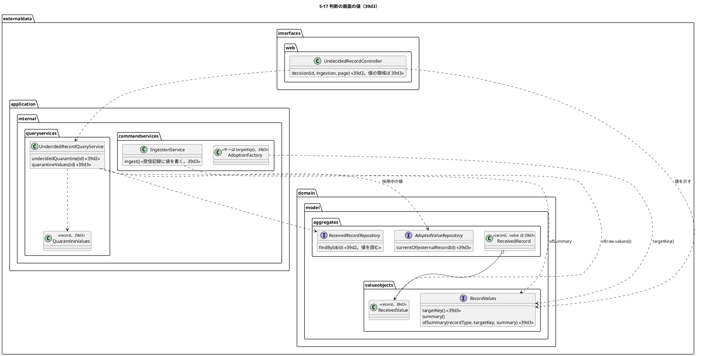
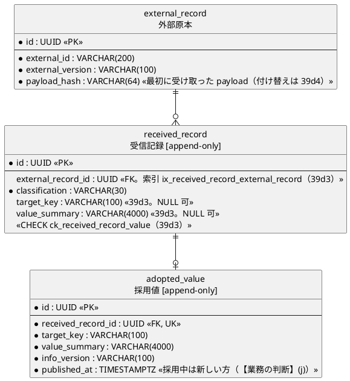

# Bolt 39d3 計画 - S-17 の判断の画面で内容の違う原本の受け取った値と採用中の値を比べる（受信記録の値の列）

## 基本情報

| 項目 | 内容 |
| :--- | :--- |
| Bolt | 第 39d3 回（W7 の 18 本目。release_plan :966 の 39d3 の行。この開始準備で 39d3・39d3b に縦に分ける 1 つ目） |
| 状態 | 初稿（承認待ち） |
| 予定 | W7（2026-11-16 の週。前倒しで着手できる）。作業は約 4 時間 20 分（目安の 4 時間を 20 分超える。半日の中に収まるので、これ以上は分けない。下の「時間の配分と打ち切り」。`check`・`uiTest`・`manualScreenshots`・`demoVideo`・SonarQube・CI とステップごとの承認の待ちを除く） |
| アプローチ | アウトサイドイン（S-17 の判断の画面の値から。画面の層の受入シナリオ（`@ui`）の Red から入る。release_plan :966 の「アウトサイドイン（S-17 の採用から）」を、分けた後の 39d3 では判断の画面に値を示すところから入る形に読み替える。判断の画面と照会は 39d2 で固まっていて（UndecidedRecordController.java :293-320、UndecidedRecordQueryService.java :122-130）、受け取った値をどこに残し、どう読み戻して示すかが受入条件の中心） |
| 対象 | (1) 受信記録の値の列 `target_key VARCHAR(100)`・`value_summary VARCHAR(4000)`（NULL 可。共通のマイグレーション。スキーマ）と、外部原本を持つ受信記録（採用・重複・内容の違う原本の隔離）に取込で値を書くこと（Bolt 39d の開始準備の決定 (8)）、(2) 値の要約から取込の値（航海・主要実績）に戻す規則（39d3b の採用が同じ規則で採用値と DE-12・DE-13 を作り直す）、(3) 採用中の値の照会（同じ外部原本の採用値のうち公開した時刻の新しいもの。【業務の判断】(j)）と、そのための受信記録の外部原本 ID の索引、(4) S-17 の判断の画面で、内容の違う原本の「受け取った値」と「採用中の値」を並べて示す（【業務の判断】(i)）、(5) マニュアル 12.2 の判断の画面の説明とキャプチャの撮り直し、(6) デモの動画（`@demo-bolt-39d3/compare`）。採用の判断そのもの（採用値と DE-12・DE-13・DE-29 の `ADOPTED`、監査、`EXTERNAL_RECORD_ADOPTED` の Javadoc と DE-12・DE-13 の `publishedAt` の直し、採用の理由は任意）は 39d3b に送る（下の開始準備の決定 (1)。【前の決定の変更】(1)） |
| トレース | US-14 AC4（同一キー・異 payload は既存原本と採用値を上書きせず隔離しデータ責任者へ示す。user_story :561）、UC-15 の主成功シナリオ 5（データ責任者が差異と採否を確認する。system_usecase :408）・3b（system_usecase :527）、ED-INV-02、data_model の受信記録（:1155）・採用値（:1157）、domain_model の受信記録の判断（:1523）、ui_design の S-17 の判断の画面（:194・:1981 の画面イメージ・:2024）、ACC-01（WCAG 2.2 AA） |
| GitHub | [#18](https://github.com/k2works/practical-domain-driven-design-in-enterpris-application/issues/18)（US-14。クローズは 39h） |
| SP | 0 |
| 承認ゲート | **ステップごとに止める**（release_plan :966 の「ステップごと（スキーマ）」に、判断の画面の振る舞いが変わるので画面を足す）。スキーマ（受信記録の値の 2 列・CHECK・索引の共通のマイグレーション。ステップ 3）、画面（判断の画面の値の領域。ステップ 6）、新しいファイル（下の一覧）。判断の振る舞い・イベント・監査・認可は変えない（採用は 39d3b）。新しいセキュリティの判断と本番の操作はない |
| 開始準備で決めたこと | 下の (1)〜(10)（初稿。推奨を 1 つに決めて書いた。承認待ち）。【業務の判断】(i)・(j) を新しく記録する |

### 開始準備の決定

(1) **範囲と見積り**（【前の決定の変更】(1)）: release_plan :966 の 39d3 の行（Bolt 39d の開始準備の決定 (1) の表で約 3 時間 50 分。bolt_39d_plan.md :35）に、前の Bolt の申し送り（[39d 終了報告](bolt_39d_report.md) :100 の「`EXTERNAL_RECORD_ADOPTED` の Javadoc と DE-12・DE-13 の `publishedAt`」、[39d2 終了報告](bolt_39d2_report.md) :104 と [39d2b 終了報告](bolt_39d2b_report.md) :104 の「採用の判断を同じ判断の画面に足す（理由は任意。【業務の判断】(d)）」）と、コードで確かめて見つかった作業（下の (a)〜(e)）を加えて引き直すと、1 本で約 6 時間 50 分になり、半日を超える。39d の見積りより増えるのは、(a) データ責任者が採用の前に受け取った値と採用中の値を読めないと採否を決められない（今の判断の画面は注記の文だけ。decision.html :27-40）ので値を示す（【業務の判断】(i)。+40 分）、(b) 採用は外部原本の外部 ID・外部版を読むが、外部原本のポートは `findByKey` だけ（ExternalRecordRepository.java :13）なので `findById` を足す（+15 分）、(c) 監査の listener は DE-29 の理由を必須の部品として読み、理由のない判断の監査記録を書かずに捨てる（ExternalRecordAuditEventHandler.java :130 の `part(event.reason(), "reason")`、:178-183）ので、採用の理由を任意にする（【業務の判断】(d)）には listener も直す（+15 分）、(d) 受信記録の record に値を足すと、受信記録を組み立てる 19 か所（本体 3、テスト 16）と、`receivedRecordRow` を読む 3 つの SELECT（ReceivedRecordMapper.xml :40・:93・:110）を直す（+15 分）、(e) 要約から値に戻す規則と往復のテスト（39d の決定 (8) は「要約は寄港と主要実績に戻せる」と書いたが、戻すコードはない。+25 分）ため。

**縦に 2 本に分ける**（推奨）:

| Bolt | 範囲（縦） | アプローチ | 承認ゲート | 見積り |
| :--- | :--- | :--- | :--- | ---: |
| **39d3**（この計画） | データ責任者が判断の画面で内容の違う原本の受け取った値と採用中の値を比べる: 受信記録の値の列（スキーマ）と取込での書き込み、要約から値に戻す規則、採用中の値の照会と索引、判断の画面の値の領域、マニュアル 12.2 の判断の画面の説明とキャプチャ、デモの動画 | アウトサイドイン（S-17 の判断の画面の値から） | ステップごと（スキーマ・画面） | 約 4 時間 20 分 |
| **39d3b** | データ責任者が内容の違う原本の隔離を採用する: 外部原本のポートの `findById`、採用の判断（`DecisionKind.ADOPTED`、理由は任意。【業務の判断】(d)）、採用値と DE-12・DE-13（操作者は判断者、公開した時刻は判断の時刻）と DE-29（`ADOPTED`）、キーのない隔離と値の列のない隔離は採用を出さない（【業務の判断】(a)、Bolt 39d の決定 (8)）、監査（理由のない DE-29 を受ける listener の直し、（操作、受信記録）ごとに 1 つ。IA-INV-15）、`EXTERNAL_RECORD_ADOPTED` の Javadoc と DE-12・DE-13 の `publishedAt` の直し、判断の画面の「採用する」と POST、マニュアル 12.2 の採用と付録 B、デモの動画 | アウトサイドイン（S-17 の採用から） | ステップごと（監査・画面） | 約 4 時間 10 分 |

比べた案: (i) 1 本のまま（約 6 時間 50 分。半日を超える）、(ii) 値を示さずに採用だけを 1 本にする（約 5 時間 50 分でなお半日を超え、データ責任者が値を読まずに採否を決める。【業務の判断】(i) の比べた案）、(iii) スキーマと取込での書き込みだけを先に 1 本にする（画面に何も出ない横の切り方になり、利用者に見える成果がない）。分けた 2 本はどちらも画面の振る舞いが変わる縦で、39d3 は値を示すだけで判断の振る舞いを変えないので、39d3b の採用の前に値の読み方を確かめられる（却下の判断にも使える）。

順序は 39d2b → 39d3 → 39d3b → 39d4（39d4 の外部原本の基準のハッシュの付け替えは採用の判断の中で行うので 39d3b の後。release_plan :968）。39e・39f は取込での自動の採用（39b3）の DE-12 で足り、39d3b を待たない（release_plan :976 のまま）。W7 は 26 本前後になる（39d2 の開始準備の見込みの 25 本前後から 1 本増える。release_plan :976）。週の計画の期間（2026-11-16〜11-20）に対して実績は約 2 週先行しているので、バッファ消費ルールの範囲で吸収できる（W7 の週の見直しで確かめる）。

39d3 は目安を 20 分超える。39d2（25 分）・39d2b（15 分）の超過を半日の中に収まるとして受け入れた前例（bolt_39d2_plan.md :18、bolt_39d2b_plan.md :408）にならい、これ以上は分けずに受け入れることを推奨する。送る候補は 2 つを比べた: (i) 採用中の値の照会と示し方（約 30 分）を 39d3b に送る（39d3b が約 4 時間 40 分になって目安を大きく超え、39d3 の画面は受け取った値だけになって比べられない）、(ii) 39d3 のデモの動画を 39d3b の動画にまとめる（約 5 分減るが、release_plan :982 の「動画は画面の振る舞いが変わる Bolt で撮る」を変える）。どちらも取らない（下の「確認ポイント」1）。

(2) **受信記録の値の列（スキーマ）**: Bolt 39d の開始準備の決定 (8)（bolt_39d_plan.md :54、data_model :1155 の末尾）のとおり、`external_data.received_record` に `target_key VARCHAR(100)`・`value_summary VARCHAR(4000)`（どちらも NULL 可）を足す。採用値の同じ名前の列（V20261103100000 :133-134。`target_key VARCHAR(100)`・`value_summary VARCHAR(4000)`）と同じ型にする。CHECK `ck_received_record_value` で、(i) 2 列はそろって NULL かそろって NULL でない、(ii) 外部原本を持たない受信記録（キーのない隔離）は値を持たない（`(target_key IS NULL) = (value_summary IS NULL) AND (external_record_id IS NOT NULL OR target_key IS NULL)`）を守る。外部原本を持つ受信記録に値を必須にはしない（Bolt 39d3 より前の受信記録は NULL のまま。受信記録は追記専用で更新しない。data_model :1155）。

- **索引** `ix_received_record_external_record`（`received_record (external_record_id)`）を同じマイグレーションで足す: 採用中の値（決定 (5)）は「同じ外部原本の受信記録の採用値」を引くので、受信記録を外部原本 ID で絞る。今の索引は取込 ID と分類だけ（V20261103100000 :93-94）で、PostgreSQL は外部キーに索引を自動で作らない。判断の画面を開くたびに受信記録の表を全部読まないようにする（1 つの取込で 1 万件まで。IngestionFileLimit.java :13）。39d4 の付け替えと 39h の差異も外部原本ごとに受信記録を引く見込みだが、索引を足す理由は 39d3 の照会だけで足りる
- **版**: すべての場所の最新より後にする。今の最新は h2 の V20261105100000（V20261105100000__widen_received_record_decision_reason.sql）、common は V20261104170000、postgresql は V20261022100100、dev-data は V20261104160900（Flyway の場所は common・`{vendor}`・callback・dev-data。application.properties :4、application-dev.properties :6）。例として `db/migration/common/V20261105120000__add_external_data_received_record_value.sql`（ステップ 3 の開始で実際の最新を確かめて決める）
- **書き方**: 1 列・1 制約・1 索引ずつの文にする（H2 の PostgreSQL 互換モードと PostgreSQL の両方で通る形。前例 V20261104170000 の頭の注記）。列のコメントは日本語（「対象のキー（航海は航海番号、主要実績は追跡番号。キーのない隔離と Bolt 39d3 より前の行は NULL）」「値の要約（採用値と同じ規則の正規の文字列。キーのない隔離と Bolt 39d3 より前の行は NULL）」）
- **H2 は広げない**: H2 の VARCHAR は UTF-16 の単位で数える（前例 Bolt 39b4 の V20261104145000、Bolt 39d2 の V20261105100000）が、この 2 列は H2 でも上限に収まる。`value_summary` は ASCII だけでできている（港は UN/LOCODE `[A-Z]{2}[A-Z2-9]{3}`（Location.java :14）、時刻は `2026-11-19T23:00:00.000000Z` の形（RecordValues.java :27-34）、種類は enum の名前、区切りは `|`・`;`）ので UTF-16 の単位とコードポイントの数が同じ（寄港 60 で最大 3719 文字。VoyageValues.java :28-31）。`target_key` は航海番号ならコードポイントで 30 文字まで（VoyageValues.java :22。補助文字だけでも UTF-16 で 60 単位）、追跡番号なら ASCII 14 文字（TrackingNumberValue.java :17）で、どちらも `VARCHAR(100)` に入る。採用値の同じ 2 列も H2 で広げていない（h2 の場所に採用値のマイグレーションはない）。契約のテストで「寄港 60 の要約と補助文字を含む 30 文字の航海番号が H2 と PostgreSQL で往復する」を確かめる（行 5。T-242）
- **追記専用の権限**: 表の印 `[append-only]`（V20261103100000 :96）はそのままで、PostgreSQL の afterMigrate のコールバックが UPDATE・DELETE を外す（V20261103130000 の注記）。値は受信記録の INSERT で書くので権限は変えない

(3) **受信記録の値の型**（T-246）: 値の 2 列を値オブジェクト `ReceivedValue`（`externaldata.domain.model.valueobjects`。対象のキーと値の要約。どちらも必須、要約は 4000 コードポイントまで（AdoptedValue.java :33 の `VALUE_SUMMARY_MAX_LENGTH` と同じ）、キーは 100 コードポイントまで）にし、受信記録の record（ReceivedRecord.java :33-43）の最後に `value`（`ReceivedValue`、NULL 可）を足す。不変条件に「外部原本を持たない受信記録は値を持たない」（ReceivedRecord.java :52-57 の今の 2 つの規則の隣。表の CHECK と同じ規則）を足す。MyBatis の行（`ReceivedRecordRow`）・`insert`（ReceivedRecordMapper.xml :24-32）・`receivedRecordRow` を読む 3 つの SELECT（`quarantinedOf` :40、`selectById` :93、`undecidedKeylessQuarantinesOf` :110）・メモリの実装（`InMemoryReceivedRecordRepository`）を直す。判断を待つ隔離の一覧の照会（`undecidedQuarantines` :79・`undecidedQuarantine` :101）は値の列を読まない（一覧は値を示さず、1 ページ 100 件で要約が最大 3719 文字なので読まない）。受信記録を組み立てる 19 か所（IngestionService.java の 2、MyBatisReceivedRecordRepository.java の 1、テストの 16）を直す

(4) **取込で値を書く・要約から値に戻す**: 取込の値の型に `targetKey()` を足す（`RecordValues`。RecordValues.java :13-19。航海は航海番号、主要実績は追跡番号の値）。今は採用の組み立て役が値の型で分けてキーを決めている（AdoptionFactory.java :62-101 の `voyage.voyageNumber()`・`trackingNumber.value()`）ので、`targetKey()` に寄せて取込の値の書き込みと 1 つの規則にする。取込のサービスは形式の正しい行の受信記録（IngestionService.java :196-206。採用・重複・内容の違う原本の隔離。どれも外部原本を持つ。:191-195）に `ReceivedValue.of(row.values())`（キーは `targetKey()`、要約は `summary()`）を書き、キーのない隔離（:311-326）には書かない。書くのは取込の外側の 1 つのトランザクション（IngestionService.java :113 の `@Transactional`）の中の受信記録の INSERT で、セーブポイントもイベントも足さない。

要約から値に戻す規則は値の型に置く: `VoyageValues.ofSummary(String voyageNumber, String summary)`（寄港を `|` で分け、各寄港を `;` で「UN/LOCODE;到着;出発」に分ける。空の時刻は null。VoyageValues.java :55-65）、`MilestoneValues.ofSummary(String trackingNumber, String summary)`（「種類;場所;発生時刻」。MilestoneValues.java :28-31）、型で分ける入口 `RecordValues.ofSummary(String recordType, String targetKey, String summary)`（原本種別 `VOYAGE`・`MILESTONE`。IdempotencyKey.java :8-11 の原本種別の名前。ほかは `IllegalArgumentException`）。値の規則（寄港 2〜60、同じ寄港を重ねない、到着か出発の一方、追跡番号の形）は今のコンストラクタがそのまま守る。規則に合わない要約（区切りの数の違い、読めない時刻）は `IllegalArgumentException` にする（取込が書いた要約からは起きない。表を直に書き換えた誤りを黙って読まない）。往復の約束は「取込の値 `v` について `ofSummary(v.targetKey(), v.summary())` が `v` と等しい」で、時刻はマイクロ秒に切り捨てた値（取込が切り捨てる。IngestFileCommandAssembler.java :319-322）に限る

(5) **採用中の値**（【業務の判断】(j)）: 内容の違う原本の「採用中の値」は、**同じ外部原本（同じ提供元・原本種別・外部 ID・外部版）の受信記録に付いた採用値のうち、公開した時刻の最も新しいもの**（同じ時刻なら採用値 ID の順の最後）とする。39d3 の時点では、外部原本は取込で採用になった受信記録のときだけ作られ（IngestionService.java :191-195）、その採用値が 1 つある。39d3b で隔離を採用すると同じ外部原本の採用値が 2 つになり、判断の時刻を公開した時刻にする（Bolt 39d の決定表の 39d3 の行。bolt_39d_plan.md :35）ので、採用した隔離の値が採用中になる。読むのは採用値のポートに足す `currentOf(UUID externalRecordId)`（`Optional<AdoptedValue>`。AdoptedValueRepository.java :11-23 の追記と受信記録 ID の照会の隣。SQL は `adopted_value a JOIN received_record r ON r.id = a.received_record_id WHERE r.external_record_id = ?` を `a.published_at DESC, a.id DESC` で 1 件。索引は決定 (2)）。メモリの実装（`InMemoryAdoptedValueRepository`）はメモリの受信記録のリポジトリを受け取って結ぶ。採用値は今も航海・主要実績の値の要約を持つ（data_model :1157）ので、39d3 より前に取り込んだ外部原本でも採用中の値は読める

(6) **判断の画面の中身の照会**: 照会のサービス `UndecidedRecordQueryService` に `quarantineValues(UUID receivedRecordId)` を足し、内容の違う原本のときだけ値を返す（`Optional<QuarantineValues>`。キーのない隔離・ない受信記録は空で、採用値を引かない）。受信記録を `findById`（ReceivedRecordRepository.java :44。値と外部原本 ID を持つ）、取込を `findById`、情報源を `findById`（原本種別。値に戻す型を決める）で読み、採用中の値を `currentOf` で 1 回引く。`QuarantineValues`（`externaldata.application.internal.queryservices`。前例 `KeylessRejectionTarget`）は、受け取った値（`RecordValues`。値の列が NULL なら null）、採用中の値（`RecordValues`。なければ null）と、その情報版（外部版）・公開した時刻を持つ。照会のサービスの組み立て（ExternalDataConfiguration.java :48-55）に採用値のリポジトリを足す。一覧の `page` と判断の画面の行き先（ReceivedRecordDecisionService.java :58-64 の `refusalOf`）は変えない

(7) **判断の画面に値を示す**（【業務の判断】(i)）: 内容の違う原本の判断の画面（decision.html :27-40 の隔離の中身の後、:41 の前）に 2 つの領域を足す。見出し `h2`「受け取った値」と「採用中の値」（採用中の値には「情報版 N・公開した日時 …」を添える。日時は `DateTimeDisplay.staff`。UndecidedRecordController.java :309 と同じ形）。

- 航海は「航海番号」と、寄港を運航の順の番号付きの並び（`ol`）で「港 JPTYO・到着 —・出発 2026-11-19 08:00 Asia/Tokyo（UTC+09:00）（UTC 2026-11-18 23:00）」の形で示す（表にしない。寄港 60 の航海を幅 320 px で横スクロールなしに示すため。ACC-01）
- 主要実績は `dl` で「追跡番号」「種類」（日本語の名前。外部データは追跡の型を参照できない（モジュールの規則）ので、追跡の表示名（TrackingRecordViews.java :46-53 の `KIND_NAMES`）の写しを画面の層に置き、`MilestoneKindValue` のすべての値に名前があることをテストで縛る。T-240）「場所」「発生時刻」
- 受け取った値と採用中の値が等しい（`RecordValues` の同一性）ときは、2 つの領域の前に「受け取った値は採用中の値と同じです。原本の書き方（引用符・空白など）だけが違います。」を示す（隔離はハッシュで決まる（IngestionService.java :183-190）ので、値の同じ原本も隔離になる。データ責任者が違いを探さずに済む）。違いの強調（寄港ごとの差分の印）はしない（下の「入れないもの」）
- 受け取った値がない（Bolt 39d3 より前に取り込んだ隔離）ときは「受け取った値」の領域に「この隔離は、受け取った値を記録する前に取り込みました。値は原本のファイルで確かめてください。」を示す。採用中の値がないときは「採用中の値はありません。」を示す
- キーのない隔離（形式の誤り）の判断の画面には 2 つの領域を出さない（値を読めていない。【業務の判断】(a)）。却下の欄・取り消せないことの文・「一覧に戻る」は変えない（decision.html :42-54）
- 文は画面の層の定数、テンプレートは `th:text`（取込ファイルから来た値を含む。航海番号は外部 ID の列の値）

(8) **判断の振る舞い・イベント・監査は変えない**: 39d3 は値を示すだけで、判断の画面の行き先（判断できる受信記録の定め）・却下の POST・DE-29・監査の listener を変えない（ReceivedRecordDecisionService.java :58-95、ExternalRecordAuditEventHandler.java :112-132）。判断の画面の Javadoc とテンプレートの注記の「採用は 39d3 で足す」（UndecidedRecordController.java :37、decision.html :16）は「採用は 39d3b で足す」に直す

(9) **39d3b に送るもの**（下の「申し送り」）: 採用の判断（`ReceivedRecordDecision` の採用のファクトリー、理由は任意で 1000 文字まで。【業務の判断】(d)。DecisionKind.java :12 の `ADOPTED`）、外部原本のポートの `findById`、採用値と DE-12・DE-13 を受け取った値から作る（採用の組み立て役を取込の行でなく値から作れる形にする。AdoptionFactory.java :51-102。操作者は判断者、公開した時刻は判断の時刻）、DE-29 の `ADOPTED`、理由のない DE-29 の監査（ExternalRecordAuditEventHandler.java :130）、`EXTERNAL_RECORD_ADOPTED` の Javadoc（AuditAction.java :89-93 の「取込で自動に採用した」）と DE-12・DE-13 の `publishedAt` の Javadoc（VoyageAdoptedValueUpdated.java :26、MilestoneAdoptedValueAccepted.java :28 の「取込の時刻」）と domain_model の DE-12・DE-13 の行（:1697-1698）の直し、判断の画面の「採用する」と POST。トランザクションの形は 39d3b の開始準備で、判断のリポジトリの追記がセーブポイントの中（MyBatisReceivedRecordDecisionRepository.java :29-30 の `NESTED`）で、採用値のリポジトリの追記はセーブポイントを持たず一意制約の違反を上げる（MyBatisAdoptedValueRepository.java :27-40。DuplicateAdoptedValueException.java :8 の「取込のサービスは捕まえずに上げ、取込全体を巻き戻す」）ことを前提に、判断を先に追記してから採用値を書く順を決める

(10) **新しい型の名前**（T-246。`apps/cargo-tracker/src` で `ReceivedValue`・`QuarantineValues`・`quarantineValues`・`ofSummary`・`currentOf`・`ix_received_record_external_record` を検索して、ないことを確かめた。`targetKey()` は採用値の record の部品と、テストの読み出しだけで、取込の値の型にはない）: 本体 `ReceivedValue`（`externaldata.domain.model.valueobjects`）、`QuarantineValues`（`externaldata.application.internal.queryservices`）、マイグレーション（決定 (2) の版）。テンプレートは新しく作らない（decision.html に足す）。テストは既存のクラスに `@Nested class Bolt39d3_…` で足し、契約のテストは名前の頭に `Bolt39d3_`。新しい受入シナリオ `features/ui/compare_quarantine_values_ui.feature` と Steps `CompareQuarantineValuesUiSteps.java`

【前の決定の変更】(1): release_plan :966 の 39d3 の行（Bolt 39d の開始準備の決定 (1) の 39d3。約 3 時間 50 分）を、この開始準備で半日を超える（約 6 時間 50 分）ので 39d3（値を比べる）・39d3b（採用）に縦に分ける（決定 (1)）。release_plan の W7 の節の 39d3 の行を直し、39d3b の行を足した（案。承認待ち）。順序の段落（:976）・デモ項目（:982）・確認ポイント 23（:935）・承認ゲートの範囲（:895）・局面とアプローチ（:893）に 39d3b を足すのはステップ 1。

新しいファイル（39d3）: 本体は決定 (10) の 2 個（.java）とマイグレーション 1 個（.sql）。テスト: 受入シナリオ `features/ui/compare_quarantine_values_ui.feature` と Steps `CompareQuarantineValuesUiSteps.java`（新しいテストのクラスはこれだけ）。デモの動画 `docs/assets/demo/bolt-39d3/compare.webm`（`demoVideo` が作る）。直すもの: `ReceivedRecord`・`RecordValues`・`VoyageValues`・`MilestoneValues`・`AdoptionFactory`（キーを `targetKey()` に）・`IngestionService`、`ReceivedRecordRow`・`ReceivedRecordMapper`（.java・.xml）・`MyBatisReceivedRecordRepository`・`AdoptedValueRepository`・`AdoptedValueMapper`（.java・.xml）・`MyBatisAdoptedValueRepository`、テストの `InMemoryReceivedRecordRepository`・`InMemoryAdoptedValueRepository`、`UndecidedRecordQueryService`・`ExternalDataConfiguration`、`UndecidedRecordController`・`decision.html`、テスト `ExternalDataRecordRepositoriesContract`・`AdoptedValueRepositoryContract`・`VoyageValuesTest`・`MilestoneValuesTest`・`IngestionServiceTest`・`UndecidedRecordQueryServiceTest`・`UndecidedRecordControllerTest`・`MyBatisExternalDataRecordRepositoriesIntegrationTest`（CHECK）と受信記録を組み立てるテスト、`manual_screenshots.feature`、マニュアル 12 章。キャプチャ `docs/manual/assets/12-undecided-record-decision.png` を撮り直す（新しいキャプチャは作らない）。

## Bolt ゴール

データ責任者が S-17 の一覧から内容の違う原本の「判断する」を開くと、判断の画面で隔離の中身と理由の後に「受け取った値」と「採用中の値」（情報版と公開した日時）が並び、航海なら寄港の並び、主要実績なら種類・場所・発生時刻を、採用中の値と見比べてから却下を決められる。値が同じで原本の書き方だけが違うときはそう示す。寄港 60 の航海も幅 320 px で横スクロールなしに読める。値は取込のときに受信記録に残り（採用・重複・内容の違う原本の隔離。形式の誤りには残らない）、採用値と同じ規則の要約から値に戻せる（39d3b の採用が同じ規則で採用値とイベントを作り直す）。値を記録する前の隔離は、その旨を示す。マニュアル 12.2 の判断の画面の説明とキャプチャが新しい画面と合い、デモの動画がある。

### 開始準備で確かめたこと

- **release_plan の 39d3 の行**（:966）: 「受信記録に値の列（`target_key`・`value_summary`。NULL 可。スキーマ）と取込での書き込み、採用の判断で採用値と DE-12・DE-13 と判断のイベント、キーのない隔離と値の列のない隔離は採用を出さない、監査の不変条件（IA-INV-15）、`EXTERNAL_RECORD_ADOPTED` の Javadoc と DE-12・DE-13 の `publishedAt` の直し、マニュアル 12.2 の採用、デモの動画」、アプローチはアウトサイドイン（S-17 の採用から）、承認ゲートは「ステップごと（スキーマ）」
- **前の Bolt の申し送り**: [39d 終了報告](bolt_39d_report.md) :100（採用と受信記録の値の列（スキーマ）、`EXTERNAL_RECORD_ADOPTED` の Javadoc と DE-12・DE-13 の `publishedAt`）、[39d2 終了報告](bolt_39d2_report.md) :104・[39d2b 終了報告](bolt_39d2b_report.md) :104（採用の判断を同じ判断の画面に足す、理由は任意。【業務の判断】(d)）。Bolt 39d の開始準備の決定 (7)（キーのない隔離は却下だけ。【業務の判断】(a)）・(8)（値の列と要約からの作り直し、39d3 より前の受信記録は採用できない）・(11)（採用の理由は任意）・(12)（判断のイベントと監査）・(13)（取り消さない）は bolt_39d_plan.md :52-64
- **【業務の判断】(b)・(f) と再送の扱いの範囲**: (b)（採用の判断で外部原本の基準のハッシュを付け替え、採用した payload の再送は重複、元の payload の再送は隔離）と (f)（同じ外部版は隔離、版をまたげば差異）は bolt_39d_plan.md :56 の決定 (9)。release_plan の 39d4 の行（:968）に「採用した後の外部原本の基準のハッシュの付け替え」「同じ外部版は隔離・版をまたげば差異（39h）」があり、**39d4 の範囲**（差異は 39h）で、39d3・39d3b の範囲ではない。39d3b の後 39d4 までの間は、採用した payload を送り直すと最初の payload のハッシュと比べて再び隔離になる（外部原本は最初に受け取った payload のハッシュを持つ。ExternalRecord.java :18、V20261103100000 :71）。パイロットの前で業務のデータはなく、39d4 がすぐ後に続くので受け入れる（申し送りの表）
- **受信記録と外部原本の今の形**: 受信記録は値を持たず（ReceivedRecord.java :33-43、data_model :1155 の「値の列は持たず、値は payload の行の原文に残る」）、外部原本は取込で採用のときだけ作る（IngestionService.java :191-195）。内容の違う原本の隔離は外部原本 ID を持つ（:196-206）。隔離はハッシュの違いで決まる（:183-190）
- **採用値**: 要約の規則と例（data_model :1157、VoyageValues.java :55-65、MilestoneValues.java :28-31）、上限 4000 コードポイント（AdoptedValue.java :33）、公開した時刻は取込の時刻（AdoptedValue.java :20、AdoptionFactory.java :61）。採用値のポートは追記と受信記録 ID の照会だけ（AdoptedValueRepository.java :11-23）
- **スキーマ**: 受信記録（V20261103100000 :75-105。索引 :93-94）、採用値（:129-142）、行の範囲を足した前例（V20261104170000。1 列・1 制約ずつ）、H2 だけ広げた前例（V20261104145000・V20261105100000）。Flyway の場所（application.properties :4）
- **判断の画面の今の形**: 中身は一覧と同じ項目と注記（UndecidedRecordController.java :293-320、decision.html :27-40）、キーのない隔離の文（decision.html :41）、却下の欄（:42-53）。中身の照会（UndecidedRecordQueryService.java :122-130）
- **監査の listener**: DE-29 の理由は必須の部品（ExternalRecordAuditEventHandler.java :130・:178-183）で、理由のない DE-29 は書かずに捨てる（:138-151）。39d3b で直す（決定 (9)）
- **マニュアル**: 12.2 の「隔離の判断の画面」の説明の表（docs/manual/12-外部データ.md :265-278）、却下の手順（:280-286）、「注意・補足」の「内容の違う原本を採用する（受け取った内容を業務で使う）ことは、まだ画面でできません」（:352）。キャプチャ `12-undecided-record-decision.png` は内容の違う原本の判断の画面（manual_screenshots.feature :260）

## 設計の決定

| 項目 | 決定 | 根拠 |
| :--- | :--- | :--- |
| 範囲と分け方 | 開始準備の決定 (1)。39d3（値を比べる）・39d3b（採用）に縦に分け、39d3 は約 4 時間 20 分（【前の決定の変更】(1)） | 下の「時間の配分と打ち切り」、bolt_39d_plan.md :35 |
| 値の列 | 決定 (2)。2 列 NULL 可、CHECK（そろって NULL、キーのない隔離は値なし）、外部原本 ID の索引。H2 は広げない | V20261103100000 :93-94・:133-134、Location.java :14、VoyageValues.java :22・:31、TrackingNumberValue.java :17 |
| 値の型 | 決定 (3)。`ReceivedValue` を受信記録の最後に（NULL 可）。一覧の照会は値を読まない | ReceivedRecord.java :33-57、ReceivedRecordMapper.xml :24・:40・:79・:93・:101・:110 |
| 書き込みと読み戻し | 決定 (4)。`targetKey()` を取込の値に寄せ、外部原本を持つ受信記録に書く。`ofSummary` で戻す（往復の約束） | IngestionService.java :113・:191-206・:311-326、AdoptionFactory.java :62-101、IngestFileCommandAssembler.java :322 |
| 採用中の値 | 決定 (5)。同じ外部原本の採用値のうち公開した時刻の新しいもの。【業務の判断】(j) | AdoptedValueRepository.java :11-23、bolt_39d_plan.md :35 |
| 判断の画面 | 決定 (6)・(7)。内容の違う原本だけに「受け取った値」「採用中の値」。同じ値の文、値のない隔離の文。`ol`・`dl` で幅 320 px。【業務の判断】(i) | decision.html :27-41、UndecidedRecordController.java :293-320、TrackingRecordViews.java :46-53 |
| 判断・イベント・監査 | 決定 (8)。変えない（採用は 39d3b） | ReceivedRecordDecisionService.java :58-95、ExternalRecordAuditEventHandler.java :112-132 |
| 状態遷移とナビ | 受信記録の判断の状態遷移（domain_model :1523-1540）は変えない（判断を足さない）ので、この計画では状態遷移図を省く。ナビ・画面遷移も変えない（判断の画面の中身が増えるだけ）ので画面遷移図を省く | domain_model :1523 |
| 型の名前 | 決定 (10)（T-246 で検索した） | — |

## ふりかえりと前の Bolt からの引き継ぎ

| 出典 | 内容 | この Bolt での扱い |
| :--- | :--- | :--- |
| W6 の Try T-204・T-212、Bolt 38h の T-227、Bolt 39b の T-233、Bolt 39d・39d2 の Problem | サブエージェントへの指示の最初に heredoc と標準入力を待つコマンド（`python -`、引数のない `cat >` など）を使わないと書く | 任せるときの指示の最初に書く（39d2b では違反が止まった。[39d2b 終了報告](bolt_39d2b_report.md) :96）。計画を直すときもファイルは Write・Edit で書く |
| Bolt 39d の T-247、Bolt 39d2 の Try | 決まりを文章の指示ではなく仕組みで守らせる（フック） | W7 の締めで諮る（39d2 の終了報告のとおり）。39d3 では任せる範囲を、ファイルを Write・Edit で書く作業と読むだけの検索に絞り、Gradle と git を人の側の 1 か所に残す。任せる指示に触らないもの（`.claude/agent-memory`・`.run/`・`apps/cargo-tracker/.claude/`、ほかの作業のテスト）を名前で書く |
| Bolt 39d の T-248 | `git add` は `git status --short` の出力を使わず、ディレクトリか `git add -u` で指定する | 各ステップのコミットで、本体・テストはパッケージのディレクトリ、文書は `docs/` の下のディレクトリで指定する（マニュアルは `docs/manual`） |
| Bolt 39d2b の T-249 | 担当への指示に私の言葉を書くときは「（私の指示）」と出典を付け、計画に人の指示として書き写さない | 見積りの目安は CLAUDE.md の決まり（「目安 2〜4 時間。半日を超える Bolt は分割する」）として書き、人の指示として書かない |
| Bolt 39d2b の学び（判断と学び） | トランザクションとセーブポイントの形は、取込と判断で違うので推し量らずコードで確かめる | 39d3 の書き込みは取込の外側のトランザクションの中の INSERT だけ（IngestionService.java :113。セーブポイントなし）。39d3b の採用は判断のリポジトリの追記がセーブポイントの中、採用値のリポジトリの追記はセーブポイントなし（決定 (9) に出典を添えた） |
| W6 の Try T-217、Bolt 39b2 の Try | 本体を直す前に Red を流し、落ちた理由を記録する。直したテストの一覧を添える | ステップ 2。受信記録の record に値を足して直す 16 か所のテスト（決定 (3)）、判断の画面の HTML の順が変わる `UndecidedRecordControllerTest`・`reject_quarantine_ui.feature`・`RejectQuarantineUiSteps`（判断の画面の Tab の順）、`manual_screenshots.feature` を、ステップ 2 の開始で grep して一覧にする |
| W6 の Try T-191 | 環境の前提に設定ファイルの行を添える | Flyway の場所（application.properties :4、application-dev.properties :6）、追記専用の権限のコールバック（V20261103130000 の注記）を決定 (2) に添えた |
| W6 の Try T-225・T-213 | push の前に `check` | ステップ 8（`uiTest` も流す） |
| W6 の Try T-182・T-211・T-216 | 状態の組み合わせの表に重複・隔離と出口・誤った入力の行を置く | 下の表（行 1〜20）。重複（行 3）、キーのない隔離（行 4・12）、壊れた要約（行 7）、値のない隔離（行 10） |
| W6 の Try T-184 | listener は配信まで確かめる | 39d3 はイベントと listener を変えない。39d3b で採用の DE-12・DE-13・DE-29 の配信を確かめる |
| W6 の Try T-219 | 変異の対象に単体・統合・契約のテスト | 下の変異の表 |
| W6 の Try T-215・T-222 | Gradle を流す担当を 1 つに、計画の初稿を先にコミット | Gradle は人の側の 1 か所で流す（`uiTest`・`manualScreenshots`・`demoVideo` を含む）。初稿をコミットしてから実装に入る |
| Bolt 39a2 の T-229 | 永続化の Bolt の状態の組み合わせに時刻の出どころと同時の書き込みの行を置く | 時刻: 39d3 は時刻を取らない（値は取込の値。取込の時刻の取り方（IngestionService.java :129）は変えない）。採用中の値の並びは公開した時刻（行 8）。同時の書き込み: 値は受信記録の INSERT と同じ文で書き、ほかの書き込みを足さない（行 2）。判断の画面を開いた後に採用値が増える（39d3b）と、開いた時点の採用中の値を示す（行 8 の注。読み直さない） |
| Bolt 39a3 の T-230 | 入ることを確かめる行のデータはドメインの規則に合う組み合わせにする | 内容の違う原本は、寄港 2 つ以上・時刻の順の航海の行を、同じ外部 ID・外部版で寄港の値を変えて 2 度取り込んで作る。値の同じ原本（行 11）は同じ値の行を引用符で囲み直して取り込む。情報源は提供元の名前に自分の UUID を含める |
| Bolt 39b の T-231 | `@Transactional` は契約のクラスに付ける | 行 5・8 を契約のクラス（`ExternalDataRecordRepositoriesContract`・`AdoptedValueRepositoryContract`）に置く |
| Bolt 39b の T-232・Bolt 39b2 の T-234・Bolt 39b3 の T-237 | 本体を直したステップは承認の前に `spotbugsMain`・`checkstyleMain`・`sonar-local:check` | ステップ 3〜6 |
| Bolt 39b2b の T-235 | テストの名前の「行 N_」に Bolt の接頭辞を付けるかを W7 の締めで決める | 39d2・39d2b の前例のまま（`@Nested class Bolt39d3_…`、契約のテストは名前の頭に `Bolt39d3_`） |
| Bolt 39b2b の T-236 | 「起きないこと」を確かめるテストは呼び出しの記録で確かめる | キーのない隔離の判断の画面で採用値を引かない（行 12）、一覧の照会で採用値を引かない（行 13）を、ポートの呼び出しの記録で確かめる |
| Bolt 39b3 の T-238 | サブエージェントへの指示は計画の決定を言い換えず計画の行を指す | 任せるときは「開始準備の決定」の番号と「状態の組み合わせ」の行番号を指す |
| Bolt 39b3b の T-239 | 人に諮る選択肢・主張の前提はコードで確かめ、出典の行を添える | 開始準備の決定の前提に出典の行を添えた（値の列の型と H2 の単位、要約の文字の種類、外部原本を作る場所、隔離の決まり方、採用値の公開した時刻、監査の listener の理由の扱い、2 つのリポジトリのセーブポイントの有無、受信記録を組み立てる場所の数） |
| Bolt 39b3b の T-240 | 表から作る規則には、全部の行が規則に入ることを確かめるテストを添える | 種類の表示名の写しが `MilestoneKindValue` のすべての値を持つ（行 18）。値に戻す入口がすべての原本種別を扱う（行 6） |
| Bolt 39b4 の T-241・T-242 | 性能の目標を外れたら区切って測る。上限いっぱいの入力の行を入れる | 寄港 60（要約 3719 文字）と補助文字を含む 30 文字の航海番号の往復（行 5）、寄港 60 の判断の画面の幅 320 px（行 15）。判断の画面の照会の時間は測らない（1 件の照会と索引。上限いっぱいの一覧の計測は 39d4 のまま） |
| Bolt 39c の T-243 | 状態の数を 0 件にする受入シナリオは計画の時点で controller のテストに下ろす | 採用中の値がない（行 11）と値のない隔離（行 10）は UI で作れない（取込で必ず採用値ができ、39d3 の後の取込は必ず値を書く）ので controller のテストに下ろす |
| Bolt 39c2 の T-244 | パラメーターのテストは入力と期待する出力の組み合わせまで縛る | 行 6（航海の到着だけ・出発だけ・両方、寄港 2・60、主要実績の 6 種類と、戻した値）、行 7（壊れた要約の 4 種類と例外） |
| Bolt 39c3 の T-245 | 並びの規則を足すテストは書く順を逆にしたデータを置く | 行 8 の採用中の値の並び（公開した時刻、同じ時刻は採用値 ID）を、書く順を逆にしたデータで確かめる |
| Bolt 39c4 の T-246 | 新しい型の名前は同じ単純名がないかを検索してから決める | 開始準備の決定 (10) |
| 画面の Bolt の前例（memory の manual-in-bolt-done-criteria、Bolt 37f2 の T-197） | 振る舞いが変わる Bolt はマニュアルの更新を完了条件に入れる。マニュアルの文を実装と突き合わせる | 完了条件に 12.2 の判断の画面の説明とキャプチャを入れる。ステップ 7 で値の領域の見出し・同じ値の文・値のない隔離の文・採用中の値がない文を controller の定数とテンプレートに突き合わせる |
| Bolt 39d・39d2・39d2b の終了報告の既知の課題 | 39d3: 採用と受信記録の値の列、`EXTERNAL_RECORD_ADOPTED` の Javadoc と DE-12・DE-13 の `publishedAt`、採用の判断（理由は任意） | 値の列は 39d3（決定 (2)〜(4)）、残りは 39d3b（決定 (9)。申し送り） |

## 状態の組み合わせ（行ごとにテストを 1 本。T-182）

値の列と採用中の値の DB の通しは契約のテスト（`ExternalDataRecordRepositoriesContract`・`AdoptedValueRepositoryContract`。メモリ・H2・PostgreSQL）、表の CHECK は JDBC の統合テスト（`MyBatisExternalDataRecordRepositoriesIntegrationTest`。H2 と PostgreSQL）、取込での書き込みはサービスの単体（`IngestionServiceTest` の `@Nested class Bolt39d3_…`）、要約から値に戻す規則は値の型の単体（`VoyageValuesTest`・`MilestoneValuesTest`）、照会のサービスは単体（`UndecidedRecordQueryServiceTest`。ポートを mock）、画面は WebMvc のテスト（`UndecidedRecordControllerTest` の `@Nested class Bolt39d3_…`。照会と判断のサービスは mock）、画面の通しは `compare_quarantine_values_ui.feature`（Feature の `@ui @US-14 @must`、幅 320 px、axe）。

| 行 | 状況 | 期待 | 確かめ方 |
| :--- | :--- | :--- | :--- |
| 1 | 表の CHECK | 2 列の片方だけ NULL、外部原本を持たない受信記録に値を入れる INSERT を拒む。2 列とも NULL（Bolt 39d3 より前の行の形）は外部原本を持つ受信記録でも通る | JDBC の統合テスト（H2・PostgreSQL） |
| 2 | 取込で採用の行 | 受信記録に値（キーは航海番号・追跡番号、要約は採用値と同じ文字列）。採用値のキーと要約に一致する | サービスの単体 |
| 3 | 取込で重複の行・内容の違う原本の行 | どちらも受信記録に値を書く（重複は採用値を作らないまま。ED-INV-02） | サービスの単体 |
| 4 | 行の誤り・ファイルの誤り・ファイルの終わりまで取り込めなかった部分 | 受信記録に値を書かない（NULL） | サービスの単体、受信記録の record の不変条件（外部原本のない受信記録に値を渡すと `IllegalArgumentException`） |
| 5 | 値の往復（上限いっぱい） | 寄港 60（要約 3719 文字）の航海と、補助文字を含む 30 文字（コードポイント）の航海番号、主要実績の値が、受信記録の追記と `findById`・`quarantinedOf`・`undecidedKeylessQuarantinesOf`（キーのない隔離は NULL）で往復する | 契約のテスト（メモリ・H2・PostgreSQL） |
| 6 | 要約から値に戻す | 航海（到着だけ・出発だけ・両方の寄港、寄港 2 と 60）と主要実績の 6 種類で `ofSummary(v.targetKey(), v.summary())` が `v` に等しい。入口 `RecordValues.ofSummary` は `VOYAGE`・`MILESTONE` を扱い、ほかの原本種別は `IllegalArgumentException`（T-240・T-244） | 値の型の単体（パラメーター） |
| 7 | 壊れた要約 | 区切りの数が違う・港が UN/LOCODE でない・時刻が読めない・種類の名前がない、の 4 種類で `IllegalArgumentException`（黙って読まない） | 値の型の単体（パラメーター） |
| 8 | 採用中の値 | 同じ外部原本の受信記録の採用値のうち公開した時刻の最も新しいもの、同じ時刻は採用値 ID の順の最後（書く順を逆にしたデータ。T-245）。ほかの外部原本の採用値を含めない。採用値がなければ空 | 契約のテスト（`currentOf`。メモリ・H2・PostgreSQL） |
| 9 | 判断の画面（内容の違う原本・航海・値あり） | 隔離の理由の後に見出し「受け取った値」「採用中の値」、採用中の値に情報版と公開した日時、航海番号と寄港の番号付きの並び（港・到着・出発。空の時刻は「—」。時刻は `DateTimeDisplay.staff` の形） | controller（HTML の文字と順） |
| 10 | 判断の画面（内容の違う原本・値の列が NULL） | 「受け取った値」の領域に「この隔離は、受け取った値を記録する前に取り込みました。値は原本のファイルで確かめてください。」、採用中の値は示す | controller |
| 11 | 判断の画面（採用中の値がない・値が同じ） | 採用中の値がなければ「採用中の値はありません。」。受け取った値と採用中の値が等しければ、2 つの領域の前に「受け取った値は採用中の値と同じです。原本の書き方（引用符・空白など）だけが違います。」（等しくなければ出さない） | controller（パラメーター）、UI（値の同じ原本を作る） |
| 12 | 判断の画面（キーのない隔離） | 値の領域を出さない。照会は採用値を引かない（呼び出しの記録。T-236）。「形式の誤りは採用できません。…」と却下の欄は今のまま | 照会のサービスの単体、controller |
| 13 | 一覧の照会 | `page` は値の列も採用値も読まない（一覧の SQL の項目は変えない。照会のサービスは `currentOf` を呼ばない） | 照会のサービスの単体（呼び出しの記録）、契約のテストの今の行（一覧） |
| 14 | 判断の画面（主要実績） | 追跡番号・種類（日本語の名前）・場所・発生時刻 | controller |
| 15 | UI の幅と axe | 寄港 60 の航海の内容の違う原本の判断の画面が幅 320 px で横スクロールを出さず、axe の違反 0 | `compare_quarantine_values_ui.feature` |
| 16 | 却下は今のまま | 値の領域を足しても、判断の画面の却下（理由の欄の誤り・判断済み・PRG）の振る舞いと Tab の順の先（却下の欄）が変わらない | 39d2 の `reject_quarantine_ui.feature`、controller の今の行 |
| 17 | マニュアルのキャプチャ | `12-undecided-record-decision.png` を撮り直し、受け取った値と採用中の値が写る。マニュアルの文（見出し・同じ値の文・値のない隔離の文・採用中の値がない文）と画面の説明の表の番号（画面の上からの順）が実装と一致する（T-197） | `manual_screenshots.feature`、ステップ 7 の突き合わせ |
| 18 | 種類の表示名の写し | `MilestoneKindValue` のすべての値に表示名があり、追跡の表示名（TrackingRecordViews.java :46-53）と同じ文（T-240） | 画面の層の単体（パラメーター） |
| 19 | 値の要約の規則の一致 | 取込で受信記録に書く要約と、同じ行の採用値の要約が同じ文字列（同じ `summary()` を使う。採用の組み立て役のキーも `targetKey()`） | サービスの単体（行 2 と同じテストの確かめ） |
| 20 | 判断の画面の照会の行き先 | 判断の画面の行き先（404・判断済み）は今の `refusalOf` で決め、値の照会が空でも行き先を変えない（値の照会は中身だけ） | controller（今の行のまま通る） |

## スコープ

### 入れるもの

- 行 1〜20 のテスト。決定 (2) のマイグレーション（値の 2 列・CHECK・索引）、決定 (3) の `ReceivedValue` と受信記録の値、決定 (4) の取込での書き込みと `ofSummary`、決定 (5) の `currentOf`、決定 (6) の `quarantineValues`・`QuarantineValues`、決定 (7) の判断の画面の値の領域、受入シナリオと Steps、キャプチャのシナリオ、デモのシナリオ（`@demo @demo-bolt-39d3/compare`）
- マニュアル: `docs/manual/12-外部データ.md` の 12.2「隔離の判断の画面」の画面の説明の表（:271-278。「受け取った値」「採用中の値」と同じ値の文の行を足し、番号を画面の上からの順に振り直す）と、却下の手順（:280-286）の 2 の「『種類』と『隔離の理由』の全文を読み」に受け取った値と採用中の値を見比べることを足す。「注意・補足」（:345-359）に値を記録する前に取り込んだ隔離の文を足す。:352 の「内容の違う原本を採用する…ことは、まだ画面でできません」は 39d3b まで残す。用語集に「採用中の値」を足す。キャプチャの撮り直し
- 文書: 下の「設計文書に直す箇所」（ステップ 1）

### 入れないもの

- 採用の判断とその後（39d3b。決定 (9)）: 採用の POST、`DecisionKind.ADOPTED` の判断、採用値と DE-12・DE-13 の発行、DE-29 の `ADOPTED`、監査の listener の直し、`EXTERNAL_RECORD_ADOPTED` と `publishedAt` の Javadoc の直し、マニュアルの採用の手順
- 受け取った値と採用中の値の違いの強調（寄港ごとの差分の印。見比べる手間が業務で問題になったら足す）、一覧の各行に値を示すこと（一覧は 1 ページ 100 件で、値は判断の画面で読む）
- 判断の後に送り直されたときの扱い（39d4。【業務の判断】(b)・(f)）、差異（39h）、判断済みの一覧（AUD-UI-01。W8）
- Bolt 39d3 より前の受信記録の値を埋め直すこと（追記専用で更新しない。パイロットの前で業務のデータはない）

### 申し送り（既知の課題・入れないもの）

| 送り先 | 課題 | 扱い |
| :--- | :--- | :--- |
| 39d3b | 採用の判断: 外部原本のポートの `findById`、採用のファクトリー（理由は任意、1000 文字まで。【業務の判断】(d)）、受け取った値（`ReceivedValue` と `RecordValues.ofSummary`）から採用値と DE-12・DE-13 を作る（操作者は判断者、公開した時刻は判断の時刻）、DE-29 の `ADOPTED`、キーのない隔離と値のない隔離は採用を出さない、判断の画面の「採用する」と POST、マニュアル 12.2 の採用と付録 B、デモの動画 | 39d3b の開始準備で計画に入れる（決定 (1) の表、決定 (9)） |
| 39d3b | 理由のない DE-29 の監査: listener が DE-29 の理由を必須の部品として読み（ExternalRecordAuditEventHandler.java :130）、理由のない採用の判断の監査記録を書かずに捨てる | 39d3b の開始準備で、理由がないときの要約の書き方（`reason=-` にするか、部品を省くか）を決める |
| 39d3b | `EXTERNAL_RECORD_ADOPTED` の Javadoc（AuditAction.java :89-93。取込での自動の採用だけを書いている）、DE-12・DE-13 の `publishedAt` の Javadoc（「取込の時刻」）と domain_model の行（:1697-1698）、listener の Javadoc（ExternalRecordAuditEventHandler.java :47・:68 の「取込での自動の採用」） | 39d3b のステップ 1 と実装で直す |
| 39d3b | トランザクションの順: 判断の追記はセーブポイントの中（MyBatisReceivedRecordDecisionRepository.java :29-30）、採用値の追記はセーブポイントなしで一意制約の違反を上げる（MyBatisAdoptedValueRepository.java :27-40） | 39d3b の開始準備で、判断を先に追記して同時の判断を「判断済み」にしてから採用値を書く順を、コードで確かめて決める |
| 39d4 | 採用した後の外部原本の基準のハッシュの付け替え（【業務の判断】(b)）。39d3b と 39d4 の間は、採用した payload を送り直すと再び隔離になる | 39d4 のまま（release_plan :968）。39d3b の終了報告の既知の課題に書く |
| 39d4 | 同じ外部原本に判断を待つ内容の違う原本が 2 つあり、片方を採用したとき、もう片方の比べる相手（採用中の値）が変わる | 39d4 の開始準備で、付け替えと合わせて確かめる（39d3 の判断の画面は開いた時点の採用中の値を示す） |
| 39e・39g | 同じ外部 ID・外部版の採用値が 2 つになる（取込での採用と、隔離の採用）。採用中は公開した時刻の新しい方（【業務の判断】(j)） | 39e（航海の更新）・39g（主要実績の登録）の開始準備で、DE-12・DE-13 の受け手が同じ情報版の後のイベントを上書きとして受けることを確かめる |

### 設計文書に直す箇所（ステップ 1）

- data_model: 受信記録の行（:1155）の末尾の「Bolt 39d3 で、値の列 … を書く予定」を、作ったこと（2 列・CHECK `ck_received_record_value`・索引 `ix_received_record_external_record`、H2 は広げない理由、往復の約束 `ofSummary`、39d3 より前の行は NULL、一覧の照会は値を読まない）に直す。採用値の行（:1157）に採用中の値の定め（同じ外部原本の採用値のうち公開した時刻の新しいもの。【業務の判断】(j)。`currentOf`）を足す。ER 図の受信記録に 2 列を足す
- domain_model: 受信記録の行（`ReceivedRecord`）に値（`ReceivedValue`）、値オブジェクトの表に `ReceivedValue`、取込の値（`RecordValues`）の行に `targetKey()` と `ofSummary`、採用値のリポジトリの行に `currentOf`、照会のサービスの行に `quarantineValues` と `QuarantineValues` の行、ユビキタス言語に「採用中の値」、受信記録の判断の節（:1523）に「判断の画面で受け取った値と採用中の値を示す（Bolt 39d3）。採用は 39d3b」
- ui_design: S-17 の判断の画面の行（:194）に値の領域（受け取った値・採用中の値・同じ値の文・値のない隔離の文・採用中の値がない文。キーのない隔離には出さない）と「採用は 39d3b」、判断の画面の画面イメージ（:1981 の内容の違う原本）に値の領域（下の「画面イメージ」）、:2024 の「採用（39d3）」を「採用（39d3b）」に、S-17 の節（:1946 の後）に 39d3 の段落、オブジェクトの表（:74）と画面一覧（:142）の「39d3（採用）」を「39d3（値を比べる）・39d3b（採用）」に
- user_story: US-14 の受入条件の後（:568 の Bolt 39d2b の決定の注の後）に「Bolt 39d3 の決定: AC4 の注: 内容の違う原本の判断の画面に受け取った値と採用中の値を示す（【業務の判断】(i)・(j)）」
- system_usecase: UC-15 の主成功シナリオ 5（:408）と 3b（:527）の注の「採用は 39d3」を「判断の画面で受け取った値と採用中の値を示す（Bolt 39d3）、採用は 39d3b」に
- test_strategy: 外部データの画面の行に 39d3 の確かめ方（上の「状態の組み合わせ」の冒頭の段落）
- release_plan: 39d3 の行（:966）に計画へのリンクと【前の決定の変更】の注、39d3b の行（案として足した）、順序の段落（:976）に 39d3b と W7 の本数の見込み（26 本前後）、デモ項目の動画を撮る Bolt（:982）に 39d3b、確認ポイント 23（:935）に「39d3 は判断の画面の値、39d3b は採用」、承認ゲートの範囲（:895）と局面とアプローチ（:893）に 39d3b、業務責任者に確かめる事項の台帳に D-97（【業務の判断】(j)。採用中の値の定め。仮の決定）
- development_strategy: W7 の行の外部データの画面に 39d3b を足す
- ADR-004: 改訂の経緯の「39d2〜39d4 の予定」（:131）の「受信記録の値の列 … と採用の判断で採用値と DE-12・DE-13 を作るのは 39d3」を「受信記録の値の列は 39d3、採用の判断で採用値と DE-12・DE-13 を作るのは 39d3b」に直し、Bolt 39d3 計画へのリンクを足す

## 設計（この Bolt の範囲）

### 画面イメージ

S-17 の判断の画面（内容の違う原本・航海。値の領域を足す。採用は 39d3b で同じ画面に足す）:

値が同じで原本の書き方だけが違うときは、「受け取った値」の前に「受け取った値は採用中の値と同じです。原本の書き方（引用符・空白など）だけが違います。」を示す。主要実績は「追跡番号」「種類」「場所」「発生時刻」を `dl` で示す。画面イメージの名前・時刻・外部 ID は説明用の架空の値である（ui_design の画面イメージの決まり）。

### クラスと依存

注: 照会のサービスは取込と情報源のリポジトリも読む（原本種別で値に戻す型を決める。今の組み立てのまま）。層の規則（LayerArchitectureTest・ModularityTest・MapperSchemaArchitectureTest・DomainArchitectureTest）が置き場所を拒んだときは置き場所を動かさず止めて諮る。

### ER 図（この Bolt で変える表）

## ステップ計画（ステップごとに止める）

- [ ] **1. 設計の文書**（data_model・domain_model・ui_design・user_story・system_usecase・test_strategy・release_plan・development_strategy・ADR-004）: 上の「設計文書に直す箇所」（開始準備の決定 (1)〜(10) と【前の決定の変更】(1)、【業務の判断】(i)・(j)、台帳 D-97 を反映する）（完了の判定: 文書の差分。**承認ゲート**）
- [ ] **2. テストの Red（外側から）**: 行 9・11・15 の feature の Red（今は判断の画面に値の領域がなく落ちることを確かめる）、続いて行 9〜12・14・18 の controller、行 12・13 の照会のサービス、行 2〜4・19 のサービス、行 6・7 の値の型、行 5・8 の契約、行 1 の JDBC。直す既存のテストを一覧にする（T-217。受信記録を組み立てる 16 か所、`reject_quarantine_ui.feature`・`RejectQuarantineUiSteps`・`manual_screenshots.feature` を含む）（完了の判定: 期待した理由で落ちる記録。**承認ゲート**（画面の振る舞いの契約））
- [ ] **3. 値の列と受信記録の値**（スキーマ）: マイグレーション（決定 (2)。版はこのステップの開始で最新を確かめる）、`ReceivedValue`、受信記録の値と不変条件、MyBatis の行・`insert`・3 つの SELECT、メモリの実装、受信記録を組み立てる 19 か所。行 1・4（不変条件）・5 が緑（メモリ・H2・PostgreSQL）（完了の判定: 緑、`spotbugsMain`・`checkstyleMain`・`sonar-local:check`。**承認ゲート**（スキーマ、新しいファイル））
- [ ] **4. 取込で値を書く・要約から値に戻す**: `RecordValues.targetKey()`・`ofSummary`（航海・主要実績・入口）、採用の組み立て役のキーを `targetKey()` に、取込のサービスの書き込み。行 2〜4・6・7・19 が緑（完了の判定: 同上。**承認ゲート**）
- [ ] **5. 採用中の値と判断の画面の照会**: `AdoptedValueRepository.currentOf`（ポート・マッパー（.java・.xml）・MyBatis・メモリの実装）、`quarantineValues`・`QuarantineValues`、照会のサービスの組み立て。行 8・12・13 が緑（完了の判定: 同上。**承認ゲート**（新しいファイル））
- [ ] **6. 画面**: 判断の画面の値の領域（`decision.html`、controller の値の示し方、種類の表示名の写し、同じ値・値のない隔離・採用中の値がない文）、受入シナリオの Steps、Javadoc とテンプレートの注記の「39d3b」。行 9〜12・14〜18・20 が緑、受入シナリオが緑、39d・39d2・39d2b の S-17 と S-16 の UI のシナリオが緑（完了の判定: 緑、`spotbugsMain`・`checkstyleMain`・`sonar-local:check`、`uiTest` と axe 違反 0。**承認ゲート**（画面、新しいファイル））
- [ ] **7. マニュアルとキャプチャ**: 12.2 の「隔離の判断の画面」の画面の説明の表（値の領域の行を足し、番号を画面の上からの順に振り直す）・却下の手順の 2・注意・補足、用語集の「採用中の値」、`manualScreenshots`（行 17。`12-undecided-record-decision.png` の撮り直し。関係のないキャプチャが時刻の画素だけで変わったら戻す）。値の領域の見出しと文を controller の定数とテンプレートに突き合わせる（T-197）（完了の判定: キャプチャの差分と突き合わせの記録。**承認ゲート**（マニュアル））
- [ ] **8. 品質ゲートと開発レビュー**: 変異、`check`・`uiTest`、その後に SonarQube、開発レビューとその直し。push の前に `check`（T-225）
- [ ] **9. 終了報告**: push して CI とデモ環境の配備を確かめ（デモ環境でデータ責任者でログインし、同じ外部 ID・外部版で寄港の値を変えた航海のファイルを 2 度取り込んで、S-17 の判断の画面で受け取った値と採用中の値を見る）、`demoVideo` で `@demo-bolt-39d3/compare` を撮る（新しいファイル）。release_plan（39d3 の行の計画と終了報告のリンク）・開発の索引・mkdocs を直す。【業務の判断】(i)・(j) を終了報告の議題の先頭に置く

### 時間の配分と打ち切り

| # | 目安 | 打ち切り |
| :--- | :--- | :--- |
| 1 | 20 分（39d2b の前例。台帳 D-97 と release_plan の 39d3b の注を含む） | — |
| 2 | 20 分 | — |
| 3 | 40 分（マイグレーションの 10 分、値の型と受信記録の不変条件の 10 分、MyBatis の行と 4 つの文とメモリの実装の 10 分、受信記録を組み立てる 19 か所と契約の行 5 の 10 分） | 値の列の置き場所や CHECK が H2 と PostgreSQL のどちらかで通らないときは、文を分けて試し、通らなければ止めて諮る（スキーマ） |
| 4 | 30 分（`targetKey()` と採用の組み立て役の 5 分、`ofSummary` と往復・壊れた要約のパラメーターのテストの 20 分、取込のサービスの書き込みの 5 分） | 往復しない値（要約の規則で失われる値）が見つかったら止めて、要約の規則（data_model :1157）を変えるかを諮る（採用値の要約の契約に触れる） |
| 5 | 30 分（`currentOf` のポート・マッパー・メモリ・契約の 20 分、照会のサービスと `QuarantineValues` の 10 分） | 採用中の値の照会の置き場所を層の規則が拒むときは、置き場所を動かさず止めて規則の例外を諮る（CLAUDE.md の層の規則の決まり） |
| 6 | 40 分（判断の画面の値の領域と controller の示し方の 25 分、文の 3 つと種類の表示名の 5 分、受入シナリオの Steps と幅 320 px の 10 分） | 判断の画面の行き先（判断できる受信記録の定め）や却下の振る舞いを変える必要が出たら止めて諮る |
| 7 | 25 分（39d2b の前例。画面の説明の表の番号の振り直し、撮り直し 1 枚、用語集） | — |
| 8 | 30 分（待ちを除く） | — |
| 9 | 10 分（CI と動画の待ちを除く） | — |

合計 245 分に、受入シナリオの例の 10 分（ステップ 6 の外。航海の値の比べ・値の同じ原本・幅 320 px）と予備の 5 分を足して約 4 時間 20 分。目安（2〜4 時間。CLAUDE.md の「目安 2〜4 時間。半日を超える Bolt は分割する」）を 20 分超えるが、半日の中に収まるので、これ以上は分けない（39d2・39d2b の前例。決定 (1)）。実装の中でさらに増えるときは止めて諮る。マニュアルは後に送らない。

## 確認ポイント（計画の承認の場でまとめて確認する。Try T-6）

| # | 確認すること | 場所 | 推奨 |
| :--- | :--- | :--- | :--- |
| 1 | **範囲と分け方**（【前の決定の変更】(1)） | 開始準備の決定 (1) | 39d3（値を比べる。約 4 時間 20 分）・39d3b（採用。約 4 時間 10 分）に縦に分ける。39d3 の 20 分の超過は半日の中に収まるので受け入れる（39d2・39d2b の前例） |
| 2 | **値の列**（スキーマ） | 決定 (2) | 2 列 NULL 可、CHECK（そろって NULL、キーのない隔離は値なし）、外部原本 ID の索引を共通のマイグレーションで。H2 は広げない（要約は ASCII、キーは 100 単位に収まる） |
| 3 | **値の型** | 決定 (3) | `ReceivedValue` を受信記録の最後に（NULL 可）。一覧の照会は値を読まない |
| 4 | **書き込みと読み戻し** | 決定 (4) | 外部原本を持つ受信記録（採用・重複・内容の違う原本の隔離）に書く。`targetKey()` を取込の値に寄せる。`ofSummary` で戻し、往復の約束をテストで縛る |
| 5 | **採用中の値**（【業務の判断】(j)） | 決定 (5) | 同じ外部原本の採用値のうち公開した時刻の新しいもの（同じ時刻は採用値 ID）。台帳に D-97 として仮に載せる |
| 6 | **判断の画面**（【業務の判断】(i)） | 決定 (6)・(7) | 内容の違う原本だけに「受け取った値」「採用中の値」を示す。値が同じなら書き方だけの違いと示す。値のない隔離と採用中の値がないときの文。表にせず `ol`・`dl` |
| 7 | **判断・イベント・監査** | 決定 (8)・(9) | 39d3 では変えない。採用とその監査は 39d3b |
| 8 | **型の名前** | 決定 (10) | `ReceivedValue`・`QuarantineValues`、`ofSummary`・`currentOf`・`quarantineValues`、受入シナリオ `compare_quarantine_values_ui.feature` |
| 9 | **変異** | ステップ 8 | 下の 7 個 |

### 人に諮ること

なし。推奨を 1 つに決められない判断はない（業務の意味を含む (i)・(j) は推奨を 1 つに決め、下の「業務の判断の記録」に置き、(j) は台帳 D-97 に仮の決定として載せる（ステップ 1））。新しい本番・セキュリティの判断はない: 認可・CSRF・判断の POST は変えず、画面に足すのは読むだけの領域で、値は `th:text` で示す（取込ファイルから来た値を含む）。スキーマの変更（値の 2 列・CHECK・索引）は確認必須の操作として、ステップ 3 の承認ゲートで扱う（Bolt 39d の決定 (8) で 39d3 のステップで扱うと決めてある。data_model :1155）。分け方は前の決定の変更だが、推奨を 1 つに決められるので諮らず、計画の承認で記録する。打ち切りの 4 つ（CHECK が通らない、往復しない値、層の規則の例外、判断の振る舞いの変更）に当たったときは、そのステップで止めて諮る。

### 業務の判断の記録

終了報告の議題の先頭に置き、人が後から見直せるようにする（前例 Bolt 39d の (a)〜(f)、Bolt 39d2 の (g)、Bolt 39d2b の (h)）。39d3 では (i)・(j) を新しく記録し、(a)（キーのない隔離は採用できない。値の領域を出さない）を引き継ぐ。(b)・(f)（採用した後の再送）は 39d4、(d)（採用の理由は任意）は 39d3b で実装する。

1. 【業務の判断】(i) **内容の違う原本の判断の画面に、受け取った値と採用中の値を並べて示す**（決定 (6)・(7)）: データ責任者は値を見比べてから採用か却下かを決める。値が同じで原本の書き方だけが違うときはそう示す。比べた案: (i) 今のまま注記の文だけを示す（受け取った値は原本のファイルを開かないと読めず、採用中の値はどこにも示されない。39d3b の採用を値を読まずに決めることになる）、(ii) 受け取った値だけを示す（採用で何が変わるかが分からない）、(iii) 違う寄港に印を付けて示す（見比べる手間は減るが、寄港の対応付け（同じ港の周回）の規則が要る。業務で問題になったら足す）
2. 【業務の判断】(j) **採用中の値は、同じ外部原本の採用値のうち公開した時刻の最も新しいもの**（決定 (5)。台帳 D-97 に仮の決定として載せる）: 39d3b で隔離を採用すると、同じ外部 ID・外部版に取込で採用した値と、隔離から採用した値の 2 つの採用値ができる（採用値は追記専用で、前の採用値を消さない。data_model :1157）。後から採用した（公開した時刻が新しい）方を採用中とし、業務（経路設計・追跡）はそれを使う。これは【業務の判断】(b)（採用の判断で外部原本の基準を採用した payload に付け替える）と同じ考え方で、採用中の値を比べる相手にする。比べた案: (i) 最初に採用した値を採用中のまま（隔離を採用しても業務の値が変わらず、採用の意味がない）、(ii) 情報版（外部版）の新しい方を採用中にする（同じ外部版の 2 つの採用値の順が決まらない）、(iii) 採用値に「採用中」の印の列を足して付け替える（追記専用の表を更新することになる）

打ち切りの 4 つ（CHECK が通らない、往復しない値、層の規則の例外、判断の振る舞いの変更）に当たったときは、そのステップで止めて諮る。

### 変異と落ちる見込みのテスト

| # | 変異 | 落ちる見込み |
| :--- | :--- | :--- |
| V1 | CHECK からキーのない隔離の条件（`external_record_id IS NOT NULL OR target_key IS NULL`）を外す | 行 1（JDBC の統合テスト） |
| V2 | 取込で内容の違う原本の隔離に値を書かない（採用だけに書く） | 行 3（サービスの単体） |
| V3 | 取込でキーのない隔離に空の値を書く | 行 4（サービスの単体・受信記録の不変条件） |
| V4 | `ofSummary` で寄港の到着と出発を入れ替える | 行 6（値の型の単体） |
| V5 | 採用中の値の並びを公開した時刻の古い順にする | 行 8（契約） |
| V6 | 採用中の値の照会から外部原本の絞り込みを外す | 行 8（契約） |
| V7 | 判断の画面の「受け取った値は採用中の値と同じです。」の条件を反転する | 行 11（controller のパラメーター） |

## 完了条件

- [ ] 上のステップ 1〜9 の完了の判定を満たす（ステップごとの承認を受ける）
- [ ] 行 1〜20 に、それを名乗るテストがある（既存のテストのクラスでは `@Nested class Bolt39d3_…` の中、契約のテストは名前の頭に `Bolt39d3_`）
- [ ] 受信記録の値の列と採用中の値の照会がメモリ・H2・PostgreSQL の契約のテストで同じ振る舞い（往復、キーのない隔離は NULL、採用中の値の並び）
- [ ] 取込で外部原本を持つ受信記録に値が残り、要約から値に戻す往復が値の型のテストで縛られている
- [ ] S-17 の内容の違う原本の判断の画面に受け取った値と採用中の値があり、幅 320 px で横スクロールがなく axe の違反 0
- [ ] マニュアル 12.2 の判断の画面の説明・却下の手順・注意・補足・用語集とキャプチャ（`12-undecided-record-decision.png` の撮り直し）が実装と合っている
- [ ] デモの動画（`@demo-bolt-39d3/compare`）があり、終了報告のデモ項目からリンクしている
- [ ] `check`・`uiTest` が緑、SonarQube が PASS、CI が緑、デモ環境が新しい版で動く
- [ ] 【業務の判断】(i)・(j) が終了報告の議題の先頭にあり、台帳 D-97 がある
- [ ] release_plan に 39d3b の行があり、39d3b の申し送り（採用・監査の listener・Javadoc・トランザクションの順）が終了報告の既知の課題にある
- [ ] 終了報告が承認されている

## 更新履歴

| 日付 | 更新内容 | 更新者 |
| :--- | :--- | :--- |
| 2026-11-05 | 初版作成（承認待ち）。開始準備の決定: 39d3 を 39d3（値を比べる）・39d3b（採用）に縦に分ける（【前の決定の変更】(1)。1 本だと約 6 時間 50 分）、受信記録の値の 2 列・CHECK・外部原本 ID の索引（スキーマ。H2 は広げない）、`ReceivedValue` と取込での書き込み、要約から値に戻す `ofSummary`、採用中の値は同じ外部原本の採用値のうち公開した時刻の新しいもの（【業務の判断】(j)）、判断の画面に受け取った値と採用中の値を示す（【業務の判断】(i)）。見積りは約 4 時間 20 分。人に諮ることはなし | anthropic/claude-opus-5-5 |

## 関連ドキュメント

- [リリース計画](release_plan.md)（W7 の節の 39d3・39d3b・39d4 の行、台帳の D-95・D-96）
- [Bolt 39d 計画](bolt_39d_plan.md)（開始準備の決定 (7)〜(13)、【業務の判断】(a)〜(f)）・[Bolt 39d 終了報告](bolt_39d_report.md)
- [Bolt 39d2 計画](bolt_39d2_plan.md)・[Bolt 39d2 終了報告](bolt_39d2_report.md)（判断の型と画面、39d3 の申し送り）
- [Bolt 39d2b 計画](bolt_39d2b_plan.md)・[Bolt 39d2b 終了報告](bolt_39d2b_report.md)（39d3 の申し送り、見積りの超過の前例）
- [データモデル](../../design/cargo-tracker/data_model.md)（受信記録・採用値）、[ドメインモデル](../../design/cargo-tracker/domain_model.md)（受信記録の判断、DE-12・DE-13・DE-29）、[UI 設計](../../design/cargo-tracker/ui_design.md)（S-17 の判断の画面）、[ADR-004](../../adr/cargo-tracker/004-external-data-ingestion.md)、[ユーザーマニュアル 12 章](../../manual/12-外部データ.md)
