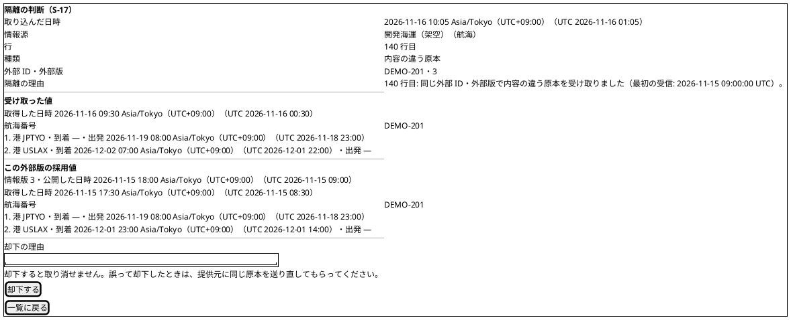
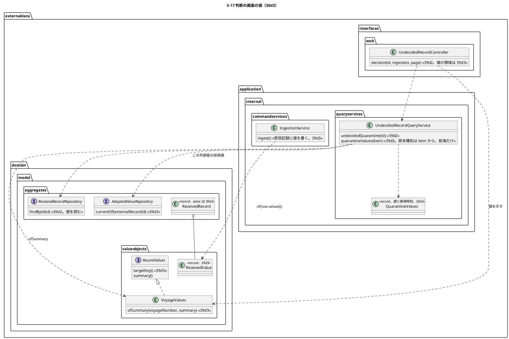
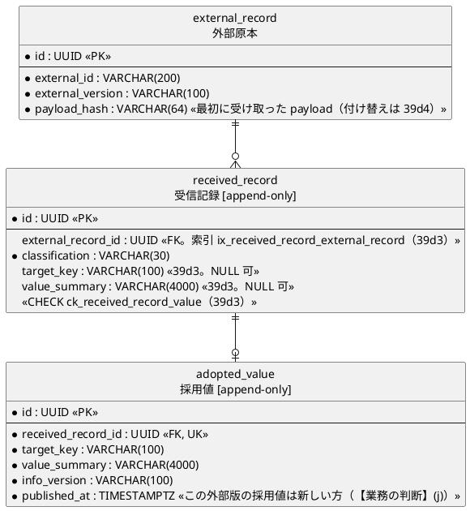

# Bolt 39d3 計画 - S-17 の判断の画面で内容の違う原本の受け取った値とこの外部版の採用値を比べる（受信記録の値の列）

## 基本情報

| 項目 | 内容 |
| :--- | :--- |
| Bolt | 第 39d3 回（W7 の 18 本目。release_plan :966 の 39d3 の行。この開始準備で 39d3・39d3c・39d3b に縦に分ける 1 つ目） |
| 状態 | 初稿（承認待ち） |
| 予定 | W7（2026-11-16 の週。前倒しで着手できる）。作業は約 4 時間 05 分（主要実績の値の示し方と読めない値と上限いっぱいの確かめを 39d3c に、採用を 39d3b に送った後。決定 (1)。目安の 4 時間に 5 分の見積りの誤差を含めて収まる）。下の「時間の配分と打ち切り」。`check`・`uiTest`・`manualScreenshots`・`demoVideo`・SonarQube・CI とステップごとの承認の待ちを除く） |
| アプローチ | アウトサイドイン（S-17 の判断の画面の値から。画面の層の受入シナリオ（`@ui`）の Red から入る。release_plan :966 の「アウトサイドイン（S-17 の採用から）」を、分けた後の 39d3 では判断の画面に値を示すところから入る形に読み替える。判断の画面と照会は 39d2 で固まっていて（UndecidedRecordController.java :293-320、UndecidedRecordQueryService.java :122-130）、受け取った値をどこに残し、どう読み戻して示すかが受入条件の中心）。内側（値の列・航海の要約から値に戻す規則・この外部版の採用値の照会）も足すが、受入条件の中心は値の見せ方で、値の規則は採用値の要約（39b3。VoyageValues.java :55-65）を写すだけなので、画面から入る |
| 対象 | (1) 受信記録の値の列 `target_key VARCHAR(100)`・`value_summary VARCHAR(4000)`（NULL 可。共通のマイグレーション。スキーマ）と、外部原本を持つ受信記録（採用・重複・内容の違う原本の隔離）に取込で値を書くこと（Bolt 39d の開始準備の決定 (8)）、(2) 航海の値の要約から取込の値に戻す規則（`VoyageValues.ofSummary`。39d3b の採用が同じ規則で採用値と DE-12 を作り直す）、(3) この外部版の採用値の照会（同じ外部原本（同じ外部 ID と外部版）の採用値のうち公開した時刻の新しいもの。【業務の判断】(j)）と、そのための受信記録の外部原本 ID の索引、(4) S-17 の判断の画面で、航海の内容の違う原本の「受け取った値」と「この外部版の採用値」を、それぞれの取得時刻とともに並べて示す（【業務の判断】(i)）、(5) マニュアル 12.2 の判断の画面の説明とキャプチャの撮り直し、(6) デモの動画（`@demo-bolt-39d3/compare`）。主要実績の値の示し方（`MilestoneValues.ofSummary`・入口 `RecordValues.ofSummary`・主要実績の `dl`・種類の表示名の写し）、読めない値の示し方、上限いっぱいの確かめ、採用の組み立て役を値から作れる形にしキーを `targetKey()` に寄せることは 39d3c に、採用の判断そのもの（採用値と DE-12・DE-13・DE-29 の `ADOPTED`、監査、`EXTERNAL_RECORD_ADOPTED` の Javadoc と DE-12・DE-13 の `publishedAt` の直し、採用の理由は任意）は 39d3b に送る（下の開始準備の決定 (1)。【前の決定の変更】(1)） |
| トレース | US-14 AC4（同一キー・異 payload は既存原本と採用値を上書きせず隔離しデータ責任者へ示す。user_story :561）、UC-15 の主成功シナリオ 5（データ責任者が差異と採否を確認する。system_usecase :408）・3b（system_usecase :527）、ED-INV-02、data_model の受信記録（:1155）・採用値（:1157）、domain_model の受信記録の判断（:1523）、ui_design の S-17 の判断の画面（:194・:1981 の画面イメージ・:2024）、ACC-01（WCAG 2.2 AA） |
| GitHub | [#18](https://github.com/k2works/practical-domain-driven-design-in-enterpris-application/issues/18)（US-14。クローズは 39h） |
| SP | 0 |
| 承認ゲート | **ステップごとに止める**（release_plan :966 の「ステップごと（スキーマ）」に、判断の画面の振る舞いが変わるので画面を足す）。スキーマ（受信記録の値の 2 列・CHECK・索引の共通のマイグレーション。ステップ 3）、画面（判断の画面の値の領域。ステップ 6）、新しいファイル（下の一覧）。判断の振る舞い・イベント・監査・認可は変えない（採用は 39d3b）。新しいセキュリティの判断と本番の操作はない |
| 開始準備で決めたこと | 下の (1)〜(10)（初稿。推奨を 1 つに決めて書き、2 つの整合性検証の指摘と見積りの超過の扱いを推奨のとおり反映した（Recommend 承認の指示による）。承認待ち）。【業務の判断】(i)・(j) を新しく記録する |

### 開始準備の決定

(1) **範囲と見積り**（【前の決定の変更】(1)）: release_plan :966 の 39d3 の行（Bolt 39d の開始準備の決定 (1) の表で約 3 時間 50 分。bolt_39d_plan.md :35）に、前の Bolt の申し送り（[39d 終了報告](bolt_39d_report.md) :100 の「`EXTERNAL_RECORD_ADOPTED` の Javadoc と DE-12・DE-13 の `publishedAt`」、[39d2 終了報告](bolt_39d2_report.md) :104 と [39d2b 終了報告](bolt_39d2b_report.md) :104 の「採用の判断を同じ判断の画面に足す（理由は任意。【業務の判断】(d)）」）と、コードで確かめて見つかった作業（下の (a)〜(g)）と、2 つの整合性検証の指摘で足した作業（(h)）を加えて引き直すと、1 本で約 7 時間 15 分になり、半日を超える（下の表。初稿の「約 6 時間 50 分」は、39d の 230 分に (a)〜(e) の 110 分を足した 340 分と合っていなかったので、表で足し算を合わせて直した）。39d の見積りより増えるのは、(a) データ責任者が採用の前に受け取った値とこの外部版の採用値を読めないと採否を決められない（今の判断の画面は注記の文だけ。decision.html :27-40）ので値を示す（【業務の判断】(i)。+40 分）、(b) 採用は外部原本の外部 ID・外部版を読むが、外部原本のポートは `findByKey` だけ（ExternalRecordRepository.java :13）なので `findById` を足す（+15 分）、(c) 監査の listener は DE-29 の理由を必須の部品として読み、理由のない判断の監査記録を書かずに捨てる（ExternalRecordAuditEventHandler.java :130 の `part(event.reason(), "reason")`、:178-183）ので、採用の理由を任意にする（【業務の判断】(d)）には listener も直す（+15 分）、(d) 受信記録の record に値を足すと、受信記録を組み立てる 19 か所（本体 3、テスト 16）と、`receivedRecordRow` を読む 3 つの SELECT（ReceivedRecordMapper.xml :40・:93・:110）を直す（+15 分）、(e) 要約から値に戻す規則と往復のテスト（39d の決定 (8) は「要約は寄港と主要実績に戻せる」と書いたが、戻すコードはない。+25 分）、(f) 比べる相手のこの外部版の採用値の照会と判断の画面の照会（`currentOf`・外部原本 ID の索引・`quarantineValues`。39d の 39d3 は採用だけで、比べる相手を読むことを見込んでいない。決定 (5)・(6)。+30 分）、(g) 採用の組み立て役は取込の行から採用値を作る形（AdoptionFactory.java :51-102 は `IngestedRow` を受ける）なので、受け取った値から作れる形に作り直し、キーを `targetKey()` に寄せる（決定 (9)。+20 分）、(h) 2 つの整合性検証で足した作業（受け取った値とこの外部版の採用値の取得時刻と「取得時刻だけが違う」の文（決定 (7)）の 15 分、`currentOf` の契約の仕掛けと直すテスト（決定 (5)）の 10 分、読めない値の文（決定 (6)・(7)）の 5 分、古い「39d3 = 採用」の参照の直し（文書とコード。ステップ 1・6）の 10 分、マニュアル 12.2 の採用に誤って採用したときの案内（39d3b。【業務の判断】(e)、D-95）の 5 分。+45 分）ため。

| 1 本のときの内訳 | 分 |
| :--- | ---: |
| Bolt 39d の開始準備の決定 (1) の 39d3（bolt_39d_plan.md :35） | 230 |
| (a) 判断の画面に値を示す | 40 |
| (b) 外部原本のポートの `findById` | 15 |
| (c) 理由のない DE-29 を受ける監査の listener | 15 |
| (d) 受信記録を組み立てる 19 か所と 3 つの SELECT | 15 |
| (e) 要約から値に戻す規則と往復のテスト | 25 |
| (f) この外部版の採用値の照会と判断の画面の照会 | 30 |
| (g) 採用の組み立て役を受け取った値から作れる形にし、キーを `targetKey()` に寄せる | 20 |
| (h) 2 つの整合性検証で足した作業 | 45 |
| **1 本の合計** | **435（約 7 時間 15 分）** |

| 分けて増える分（2 本目にも要る作業） | 分 |
| :--- | ---: |
| ステップ 1 の設計の文書 | 20 |
| Red の記録と直す既存のテストの一覧 | 15 |
| 品質ゲートと開発レビュー | 30 |
| 終了報告 | 10 |
| マニュアルのキャプチャの撮り直しと文の突き合わせ | 15 |
| 受入シナリオの例・Steps の土台と予備 | 15 |
| S-17・S-16 の UI のシナリオの流し直しとデモの動画 | 10 |
| **分けて増える分の合計** | **115** |

2 本に分けたときの合計は 435 ＋ 115 ＝ 550 分で、39d3 の 295 分（キーを寄せる作業を 39d3b に送った後、上限いっぱいの確かめを送る前）と 39d3b の 255 分（約 4 時間 15 分）の和に合う。2 本では 39d3 が約 4 時間 40 分（上限いっぱいの確かめを送った後）、39d3b が約 4 時間 15 分で、どちらも目安を超える（下の「見積りの超過の前例」と「3 本目を分ける」）。3 本に分けると、分けて増える分をもう一度払い、合計は 435 ＋ 115 × 2 ＝ 665 分で、下の 3 本の見積りの和（245 ＋ 185 ＋ 235）に合う。

**縦に 3 本に分ける**（推奨。見積りの超過の扱いは推奨のとおり。Recommend 承認の指示による）:

| Bolt | 範囲（縦） | アプローチ | 承認ゲート | 見積り |
| :--- | :--- | :--- | :--- | ---: |
| **39d3**（この計画） | データ責任者が判断の画面で内容の違う原本（航海）の受け取った値とこの外部版の採用値を比べる: 受信記録の値の列（スキーマ）と取込での書き込み（航海・主要実績の両方）、航海の要約から値に戻す規則（`VoyageValues.ofSummary`）、この外部版の採用値の照会と索引、判断の画面の航海の値の領域（それぞれの取得時刻、同じ値の 2 つの文、値のない隔離の文、この外部版の採用値がない文）、マニュアル 12.2 の判断の画面の説明とキャプチャ、デモの動画 | アウトサイドイン（S-17 の判断の画面の値から） | ステップごと（スキーマ・画面） | 約 4 時間 05 分 |
| **39d3c** | データ責任者が判断の画面で内容の違う原本（主要実績）の値を比べ、値を読めない隔離も却下で片付けられる: 主要実績の要約から値に戻す規則（`MilestoneValues.ofSummary`）と型で分ける入口（`RecordValues.ofSummary`。知らない原本種別は `IllegalArgumentException`）、判断の画面の主要実績の `dl` と種類の表示名の写し（行 14・18）、読めない値（壊れた要約・知らない原本種別）を 500 にせず「値を読めませんでした。」を示す（行 23）、上限いっぱいの確かめ（行 5 の寄港 60 と補助文字を含む 30 文字の航海番号の往復、行 15 の寄港 60 の幅 320 px）、採用の組み立て役を受け取った値から作れる形にし、キーを `targetKey()` に寄せる（振る舞いを変えないリファクタリング。39d3b から送る。下の「3 本目を分ける」）、マニュアル 12.2 の主要実績の値と読めない値の文、デモの動画 | アウトサイドイン（S-17 の判断の画面の主要実績の値から） | ステップごと（画面） | 約 3 時間 05 分 |
| **39d3b** | データ責任者が内容の違う原本の隔離を採用する: 外部原本のポートの `findById`、採用の判断（`DecisionKind.ADOPTED`、理由は任意。【業務の判断】(d)）、39d3c で値から作れる形にした採用の組み立て役で採用値と DE-12・DE-13（操作者は判断者、公開した時刻は判断の時刻）と DE-29（`ADOPTED`）を作る、キーのない隔離と値の列のない隔離は採用を出さない（【業務の判断】(a)、Bolt 39d の決定 (8)）、監査（理由のない DE-29 を受ける listener の直し、（操作、受信記録）ごとに 1 つ。IA-INV-15）、`EXTERNAL_RECORD_ADOPTED` の Javadoc と DE-12・DE-13 の `publishedAt` の直し、判断の画面の「採用する」と POST、マニュアル 12.2 の採用（誤って採用したときの案内を含む。【業務の判断】(e)、D-95）と付録 B、デモの動画 | アウトサイドイン（S-17 の採用から） | ステップごと（監査・画面） | 約 3 時間 55 分（2 本のときの約 4 時間 15 分から、39d3c に送る採用の組み立て役の作り直し（(g)）の 20 分を引く） |

比べた案: (i) 1 本のまま（約 7 時間 15 分。半日を超える）、(ii) 値を示さずに採用だけを 1 本にする（(a)・(f) と (h) の取得時刻・読めない値を除いても 345 分（約 5 時間 45 分）で、なお半日を超え、データ責任者が値を読まずに採否を決める。【業務の判断】(i) の比べた案）、(iii) スキーマと取込での書き込みだけを先に 1 本にする（画面に何も出ない横の切り方になり、利用者に見える成果がない）、(iv) 2 本のまま約 4 時間 40 分と約 4 時間 15 分を受け入れる（半日を 4 時間と読むと、どちらも決まりを超える。下の「見積りの超過の前例」）。分けた 3 本はどれも画面の振る舞いが変わる縦で、39d3・39d3c は値を示すだけで判断の振る舞いを変えないので、39d3b の採用の前に値の読み方を確かめられる（却下の判断にも使える）。

**3 本目を分ける**（主要実績で分けるのが縦として成り立つかをコードで確かめた）: 値の列とその書き込みは種類で分けられない。値の 2 列は航海・主要実績で共通の列（決定 (2)）で、取込のサービスは `ReceivedValue.of(row.values())` で取込の値の型（sealed interface。RecordValues.java :13 の `permits VoyageValues, MilestoneValues`）の `targetKey()`・`summary()` を読むだけなので、書き込みは 39d3 で両方の種類に行う（主要実績の `targetKey()` は追跡番号の値を返すだけ。MilestoneValues.java :17-19。39d3 と 39d3c の間に取り込んだ主要実績の隔離も値を持つ）。分けられるのは読み戻しと示し方で、照会のサービスは判断の画面の `Item` の原本種別（UndecidedRecordQueryService.java :136 の `source.recordType()`）で値に戻す型を決めるので、39d3 は原本種別が `VOYAGE` の内容の違う原本だけに値の領域を出し、主要実績の内容の違う原本の判断の画面は 39d2 の形のまま（値の領域を出さず、照会はポートを引かない。行 12）にする。これで 39d3 は「航海の値を比べる」縦、39d3c は「主要実績の値を比べる」縦として、それぞれ画面の振る舞いが変わる。

- **39d3c に送るもの**: 主要実績の値の示し方（`MilestoneValues.ofSummary` と入口 `RecordValues.ofSummary`、主要実績の `dl`、種類の表示名の写し。行 6 の主要実績・入口、行 7 の種類の名前がない、行 14・18。25 分）、読めない値（行 23。照会のサービスの例外の受け方と WARN のログの 5 分、画面とマニュアルの文の 5 分。10 分）。39d3 は 280 − 25 − 10 ＝ 245 分（約 4 時間 05 分）で、目安に収まる（下の「時間の配分と打ち切り」）
- **候補 (i) の送り先を 39d4 から 39d3c に変える**: 上限いっぱいの確かめ（行 5 の寄港 60 と補助文字を含む 30 文字の航海番号の往復、行 15 の寄港 60 の判断の画面の幅 320 px。15 分）は、39d3 に戻すと目安を超えるので送ったままにし、送り先を 39d4 から 39d3c にする。39d3c は約 3 時間 05 分で余裕があり、39d4 より先に H2 を広げない判断（決定 (2)）の上限を確かめられる（39d4 はすでに上限いっぱいの照会の計測・行 7 の契約のテスト・送り直しの受入シナリオを受けている。release_plan :968）。候補 (i) は取り下げない
- **39d3b から 39d3c に送るもの**: 39d3b は 2 本のときの約 4 時間 15 分のままだと目安を 10 分超えるので、採用の組み立て役を受け取った値から作れる形にし、キーを `targetKey()` に寄せる作業（(g)。20 分）を 39d3c に送る。今の組み立て役は取込の行（`IngestedRow`）から値・外部 ID・外部版・取得時刻を読む（AdoptionFactory.java :51-102。:60 の `row.acquiredAt()`、:62 の `row.values()`、:76・:96-97 の `row.externalId()`・`row.externalVersion()`）ので、これらを引数で受ける形にするのは取込での自動の採用の振る舞いを変えないリファクタリングで、今の取込のテスト（`IngestionServiceTest` の採用の行）と 39d3 の行 19（受信記録のキーと採用値のキーの一致）が守る。39d3b は約 3 時間 55 分になる。損なうもの: 作り直しを使う採用より 1 本先に行うので、39d3b の開始準備で採用に別の形が要ると分かれば作り直しが重なる（39d3c の直後が 39d3b なので、39d3b の開始準備で確かめる）
- **39d3c の見積り**: 分けて増える分（115 分。上の表）に、主要実績の値の示し方の 25 分、読めない値の 10 分、上限いっぱいの確かめの 15 分、採用の組み立て役の作り直しの 20 分を足して 185 分（約 3 時間 05 分）

順序は 39d2b → 39d3 → 39d3c → 39d3b → 39d4。39d3c を 39d3b の前に置く理由: (1) 39d3b の採用は航海と主要実績の両方の隔離を採用する（DE-12・DE-13）。データ責任者は値を読んでから採否を決める（【業務の判断】(i)）ので、主要実績の値を示す 39d3c が先でないと、主要実績の隔離を値を読まずに採用できてしまう。(2) 39d3b は主要実績の DE-13 を受け取った値から作り直すので、39d3c の `MilestoneValues.ofSummary` と、値から作れる形にした採用の組み立て役を使う。39d4 の外部原本の基準のハッシュの付け替えは採用の判断の中で行うので 39d3b の後（release_plan :968）。39e・39f は取込での自動の採用（39b3）の DE-12 で足り、39d3b を待たない（release_plan :976 の「隔離した行の採用は 39d3」「39d3 を待たない」を、ステップ 1 で「39d3b」に直す）。W7 は 27 本前後になる（39d2 の開始準備の見込みの 25 本前後から 2 本増える。release_plan :976）。W6 までで計画より約 3 週早い（release_plan :976）ので、バッファ消費ルールの範囲で吸収できる（W7 の週の見直しで確かめる）。

**見積りの超過の前例**: 39d と 39d2 は、計画の承認の場で作業を後の Bolt に送って目安の中（4 時間 00 分・4 時間 05 分）に収めた（[39d 終了報告](bolt_39d_report.md) :75 の上限いっぱいの照会の計測を 39d4 へ、[39d2 終了報告](bolt_39d2_report.md) :77・:97 の行 7 を契約のテストに上げる分を 39d2b へ）。超過を受け入れたのは 39d2b の約 4 時間 15 分だけだった（行 7 を 39d4 に送った後の 15 分。[39d2b 終了報告](bolt_39d2b_report.md) :78、bolt_39d2b_plan.md :472 の計画の承認の更新履歴）。CLAUDE.md の決まりは「Bolt は目安 2〜4 時間。半日を超える Bolt は分割する」で、半日は 4 時間と読むのが素直なので、39d2b の受け入れは半日の読み違えだった。39d3 から 4 時間を半日として分ける（5 分は見積りの誤差の範囲とし、4 時間 05 分までを目安の中とする）。39d2b は終えたので直さない。

**送るもの**: 採用の組み立て役のキーを `targetKey()` に寄せる作業（初稿の行 19 の一部。決定 (4)）は、39d3 から送り、採用の組み立て役の作り直し（(g)）の中で行う（39d3 の 5 分が減る）。作り直しは上の「3 本目を分ける」のとおり 39d3c で行う。2 本のときに比べた送る候補（主要実績の値の示し方を 39d3b に、この外部版の採用値の照会と示し方を 39d3b に、デモの動画をまとめる）は、3 本に分けて要らなくなったので取り下げる。上限いっぱいの確かめ（候補 (i)）は送り先を 39d3c にして残す。

(2) **受信記録の値の列（スキーマ）**: Bolt 39d の開始準備の決定 (8)（bolt_39d_plan.md :54、data_model :1155 の末尾）のとおり、`external_data.received_record` に `target_key VARCHAR(100)`・`value_summary VARCHAR(4000)`（どちらも NULL 可）を足す。採用値の同じ名前の列（V20261103100000 :133-134。`target_key VARCHAR(100)`・`value_summary VARCHAR(4000)`）と同じ型にする。CHECK `ck_received_record_value` で、(i) 2 列はそろって NULL かそろって NULL でない、(ii) 外部原本を持たない受信記録（キーのない隔離）は値を持たない（`(target_key IS NULL) = (value_summary IS NULL) AND (external_record_id IS NOT NULL OR target_key IS NULL)`）を守る。外部原本を持つ受信記録に値を必須にはしない（Bolt 39d3 より前の受信記録は NULL のまま。受信記録は追記専用で更新しない。data_model :1155）。

- **索引** `ix_received_record_external_record`（`received_record (external_record_id)`）を同じマイグレーションで足す: この外部版の採用値（決定 (5)）は「同じ外部原本の受信記録の採用値」を引くので、受信記録を外部原本 ID で絞る。今の索引は取込 ID と分類だけ（V20261103100000 :93-94）で、PostgreSQL は外部キーに索引を自動で作らない。判断の画面を開くたびに受信記録の表を全部読まないようにする（1 つの取込で 1 万件まで。IngestionFileLimit.java :13）。39d4 の付け替えと 39h の差異も外部原本ごとに受信記録を引く見込みだが、索引を足す理由は 39d3 の照会だけで足りる
- **版**: すべての場所の最新より後にする。今の最新は h2 の V20261105100000（V20261105100000__widen_received_record_decision_reason.sql）、common は V20261104170000、postgresql は V20261022100100、dev-data は V20261104160900（Flyway の場所は common・`{vendor}`・callback・dev-data。application.properties :4、application-dev.properties :6）。例として `db/migration/common/V20261105120000__add_external_data_received_record_value.sql`（ステップ 3 の開始で実際の最新を確かめて決める）
- **書き方**: 1 列・1 制約・1 索引ずつの文にする（H2 の PostgreSQL 互換モードと PostgreSQL の両方で通る形。前例 V20261104170000 の頭の注記）。列のコメントは日本語（「対象のキー（航海は航海番号、主要実績は追跡番号。キーのない隔離と Bolt 39d3 より前の行は NULL）」「値の要約（採用値と同じ規則の正規の文字列。キーのない隔離と Bolt 39d3 より前の行は NULL）」）
- **H2 は広げない**: H2 の VARCHAR は UTF-16 の単位で数える（前例 Bolt 39b4 の V20261104145000、Bolt 39d2 の V20261105100000）が、この 2 列は H2 でも上限に収まる。`value_summary` は ASCII だけでできている（港は UN/LOCODE `[A-Z]{2}[A-Z2-9]{3}`（Location.java :14）、時刻は `2026-11-19T23:00:00.000000Z` の形（RecordValues.java :27-34）、種類は enum の名前、区切りは `|`・`;`）ので UTF-16 の単位とコードポイントの数が同じ（寄港 60 で最大 3719 文字。VoyageValues.java :28-31）。`target_key` は航海番号ならコードポイントで 30 文字まで（VoyageValues.java :22。補助文字だけでも UTF-16 で 60 単位）、追跡番号なら ASCII 14 文字（TrackingNumberValue.java :17）で、どちらも `VARCHAR(100)` に入る。採用値の同じ 2 列も H2 で広げていない（h2 の場所に採用値のマイグレーションはない）。契約のテストで「寄港 60 の要約と補助文字を含む 30 文字の航海番号が H2 と PostgreSQL で往復する」を確かめる（行 5。T-242）。この上限いっぱいの往復は、見積りを目安に収めるため 39d3c に送り（決定 (1) の候補 (i)。送り先を 39d4 から 39d3c に変えた）、39d3 の行 5 は寄港 2 つの航海と主要実績の往復を確かめる。ADR-007 に「値の 2 列は ASCII と値の型の上限に収まるので H2 で広げない」を 1 行足す（ステップ 1）
- **追記専用の権限**: 表の印 `[append-only]`（V20261103100000 :96）はそのままで、PostgreSQL の afterMigrate のコールバックが UPDATE・DELETE を外す（V20261103130000 の注記）。値は受信記録の INSERT で書くので権限は変えない

(3) **受信記録の値の型**（T-246）: 値の 2 列を値オブジェクト `ReceivedValue`（`externaldata.domain.model.valueobjects`。対象のキーと値の要約。どちらも必須、要約は 4000 コードポイントまで（AdoptedValue.java :33 の `VALUE_SUMMARY_MAX_LENGTH` と同じ）。キーに独自の 100 の上限は置かない: キーは取込の値の `targetKey()` から作り、上限は値の型が守る（航海番号はコードポイントで 30 文字まで（VoyageValues.java :22）、追跡番号は 14 文字（TrackingNumberValue.java :17））。表の `VARCHAR(100)` はその外側の守り）にし、受信記録の record（ReceivedRecord.java :33-43）の最後に `value`（`ReceivedValue`、NULL 可）を足す。不変条件に「外部原本を持たない受信記録は値を持たない」（ReceivedRecord.java :52-57 の今の 2 つの規則の隣。表の CHECK と同じ規則）を足す。MyBatis の行（`ReceivedRecordRow`）・resultMap `receivedRecordRow`（ReceivedRecordMapper.xml :8-22 の constructor に `target_key`・`value_summary` の 2 列を足す）・`insert`（ReceivedRecordMapper.xml :24-32）・マッパーの頭の注記（:3-5 の「INSERT と数えること…」に値の 2 列を足す）・`receivedRecordRow` を読む 3 つの SELECT（`quarantinedOf` :40、`selectById` :93、`undecidedKeylessQuarantinesOf` :110）・メモリの実装（`InMemoryReceivedRecordRepository`）を直す。判断を待つ隔離の一覧の照会（`undecidedQuarantines` :79・`undecidedQuarantine` :101）は値の列を読まない（一覧は値を示さず、1 ページ 100 件で要約が最大 3719 文字なので読まない）。受信記録を組み立てる 19 か所（IngestionService.java の 2、MyBatisReceivedRecordRepository.java の 1、テストの 16）を直す

(4) **取込で値を書く・要約から値に戻す**: 取込の値の型に `targetKey()` を足す（`RecordValues`。RecordValues.java :13-19。航海は航海番号、主要実績は追跡番号の値）。今は採用の組み立て役が値の型で分けてキーを決めている（AdoptionFactory.java :62-101 の `voyage.voyageNumber()`・`trackingNumber.value()`）。採用の組み立て役のキーを `targetKey()` に寄せて取込の値の書き込みと 1 つの規則にするのは 39d3c に送る（39d3c で採用の組み立て役を受け取った値から作れる形に作り直すので、その中で行う。決定 (1) の「3 本目を分ける」）。39d3 では、受信記録に書くキーと同じ行の採用値のキーが一致することをテストで縛る（行 19）。取込の値の型の Javadoc の「受信記録の列には書かない（値は payload の行の原文に残る）」（RecordValues.java :10）と取り込む行の Javadoc の「取込のサービスは値を受信記録の列に書かず」（IngestFileCommand.java :91-93）は、外部原本を持つ受信記録に値を書くことに直す（ステップ 4）。取込のサービスは形式の正しい行の受信記録（IngestionService.java :196-206。採用・重複・内容の違う原本の隔離。どれも外部原本を持つ。:191-195）に `ReceivedValue.of(row.values())`（キーは `targetKey()`、要約は `summary()`）を書き、キーのない隔離（:311-326）には書かない。書くのは取込の外側の 1 つのトランザクション（IngestionService.java :113 の `@Transactional`）の中の受信記録の INSERT で、セーブポイントもイベントも足さない。

要約から値に戻す規則は値の型に置く。39d3 は航海の `VoyageValues.ofSummary(String voyageNumber, String summary)`（寄港を `|` で分け、各寄港を `;` で「UN/LOCODE;到着;出発」に分ける。空の時刻は null。VoyageValues.java :55-65）を足す。主要実績の `MilestoneValues.ofSummary(String trackingNumber, String summary)`（「種類;場所;発生時刻」。MilestoneValues.java :28-31）と、型で分ける入口 `RecordValues.ofSummary(String recordType, String targetKey, String summary)`（原本種別 `VOYAGE`・`MILESTONE`。IdempotencyKey.java :8-11 の原本種別の名前。ほかは `IllegalArgumentException`。判断の画面では照会のサービスが受けて「値を読めない」にする）は 39d3c で足す（決定 (1) の「3 本目を分ける」）。39d3 の照会のサービスは原本種別が `VOYAGE` のときだけ `VoyageValues.ofSummary` を呼ぶ（決定 (6)）。値の規則（寄港 2〜60、同じ寄港を重ねない、到着か出発の一方、追跡番号の形）は今のコンストラクタがそのまま守る。規則に合わない要約（区切りの数の違い、読めない時刻）は `IllegalArgumentException` にする（取込が書いた要約からは起きない。表を直に書き換えた誤りを黙って読まない。39d3 から 39d3c までの間は、判断の画面がこの例外を受けずに 500 になる。決定 (6) の読めない値）。往復の約束は「取込の値 `v` について `ofSummary(v.targetKey(), v.summary())` が `v` と等しい」で、時刻はマイクロ秒に切り捨てた値（取込が切り捨てる。IngestFileCommandAssembler.java :319-322）に限る

(5) **この外部版の採用値**（【業務の判断】(j)）: 内容の違う原本と比べる「この外部版の採用値」は、**同じ外部原本（同じ提供元・原本種別・外部 ID・外部版）の受信記録に付いた採用値のうち、公開した時刻の最も新しいもの**（同じ時刻なら採用値 ID の順の最後）とする。同じ外部 ID の別の外部版の採用値は含めない（外部版が違えば別の外部原本。対象のキーで業務に効くのは新しい外部版の採用値で（Bolt 39d の決定 (13)。bolt_39d_plan.md :64）、版をまたぐ比べは差異（39h。【業務の判断】(f)）なので、この照会の範囲ではない）。Bolt 39d の「採用中の値」（bolt_39d_plan.md :56 の決定 (9)・(10)）の語は 39d の意味のまま残し、前の決定は変えない。画面・マニュアル・用語集の語は「この外部版の採用値」にする。39d3 の時点では、外部原本は取込で採用になった受信記録のときだけ作られ（IngestionService.java :191-195）、その採用値が 1 つある。39d3b で隔離を採用すると同じ外部原本の採用値が 2 つになり、判断の時刻を公開した時刻にする（Bolt 39d の決定表の 39d3 の行。bolt_39d_plan.md :35）ので、採用した隔離の値がこの外部版の採用値になる。読むのは採用値のポートに足す `currentOf(UUID externalRecordId)`（`Optional<AdoptedValue>`。AdoptedValueRepository.java :11-23 の追記と受信記録 ID の照会の隣。SQL は `adopted_value a JOIN received_record r ON r.id = a.received_record_id WHERE r.external_record_id = ?` を `a.published_at DESC, a.id DESC` で 1 件。索引は決定 (2)）。採用値の取得時刻は採用値の受信記録の `acquired_at`（ReceivedRecord.java :39）で、照会のサービスが採用値の受信記録 ID で受信記録を `findById` して読む（決定 (6)。`currentOf` の型は変えない）。メモリの実装（`InMemoryAdoptedValueRepository`）はメモリの受信記録のリポジトリを受け取って結び、同じ時刻の採用値は ID を `toString()` で並べる（DB と同じく文字列の表現の順。InMemoryReceivedRecordRepository.java :54-60 の前例）。採用値は今も航海・主要実績の値の要約を持つ（data_model :1157）ので、39d3 より前に取り込んだ外部原本でもこの外部版の採用値は読める。

- **契約の仕掛け**: 採用値の契約（`AdoptedValueRepositoryContract`）に、外部原本を指定して採用の受信記録を用意する仕掛け（外部原本・取込・受信記録を書いてから採用値を追記する）を足す（例 `givenReceivedRecordOf(UUID externalRecordId)`。名前はステップ 2 で T-246 の検索をしてから決める）。今の仕掛け `givenReceivedRecord()`（AdoptedValueRepositoryContract.java :29-30）は外部原本を指定できず、メモリの実装はランダムな ID を返すだけ（InMemoryAdoptedValueRepositoryTest.java :15-19）
- **直すテスト**: メモリの実装のコンストラクタが受信記録のリポジトリを受けるので、`InMemoryAdoptedValueRepositoryTest`・`H2AdoptedValueRepositoryTest`・`MyBatisAdoptedValueRepositoryIntegrationTest`（契約の仕掛けの実装）、`AcceptanceTestConfiguration`（:487-488 の `new InMemoryAdoptedValueRepository()`）、`IngestionServiceTest`（:107 の `new InMemoryAdoptedValueRepository()` と :1736 の `RecordingAdoptedValues`）を直す（ステップ 5）

(6) **判断の画面の中身の照会**: 照会のサービス `UndecidedRecordQueryService` に `quarantineValues(UndecidedRecordPage.Item quarantine)` を足す。値を返すのは、分類が隔離で外部原本を持つ受信記録（内容の違う原本）のうち、原本種別が `VOYAGE` のものだけ（`Optional<QuarantineValues>`。キーのない隔離（`Item` の形式の誤りの印。UndecidedRecordQueryService.java :138）と、39d3c までの主要実績の内容の違う原本は受信記録も採用値も引かずに空、ない受信記録・分類が隔離でない受信記録は採用値を引かずに空）。原本種別（値に戻す型を決める）は判断の画面の `Item` の `recordType`（UndecidedRecordQueryService.java :131-141 の `item` が情報源から写す）から渡し、取込と情報源を読み直さない。主要実績を値に戻すのは 39d3c（決定 (1) の「3 本目を分ける」）。引くのは、受信記録の `findById`（ReceivedRecordRepository.java :44。値・外部原本 ID・取得時刻を持つ）を 1 回、この外部版の採用値の `currentOf` を 1 回、採用値があればその受信記録の `findById`（採用値の取得時刻）を 1 回で、引く数は照会のサービスの単体でポートの呼び出しの記録で縛る（行 12・13。T-236）。`QuarantineValues`（`externaldata.application.internal.queryservices`。前例 `KeylessRejectionTarget`）は、受け取った値（`RecordValues`。値の列が NULL なら null）とその取得時刻（受信記録の `acquired_at`）、この外部版の採用値（`RecordValues`。なければ null）とその情報版（外部版）・公開した時刻・取得時刻（採用値の受信記録の `acquired_at`）を持つ（値を読めたかの印は 39d3c で足す。下の読めない値）。照会のサービスの組み立て（ExternalDataConfiguration.java :48-55）に採用値のリポジトリを足す。一覧の `page` と判断の画面の行き先（ReceivedRecordDecisionService.java :58-64 の `refusalOf`）は変えない。

- **読めない値（39d3c）**: 受け取った値か採用値の要約が規則に合わない（壊れた要約。決定 (4) の `IllegalArgumentException`）か、原本種別が `VOYAGE`・`MILESTONE` でない（知らない原本種別）ときは、照会のサービスが例外を受けて「値を読めない」とし（その値は null、読めない印を立てる）、ERROR でなく WARN のログに受信記録 ID を残す。判断の画面は 500 にせず、値の領域に「値を読めませんでした。」を示し、却下の欄は残す（データ責任者が却下で片付けられる。取込が書いた要約からは起きず、表を直に書き換えた誤りを黙って読まない）。見積りを目安に収めるため 39d3c に送る（決定 (1)）。39d3 から 39d3c までの間は、航海の要約が壊れていると判断の画面が 500 になる（取込が書いた要約からは起きず、表を直に書き換えたときだけ。パイロットの前で業務のデータはなく、39d3c がすぐ後に続くので受け入れる。申し送りの表）

(7) **判断の画面に値を示す**（【業務の判断】(i)。39d3 は航海、主要実績と読めない値は 39d3c）: 航海の内容の違う原本の判断の画面（decision.html :27-40 の隔離の中身の後、:41 の前）に 2 つの領域を足す。見出し `h2`「受け取った値」と「この外部版の採用値」。受け取った値には「取得した日時 …」（受信記録の `acquired_at`）を、この外部版の採用値には「情報版 N・公開した日時 …・取得した日時 …」（取得した日時は採用値の受信記録の `acquired_at`）を添える。日時は `DateTimeDisplay.staff`（UndecidedRecordController.java :309 と同じ形）。取得時刻は取込ファイルの `acquired_at` の列の値（CsvFileKind.java :11-20）で、行の原文に含まれるのでハッシュ（隔離の決まり方）に入るが、取込の値と要約には入らない（IngestFileCommand.java :103-110 の `IngestedRow` は取得時刻と値を別に持つ）ので、値だけを示すと取得時刻の違いが見えない。

- 航海は「航海番号」と、寄港を運航の順の番号付きの並び（`ol`）で「港 JPTYO・到着 —・出発 2026-11-19 08:00 Asia/Tokyo（UTC+09:00）（UTC 2026-11-18 23:00）」の形で示す（表にしない。寄港 60 の航海を幅 320 px で横スクロールなしに示すため。ACC-01）
- 主要実績（39d3c。39d3 では主要実績の内容の違う原本に値の領域を出さない）は `dl` で「追跡番号」「種類」（日本語の名前。外部データは追跡の型を参照できない（モジュールの規則）ので、追跡の表示名（TrackingRecordViews.java :46-53 の `KIND_NAMES`。private な定数で、外部データのテストからも参照できない）の写しを画面の層に置く。テストは用語集の実績の種類の名前（docs/manual/用語集.md :54 の「集荷・搬入・出発・積替・到着・引渡し」）を `MilestoneKindValue` の値ごとに書き並べ、すべての値を縛る。行 18。T-240）「場所」「発生時刻」
- 受け取った値とこの外部版の採用値が等しい（`RecordValues` の同一性）ときは、2 つの領域の前に文を 1 つ示す（隔離はハッシュで決まる（IngestionService.java :183-190）ので、値の同じ原本も隔離になる。データ責任者が違いを探さずに済む）。値も取得時刻も同じなら「受け取った値はこの外部版の採用値と同じです。原本の書き方（引用符・空白など）だけが違います。」、値は同じで取得時刻が違うなら「受け取った値はこの外部版の採用値と同じで、取得時刻だけが違います。」。値が違えばどちらも出さない。違いの強調（寄港ごとの差分の印）はしない（下の「入れないもの」）
- 受け取った値がない（Bolt 39d3 より前に取り込んだ隔離）ときは「受け取った値」の領域に「この隔離は、受け取った値を記録する前に取り込みました。値は原本のファイルで確かめてください。」を示す。この外部版の採用値がないときは「この外部版の採用値はありません。」を示す。値を読めない（決定 (6)）ときは、その領域に「値を読めませんでした。」を示す（同じ値の文は出さない。39d3c）
- キーのない隔離（形式の誤り）の判断の画面には 2 つの領域を出さない（値を読めていない。【業務の判断】(a)）。却下の欄・取り消せないことの文・「一覧に戻る」は変えない（decision.html :42-54）
- 文は画面の層の定数、テンプレートは `th:text`（取込ファイルから来た値を含む。航海番号は外部 ID の列の値）

(8) **判断の振る舞い・イベント・監査は変えない**: 39d3 は値を示すだけで、判断の画面の行き先（判断できる受信記録の定め）・却下の POST・DE-29・監査の listener を変えない（ReceivedRecordDecisionService.java :58-95、ExternalRecordAuditEventHandler.java :112-132）。コードの「39d3 = 採用」の古い参照は、ステップ 6 で `apps/cargo-tracker/src` を「39d3」で検索して「39d3b」に直す。開始準備の検索で挙がったのは、DecisionKind.java :11、ReceivedRecordDecision.java :24、ReceivedRecordDecided.java :12、AuditAction.java :101、UndecidedRecordController.java :37、undecided-records/index.html :15、undecided-records/decision.html :16、reject_quarantine_ui.feature :6、review_undecided_records_ui.feature :6 の 9 か所。RecordValues.java :10 と IngestFileCommand.java :91-93 の「受信記録の列には書かない」は決定 (4) のとおり値を受信記録に書くことに直す（ステップ 4）

(9) **39d3c・39d3b に送るもの**（下の「申し送り」）: 39d3c には、主要実績の値の示し方（`MilestoneValues.ofSummary`・入口 `RecordValues.ofSummary`・主要実績の `dl`・種類の表示名の写し）、読めない値（決定 (6)）、上限いっぱいの確かめ（決定 (2)）、採用の組み立て役を取込の行でなく値から作れる形にし、その中でキーを `targetKey()` に寄せる（振る舞いを変えないリファクタリング。決定 (1)・(4)。AdoptionFactory.java :51-102）を送る。39d3b には、採用の判断（`ReceivedRecordDecision` の採用のファクトリー、理由は任意で 1000 文字まで。【業務の判断】(d)。DecisionKind.java :12 の `ADOPTED`）、外部原本のポートの `findById`、採用値と DE-12・DE-13 を受け取った値から作る（39d3c で作り直した採用の組み立て役を使う。操作者は判断者、公開した時刻は判断の時刻）、DE-29 の `ADOPTED`、理由のない DE-29 の監査（ExternalRecordAuditEventHandler.java :130）、`EXTERNAL_RECORD_ADOPTED` の Javadoc（AuditAction.java :89-93 の「取込で自動に採用した」）と DE-12・DE-13 の `publishedAt` の Javadoc（VoyageAdoptedValueUpdated.java :26、MilestoneAdoptedValueAccepted.java :28 の「取込の時刻」）と domain_model の DE-12・DE-13 の行（:1697-1698）の直し、判断の画面の「採用する」と POST。トランザクションの形は 39d3b の開始準備で、判断のリポジトリの追記がセーブポイントの中（MyBatisReceivedRecordDecisionRepository.java :29-30 の `NESTED`）で、採用値のリポジトリの追記はセーブポイントを持たず一意制約の違反を上げる（MyBatisAdoptedValueRepository.java :27-40。DuplicateAdoptedValueException.java :8 の「取込のサービスは捕まえずに上げ、取込全体を巻き戻す」）ことを前提に、判断を先に追記してから採用値を書く順を決める

(10) **新しい型の名前**（T-246。`apps/cargo-tracker/src` で `ReceivedValue`・`QuarantineValues`・`quarantineValues`・`ofSummary`・`currentOf`・`ix_received_record_external_record` を検索して、ないことを確かめた。`targetKey()` は採用値の record の部品と、テストの読み出しだけで、取込の値の型にはない）: 本体 `ReceivedValue`（`externaldata.domain.model.valueobjects`）、`QuarantineValues`（`externaldata.application.internal.queryservices`）、マイグレーション（決定 (2) の版）。39d3 で足すメソッドは `VoyageValues.ofSummary`・`targetKey()`・`currentOf`・`quarantineValues`（`MilestoneValues.ofSummary` と入口 `RecordValues.ofSummary` は 39d3c。名前はこの検索で決めたものを使う）。テンプレートは新しく作らない（decision.html に足す）。テストは既存のクラスに `@Nested class Bolt39d3_…` で足し、契約のテストは名前の頭に `Bolt39d3_`。新しい受入シナリオ `features/ui/compare_quarantine_values_ui.feature` と Steps `CompareQuarantineValuesUiSteps.java`

【前の決定の変更】(1): release_plan :966 の 39d3 の行（Bolt 39d の開始準備の決定 (1) の 39d3。約 3 時間 50 分）を、この開始準備で半日を超える（約 7 時間 15 分）ので 39d3（航海の値を比べる）・39d3c（主要実績の値を比べる）・39d3b（採用）の 3 本に縦に分ける（決定 (1)。初稿の 2 本は、2 本とも 4 時間を超えるので、見積りの超過の扱いを推奨のとおり 3 本に直した。Recommend 承認の指示による）。release_plan の W7 の節の 39d3 の行を直し、39d3c と 39d3b の行を足した（案。承認待ち）。順序の段落（:976）・デモ項目（:982）・確認ポイント 23（:935）・承認ゲートの範囲（:895）・局面とアプローチ（:893）に 39d3c・39d3b を足すのはステップ 1。注: Bolt 39d の開始準備の決定 (9) の「39d3・39d4 の終了報告の議題の先頭に置く」（【業務の判断】(b)・(f)。bolt_39d_plan.md :56）の 39d3 は、採用を 39d3b に分けたので 39d3b に読み替える（39d3 は採用せず、(b)・(f) の論点の採用した後の再送が起きない）。同じく決定 (13) の「マニュアルに書き（39d3・39d4）」（【業務の判断】(e)。bolt_39d_plan.md :64）と台帳 D-95 の「39d3・39d4」も 39d3b に読み替える（ステップ 1 で D-95 を直す）。

【前の決定の変更】(2): ADR-004 の Bolt 39b2b の項の「値の持ち方」（004-external-data-ingestion.md :99 の「受信記録・外部原本の列には書かない」）を、受信記録に値の 2 列を足して改める。改めることは Bolt 39d の開始準備の決定 (8)（【前の決定の変更】(2)。bolt_39d_plan.md :54）で決めてあり、39d3 で実装して ADR の改訂の経緯に記録する（ステップ 1。下の「設計文書に直す箇所」の ADR-004）。外部原本の列には書かないまま。

新しいファイル（39d3）: 本体は決定 (10) の 2 個（.java）とマイグレーション 1 個（.sql）。テスト: 受入シナリオ `features/ui/compare_quarantine_values_ui.feature` と Steps `CompareQuarantineValuesUiSteps.java`（新しいテストのクラスはこれだけ）。デモの動画 `docs/assets/demo/bolt-39d3/compare.webm`（`demoVideo` が作る）。直すもの: `ReceivedRecord`・`RecordValues`（`targetKey()`・Javadoc :10）・`VoyageValues`（`targetKey()`・`ofSummary`）・`MilestoneValues`（`targetKey()` だけ。`ofSummary` は 39d3c）・`IngestFileCommand`（Javadoc :91-93）・`IngestionService`、`ReceivedRecordRow`・`ReceivedRecordMapper`（.java・.xml）・`MyBatisReceivedRecordRepository`・`AdoptedValueRepository`・`AdoptedValueMapper`（.java・.xml）・`MyBatisAdoptedValueRepository`、テストの `InMemoryReceivedRecordRepository`・`InMemoryAdoptedValueRepository`、`UndecidedRecordQueryService`・`ExternalDataConfiguration`、`UndecidedRecordController`・`decision.html`、古い「39d3 = 採用」の参照の 9 か所（決定 (8)）、テスト `ExternalDataRecordRepositoriesContract`・`AdoptedValueRepositoryContract`（契約の仕掛け）・`InMemoryAdoptedValueRepositoryTest`・`H2AdoptedValueRepositoryTest`・`MyBatisAdoptedValueRepositoryIntegrationTest`・`AcceptanceTestConfiguration`・`VoyageValuesTest`・`MilestoneValuesTest`・`IngestionServiceTest`（`RecordingAdoptedValues` を含む）・`UndecidedRecordQueryServiceTest`・`UndecidedRecordControllerTest`・`MyBatisExternalDataRecordRepositoriesIntegrationTest`（CHECK）と受信記録を組み立てるテスト、`manual_screenshots.feature`、マニュアル 12 章と用語集。`AdoptionFactory` は 39d3 では直さない（値から作れる形にしキーを `targetKey()` に寄せるのは 39d3c。決定 (4)）。キャプチャ `docs/manual/assets/12-undecided-record-decision.png` を撮り直す（新しいキャプチャは作らない）。

## Bolt ゴール

データ責任者が S-17 の一覧から航海の内容の違う原本の「判断する」を開くと、判断の画面で隔離の中身と理由の後に「受け取った値」（取得した日時）と「この外部版の採用値」（情報版・公開した日時・取得した日時）が並び、寄港の並びをこの外部版の採用値と見比べてから却下を決められる。値が同じで原本の書き方だけが違うとき、値が同じで取得時刻だけが違うときはそう示す。判断の画面は幅 320 px で横スクロールなしに読める（寄港 60 の上限いっぱいの確かめは 39d3c）。値は取込のときに受信記録に残り（航海・主要実績の採用・重複・内容の違う原本の隔離。形式の誤りには残らない）、航海は採用値と同じ規則の要約から値に戻せる（39d3b の採用が同じ規則で採用値とイベントを作り直す）。主要実績の値の示し方と、値を読めないときの示し方は 39d3c。値を記録する前の隔離は、その旨を示す。マニュアル 12.2 の判断の画面の説明とキャプチャが新しい画面と合い、デモの動画がある。

### 開始準備で確かめたこと

- **release_plan の 39d3 の行**（:966）: 「受信記録に値の列（`target_key`・`value_summary`。NULL 可。スキーマ）と取込での書き込み、採用の判断で採用値と DE-12・DE-13 と判断のイベント、キーのない隔離と値の列のない隔離は採用を出さない、監査の不変条件（IA-INV-15）、`EXTERNAL_RECORD_ADOPTED` の Javadoc と DE-12・DE-13 の `publishedAt` の直し、マニュアル 12.2 の採用、デモの動画」、アプローチはアウトサイドイン（S-17 の採用から）、承認ゲートは「ステップごと（スキーマ）」
- **前の Bolt の申し送り**: [39d 終了報告](bolt_39d_report.md) :100（採用と受信記録の値の列（スキーマ）、`EXTERNAL_RECORD_ADOPTED` の Javadoc と DE-12・DE-13 の `publishedAt`）、[39d2 終了報告](bolt_39d2_report.md) :104・[39d2b 終了報告](bolt_39d2b_report.md) :104（採用の判断を同じ判断の画面に足す、理由は任意。【業務の判断】(d)）。Bolt 39d の開始準備の決定 (7)（キーのない隔離は却下だけ。【業務の判断】(a)）・(8)（値の列と要約からの作り直し、39d3 より前の受信記録は採用できない）・(11)（採用の理由は任意）・(12)（判断のイベントと監査）・(13)（取り消さない）は bolt_39d_plan.md :52-64
- **【業務の判断】(b)・(f) と再送の扱いの範囲**: (b)（採用の判断で外部原本の基準のハッシュを付け替え、採用した payload の再送は重複、元の payload の再送は隔離）と (f)（同じ外部版は隔離、版をまたげば差異）は bolt_39d_plan.md :56 の決定 (9)。release_plan の 39d4 の行（:968）に「採用した後の外部原本の基準のハッシュの付け替え」「同じ外部版は隔離・版をまたげば差異（39h）」があり、**39d4 の範囲**（差異は 39h）で、39d3・39d3b の範囲ではない。39d3b の後 39d4 までの間は、採用した payload を送り直すと最初の payload のハッシュと比べて再び隔離になる（外部原本は最初に受け取った payload のハッシュを持つ。ExternalRecord.java :18、V20261103100000 :71）。パイロットの前で業務のデータはなく、39d4 がすぐ後に続くので受け入れる（申し送りの表）
- **受信記録と外部原本の今の形**: 受信記録は値を持たず（ReceivedRecord.java :33-43、data_model :1155 の「値の列は持たず、値は payload の行の原文に残る」）、外部原本は取込で採用のときだけ作る（IngestionService.java :191-195）。内容の違う原本の隔離は外部原本 ID を持つ（:196-206）。隔離はハッシュの違いで決まる（:183-190）
- **採用値**: 要約の規則と例（data_model :1157、VoyageValues.java :55-65、MilestoneValues.java :28-31）、上限 4000 コードポイント（AdoptedValue.java :33）、公開した時刻は取込の時刻（AdoptedValue.java :20、AdoptionFactory.java :61）。採用値のポートは追記と受信記録 ID の照会だけ（AdoptedValueRepository.java :11-23）
- **スキーマ**: 受信記録（V20261103100000 :75-105。索引 :93-94）、採用値（:129-142）、行の範囲を足した前例（V20261104170000。1 列・1 制約ずつ）、H2 だけ広げた前例（V20261104145000・V20261105100000）。Flyway の場所（application.properties :4）
- **判断の画面の今の形**: 中身は一覧と同じ項目と注記（UndecidedRecordController.java :293-320、decision.html :27-40）、キーのない隔離の文（decision.html :41）、却下の欄（:42-53）。中身の照会（UndecidedRecordQueryService.java :122-130）
- **監査の listener**: DE-29 の理由は必須の部品（ExternalRecordAuditEventHandler.java :130・:178-183）で、理由のない DE-29 は書かずに捨てる（:138-151）。39d3b で直す（決定 (9)）
- **マニュアル**: 12.2 の「隔離の判断の画面」の説明の表（docs/manual/12-外部データ.md :265-278）、却下の手順（:280-286）、「注意・補足」の「内容の違う原本を採用する（受け取った内容を業務で使う）ことは、まだ画面でできません」（:352）。キャプチャ `12-undecided-record-decision.png` は内容の違う原本の判断の画面（manual_screenshots.feature :260）

## 設計の決定

| 項目 | 決定 | 根拠 |
| :--- | :--- | :--- |
| 範囲と分け方 | 開始準備の決定 (1)。39d3（航海の値を比べる。約 4 時間 05 分）・39d3c（主要実績の値を比べる・読めない値・上限いっぱいの確かめ・採用の組み立て役の作り直し。約 3 時間 05 分）・39d3b（採用。約 3 時間 55 分）に縦に分け、39d3 → 39d3c → 39d3b の順にする（【前の決定の変更】(1)。見積りの超過の扱いは推奨のとおり。Recommend 承認の指示による） | 下の「時間の配分と打ち切り」、bolt_39d_plan.md :35、bolt_39d_report.md :75、bolt_39d2_report.md :77、bolt_39d2b_report.md :78、RecordValues.java :13、AdoptionFactory.java :51-102、UndecidedRecordQueryService.java :136 |
| 値の列 | 決定 (2)。2 列 NULL 可、CHECK（そろって NULL、キーのない隔離は値なし）、外部原本 ID の索引。H2 は広げない | V20261103100000 :93-94・:133-134、Location.java :14、VoyageValues.java :22・:31、TrackingNumberValue.java :17 |
| 値の型 | 決定 (3)。`ReceivedValue` を受信記録の最後に（NULL 可。キーの上限は値の型が守る）。一覧の照会は値を読まない | ReceivedRecord.java :33-57、ReceivedRecordMapper.xml :8・:24・:40・:79・:93・:101・:110、VoyageValues.java :22、TrackingNumberValue.java :17 |
| 書き込みと読み戻し | 決定 (4)。`targetKey()` を取込の値に足し、外部原本を持つ受信記録に書く（航海・主要実績）。航海は `VoyageValues.ofSummary` で戻す（往復の約束）。主要実績の `ofSummary` と入口、採用の組み立て役のキーを寄せるのは 39d3c | IngestionService.java :113・:191-206・:311-326、AdoptionFactory.java :62-101、IngestFileCommandAssembler.java :322 |
| この外部版の採用値 | 決定 (5)。同じ外部原本（同じ外部 ID と外部版）の採用値のうち公開した時刻の新しいもの。別の外部版の採用値は含めない。【業務の判断】(j) | AdoptedValueRepository.java :11-23、bolt_39d_plan.md :35・:64 |
| 判断の画面 | 決定 (6)・(7)。航海の内容の違う原本だけに「受け取った値」「この外部版の採用値」とそれぞれの取得時刻。同じ値の文を値と取得時刻で 2 つに分ける、値のない隔離の文。原本種別は `Item` から渡す。`ol` で幅 320 px。主要実績の `dl` と読めない値の文は 39d3c。【業務の判断】(i) | decision.html :27-41、UndecidedRecordController.java :293-320、UndecidedRecordQueryService.java :131-141、TrackingRecordViews.java :46-53、CsvFileKind.java :11-20、IngestFileCommand.java :103-110 |
| 判断・イベント・監査 | 決定 (8)。変えない（採用は 39d3b） | ReceivedRecordDecisionService.java :58-95、ExternalRecordAuditEventHandler.java :112-132 |
| 状態遷移とナビ | 受信記録の判断の状態遷移（domain_model :1523-1540）は変えない（判断を足さない）ので、この計画では状態遷移図を省く。ナビ・画面遷移も変えない（判断の画面の中身が増えるだけ）ので画面遷移図を省く | domain_model :1523 |
| 型の名前 | 決定 (10)（T-246 で検索した） | — |

## ふりかえりと前の Bolt からの引き継ぎ

| 出典 | 内容 | この Bolt での扱い |
| :--- | :--- | :--- |
| W6 の Try T-204・T-212、Bolt 38h の T-227、Bolt 39b の T-233、Bolt 39d・39d2 の Problem | サブエージェントへの指示の最初に heredoc と標準入力を待つコマンド（`python -`、引数のない `cat >` など）を使わないと書く | 任せるときの指示の最初に書く（39d2b では違反が止まった。[39d2b 終了報告](bolt_39d2b_report.md) :96）。計画を直すときもファイルは Write・Edit で書く |
| Bolt 39d の T-247、Bolt 39d2 の Try | 決まりを文章の指示ではなく仕組みで守らせる（フック） | W7 の締めで諮る（39d2 の終了報告のとおり）。39d3 では任せる範囲を、ファイルを Write・Edit で書く作業と読むだけの検索に絞り、Gradle と git を人の側の 1 か所に残す。任せる指示に触らないもの（`.claude/agent-memory`・`.run/`・`apps/cargo-tracker/.claude/`、ほかの作業のテスト）を名前で書く |
| Bolt 39d の T-248 | `git add` は `git status --short` の出力を使わず、ディレクトリか `git add -u` で指定する | 各ステップのコミットで、本体・テストはパッケージのディレクトリ、文書は `docs/` の下のディレクトリで指定する（マニュアルは `docs/manual`） |
| Bolt 39d2b の T-249 | 担当への指示に私の言葉を書くときは「（私の指示）」と出典を付け、計画に人の指示として書き写さない | 見積りの目安は CLAUDE.md の決まり（「目安 2〜4 時間。半日を超える Bolt は分割する」）として書き、人の指示として書かない。半日を 4 時間と読み、5 分を見積りの誤差の範囲とする扱い（決定 (1) の前例の段落）は、決まりの読み方として書く |
| Bolt 39d2b の学び（判断と学び） | トランザクションとセーブポイントの形は、取込と判断で違うので推し量らずコードで確かめる | 39d3 の書き込みは取込の外側のトランザクションの中の INSERT だけ（IngestionService.java :113。セーブポイントなし）。39d3b の採用は判断のリポジトリの追記がセーブポイントの中、採用値のリポジトリの追記はセーブポイントなし（決定 (9) に出典を添えた） |
| W6 の Try T-217、Bolt 39b2 の Try | 本体を直す前に Red を流し、落ちた理由を記録する。直したテストの一覧を添える | ステップ 2。受信記録の record に値を足して直す 16 か所のテスト（決定 (3)）、判断の画面の HTML の順が変わる `UndecidedRecordControllerTest`・`reject_quarantine_ui.feature`・`RejectQuarantineUiSteps`（判断の画面の Tab の順）、`manual_screenshots.feature` を、ステップ 2 の開始で grep して一覧にする |
| W6 の Try T-191 | 環境の前提に設定ファイルの行を添える | Flyway の場所（application.properties :4、application-dev.properties :6）、追記専用の権限のコールバック（V20261103130000 の注記）を決定 (2) に添えた |
| W6 の Try T-225・T-213 | push の前に `check` | ステップ 8（`uiTest` も流す） |
| W6 の Try T-182・T-211・T-216 | 状態の組み合わせの表に重複・隔離と出口・誤った入力の行を置く | 下の表（行 1〜23。行 14・18・23 は 39d3c）。重複（行 3）、キーのない隔離（行 4・12）、壊れた要約（行 7。画面で読めない値として示す行 23 は 39d3c）、値のない隔離（行 10） |
| W6 の Try T-184 | listener は配信まで確かめる | 39d3 はイベントと listener を変えない。39d3b で採用の DE-12・DE-13・DE-29 の配信を確かめる |
| W6 の Try T-219 | 変異の対象に単体・統合・契約のテスト | 下の変異の表 |
| W6 の Try T-215・T-222 | Gradle を流す担当を 1 つに、計画の初稿を先にコミット | Gradle は人の側の 1 か所で流す（`uiTest`・`manualScreenshots`・`demoVideo` を含む）。初稿をコミットしてから実装に入る |
| Bolt 39a2 の T-229 | 永続化の Bolt の状態の組み合わせに時刻の出どころと同時の書き込みの行を置く | 時刻: 39d3 は時刻を取らない（値は取込の値。取込の時刻の取り方（IngestionService.java :129）は変えない）。示す取得時刻は受信記録の `acquired_at`（取込ファイルの列の値。行 21・22）。この外部版の採用値の並びは公開した時刻（行 8）。同時の書き込み: 値は受信記録の INSERT と同じ文で書き、ほかの書き込みを足さない（行 2）。判断の画面を開いた後に採用値が増える（39d3b）と、開いた時点のこの外部版の採用値を示す（行 8 の注。読み直さない） |
| Bolt 39a3 の T-230 | 入ることを確かめる行のデータはドメインの規則に合う組み合わせにする | 内容の違う原本は、寄港 2 つ以上・時刻の順の航海の行を、同じ外部 ID・外部版で寄港の値を変えて 2 度取り込んで作る。値の同じ原本（行 21）は同じ値・同じ取得時刻の行を引用符で囲み直して取り込み、取得時刻だけが違う原本（行 22）は同じ値の行の `acquired_at` だけを変えて取り込む。情報源は提供元の名前に自分の UUID を含める |
| Bolt 39b の T-231 | `@Transactional` は契約のクラスに付ける | 行 5・8 を契約のクラス（`ExternalDataRecordRepositoriesContract`・`AdoptedValueRepositoryContract`）に置く |
| Bolt 39b の T-232・Bolt 39b2 の T-234・Bolt 39b3 の T-237 | 本体を直したステップは承認の前に `spotbugsMain`・`checkstyleMain`・`sonar-local:check` | ステップ 3〜6 |
| Bolt 39b2b の T-235 | テストの名前の「行 N_」に Bolt の接頭辞を付けるかを W7 の締めで決める | 39d2・39d2b の前例のまま（`@Nested class Bolt39d3_…`、契約のテストは名前の頭に `Bolt39d3_`） |
| Bolt 39b2b の T-236 | 「起きないこと」を確かめるテストは呼び出しの記録で確かめる | キーのない隔離の判断の画面で採用値を引かない（行 12）、一覧の照会で採用値を引かない（行 13）を、ポートの呼び出しの記録で確かめる |
| Bolt 39b3 の T-238 | サブエージェントへの指示は計画の決定を言い換えず計画の行を指す | 任せるときは「開始準備の決定」の番号と「状態の組み合わせ」の行番号を指す |
| Bolt 39b3b の T-239 | 人に諮る選択肢・主張の前提はコードで確かめ、出典の行を添える | 開始準備の決定の前提に出典の行を添えた（値の列の型と H2 の単位、要約の文字の種類、外部原本を作る場所、隔離の決まり方、採用値の公開した時刻、監査の listener の理由の扱い、2 つのリポジトリのセーブポイントの有無、受信記録を組み立てる場所の数） |
| Bolt 39b3b の T-240 | 表から作る規則には、全部の行が規則に入ることを確かめるテストを添える | 種類の表示名の写しが `MilestoneKindValue` のすべての値を持つ（行 18）、値に戻す入口がすべての原本種別を扱う（行 6 の入口）は、どちらも 39d3c で確かめる |
| Bolt 39b4 の T-241・T-242 | 性能の目標を外れたら区切って測る。上限いっぱいの入力の行を入れる | 寄港 60（要約 3719 文字）と補助文字を含む 30 文字の航海番号の往復（行 5）、寄港 60 の判断の画面の幅 320 px（行 15）は、見積りを目安に収めるため 39d3c に送る（決定 (1) の候補 (i)。送り先を 39d4 から 39d3c に変えた）。39d3 の行 5・15 は寄港 2 つの航海で確かめる。判断の画面の照会の時間は測らない（1 件の照会と索引。上限いっぱいの一覧の計測は 39d4 のまま） |
| Bolt 39c の T-243 | 状態の数を 0 件にする受入シナリオは計画の時点で controller のテストに下ろす | この外部版の採用値がない（行 11）、値のない隔離（行 10）と読めない値（行 23。39d3c）は UI で作れない（取込で必ず採用値ができ、39d3 の後の取込は必ず値を書く）ので controller のテストに下ろす |
| Bolt 39c2 の T-244 | パラメーターのテストは入力と期待する出力の組み合わせまで縛る | 行 6（航海の到着だけ・出発だけ・両方、寄港 2・60 と、戻した値。主要実績の 6 種類は 39d3c）、行 7（航海の壊れた要約の 3 種類と例外。種類の名前がないは 39d3c） |
| Bolt 39c3 の T-245 | 並びの規則を足すテストは書く順を逆にしたデータを置く | 行 8 のこの外部版の採用値の並び（公開した時刻、同じ時刻は採用値 ID）を、書く順を逆にしたデータで確かめる |
| Bolt 39c4 の T-246 | 新しい型の名前は同じ単純名がないかを検索してから決める | 開始準備の決定 (10) |
| 画面の Bolt の前例（memory の manual-in-bolt-done-criteria、Bolt 37f2 の T-197） | 振る舞いが変わる Bolt はマニュアルの更新を完了条件に入れる。マニュアルの文を実装と突き合わせる | 完了条件に 12.2 の判断の画面の説明とキャプチャを入れる。ステップ 7 で値の領域の見出し・取得した日時の示し方・同じ値の 2 つの文（値も取得時刻も同じ、取得時刻だけが違う）・値のない隔離の文・この外部版の採用値がない文を controller の定数とテンプレートに突き合わせる（値を読めない文は 39d3c） |
| Bolt 39d・39d2・39d2b の終了報告の既知の課題 | 39d3: 採用と受信記録の値の列、`EXTERNAL_RECORD_ADOPTED` の Javadoc と DE-12・DE-13 の `publishedAt`、採用の判断（理由は任意） | 値の列は 39d3（決定 (2)〜(4)）、採用の組み立て役の作り直しは 39d3c、残りは 39d3b（決定 (9)。申し送り） |

## 状態の組み合わせ（行ごとにテストを 1 本。T-182）

値の列とこの外部版の採用値の DB の通しは契約のテスト（`ExternalDataRecordRepositoriesContract`・`AdoptedValueRepositoryContract`。メモリ・H2・PostgreSQL）、表の CHECK は JDBC の統合テスト（`MyBatisExternalDataRecordRepositoriesIntegrationTest`。H2 と PostgreSQL）、取込での書き込みはサービスの単体（`IngestionServiceTest` の `@Nested class Bolt39d3_…`）、要約から値に戻す規則は値の型の単体（`VoyageValuesTest`・`MilestoneValuesTest`）、照会のサービスは単体（`UndecidedRecordQueryServiceTest`。ポートを mock）、画面は WebMvc のテスト（`UndecidedRecordControllerTest` の `@Nested class Bolt39d3_…`。照会と判断のサービスは mock）、画面の通しは `compare_quarantine_values_ui.feature`（Feature の `@ui @US-14 @must`、幅 320 px、axe）。行の番号は 3 本に分ける前のまま残し、39d3c に送った行（行 14・18・23 と、行 5・6・7・15 の一部）は行の中に「39d3c」と書く（39d3c の計画で引き継ぐ）。

| 行 | 状況 | 期待 | 確かめ方 |
| :--- | :--- | :--- | :--- |
| 1 | 表の CHECK | 2 列の片方だけ NULL、外部原本を持たない受信記録に値を入れる INSERT を拒む。2 列とも NULL（Bolt 39d3 より前の行の形）は外部原本を持つ受信記録でも通る | JDBC の統合テスト（H2・PostgreSQL） |
| 2 | 取込で採用の行 | 受信記録に値（キーは航海番号・追跡番号、要約は採用値と同じ文字列）。採用値のキーと要約に一致する | サービスの単体 |
| 3 | 取込で重複の行・内容の違う原本の行 | どちらも受信記録に値を書く（重複は採用値を作らないまま。ED-INV-02） | サービスの単体 |
| 4 | 行の誤り・ファイルの誤り・ファイルの終わりまで取り込めなかった部分 | 受信記録に値を書かない（NULL） | サービスの単体、受信記録の record の不変条件（外部原本のない受信記録に値を渡すと `IllegalArgumentException`） |
| 5 | 値の往復 | 寄港 2 つの航海と主要実績の値が、受信記録の追記と `findById`・`quarantinedOf`・`undecidedKeylessQuarantinesOf`（キーのない隔離は NULL）で往復する。上限いっぱい（寄港 60（要約 3719 文字）の航海と、補助文字を含む 30 文字（コードポイント）の航海番号）の往復は 39d3c（決定 (1) の候補 (i)） | 契約のテスト（メモリ・H2・PostgreSQL） |
| 6 | 要約から値に戻す | 航海（到着だけ・出発だけ・両方の寄港、寄港 2 と 60）で `VoyageValues.ofSummary(v.targetKey(), v.summary())` が `v` に等しい（T-244）。主要実績の 6 種類と入口 `RecordValues.ofSummary`（`VOYAGE`・`MILESTONE` を扱い、ほかの原本種別は `IllegalArgumentException`。T-240）は 39d3c | 値の型の単体（パラメーター） |
| 7 | 壊れた要約 | 航海の要約で、区切りの数が違う・港が UN/LOCODE でない・時刻が読めない、の 3 種類で `IllegalArgumentException`（黙って読まない）。主要実績の種類の名前がないは 39d3c | 値の型の単体（パラメーター） |
| 8 | この外部版の採用値 | 同じ外部原本の受信記録の採用値のうち公開した時刻の最も新しいもの、同じ時刻は採用値 ID の順の最後（書く順を逆にしたデータ。T-245。メモリの実装は ID を `toString()` で比べる）。ほかの外部原本の採用値を含めない。同じ外部 ID の別の外部版の採用値も含めない（外部原本を指定して採用の受信記録を用意する契約の仕掛けで作る）。採用値がなければ空 | 契約のテスト（`currentOf`。メモリ・H2・PostgreSQL） |
| 9 | 判断の画面（内容の違う原本・航海・値あり） | 隔離の理由の後に見出し「受け取った値」「この外部版の採用値」、受け取った値に取得した日時、この外部版の採用値に情報版・公開した日時・取得した日時（採用値の受信記録の `acquired_at`）、航海番号と寄港の番号付きの並び（港・到着・出発。空の時刻は「—」。時刻は `DateTimeDisplay.staff` の形） | controller（HTML の文字と順） |
| 10 | 判断の画面（内容の違う原本・値の列が NULL） | 「受け取った値」の領域に「この隔離は、受け取った値を記録する前に取り込みました。値は原本のファイルで確かめてください。」、この外部版の採用値は示す | controller |
| 11 | 判断の画面（この外部版の採用値がない） | 「この外部版の採用値」の領域に「この外部版の採用値はありません。」。同じ値の文は出さない | controller |
| 12 | 判断の画面（キーのない隔離・主要実績の内容の違う原本） | 値の領域を出さない。照会は受信記録も採用値も引かない（`Item` の形式の誤りの印と原本種別で決める。呼び出しの記録。T-236）。キーのない隔離の「形式の誤りは採用できません。…」と却下の欄は今のまま。主要実績の内容の違う原本の判断の画面は 39d2 の形のまま（値の領域は 39d3c） | 照会のサービスの単体、controller |
| 13 | 一覧の照会と判断の画面の照会の引く数 | `page` は値の列も採用値も読まない（一覧の SQL の項目は変えない。照会のサービスは `currentOf` を呼ばない）。`quarantineValues` は受信記録の `findById` 1 回・`currentOf` 1 回・採用値の受信記録の `findById` 1 回（採用値がなければ 0 回）だけを引き、取込と情報源を読まない（原本種別は `Item` から） | 照会のサービスの単体（呼び出しの記録）、契約のテストの今の行（一覧） |
| 14 | 判断の画面（主要実績） | 追跡番号・種類（日本語の名前）・場所・発生時刻（39d3c） | controller（39d3c） |
| 15 | UI の幅と axe | 寄港 2 つの航海の内容の違う原本の判断の画面が幅 320 px で横スクロールを出さず、axe の違反 0。寄港 60 の航海の幅 320 px は 39d3c（決定 (1) の候補 (i)） | `compare_quarantine_values_ui.feature` |
| 16 | 却下は今のまま | 値の領域を足しても、判断の画面の却下（理由の欄の誤り・判断済み・PRG）の振る舞いと Tab の順の先（却下の欄）が変わらない | 39d2 の `reject_quarantine_ui.feature`、controller の今の行 |
| 17 | マニュアルのキャプチャ | `12-undecided-record-decision.png` を撮り直し、受け取った値とこの外部版の採用値（それぞれの取得した日時）が写る。マニュアルの文（見出し・取得した日時・同じ値の 2 つの文・値のない隔離の文・この外部版の採用値がない文）と画面の説明の表の番号（画面の上からの順）が実装と一致する（T-197） | `manual_screenshots.feature`、ステップ 7 の突き合わせ |
| 18 | 種類の表示名の写し | `MilestoneKindValue` のすべての値に表示名があり、テストに書き並べた用語集の実績の種類の名前（docs/manual/用語集.md :54。PICKUP 集荷、RECEIPT_AT_ORIGIN 搬入、DEPARTURE 出発、TRANSSHIPMENT 積替、ARRIVAL 到着、DELIVERY 引渡し）と同じ文。追跡の `KIND_NAMES`（TrackingRecordViews.java :47-53）は private なので参照しない。書き並べた組の数が `MilestoneKindValue.values()` の数と同じことも確かめる（T-240。39d3c） | 画面の層の単体（パラメーター。39d3c） |
| 19 | 値の要約の規則の一致 | 取込で受信記録に書くキーと要約が、同じ行の採用値のキーと要約に同じ文字列（同じ `summary()` を使う。採用の組み立て役のキーを `targetKey()` に寄せるのは 39d3c で、この行がそのリファクタリングを守る） | サービスの単体（行 2 と同じテストの確かめ） |
| 20 | 判断の画面の照会の行き先 | 判断の画面の行き先（404・判断済み）は今の `refusalOf` で決め、値の照会が空でも行き先を変えない（値の照会は中身だけ） | controller（今の行のまま通る） |
| 21 | 判断の画面（値も取得時刻も同じ） | 受け取った値とこの外部版の採用値が等しく、取得時刻も同じなら、2 つの領域の前に「受け取った値はこの外部版の採用値と同じです。原本の書き方（引用符・空白など）だけが違います。」。値が違えば出さない（初稿の行 11 から分けた） | controller（パラメーター）、UI（値の同じ原本を作る） |
| 22 | 判断の画面（値は同じで取得時刻が違う） | 受け取った値とこの外部版の採用値が等しく、取得時刻が違えば、2 つの領域の前に「受け取った値はこの外部版の採用値と同じで、取得時刻だけが違います。」（行 21 の文は出さない）。取得時刻は 2 つの領域にそれぞれ示す | controller（パラメーター） |
| 23 | 判断の画面（読めない値） | 受け取った値か採用値の要約が壊れている、または原本種別が `VOYAGE`・`MILESTONE` でないときは、500 にせず、その領域に「値を読めませんでした。」を示し、同じ値の文を出さず、却下の欄を残す。照会のサービスは例外を受けて読めない印を立て、WARN のログに受信記録 ID を残す（39d3c。39d3 から 39d3c までは 500 になる。決定 (6)） | 照会のサービスの単体（壊れた要約・知らない原本種別）、controller（39d3c） |

## スコープ

### 入れるもの

- 行 1〜23 のテスト（行 14・18・23 と、行 5・15 の上限いっぱい、行 6・7 の主要実績は 39d3c）。決定 (2) のマイグレーション（値の 2 列・CHECK・索引）、決定 (3) の `ReceivedValue` と受信記録の値、決定 (4) の取込での書き込み（航海・主要実績）と `VoyageValues.ofSummary`、決定 (5) の `currentOf`、決定 (6) の `quarantineValues`・`QuarantineValues`（航海）、決定 (7) の判断の画面の航海の値の領域、受入シナリオと Steps、キャプチャのシナリオ、デモのシナリオ（`@demo @demo-bolt-39d3/compare`）
- マニュアル: `docs/manual/12-外部データ.md` の 12.2「隔離の判断の画面」の画面の説明の表（:271-278。「受け取った値」「この外部版の採用値」（それぞれの取得した日時）と同じ値の 2 つの文（値も取得時刻も同じ、取得時刻だけが違う）の行を足し、番号を画面の上からの順に振り直す）と、却下の手順（:280-286）の 2 の「『種類』と『隔離の理由』の全文を読み」に受け取った値とこの外部版の採用値を見比べることを足す。「注意・補足」（:345-359）に値を記録する前に取り込んだ隔離の文と、主要実績の内容の違う原本の値はまだ判断の画面に出ないこと（39d3c で足す）を足す（値を読めないときの文は 39d3c）。:352 の「内容の違う原本を採用する…ことは、まだ画面でできません」は 39d3b まで残す。用語集に「この外部版の採用値」（同じ外部 ID・外部版で採用した値のうち、最も新しく公開したもの。外部版が新しい原本の採用値とは別）を足す。キャプチャの撮り直し
- 文書: 下の「設計文書に直す箇所」（ステップ 1）

### 入れないもの

- 主要実績の値の示し方・読めない値・上限いっぱいの確かめ・採用の組み立て役の作り直し（39d3c。決定 (1)・(9)）
- 採用の判断とその後（39d3b。決定 (9)）: 採用の POST、`DecisionKind.ADOPTED` の判断、採用値と DE-12・DE-13 の発行、DE-29 の `ADOPTED`、監査の listener の直し、`EXTERNAL_RECORD_ADOPTED` と `publishedAt` の Javadoc の直し、マニュアルの採用の手順
- 受け取った値とこの外部版の採用値の違いの強調（寄港ごとの差分の印。見比べる手間が業務で問題になったら足す）、一覧の各行に値を示すこと（一覧は 1 ページ 100 件で、値は判断の画面で読む）
- 判断の後に送り直されたときの扱い（39d4。【業務の判断】(b)・(f)）、差異（39h）、判断済みの一覧（AUD-UI-01。W8）
- Bolt 39d3 より前の受信記録の値を埋め直すこと（追記専用で更新しない。パイロットの前で業務のデータはない）

### 申し送り（既知の課題・入れないもの）

| 送り先 | 課題 | 扱い |
| :--- | :--- | :--- |
| 39d3c | 主要実績の値の示し方: `MilestoneValues.ofSummary` と入口 `RecordValues.ofSummary`（知らない原本種別は `IllegalArgumentException`）、照会のサービスで主要実績を値に戻す、判断の画面の主要実績の `dl` と種類の表示名の写し（行 6 の主要実績と入口、行 7 の種類の名前がない、行 14・18）、マニュアル 12.2 の主要実績の値（39d3 で書く「主要実績の値はまだ出ない」の文を消す）、デモの動画 | 39d3c の開始準備で計画に入れる（決定 (1) の表と「3 本目を分ける」）。行の番号はこの計画の番号を引く |
| 39d3c | 読めない値（行 23）: 壊れた要約・知らない原本種別を照会のサービスが受けて読めない印を立て、WARN のログに受信記録 ID を残し、判断の画面は 500 にせず「値を読めませんでした。」を示し、却下の欄を残す。マニュアル 12.2 の注意・補足の文。39d3 から 39d3c までの間は、表を直に書き換えて航海の要約を壊すと判断の画面が 500 になる | 39d3c の開始準備で計画に入れる（決定 (6)）。39d3 の終了報告の既知の課題に 500 になる間のことを書く |
| 39d3c | 上限いっぱいの確かめ: 行 5 の寄港 60（要約 3719 文字）と補助文字を含む 30 文字の航海番号の受信記録の値の往復（契約のテスト。メモリ・H2・PostgreSQL。H2 を広げない判断の確かめ。T-242）、行 15 の寄港 60 の航海の内容の違う原本の判断の画面の幅 320 px と axe（約 15 分） | 39d3c の開始準備で計画に入れる（決定 (1) の候補 (i)。送り先を 39d4 から 39d3c に変えた） |
| 39d3c | 採用の組み立て役を受け取った値から作れる形にし、キーを `targetKey()` に寄せる（AdoptionFactory.java :51-102 の `IngestedRow` から読む値・外部 ID・外部版・取得時刻を引数で受ける。取込での自動の採用の振る舞いを変えないリファクタリング。今の取込のテストと 39d3 の行 19 が守る。約 20 分） | 39d3c の開始準備で計画に入れる（決定 (1) の「3 本目を分ける」。39d3b を目安に収めるため 39d3b から送る）。39d3b の開始準備で、採用に別の形が要るかを確かめる |
| 39d3b | 採用の判断: 外部原本のポートの `findById`、採用のファクトリー（理由は任意、1000 文字まで。【業務の判断】(d)）、受け取った値（`ReceivedValue` と `RecordValues.ofSummary`）から、39d3c で値から作れる形にした採用の組み立て役で採用値と DE-12・DE-13 を作る（操作者は判断者、公開した時刻は判断の時刻）、DE-29 の `ADOPTED`、キーのない隔離と値のない隔離は採用を出さない、判断の画面の「採用する」と POST、マニュアル 12.2 の採用と付録 B、デモの動画 | 39d3b の開始準備で計画に入れる（決定 (1) の表、決定 (9)） |
| 39d3b | マニュアル 12.2 の採用に、誤って採用したときの案内（提供元に新しい外部版で正しい原本を送ってもらう。【業務の判断】(e)、台帳 D-95。Bolt 39d の決定 (13) の「マニュアルに書き（39d3・39d4）」の 39d3 を 39d3b に読み替える） | 39d3b のステップのマニュアルで書く。D-95 の「39d3・39d4」はこの Bolt のステップ 1 で「39d3b・39d4」に直す |
| 39d3b | 【業務の判断】(b)・(f)（採用した後の再送の扱い、同じ外部版は隔離・版をまたげば差異）を 39d3b の終了報告の議題の先頭に置く（Bolt 39d の決定 (9) の「39d3・39d4 の終了報告の議題の先頭に置く」の 39d3 を 39d3b に読み替える。【前の決定の変更】(1) の注） | 39d3b の終了報告で行う。39d3 は採用しないので、39d3 の終了報告の議題には (i)・(j) を置く |
| 39d3b | 理由のない DE-29 の監査: listener が DE-29 の理由を必須の部品として読み（ExternalRecordAuditEventHandler.java :130）、理由のない採用の判断の監査記録を書かずに捨てる | 39d3b の開始準備で、理由がないときの要約の書き方（`reason=-` にするか、部品を省くか）を決める |
| 39d3b | `EXTERNAL_RECORD_ADOPTED` の Javadoc（AuditAction.java :89-93。取込での自動の採用だけを書いている）、DE-12・DE-13 の `publishedAt` の Javadoc（「取込の時刻」）と domain_model の行（:1697-1698）、listener の Javadoc（ExternalRecordAuditEventHandler.java :47・:68 の「取込での自動の採用」） | 39d3b のステップ 1 と実装で直す |
| 39d3b | トランザクションの順: 判断の追記はセーブポイントの中（MyBatisReceivedRecordDecisionRepository.java :29-30）、採用値の追記はセーブポイントなしで一意制約の違反を上げる（MyBatisAdoptedValueRepository.java :27-40） | 39d3b の開始準備で、判断を先に追記して同時の判断を「判断済み」にしてから採用値を書く順を、コードで確かめて決める |
| 39d4 | 採用した後の外部原本の基準のハッシュの付け替え（【業務の判断】(b)）。39d3b と 39d4 の間は、採用した payload を送り直すと再び隔離になる | 39d4 のまま（release_plan :968）。39d3b の終了報告の既知の課題に書く |
| 39d4 | 同じ外部原本に判断を待つ内容の違う原本が 2 つあり、片方を採用したとき、もう片方の比べる相手（この外部版の採用値）が変わる | 39d4 の開始準備で、付け替えと合わせて確かめる（39d3 の判断の画面は開いた時点のこの外部版の採用値を示す） |
| 39e・39g | 同じ外部 ID・外部版の採用値が 2 つになる（取込での採用と、隔離の採用）。業務に効くのは公開した時刻の新しい方（【業務の判断】(j)） | 39e（航海の更新）・39g（主要実績の登録）の開始準備で、DE-12・DE-13 の受け手が同じ情報版の後のイベントを上書きとして受けることを確かめる |

### 設計文書に直す箇所（ステップ 1）

ステップ 1 の開始で `docs/design`・`docs/requirements`・`docs/adr`・`docs/development/cargo-tracker`（release_plan・development_strategy）を「39d3」で検索し、採用を指す古い参照（「39d3 = 採用」）を 39d3b に直す。開始準備の検索で挙がった場所は下の各行に名前で書いた（終わった Bolt の計画と終了報告は記録なので直さない）。語は「この外部版の採用値」にし、Bolt 39d の「採用中の値」（決定 (9)・(10)）を引く文はそのままにする。

- data_model: 受信記録の行（:1155）の末尾の「Bolt 39d3 で、値の列 … を書く予定」を、作ったこと（2 列・CHECK `ck_received_record_value`・索引 `ix_received_record_external_record`、H2 は広げない理由、往復の約束 `ofSummary`、39d3 より前の行は NULL、一覧の照会は値を読まない）に直す（同じ行の「39d3 より前の受信記録は値の列が NULL で採用できず」と「スキーマの変更は 39d3 のステップで扱う」は、値の列を作るのが 39d3 なのでそのまま）。判断の表の行（:1156）の「読み書きは 39d2（却下）・39d3（採用）」を 39d3b に、監査の行（:962）の「39d3 で `ADOPTED`」を 39d3b に直す。採用値の行（:1157）にこの外部版の採用値の定め（同じ外部原本（同じ外部 ID と外部版）の採用値のうち公開した時刻の新しいもの。別の外部版の採用値は含めない。【業務の判断】(j)。`currentOf`）を足す。索引の表（:1219 の `ix_received_record_ingestion` の行の後）に `ix_received_record_external_record` を足す。ER 図の受信記録に 2 列を足す
- domain_model: 受信記録の行（`ReceivedRecord`）に値（`ReceivedValue`）、値オブジェクトの表に `ReceivedValue`、取込の値（`RecordValues`）の行に `targetKey()`、航海の値（`VoyageValues`）の行に `ofSummary`（主要実績の `ofSummary` と入口は 39d3c）、採用値のリポジトリの行に `currentOf`、照会のサービスの行に `quarantineValues` と `QuarantineValues` の行、ユビキタス言語に「この外部版の採用値」、受信記録の判断の節（:1523）に「判断の画面で受け取った値とこの外部版の採用値を示す（航海は Bolt 39d3、主要実績は 39d3c）。採用は 39d3b」。古い参照の :232（監査の操作の「39d3 で `ADOPTED`」）、:320（「採用は 39d3 で足す」）、:1453（監査の listener の「39d3 の隔離した行の採用」「39d3 の採用の判断」）、:1514（受信記録の判断の「採用は 39d3 で足す」）、:1523・:1532（状態遷移の「採用（39d3）」）、:1706（DE-29 の「39d3 で `ADOPTED`」「（39d3）」）を 39d3b に直す
- ui_design: S-17 の判断の画面の行（:194）に値の領域（受け取った値とこの外部版の採用値・それぞれの取得した日時・同じ値の 2 つの文・値のない隔離の文・この外部版の採用値がない文。キーのない隔離には出さない。航海は 39d3、主要実績と値を読めない文は 39d3c）と「採用は 39d3b」（:194 の「採用は 39d3 で同じ画面に足す」を直す）、判断の画面の画面イメージ（:1981 の内容の違う原本）に値の領域（下の「画面イメージ」）、:2024 の「採用（39d3）」を「採用（39d3b）」に、S-17 の節の :1942（「採用は 39d3」）・:1944（「39d3 の採用を足す場所もない」）を 39d3b に、S-17 の節（:1946 の後）に 39d3 の段落、オブジェクトの表（:74）と画面一覧（:142）の「39d3（採用）」「採用は 39d3」を「39d3（航海の値を比べる）・39d3c（主要実績の値を比べる）・39d3b（採用）」に
- user_story: US-14 の受入条件の後（:568 の Bolt 39d2b の決定の注の後）に「Bolt 39d3 の決定: AC4 の注: 内容の違う原本の判断の画面に受け取った値とこの外部版の採用値を、それぞれの取得時刻とともに示す（【業務の判断】(i)・(j)）」
- system_usecase: UC-15 の主成功シナリオ 5（:408）と 3b（:527）の注の「採用は 39d3」を「判断の画面で受け取った値とこの外部版の採用値を示す（Bolt 39d3）、採用は 39d3b」に
- test_strategy: 外部データの画面の行に 39d3 の確かめ方（上の「状態の組み合わせ」の冒頭の段落）
- release_plan: 39d3 の行（:966）に計画へのリンクと【前の決定の変更】の注、39d3c と 39d3b の行（案として足した）、順序の段落（:976）に 39d3 → 39d3c → 39d3b と W7 の本数の見込み（27 本前後）、同じ段落の「隔離した行の採用は 39d3」「39d3 を待たない」を「39d3b」に、デモ項目の動画を撮る Bolt（:982）に 39d3c・39d3b、確認ポイント 23（:935）の「39d3 は採用」を「39d3 は判断の画面の航海の値、39d3c は主要実績の値、39d3b は採用」に、承認ゲートの範囲（:895）と局面とアプローチ（:893）に 39d3c・39d3b、業務責任者に確かめる事項の台帳に D-97（【業務の判断】(j)。この外部版の採用値の定め。仮の決定。「対象のキーで効くのは新しい外部版の採用値（Bolt 39d の決定 (13)）。版をまたぐ比べは差異（39h。【業務の判断】(f)）」と区別を書く）、D-95（:1073）の「マニュアルに書く（39d3・39d4）」を「39d3b・39d4」に直す（上限いっぱいの確かめは 39d3c の行に書いたので、39d4 の行（:968）には足さない）
- development_strategy: W7 の行（:350）の外部データの画面に 39d3c・39d3b を足し、「39d3 は内容の違う原本の隔離を採用する縦」を「39d3 は判断の画面で航海の値を比べる縦、39d3c は主要実績の値を比べる縦、39d3b は採用する縦」に書き直す
- ADR-004: 改訂の経緯の「39d2〜39d4 の予定」（:131）の「受信記録の値の列 … と採用の判断で採用値と DE-12・DE-13 を作るのは 39d3」を「受信記録の値の列は 39d3、採用の判断で採用値と DE-12・DE-13 を作るのは 39d3b」に直し、Bolt 39d3 計画へのリンクを足す。改訂の経緯の最後に「2026-11-05（W7、Bolt 39d3）: 受信記録に値の 2 列を足し、:99 の『受信記録の列には書かない』を改めた【前の決定の変更】（【前の決定の変更】(2)。外部原本の列には書かないまま）」の項を足す
- ADR-007: H2 だけ列を広げる前例の記述の隣に「受信記録の値の 2 列（`target_key`・`value_summary`）は ASCII と値の型の上限に収まるので H2 で広げない（Bolt 39d3）」を 1 行足す

## 設計（この Bolt の範囲）

### 画面イメージ

S-17 の判断の画面（内容の違う原本・航海。値の領域を足す。採用は 39d3b で同じ画面に足す）:

値も取得時刻も同じで原本の書き方だけが違うときは、「受け取った値」の前に「受け取った値はこの外部版の採用値と同じです。原本の書き方（引用符・空白など）だけが違います。」を、値は同じで取得時刻だけが違うときは「受け取った値はこの外部版の採用値と同じで、取得時刻だけが違います。」を示す。値を読めないときの「値を読めませんでした。」と、主要実績の「追跡番号」「種類」「場所」「発生時刻」の `dl` は 39d3c で足す（39d3 では主要実績の内容の違う原本に値の領域を出さない）。画面イメージの名前・時刻・外部 ID は説明用の架空の値である（ui_design の画面イメージの決まり）。

### クラスと依存

注: `quarantineValues` は取込と情報源を読み直さない（原本種別は判断の画面の `Item` の `recordType` から渡す。決定 (6)）。採用の組み立て役（`AdoptionFactory`）は 39d3 では変えない（値から作れる形にしキーを `targetKey()` に寄せるのは 39d3c）。`MilestoneValues.ofSummary` と入口 `RecordValues.ofSummary` は 39d3c。層の規則（LayerArchitectureTest・ModularityTest・MapperSchemaArchitectureTest・DomainArchitectureTest）が置き場所を拒んだときは置き場所を動かさず止めて諮る。

### ER 図（この Bolt で変える表）

## ステップ計画（ステップごとに止める）

- [x] **1. 設計の文書**（data_model・domain_model・ui_design・user_story・system_usecase・test_strategy・development_strategy・release_plan（D-95・D-97、27 本前後）・ADR-004・ADR-007 を直し、文書の「39d3 = 採用」の古い参照を 39d3b に直した。推奨のとおり承認として記録した。Recommend 承認の指示による）（data_model・domain_model・ui_design・user_story・system_usecase・test_strategy・release_plan・development_strategy・ADR-004・ADR-007）: 上の「設計文書に直す箇所」（開始準備の決定 (1)〜(10) と【前の決定の変更】(1)・(2)、【業務の判断】(i)・(j)、台帳 D-97 と D-95 の直しを反映する）。始めに docs を「39d3」で検索し、採用を指す古い参照を 39d3b に直す（挙がった場所は「設計文書に直す箇所」に名前で書いた。release_plan :976 の「隔離した行の採用は 39d3」「39d3 を待たない」を含む）（完了の判定: 文書の差分と検索の記録。**承認ゲート**）
- [x] **2. テストの Red（外側から）**（新しい feature の 3 シナリオが「受け取った値」の領域と同じ値の文がない理由で落ちた（取り込みの件数は採用 1・隔離 1 まで通り、寄港の列を引用符で囲み直した行が隔離になることも確かめた）。骨組み（型・メソッドの空の実装）でコンパイルさせ、単体と統合は 744 件中 33 件が期待した理由で落ちた（列がない、値が往復しない、`currentOf` が空、`ofSummary`・`targetKey` が未実装、画面に領域がない）。直した既存のテストは受信記録を組み立てる 16 か所（ReceivedRecordDecisionServiceTest 3・IngestionSummaryQueryServiceTest 3・ExternalDataRecordRepositoriesContract 6・ReceivedRecordDecisionTest 1・MyBatisAdoptedValueRepositoryIntegrationTest 1・MyBatisExternalDataRecordRepositoriesIntegrationTest 2）、照会のサービスの組み立て、採用値の契約の行 15 のメソッドの一覧、採用値の契約の 3 つの実装の仕掛け、AcceptanceTestConfiguration、IngestionServiceTest の採用値のリポジトリ。`reject_quarantine_ui.feature` は古い参照の 1 行だけで、`RejectQuarantineUiSteps` は直さずに通った。`manual_screenshots.feature` はステップ 7）: 行 9・15・21 の feature の Red（今は判断の画面に値の領域がなく落ちることを確かめる）、続いて行 9〜12・21・22 の controller、行 12・13 の照会のサービス、行 2〜4・19 のサービス、行 6・7 の値の型、行 5・8 の契約、行 1 の JDBC。直す既存のテストを一覧にする（T-217。受信記録を組み立てる 16 か所、`reject_quarantine_ui.feature`・`RejectQuarantineUiSteps`・`manual_screenshots.feature` を含む）（完了の判定: 期待した理由で落ちる記録。**承認ゲート**（画面の振る舞いの契約））（推奨のとおり承認として記録した。Recommend 承認の指示による）
- [x] **3. 値の列と受信記録の値**（スキーマ）（版は V20261105120000（開始で最新を確かめた。common V20261104170000・h2 V20261105100000・postgresql V20261022100100・dev-data V20261104160900）。行 1・4・5 がメモリ・H2・PostgreSQL で緑。行 1 の JDBC のテストは前例に合わせ H2 を H2ExternalDataRecordRepositoriesTest、PostgreSQL を ExternalDataSchemaIntegrationTest に置いた。採用値の上限 4000 は受信記録の値の定数を引く形にして重複を消した）: マイグレーション（決定 (2)。版はこのステップの開始で最新を確かめる）、`ReceivedValue`、受信記録の値と不変条件、MyBatis の行・resultMap `receivedRecordRow`・`insert`・3 つの SELECT、メモリの実装、受信記録を組み立てる 19 か所。行 1・4（不変条件）・5 が緑（メモリ・H2・PostgreSQL）（完了の判定: 緑、`spotbugsMain`・`checkstyleMain`・`sonar-local:check`。**承認ゲート**（スキーマ、新しいファイル））（推奨のとおり承認として記録した。Recommend 承認の指示による）
- [x] **4. 取込で値を書く・航海の要約から値に戻す**（行 2〜4・6・7・19 が緑。要約の時刻を読む `RecordValues.summaryTimeOf`（書く形と同じマイクロ秒 6 桁だけを受ける）を足した）: `RecordValues.targetKey()`（航海・主要実績）・`VoyageValues.ofSummary`、取込のサービスの書き込み、`RecordValues`（:10）と `IngestFileCommand`（:91-93）の Javadoc の直し（採用の組み立て役と主要実績の `ofSummary`・入口は直さない。39d3c）。行 2〜4・6・7・19 が緑（完了の判定: 同上。**承認ゲート**）（推奨のとおり承認として記録した。Recommend 承認の指示による）
- [x] **5. この外部版の採用値と判断の画面の照会**（行 8 がメモリ・H2・PostgreSQL で、照会のサービスの行 10・12・13 が緑。契約の仕掛けは `givenExternalRecord`・`givenReceivedRecordOf`。`QuarantineValues` の値は 39d3 では `VoyageValues` で持つ（39d3c で `RecordValues` に広げる））: `AdoptedValueRepository.currentOf`（ポート・マッパー（.java・.xml）・MyBatis・メモリの実装（ID は `toString()` の順））、採用値の契約の仕掛け（外部原本を指定して採用の受信記録を用意する）と直すテスト（決定 (5) の一覧）、`quarantineValues`・`QuarantineValues`（航海、取得時刻。読めない値は 39d3c）、照会のサービスの組み立て。行 8・12・13（照会のサービス）が緑（完了の判定: 同上。**承認ゲート**（新しいファイル））（推奨のとおり承認として記録した。Recommend 承認の指示による）
- [x] **6. 画面**（緑。UI 23 シナリオ（新しい feature 3 と S-17・S-16 の 20）、axe 違反 0、test 4,496 件、`check` 緑、SonarQube PASS（新しい違反 1 件を直した）。コードの古い参照 9 か所を 39d3b に直した。規則（ArchUnit・spotbugs の除外）は変えていない）: 判断の画面の航海の値の領域（`decision.html`、controller の値の示し方、取得した日時、同じ値の 2 つの文・値のない隔離・この外部版の採用値がない文。主要実績の `dl`・種類の表示名の写し・値を読めない文は 39d3c）、受入シナリオの Steps、コードの古い「39d3 = 採用」の参照の直し（`apps/cargo-tracker/src` を「39d3」で検索する。決定 (8) の 9 か所）。行 9〜12・15〜17・20〜22 が緑、受入シナリオが緑、39d・39d2・39d2b の S-17 と S-16 の UI のシナリオが緑（完了の判定: 緑、`spotbugsMain`・`checkstyleMain`・`sonar-local:check`、`uiTest` と axe 違反 0。**承認ゲート**（画面、新しいファイル））（推奨のとおり承認として記録した。Recommend 承認の指示による）
- [x] **7. マニュアルとキャプチャ**（12.2 の判断の画面の説明に値の領域（②〜④）を足し画面の順に振り直した、用語集に「この外部版の採用値」、付録 B に値を記録する前の隔離の文。12-undecided-record-decision.png を撮り直した（時刻の画素だけの 51 枚は戻した）。実装の文と一字ずつ一致（T-197）。用語集と 12.2 の「いま業務で使っている値」は 39d の決定 (13) と食い違うので直した。推奨のとおり承認として記録した。Recommend 承認の指示による）: 12.2 の「隔離の判断の画面」の画面の説明の表（値の領域の行を足し、番号を画面の上からの順に振り直す）・却下の手順の 2・注意・補足（値を記録する前の隔離、主要実績の値はまだ出ないこと）、用語集の「この外部版の採用値」、`manualScreenshots`（行 17。`12-undecided-record-decision.png` の撮り直し。関係のないキャプチャが時刻の画素だけで変わったら戻す）。値の領域の見出し・取得した日時・同じ値の 2 つの文（値も取得時刻も同じ、取得時刻だけが違う）・値のない隔離・この外部版の採用値がない文を controller の定数とテンプレートに突き合わせる（T-197。値を読めない文は 39d3c）（完了の判定: キャプチャの差分と突き合わせの記録。**承認ゲート**（マニュアル））
- [ ] **8. 品質ゲートと開発レビュー**: 変異、`check`・`uiTest`、その後に SonarQube、開発レビューとその直し。push の前に `check`（T-225）
- [ ] **9. 終了報告**: push して CI とデモ環境の配備を確かめ（デモ環境でデータ責任者でログインし、同じ外部 ID・外部版で寄港の値を変えた航海のファイルを 2 度取り込んで、S-17 の判断の画面で受け取った値とこの外部版の採用値（それぞれの取得した日時）を見る）、`demoVideo` で `@demo-bolt-39d3/compare` を撮る（新しいファイル）。release_plan（39d3 の行の計画と終了報告のリンク）・開発の索引・mkdocs を直す。【業務の判断】(i)・(j) を終了報告の議題の先頭に置く。既知の課題に、39d3c までは主要実績の値が判断の画面に出ないことと、壊れた航海の要約で判断の画面が 500 になることを書く

### 時間の配分と打ち切り

| # | 目安 | 打ち切り |
| :--- | :--- | :--- |
| 1 | 25 分（39d2b の前例の 20 分。台帳 D-97 と release_plan の 39d3c・39d3b の注を含む。古い「39d3 = 採用」の参照の検索と直し、ADR-004 の改訂の経緯と ADR-007 の 1 行、D-95 の直しの 5 分） | — |
| 2 | 20 分 | — |
| 3 | 35 分（マイグレーションの 10 分、値の型と受信記録の不変条件の 10 分、MyBatis の行と resultMap と 4 つの文とメモリの実装の 10 分、受信記録を組み立てる 19 か所と契約の行 5（寄港 2 つの航海と主要実績）の 5 分。上限いっぱいの往復は 39d3c） | 値の列の置き場所や CHECK が H2 と PostgreSQL のどちらかで通らないときは、文を分けて試し、通らなければ止めて諮る（スキーマ） |
| 4 | 15 分（`targetKey()` と取込のサービスの書き込みと Javadoc の直しの 5 分、`VoyageValues.ofSummary` と往復・壊れた要約のパラメーターのテストの 10 分。主要実績の `ofSummary` と入口の 10 分と、採用の組み立て役のキーを寄せる 5 分は 39d3c に送った） | 往復しない値（要約の規則で失われる値）が見つかったら止めて、要約の規則（data_model :1157）を変えるかを諮る（採用値の要約の契約に触れる） |
| 5 | 45 分（`currentOf` のポート・マッパー・メモリ・契約の 20 分、契約の仕掛けと直すテスト（決定 (5) の一覧）の 10 分、照会のサービスと `QuarantineValues` の 10 分、取得時刻（採用値の受信記録の `findById`）の 5 分。読めない値の 5 分は 39d3c に送った） | この外部版の採用値の照会の置き場所を層の規則が拒むときは、置き場所を動かさず止めて規則の例外を諮る（CLAUDE.md の層の規則の決まり） |
| 6 | 30 分（判断の画面の航海の値の領域と controller の示し方の 15 分、文の 4 つ（同じ値の 2 つ・値のない隔離・この外部版の採用値がない）と取得した日時の 5 分、受入シナリオの Steps と幅 320 px（寄港 2 つの航海）の 5 分、コードの古い参照の直しの 5 分。主要実績の `dl` の 10 分と種類の表示名の写しの 5 分、寄港 60 の幅 320 px は 39d3c に送った） | 判断の画面の行き先（判断できる受信記録の定め）や却下の振る舞いを変える必要が出たら止めて諮る |
| 7 | 25 分（39d2b の前例の 25 分。画面の説明の表の番号の振り直し、撮り直し 1 枚、用語集、取得した日時と同じ値の 2 つ目の文とその突き合わせ。読めない値の文と突き合わせの 5 分は 39d3c に送った） | — |
| 8 | 30 分（待ちを除く） | — |
| 9 | 10 分（CI と動画の待ちを除く） | — |

合計 235 分に、受入シナリオの例の 5 分（ステップ 6 の外。航海の値の比べ・値の同じ原本・幅 320 px の寄港 2 つの航海）と予備の 5 分を足して 245 分（約 4 時間 05 分）。2 本のときの 280 分（約 4 時間 40 分。上限いっぱいの確かめを送った後）から、主要実績の値の示し方の 25 分（ステップ 4 の 10 分、ステップ 6 の 15 分）と読めない値の 10 分（ステップ 5 の 5 分、ステップ 7 の 5 分）を 39d3c に送った。上限いっぱいの確かめ（行 5・15 の寄港 60 と補助文字。15 分）と採用の組み立て役のキーを `targetKey()` に寄せる 5 分も 39d3c にある（決定 (1)・(4)）。目安（CLAUDE.md の「目安 2〜4 時間。半日を超える Bolt は分割する」の 4 時間に、見積りの誤差の 5 分を含める。決定 (1) の前例の段落）に収まる。実装の中でさらに増えるときは止めて諮る。マニュアルは後に送らない。

## 確認ポイント（計画の承認の場でまとめて確認する。Try T-6）

| # | 確認すること | 場所 | 推奨 |
| :--- | :--- | :--- | :--- |
| 1 | **範囲と分け方**（【前の決定の変更】(1)） | 開始準備の決定 (1) | 39d3（航海の値を比べる。約 4 時間 05 分）・39d3c（主要実績の値を比べる・読めない値・上限いっぱいの確かめ（行 5・15。送り先を 39d4 から変えた）・採用の組み立て役を値から作れる形にしキーを `targetKey()` に寄せる。約 3 時間 05 分）・39d3b（採用。約 3 時間 55 分）の 3 本に縦に分け、39d3 → 39d3c → 39d3b の順にする（39d3b の採用の前に主要実績の値を読めるようにする）。39d2b の約 4 時間 15 分の受け入れは半日の読み違えで、39d3 から 4 時間を半日として分ける（見積りの超過の扱いは推奨のとおり。Recommend 承認の指示による） |
| 2 | **値の列**（スキーマ） | 決定 (2) | 2 列 NULL 可、CHECK（そろって NULL、キーのない隔離は値なし）、外部原本 ID の索引を共通のマイグレーションで。H2 は広げない（要約は ASCII、キーは 100 単位に収まる。ADR-007 に 1 行） |
| 3 | **値の型** | 決定 (3) | `ReceivedValue` を受信記録の最後に（NULL 可。キーの上限は値の型が守る）。resultMap に 2 列を足す。一覧の照会は値を読まない。ADR-004 :99 を改める（【前の決定の変更】(2)） |
| 4 | **書き込みと読み戻し** | 決定 (4) | 外部原本を持つ受信記録（採用・重複・内容の違う原本の隔離）に書く。`targetKey()` を取込の値に足す（航海・主要実績。採用の組み立て役を寄せるのは 39d3c）。航海は `VoyageValues.ofSummary` で戻し、往復の約束をテストで縛る（主要実績は 39d3c） |
| 5 | **この外部版の採用値**（【業務の判断】(j)） | 決定 (5) | 同じ外部原本（同じ外部 ID と外部版）の採用値のうち公開した時刻の新しいもの（同じ時刻は採用値 ID）。別の外部版の採用値は含めない。39d の「採用中の値」の語と前の決定は変えない。台帳に D-97 として仮に載せる |
| 6 | **判断の画面**（【業務の判断】(i)） | 決定 (6)・(7) | 航海の内容の違う原本だけに「受け取った値」「この外部版の採用値」をそれぞれの取得時刻とともに示す。同じ値の文は値と取得時刻で 2 つに分ける。値のない隔離・この外部版の採用値がないときの文。原本種別は `Item` から渡す。表にせず `ol`。主要実績の `dl` と値を読めないときの文（読めなくても 500 にせず却下を残す）は 39d3c（それまでは壊れた要約で 500 になる） |
| 7 | **判断・イベント・監査** | 決定 (8)・(9) | 39d3 では変えない。採用とその監査は 39d3b |
| 8 | **型の名前** | 決定 (10) | `ReceivedValue`・`QuarantineValues`、`VoyageValues.ofSummary`・`currentOf`・`quarantineValues`、受入シナリオ `compare_quarantine_values_ui.feature`（`MilestoneValues.ofSummary`・`RecordValues.ofSummary` は 39d3c） |
| 9 | **変異** | ステップ 8 | 下の 8 個 |

### 人に諮ること

初稿で諮った 39d3 の見積りの超過（約 4 時間 40 分。(a) 受け入れる、(b) さらに縦に分ける）は、(b) を取り、主要実績の値の示し方で 39d3c を分けた（推奨のとおり。Recommend 承認の指示による。決定 (1)）。CLAUDE.md の決まりの「半日を超える Bolt は分割する」の半日を 4 時間と読むと、(a) は決まりを超えるため。

推奨を 1 つに決められない判断はない（業務の意味を含む (i)・(j) は推奨を 1 つに決め、下の「業務の判断の記録」に置き、(j) は台帳 D-97 に仮の決定として載せる（ステップ 1））。新しい本番・セキュリティの判断はない: 認可・CSRF・判断の POST は変えず、画面に足すのは読むだけの領域で、値は `th:text` で示す（取込ファイルから来た値を含む）。スキーマの変更（値の 2 列・CHECK・索引）は確認必須の操作として、ステップ 3 の承認ゲートで扱う（Bolt 39d の決定 (8) で 39d3 のステップで扱うと決めてある。data_model :1155）。3 本に分けること自体と、送る先（39d3c・39d3b）、上限いっぱいの確かめの送り先を 39d4 から 39d3c に変えること、採用の組み立て役の作り直しを 39d3b から 39d3c に送ること（採用より 1 本先に行うリファクタリング）は前の決定の変更だが、推奨を 1 つに決められるので諮らず、計画の承認で記録する。打ち切りの 4 つ（CHECK が通らない、往復しない値、層の規則の例外、判断の振る舞いの変更）に当たったときは、そのステップで止めて諮る。

### 業務の判断の記録

終了報告の議題の先頭に置き、人が後から見直せるようにする（前例 Bolt 39d の (a)〜(f)、Bolt 39d2 の (g)、Bolt 39d2b の (h)）。39d3 では (i)・(j) を新しく記録し、(a)（キーのない隔離は採用できない。値の領域を出さない）を引き継ぐ。(b)・(f)（採用した後の再送）は 39d4 で実装し、39d3b の終了報告の議題の先頭に置く（Bolt 39d の決定 (9) の 39d3 を 39d3b に読み替える。【前の決定の変更】(1) の注）。(d)（採用の理由は任意）は 39d3b で実装する。

1. 【業務の判断】(i) **内容の違う原本の判断の画面に、受け取った値とこの外部版の採用値を、それぞれの取得時刻とともに並べて示す**（決定 (6)・(7)）: データ責任者は値を見比べてから採用か却下かを決める。値も取得時刻も同じで原本の書き方だけが違うとき、値は同じで取得時刻だけが違うときはそう示す（取得時刻はハッシュに入るが値と要約に入らない。CsvFileKind.java :11-20、IngestFileCommand.java :103-110）。値を読めないときは画面を壊さずにそう示し、却下を残す（39d3 は航海の値、主要実績の値と読めない値は 39d3c で実装する。決定 (1)）。比べた案: (i) 今のまま注記の文だけを示す（受け取った値は原本のファイルを開かないと読めず、この外部版の採用値はどこにも示されない。39d3b の採用を値を読まずに決めることになる）、(ii) 受け取った値だけを示す（採用で何が変わるかが分からない）、(iii) 違う寄港に印を付けて示す（見比べる手間は減るが、寄港の対応付け（同じ港の周回）の規則が要る。業務で問題になったら足す）、(iv) 取得時刻を示さず値だけを比べる（取得時刻だけが違う原本に「書き方だけが違う」と示してしまう）
2. 【業務の判断】(j) **この外部版の採用値は、同じ外部原本（同じ外部 ID と外部版）の採用値のうち公開した時刻の最も新しいもの**（決定 (5)。台帳 D-97 に仮の決定として載せる）: 39d3b で隔離を採用すると、同じ外部 ID・外部版に取込で採用した値と、隔離から採用した値の 2 つの採用値ができる（採用値は追記専用で、前の採用値を消さない。data_model :1157）。後から採用した（公開した時刻が新しい）方をこの外部版の採用値とし、比べる相手にする。同じ外部 ID の別の外部版の採用値は含めない。対象のキーで業務（経路設計・追跡）に効くのは新しい外部版の採用値で（Bolt 39d の決定 (13)。bolt_39d_plan.md :64）、版をまたぐ比べは差異（39h。【業務の判断】(f)）なので、この定めとは区別する。Bolt 39d の「採用中の値」（決定 (9)・(10)）の語は 39d の意味のまま残し、前の決定は変えない。これは【業務の判断】(b)（採用の判断で外部原本の基準を採用した payload に付け替える）と同じ考え方である。比べた案: (i) 最初に採用した値をこの外部版の採用値のまま（隔離を採用しても比べる相手が変わらず、採用の意味がない）、(ii) 情報版（外部版）の新しい方を比べる相手にする（同じ外部版の 2 つの採用値の順が決まらず、版をまたぐ比べは差異の範囲）、(iii) 採用値に「採用中」の印の列を足して付け替える（追記専用の表を更新することになる）

打ち切りの 4 つ（CHECK が通らない、往復しない値、層の規則の例外、判断の振る舞いの変更）に当たったときは、そのステップで止めて諮る。

### 変異と落ちる見込みのテスト

| # | 変異 | 落ちる見込み |
| :--- | :--- | :--- |
| V1 | CHECK からキーのない隔離の条件（`external_record_id IS NOT NULL OR target_key IS NULL`）を外す | 行 1（JDBC の統合テスト） |
| V2 | 取込で内容の違う原本の隔離に値を書かない（採用だけに書く） | 行 3（サービスの単体） |
| V3 | 取込でキーのない隔離に空の値を書く | 行 4（サービスの単体・受信記録の不変条件） |
| V4 | `ofSummary` で寄港の到着と出発を入れ替える | 行 6（値の型の単体） |
| V5 | この外部版の採用値の並びを公開した時刻の古い順にする | 行 8（契約） |
| V6 | この外部版の採用値の照会から外部原本の絞り込みを外す（同じ外部 ID の別の外部版の採用値が混じる） | 行 8（契約） |
| V7 | 判断の画面の「受け取った値はこの外部版の採用値と同じです。」の条件（値が等しい）を反転する | 行 21（controller のパラメーター） |
| V8 | 同じ値の文を選ぶ条件から取得時刻の比べを外す（取得時刻だけが違う原本にも「原本の書き方…だけが違います」を示す） | 行 22（controller のパラメーター） |

## 完了条件

- [ ] 上のステップ 1〜9 の完了の判定を満たす（ステップごとの承認を受ける）
- [ ] 行 1〜23（39d3c に送った行 14・18・23 と、行 5・6・7・15 の 39d3c の部分を除く）に、それを名乗るテストがある（既存のテストのクラスでは `@Nested class Bolt39d3_…` の中、契約のテストは名前の頭に `Bolt39d3_`）
- [ ] 受信記録の値の列とこの外部版の採用値の照会がメモリ・H2・PostgreSQL の契約のテストで同じ振る舞い（往復、キーのない隔離は NULL、この外部版の採用値の並び、別の外部版の採用値を含めない）
- [ ] 取込で外部原本を持つ受信記録（航海・主要実績）に値が残り、航海の要約から値に戻す往復が値の型のテストで縛られている
- [ ] S-17 の航海の内容の違う原本の判断の画面に受け取った値とこの外部版の採用値（それぞれの取得した日時）があり、幅 320 px で横スクロールがなく axe の違反 0。主要実績の内容の違う原本の判断の画面は 39d2 の形のまま
- [ ] マニュアル 12.2 の判断の画面の説明・却下の手順・注意・補足・用語集とキャプチャ（`12-undecided-record-decision.png` の撮り直し）が実装と合っている
- [ ] デモの動画（`@demo-bolt-39d3/compare`）があり、終了報告のデモ項目からリンクしている
- [ ] `check`・`uiTest` が緑、SonarQube が PASS、CI が緑、デモ環境が新しい版で動く
- [ ] 【業務の判断】(i)・(j) が終了報告の議題の先頭にあり、台帳 D-97 がある
- [ ] release_plan に 39d3c と 39d3b の行があり、39d3c の申し送り（主要実績の値の示し方・読めない値と 39d3c までの 500・上限いっぱいの確かめ・採用の組み立て役の作り直しとキー）と、39d3b の申し送り（採用・監査の listener・Javadoc・トランザクションの順・誤って採用したときの案内・(b)・(f) を議題の先頭に置くこと）が終了報告の既知の課題にある
- [ ] docs と `apps/cargo-tracker/src` に採用を指す「39d3」の古い参照が残っていない（ステップ 1・6 の検索）
- [ ] 終了報告が承認されている

## 更新履歴

| 日付 | 更新内容 | 更新者 |
| :--- | :--- | :--- |
| 2026-11-05 | 初版作成（承認待ち）。開始準備の決定: 39d3 を 39d3（値を比べる）・39d3b（採用）に縦に分ける（【前の決定の変更】(1)。1 本だと約 6 時間 50 分）、受信記録の値の 2 列・CHECK・外部原本 ID の索引（スキーマ。H2 は広げない）、`ReceivedValue` と取込での書き込み、要約から値に戻す `ofSummary`、採用中の値は同じ外部原本の採用値のうち公開した時刻の新しいもの（【業務の判断】(j)）、判断の画面に受け取った値と採用中の値を示す（【業務の判断】(i)）。見積りは約 4 時間 20 分。人に諮ることはなし | anthropic/claude-opus-5-5 |
| 2026-11-05 | 2 つの整合性検証の指摘（詳細 重大 1・中 3・軽 6、横断 重大 1・中 5・軽 6）を反映した（推奨のとおり。Recommend 承認の指示による）。語を「この外部版の採用値」にし（同じ外部 ID の別の外部版の採用値は含めない。Bolt 39d の「採用中の値」は 39d の意味のまま）、受け取った値とこの外部版の採用値の取得時刻を示して同じ値の文を 2 つに分け（行 21・22、V8）、読めない値は 500 にせず「値を読めませんでした。」（行 23）、見積りの前例を事実に直し、1 本のときの内訳（約 7 時間 15 分）と分けて増える分（115 分）を表にして足し算を合わせた。採用の組み立て役のキーを `targetKey()` に寄せる作業を 39d3b に送り（39d3b は約 4 時間 15 分）、さらに上限いっぱいの確かめを 39d4 に送る案を推奨にした（39d3 は約 4 時間 40 分）。超過の扱いは人に諮る（人に諮ること 1）。ほかに、`currentOf` の契約の仕掛けと直すテスト、原本種別を `Item` から渡すこと、resultMap の 2 列、`ReceivedValue` のキーの上限、種類の表示名のテスト、古い「39d3 = 採用」の参照の直し（文書とコードの場所を列挙）、ADR-004 :99 の改め（【前の決定の変更】(2)）と ADR-007 の 1 行、D-95 の直し、39d3b の申し送り（誤って採用したときの案内、(b)・(f) を議題の先頭に）、局面とアプローチの理由、先行は約 3 週 | anthropic/claude-opus-5-5 |
| 2026-11-05 | 見積りの超過（約 4 時間 40 分）を、主要実績の値の示し方を 39d3c に分けて目安に収めた（推奨のとおり。Recommend 承認の指示による。【前の決定の変更】(1) を 39d3・39d3c・39d3b の 3 本に直した）。値の列とその書き込みは種類で分けられない（共通の 2 列、`ReceivedValue.of(row.values())`）ことをコードで確かめ、読み戻しと示し方を原本種別で分けた。39d3 は航海の値を比べる縦（約 4 時間 05 分）、39d3c は主要実績の値・読めない値（行 23）・上限いっぱいの確かめ（候補 (i) の送り先を 39d4 から 39d3c に変えた）・採用の組み立て役を値から作れる形にしキーを `targetKey()` に寄せる（39d3b を目安に収めるため 39d3b から送った）縦（約 3 時間 05 分）、39d3b は採用（約 3 時間 55 分）。順序は 39d3 → 39d3c → 39d3b（39d3b の採用の前に主要実績の値を読めるようにし、39d3b が 39d3c の `MilestoneValues.ofSummary` と作り直した組み立て役を使う）。W7 は 27 本前後。前例の段落に、39d2b の約 4 時間 15 分の受け入れは半日の読み違えで、39d3 から 4 時間を半日として分けることを書いた。状態の組み合わせ・ステップ・時間の配分・マニュアル・確認ポイント・完了条件を 39d3 の範囲に合わせ、39d3c に回すものを申し送りの表に書いた。人に諮ることはなくなった | anthropic/claude-opus-5-5 |
| 2026-11-05 | 計画を承認した（39d3 約 4 時間 05 分・39d3c 約 3 時間 05 分・39d3b 約 3 時間 55 分の 3 本に分ける。【業務の判断】(i)・(j)、【前の決定の変更】(1)・(2)。採用の組み立て役の作り直しを 39d3c で行うこと、39d3 から 39d3c までの間は表を直に書き換えて壊れた要約が判断の画面を 500 にしうること（取込が書いた要約からは起きず、パイロットの前で業務のデータがない）を受け入れる）。推奨のとおり。Recommend 承認の指示による。human:kakimomokuri | anthropic/claude-opus-5-5、承認 human:kakimomokuri |

## 関連ドキュメント

- [リリース計画](release_plan.md)（W7 の節の 39d3・39d3c・39d3b・39d4 の行、台帳の D-95・D-96）
- [Bolt 39d 計画](bolt_39d_plan.md)（開始準備の決定 (7)〜(13)、【業務の判断】(a)〜(f)）・[Bolt 39d 終了報告](bolt_39d_report.md)
- [Bolt 39d2 計画](bolt_39d2_plan.md)・[Bolt 39d2 終了報告](bolt_39d2_report.md)（判断の型と画面、39d3 の申し送り）
- [Bolt 39d2b 計画](bolt_39d2b_plan.md)・[Bolt 39d2b 終了報告](bolt_39d2b_report.md)（39d3 の申し送り、見積りの超過の前例）
- [データモデル](../../design/cargo-tracker/data_model.md)（受信記録・採用値）、[ドメインモデル](../../design/cargo-tracker/domain_model.md)（受信記録の判断、DE-12・DE-13・DE-29）、[UI 設計](../../design/cargo-tracker/ui_design.md)（S-17 の判断の画面）、[ADR-004](../../adr/cargo-tracker/004-external-data-ingestion.md)、[ユーザーマニュアル 12 章](../../manual/12-外部データ.md)
