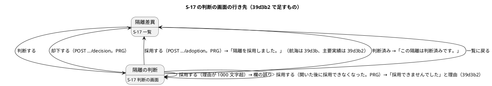
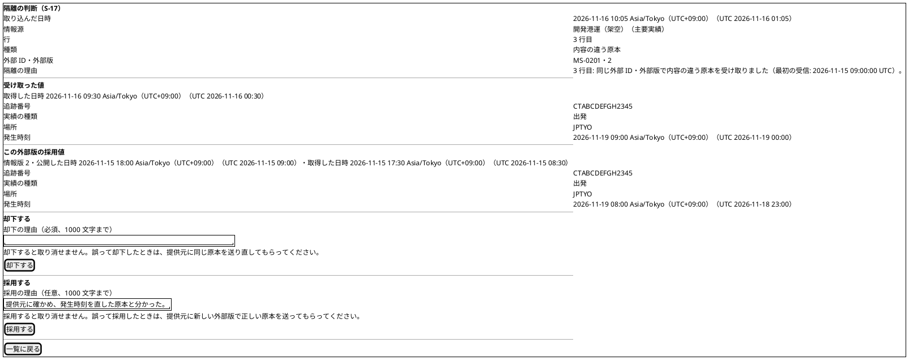
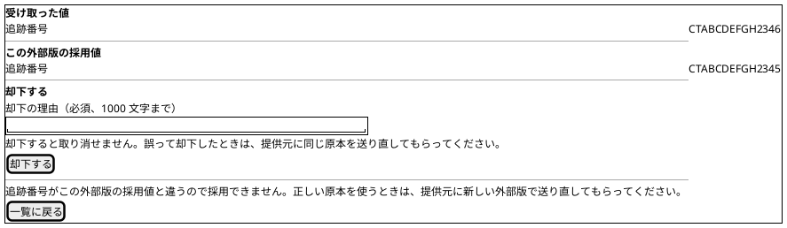
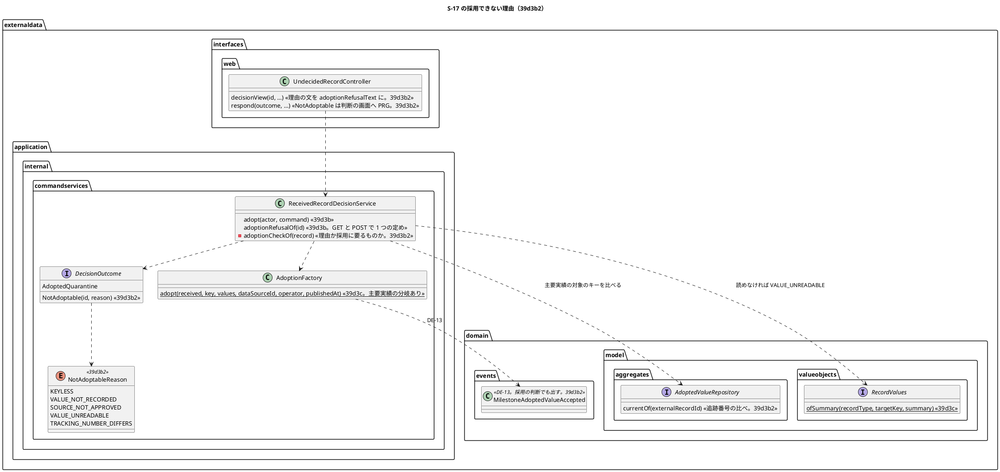

# Bolt 39d3b2 計画 - S-17 で主要実績の内容の違う原本の隔離を採用し、採用できない隔離の理由を示す

## 基本情報

| 項目 | 内容 |
| :--- | :--- |
| Bolt | 第 39d3b2 回（W7 の 21 本目。release_plan :969 の 39d3b2 の行。Bolt 39d3b の開始準備で 39d3b から縦に分けた 2 本目。Bolt 39d3b の【前の決定の変更】(2)） |
| 状態 | 承認済み（2026-11-09。推奨のとおり。Recommend 承認の指示による）。2 つの整合性検証の指摘を反映した |
| 予定 | W7（2026-11-16 の週。前倒しで着手できる）。作業は約 2 時間 47 分（Bolt 39d3b の決定 (1) の見積り約 2 時間 25 分に、39d3b の開発レビューと終了報告から足した作業、コードで確かめて増減した作業、2 つの整合性検証の指摘の反映で増えた作業を足し引きした。決定 (1)。目安の 4 時間 05 分（T-250）に 78 分の余りがあるので、送るものはない）。下の「時間の配分と打ち切り」。`check`・`uiTest`・`demoVideo`・SonarQube・CI とステップごとの承認の待ちを除く |
| アプローチ | アウトサイドイン（S-17 の主要実績の採用から。release_plan :969 のとおり）。画面の層の受入シナリオ（`@ui`）の Red から入る。受入条件の中心は「主要実績の内容の違う原本を判断の画面で採用し、採用できない隔離では理由と次の道を知る」で、内側（判断のサービスの定めと理由）は画面の文を出すために足す。Red は外側（受入シナリオ → controller → 判断のサービス）から書き、Green は内側（判断のサービス → 画面 → 受入シナリオ。ステップ 3〜6）の順に通す（前例 bolt_39d3b_plan.md :20） |
| 対象 | (1) 主要実績の隔離に採用を出す（判断のサービスの原本種別の定めを外す。DE-13 と `AdoptionFactory` の主要実績の分岐はある）、(2) 追跡番号がこの外部版の採用値と違う主要実績の隔離は採用を出さない（【業務の判断】(m)）、(3) `NotAdoptable` に理由を持たせ、判断の画面の「却下する」の欄の後に理由ごとの文を示す（キーのない隔離・値の列のない隔離・受け取った値を読めない隔離・停止した情報源の隔離・追跡番号が違う主要実績の隔離）、(4) 判断の画面を開いた後に採用できなくなったときの案内（【前の決定の変更】(2)）、(5) 情報源が停止した隔離の運用（【業務の判断】(o)）、(6) `org.slf4j` の許可を外部データの application 層に限る（【前の決定の変更】(1)）、(7) マニュアル 12.2 の主要実績の採用と「採用の欄が出ない隔離」・付録 B、(8) デモの動画（`@demo-bolt-39d3b2/adopt-milestone`） |
| トレース | US-14 AC4（user_story :574 の AC4 の注）、UC-15 の主成功シナリオ 5（system_usecase :408）・3b（system_usecase :527）、data_model の受信記録の判断・採用値（:1159）、domain_model の受信記録の判断（:1517・:1526〜:1534）・IA-INV-15（:1456）・DE-13（:1707）・DE-29（:1715）、ui_design の S-17 の判断の画面（:194・:1955・:2032・:2095・:2119・:2146）、ACC-01（WCAG 2.2 AA）、AUD-01 |
| GitHub | [#18](https://github.com/k2works/practical-domain-driven-design-in-enterpris-application/issues/18)（US-14。クローズは 39h） |
| SP | 0 |
| 承認ゲート | **ステップごとに止める**（release_plan :969 の「ステップごと（画面・層の規則）」、:895 の外部原本の取込のゲート）。画面（理由の文と開いた後の案内。ステップ 4）、層の規則（【前の決定の変更】(1)。ステップ 5）。新しいファイルはデモの動画だけ（`docs/assets/demo/bolt-39d3b2/adopt-milestone.webm`。`demoVideo` が作る）。スキーマは変えない（判断と採用値の表は 39b2 からあり、主要実績の対象の種類も CHECK にある。AdoptedValue.java :49-55）。新しいセキュリティの判断と本番の操作はない（POST は 39d3b と同じ URL・認可・CSRF で、下の「人に諮ること」） |
| 開始準備で決めたこと | 下の (1)〜(10)（初稿。推奨を 1 つに決めて書いた。承認待ち）。【業務の判断】(o) を新しく記録する。【前の決定の変更】(1)・(2) |

### 開始準備の決定

(1) **範囲と見積り**: release_plan :969 の 39d3b2 の行（Bolt 39d3b の決定 (1) の表で約 2 時間 25 分。bolt_39d3b_plan.md :64）に、39d3b の開発レビューから送られた開いた後の案内（[39d3b 終了報告](bolt_39d3b_report.md) :74）と情報源が停止した隔離の運用（同 :23・:106）、コードで確かめて増減した作業、2 つの整合性検証の指摘の反映で増えた作業を足し引きすると、約 2 時間 47 分になる（下の表）。目安（CLAUDE.md の「Bolt がイテレーションであり、時間単位（目安 2〜4 時間）で回す。半日を超える Bolt は分割する」の 4 時間に、見積りの誤差の 5 分を含めた 4 時間 05 分まで。T-250）に収まるので、送るものはない。余りの 78 分に 39d4 の分（H2 の UUID の比べ方・テストの完全修飾名。release_plan :970）を前倒ししない（39d4 は外部原本の基準の付け替えで同じ契約のテストを触るので 39d4 の中でまとめる。bolt_39d3b_plan.md :57 の理由のまま）。

| 内訳 | 分 |
| :--- | ---: |
| 分けて増える分（bolt_39d3_plan.md :54。設計の文書 20、Red 15、品質ゲート 30、終了報告 10、キャプチャと文の突き合わせ 15、受入シナリオの土台と予備 15、UI の流し直しと動画 10） | 115 |
| 主要実績の採用（bolt_39d3b_plan.md :51。行 1・2、DE-13 の Javadoc と domain_model の DE-13、ui_design の主要実績の画面イメージ、マニュアルの主要実績） | 10 |
| 採用できない理由の文 2 つ（bolt_39d3b_plan.md :53。(b) の 3 分とマニュアルの 2 分） | 5 |
| 停止した情報源・追跡番号が違う主要実績の文（bolt_39d3b_plan.md :64） | 4 |
| 追跡番号の比べ（bolt_39d3b_plan.md :64） | 3 |
| `NotAdoptable` の理由（bolt_39d3b_plan.md :64） | 2 |
| 主要実績の隔離に採用を出す（bolt_39d3b_plan.md :64） | 1 |
| `org.slf4j` の規則（bolt_39d3b_plan.md :54） | 5 |
| 39g の申し送りの文書（bolt_39d3b_plan.md :64） | 1 |
| **Bolt 39d3b の決定 (1) の見積り** | **146（約 2 時間 25 分）** |
| 39d3b の開発レビュー: 開いた後の案内（bolt_39d3b_report.md :74。決定 (5)。テスト 3 分、controller とテンプレート 5 分） | 8 |
| キーのない隔離の文を理由の文にまとめる（5 つ目の理由。決定 (3)。decision.html :94 の `keyless` の条件を置き換える） | 2 |
| 情報源が停止した隔離の運用（bolt_39d3b_report.md :23・:106。決定 (6)、【業務の判断】(o)、台帳 D-102 の文書） | 3 |
| 受入シナリオの土台は 39d3b にある（AdoptQuarantineUiSteps.java :54-67 の採用の手順、ExternalDataIngestionUiSteps.java :278-287 の主要実績の内容の違う原本。受入シナリオの 15 分のうち 10 分を引く。前例 bolt_39d3b_plan.md :45。15 分は「受入シナリオの例・Steps の土台と予備」の一括の見積り（bolt_39d3_plan.md :52）で、10 分を引くと予備まで消す形になる） | −10 |
| 追跡番号が違う 2 行の Steps と文を確かめる Steps（行 15・16） | 4 |
| `NotAdoptable` の形を変える骨組みと直す既存のテスト 9 か所（T-254。下の決定 (3)） | 3 |
| キャプチャの撮り直しがない（採用できる隔離の判断の画面の並びは変わらない。行 19。キャプチャと文の突き合わせの 15 分のうち 5 分を引く。15 分は撮り直しと突き合わせの一括の見積り（bolt_39d3_plan.md :51）で、5 分は撮り直しの分の推定） | −5 |
| コードの「39d3b2」の注記 10 か所（`apps/cargo-tracker/src` を「39d3b2」で検索した。下の「設計文書に直す箇所」の最後） | 2 |
| マニュアルの「採用の欄が出ない隔離」の表と開いた後の段落の書き直し（12-外部データ.md :343-353・:365） | 3 |
| 2 つの整合性検証の指摘の反映（ステップ 1 の文書 3、行 3 (b)・直す既存のテスト 3 か所・T-254 の置き分け 4、マニュアル 4） | 11 |
| **合計** | **167（約 2 時間 47 分）** |

(2) **主要実績の採用**: 判断のサービスの原本種別の定め（ReceivedRecordDecisionService.java :45-46 の `ADOPTABLE_RECORD_TYPE` と :164-166 の判定）を消す。採用の組み立て役は値の型で DE-13 に分かれている（AdoptionFactory.java :83-103。Bolt 39d3c）ので変えない。空でない知らない原本種別は、`RecordValues.ofSummary` が `IllegalArgumentException` を投げる（RecordValues.java :47）ので、受け取った値を読めない隔離として断る（`valuesOf` の :174。Bolt 39d3b の決定 (4) の (iv) の注。行 7 (d)）。DE-13 は判断と同じトランザクションで DE-29 の後に出す（`adopt` の :139-140 は型を見ない）。操作者は判断者、公開した時刻は判断の時刻（:131-137 は値の型で変わらない）。DE-13 の Javadoc（MilestoneAdoptedValueAccepted.java :12-14 の「取込で主要実績の採用値を追記したとき、取込と同じトランザクションで出す」、:28 の「公開した時刻（取込の時刻）」）を、取込での採用と採用の判断の両方に直す。監査の listener の Javadoc（ExternalRecordAuditEventHandler.java :72 の「採用の判断は Bolt 39d3b2」）を作ったことに直す（:74-92 の本体は変えない。行 2 の配信で確かめる）。主要実績の DE-13 の購読者は今は監査だけ（main の参照は AdoptionFactory と identity の listener だけ。追跡の listener は 39g）。

(3) **`NotAdoptable` の理由**: 結果の種類（DecisionOutcome.java :36-37。今は理由を持たない）を `NotAdoptable(UUID receivedRecordId, NotAdoptableReason reason)` に変え、`DecisionOutcome` の中に enum `NotAdoptableReason` を足す（`DecisionOutcome.NotAdoptableReason`。sealed の permits は増えないので、結果の型のすべてを行き先の組で縛るテスト（UndecidedRecordControllerTest.java :1819-1824）はそのまま効く）。

| `NotAdoptableReason` | 断る定め（判断のサービス。順に確かめる） | 【業務の判断】 | 引く数（行 7） |
| :--- | :--- | :--- | :--- |
| `KEYLESS` | 外部原本がない（ReceivedRecordDecisionService.java :151） | (a) | 取込・情報源・外部原本・採用値を引かない |
| `VALUE_NOT_RECORDED` | 受け取った値の列がない（:151） | Bolt 39d の決定 (8) | 同上 |
| `SOURCE_NOT_APPROVED` | 情報源の承認の状態が `APPROVED` でない（:157。`SUSPENDED`・`CANDIDATE`。DataSource.java :26-33） | (n) | 取込 1・情報源 1。外部原本と採用値を引かない |
| `VALUE_UNREADABLE` | 受け取った値を読めない、知らない原本種別（`valuesOf`。:171-177） | (k) | 取込 1・情報源 1・外部原本 1。採用値を引かない |
| `TRACKING_NUMBER_DIFFERS` | 主要実績で、受け取った値の追跡番号（`targetKey()`）がこの外部版の採用値の対象のキーと違う（決定 (4)） | (m) | 取込 1・情報源 1・外部原本 1・採用値の `currentOf` 1 |

- 判断のサービスの private の定め `adoptionPartsOf`（:149-168）は、採用に要るものか断る理由のどちらかを返す形に変える: `private record AdoptionCheck(AdoptionParts parts, DecisionOutcome.NotAdoptableReason refusal)`（`adoptionCheckOf`。どちらか一方が null でない形にし、`adopt`（:121-125）と `adoptionRefusalOf`（:92-94）が同じ結果を読む）。GET と POST で定めを 1 つにする形は変えない（Bolt 39d3b の決定 (4)）
- 順は上の表のとおりで、値の列のない隔離と停止した情報源の隔離が重なると `VALUE_NOT_RECORDED`、停止した情報源と追跡番号が違うが重なると `SOURCE_NOT_APPROVED` になる（行 7 (i)・(j)）。順は変えず、重なりの次の道はマニュアルの表に「情報源が停止中なら、先に承認し直す。承認後に別の理由が示されることがある」と書く（「入れるもの」のマニュアル）。先の理由で片付く隔離で後の照会を引かない（T-236）
- 受信記録 ID を持たせるのは、POST の行き先（決定 (5)）で判断の画面の URL を作るため（`Rejected`・`AdoptedQuarantine` と同じ形。DecisionOutcome.java :17・:29）
- 文は画面の層の定数（下の決定 (5)）。理由の enum は業務の見分けで、文を持たない（値の型は Java と共有カーネルだけ）。すべての理由に文があることをテストで縛る（T-240。行 9。switch で書き、`default` を置かない）
- `NotAdoptable` の形を変えるとテスト 9 か所（UndecidedRecordControllerTest.java :404・:1689・:1707・:1749・:1799・:1835・:1836、ReceivedRecordDecisionServiceTest.java :846・:851）のコンパイルが通らなくなる。ステップ 2 の骨組みで本体と同時に直し、コンパイルの通らない状態を作らない（T-254）

(4) **追跡番号の比べ**（【業務の判断】(m)。台帳 D-100。bolt_39d3b_plan.md :134）: 受け取った値を読めた主要実績（`values instanceof MilestoneValues`）について、`adoptedValues.currentOf(receivedRecord.externalRecordId())` が値を返し、その対象のキー（`AdoptedValue.targetKey()`。列の値。AdoptedValue.java :18・:28）が受け取った値の `targetKey()`（追跡番号の値。MilestoneValues.java :44-48）と違えば `TRACKING_NUMBER_DIFFERS` で断る。

- 比べるのは文字列の完全一致（追跡番号の形は `CT` と 12 文字で計 14 文字の大文字の形に揃っている。TrackingNumberValue.java :17。取込も採用も同じ `values.targetKey()` を採用値に書く。AdoptionFactory.java :118）
- 採用値の要約は読まない（【業務の判断】(l) は変わらない。行 3 (a)）。採用値の要約が壊れていても、対象のキーが違えば `TRACKING_NUMBER_DIFFERS` で断る（(m) が (l) より先。行 3 (b)）。`currentOf` は要約を解析しない（AdoptedValueRepository.java :32、MyBatisAdoptedValueRepository.java :49-58 は列を写すだけ）
- この外部版の採用値がなければ比べずに採用できる（D-100。行 5）。取込の経路では新しい外部原本は必ず採用になる（IngestionService.java :192-198・:214）ので採用値がない隔離は表を直に書き換えたときなどにしかできず、採用値のない 2 つの隔離を同時に別の追跡番号で採用する競り合いは受け入れる（判断は受信記録ごとで競り合わない。採用値の一意制約も受信記録ごと。V20261103100000 :115・:138）
- 航海は比べない（航海番号は外部 ID の列の値で、同じ外部 ID の隔離は対象のキーが同じ。CsvFileKind.java :6-7。bolt_39d3b_plan.md :155）。航海の採用は今のまま `currentOf` を呼ばない（ReceivedRecordDecisionServiceTest.java :866 の行 5 を変えない。行 8）。主要実績に比べの `currentOf` が足されるのは 1 回だけ
- キーが変わる原本の扱いは 39g・39h の開始準備で決める（申し送りの表）

(5) **採用できない理由の文と開いた後の案内**: 判断の画面の組み立て（UndecidedRecordController.java :344-378）で、`adoptionRefusalOf` の結果が `NotAdoptable` のときに理由から文を選び、モデルの `adoptionRefusalText` に入れる（:362 の `adoptable` の隣。:371 の `keyless` は消す。キーのない隔離の文も理由の文にまとめ、文の置き場所を 1 つにする）。テンプレートは今の `th:if="${keyless}"`（decision.html :94）を、`th:if="${adoptionRefusalText}"` の段落（id `adoption-refusal`、`tabindex="-1"`、`th:text`）に置き換える。位置は今と同じ「却下する」の欄の後、「一覧に戻る」の前（Bolt 39d3b の決定 (8)）。

| 理由 | 画面の文 | 出典 |
| :--- | :--- | :--- |
| `KEYLESS` | 形式の誤りは採用できません。直したファイルを取り込み直してください。 | 今の文（decision.html :94。【業務の判断】(a)） |
| `VALUE_NOT_RECORDED` | 受け取った値を記録する前に取り込んだ隔離は採用できません。受け取った値を使うときは、提供元に新しい外部版で送り直してもらってください。 | bolt_39d3b_plan.md :135 |
| `VALUE_UNREADABLE` | 受け取った値を読めないので採用できません。受け取った値を使うときは、提供元に新しい外部版で送り直してもらってください。 | bolt_39d3b_plan.md :135（【業務の判断】(k)） |
| `SOURCE_NOT_APPROVED` | 情報源が承認済みではないため採用できません。受け取った値を使うときは、運用の手順で情報源を承認し直してから、この隔離を開き直してください。 | 【業務の判断】(o)。語は取込の文（ExternalDataIngestionController.java :80）にそろえる |
| `TRACKING_NUMBER_DIFFERS` | 追跡番号がこの外部版の採用値と違うので採用できません。正しい原本を使うときは、提供元に新しい外部版で送り直してもらってください。 | 【業務の判断】(m)、台帳 D-100 |

- どの隔離も却下はできる（文に却下を重ねない。「却下する」の欄が直前にある）。文は画面の層の定数で、取込ファイルから来た値を含まない
- 行き先の変更（【前の決定の変更】(2)）: `respond`（UndecidedRecordController.java :393-412）の `NotAdoptable` を 404（:408-409）から分け、判断の画面へ PRG で戻す（行き先の URL は `LIST_URL + "/" + id + query(back, backPage)`。`id` は `NotAdoptable` の受信記録 ID。フラッシュ属性 `adoptionRefused` に `true`）。`NotFound`・`NotDecidable` は 404 のまま。開いた後の通常の道は情報源の停止（D-101）で、(m) はこの外部版の採用値がないときだけ（開いたときに採用値がなく、別のタブで別の追跡番号の隔離を採用した後。採用値があれば開いた時点で採用の欄を出さない。POST が来る道）。理由の 1001 文字の誤りで採用できない隔離だった道（:227-233。39d3b の開発レビューの指摘 1）も同じ `respond` を通るので同じ行き先になる
- 判断の画面の案内: `adoptionRefused` のフラッシュがあり、かつ `adoptionRefusalText` があるときだけ、エラー要約（id `error-summary`、`role="alert"`、`tabindex="-1"`。decision.html :19-36 の形）を出す。見出しは今の「採用できませんでした」、項目は理由の文で `#adoption-refusal` へのリンク。判断の画面で効く JS はエラー要約へのフォーカス（transport-request-form.js :5-7）だけで（要約のリンクの処理 :106-115 は `form[data-stepwise]` と `#step-nav` がない画面では :40-42 で return するので動かない）、リンクの移動はブラウザーの標準のフラグメント移動で、段落の `tabindex="-1"` はその受け口。`title` も「採用できませんでした - 隔離の判断 - cargo-tracker」（decision.html :7 の式に足す）。3 つのエラー要約は同時に出ない（2 つのフォームの誤りは POST の戻りで、`adoptionRefused` は PRG の GET で出る）
- 着地で事情が変わったとき: GET で判断の画面を組み立てるときに `adoptionRefusalOf` を読み直す（今の形）ので、情報源の承認が戻っていれば要約を出さず採用の欄を出し（行 13）、ほかの人が判断済みなら今の `refusalOf` の行き先で一覧に戻って「この隔離は判断済みです。」（:345-348）
- 比べた案: (i) 判断の画面へ PRG で戻して理由を示す（推奨。画面に出た文と同じ定めで理由が分かり、次の道（却下か、運用の手順か）に進める）、(ii) 今の 404 のまま（「画面が見つかりません」の案内で、開き直さないと理由が分からない。39d3b の開発レビューの指摘）、(iii) 一覧に戻して知らせる（理由の文が一覧に残らず、判断の画面の却下に進むのに開き直しが要る）

(6) **情報源が停止した隔離の運用**（【業務の判断】(o)。bolt_39d3b_report.md :23・:106。台帳 D-102）: 採用できるかは判断の時点の情報源の承認の状態で決める（今のコードのまま。ReceivedRecordDecisionService.java :155-159）。

- 取込は承認済みでない情報源のファイルを受けない（IngestionService.java :154）ので、停止の後に新しい隔離はできない。停止した情報源の隔離は停止の前に受け取った隔離だけで、一覧に残る
- 停止の間は却下だけ（(n) のまま）。情報源の承認が戻れば、同じ隔離に採用の欄が出て採用できる（行 7・13）。受け取った値を使うときの道は「運用の手順で情報源を承認し直してから開き直す」で、提供元に送り直してもらう必要はない。承認が戻らないと決まったら却下で片付ける
- マニュアルの今の文「運用の手順で情報源を承認してから、提供元に新しい外部版で送り直してもらってください」（12-外部データ.md :350）を、上の道に直す
- 情報源の選定・承認・停止の運用の手順はまだない（`docs/operation`・`ops` に「情報源」の記述がない。ExternalDataIngestionUiSteps.java :98 の注のとおり W10 の運用タスク）。手順を作るときに「停止の前後に、その情報源の判断を待つ隔離を S-17 で確かめる」を入れ、`SUSPENDED` から `APPROVED` に戻す手順を含める（【業務の判断】(o)、D-102）よう、W10 に申し送る（申し送りの表）。マニュアルの「運用の手順」の語は 39c からの語のまま（W10 までは停止した情報源は表の直の書き換えでしか承認し直せない）

(7) **`org.slf4j` の規則の分け方**（【前の決定の変更】(1)。Bolt 39d3b の決定 (10)。bolt_39d3b_plan.md :112-117）: 今の規則（ModularityTest.java :148-166）の対象から application を外し（`resideOutsideOfPackages` に `com.example.cargotracker.externaldata.application..` を足す）、許可リストから `org.slf4j..`（:164）を消す。規則の名前を `外部データのドメイン層とファイルの読み取りの層は共有カーネルとJavaとSpringにだけ依存する` に、Javadoc（:140-141 の「インフラストラクチャ層の外を見る」「application は LayerArchitectureTest が先に守る」）を domain と `interfaces.file` を見ることに直す。新しい規則 `外部データのアプリケーション層は共有カーネルとJavaとSpringとSLF4Jにだけ依存する`（`externaldata.application..` が `java..`・`com.example.cargotracker.externaldata..`・`com.example.cargotracker.shared..`・`org.springframework..`・`org.slf4j..` にだけ依存する）を足し、Bolt 39d3c の【前の決定の変更】の注（:144-146）をそちらの Javadoc に移して、この変更の注を足す。前例は画面の層を別の規則に分けた形（:168-187）。ロガーを使うのは application の照会のサービスだけで（`externaldata` の main で `org.slf4j` を import するのは UndecidedRecordQueryService.java :20-21・:41 だけ）、39d3b2 でもロガーを足さない。規則が拒んだときは置き場所を動かさず止めて諮る（CLAUDE.md の決まり）。

(8) **受入シナリオ**: 今の `adopt_quarantine_ui.feature` に 2 シナリオを足し、新しいファイルを作らない（判断ごとに 1 つの feature。bolt_39d3b_plan.md :121）。機能名（:3）を「データ責任者が内容の違う原本の隔離を採用する」に直す。背景の航海の情報源（:12-13）は主要実績のシナリオに合わないので、各シナリオの前提に下ろす（前例 compare_quarantine_values_ui.feature :14・:64）。注記（:8）の「主要実績の隔離（39d3b2 まで）」を消す。主要実績の内容の違う原本は今の Steps（ExternalDataIngestionUiSteps.java :278-287）で作り、追跡番号の違う 2 行は Steps に足す（`milestoneLine` :404-407 の `CTABCDEFGH2345` を引数にして、形（TrackingNumberValue.java :17）に合う別の番号 `CTABCDEFGH2346` を使う。T-230）。

(9) **変えないもの**: 判断と採用値の順（セーブポイント。Bolt 39d3b の決定 (5)）、公開した時刻は判断の時刻（決定 (6)）、監査の要約（`recordType=MILESTONE;targetKey=…`。ExternalRecordAuditEventHandler.java :84-85）、採用の POST の URL・認可・CSRF（UndecidedRecordController.java :210-236）。同時の判断・トランザクションの順は航海と同じ経路で、39d3b の行 7・19 が縛る（行は足さない。行 1 の主要実績の採用の判定だけ足す）。

(10) **新しい型の名前**（T-246。`apps/cargo-tracker/src` で `NotAdoptableReason`・`AdoptionCheck`・`TRACKING_NUMBER_DIFFERS`・`VALUE_UNREADABLE`・`VALUE_NOT_RECORDED`・`adoptionRefused`・`adoptionRefusalText`・`adoption-refusal`・`adopt-milestone` を検索し、ないことを確かめた。`SOURCE_NOT_APPROVED` は ExternalDataIngestionController.java :80 に文字列の定数としてあるが別のクラスの private なので enum の値に使える。`Reason` は単純名の enum が quotation に 3 つあるので `NotAdoptableReason` にした。BookableQuotation.java :90、QuotationViolations.java :67、SubmissionViolations.java :73）: 足す型は `DecisionOutcome.NotAdoptableReason`（enum）と判断のサービスの private の `AdoptionCheck`（record）。テストは既存のクラスに `@Nested class Bolt39d3b2_…`、受入シナリオは今の feature、デモのタグは `@demo-bolt-39d3b2/adopt-milestone`。

【前の決定の変更】(1): Bolt 39d3c の【前の決定の変更】(4)（外部データのインフラストラクチャ層と画面の層の外の許可リストに `org.slf4j..` を足した。bolt_39d3c_plan.md :97）を改め、`org.slf4j..` の許可を application 層に限る（決定 (7)。Bolt 39d3b の【前の決定の変更】(1)。bolt_39d3b_plan.md :123 で決め、この Bolt で作る）。application の照会のサービスがログを書けることは変えない。

【前の決定の変更】(2): Bolt 39d3b の決定 (9)（`NotAdoptable` は 404。bolt_39d3b_plan.md :110）、行 14（:232）、開発レビューの指摘 1（bolt_39d3b_report.md :70 の「採用できない POST と同じ 404」）、台帳 D-101 の「採用の POST は採用せず 404 になる」を改め、採用できなくなった隔離への POST は判断の画面へ PRG で戻り、理由を示す（決定 (5)）。採用の欄の出ない隔離へ作った送信が来ても 302 で判断の画面に戻るだけで、判断も採用値も書かない（データ責任者だけが送れる。行 20）。新しい形のエラー要約のリンクの先 `#adoption-refusal` は「却下する」の欄の後の段落に必ずあるので（要約は `adoptionRefusalText` があるときだけ出す）、39d3b の開発レビューの指摘 1 の「先のないリンク」（bolt_39d3b_report.md :70）は再発しない。ui_design :196 の採用の POST の行の `NotAdoptable` の 404 の記述（「39d3b2」の字がないので検索で拾えない）も改める（「設計文書に直す箇所」の ui_design）。

新しいファイル（39d3b2）: デモの動画 `docs/assets/demo/bolt-39d3b2/adopt-milestone.webm`（`demoVideo` が作る）だけ。直すもの: `DecisionOutcome`、`ReceivedRecordDecisionService`、`UndecidedRecordController`、`decision.html`、`MilestoneAdoptedValueAccepted` と `ExternalRecordAuditEventHandler` の Javadoc、`ModularityTest`、コードの「39d3b2」の注記、テスト `ReceivedRecordDecisionServiceTest`（行 1〜8）・`UndecidedRecordControllerTest`（行 9〜14）・`ExternalRecordAuditDeliveryIntegrationTest`（行 2）・`ExternalDataIngestionSecurityIntegrationTest`（行 20）、受入シナリオ `adopt_quarantine_ui.feature`・`AdoptQuarantineUiSteps.java`・`ExternalDataIngestionUiSteps.java`（Steps を足す）、マニュアル 12 章と付録 B・00-はじめに・index・用語集。スキーマは変えない。

### 39d3b の開始準備から引き継いだもの

[Bolt 39d3b 計画](bolt_39d3b_plan.md) の「39d3b2 に分けるもの」（:129-137）と行 3・17・18 を次に対応させた。

| 39d3b の計画 | この計画 |
| :--- | :--- |
| 行 3（採用（主要実績）） | 行 1 |
| 行 11 の主要実績の配信（DE-13 → `EXTERNAL_RECORD_ADOPTED`） | 行 2 |
| 行 17（追跡番号が違う主要実績の隔離） | 行 4・5・9 |
| 行 18（層の規則）、変異 V10 | 行 18、変異 V10 |
| 行 20 の DE-13（時刻） | 行 1 |
| 行 4 (e) の主要実績の隔離を「追跡番号が違う」に狭める | 行 4・7 |
| 39g・39h の申し送りのうち主要実績の採用で起きる組み合わせ | 下の申し送りの表（39g の同じ情報版で値が違う DE-13、39g・39h のキーが変わる原本）。この Bolt では DE-13 を受ける listener を作らないので組み合わせは起きない |

## Bolt ゴール

データ責任者が S-17 の一覧から主要実績の内容の違う原本の「判断する」を開き、受け取った値とこの外部版の採用値を見比べて、「採用する」の欄で理由（任意）を書いて「採用する」と、受け取った値が採用値として記録され、隔離は一覧から消え、「隔離を採用しました。」と知らされる。採用値は DE-13 として、操作者を判断者、公開した時刻を判断の時刻として出され、判断（DE-29）とともに監査記録に残る。追跡番号がこの外部版の採用値と違う主要実績の隔離、キーのない隔離、値を記録する前の隔離、受け取った値を読めない隔離、停止した情報源の隔離には採用の欄を出さず、「却下する」の欄の後に、採用できない理由と次の道を示す。画面を開いた後に採用できなくなったときは、採用されずに判断の画面に戻り、「採用できませんでした」と理由が示される。情報源の承認が戻れば、同じ隔離を採用できる。`org.slf4j` の許可は外部データの application 層に限られる。マニュアル 12.2 に主要実績の採用の手順と採用できない隔離の理由があり、付録 B が新しい文に合い、デモの動画がある。

### 開始準備で確かめたこと

- **release_plan の 39d3b2 の行**（:969）: 「主要実績の隔離に採用を出す（DE-13、主要実績の採用の配信）、追跡番号がこの外部版の採用値と違う主要実績の隔離は採用を出さない（【業務の判断】(m)、台帳 D-100。…）、採用できない理由の文（値の列のない隔離・受け取った値を読めない隔離・停止した情報源の隔離・追跡番号が違う主要実績）、外部データの `org.slf4j` の許可を application に限る規則の分け方（…）、マニュアル 12.2 の主要実績の採用と採用できない隔離・付録 B、デモの動画。約 2 時間 25 分の見込み、39d3b の開発レビューから: 開いた後に情報源が停止されたときの案内、情報源が停止した隔離を受け取るときの運用」。アプローチはアウトサイドイン（S-17 の主要実績の採用から）、承認ゲートは「ステップごと（画面・層の規則）」
- **判断のサービスの今の形**: 採用できる原本種別は航海だけ（ReceivedRecordDecisionService.java :45-46・:164-166）、定めと採用に要るものを 1 回で読む（:149-168。`private record AdoptionParts` :303）、採用はこの外部版の採用値を引かない（:145-148 の Javadoc）、採用の順は判断 → 採用値 → DE-29 → 採用値のイベント（:126-140）。`adoptedValues` は組み立ての引数にある（:53・:64）ので組み立てを変えない
- **採用の組み立て役**: `MilestoneValues` の分岐がある（AdoptionFactory.java :83-103）。DE-13 の外部 ID は冪等性キーから（:99）、情報版は外部版（:100）、採用値の対象のキーは `values.targetKey()`（:118。主要実績は追跡番号。MilestoneValues.java :44-48）
- **主要実績の読み直し**: `MilestoneValues.ofSummary` は種類・場所・発生時刻の 3 つの要約と追跡番号を読み、規則に合わなければ `IllegalArgumentException`（MilestoneValues.java :60-76）。入口の `RecordValues.ofSummary` は知らない原本種別も同じ例外にする（RecordValues.java :43-49）。判断のサービスの `valuesOf` がこの例外だけを受ける（:171-177）
- **対象のキー**: 採用値の対象のキーは列の値（AdoptedValue.java :18・:28）、`currentOf` は外部原本 ID で引く（AdoptedValueRepository.java :32）。主要実績の追跡番号は値の列（CsvFileKind.java :13-20。bolt_39d3b_plan.md :155）
- **`NotAdoptable`**: 理由を持たない（DecisionOutcome.java :36-37）。使う場所は判断のサービスの 2 か所（:94・:123）と controller の `respond`（:408-409）、テスト 9 か所（決定 (3)）
- **判断の画面**: 採用の欄は `adoptionRefusalOf` の結果だけで決める（UndecidedRecordController.java :362）。キーのない隔離の文は `keyless` の条件（:371、decision.html :94）。採用できない理由の 1001 文字の道（:227-233）
- **知らせの文**: 判断の画面に `result` のフラッシュの表示はない（`result` を示すのは index.html :16 と ingestions/result.html :19 だけ）。判断の画面の案内はエラー要約の形にする（決定 (5)）
- **JS**: decision.html :9 が読む transport-request-form.js はエラー要約へフォーカスを移す（:5-7）。要約のリンクの処理（:106-115）は `form[data-stepwise]` と `#step-nav` がない画面では :40-42 で return するので、判断の画面では動かない。リンクの移動はブラウザーの標準のフラグメント移動で、段落の `tabindex="-1"` はその受け口
- **層の規則**: `org.slf4j..` の許可（ModularityTest.java :144-146・:164）、前例の分けた規則（:168-187）、`interfaces.file` のパッケージはある（`externaldata.interfaces.file`。`CsvFileKind` など）
- **運用の手順**: 情報源の承認の状態の変更は画面がなく（ExternalDataIngestionUiSteps.java :98）、`docs/operation`・`ops` に手順の記述がない（「情報源」で検索して 0 件）
- **マニュアル**: 12 章の description（12-外部データ.md :4）・冒頭（:12）・表の隔離の判断（:21）・情報源の承認の文（:24）・12.2 の要約（:196）・主要実績の採用の案内（:288・:317・:321）・「採用の欄が出ない隔離」（:341-353）・開いた後（:365）・注意・補足（:417）。付録 B の「受け取った値を記録する前」（付録B-トラブルシューティング.md :223）・「値を読めませんでした。」（:224）。00-はじめに :45・index :25・用語集 :63 の採用の案内
- **39d3b の採用の Steps**: 採用の手順（AdoptQuarantineUiSteps.java :54-67）、キーのない隔離の案内（:76-86）、主要実績の内容の違う原本（ExternalDataIngestionUiSteps.java :278-287）、主要実績の情報源（:105-108）

## 設計の決定

| 項目 | 決定 | 根拠 |
| :--- | :--- | :--- |
| 範囲と見積り | 開始準備の決定 (1)。約 2 時間 47 分で送るものはない | bolt_39d3b_plan.md :51-54・:64、bolt_39d3_plan.md :54、bolt_39d3b_report.md :23・:74・:106 |
| 主要実績の採用 | 決定 (2)。原本種別の定めを消す。組み立て役は変えない | ReceivedRecordDecisionService.java :45-46・:164-166、AdoptionFactory.java :83-103、RecordValues.java :47 |
| `NotAdoptable` の理由 | 決定 (3)。`NotAdoptable(id, reason)` と `NotAdoptableReason` の 5 値。`AdoptionCheck` で定めを 1 つにする | DecisionOutcome.java :17・:29・:36-37、ReceivedRecordDecisionService.java :92-94・:121-125・:149-168 |
| 追跡番号の比べ | 決定 (4)。主要実績だけ、`currentOf` の対象のキーと文字列の完全一致で比べ、要約を読まない。採用値がなければ比べない | AdoptedValue.java :18・:28、AdoptedValueRepository.java :32、MilestoneValues.java :44-48、CsvFileKind.java :7・:13-20、TrackingNumberValue.java :17 |
| 理由の文 | 決定 (5)。5 つの文を画面の層の定数にし、「却下する」の欄の後の 1 つの段落に示す | decision.html :94、bolt_39d3b_plan.md :135、ExternalDataIngestionController.java :80 |
| 開いた後の案内 | 決定 (5)、【前の決定の変更】(2)。PRG で判断の画面に戻り、エラー要約と理由を示す | UndecidedRecordController.java :227-233・:345-348・:393-412、decision.html :7・:19-36、transport-request-form.js :5-7・:40-42 |
| 情報源が停止した隔離の運用 | 決定 (6)、【業務の判断】(o)。判断の時点の承認の状態で決める | ReceivedRecordDecisionService.java :155-159、IngestionService.java :154、DataSource.java :26-33、ExternalDataIngestionUiSteps.java :98 |
| 層の規則 | 決定 (7)、【前の決定の変更】(1)。application に限る規則に分ける | ModularityTest.java :137-187、UndecidedRecordQueryService.java :20-21・:41 |
| 受入シナリオ | 決定 (8)。今の feature に 2 シナリオ、背景を各シナリオの前提に下ろす | adopt_quarantine_ui.feature :3・:8・:12-13、compare_quarantine_values_ui.feature :14・:64、ExternalDataIngestionUiSteps.java :278-287・:404-407 |
| 状態遷移・スキーマ | 受信記録の判断の状態遷移は変えない（「判断を待つ隔離 --> 採用済み」の遷移を主要実績でも通すだけ）。スキーマは変えないので ER 図を省く | domain_model :1534-1548、AdoptedValue.java :49-55、V20261103100000 :107-142 |
| 型の名前 | 決定 (10)（T-246 で検索した） | — |

## ふりかえりと前の Bolt からの引き継ぎ

| 出典 | 内容 | この Bolt での扱い |
| :--- | :--- | :--- |
| W6 の Try T-204・T-212、Bolt 38h の T-227、Bolt 39b の T-233、Bolt 39d・39d2・39d3・39d3c の Problem | サブエージェントへの指示の最初に heredoc と標準入力を待つコマンドを使わないと書く | 任せるときの指示の最初に書き、私の側の操作も同じ決まりで行う（ファイルは Write・Edit、検索は Grep） |
| Bolt 39d の T-247、Bolt 39d2・39d3 の Try | 決まりを文章の指示ではなく仕組みで守らせる（フック） | W7 の締めで諮る。任せる範囲をファイルを Write・Edit で書く作業と読むだけの検索に絞り、Gradle と git を人の側の 1 か所に残す。任せる指示に触らないもの（`.claude/agent-memory`・`.run/`・`apps/cargo-tracker/.claude/`、ほかの作業のテスト）を名前で書く |
| Bolt 39d の T-248 | `git add` は `git status --short` の出力を使わず、ディレクトリか `git add -u` で指定する | 各ステップのコミットで、本体・テストはパッケージのディレクトリ、文書は `docs/` の下のディレクトリで指定する |
| Bolt 39d2b の T-249 | 担当への指示に私の言葉を書くときは「（私の指示）」と出典を付け、計画に人の指示として書き写さない | 初稿は推奨を 1 つに決めて書き、人の承認として書かない（承認は計画の承認の場で更新履歴に書く）。見積りの目安は CLAUDE.md の決まりとして書く |
| Bolt 39d3 の T-250 | 見積りの受け入れは 4 時間 05 分まで（5 分は誤差）とし、超えたら必ず送るか分ける | 決定 (1)。約 2 時間 47 分で余りは 78 分。実装の中で超えそうなら止めて送る先を諮る |
| Bolt 39d3 の T-251 | マニュアルの担当には、用語の定義を計画の【業務の判断】の文から写させる | マニュアルの担当には、採用できない隔離と次の道を【業務の判断】(a)・(k)・(m)・(n)・(o) の文と決定 (5) の表から写させる。「この外部版の採用値」の語は用語集のまま |
| Bolt 39d3c の T-252 | ゲートが落ちたら、見込みを書く前に中身を一覧する手段（運用タスク）を先に確かめる | ステップ 8 で SonarQube が落ちたら、先に `sonar-local:hotspots` などで中身を一覧してから原因を書く |
| Bolt 39d3b の T-254 | 途中で止めるときは、コンパイルの通らない変更を develop にコミットせず、`wip/` のブランチか stash に置く | ステップ 2 の骨組みで `NotAdoptable` の形を本体とテストで同時に変え（決定 (3)）、コンパイルの通らない状態を作らない。各ステップのコミットには、そのステップで緑になる行のテストだけを入れ、まだ Red の行は `wip/` のブランチか stash に置く。develop に落ちるテストを積まない（39d3b では develop の CI の赤が 11-06 から 11-09 まで続いた。bolt_39d3b_report.md :101-102） |
| W6 の Try T-217、Bolt 39b2 の Try | 本体を直す前に Red を流し、落ちた理由を記録する。直したテストの一覧を添える | ステップ 2。直す既存のテスト: `NotAdoptable` の 9 か所（決定 (3)）、`ReceivedRecordDecisionServiceTest` の行 4 の (e)（:800-808。主要実績の隔離は採用できるようになる）、`UndecidedRecordControllerTest` の行 14 の `NotAdoptable` の 404（:1799・:1834-1840）とキーのない隔離の案内（:404）、`行12_値の照会が空なら…`（:1188-1212。`decisionPageWith` :1079-1088 は `adoptionRefusalOf` を stub せず、文が理由からしか出なくなるので `KEYLESS` を返す mock を足す。:1337 の同名の組み立ては `mismatch(…)` の隔離だけで呼ばれる（:1362・:1446・:1474）ので直さない）、`行12_キーのない隔離は…`（:1706-1718。キーのない隔離の文を `p` のタグでそのまま囲んだ期待は、段落に id と tabindex が付くと一致しない）、`行13_採用できない隔離へ上限を超えた理由を…`（:1746-1754。404 を確かめる期待と名前を、判断の画面へ戻す行き先に直す）、`ExternalRecordAuditDeliveryIntegrationTest` の行 11（:447-453）、受入シナリオの背景（adopt_quarantine_ui.feature :12-13） |
| W6 の Try T-225・T-213 | push の前に `check` | ステップ 8（`uiTest` も流す） |
| W6 の Try T-182・T-211・T-216 | 状態の組み合わせの表に重複・隔離と出口・誤った入力の行を置く | 下の表。出口（行 7・9・11）、誤った入力（行 12）、同時の判断は決定 (9) のとおり 39d3b の行 7 が縛る |
| W6 の Try T-184 | listener は配信まで確かめる | 行 2（主要実績の採用の判断のコミットの後に `DECIDED` と `ADOPTED` の監査記録が書かれる） |
| W6 の Try T-219 | 変異の対象に単体・統合・契約のテスト | 下の変異の表 |
| W6 の Try T-215・T-222 | Gradle を流す担当を 1 つに、計画の初稿を先にコミット | Gradle は人の側の 1 か所で流す。初稿をコミットしてから実装に入る |
| Bolt 39a2 の T-229 | 時刻の出どころと同時の書き込みの行を置く | 時刻: 判断の時刻を Clock から 1 回取り、DE-13 の公開した時刻に使う（行 1。39d3b の行 20 に主要実績を足す）。同時の書き込みは決定 (4) の最後と決定 (9) |
| Bolt 39a3 の T-230 | 入ることを確かめる行のデータはドメインの規則に合う組み合わせにする | 主要実績の内容の違う原本は発生時刻を変えた 2 行（ExternalDataIngestionUiSteps.java :278-287）、追跡番号の違う 2 行は形に合う `CTABCDEFGH2346`（決定 (8)）。情報源は提供元の名前に自分の UUID を含める |
| Bolt 39b の T-232・39b2 の T-234・39b3 の T-237 | 本体を直したステップは承認の前に `spotbugsMain`・`checkstyleMain`・`sonar-local:check` | ステップ 3〜5 |
| Bolt 39b2b の T-235 | テストの名前の「行 N_」に Bolt の接頭辞を付けるかを W7 の締めで決める | 39d3b の前例のまま（`@Nested class Bolt39d3b2_…`） |
| Bolt 39b2b の T-236 | 「起きないこと」を確かめるテストは呼び出しの記録で確かめる | 採用を出さない隔離で判断・採用値を追記せずイベントを出さない、先の理由で片付く隔離で後の照会を引かない（行 7）、航海で `currentOf` を呼ばない（行 8）、1001 文字の誤りの道で `adopt` を呼ばない（行 12） |
| Bolt 39b3 の T-238 | サブエージェントへの指示は計画の決定を言い換えず計画の行を指す | 任せるときは「開始準備の決定」の番号と「状態の組み合わせ」の行番号を指す |
| Bolt 39b3b の T-239 | 人に諮る選択肢・主張の前提はコードで確かめ、出典の行を添える | 開始準備の決定の前提に出典の行を添えた（判断のサービスの定めと順、組み立て役の分岐、`currentOf` と対象のキー、理由の文の置き場所、行き先、JS のフォーカス、層の規則、運用の手順の有無） |
| Bolt 39b3b の T-240 | 表から作る規則には、全部の行が規則に入ることを確かめるテストを添える | 理由のすべてに文がある（行 9）、結果の型のすべてに行き先がある（行 14。UndecidedRecordControllerTest.java :1819-1824） |
| Bolt 39c の T-243 | 状態の数を 0 件にする受入シナリオは計画の時点で controller のテストに下ろす | 値の列のない隔離・読めない隔離・停止した情報源の隔離は UI で作れない（取込は必ず読める値を書き、停止は画面がない）ので controller と判断のサービス（行 7・9）、停止の統合（行 20）に下ろす。追跡番号が違う隔離は取込で作れるので行 16 で UI を通す |
| Bolt 39c2 の T-244 | パラメーターのテストは入力と期待する出力の組み合わせまで縛る | 行 7（隔離の種類、理由、引く数、`adoptionRefusalOf` と `adopt` の結果の一致）、行 9（理由と文）、行 14（結果の種類と行き先） |
| Bolt 39c3 の T-245 | 並びの規則を足すテストは書く順を逆にしたデータを置く | 並びの規則を足さない（`currentOf` の並びは 39d3 の契約のテスト） |
| Bolt 39c4 の T-246 | 新しい型の名前は同じ単純名がないかを検索してから決める | 開始準備の決定 (10)。`Reason` の単純名を避けた |
| 画面の Bolt の前例（memory の manual-in-bolt-done-criteria、Bolt 37f2 の T-197） | 振る舞いが変わる Bolt はマニュアルの更新を完了条件に入れる。マニュアルの文を実装と突き合わせる | 完了条件に 12.2 の主要実績の採用と「採用の欄が出ない隔離」、開いた後の段落、付録 B の行を入れる。ステップ 7 で 5 つの文と「採用できませんでした」を controller の定数とテンプレートに一字ずつ突き合わせる |
| Bolt 39d3b の終了報告の既知の課題（bolt_39d3b_report.md :106）と開発レビュー（:74）、議題 5（:23） | 39d3b2: 主要実績の採用、(m)、採用できない理由の文、`org.slf4j`、情報源が停止した隔離の運用、開いた後の案内 | 決定 (2)〜(7) |

## 状態の組み合わせ（行ごとにテストを 1 本。T-182）

行の番号は 1 から振る（新しい縦の Bolt）。判断のサービスは単体（`ReceivedRecordDecisionServiceTest` の `@Nested class Bolt39d3b2_…`。メモリの実装と固定の Clock、呼び出しの記録）、監査の配信は統合のテスト（`ExternalRecordAuditDeliveryIntegrationTest`）、画面は WebMvc のテスト（`UndecidedRecordControllerTest` の `@Nested class Bolt39d3b2_…`。照会と判断のサービスは mock）、開いた後の停止は統合のテスト（`ExternalDataIngestionSecurityIntegrationTest` の `@Nested class Bolt39d3b2_…`）、画面の通しは `adopt_quarantine_ui.feature`（axe、幅 320 px）。

| 行 | 状況 | 期待 | 確かめ方 |
| :--- | :--- | :--- | :--- |
| 1 | 採用（主要実績） | 主要実績の内容の違う原本を採用すると、判断（`ADOPTED`、判断者、判断の時刻、理由）を追記し、採用値（受信記録 ID は隔離の受信記録、対象の種類 `MILESTONE`、対象のキーは追跡番号、要約は受け取った値の要約、情報版は外部版、公開した時刻は判断の時刻）を追記し、DE-29 と DE-13（追跡番号・種類・場所・発生時刻・外部 ID・情報版、出典の参照は隔離の受信記録 ID、取得時刻はその受信記録の取得時刻、操作者は判断者、公開した時刻は判断の時刻）を DE-29 → DE-13 の順に出し、`AdoptedQuarantine` を返す。判断の時刻は Clock から 1 回取り、判断・採用値・DE-13・DE-29 で同じ値（呼ぶたびに進む Clock。前例 ReceivedRecordDecisionServiceTest.java :362-367 の `TickingClock`） | 判断のサービスの単体 |
| 2 | 採用の監査の配信（主要実績） | 主要実績の採用の判断のコミットの後に、隔離の受信記録に `EXTERNAL_RECORD_DECIDED`（理由は `ADOPTED`、操作者は判断者）と `EXTERNAL_RECORD_ADOPTED`（要約は `recordType=MILESTONE;targetKey=…;externalId=…`、操作者は判断者、時刻は判断の時刻）が 1 つずつ書かれ、取込のときの `EXTERNAL_RECORD_QUARANTINED` と合わせて 3 つ。同じイベントを配り直しても増えない（IA-INV-15） | 統合のテスト（イベントの発行記録を通す。T-184。39d3b の行 11 のパラメーターに足す） |
| 3 | 採用値の側だけ読めない主要実績の隔離 | (a) この外部版の採用値の要約が壊れていても、対象のキーが受け取った値の追跡番号と同じなら採用でき、行 1 と同じ採用値とイベントを作る。`currentOf` を 1 回呼ぶが要約を解析しない（【業務の判断】(l)）。(b) 採用値の要約が壊れ、対象のキーが違う → `TRACKING_NUMBER_DIFFERS`（(m) が (l) より先）。判断も採用値も追記せず、イベントを出さない | 判断のサービスの単体（パラメーター。呼び出しの記録） |
| 4 | 追跡番号が違う主要実績の隔離 | 受け取った値の追跡番号がこの外部版の採用値の対象のキーと違うと `NotAdoptable(id, TRACKING_NUMBER_DIFFERS)`。判断も採用値も追記せず、イベントを出さない。`adoptionRefusalOf` も同じ結果（【業務の判断】(m)） | 判断のサービスの単体（呼び出しの記録。T-236） |
| 5 | 比べの境界 | (a) 追跡番号が同じなら採用できる、(b) この外部版の採用値がなければ比べずに採用できる（`currentOf` は 1 回、空）、(c) 同じ外部原本に追跡番号の違う 2 つの隔離があり採用値がないとき、1 つ目を採用すると 2 つ目は `TRACKING_NUMBER_DIFFERS` になる（1 つ目の採用値と比べる） | 判断のサービスの単体（パラメーター） |
| 6 | 主要実績の採用できる隔離の照会 | 行 1 の隔離で `adoptionRefusalOf` は空を返し、判断を追記しない（GET と POST の定めの一致） | 判断のサービスの単体 |
| 7 | 採用を出さない隔離と理由 | (a) キーのない隔離 → `KEYLESS`、(b) 値の列のない隔離 → `VALUE_NOT_RECORDED`、(c) 航海の受け取った値の要約が壊れている → `VALUE_UNREADABLE`、(c2) 主要実績の受け取った値の要約が壊れている（知らない実績の種類）→ `VALUE_UNREADABLE`、(d) 空でない知らない原本種別 → `VALUE_UNREADABLE`、(f) 停止した情報源 → `SOURCE_NOT_APPROVED`（`CANDIDATE` も）、(g) 追跡番号が違う → `TRACKING_NUMBER_DIFFERS`。判断も採用値も追記せず、イベントを出さない。(a)・(b) は取込・情報源・外部原本・採用値を引かない、(f) は取込と情報源を 1 回ずつ引き外部原本と採用値を引かない、(c)・(c2)・(d) は外部原本を 1 回引き採用値を引かない、(g) は採用値の `currentOf` を 1 回引く。重なり: (i) 値の列のない隔離で情報源が停止 → `VALUE_NOT_RECORDED`、(j) 停止した情報源で追跡番号が違う → `SOURCE_NOT_APPROVED`。承認が戻った情報源（`SUSPENDED` から `APPROVED`）の隔離は採用できる（【業務の判断】(o)）。`adoptionRefusalOf` と `adopt` は同じ結果を返す | 判断のサービスの単体（パラメーター。呼び出しの記録。T-244） |
| 8 | 航海は今のまま | 航海の採用は `currentOf` を呼ばず（39d3b の行 5。ReceivedRecordDecisionServiceTest.java :866 を変えない）、航海の採用できない隔離も行 7 の理由を返す | 判断のサービスの単体（呼び出しの記録） |
| 9 | 判断の画面の理由の文 | 照会が `NotAdoptable(id, 理由)` なら、採用の欄を出さず、「却下する」の欄の後、「一覧に戻る」の前に理由ごとの文（決定 (5) の表）の段落（id `adoption-refusal`）が 1 つ示される。5 つの理由のすべてに文がある（T-240）。文は一字ずつ表のとおり。却下の欄が使える（T-182 の出口） | controller（パラメーター。HTML の文字と順） |
| 10 | 文を出さないとき | 照会が空（採用できる）なら段落を出さず採用の欄を出す。照会が `AlreadyDecided`（行き先を決めた後に判断された）なら文を出さない（照会の結果だけで決まる） | controller（パラメーター） |
| 11 | 開いた後に採用できなくなった POST | `NotAdoptable` を `adopt` が返すと、判断の画面（`ingestion`・`page` を持つ）へ 302 で戻り、フラッシュ `adoptionRefused` が付く。続く GET で、エラー要約（`id="error-summary"`・`role="alert"`・見出し「採用できませんでした」）に理由の文と `#adoption-refusal` へのリンク、`title` は「採用できませんでした - 隔離の判断 - cargo-tracker」、採用の欄はなく、理由の段落に `tabindex="-1"` がある。却下の欄は使える | controller（パラメーター） |
| 12 | 1001 文字の理由を採用できない隔離へ送る | 採用の理由が 1001 文字で照会が `NotAdoptable` なら、`adopt` を呼ばず、行 11 と同じ行き先（判断の画面へ 302、フラッシュ `adoptionRefused`）。39d3b の開発レビューの指摘 1 の 404 を置き換える | controller（呼び出しの記録） |
| 13 | 着地で事情が変わった | フラッシュ `adoptionRefused` があり、GET の照会が空（承認が戻った）ならエラー要約を出さず採用の欄を出す。`refusalOf` が `AlreadyDecided` なら一覧に戻って「この隔離は判断済みです。」 | controller（パラメーター） |
| 14 | 採用の POST の行き先 | `AdoptedQuarantine` → 元の一覧に「隔離を採用しました。」、`AlreadyDecided` → 一覧に「この隔離は判断済みです。」、`NotAdoptable` → 判断の画面（行 11）、`NotFound`・`NotDecidable` → 404、`NotPermitted` → 403。`DecisionOutcome` のすべての値に行き先がある（T-240） | controller（パラメーター。UndecidedRecordControllerTest.java :1792-1824 を直す） |
| 15 | UI（主要実績を採用する） | 承認済みの主要実績の情報源で同じ外部 ID・外部版で発生時刻の違う 2 行を取り込み、判断の画面で値を見比べ、キー操作だけで「採用する」の欄の理由を書いて「採用する」と、一覧に「隔離を採用しました。」が示されその隔離は一覧から消える。判断の画面と一覧で axe の違反 0 | `adopt_quarantine_ui.feature`（`@demo-bolt-39d3b2/adopt-milestone`） |
| 16 | UI（追跡番号が違う） | 同じ外部 ID・外部版で追跡番号の違う 2 行を取り込むと、判断の画面に「採用する」の見出しと欄がなく、「却下する」の欄の後に「追跡番号がこの外部版の採用値と違うので採用できません。…」が示され、却下できる。axe の違反 0、幅 320 CSS px で横スクロールが出ない | `adopt_quarantine_ui.feature` |
| 17 | 今の振る舞い | 航海の採用（`adopt_quarantine_ui.feature` の 3 シナリオ）、却下（`reject_quarantine_ui.feature`）、キーのない隔離の案内の位置（AdoptQuarantineUiSteps.java :76-86）が変わらない | 既存のシナリオ（背景を前提に下ろした後も緑） |
| 18 | 層の規則 | `ModularityTest` の分けた 2 つの規則が通り、外部データの application だけが `org.slf4j` に依存できる（`interfaces.file` は依存できない） | `ModularityTest`、変異 V10 |
| 19 | マニュアル | 採用できる隔離の判断の画面の並びは変わらないのでキャプチャを撮り直さない（`12-undecided-record-decision.png` は航海の採用できる隔離）。5 つの文と「採用できませんでした」、主要実績の採用の手順、「採用の欄が出ない隔離」の表、付録 B の行が実装と一致する（T-197） | ステップ 7 の突き合わせの記録 |
| 20 | 開いた後の停止（統合） | データ責任者が判断の画面を開いた後に情報源を `SUSPENDED` にし（前例 ExternalDataIngestionSecurityIntegrationTest.java :372）、CSRF のトークン付きで採用の POST を送ると判断の画面へ 302 で戻り、判断と採用値は書かれない。続く GET に `SOURCE_NOT_APPROVED` の文が示され、エラー要約がある。情報源を `APPROVED` に戻すと採用できる | `ExternalDataIngestionSecurityIntegrationTest`（H2。行 7 の (o) の通し） |

## スコープ

### 入れるもの

- 行 1〜20 のテスト（行 17・19 は既存のテストと突き合わせで確かめる）。決定 (2) の主要実績の採用、決定 (3) の `NotAdoptable` の理由、決定 (4) の追跡番号の比べ、決定 (5) の理由の文と開いた後の案内、決定 (7) の層の規則、決定 (8) の受入シナリオと Steps、コードの「39d3b2」の注記 10 か所
- マニュアル: 12 章の description（:4）・冒頭（:12）・表の隔離の判断（:21）・情報源の案内（:24）・12.2 の要約（:196）に主要実績の採用を足す。12.2 の主要実績の案内（:288・:317・:321）を直し、手順の値の見比べ（:326）に主要実績の項目を足す。「採用の欄が出ない隔離」（:341-353）の前置きを「形式の誤りのほかは、採用できない理由の文が画面に示されない」から「画面に理由が示される」に直し、表の「主要実績の隔離」の行を消して「追跡番号が違う主要実績の隔離」の行を足し、「停止した情報源の隔離」の「すること」を【業務の判断】(o) の文に直す。表の見分け方の列（:348-350）を画面に示す文（決定 (5) の表）に直す。表に「情報源が停止中なら、先に承認し直す。承認後に別の理由が示されることがある」を足す（理由の順は変えない）。画面の説明の表の ⑬（:285）を、理由の文 5 つの説明に直す。開いた後の段落（:365）を決定 (5) に直す（採用されず判断の画面に戻り「採用できませんでした」と理由が示される。却下で片付けるか、情報源の承認が戻ったら採用する）。あわせて「採用の欄に書いた理由は残りません」の一文を足す（PRG で戻るので、:357 の「書いた理由は残ります」とは違う振る舞い）。注意・補足（:417）を「内容の違う原本は採用できます」に直す。12.1 の「どうすればよいか」の内容の違う原本の行（:173 の「却下するか、航海は採用してください」）と 12.2 の手順（:224 の「航海の内容の違う原本で…」）を、主要実績も採用できる書き方に直す（:269 は図の説明なのでそのまま）。「この外部版の採用値だけを読めないとき」（:335）と注意・補足（:419）、付録 B の「値を読めませんでした。」の行（:224）に「主要実績で追跡番号が違うときを除く」の一文を足し、マニュアルに「採用値の追跡番号は原本のファイルで確かめる」と書く（行 3 (b)）。`docs/manual/付録B-トラブルシューティング.md` に 5 つの文の行を足し（「形式の誤りは採用できません。」の行を含む。:223・:224 の形）、:223・:224 の採用できない案内を行に合わせる。00-はじめに :45・index :25・用語集 :63 の航海だけの書き方を直す。キャプチャは撮り直さない（行 19）
- 文書: 下の「設計文書に直す箇所」（ステップ 1）

### 入れないもの

- 採用した後の外部原本の基準のハッシュの付け替えと再送の扱い（【業務の判断】(b)。39d4）。39d3b の後 39d4 までの間の振る舞い（採用した隔離の行をもう一度取り込むと再び隔離になる）は主要実績でも同じ（マニュアルの注意・補足 :418 のまま）
- 同じ外部版は隔離・版をまたげば差異（【業務の判断】(f)。39h）
- 同じ公開時刻の採用値の H2 の UUID の比べ方、テストの完全修飾名（39d4。Bolt 39d3b の決定 (11)）
- 採用値を受ける追跡の DE-13 の listener（39g）。39d3b2 の DE-13 を受けるのは今は監査だけ
- キーが変わる原本の扱い（元の追跡番号の採用値と実績をどうするか。39g・39h）
- 誤った判断の取り消し（【業務の判断】(e)。Release 1.0 の外）、判断済みの一覧（AUD-UI-01。W8）
- 理由の NUL 文字（bolt_39d3b_report.md :76。W8）
- 情報源の選定・承認・停止の運用の手順（W10。決定 (6)）

### 申し送り（既知の課題・入れないもの）

| 送り先 | 課題 | 扱い |
| :--- | :--- | :--- |
| 39d4 | 採用した後の基準のハッシュの付け替え（【業務の判断】(b)）は主要実績の採用にも効く。39d3b2 と 39d4 の間は、採用した主要実績の行を送り直すと再び隔離になる | 39d4 のまま（release_plan :970）。主要実績の再送の組み合わせを 39d4 の開始準備で確かめる |
| 39g | 採用の判断の DE-13 は、取込で採用した値と同じ情報版（外部版）で値が違いうる（AdoptionFactory.java :100・:120） | release_plan の 39g の行（:973）のまま。この Bolt では DE-13 を受ける追跡の listener を作らない（今の購読者は監査だけ）。39g の開始準備で、同じ情報版で値の違う 2 つの DE-13 の組を状態の組み合わせに置く |
| 39g・39h | 追跡番号が違う主要実績の内容の違う原本（キーが変わる原本）は採用を出さず、新しい外部版で正しい原本を送り直してもらう（【業務の判断】(m)）。キーが変わる原本の扱い（元の追跡番号の採用値と実績）は決めていない | 39g・39h の開始準備で決める（release_plan :973・:975）。決めるまでは採用を出さないままにする |
| W10 | 情報源の選定・承認・停止の運用の手順はまだない（決定 (6)）。手順を作るときに「停止の前後に、その情報源の判断を待つ隔離を S-17 で確かめる」を入れ、`SUSPENDED` から `APPROVED` に戻す手順を含め（【業務の判断】(o)、D-102）、マニュアルの「運用の手順」から手順へのリンクを足す | W10 の運用タスクの開始準備で計画に入れる（release_plan の W10 の節に書く。ステップ 1） |

### 設計文書に直す箇所（ステップ 1）

ステップ 1 の開始で `docs/design`・`docs/requirements`・`docs/adr`・`docs/development/cargo-tracker`（release_plan・development_strategy）を「39d3b2」で検索し、39d3b2 の予定を書いた場所を作ったことに直す。開始準備の検索で挙がった場所は下の各行に名前で書いた（終わった Bolt の計画と終了報告は記録なので直さない）。

- data_model: 受信記録の判断の行（:1159）の「主要実績の採用は 39d3b2」を作ったことに直し、採用値の行に主要実績の採用の判断を足す（`MILESTONE`、公開した時刻は判断の時刻）
- domain_model: 外部原本の採否の監査のイベントハンドラー（:316）、受信記録の判断の要素の行（:320）、判断のサービスの行（:324。`NotAdoptable` の理由と追跡番号の比べ）、IA-INV-15（:1456）、受信記録の判断の行（:1517）と節（:1526・:1528・:1530・:1534）の「主要実績は 39d3b2」を作ったことに直す。要素表に `NotAdoptableReason`（`DecisionOutcome` の入れ子の enum。5 値と確かめる順、対応する【業務の判断】。決定 (3) の表）の定義行を足し、:324 の `NotAdoptable` を `NotAdoptable(id, reason)` に直す。`AdoptionCheck` は判断のサービスの private の record で、前例の `AdoptionParts` も domain_model にないので載せない。:1528 の採用できる隔離の定めに、追跡番号の比べ（【業務の判断】(m)）と判断の時点の情報源の承認の状態（【業務の判断】(o)）を足し、「この外部版の採用値の側だけを読めない隔離も…採用できる」に「主要実績で追跡番号が違うときを除く」の一文を足す。主要実績の採用値を受け付けたの行（:370）と DE-13（:1707）の「公開した時刻（取込の時刻）」を「取込での採用は取込の時刻、採用の判断は判断の時刻」に、操作者を「取込の操作者か判断者」に直す（bolt_39d3b_plan.md :133）。DE-29（:1715）の「DE-13（39d3b2）」を作ったことに直す
- ui_design: S-17 の判断の画面の行（:194）と節（:1945・:1955）の「主要実績は 39d3b2」を作ったことに直し、理由の文 5 つ（決定 (5) の表）と開いた後の案内（POST の行き先、エラー要約、`#adoption-refusal`）を足す。S-17 の採用の POST の行（:196）の「採用できない隔離（`NotAdoptable`）」を 404 の列挙から外し、判断の画面へ PRG で戻ること、フラッシュ `adoptionRefused`、エラー要約（見出し「採用できませんでした」、リンクは `#adoption-refusal`）を足す（この行には「39d3b2」の字がないので検索で拾えない。:2146 の末尾の「判断の画面の振る舞い（欄の誤り・判断済み・404）」もこの行を指す）。画面遷移図（下の「画面遷移図」を写す）。主要実績の判断の画面イメージ（:2032〜。「採用は 39d3b2 で同じ画面に足す」）に「採用する」の欄を足し、下の「画面イメージ」を写す。採用の欄を出さない例（:2095〜）に理由の文を足し、:2119 の主要実績の隔離の説明を「追跡番号が違う主要実績の隔離」に直し、同じ行の「この外部版の採用値の側だけを読めない隔離は…「採用する」の欄を示す」に「主要実績で追跡番号が違うときを除く」の一文を足す。:2146 の「主要実績は 39d3b2」を作ったことに直す
- user_story: US-14 AC4 の注（:574）の「主要実績の採用は 39d3b2」を作ったことに直し、追跡番号が違う主要実績の隔離は採用できない（【業務の判断】(m)、D-100。仮）、情報源の承認が戻れば採用できる（【業務の判断】(o)、D-102。仮）、採用できない理由の文を足す。「この外部版の採用値の側だけを読めない隔離も、受け取った値を読めれば採用できる」に「主要実績で追跡番号が違うときを除く」の一文を足す
- system_usecase: UC-15 の 5（:408）と 3b（:527）の「主要実績は 39d3b2」を作ったことに直す
- test_strategy: 外部データの画面の行（:347）に 39d3b2 の確かめ方（上の「状態の組み合わせ」の冒頭の段落）を足す
- ADR-004: :131・:139・:146 の「主要実績は 39d3b2」を作ったことに直す（採用の判断の DE-13。公開した時刻は判断の時刻。別の形は要らない）
- release_plan: 39d3b2 の行（:969）に計画へのリンク、見積り（約 2 時間 47 分）、開始準備で決めたことを足す。39d3b の行（:968）の「主要実績の採用」は変えない。台帳 D-101（:1081）の「採用の POST は採用せず 404 になる」を「判断の画面へ戻り理由を示す」に直し、「判断の時点の承認の状態で決める。D-102」の注を足し、D-100（:1080）の「39d3b2 で作る」を作ったことに直す。台帳の D-101 の後に D-102（【業務の判断】(o)。仮の決定）を足す。D-95（:1075）の「主要実績の採用の分は 39d3b2」を書いたことに直す。W10 の節に情報源の運用の手順の申し送りを足す（`SUSPENDED` から `APPROVED` に戻す手順を含める。【業務の判断】(o)、D-102。W10 の行の「情報源の管理（S-19）の運用タスク」には開始準備で足した）
- development_strategy: W7 の行（:350）は 39d3b2 の名前があるのでそのまま（:481 は履歴なので直さない）
- コードの「39d3b2」の注記 10 か所（ステップ 3〜4 で `apps/cargo-tracker/src` を「39d3b2」で検索して直す。UndecidedRecordController.java :42、ReceivedRecordDecisionService.java :35・:45・:146、DecisionOutcome.java :36、ExternalRecordAuditEventHandler.java :72、ReceivedRecordDecisionServiceTest.java :801、ExternalRecordAuditDeliveryIntegrationTest.java :450、review_undecided_records_ui.feature :6、adopt_quarantine_ui.feature :8）。「39d3b2」の字がなく検索で拾えない航海だけの書き方も直す: ReceivedRecordDecisionService.java :34（航海の内容の違う原本）・:98-102（航海の内容の違う原本、DE-12 の順と公開した時刻）・:145-147（原本種別の定めと「この外部版の採用値は引かない」）、`adopt_quarantine_ui.feature` :4-5

## 設計（この Bolt の範囲）

### 画面遷移図

ui_design の画面遷移図の「隔離の判断」の行き先に、採用できなくなった POST の遷移を足す（ステップ 1 で写す）。

### 画面イメージ

S-17 の判断の画面（内容の違う原本・主要実績。値の領域は 39d3c のまま。「採用する」の欄を 39d3b2 で足す）:

S-17 の判断の画面（採用の欄を出さない隔離。例: 追跡番号が違う主要実績）:

開いた後に採用できなくなったとき（例: 情報源の停止）は、値の領域の前にエラー要約（見出し「採用できませんでした」、項目は理由の文で `#adoption-refusal` へのリンク）を足し、「却下する」の欄の後に同じ文を示す（ほかは上の例と同じ）。画面イメージの名前・時刻・外部 ID・追跡番号は説明用の架空の値である（ui_design の画面イメージの決まり）。1 つ目は ui_design の主要実績の判断の画面イメージ（:2032〜）に「採用する」の欄だけを足した形（提供元・外部版・時刻と却下の欄は ui_design :2039・:2042・:2050・:2053・:2057・:2059-2063 のまま）で、2 つ目は採用の欄を出さない例として、ui_design の S-17 の画面イメージに写す（ステップ 1）。

### 状態遷移図

受信記録の判断の状態遷移（domain_model :1534-1548）は変えない。主要実績の隔離も「判断を待つ隔離 --> 採用済み」の同じ遷移を通るので図を省く。採用できる隔離の定めは遷移の前の条件で、決定 (3) の表に書いた。

### クラスと依存

注: 判断のサービスの組み立て（ExternalDataConfiguration.java）は変えない（`adoptedValues` はすでにある。ReceivedRecordDecisionService.java :53・:64）。ER 図は省く（スキーマを変えない）。

## ステップ計画（ステップごとに止める）

- [x] **1. 設計の文書**（data_model・domain_model（NotAdoptableReason の行）・ui_design（PRG と理由の文）・test_strategy・user_story・system_usecase・ADR-004・release_plan（D-101 の直し、D-102 を仮の決定として足した）を直した。推奨のとおり承認として記録した。Recommend 承認の指示による）: 上の「設計文書に直す箇所」（data_model・domain_model・ui_design（画面遷移図、画面イメージ 2 つ）・user_story・system_usecase・test_strategy・ADR-004・release_plan（39d3b2 の行、D-95・D-100・D-101 の直し、D-102 を仮の決定として足す、W10 の申し送り））。開始準備の決定 (1)〜(10)、【前の決定の変更】(1)・(2)、【業務の判断】(o) を反映する。始めに docs を「39d3b2」で検索する（完了の判定: 文書の差分と検索の記録。**承認ゲート**）
- [x] **2. テストの Red（外側から）**（結果: 骨組みは緑。Red はテスト 39 件と受入シナリオ 2 件で、理由は `KEYLESS` の固定・主要実績に採用の欄がない・文の段落がない・`NotAdoptable` が 404）: このステップで行 1〜16・20 のテストを書く（ステップ 3〜5 の目安にテストを書く時間は入れない。下の「時間の配分と打ち切り」）。まず骨組み（`NotAdoptable(id, reason)` と `NotAdoptableReason`、判断のサービスは今の定めのまま固定の理由 1 つ（`KEYLESS`）を返す形にして、テスト 9 か所を同時に直す。理由の分岐はステップ 3 で書く（Red を弱めないため）。コンパイルの通らない状態を作らない。T-254）、続いて行 15・16 の feature の Red（主要実績の判断の画面に「採用する」の欄がないことで落ちる）、行 9〜14 の controller、行 20 の統合、行 1・3〜8 の判断のサービス、行 2 の配信。直す既存のテストを一覧にする（T-217。上の引き継ぎの表の行）（完了の判定: 期待した理由で落ちる記録。各ステップのコミットには、そのステップで緑になる行のテストだけを入れ、まだ Red の行は `wip/` のブランチか stash に置く。develop に落ちるテストを積まない（T-254）。このステップで develop に入れるのは緑の骨組みだけで、Red の行はステップ 3〜6 の緑にするコミットに入れる。**承認ゲート**（画面の振る舞いの契約））（推奨のとおり承認として記録した。Recommend 承認の指示による）
- [x] **3. 判断のサービス**（結果: 行 1〜8 が緑、`IngestionServiceTest` も緑、`spotbugsMain`・`checkstyleMain` 通過。`sonar-local:check` はステップ 6 の後にまとめて流し PASS）: 原本種別の定めを消す（決定 (2)）、追跡番号の比べ（決定 (4)）、`AdoptionCheck` と理由（決定 (3)）、`MilestoneAdoptedValueAccepted`・listener の Javadoc、判断のサービスの Javadoc（ReceivedRecordDecisionService.java :34・:98-102・:145-147）、コードの注記（判断のサービス・結果の種類の分）。行 1〜8 が緑（完了の判定: 緑、`spotbugsMain`・`checkstyleMain`・`sonar-local:check`。**承認ゲート**）（推奨のとおり承認として記録した。Recommend 承認の指示による）
- [x] **4. 画面**（結果: 行 9〜14・20 が緑、全体の `uiTest` 412 件が緑で axe 違反 0、`spotbugsMain`・`checkstyleMain` 通過、`sonar-local:check` PASS。行 14 のテストは 39d3b の入れ子から 39d3b2 の入れ子へ移した）: 理由の文と `adoptionRefusalText`、`keyless` の条件を置き換える、`respond` の `NotAdoptable`、フラッシュ `adoptionRefused`、エラー要約と `title`、コードの注記（画面の分）。行 9〜14・20 が緑、39d・39d2・39d2b・39d3・39d3c・39d3b の S-17 と S-16 の UI のシナリオが緑（行 15・16 の新しいシナリオはステップ 6）（完了の判定: 緑、`spotbugsMain`・`checkstyleMain`・`sonar-local:check`、`uiTest` と axe 違反 0。**承認ゲート**（画面））（推奨のとおり承認として記録した。Recommend 承認の指示による）
- [x] **5. 層の規則**（結果: 行 18 が緑。変異 V10（`IngestFileCommandAssembler` にロガー）は分けた規則 `外部データのドメイン層とファイルの読み取りの層は…` で落ち、戻した）: `ModularityTest` の 2 つの規則（決定 (7)）。行 18 が緑、変異 V10 を流して落ちることを確かめて戻す（完了の判定: 緑。**承認ゲート**（層の規則。【前の決定の変更】(1)））（推奨のとおり承認として記録した。Recommend 承認の指示による）
- [x] **6. 受入シナリオ**（結果: `adopt_quarantine_ui.feature` の 5 シナリオが緑で axe 違反 0、幅 320 px で横スクロールなし。定数の直しの後に S-17 の 5 つの feature（20 シナリオ）を流し直して緑）: `adopt_quarantine_ui.feature`（機能名、冒頭の文 :4-5、背景を前提に下ろす、行 15・16）と Steps（`ExternalDataIngestionUiSteps` に追跡番号の違う 2 行、`AdoptQuarantineUiSteps` に文を確かめる手順）、`@demo-bolt-39d3b2/adopt-milestone`。行 15〜17 が緑（完了の判定: `uiTest` と axe 違反 0。**承認ゲート**）（推奨のとおり承認として記録した。Recommend 承認の指示による）
- [x] **7. マニュアル**（12 章に主要実績の採用と採用できない理由の 5 つの文、開いた後の案内、付録 B の 5 行、用語集、はじめに・index を直した。実装の文と一字ずつ一致（T-197）。キャプチャは文だけの変更なので撮り直していない。採用した値がまだ経路設計と追跡に反映されないことを注意・補足に足した。推奨のとおり承認として記録した。Recommend 承認の指示による）: 上の「入れるもの」のマニュアル（12 章、付録 B、00-はじめに・index・用語集）。5 つの文と「採用できませんでした」を controller の定数とテンプレートに突き合わせる（T-197）。行 19（完了の判定: 突き合わせの記録。**承認ゲート**（マニュアル））
- [x] **8. 品質ゲートと開発レビュー**（変異 39 個がすべて落ちた。開いた後のエラー要約へのフォーカスと理由の段落へのリンクは UI のシナリオを足して実ブラウザーで確かめた。レビューは高 0・中 1・低 6。test 4,684 件、uiTest 207 シナリオ、失敗 0、axe 違反 0、SonarQube PASS（カバレッジ 96.0%、重複 0.02%、違反 0）。推奨のとおり承認として記録した。Recommend 承認の指示による）: 変異、`check`・`uiTest`、その後に SonarQube（落ちたら先に中身を一覧する。T-252）、開発レビューとその直し。push の前に `check`（T-225）（完了の判定: 緑と指摘の扱いの記録。**承認ゲート**）
- [ ] **9. 終了報告**: push して CI とデモ環境の配備を確かめ（デモ環境でデータ責任者でログインし、同じ外部 ID・外部版で発生時刻を変えた主要実績のファイルを 2 度取り込んで、S-17 の判断の画面で値を見比べて採用し、一覧から消えることを見る）、`demoVideo` で `@demo-bolt-39d3b2/adopt-milestone` を撮る（新しいファイル）。release_plan（39d3b2 の行の計画と終了報告のリンク）・開発の索引・mkdocs を直す。【業務の判断】(m)・(o) と【前の決定の変更】(1)・(2) を議題の先頭に置き、既知の課題に申し送りの表を書く

### 時間の配分と打ち切り

| # | 目安 | 打ち切り |
| :--- | :--- | :--- |
| 1 | 29 分（分けて増える分の 20 分（bolt_39d3_plan.md :47）、主要実績の分の 2 分（DE-13・主要実績の画面イメージ）、39g の申し送りの 1 分、【業務の判断】(o) と D-102 の 3 分、2 つの整合性検証の反映の 3 分（ui_design :196、`NotAdoptableReason` の定義行、(l) と (m) の一文）） | — |
| 2 | 34 分（分けて増える分の 15 分（:48）、行 1・2 の 3 分、追跡番号の比べの 2 分、文のテストの 1 分、理由の 1 分、開いた後の 3 分、骨組みと直す既存のテストの 3 分、受入シナリオの骨組みの 2 分、2 つの整合性検証の反映の 4 分（行 3 (b)、直す既存のテスト 3 か所、T-254 の置き分け）） | テストを書く時間が 34 分を超えそうなら、書いた分で Red を記録して止めて諮る |
| 3 | 7 分（DE-13 の Javadoc の 2 分、比べの 1 分、理由の 1 分、採用を出す 1 分、コードの注記の 2 分） | 主要実績の採用で取込の採用の振る舞い（`IngestionServiceTest`）が変わるテストが出たら、止めて諮る |
| 4 | 12 分（理由の文の 3 分と 2 分、開いた後の 5 分、キーのない隔離の文をまとめる 2 分） | 却下の欄の振る舞い・id・Tab の順を変える必要が出たら止めて諮る。PRG で戻った画面で `transport-request-form.js` の要約へのフォーカス（:5-7）が効かないときは、止めて形を諮る |
| 5 | 5 分（`org.slf4j` の規則） | 規則が既存のクラスを拒むときは、置き場所を動かさず止めて諮る |
| 6 | 7 分（分けて増える分の受入シナリオの 15 分から、39d3b の Steps の土台の 10 分を引き、追跡番号の違う 2 行と文を確かめる Steps の 4 分を足し、骨組みの 2 分をステップ 2 に移した） | 背景を前提に下ろして今のシナリオが落ちるときは、止めて諮る |
| 7 | 23 分（分けて増える分の文の突き合わせの 10 分（:51 の 15 分からキャプチャの撮り直しの 5 分を引いた）、主要実績の採用の 3 分、文の 3 分、表と開いた後の段落の書き直しの 3 分、2 つの整合性検証の反映の 4 分（:173・:224、:335・:419・付録 B の一文、表の見分け方の列と次の道、:365 の一文）） | — |
| 8 | 30 分（分けて増える分の 30 分（:49）。待ちを除く） | — |
| 9 | 20 分（分けて増える分の終了報告の 10 分（:50）と、UI のシナリオの流し直しとデモの動画の 10 分（:53）。CI と動画の待ちを除く） | — |

合計 167 分（約 2 時間 47 分）。Bolt 39d3b の決定 (1) の見積り 146 分に、39d3b の開発レビューと終了報告から足した作業（開いた後の案内 8 分、(o) 3 分）、コードで確かめて増減した作業（キーのない隔離の文 +2、受入シナリオの土台 −10 と Steps +4、骨組み +3、キャプチャ −5、コードの注記 +2、マニュアルの書き直し +3）、2 つの整合性検証の指摘の反映（+11）を足し引きした（決定 (1)）。テストを書く時間はステップ 2 にまとめた。目安（4 時間 05 分。T-250）に 78 分の余りがある。実装の中で 4 時間 05 分を超えそうなときは止めて送る先を諮る（送る先の推奨は 39d4）。マニュアルとデモの動画は後に送らない。

## 確認ポイント（計画の承認の場でまとめて確認する。Try T-6）

| # | 確認すること | 場所 | 推奨 |
| :--- | :--- | :--- | :--- |
| 1 | **範囲と見積り** | 開始準備の決定 (1) | 約 2 時間 47 分で送るものはない |
| 2 | **主要実績の採用** | 決定 (2) | 原本種別の定めを消すだけで DE-13 が出る。組み立て役と監査の本体は変えない |
| 3 | **追跡番号が違う主要実績の隔離**（【業務の判断】(m)） | 決定 (4)、行 4・5 | 採用を出さない。主要実績だけ比べ、要約を読まない。この外部版の採用値がなければ比べない |
| 4 | **採用できない理由の文** | 決定 (3)・(5) | `NotAdoptable(id, reason)` の 5 つの理由ごとの文を「却下する」の欄の後の 1 か所に示す |
| 5 | **開いた後の案内**（【前の決定の変更】(2)） | 決定 (5)、行 11〜13・20 | 404 をやめ、判断の画面へ PRG で戻り、「採用できませんでした」と理由を示す |
| 6 | **情報源が停止した隔離の運用**（【業務の判断】(o)） | 決定 (6)、行 7・20 | 判断の時点の情報源の承認の状態で決める。承認が戻れば同じ隔離を採用できる。運用の手順は W10 に申し送る |
| 7 | **層の規則**（【前の決定の変更】(1)） | 決定 (7) | `org.slf4j` の許可を application の規則に分け、`interfaces.file` には許さない |
| 8 | **受入シナリオの形** | 決定 (8) | 今の feature に足し、背景を各シナリオの前提に下ろす |
| 9 | **型の名前** | 決定 (10) | `DecisionOutcome.NotAdoptableReason`、`AdoptionCheck`、`adoptionRefusalText`、`adoptionRefused`、`adoption-refusal` |
| 10 | **変異** | ステップ 8 | 下の 13 個 |

### 人に諮ること

推奨を 1 つに決められない判断はない（業務の意味を含む (o) は推奨を 1 つに決め、下の「業務の判断の記録」に置き、台帳 D-102 に仮の決定として載せる（ステップ 1））。新しい本番・セキュリティの判断はない: 採用の POST は 39d3b と同じ `/staff/external-data/**` のデータ責任者の認可と CSRF の中で、サービスでも役割を確かめる（ReceivedRecordDecisionService.java :109）。判断の画面へ戻す PRG の URL は読んだ UUID とページから組む（UndecidedRecordController.java :446-448）。画面に足す文はどれも固定の文で、取込ファイルから来た値を含まない。ログは足さない。スキーマは変えない。打ち切りの 6 つ（Red の時間、`IngestionServiceTest` の変化、却下の欄の変更、要約への JS のフォーカス、層の規則の拒否、背景の下ろしで既存が落ちる）に当たったときは、そのステップで止めて諮る。

### 業務の判断の記録

終了報告の議題の先頭に置き、人が後から見直せるようにする（前例 Bolt 39d の (a)〜(f)、39d2 の (g)、39d2b の (h)、39d3 の (i)・(j)、39d3c の (k)、39d3b の (l)・(m)・(n)）。39d3b2 では (o) を新しく記録し、(m)（追跡番号が違う主要実績の隔離は採用を出さない）を実装し、(a)・(k)・(n) の採用できない隔離に理由の文を足す。(l) と (m) が重なるとき（採用値の要約が壊れ、対象のキーが違う主要実績の隔離）は (m) が先（行 3 (b)）。用語は前の【業務の判断】の文から写した: (m)「追跡番号がこの外部版の採用値と違う主要実績の隔離には採用を出さない。採用できない理由（追跡番号が違う）と、新しい外部版で正しい原本を送り直してもらう道を示す。キーが変わる原本の扱いは 39g（追跡）・39h（差異）で決める」（bolt_39d3b_plan.md :524）、(n)「承認済みの情報源の隔離だけを採用できる（取込と同じ規則）。停止した情報源の隔離は却下だけ」（同 :525）、(k)「値を読めない隔離（受け取った値が読めない、原本種別を読めない）は採用できない」（bolt_39d3c_plan.md :407）、(a)「キーのない隔離は却下だけ」（bolt_39d_plan.md :456-461）。

1. 【業務の判断】(o) **採用できるかは判断の時点の情報源の承認の状態で決める。停止の間は却下だけで（(n) のまま）、情報源の承認が戻れば同じ隔離を採用できる。受け取った値を使うときは、運用の手順で情報源を承認し直してから開き直す**（決定 (6)、行 7・20。台帳 D-102 に仮の決定として載せる）: 取込は承認済みでない情報源のファイルを受けない（IngestionService.java :154）ので、停止の後に新しい隔離はできず、停止した情報源の隔離は停止の前に受け取ったものだけ。判断のサービスは判断のたびに情報源の状態を読む（ReceivedRecordDecisionService.java :155-159）。データ責任者は受け取った値を原本のファイルと提供元に確かめて判断する（【業務の判断】(l) の前提のまま）ので、承認が戻った情報源の隔離は、ほかの隔離と同じ確かめで採用できる。比べた案: (i) 情報源を停止したら判断を待つ隔離を自動で却下する（データ責任者の判断でない判断が記録と監査に残る。DE-29 と監査記録は判断者を必須にする）、(ii) 承認が戻っても採用を出さず、新しい外部版で送り直してもらう（39d3b のマニュアルの今の文 12-外部データ.md :350。同じ内容を提供元に送り直させる手間だけが増え、判断の画面で値を確かめることに比べて業務の安全が増えない）、(iii) 受け取った時点で承認済みだった隔離は停止の後も採用できる（(n) と食い違い、停止した提供元の値が判断で業務に入る）

打ち切りの 6 つに当たったときは、そのステップで止めて諮る。

### 変異と落ちる見込みのテスト

| # | 変異 | 落ちる見込み |
| :--- | :--- | :--- |
| V1 | 判断のサービスの原本種別の定めを残す（主要実績に採用を出さない） | 行 1・6（判断のサービスの単体）、行 15（UI） |
| V2 | 追跡番号の比べを外す | 行 3 (b)・4・5 (c)（判断のサービスの単体）、行 16（UI） |
| V3 | この外部版の採用値がないときに断る（`currentOf` が空を `TRACKING_NUMBER_DIFFERS` にする） | 行 5 (b) |
| V4 | 比べのときに採用値の要約を `ofSummary` で読む | 行 3（要約が壊れた採用値で `IllegalArgumentException` か `VALUE_UNREADABLE` になる） |
| V5 | 航海でも `currentOf` を呼ぶ | 行 8（呼び出しの記録） |
| V6 | 停止した情報源を `VALUE_UNREADABLE` にする | 行 7 (f) |
| V7 | 順を入れ替え、追跡番号の比べを情報源の承認より先にする | 行 7 (j) の結果と、(f) で採用値を引かない呼び出しの記録 |
| V8 | DE-13 の公開した時刻を取込の時刻（隔離の受信記録の分類の時刻）にする | 行 1（判断のサービスの単体）、行 2（監査の時刻） |
| V9 | `respond` の `NotAdoptable` を 404 に戻す | 行 11・14（controller）、行 20（統合） |
| V10 | `interfaces.file` のクラスに `org.slf4j` のロガーを置く | 行 18（`ModularityTest` の分けた規則） |
| V11 | フラッシュがあれば `adoptionRefusalText` を確かめずにエラー要約を出す | 行 13（controller） |
| V12 | 理由の 1 つの文を別の理由の文にする | 行 9（controller。文は表のとおり） |
| V13 | 1001 文字の誤りの道で採用できない隔離を欄の誤りに戻す | 行 12（controller） |

## 完了条件

- [ ] 上のステップ 1〜9 の完了の判定を満たす（ステップごとの承認を受ける）
- [ ] 行 1〜16・18・20 に、それを名乗るテストがある（既存のテストのクラスでは `@Nested class Bolt39d3b2_…` の中）。今のテストと突き合わせで確かめる行 17・19 は名乗るテストを新しく作らない
- [ ] データ責任者が S-17 の判断の画面で主要実績の内容の違う原本を採用でき、判断・採用値・DE-13・DE-29 が 1 つのトランザクションで残り、隔離は一覧から消える
- [ ] 追跡番号がこの外部版の採用値と違う主要実績の隔離には採用の欄を出さず、理由と新しい外部版の道を示し、POST も採用しない。採用値の要約は読まない
- [ ] 採用できない隔離の 5 つの理由ごとに、「却下する」の欄の後に文が示される。すべての理由に文があることをテストが縛る
- [ ] 判断の画面を開いた後に採用できなくなると、採用されずに判断の画面に戻り、「採用できませんでした」と理由が示される。情報源の承認が戻れば採用できる
- [ ] `org.slf4j` の許可が外部データの application 層に限られ、`interfaces.file` にロガーを置くと規則が落ちる
- [ ] axe の違反 0、幅 320 px で横スクロールがない
- [ ] マニュアル 12 章の description・冒頭・12.2 の要約・主要実績の採用・「採用の欄が出ない隔離」・開いた後の段落・注意・補足、付録 B の行が実装と合う（12 章の「航海の」の検索結果を確かめる）
- [ ] デモの動画（`@demo-bolt-39d3b2/adopt-milestone`）があり、終了報告のデモ項目からリンクしている
- [ ] `check`・`uiTest` が緑、SonarQube が PASS、CI が緑、デモ環境が新しい版で動く
- [ ] 【業務の判断】(m)・(o) が終了報告の議題の先頭にある。台帳 D-102 があり、D-100・D-101 が今の振る舞いに合う
- [ ] 39g・39h・W10 の申し送りが release_plan の行と終了報告の既知の課題にある
- [ ] docs と `apps/cargo-tracker/src` に 39d3b2 の予定のままの記述が残っていない（ステップ 1・3〜4 の検索）
- [ ] 終了報告が承認されている

## 更新履歴

| 日付 | 更新内容 | 更新者 |
| :--- | :--- | :--- |
| 2026-11-09 | 初版作成（承認待ち）。開始準備の決定: 約 2 時間 36 分で送るものはない。主要実績の採用は原本種別の定めを消して DE-13 を出す、追跡番号が違う主要実績の隔離は採用を出さない（【業務の判断】(m)）、`NotAdoptable` に 5 つの理由を持たせ画面に文を示す、開いた後に採用できなくなったら 404 をやめて判断の画面へ戻る（【前の決定の変更】(2)）、情報源が停止した隔離は判断の時点の承認の状態で決める（【業務の判断】(o)）、`org.slf4j` の許可を application に限る（【前の決定の変更】(1)）。人に諮ることはなし | anthropic/claude-opus-5-5 |
| 2026-11-09 | 2 つの整合性検証の指摘（詳細 中 4・軽 6、横断 中 6・軽 7）を反映した（推奨のとおり。Recommend 承認の指示による）。見積りは約 2 時間 47 分で送るものはない | anthropic/claude-opus-5-5 |
| 2026-11-09 | 計画を承認した（約 2 時間 47 分。【業務の判断】(o)、(m) の実装、【前の決定の変更】(1)・(2)）。推奨のとおり。Recommend 承認の指示による。human:kakimomokuri | anthropic/claude-opus-5-5、承認 human:kakimomokuri |

## 関連ドキュメント

- [リリース計画](release_plan.md)（W7 の節の 39d3b2・39d4・39g・39h の行、台帳の D-95・D-100・D-101）
- [Bolt 39d3b 計画](bolt_39d3b_plan.md)（開始準備の決定 (4)・(5)・(8)・(9)・(10)、「39d3b2 に分けるもの」、【業務の判断】(l)・(m)・(n)、【前の決定の変更】(1)・(2)）・[Bolt 39d3b 終了報告](bolt_39d3b_report.md)（議題 5、開発レビューの指摘、既知の課題）
- [Bolt 39d3c 計画](bolt_39d3c_plan.md)（【業務の判断】(k)、【前の決定の変更】(4)）、[Bolt 39d3 計画](bolt_39d3_plan.md)（分けて増える分）、[Bolt 39d 計画](bolt_39d_plan.md)（【業務の判断】(a)〜(f)）
- [データモデル](../../design/cargo-tracker/data_model.md)（受信記録の判断・採用値）、[ドメインモデル](../../design/cargo-tracker/domain_model.md)（受信記録の判断、IA-INV-15、DE-13・DE-29）、[UI 設計](../../design/cargo-tracker/ui_design.md)（S-17 の判断の画面）、[ADR-004](../../adr/cargo-tracker/004-external-data-ingestion.md)、[ユーザーマニュアル 12 章](../../manual/12-外部データ.md)、[付録 B](../../manual/付録B-トラブルシューティング.md)
