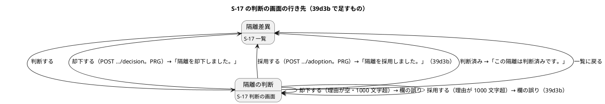
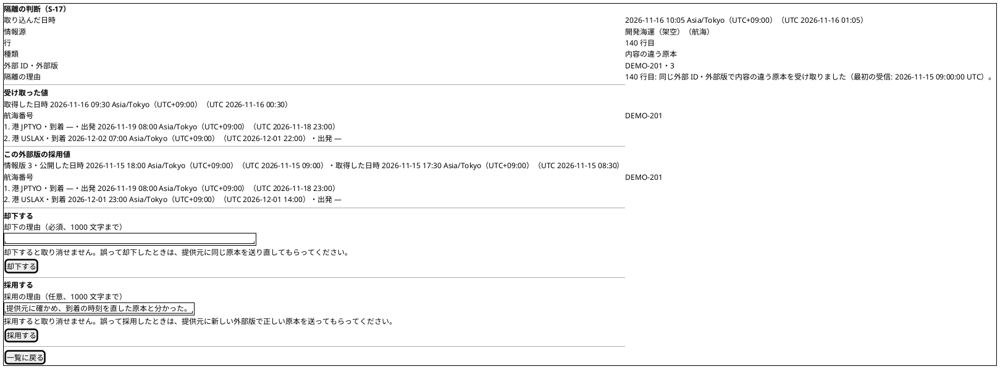
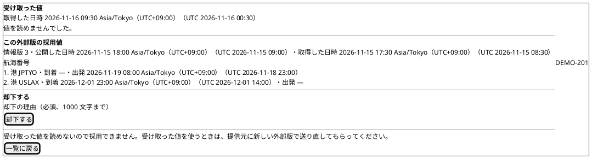
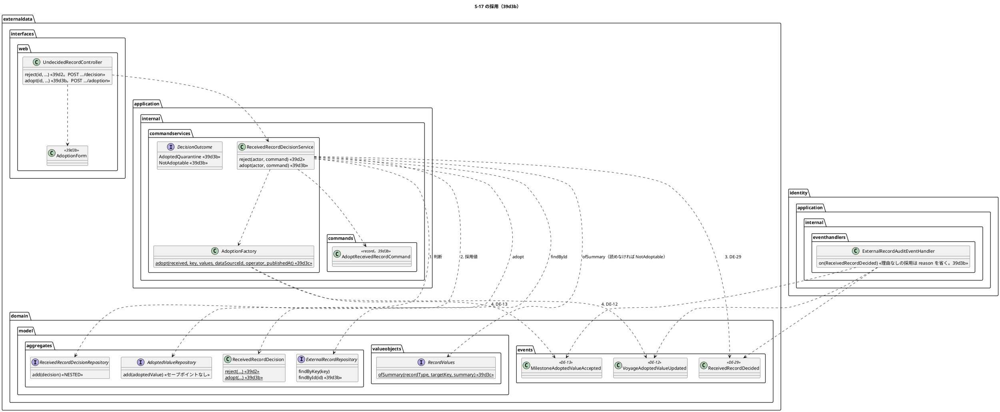

# Bolt 39d3b 計画 - S-17 で内容の違う原本の隔離を採用する

## 基本情報

| 項目 | 内容 |
| :--- | :--- |
| Bolt | 第 39d3b 回（W7 の 20 本目。release_plan :968 の 39d3b の行。Bolt 39d3 の開始準備で 39d3 から縦に分けた 3 本目） |
| 状態 | 初稿（承認待ち） |
| 予定 | W7（2026-11-16 の週。前倒しで着手できる）。作業は約 4 時間 05 分（Bolt 39d3 の決定 (1) の見積り約 3 時間 55 分に、39d3・39d3c の開発レビューから足した申し送りとコードで確かめて見つかった作業を足し、39d3c までにできた受入シナリオの土台の分を引き、目安を超える分を 39d4 に送った。決定 (1)。目安の 4 時間 05 分（T-250）にちょうど収まり、余りはない）。下の「時間の配分と打ち切り」。`check`・`uiTest`・`manualScreenshots`・`demoVideo`・SonarQube・CI とステップごとの承認の待ちを除く |
| アプローチ | アウトサイドイン（S-17 の採用から。release_plan :968 のとおり）。画面の層の受入シナリオ（`@ui`）の Red から入る。受入条件の中心は「判断の画面で採用し、一覧から消え、採用値とイベントと監査が残る」で、内側（採用の判断のファクトリー・外部原本の `findById`・判断のサービスの採用・監査の listener）は画面の採用を通すために足す。Red は外側（受入シナリオ → controller → 判断のサービス → listener → ドメイン → 契約）から書き、Green は内側（ドメイン・契約 → 判断のサービス → listener → 画面 → 受入シナリオ。ステップ 3〜7）の順に通す。画面の Green は、判断のサービスの採用の結果の種類がないと書けないため（前例 bolt_39d3c_plan.md :20） |
| 対象 | (1) 採用の判断のファクトリー `ReceivedRecordDecision.adopt`（理由は任意で 1000 文字まで。【業務の判断】(d)）、(2) 外部原本のポートの `findById`（MyBatis・メモリ・契約）、(3) 判断のサービスの採用（キーのない隔離・値の列のない隔離・受け取った値を読めない隔離は採用を出さない。【業務の判断】(a)・(k)。採用値の側だけを読めない隔離は採用できる。【業務の判断】(l)）、(4) 判断を先にセーブポイントの中で追記し、採用値をセーブポイントなしで追記する順、(5) 作り直した採用の組み立て役 `AdoptionFactory.adopt` で採用値と DE-12・DE-13（操作者は判断者、公開した時刻は判断の時刻）、DE-29 の `ADOPTED`、(6) 理由のない DE-29 を受ける監査の listener、`EXTERNAL_RECORD_ADOPTED` と DE-12・DE-13 の `publishedAt` と採用値の Javadoc、(7) 判断の画面の「却下する」「採用する」の 2 つの見出しの欄と採用の POST、(8) 外部データの `org.slf4j` の許可を application に限る（【前の決定の変更】(1)）、(9) マニュアル 12.2 の採用（誤って採用したときの案内。【業務の判断】(e)、D-95）と付録 B、キャプチャの撮り直し、(10) デモの動画（`@demo-bolt-39d3b/adopt`） |
| トレース | US-14 AC4（隔離はデータ責任者が確かめ、採用か却下で判断する。user_story :574 の AC4 の注）、UC-15 の主成功シナリオ 5（system_usecase :408）・3b（system_usecase :527）、data_model の受信記録の判断・採用値（:1159・:1160）と監査記録の `EXTERNAL_RECORD_DECIDED`（:962）、domain_model の受信記録の判断の状態遷移（:1526・:1539 の「判断を待つ隔離 --> 採用済み」）・IA-INV-15（:1456）・DE-12・DE-13・DE-29（:1704・:1705・:1713）、ui_design の S-17 の判断の画面（:194・:195・:538・:1948・:1950・:2018・:2097）、ACC-01（WCAG 2.2 AA）、AUD-01 |
| GitHub | [#18](https://github.com/k2works/practical-domain-driven-design-in-enterpris-application/issues/18)（US-14。クローズは 39h） |
| SP | 0 |
| 承認ゲート | **ステップごとに止める**（release_plan :968 の「ステップごと（監査・画面）」）。監査（理由のない DE-29 と採用の監査。ステップ 5）、層の規則（【前の決定の変更】(1)。ステップ 5）、画面（判断の画面の 2 つの欄と採用の POST。ステップ 6）、新しいファイル（下の一覧）。スキーマは変えない（判断の表の CHECK はすでに `ADOPTED` を持つ。V20261103100000 :118）。新しいセキュリティの判断と本番の操作はない（採用の POST は却下と同じ認可と CSRF の中に置く） |
| 開始準備で決めたこと | 下の (1)〜(12)（初稿。推奨を 1 つに決めて書いた。承認待ち）。【業務の判断】(l)・(m) を新しく記録する。【前の決定の変更】(1) |

### 開始準備の決定

(1) **範囲と見積り**: release_plan :968 の 39d3b の行（Bolt 39d3 の開始準備の決定 (1) の表で約 3 時間 55 分。bolt_39d3_plan.md :64）に、39d3 の開発レビューから送られた 2 つ（[39d3 終了報告](bolt_39d3_report.md) :71 の却下の欄の見出し、:72 の H2 の UUID の比べ方）、39d3c の開発レビューから送られた 2 つ（[39d3c 終了報告](bolt_39d3c_report.md) :72 の `org.slf4j` の許可の範囲（議題 2。:20）、:74 のテストの完全修飾名）、コードで確かめて見つかった作業（下の (a)〜(e)）を足し、39d3c までにできた受入シナリオの土台の分（(f)）を引くと、約 4 時間 25 分になる（下の表）。目安（CLAUDE.md の「Bolt は目安 2〜4 時間。半日を超える Bolt は分割する」の 4 時間に、見積りの誤差の 5 分を含めた 4 時間 05 分まで。Bolt 39d3 の決定 (1)、T-250）を超えるので、送る候補を比べ、H2 の UUID の比べ方とテストの完全修飾名を 39d4 に送る（推奨。下の「比べた案」）。送った後は約 4 時間 05 分で、余りはない。実装の中で 1 分でも超えそうなときは止めて送る先を諮る（下の「時間の配分と打ち切り」）。

増える理由: (a) 判断の画面の 2 つ目のフォームのエラー要約のリンク。採用のフォームの理由の欄の名前も `reason` なので、`#fields.detailedErrors` の `fieldName` から作る今のリンク（decision.html :23 の `|#${error.fieldName}|`）では却下の欄（:62 の `id="reason"`）を指してしまう。採用の欄の id を `adoption-reason` にし、リンクを明示する（+3 分）、(b) 採用を出さない隔離に、採用できない理由の文を 2 つ（値の列のない隔離、受け取った値を読めない隔離）。キーのない隔離にはすでに文がある（decision.html :55）（+3 分）、(c) コードの「39d3b」の注記 12 か所（`apps/cargo-tracker/src` を「39d3b」で検索した。AdoptionFactory.java :25、IngestionService.java :61、ReceivedRecordDecided.java :12、ReceivedRecordDecision.java :24、DecisionKind.java :11、UndecidedRecordController.java :40、AuditAction.java :101、decision.html :16、index.html :15、compare_quarantine_values_ui.feature :7、reject_quarantine_ui.feature :6、review_undecided_records_ui.feature :6）と、採用値の Javadoc（AdoptedValue.java :10-11 の「分類が採用の受信記録ごとに 1 つ…隔離には作らない」、:21 の「公開した時刻（取込の時刻）」）（+3 分）、(d) 受け取った値を読めない隔離は採用を出さない（【業務の判断】(k)）と、採用値の側だけを読めない隔離は採用できる（【業務の判断】(l)）の行（行 4・5。+3 分）、(e) `org.slf4j` の許可を application に限る規則の分け方（【前の決定の変更】(1)。+5 分）。引く分: (f) 受入シナリオの土台（内容の違う原本を作る Steps）は 39d3・39d3c で航海と主要実績の両方にある（ExternalDataIngestionUiSteps.java :222・:249・:278。却下の Steps は RejectQuarantineUiSteps.java :48-56）ので、分けて増える分の「受入シナリオの例・Steps の土台と予備」15 分（bolt_39d3_plan.md :52）のうち 10 分を引く（−10 分）。

| 内訳 | 分 |
| :--- | ---: |
| Bolt 39d3 の決定 (1) の 39d3b（bolt_39d3_plan.md :64。2 本のときの約 4 時間 15 分から、39d3c に送った採用の組み立て役の作り直しの 20 分を引いた） | 235 |
| 39d3 の開発レビュー: 却下の欄の見出し（bolt_39d3_report.md :71。採用の欄を足すときに 2 つの欄に見出しを付ける） | 3 |
| 39d3 の開発レビュー: 同じ公開時刻の採用値を ID の順で選ぶときの H2 の UUID の比べ方（bolt_39d3_report.md :72。契約のテスト） | 10 |
| 39d3c の開発レビュー: `org.slf4j` の許可を application に限る（bolt_39d3c_report.md :20・:72。(e)） | 5 |
| 39d3c の開発レビュー: テストの完全修飾名を import にまとめる（bolt_39d3c_report.md :74。4 つのテストのクラスで約 45 か所。下の決定 (11)） | 10 |
| (a) 採用のフォームのエラー要約のリンク | 3 |
| (b) 採用できない理由の文 2 つ | 3 |
| (c) コードの「39d3b」の注記 12 か所と採用値の Javadoc | 3 |
| (d) 読めない隔離は採用を出さない・採用値の側だけ読めない隔離は採用できる | 3 |
| (f) 受入シナリオの土台は 39d3・39d3c にある | −10 |
| **送る前の合計** | **265（約 4 時間 25 分）** |
| 39d4 に送る: H2 の UUID の比べ方 | −10 |
| 39d4 に送る: テストの完全修飾名 | −10 |
| **合計** | **245（約 4 時間 05 分）** |

比べた案: (i) H2 の UUID の比べ方とテストの完全修飾名を 39d4 に送る（推奨。約 4 時間 05 分。H2 の比べ方が効くのは同じ外部原本の 2 つの採用値の公開した時刻がマイクロ秒まで同じときだけで、採用の判断の時刻は取込の時刻より後なので、同じ時刻は 2 人のデータ責任者が同じ外部原本の別の隔離を同じマイクロ秒に採用したときと、固定の Clock のテストのときにしか起きない（下の決定 (6) の注のとおり、39d3b のテストは判断の時刻を取込の時刻より後にする）。H2 は開発とテストの DB で本番は PostgreSQL（ADR-007）。39d4 は外部原本の基準の付け替えで採用値と外部原本の契約のテストを触り、39d の行 7 の契約のテストも受けている（release_plan :969）。完全修飾名は振る舞いを変えない整理で、39d3b で足すテストは import で書く）、(ii) (i) に加えて `org.slf4j` の規則の分け方も送る（約 4 時間 00 分。39d3c の終了報告の議題 2 を 39d3b の開始準備で諮ると決めて送った（bolt_39d3c_report.md :20）ので、決めるだけで分けないと、許可が `interfaces.file` に及んだまま 1 本延びる。5 分で直せる）、(iii) 縦に 2 本に分ける（採用の判断と画面の 1 本と、監査の listener の 1 本など。分けて増える分の 115 分（bolt_39d3_plan.md :54）をもう一度払い、監査を後にすると採用の監査記録が書かれずに捨てられる 1 本ができる（ExternalRecordAuditEventHandler.java :130・:143-150）。採用と監査を分けると縦にならない）、(iv) デモの動画を 39d4 とまとめる（約 10 分減る。39d3b は採用という目に見える成果の Bolt で、動画を後に送ると終了報告のデモ項目が空になる。39d3 の開始準備でも取り下げた。bolt_39d3_plan.md :79）。

(2) **採用の判断のファクトリー**（【業務の判断】(d)）: `ReceivedRecordDecision.adopt(ReceivedRecord receivedRecord, String reason, UserId decidedBy, Instant decidedAt)` を足す（却下のファクトリー ReceivedRecordDecision.java :57-71 の隣）。隔離でない受信記録は `IllegalArgumentException`（`decidable`。:48-50 を共有）、判断の時刻はマイクロ秒に切り捨てる（:69 と同じ）。理由は任意: `null` と前後の空白だけの理由は `null` にし、ほかは前後の空白を除いて持つ（却下は :70 で `strip()` だけ。採用は空の文字列を残さない。表の `reason` は NULL 可。V20261103100000 :107-118、data_model :1159）。上限は今のコンストラクタの 1000 文字（コードポイント。:42-44）がそのまま守る。コンストラクタの「却下は理由が必須」（:39-41）は変えない（採用は理由を必須にしない）。Javadoc の「採用は任意で 39d3b」（:24）を作ったことに直す。

(3) **外部原本のポートの `findById`**: 外部原本のポート（ExternalRecordRepository.java :10-24。今は `findByKey` と `add` だけ）に `Optional<ExternalRecord> findById(UUID externalRecordId)` を足し、MyBatis の実装（MyBatisExternalRecordRepository.java :27-31 の `findByKey` の隣。マッパー ExternalRecordMapper.java は `selectByKey` と `insert` だけなので `selectById` を足し、ExternalRecordMapper.xml :20-28 の `selectByKey` の隣に同じ列の SELECT を足す）とメモリの実装（`InMemoryExternalRecordRepository`）に足す。契約のテスト（`ExternalDataRecordRepositoriesContract`）に「足した外部原本を ID で引くと同じ値、ない ID は空」をメモリ・H2・PostgreSQL で足す（行 9）。採用は外部原本の冪等性キー（ExternalRecord.java :25）から原本種別・外部 ID・外部版を読む（受信記録は外部原本 ID だけを持つ。ReceivedRecord.java :39）。

(4) **判断のサービスの採用**: 判断のサービス（ReceivedRecordDecisionService.java。却下は :72-95）に `adopt(AuthenticatedActor actor, AdoptReceivedRecordCommand command)` を足す。コマンド `AdoptReceivedRecordCommand`（`externaldata.application.internal.commands`。受信記録 ID と理由（任意）。前例 RejectReceivedRecordCommand.java :14-20）を新しく作る。1 つのトランザクション（`@Transactional`）で次の順に確かめる。

- 役割 → 受信記録（`findById`）→ 隔離か → 判断済みか（今の `refusalOf`。:161-169 を共有）→ **採用できるか** の順。採用できるかは、(i) 外部原本を持つ（`externalRecordId` が null でない。キーのない隔離は採用できない。【業務の判断】(a)）、(ii) 受け取った値の列がある（`value` が null でない。Bolt 39d3 より前の隔離は採用できない。Bolt 39d の決定 (8)。bolt_39d_plan.md :54）、(iii) 受け取った値を読める（外部原本を `findById` で引き、`RecordValues.ofSummary(key.recordType(), value.targetKey(), value.summary())` が `IllegalArgumentException` を投げない。RecordValues.java :43-47。【業務の判断】(k)）の 3 つ。どれかに当たれば新しい結果 `NotAdoptable` を返し、判断を追記せず、イベントも出さない。外部原本は受信記録から外部キーで引くので必ずある（ない場合は `orElseThrow`。前例 :91-92 の取込）
- (i)・(ii) に当たるときは外部原本を引かない（呼び出しの記録で縛る。行 4。T-236）
- **採用値の側は読まない**: 採用はこの外部版の採用値（`currentOf`）を引かない。採用値と DE-12・DE-13 は受け取った値だけから作れる（AdoptionFactory.java :54-60 の引数に今の採用値はない）。採用値の側だけを読めない隔離も採用できる（【業務の判断】(l)）
- 読めない値の WARN のログは判断のサービスでは書かない（判断の画面を開いたときに照会のサービスが書く。UndecidedRecordQueryService.java :114-122）。判断のサービスにロガーを足さない
- 結果の種類（DecisionOutcome.java :10-35）に `AdoptedQuarantine(UUID receivedRecordId)`（採用した）と `NotAdoptable()`（採用できない隔離）を足す。名前は T-246 で検索して決めた（`Adopted` は `QuarantineValues.Adopted` と同じ単純名、`Adoption` は `AdoptionFactory.Adoption` と同じ単純名があるので避けた）

(5) **トランザクションの順**（39d3 の申し送り。bolt_39d3_plan.md :247）: コードで確かめた形は、判断のリポジトリの追記がセーブポイントの中（MyBatisReceivedRecordDecisionRepository.java :28-30 の `@Transactional(propagation = Propagation.NESTED)`。一意制約の違反は `DuplicateReceivedRecordDecisionException` に写す。:39-41）、採用値のリポジトリの追記はセーブポイントなし（MyBatisAdoptedValueRepository.java :27-41。違反は `DuplicateAdoptedValueException` に写して上げる。DuplicateAdoptedValueException.java :5-8 の「取込のサービスは捕まえずに上げ、取込全体を巻き戻す」）。これに合わせて **判断を先に追記し、その後に採用値を追記する**。

- 同時の判断（2 人のデータ責任者、二重の送信、却下と採用が同時）は判断の表の受信記録 ID の一意制約（V20261103100000 :115）で 1 つに決まる。負けた側はセーブポイントに戻り（今の `added`。ReceivedRecordDecisionService.java :136-143）、`AlreadyDecided` を返して採用値を書かず、イベントも出さない（行 7）。PostgreSQL は制約違反でトランザクションを中断するので、セーブポイントのない採用値を先に書くと、負けた側が 500 になる
- 採用値の一意制約（V20261103100000 :138 の受信記録 ID）の違反は、判断の一意制約を通った後には起きない（取込は分類が採用の受信記録にだけ採用値を書く。IngestionService.java :213-214。隔離の受信記録に採用値はない）。起きたらプログラムか表の誤りなので捕まえずに上げ、トランザクションごと巻き戻す（判断も採用値もイベントも残らない）。採用値のリポジトリにセーブポイントは足さない
- 情報源 ID は受信記録の取込から読む（今の却下と同じ。:91-92。採用の組み立て役の `dataSourceId`）。取込は判断を追記した後に引く（却下と同じ順）

(6) **採用値とイベント**: 作り直した採用の組み立て役（AdoptionFactory.java :54-60。Bolt 39d3c）を `adopt(received, key, values, ingestion.dataSourceId(), actor, decision.decidedAt())` で呼ぶ。`received` は隔離の受信記録（採用値の受信記録 ID と DE-12・DE-13 の出典はその受信記録 ID、取得時刻はその受信記録の取得時刻。:62-63）、`key` は外部原本の冪等性キー（情報版は外部版。:120、DE-13 の外部 ID。:99）、`values` は決定 (4) の (iii) で読んだ受け取った値（対象のキーは `targetKey()`。:118）、操作者は判断者、公開した時刻は判断の時刻（マイクロ秒に切り捨てた `decidedAt`。採用値・DE-12・DE-13 の公開した時刻と DE-29 の判断の時刻を 1 つの値にそろえる）。組み立て役は取込のサービスと同じものを使い、採用に別の形は要らない（39d3c の申し送り「採用に別の形が要るかを確かめる」。bolt_39d3c_plan.md :212。引数の 6 つがどれも判断のサービスで手に入ることを確かめた）。

- イベントは判断と同じトランザクションで出す。順は DE-29（`ReceivedRecordDecided`。判断は `ADOPTED`、理由は任意。ReceivedRecordDecided.java :25-33 の `reason` はもともと null を許す型）を先に、DE-12・DE-13 を後に（追記の順と同じ）。監査の listener はどれもコミットの後に別のトランザクションで受ける（ExternalRecordAuditEventHandler.java :48・:69・:116 の `@ApplicationModuleListener`）
- この外部版の採用値: 採用の後、同じ外部原本の別の隔離の判断の画面では、採用した隔離の値がこの外部版の採用値になる（公開した時刻が判断の時刻で、取込の採用値より新しい。【業務の判断】(j)。AdoptedValueMapper.xml :27-33 の `published_at DESC, id DESC`）。39d3b のテストは判断の時刻を取込の時刻より後にし、同じ公開時刻を作らない（同じ時刻の ID の順の H2 の比べ方は 39d4 に送る。決定 (1)）
- 採用値の Javadoc（AdoptedValue.java :10-11・:21）を「分類が採用の受信記録と、採用と判断した隔離の受信記録ごとに 1 つ」「公開した時刻（取込での採用は取込の時刻、採用の判断は判断の時刻）」に直す。DE-12・DE-13 の `publishedAt` の Javadoc（VoyageAdoptedValueUpdated.java :26、MilestoneAdoptedValueAccepted.java :28 の「公開した時刻（取込の時刻）」）も同じに直す（bolt_39d3_plan.md :246）

(7) **監査の listener**（bolt_39d3_plan.md :245・:246）: DE-29 の監査は理由を必須の部品として読み（ExternalRecordAuditEventHandler.java :128-130 の `part(event.reason(), "reason")`、:178-183）、理由のない DE-29 は内容の欠けとして ERROR のログを残して捨てる（:141-151）。採用の理由は任意なので、**判断が `ADOPTED` で理由がないときは、要約から `;reason=` の部品を省く**（要約は `decision=ADOPTED;ingestionId=…;dataSourceId=…`）。理由があれば今と同じく最後に `;reason=…` を置く。判断が `REJECTED` で理由がないときは今のまま内容の欠けとして捨てる（却下の理由は必須。【業務の判断】(d)。判断の不変条件が先に守る。ReceivedRecordDecision.java :39-41）。

- 比べた案: (i) 部品を省く（推奨。理由の文は最後の部品で、利用者が書いた任意の文字列なので、印の文字と区別できない値を置かない）、(ii) `reason=-` を置く（同じ listener の任意の部品の印 `NONE`。:38-39・:185-187。外部 ID・外部版・行は利用者が書く値でないので印と区別できるが、理由は利用者が「-」と書けば区別できない）、(iii) `reason=` の空を置く（読み手が「空の理由」と「理由なし」を取り違える。採用の空白だけの理由は決定 (2) で null にする）
- 採用の監査: DE-12・DE-13 を受ける今の 2 つの `on`（:48-88）がそのまま `EXTERNAL_RECORD_ADOPTED` を書く（操作者は判断者、時刻は公開した時刻＝判断の時刻。:55-65・:76-87）。同じ受信記録に、取込の `EXTERNAL_RECORD_QUARANTINED`、判断の `EXTERNAL_RECORD_DECIDED`、採用の `EXTERNAL_RECORD_ADOPTED` が 1 つずつで、（操作、受信記録）ごとに 1 つ（IA-INV-15。domain_model :1456。:152-155 の操作と対象で引く冪等）。listener の Javadoc の「取込での自動の採用を監査する」（:47・:68）と「取込のコミットの後」（:20-22）を、採用の判断のコミットの後にも受けることに直す。`EXTERNAL_RECORD_ADOPTED` の Javadoc（AuditAction.java :89-93 の「外部原本を取込で自動に採用した」）を「取込での自動の採用と、データ責任者の採用の判断（Bolt 39d3b）」に、`EXTERNAL_RECORD_DECIDED` の Javadoc（:100-103 の「39d3b で `ADOPTED`」）を作ったことに直す
- 配信: 採用の判断のコミットの後に 3 つの監査記録（`DECIDED` と `ADOPTED`。隔離の監査は取込のときに書いた）が書かれることを、イベントの発行記録を通した統合のテストで確かめる（T-184。前例は Bolt 39d2 の却下の監査の配信の統合のテスト。行 11）

(8) **判断の画面の 2 つの欄**（39d3 の開発レビュー。bolt_39d3_report.md :71）: 今の判断の画面は値の領域の後に却下のフォームが見出しなしで続く（decision.html :56-67）ので、この外部版の採用値の続きに読める。値の領域の後を 2 つの `section` にし、見出し `h2` を付ける。

- **「却下する」の欄**（今のフォーム。中身・Tab の順・欄の id `reason` は変えない）を先に置く。キーのない隔離・値の列のない隔離・受け取った値を読めない隔離にも出す
- **「採用する」の欄**を後に置く（却下の欄を先にして、39d2 からの Tab の順の先（値の領域の後は却下の理由の欄）と却下の受入シナリオを変えない。reject_quarantine_ui.feature）。採用できる隔離（下）だけに出す。中身は「採用の理由」の欄（`textarea`、id `adoption-reason`、`aria-required` なし。説明「任意、1000 文字まで」。上限は判断の理由の上限から示す。前例 decision.html :59-60）、取り消せないことの文「採用すると取り消せません。誤って採用したときは、提供元に新しい外部版で正しい原本を送ってもらってください。」（【業務の判断】(e)。D-95 の文から写す）、「採用する」のボタン（`aria-describedby` で取り消せないことの文を指す。前例 :65-66）
- **採用できる隔離の画面の定め**: 照会の値（`QuarantineValues`）があり、受け取った値を読めた（受け取った値がある。値の列がなく、読めない印もない）とき。照会のサービスは受け取った値を `Item` の原本種別（情報源から写す）で読み、判断のサービスは外部原本の冪等性キーの原本種別で読む（決定 (4)）。どちらも取込で同じ `source.recordType()` から書く（IngestionService.java :190-191）ので、表を直に書き換えない限り食い違わない。食い違って画面に採用の欄が出ても、POST は `NotAdoptable` で 404 になる（下）
- **採用できない隔離の文**: キーのない隔離は今の文（decision.html :55）。値の列のない隔離には「受け取った値を記録する前に取り込んだ隔離は採用できません。受け取った値を使うときは、提供元に新しい外部版で送り直してもらってください。」、受け取った値を読めない隔離には「受け取った値を読めないので採用できません。受け取った値を使うときは、提供元に新しい外部版で送り直してもらってください。」（新しい外部版は新しい冪等性キーなので取込で採用になる。Bolt 39d の決定 (10)【業務の判断】(c)。bolt_39d_plan.md :58）。文は「却下する」の欄の後、「一覧に戻る」の前に置く
- **採用のエラー要約**: 理由が 1000 文字（コードポイント）を超えると判断の画面に戻り、エラー要約の見出し「採用できませんでした」、欄の誤り「採用の理由は 1000 文字までで書いてください。」（`aria-invalid`・`aria-describedby`）、書いた理由を残す。リンクは `#adoption-reason`（決定 (1) の (a)）。`title` も「採用できませんでした - 隔離の判断 - cargo-tracker」（今の却下の形。decision.html :7）。却下の欄の誤りと採用の欄の誤りは同時に出ない（1 回の POST は 1 つのフォーム）
- 文は画面の層の定数、テンプレートは `th:text`

(9) **採用の POST**: `POST /staff/external-data/undecided-records/{受信記録 ID}/adoption`（却下の `…/decision`（UndecidedRecordController.java :175）の隣。却下の URL は変えない）。CSRF のトークン付き（`th:action`）、戻り先の `ingestion`・`page` は今の `parseUuid`・`parsePage` を通す（:186-191 と同じ）。フォームの型 `AdoptionForm`（`externaldata.interfaces.web`。前例 RejectionForm）を新しく作る。結果の行き先（今の `respond`。:339-354 に足す）: 採用した → PRG で元の一覧に戻り「隔離を採用しました。」（その隔離は一覧から消える。判断の行ができるので、39d2 の一覧の定めのまま）、判断済み → 「この隔離は判断済みです。」（今の文）、ない・隔離でない・採用できない（`NotAdoptable`）→ 404（押しても行き先のない操作を出さない。画面に採用の欄がないのに POST が来るのは、作った送信か表を直に書き換えたときだけ）、データ責任者でない → 403。理由の上限の誤りは決定 (8)。controller の今の 508 行に足すので、引数の多い入口の注記（:176 の `java:S107`）は却下と同じ形にする。

(10) **層の規則の分け方**【前の決定の変更】(1)（39d3c の終了報告の議題 2。bolt_39d3c_report.md :20・:72）: 今の規則（ModularityTest.java :148-166 の `外部データのインフラストラクチャ層と画面の層の外は共有カーネルとJavaとSpringにだけ依存する`）は、インフラストラクチャ層と画面の層の外（domain・application・`interfaces.file`）を 1 つの許可リストで見るので、39d3c で足した `org.slf4j..`（:164）が `interfaces.file` にも及ぶ（Javadoc :140-141 のとおり、domain は DomainArchitectureTest、application は LayerArchitectureTest が先に守るので、実質この規則だけが守るのは interfaces）。ロガーを使うのは application の照会のサービスだけ（`externaldata` の main で `LoggerFactory` を使うのは UndecidedRecordQueryService.java :21・:41 だけ）。

- **推奨**: 規則を 2 つに分ける。(i) 今の規則の対象から application を外し（`resideOutsideOfPackages` に `externaldata.application..` を足す）、許可リストから `org.slf4j..` を消す、(ii) 新しい規則 `外部データのアプリケーション層は共有カーネルとJavaとSpringとSLF4Jにだけ依存する`（`externaldata.application..` が `java..`・`externaldata..`・`shared..`・`org.springframework..`・`org.slf4j..` にだけ依存する）を足す。前例は画面の層を別の規則に分けた形（:168-187。Bolt 39c）。Javadoc の「フレームワークの許可は、使う Bolt で、使う層に限って足す」（:142）に合わせる
- 比べた案: (i) 照会のサービスのパッケージ（`application.internal.queryservices`）に限る（判断のサービスなど同じ層のほかのサービスがログを書くたびに規則を足すことになり、層で分けるほかの規則と粒度が合わない）、(ii) 今のまま（`interfaces.file` が業務の値の解析でログを書けてしまい、取込ファイルの中身をログに出す道が規則で閉じない）
- 39d3c の【前の決定の変更】(4)（bolt_39d3c_plan.md :97。許可リストに `org.slf4j..` を足した）を改めるので、前の決定の変更として扱う。確かめ方は変異（V10。`interfaces.file` にロガーを置くと (i) が落ちる）

(11) **送るもの**（決定 (1)）: (i) 同じ公開時刻の採用値を ID の順で選ぶときの H2 の UUID の比べ方（bolt_39d3_report.md :72）を 39d4 に送る。39d4 の開始準備で、上の位が符号で違う 2 つの UUID（例 `7fffffff-…` と `80000000-…`）と同じ公開時刻の採用値を、メモリ（ID の `toString()` の順。InMemoryAdoptedValueRepository.java :52-53）・H2・PostgreSQL の契約のテストで確かめる（符号つきの比べ方なら H2 だけが逆になる。H2 の版は Spring Boot の管理で、build.gradle :87 は版を書かない）。(ii) テストの完全修飾名を import にまとめる（bolt_39d3c_report.md :74）を 39d4 に送る。検索の目安（import と package の行を除き、`com.example.cargotracker`・`java.util`・`java.time`・`ch.qos`・`org.slf4j` の完全修飾名を数えた）は、UndecidedRecordControllerTest 23、ExternalDataRecordRepositoriesContract 11、UndecidedRecordQueryServiceTest 9、MilestoneValuesTest 2（名前の重なりで完全修飾名が要る箇所は残す）。39d3b で足すテストは import で書き、送った分を増やさない。

(12) **新しい型の名前**（T-246。`apps/cargo-tracker/src` で `AdoptReceivedRecordCommand`・`AdoptionForm`・`AdoptedQuarantine`・`NotAdoptable`・`adoptionForm`・`adopt_quarantine`・`AdoptQuarantine`・`/adoption`・`adoption-reason`・「隔離を採用しました」・「採用の理由」を検索し、ないことを確かめた。`record Adopted` は `QuarantineValues.Adopted` などにあり、`Adoption` は `AdoptionFactory.Adoption` にあるので、結果の種類の名前に使わない。外部原本のマッパーに `selectById` はない（ほかのマッパーにはある。DataSourceMapper など）: 本体 `AdoptReceivedRecordCommand`（commands）、`AdoptionForm`（interfaces.web）。足すメソッドは `ReceivedRecordDecision.adopt`、`ExternalRecordRepository.findById`（と `ExternalRecordMapper.selectById`）、`ReceivedRecordDecisionService.adopt`、`UndecidedRecordController.adopt`、結果の種類 `DecisionOutcome.AdoptedQuarantine`・`DecisionOutcome.NotAdoptable`。テストは既存のクラスに `@Nested class Bolt39d3b_…` で足し、契約のテストは名前の頭に `Bolt39d3b_`。受入シナリオは新しい `features/ui/adopt_quarantine_ui.feature` と Steps `AdoptQuarantineUiSteps.java`（却下の受入シナリオ `reject_quarantine_ui.feature` と同じく判断ごとに 1 つ。今の Steps の内容の違う原本を作る手順を使う）。デモのタグは `@demo-bolt-39d3b/adopt`。

【前の決定の変更】(1): Bolt 39d3c の【前の決定の変更】(4)（外部データのインフラストラクチャ層と画面の層の外の許可リストに `org.slf4j..` を足した。bolt_39d3c_plan.md :97）を改め、`org.slf4j..` の許可を application 層に限る（決定 (10)。39d3c の終了報告の議題 2 の推奨。bolt_39d3c_report.md :20）。application の照会のサービスがログを書けることは変えない。

新しいファイル（39d3b）: 本体は決定 (12) の 2 個（.java）。テスト: 受入シナリオ `features/ui/adopt_quarantine_ui.feature` と Steps `AdoptQuarantineUiSteps.java`（新しいテストのクラスはこれだけ）。デモの動画 `docs/assets/demo/bolt-39d3b/adopt.webm`（`demoVideo` が作る）。直すもの: `ReceivedRecordDecision`（`adopt`・Javadoc :24）、`ExternalRecordRepository`・`MyBatisExternalRecordRepository`・`ExternalRecordMapper`（.java・.xml）、`ReceivedRecordDecisionService`（`adopt`、組み立ての引数に外部原本と採用値のリポジトリ。7 つで SonarQube の引数の数の既定の上限 7 に収まる）・`DecisionOutcome`、`ExternalDataConfiguration`（:66 の組み立て）、`AdoptedValue`・`VoyageAdoptedValueUpdated`・`MilestoneAdoptedValueAccepted`・`ReceivedRecordDecided`・`DecisionKind` の Javadoc、`ExternalRecordAuditEventHandler`・`AuditAction` の Javadoc、`UndecidedRecordController`・`decision.html`、コードの「39d3b」の注記 12 か所（決定 (1) の (c)）、テスト `ModularityTest`（決定 (10)）・`ReceivedRecordDecisionTest`・`InMemoryExternalRecordRepository`・`ExternalDataRecordRepositoriesContract`（行 9）・`ReceivedRecordDecisionServiceTest`（組み立て :77-78・:383 に 2 つのリポジトリ）・`ExternalRecordAuditEventHandlerTest`・`UndecidedRecordControllerTest`・監査の配信の統合のテスト（行 11）・`manual_screenshots.feature`（キャプチャの手順は変えず撮り直す）、マニュアル 12 章と付録 B。スキーマは変えない。

## Bolt ゴール

データ責任者が S-17 の一覧から内容の違う原本の「判断する」を開き、受け取った値とこの外部版の採用値を見比べて、「採用する」の欄で理由（任意）を書いて「採用する」と、受け取った値が採用値として記録され、隔離は一覧から消え、「隔離を採用しました。」と知らされる。採用値は航海なら DE-12、主要実績なら DE-13 として、操作者を判断者、公開した時刻を判断の時刻として出され、判断（DE-29）とともに監査記録に残る（理由のない採用の判断も監査記録が書かれる）。同じ外部原本の別の隔離の判断の画面では、採用した値がこの外部版の採用値として示される。キーのない隔離、値を記録する前の隔離、受け取った値を読めない隔離には採用の欄を出さず、採用できない理由と、受け取った値を使うときの道（新しい外部版で送り直してもらう）を示す。判断の画面の却下と採用の欄には見出しがあり、却下の欄はこれまでと同じ順で使える。マニュアル 12.2 に採用の手順と誤って採用したときの案内があり、付録 B とキャプチャが新しい画面に合い、デモの動画がある。

### 開始準備で確かめたこと

- **release_plan の 39d3b の行**（:968）: 「外部原本のポートの `findById`、採用の判断（`DecisionKind.ADOPTED`、理由は任意。【業務の判断】(d)）、39d3c で値から作れる形にした採用の組み立て役（…受け取った値は `RecordValues.ofSummary(key.recordType(), value.targetKey(), value.summary())`、情報源 ID は取込から読む。採用に別の形が要るかは 39d3b の開始準備で確かめる）で、受け取った値から採用値と DE-12・DE-13（操作者は判断者、公開した時刻は判断の時刻）と DE-29（`ADOPTED`）、キーのない隔離と値の列のない隔離は採用を出さない、値を読めない隔離…も採用を出さない…（採用値の側だけが読めない隔離を採用できるかは 39d3b の開始準備で決める）、監査の不変条件（IA-INV-15）と理由のない DE-29 を受ける listener の直し、`EXTERNAL_RECORD_ADOPTED` の Javadoc と DE-12・DE-13 の `publishedAt` の直し、判断の画面の『採用する』と POST、マニュアル 12.2 の採用（誤って採用したときの案内。【業務の判断】(e)、D-95）と付録 B、デモの動画。【業務の判断】(b)・(f) を終了報告の議題の先頭に置く」と、39d3 の開発レビューからの 2 つ（却下の欄の見出し、H2 の UUID の比べ方）、39d3c の開発レビューからの 2 つ（`org.slf4j` の許可の範囲、テストの完全修飾名）。アプローチはアウトサイドイン（S-17 の採用から）、承認ゲートは「ステップごと（監査・画面）」
- **前の Bolt の申し送り**: bolt_39d3_plan.md :242-247 の 39d3b の 6 行（採用の判断、誤って採用したときの案内、(b)・(f) を議題の先頭に、理由のない DE-29 の監査、Javadoc、トランザクションの順）、bolt_39d3c_plan.md :211-213 の 39d3b の 3 行（読めない値の隔離は採用を出さない・採用値の側だけ読めない隔離の扱い、作り直した組み立て役の呼び方、39d3 の申し送りのすべて）、[39d3 終了報告](bolt_39d3_report.md) :105 と [39d3c 終了報告](bolt_39d3c_report.md) :107 の既知の課題
- **判断の今の形**: 判断の型は却下のファクトリーだけ（ReceivedRecordDecision.java :57-71）、却下の理由は必須で採用は任意の規則がコンストラクタにある（:39-44）、判断の種類 `ADOPTED` はある（DecisionKind.java :11-12）、表の CHECK も `ADOPTED` を持つ（V20261103100000 :118）。判断のサービスは却下だけで、役割 → 受信記録 → 判断できるか → 追記 → 取込 → DE-29 の順（ReceivedRecordDecisionService.java :72-95）
- **トランザクション**: 判断の追記はセーブポイントの中（MyBatisReceivedRecordDecisionRepository.java :28-30）、採用値の追記はセーブポイントなし（MyBatisAdoptedValueRepository.java :27-41）、外部原本の追記もセーブポイントなし（MyBatisExternalRecordRepository.java :33-49）。取込は外側の 1 つのトランザクション（IngestionService.java :116）
- **採用の組み立て役**: `adopt(received, key, values, dataSourceId, operator, publishedAt)`（AdoptionFactory.java :54-60）。package-private の `final class` で、判断のサービスと同じパッケージ（`commandservices`）にあるので呼べる。取込は `adopt(received, key, row.values(), run.source().id(), run.operator(), run.now())`（IngestionService.java :235-237）
- **外部原本のポート**: `findByKey` と `add` だけ（ExternalRecordRepository.java :12-23）、マッパーも `selectByKey` と `insert` だけ（ExternalRecordMapper.java、ExternalRecordMapper.xml :20-28）
- **監査**: 4 つの `on` と、理由を必須の部品として読む DE-29（ExternalRecordAuditEventHandler.java :112-132・:178-183）、内容の欠けは ERROR のログで捨てる（:141-151）、冪等は操作と対象で引く（:152-155）。DE-12・DE-13 のほかの購読者はまだない（main で `VoyageAdoptedValueUpdated`・`MilestoneAdoptedValueAccepted` を参照するのは外部データと identity の listener だけ。経路設計の DE-12 は 39e、追跡の DE-13 は 39g）
- **画面**: 却下の POST は `…/decision`（UndecidedRecordController.java :175-197）、判断の画面の組み立て（:296-324）、結果の行き先（:339-354）、却下のフォームは見出しなし（decision.html :56-67）、エラー要約のリンクは欄の名前から（:22-23）
- **層の規則**: `org.slf4j..` の許可（ModularityTest.java :144-146・:164）、ロガーは照会のサービスだけ（UndecidedRecordQueryService.java :21・:41）
- **主要実績の対象のキー**: 航海の航海番号は外部 ID の列の値（CsvFileKind.java :6-7）なので同じ外部 ID の隔離は対象のキーが同じ。主要実績の追跡番号は値の列（CsvFileKind.java :12-19）で、同じ外部 ID・外部版の内容の違う原本は追跡番号が違いうる（【業務の判断】(m)）
- **マニュアル**: 12 章の冒頭の表の隔離の判断の行（12-外部データ.md :21。「理由を書いて却下する」）、12.2 の要約（:196）、frontmatter の description（:4）、却下の手順（:257 の節）、「内容の違う原本を採用する（受け取った内容を業務で使う）ことは、まだ画面でできません」（:359）、値を読めないときの「却下で片付けてください」（:360）。付録 B の却下の行（付録B-トラブルシューティング.md :220-221）、「値を読めませんでした。」の「却下で片付けてください」（:223）、判断済みの「却下したとき」（:224）

## 設計の決定

| 項目 | 決定 | 根拠 |
| :--- | :--- | :--- |
| 範囲と見積り | 開始準備の決定 (1)。H2 の UUID の比べ方とテストの完全修飾名を 39d4 に送り、1 本で約 4 時間 05 分（余りはない） | bolt_39d3_plan.md :52・:64、bolt_39d3_report.md :71・:72、bolt_39d3c_report.md :20・:72・:74、ExternalDataIngestionUiSteps.java :222・:249・:278 |
| 採用の判断 | 決定 (2)。`ReceivedRecordDecision.adopt`。理由は任意（空白だけは null）、1000 文字まで | ReceivedRecordDecision.java :39-44・:57-71、V20261103100000 :107-118 |
| 外部原本の `findById` | 決定 (3)。ポート・MyBatis・メモリ・契約 | ExternalRecordRepository.java :10-24、ExternalRecordMapper.xml :20-28、ExternalRecord.java :25 |
| 判断のサービスの採用 | 決定 (4)。役割 → 受信記録 → 判断できるか → 採用できるか（外部原本、値の列、受け取った値を読める）。採用値の側は読まない。`AdoptedQuarantine`・`NotAdoptable` | ReceivedRecordDecisionService.java :72-95・:161-169、RecordValues.java :43-47、DecisionOutcome.java :10-35 |
| トランザクションの順 | 決定 (5)。判断（セーブポイント）→ 取込 → 採用値（セーブポイントなし）→ イベント | MyBatisReceivedRecordDecisionRepository.java :28-41、MyBatisAdoptedValueRepository.java :27-41、V20261103100000 :115・:138、IngestionService.java :213-214 |
| 採用値とイベント | 決定 (6)。組み立て役をそのまま使う。公開した時刻は判断の時刻。DE-29 を先、DE-12・DE-13 を後 | AdoptionFactory.java :54-122、ReceivedRecordDecided.java :25-33、AdoptedValueMapper.xml :27-33 |
| 監査 | 決定 (7)。採用で理由がなければ `;reason=` を省く。却下の理由なしは今のまま捨てる | ExternalRecordAuditEventHandler.java :38-39・:112-155・:178-187、AuditAction.java :89-104、domain_model :1456 |
| 判断の画面 | 決定 (8)。「却下する」（先）と「採用する」（後）の 2 つの見出しの欄。採用できない理由の文。採用のエラー要約のリンクは `#adoption-reason` | decision.html :7・:18-26・:55-67、bolt_39d3_report.md :71 |
| 採用の POST | 決定 (9)。`…/adoption`。PRG で「隔離を採用しました。」。`NotAdoptable` は 404 | UndecidedRecordController.java :175-197・:339-354 |
| 層の規則 | 決定 (10)。application に限る規則に分ける（【前の決定の変更】(1)） | ModularityTest.java :137-187、UndecidedRecordQueryService.java :21・:41、bolt_39d3c_report.md :20 |
| 送るもの | 決定 (11)。H2 の UUID の比べ方とテストの完全修飾名を 39d4 に | InMemoryAdoptedValueRepository.java :52-53、AdoptedValueMapper.xml :32、build.gradle :87 |
| 状態遷移・スキーマ | 受信記録の判断の状態遷移の「判断を待つ隔離 --> 採用済み」（domain_model :1539）は 39d2 で図にあり、この Bolt で実装する（図は変えない）。スキーマは変えない（判断と採用値の表と CHECK は 39b2 からある）ので ER 図を省く | domain_model :1534-1548、V20261103100000 :107-142 |
| 型の名前 | 決定 (12)（T-246 で検索した） | — |

## ふりかえりと前の Bolt からの引き継ぎ

| 出典 | 内容 | この Bolt での扱い |
| :--- | :--- | :--- |
| W6 の Try T-204・T-212、Bolt 38h の T-227、Bolt 39b の T-233、Bolt 39d・39d2・39d3・39d3c の Problem | サブエージェントへの指示の最初に heredoc と標準入力を待つコマンド（`python -`、引数のない `cat >` など）を使わないと書く | 任せるときの指示の最初に書き、私の側の操作も同じ決まりで行う（ファイルは Write・Edit、検索は Grep）。39d3c では実装の担当が 3 本続けて守れた（bolt_39d3c_report.md :101） |
| Bolt 39d の T-247、Bolt 39d2・39d3 の Try | 決まりを文章の指示ではなく仕組みで守らせる（フック） | W7 の締めで諮る。39d3b でも任せる範囲をファイルを Write・Edit で書く作業と読むだけの検索に絞り、Gradle と git を人の側の 1 か所に残す。任せる指示に触らないもの（`.claude/agent-memory`・`.run/`・`apps/cargo-tracker/.claude/`、ほかの作業のテスト）を名前で書く |
| Bolt 39d の T-248 | `git add` は `git status --short` の出力を使わず、ディレクトリか `git add -u` で指定する | 各ステップのコミットで、本体・テストはパッケージのディレクトリ、文書は `docs/` の下のディレクトリで指定する |
| Bolt 39d2b の T-249 | 担当への指示に私の言葉を書くときは「（私の指示）」と出典を付け、計画に人の指示として書き写さない | 初稿は推奨を 1 つに決めて書き、人の承認として書かない（承認は計画の承認の場で更新履歴に書く）。見積りの目安は CLAUDE.md の決まりとして書く |
| Bolt 39d3 の T-250 | 見積りの受け入れは 4 時間 05 分まで（5 分は誤差）とし、超えたら必ず送るか分ける | 決定 (1)。送る前は約 4 時間 25 分なので 2 つを 39d4 に送り、約 4 時間 05 分でちょうど収まる（余りはない）。実装の中で超えそうなら止めて送る先を諮る |
| Bolt 39d3 の T-251 | マニュアルの担当には、用語の定義を計画の【業務の判断】の文から写させる | マニュアルの担当には、採用の理由が任意であることを【業務の判断】(d) の文から、誤って採用したときの案内を (e) と D-95 の文から、採用値の側だけを読めない隔離を採用できることを (l) の文から、採用できない隔離を (a)・(k) の文から写させる。用語は足さない（「この外部版の採用値」は 39d3 で用語集にある） |
| Bolt 39d3c の T-252 | ゲートが落ちたら、見込みを書く前に中身を一覧する手段（運用タスク）を先に確かめる | ステップ 9 で SonarQube が落ちたら、先に `sonar-local:hotspots` などで中身を一覧してから原因を書く |
| Bolt 39d2b の学び、Bolt 39d3 の申し送り | トランザクションとセーブポイントの形は、取込と判断で違うので推し量らずコードで確かめる | 決定 (5)。判断の追記はセーブポイントの中、採用値の追記はセーブポイントなしをコードで確かめ、判断を先に書く順にした（行 7・19 で縛る） |
| W6 の Try T-217、Bolt 39b2 の Try | 本体を直す前に Red を流し、落ちた理由を記録する。直したテストの一覧を添える | ステップ 2。直す既存のテスト: 判断のサービスの組み立て（ReceivedRecordDecisionServiceTest.java :77-78・:383 に外部原本と採用値のリポジトリ）、監査の listener の「理由のない DE-29 は捨てる」を名乗るテストがあれば判断ごとに分ける（ステップ 2 の開始で `ExternalRecordAuditEventHandlerTest` を「reason」で grep して一覧にする）、判断の画面の HTML の順を確かめる controller のテスト（見出しの `h2` を足すので、:56 の `form` の前の要素の順を見るテストがあれば直す。ステップ 2 の開始で `UndecidedRecordControllerTest` を「却下の理由」で grep して一覧にする） |
| W6 の Try T-191 | 環境の前提に設定ファイルの行を添える | スキーマ・設定は変えない |
| W6 の Try T-225・T-213 | push の前に `check` | ステップ 9（`uiTest` も流す） |
| W6 の Try T-182・T-211・T-216 | 状態の組み合わせの表に重複・隔離と出口・誤った入力の行を置く | 下の表。重複（行 7 の同時の判断）、出口（行 4 の採用を出さない、行 14 の結果の行き先）、誤った入力（行 13 の理由の上限、行 1 の空白だけの理由） |
| W6 の Try T-184 | listener は配信まで確かめる | 行 11（採用の判断のコミットの後に `DECIDED` と `ADOPTED` の監査記録が書かれる） |
| W6 の Try T-219 | 変異の対象に単体・統合・契約のテスト | 下の変異の表 |
| W6 の Try T-215・T-222 | Gradle を流す担当を 1 つに、計画の初稿を先にコミット | Gradle は人の側の 1 か所で流す。初稿をコミットしてから実装に入る |
| Bolt 39a2 の T-229 | 時刻の出どころと同時の書き込みの行を置く | 時刻: 判断の時刻を Clock から 1 回取り、マイクロ秒に切り捨てた値を判断・採用値・DE-12・DE-13・DE-29 に使う（行 20）。採用値・イベントの取得時刻は隔離の受信記録の取得時刻（行 2・3）。同時の書き込み: 判断の一意制約で 1 つに決め、負けた側は採用値を書かない（行 7） |
| Bolt 39a3 の T-230 | 入ることを確かめる行のデータはドメインの規則に合う組み合わせにする | 内容の違う原本は、同じ外部 ID・外部版で寄港の時刻（航海）か発生時刻（主要実績）を変えた 2 行を取り込んで作る（今の Steps。ExternalDataIngestionUiSteps.java :222・:278）。情報源は提供元の名前に自分の UUID を含める |
| Bolt 39b の T-231 | `@Transactional` は契約のクラスに付ける | 行 9 を契約のクラス（`ExternalDataRecordRepositoriesContract`）に置く |
| Bolt 39b の T-232・39b2 の T-234・39b3 の T-237 | 本体を直したステップは承認の前に `spotbugsMain`・`checkstyleMain`・`sonar-local:check` | ステップ 3〜6 |
| Bolt 39b2b の T-235 | テストの名前の「行 N_」に Bolt の接頭辞を付けるかを W7 の締めで決める | 39d3c の前例のまま（`@Nested class Bolt39d3b_…`、契約のテストは名前の頭に `Bolt39d3b_`） |
| Bolt 39b2b の T-236 | 「起きないこと」を確かめるテストは呼び出しの記録で確かめる | 採用を出さない隔離で判断・採用値を追記せずイベントを出さず、キーのない隔離と値の列のない隔離では外部原本を引かない（行 4）、同時の判断で採用値を追記しない（行 7）、判断の追記が採用値の追記より先（行 19）を呼び出しの記録で確かめる |
| Bolt 39b3 の T-238 | サブエージェントへの指示は計画の決定を言い換えず計画の行を指す | 任せるときは「開始準備の決定」の番号と「状態の組み合わせ」の行番号を指す |
| Bolt 39b3b の T-239 | 人に諮る選択肢・主張の前提はコードで確かめ、出典の行を添える | 開始準備の決定の前提に出典の行を添えた（判断の型と CHECK、セーブポイントの有無、組み立て役の引数、外部原本のポート、監査の部品、画面のリンク、層の規則、主要実績の追跡番号の列） |
| Bolt 39b3b の T-240 | 表から作る規則には、全部の行が規則に入ることを確かめるテストを添える | 判断の結果の種類のすべてに行き先がある（行 14。`DecisionOutcome` の値ごとに controller の `respond` を通す。前例 UndecidedRecordController.java :338 の「結果のすべてに行き先がある」） |
| Bolt 39b4 の T-241・T-242 | 上限いっぱいの入力の行を入れる | 行 1・13（採用の理由のちょうど 1000 文字と 1001 文字、補助文字を含む 1000 文字） |
| Bolt 39c の T-243 | 状態の数を 0 件にする受入シナリオは計画の時点で controller のテストに下ろす | 採用を出さない隔離（行 12 の値の列のない隔離・読めない隔離）は UI で作れない（取込は必ず値を書き、読める要約を書く）ので controller と判断のサービスのテストに下ろす。キーのない隔離は UI で作れる（今の Steps）ので行 15 で採用の欄が出ないことを確かめる |
| Bolt 39c2 の T-244 | パラメーターのテストは入力と期待する出力の組み合わせまで縛る | 行 4（採用を出さない 4 つの隔離と、外部原本を引く数）、行 6（断る 4 つの理由と結果の種類）、行 10（判断と理由の有無と要約の部品）、行 12（隔離の種類と、採用の欄・採用できない文の組）、行 14（結果の種類と行き先） |
| Bolt 39c3 の T-245 | 並びの規則を足すテストは書く順を逆にしたデータを置く | 行 8（この外部版の採用値。採用した隔離の採用値を先に、取込の採用値を後に追記しても、公開した時刻の新しい採用した値を選ぶ） |
| Bolt 39c4 の T-246 | 新しい型の名前は同じ単純名がないかを検索してから決める | 開始準備の決定 (12)。`Adopted`・`Adoption` の単純名を避けた |
| 画面の Bolt の前例（memory の manual-in-bolt-done-criteria、Bolt 37f2 の T-197） | 振る舞いが変わる Bolt はマニュアルの更新を完了条件に入れる。マニュアルの文を実装と突き合わせる | 完了条件に 12.2 の採用の手順・誤って採用したときの案内・採用できない文と、12 章の冒頭の表・12.2 の要約・付録 B の直しを入れる。ステップ 8 で「却下する」「採用する」の見出し・「採用の理由」・説明・取り消せないことの文・「隔離を採用しました。」・採用できない文・エラー要約の文を controller の定数とテンプレートに突き合わせる |
| Bolt 39d3・39d3c の終了報告の既知の課題 | 39d3b: 採用の判断、監査、Javadoc、誤って採用したときの案内、却下の欄の見出し、H2 の UUID の比べ方、(b)・(f) を議題の先頭に、読めない隔離は採用を出さない、組み立て役の呼び方、`org.slf4j`、完全修飾名（bolt_39d3_report.md :105、bolt_39d3c_report.md :107） | H2 の UUID の比べ方と完全修飾名は 39d4 に送り（決定 (1)・(11)）、ほかはすべてこの Bolt に入れる（決定 (2)〜(10)） |

## 状態の組み合わせ（行ごとにテストを 1 本。T-182）

行の番号は 1 から振る（新しい縦の Bolt。39d3c までの行の番号は引き継がない）。採用の判断のファクトリーは判断の型の単体（`ReceivedRecordDecisionTest`）、外部原本の `findById` は契約のテスト（`ExternalDataRecordRepositoriesContract`。メモリ・H2・PostgreSQL）、判断のサービスの採用は単体（`ReceivedRecordDecisionServiceTest`。メモリの実装と固定の Clock、呼び出しの記録）、監査は listener の単体（`ExternalRecordAuditEventHandlerTest`）と配信の統合のテスト、画面は WebMvc のテスト（`UndecidedRecordControllerTest` の `@Nested class Bolt39d3b_…`。照会と判断のサービスは mock）、画面の通しは `adopt_quarantine_ui.feature`（axe、幅 320 px）。

| 行 | 状況 | 期待 | 確かめ方 |
| :--- | :--- | :--- | :--- |
| 1 | 採用の判断のファクトリー | 隔離の受信記録で `ADOPTED` の判断を作る。理由が null・空・空白だけなら null、ほかは前後の空白を除いて持つ。ちょうど 1000 文字（補助文字を含む 1000 コードポイントも）は通り、1001 文字は `IllegalArgumentException`。判断の時刻はマイクロ秒に切り捨てる。隔離でない受信記録（採用・重複）は `IllegalArgumentException` | 判断の型の単体（パラメーター） |
| 2 | 採用（航海） | 航海の内容の違う原本を採用すると、判断（`ADOPTED`、判断者、判断の時刻、理由）を追記し、採用値（受信記録 ID は隔離の受信記録、対象の種類 `VOYAGE`、対象のキーは航海番号、要約は受け取った値の要約、情報版は外部版、公開した時刻は判断の時刻）を追記し、DE-29（判断 `ADOPTED`、情報源 ID は取込から）と DE-12（出典の参照は隔離の受信記録 ID、取得時刻はその受信記録の取得時刻、寄港の並び、操作者は判断者、公開した時刻は判断の時刻）を出し、`AdoptedQuarantine` を返す | 判断のサービスの単体 |
| 3 | 採用（主要実績） | 行 2 と同じく、対象の種類 `MILESTONE`、対象のキーは追跡番号、DE-13（追跡番号・種類・場所・発生時刻・外部 ID・情報版） | 判断のサービスの単体 |
| 4 | 採用を出さない隔離 | (a) キーのない隔離（外部原本なし）、(b) 値の列のない隔離（Bolt 39d3 より前）、(c) 受け取った値の要約が壊れている、(d) 外部原本の原本種別が `VOYAGE`・`MILESTONE` でない、の 4 つで `NotAdoptable`。判断も採用値も追記せず、イベントを出さない。(a)・(b) は外部原本を引かず、(c)・(d) は 1 回引く（【業務の判断】(a)・(k)） | 判断のサービスの単体（パラメーター。呼び出しの記録。T-236） |
| 5 | 採用値の側だけ読めない隔離 | この外部版の採用値の要約が壊れていても、受け取った値を読めれば採用でき、行 2 と同じ採用値とイベントを作る。採用はこの外部版の採用値を引かない（`currentOf` を呼ばない）（【業務の判断】(l)） | 判断のサービスの単体（呼び出しの記録） |
| 6 | 断る順 | データ責任者でない → `NotPermitted`、ない受信記録 → `NotFound`、隔離でない受信記録 → `NotDecidable`、判断済み → `AlreadyDecided` で、どれも外部原本を引かず、判断・採用値を追記せず、イベントを出さない（却下と同じ順で、採用できるかより先） | 判断のサービスの単体（パラメーター） |
| 7 | 同時の判断 | 判断の追記が一意制約の違反（`DuplicateReceivedRecordDecisionException`）なら `AlreadyDecided` を返し、採用値を追記せず、イベントを出さない（却下と採用が同時、2 人の採用が同時）。H2 と PostgreSQL では、同じ受信記録に判断を足した後の採用は判断済みになり、トランザクションは正常に終わる | 判断のサービスの単体（呼び出しの記録）、統合のテスト（H2・PostgreSQL。前例 39d2 の却下の同時の判断） |
| 8 | 採用した後のこの外部版の採用値 | 同じ外部原本に内容の違う隔離が 2 つあり、1 つ目を採用した後、2 つ目の判断の画面の照会でこの外部版の採用値が 1 つ目の受け取った値（情報版、公開した日時は判断の時刻）になる。採用値の追記の順を逆にしても同じ（T-245） | 照会のサービスの単体（メモリの実装）、UI（行 15） |
| 9 | 外部原本の `findById` | 足した外部原本を ID で引くと冪等性キー・ハッシュ・オブジェクトキー・最初の受信時刻が同じ。ない ID は空 | 契約のテスト（メモリ・H2・PostgreSQL） |
| 10 | DE-29 の監査（理由） | 判断 `ADOPTED` で理由がないとき、要約は `decision=ADOPTED;ingestionId=…;dataSourceId=…` で `;reason=` を持たず、監査記録を書く。理由があれば最後に `;reason=…`（区切りの `;` を含む理由も最後）。判断 `REJECTED` で理由がないときは今のまま書かずに ERROR のログを残す | listener の単体（パラメーター。前例 ExternalRecordAuditEventHandlerTest の `ListAppender`） |
| 11 | 採用の監査の配信 | 採用の判断のコミットの後に、隔離の受信記録に `EXTERNAL_RECORD_DECIDED`（理由は `ADOPTED`、操作者は判断者、時刻は判断の時刻）と `EXTERNAL_RECORD_ADOPTED`（操作者は判断者、時刻は公開した時刻＝判断の時刻）が 1 つずつ書かれ、取込のときの `EXTERNAL_RECORD_QUARANTINED` と合わせて 3 つ。同じイベントを配り直しても増えない（IA-INV-15） | 統合のテスト（イベントの発行記録を通す。T-184） |
| 12 | 判断の画面（2 つの欄） | 内容の違う原本で受け取った値を読めたときは、値の領域の後に見出し「却下する」の欄（今のフォーム）と見出し「採用する」の欄（「採用の理由」、説明「任意、1000 文字まで」、取り消せないことの文、「採用する」）がこの順に並ぶ。キーのない隔離は「却下する」の欄と今の文だけ。値の列のない隔離と受け取った値を読めない隔離は「却下する」の欄と、それぞれの採用できない文だけ（採用の欄を出さない）。採用値の側だけを読めない隔離は採用の欄を出す | controller（パラメーター。HTML の文字と順） |
| 13 | 採用の欄の誤り | 採用の理由が 1001 文字（コードポイント）なら判断の画面に戻り、エラー要約「採用できませんでした」とリンク `#adoption-reason`、欄の誤り「採用の理由は 1000 文字までで書いてください。」と `aria-invalid`、書いた理由を残し、`title` は「採用できませんでした - 隔離の判断 - cargo-tracker」。判断のサービスを呼ばない。却下の欄に誤りは出ない。ちょうど 1000 文字は採用する。理由が空でも採用する | controller（パラメーター） |
| 14 | 採用の POST の行き先 | `AdoptedQuarantine` → PRG で元の一覧（`ingestion`・`page`）に戻り「隔離を採用しました。」、`AlreadyDecided` → 一覧に戻り「この隔離は判断済みです。」、`NotFound`・`NotDecidable`・`NotAdoptable` → 404、`NotPermitted` → 403、UUID でない ID → 404、CSRF のトークンがない → 403。`DecisionOutcome` のすべての値に行き先がある（T-240） | controller（パラメーター） |
| 15 | UI（採用する） | 承認済みの航海の情報源で同じ外部 ID・外部版の内容の違う 2 行を取り込み、判断の画面で値を見比べ、キー操作だけで「採用する」の欄の理由を書いて「採用する」と、一覧に「隔離を採用しました。」が示されその隔離は一覧から消える。判断の画面と一覧で axe の違反 0、判断の画面は幅 320 CSS px で横スクロールが出ない。キーのない隔離の判断の画面に「採用する」の見出しが出ない | `adopt_quarantine_ui.feature`（`@demo-bolt-39d3b/adopt`） |
| 16 | 却下は今のまま | 「却下する」の見出しを足しても、却下（理由の欄の誤り・判断済み・PRG）の振る舞い、欄の id `reason`、Tab の順の先（値の領域の後は却下の理由の欄）が変わらない | 39d2 の `reject_quarantine_ui.feature`、controller の今の行 |
| 17 | 主要実績の対象のキーが違う原本の採用 | 主要実績の内容の違う原本の追跡番号がこの外部版の採用値と違っても採用でき、採用値の対象のキーと DE-13 の追跡番号は受け取った値の追跡番号（【業務の判断】(m)） | 判断のサービスの単体 |
| 18 | 層の規則 | `ModularityTest` の 2 つの規則が通り、外部データの application だけが `org.slf4j` に依存できる（`interfaces.file` は依存できない） | `ModularityTest`、変異 V10 |
| 19 | トランザクションの順 | 判断の追記が採用値の追記より先に呼ばれる | 判断のサービスの単体（呼び出しの記録） |
| 20 | 時刻 | 判断の時刻は Clock から 1 回取り、マイクロ秒に切り捨てた同じ値が判断の `decidedAt`・採用値の `publishedAt`・DE-12・DE-13 の `publishedAt`・DE-29 の `decidedAt` になる | 判断のサービスの単体（呼ぶたびに進む Clock。前例 ReceivedRecordDecisionServiceTest.java :288-289 の `TickingClock`） |
| 21 | マニュアルのキャプチャ | `12-undecided-record-decision.png` を撮り直し、2 つの見出しの欄が写る（判断の画面の並びが変わる）。関係のないキャプチャが時刻の画素だけで変わったら戻す。マニュアルの文（採用の手順、誤って採用したときの案内、採用できない文、付録 B の行）が実装と一致する（T-197） | `manual_screenshots.feature`、ステップ 8 の突き合わせ |

## スコープ

### 入れるもの

- 行 1〜21 のテスト（行 16・21 は今のテストと突き合わせで確かめる）。決定 (2) の `ReceivedRecordDecision.adopt`、決定 (3) の外部原本の `findById`、決定 (4)・(5)・(6) の判断のサービスの採用・トランザクションの順・採用値とイベント、決定 (7) の監査の listener と Javadoc、決定 (8)・(9) の判断の画面の 2 つの欄と採用の POST、決定 (10) の層の規則、コードの「39d3b」の注記 12 か所、受入シナリオと Steps、デモのシナリオ（`@demo @demo-bolt-39d3b/adopt`）
- マニュアル: `docs/manual/12-外部データ.md` の frontmatter の description（:4）と 12 章の冒頭の文（:12）・表の隔離の判断の行（:21）・12.2 の要約（:196）に採用を足す。12.2 に「隔離を採用する」の節を「隔離を却下する」（:257）の後に足す（手順: 判断の画面で値を見比べる → 「採用する」の欄に理由（任意）を書く → 「採用する」→ 一覧に「隔離を採用しました。」。採用した値が業務で使う値になり、同じ外部 ID・外部版の別の隔離ではこの外部版の採用値として示されること。誤って採用したときの案内（【業務の判断】(e)、D-95 の文から写す）。採用できない隔離と、受け取った値を使うときの道（新しい外部版で送り直してもらう）。採用値の側だけ「値を読めませんでした。」の隔離も、受け取った値を確かめて採用できること（【業務の判断】(l)）。主要実績の追跡番号が違う原本を採用すると、受け取った追跡番号の採用値になること（【業務の判断】(m)））。画面の説明の表に「却下する」「採用する」の見出しと採用できない文の行を足して番号を振り直す。注意・補足の「内容の違う原本を採用する…ことは、まだ画面でできません」（:359）を消し、値を読めないときの「却下で片付けてください」（:360）を「受け取った値を読めないときは却下で片付けてください（この外部版の採用値だけを読めないときは、受け取った値を確かめて採用もできます）」に直す。`docs/manual/付録B-トラブルシューティング.md` に「採用の理由は 1000 文字までで書いてください。」の行（:221 の形）を足し、「値を読めませんでした。」（:223）を (l) に合わせて直し、「この隔離は判断済みです。」（:224）の「却下したとき」に採用を足す。キャプチャ `12-undecided-record-decision.png` を撮り直す（新しいキャプチャは作らない。採用した後の一覧は却下した後の一覧と同じ並びで、知らせの文を表で説明できる）
- 文書: 下の「設計文書に直す箇所」（ステップ 1）

### 入れないもの

- 採用した後の外部原本の基準のハッシュの付け替えと再送の扱い（【業務の判断】(b)。39d4）。39d3b の後 39d4 までの間は、採用した payload を送り直すと最初の payload のハッシュと比べて再び隔離になる（ExternalRecord.java :18-19 の最初に受け取った payload のハッシュ。bolt_39d3_plan.md :133）。パイロットの前で業務のデータはなく、39d4 がすぐ後に続くので受け入れる
- 同じ外部版は隔離・版をまたげば差異（【業務の判断】(f)。差異は 39h）
- 同じ公開時刻の採用値の H2 の UUID の比べ方、テストの完全修飾名（39d4。決定 (11)）
- 採用値を受ける経路設計の DE-12 の listener（39e）、追跡の DE-13 の listener（39g）。39d3b の DE-12・DE-13 を受けるのは今は監査だけ
- 誤った判断の取り消し（【業務の判断】(e)。Release 1.0 の外）、判断済みの一覧（AUD-UI-01。W8）
- 受け取った値とこの外部版の採用値の違いの強調（39d3 と同じ）

### 申し送り（既知の課題・入れないもの）

| 送り先 | 課題 | 扱い |
| :--- | :--- | :--- |
| 39d4 | 同じ公開時刻の採用値を ID の順で選ぶときの H2 の UUID の比べ方（bolt_39d3_report.md :72。上の位が符号で違う 2 つの UUID で、メモリ・H2・PostgreSQL の契約のテスト。約 10 分） | 39d4 の開始準備で計画に入れる（決定 (11)）。H2 だけが逆なら、選び方（SQL の並び）を変えるかを 39d4 で諮る |
| 39d4 | テストの完全修飾名を import にまとめる（bolt_39d3c_report.md :74。4 つのテストのクラスで約 45 か所。約 10 分） | 39d4 の開始準備で計画に入れる（決定 (11)） |
| 39d4 | 採用した後の外部原本の基準のハッシュの付け替え（【業務の判断】(b)）。39d3b と 39d4 の間は、採用した payload を送り直すと再び隔離になる | 39d4 のまま（release_plan :969）。39d3b の終了報告の既知の課題に書く |
| 39g | 主要実績の追跡番号が違う内容の違う原本を採用すると、受け取った追跡番号の採用値（DE-13）ができ、元の追跡番号の採用値は残る（【業務の判断】(m)） | 39g の開始準備で、追跡の側が DE-13 を受けるときにこの組み合わせを状態の組み合わせの行に置く |

### 設計文書に直す箇所（ステップ 1）

ステップ 1 の開始で `docs/design`・`docs/requirements`・`docs/adr`・`docs/development/cargo-tracker`（release_plan・development_strategy）を「39d3b」で検索し、39d3b の予定を書いた場所を作ったことに直す。開始準備の検索で挙がった場所は下の各行に名前で書いた（終わった Bolt の計画と終了報告は記録なので直さない）。

- data_model: 受信記録の判断の行（:1159）と採用値の行（:1160）の 39d3b の予定を作ったことに直し、採用の判断の理由は任意（空白だけは NULL）、採用値の公開した時刻は判断の時刻を足す。監査記録の `EXTERNAL_RECORD_DECIDED` の行（:962）に、採用で理由がないときは要約の `reason` の部品を省くことを足す
- domain_model: 受信記録の判断の行（:320・:1517）、受信記録の判断の節（:1526・:1528・:1532）の「採用（39d3b）」「採用できないことは 39d3b で作る」を作ったことに直し、採用できる隔離（外部原本、値の列、受け取った値を読める。採用値の側だけ読めない隔離も採用できる。【業務の判断】(l)）と、判断を先にセーブポイントの中で追記してから採用値を書く順を足す。状態遷移図（:1539）の「（39d3b）」を「（理由は任意。Bolt 39d3b）」に直す。IA-INV-15（:1456）の「発行元のコミット（取込のコミット）」を「取込か採用の判断のコミット」に、「39d3b の隔離した行の採用もこれを守る」を守ったことに直す。DE-12・DE-13（:1704・:1705）の「公開した時刻（取込の時刻）」を「取込での採用は取込の時刻、採用の判断は判断の時刻」に、操作者を「取込の操作者か判断者」に直す（bolt_39d3_plan.md :246）。DE-29（:1713）の「39d3b で `ADOPTED`」を作ったことに直す。採用値の行（:368）の「分類が採用の受信記録」に採用と判断した隔離の受信記録を足す。取込のサービスの行（:333）の採用の組み立て役の記述に、採用の判断も同じ組み立て役を使うことを足す。外部原本のポートの記述に `findById` を足す
- ui_design: S-17 の判断の画面の行（:194）に「却下する」「採用する」の 2 つの見出しの欄と採用できない文を、却下の行（:195）の後に採用の行（`POST /staff/external-data/undecided-records/{受信記録 ID}/adoption`。決定 (9) の行き先と欄の誤り）を足す。画面遷移図（:537-540）に「隔離の判断 --> 隔離差異 : 採用する（POST …/adoption。PRG）→「隔離を採用しました。」」と「隔離の判断 --> 隔離の判断 : 採用する（理由が 1000 文字超）→ 欄の誤り」を足す。S-17 の節に 39d3b の段落を足し（:1950 の後）、:1942・:1948・:1950・:2018・:2097 の「採用は 39d3b」を作ったことに直す。画面イメージ（:1985-2016 の航海の判断の画面）を下の「画面イメージ」に差し替え（見出しの 2 つの欄）、値を読めない画面イメージ（:2053-2073）の後に採用できない文の例を 1 つ足す（下の「画面イメージ」）。オブジェクトの表（:74）と画面一覧（:142）の「39d3b（採用）」はそのまま
- user_story: US-14 AC4 の注（:574）の「採用は 39d3b」を作ったことに直し、採用の理由は任意、採用値の側だけ読めない隔離も採用できること（【業務の判断】(l)、台帳 D-99。仮）を足す
- system_usecase: UC-15 の 5（:408）と 3b（:527）の「採用は 39d3b」を作ったことに直す
- test_strategy: 外部データの画面の行（:347）に 39d3b の確かめ方（上の「状態の組み合わせ」の冒頭の段落）を足す
- ADR-004: 改訂の経緯の「39d2〜39d4 の予定」（:131）の「採用の判断で採用値と DE-12・DE-13 を作るのは 39d3b」を作ったことに直し、改訂の経緯に「2026-11-xx（W7、Bolt 39d3b）: 採用の判断で、取込と同じ採用の組み立て役から採用値と DE-12・DE-13 を作った（公開した時刻は判断の時刻）」を足す
- release_plan: 39d3b の行（:968）に計画へのリンク、見積り（約 4 時間 05 分）、【前の決定の変更】(1) の注、39d4 に送った 2 つ、39d4 の行（:969）に送った 2 つ（H2 の UUID の比べ方、テストの完全修飾名）を足す。業務責任者に確かめる事項の台帳（:1077 の D-98 の後）に D-99（【業務の判断】(l)。仮の決定）と D-100（【業務の判断】(m)。仮の決定）を足し、D-98 の「採用できない（…39d3b）」を作ったことに直す。D-95（:1074）の「マニュアルに書く（39d3b・39d4）」の 39d3b の分を書いたことに直す
- development_strategy: W7 の行（:350）は 39d3b の名前があるのでそのまま
- コードの「39d3b」の注記（ステップ 3〜6 で `apps/cargo-tracker/src` を「39d3b」で検索して直す。開始準備の検索で挙がった 12 か所は決定 (1) の (c)）

## 設計（この Bolt の範囲）

### 画面遷移図

ui_design の画面遷移図（:520-545）の「隔離の判断」の行き先に採用の 2 つを足す（ステップ 1 で写す）。

### 画面イメージ

S-17 の判断の画面（内容の違う原本・航海。値の領域は 39d3 のまま。2 つの見出しの欄を 39d3b で足す）:

採用できない隔離（例: 受け取った値を読めない。値の領域は 39d3c のまま、採用の欄を出さない）:

キーのない隔離は今の「形式の誤りは採用できません。直したファイルを取り込み直してください。」（decision.html :55）を示し、見出し「却下する」の欄だけを示す（採用できない文は足さない）。値の列のない隔離の文は「受け取った値を記録する前に取り込んだ隔離は採用できません。受け取った値を使うときは、提供元に新しい外部版で送り直してもらってください。」。この外部版の採用値の側だけを読めない隔離は、上の航海の画面と同じく「採用する」の欄を示す。画面イメージの名前・時刻・外部 ID は説明用の架空の値である（ui_design の画面イメージの決まり）。この 2 つの画面イメージを ui_design の S-17 の画面イメージに写す（ステップ 1）。

### 状態遷移図

受信記録の判断の状態遷移（domain_model :1534-1548）は 39d2 で「判断を待つ隔離 --> 採用済み」を図に置いてあり、この Bolt はその遷移を実装する。遷移・状態を変えず、注記の「（39d3b）」を直すだけなので図を省く（ステップ 1 で domain_model の 1 行を直す）。採用できる隔離の定め（外部原本・値の列・受け取った値を読める）は遷移の前の条件で、決定 (4) に書いた。

### クラスと依存

注: 判断のサービスの組み立て（ExternalDataConfiguration.java :66）に外部原本と採用値のリポジトリを足す。層の規則（LayerArchitectureTest・ModularityTest・DomainArchitectureTest）が置き場所を拒んだときは置き場所を動かさず止めて諮る（CLAUDE.md の決まり）。ER 図は省く（スキーマを変えない）。

## ステップ計画（ステップごとに止める）

- [ ] **1. 設計の文書**: 上の「設計文書に直す箇所」（data_model・domain_model・ui_design（画面遷移図、画面イメージ 2 つ）・user_story・system_usecase・test_strategy・ADR-004・release_plan（39d3b・39d4 の行、D-95・D-98 の直し、D-99・D-100 を仮の決定として足す））。開始準備の決定 (1)〜(12)、【前の決定の変更】(1)、【業務の判断】(l)・(m) を反映する。始めに docs を「39d3b」で検索する（完了の判定: 文書の差分と検索の記録。**承認ゲート**）
- [ ] **2. テストの Red（外側から）**: 行 15 の feature の Red（今は判断の画面に「採用する」の欄がないことで落ちることを確かめる）、続いて行 12〜14 の controller、行 2〜7・17・19・20 の判断のサービス、行 10 の listener、行 1 の判断の型、行 9 の契約、行 11 の配信の統合。行 8 は照会のサービスの今の形で通る見込み（採用値の追記の順を逆にしたデータで確かめる）。直す既存のテストを一覧にする（T-217。判断のサービスの組み立て 2 か所、listener の理由の扱いのテスト、判断の画面の HTML の順のテスト。ステップ 2 の開始で grep する）（完了の判定: 期待した理由で落ちる記録。**承認ゲート**（画面の振る舞いの契約））
- [ ] **3. ドメインと契約**: `ReceivedRecordDecision.adopt`、外部原本の `findById`（ポート・MyBatis・メモリ）。行 1・9 が緑（メモリ・H2・PostgreSQL）（完了の判定: 緑、`spotbugsMain`・`checkstyleMain`・`sonar-local:check`。**承認ゲート**）
- [ ] **4. 判断のサービスの採用**: `AdoptReceivedRecordCommand`、`ReceivedRecordDecisionService.adopt`、`DecisionOutcome` の 2 つ、組み立て（ExternalDataConfiguration.java :66）、判断 → 取込 → 採用値 → イベントの順、採用値と DE-12・DE-13・DE-29 の Javadoc。行 2〜8・17・19・20 が緑、行 7 の統合のテスト（H2・PostgreSQL）が緑（完了の判定: 同上。**承認ゲート**）
- [ ] **5. 監査と層の規則**: listener の理由の部品（決定 (7)）と Javadoc、`AuditAction` の Javadoc、`ModularityTest` の分け方（【前の決定の変更】(1)）。行 10・11・18 が緑（完了の判定: 同上。**承認ゲート**（監査、層の規則））
- [ ] **6. 画面**: `AdoptionForm`、`UndecidedRecordController.adopt`（POST `…/adoption`、行き先）、decision.html の 2 つの見出しの欄・採用できない文・エラー要約（`#adoption-reason`、`title`）、コードの「39d3b」の注記（画面・判断・イベント・監査の分）。行 12〜14・16 が緑、39d・39d2・39d2b・39d3・39d3c の S-17 と S-16 の UI のシナリオが緑（完了の判定: 緑、`spotbugsMain`・`checkstyleMain`・`sonar-local:check`、`uiTest` と axe 違反 0。**承認ゲート**（画面、新しいファイル））
- [ ] **7. 受入シナリオ**: `adopt_quarantine_ui.feature`・`AdoptQuarantineUiSteps.java`（今の内容の違う原本を作る Steps を使う）、`@demo-bolt-39d3b/adopt`（決定 (12)）。行 15 が緑（完了の判定: `uiTest` と axe 違反 0。**承認ゲート**（新しいファイル））
- [ ] **8. マニュアルとキャプチャ**: 12 章の description・冒頭の文と表・12.2 の要約、12.2 の「隔離を採用する」の節（誤って採用したときの案内、採用できない隔離、(l)・(m)）、画面の説明の表、注意・補足の :359・:360、付録 B の 3 行（:221 の形の 1 行を足し、:223・:224 を直す）、`manualScreenshots`（行 21。`12-undecided-record-decision.png` を撮り直し、時刻の画素だけで変わったキャプチャは戻す）。見出し・欄・文・知らせを controller の定数とテンプレートに突き合わせる（T-197）（完了の判定: キャプチャの差分と突き合わせの記録。**承認ゲート**（マニュアル））
- [ ] **9. 品質ゲートと開発レビュー**: 変異、`check`・`uiTest`、その後に SonarQube（落ちたら先に中身を一覧する。T-252）、開発レビューとその直し。push の前に `check`（T-225）（完了の判定: 緑と指摘の扱いの記録。**承認ゲート**）
- [ ] **10. 終了報告**: push して CI とデモ環境の配備を確かめ（デモ環境でデータ責任者でログインし、同じ外部 ID・外部版で寄港の時刻を変えた航海のファイルを 2 度取り込んで、S-17 の判断の画面で値を見比べて採用し、一覧から消えることを見る）、`demoVideo` で `@demo-bolt-39d3b/adopt` を撮る（新しいファイル）。release_plan（39d3b の行の計画と終了報告のリンク）・開発の索引・mkdocs を直す。**【業務の判断】(b)・(f) を終了報告の議題の先頭に置き**（Bolt 39d の決定 (9) の 39d3 を 39d3b に読み替える。bolt_39d3_plan.md :244）、続けて (l)・(m) と【前の決定の変更】(1) を置く。既知の課題に 39d4 の申し送り（付け替え、H2 の UUID の比べ方、完全修飾名）と 39g の申し送り（(m)）を書く

### 時間の配分と打ち切り

| # | 目安 | 打ち切り |
| :--- | :--- | :--- |
| 1 | 25 分（分けて増える分の 20 分（bolt_39d3_plan.md :47）、画面遷移図と画面イメージ 2 つ・D-99・D-100 の 5 分） | — |
| 2 | 20 分（分けて増える分の 15 分（:48）、直す既存のテストの一覧の 5 分） | — |
| 3 | 25 分（外部原本の `findById` と契約の 15 分（bolt_39d3_plan.md :36 の (b)）、採用の判断のファクトリーとパラメーターのテストの 10 分） | `findById` の SQL を H2 と PostgreSQL の両方で通る形にできないときは止めて諮る |
| 4 | 30 分（判断のサービスの採用と断る順・採用を出さない隔離（(d) の 3 分を含む）・トランザクションの順・時刻、Javadoc の 3 分（(c)）） | 判断を先に追記する順では同時の判断の統合のテストが PostgreSQL で中断するときは、止めて書く順を諮る（決定 (5) の前提が崩れる）。取込での自動の採用の振る舞い（`IngestionServiceTest`）が変わるテストが出たら、止めて諮る |
| 5 | 25 分（listener の理由の部品と Javadoc の 15 分（bolt_39d3_plan.md :37 の (c)）、`AuditAction` の Javadoc、層の規則の分け方の 5 分（(e)）） | 理由を省いた要約を `AuditRecord` が拒むときは、止めて要約の形を諮る |
| 6 | 30 分（採用の POST と行き先、2 つの見出しの欄（却下の欄の見出しの 3 分）、採用できない文の 3 分（(b)）、エラー要約のリンクの 3 分（(a)）、コードの注記） | 却下の欄の振る舞い・id・Tab の順を変える必要が出たら止めて諮る |
| 7 | 15 分（分けて増える分の受入シナリオの 15 分から、39d3・39d3c の Steps の土台の 10 分を引き（(f)）、採用の手順と知らせの Steps の 10 分を足した） | 内容の違う原本を作る今の Steps が使えず作り直しが要るときは、10 分で見て、超えるなら止めて諮る |
| 8 | 25 分（分けて増える分のキャプチャと文の突き合わせの 15 分（:51）、12.2 の採用の節・付録 B・誤って採用したときの案内の 10 分） | — |
| 9 | 30 分（分けて増える分の 30 分（:49）。待ちを除く） | — |
| 10 | 20 分（分けて増える分の終了報告の 10 分（:50）と、UI のシナリオの流し直しとデモの動画の 10 分（:53）。CI と動画の待ちを除く） | — |

合計 245 分（約 4 時間 05 分）。Bolt 39d3 の決定 (1) の 39d3b の 235 分に、39d3・39d3c の開発レビューから入れた 2 つ（却下の欄の見出し 3 分、`org.slf4j` の規則 5 分）とコードで確かめて見つかった作業（(a)〜(d) の 12 分）を足し、39d3・39d3c の受入シナリオの土台の分（(f) の 10 分）を引き、H2 の UUID の比べ方とテストの完全修飾名（20 分）を 39d4 に送った。目安（CLAUDE.md の「目安 2〜4 時間。半日を超える Bolt は分割する」の 4 時間に、見積りの誤差の 5 分を含める。Bolt 39d3 の決定 (1)、T-250）にちょうど収まり、余りはない。実装の中でさらに増え 4 時間 05 分を超えそうなときは止めて、送る先（推奨は `org.slf4j` の規則の分け方を 39d4 に送ること。決定 (1) の比べた案 (ii)）を諮る。マニュアルとデモの動画は後に送らない。

## 確認ポイント（計画の承認の場でまとめて確認する。Try T-6）

| # | 確認すること | 場所 | 推奨 |
| :--- | :--- | :--- | :--- |
| 1 | **範囲と見積り** | 開始準備の決定 (1) | 送る前は約 4 時間 25 分で目安を超えるので、H2 の UUID の比べ方とテストの完全修飾名を 39d4 に送り、1 本で約 4 時間 05 分（余りはない） |
| 2 | **採用の理由**（【業務の判断】(d)） | 決定 (2)・(8) | 任意で 1000 文字まで。空白だけは理由なし（null）。採用の欄の説明は「任意、1000 文字まで」 |
| 3 | **採用できる隔離**（【業務の判断】(a)・(k)・(l)） | 決定 (4)・(8) | 外部原本があり、受け取った値の列があり、受け取った値を読めるとき。採用値の側だけを読めない隔離は採用できる（(l)）。採用できない隔離には採用の欄を出さず、理由と送り直しの道を示す |
| 4 | **トランザクションの順** | 決定 (5) | 判断（セーブポイントの中）→ 取込 → 採用値（セーブポイントなし）→ イベント。負けた同時の判断は判断済みで、採用値を書かない。採用値の一意制約の違反は起きない経路として上げる |
| 5 | **採用値とイベント** | 決定 (6) | 39d3c の組み立て役をそのまま使う（別の形は要らない）。公開した時刻は判断の時刻（判断・採用値・DE-12・DE-13・DE-29 で 1 つの値）。DE-29 を先に出す |
| 6 | **理由のない採用の監査** | 決定 (7) | 要約から `;reason=` の部品を省く（`reason=-` は利用者の書く「-」と区別できないので取らない）。却下の理由なしは今のまま捨てる |
| 7 | **判断の画面の 2 つの欄** | 決定 (8) | 見出し「却下する」の欄（今のまま。先）と「採用する」の欄（後）。却下の欄を先にして Tab の順を変えない。採用のエラー要約のリンクは `#adoption-reason` |
| 8 | **採用の POST** | 決定 (9) | `POST …/{受信記録 ID}/adoption`。PRG で「隔離を採用しました。」。採用できない隔離への POST は 404 |
| 9 | **層の規則**（【前の決定の変更】(1)） | 決定 (10) | `org.slf4j` の許可を application の規則に分け、`interfaces.file` には許さない |
| 10 | **主要実績の対象のキーが違う原本**（【業務の判断】(m)） | 決定 (4)、行 17 | 採用できる。受け取った追跡番号の採用値になり、元の追跡番号の採用値は残る（追跡の側の扱いは 39g） |
| 11 | **型の名前** | 決定 (12) | `AdoptReceivedRecordCommand`、`AdoptionForm`、`DecisionOutcome.AdoptedQuarantine`・`NotAdoptable`、`adopt_quarantine_ui.feature`・`AdoptQuarantineUiSteps.java` |
| 12 | **変異** | ステップ 9 | 下の 11 個 |

### 人に諮ること

推奨を 1 つに決められない判断はない（業務の意味を含む (l)・(m) は推奨を 1 つに決め、下の「業務の判断の記録」に置き、台帳 D-99・D-100 に仮の決定として載せる（ステップ 1））。新しい本番・セキュリティの判断はない: 採用の POST は却下の POST と同じ `/staff/external-data/**` のデータ責任者の認可と CSRF の中に置き、サービスでも役割を確かめる（決定 (4)。ReceivedRecordDecisionService.java :74-76 の形）。画面に足す文はどれも固定の文で、取込ファイルから来た値は今の値の領域だけ（`th:text`）。採用の理由は利用者の入力で、監査の要約の最後に置く（今の却下の理由と同じ扱い。ExternalRecordAuditEventHandler.java :112-115）。ログは足さない。スキーマは変えない。【前の決定の変更】(1) は 39d3c の終了報告の議題 2 の推奨のとおりで推奨を 1 つに決められるので、計画の承認で記録する。打ち切りの 6 つ（`findById` の SQL、同時の判断の統合のテスト、取込の振る舞いの変化、`AuditRecord` が要約を拒む、却下の欄の振る舞いの変更、Steps の作り直し）に当たったときは、そのステップで止めて諮る。

### 業務の判断の記録

終了報告の議題の先頭に置き、人が後から見直せるようにする（前例 Bolt 39d の (a)〜(f)、39d2 の (g)、39d2b の (h)、39d3 の (i)・(j)、39d3c の (k)）。39d3b では (l)・(m) を新しく記録し、(a)（キーのない隔離は却下だけ）・(d)（却下の理由は必須、採用は任意）・(e)（誤った判断の取り消しを作らない）・(k)（値を読めない隔離は採用できない）を採用の側で実装する。**(b)（採用した後の再送）・(f)（同じ外部 ID・外部版なら隔離、版をまたげば差異）は 39d4・39h で実装し、39d3b の終了報告の議題の先頭に置く**（Bolt 39d の決定 (9)。bolt_39d3_plan.md :244）。用語は前の【業務の判断】の文から写した: (a)「キーのない隔離は却下だけ」、(b)「採用した後の再送」（採用の判断で外部原本の基準を採用した payload に付け替え、採用した payload の再送は重複、元の payload の再送は隔離にする）、(d)「却下の理由は必須、採用は任意」、(e)「誤った判断の取り消しを作らない」、(f)「同じ外部 ID・外部版なら隔離、版をまたげば差異」（bolt_39d_plan.md :456-461）、(k)「値を読めない隔離も、判断の画面で取得した日時…を示したうえで『値を読めませんでした。』と示し、却下で片付けられる。値を読めない隔離（受け取った値が読めない、原本種別を読めない）は採用できない」（bolt_39d3c_plan.md :407）。

1. 【業務の判断】(l) **この外部版の採用値の側だけを読めない隔離は、受け取った値を読めれば採用できる**（決定 (4)。台帳 D-99 に仮の決定として載せる）: (k) が採用を出さないとした理由は「受け取った値を読めなければ採用値とイベントを作り直せない」（bolt_39d3c_plan.md :407）で、採用値と DE-12・DE-13 は受け取った値と冪等性キーと受信記録だけから作る（AdoptionFactory.java :54-60。今の採用値を使わない）ので、採用値の側を読めなくても作れる。データ責任者は受け取った値と取得した日時を、原本のファイルと提供元に確かめてから採用する（比べる相手が見えない分、提供元に確かめる手間は却下のときと同じ）。採用すると、この外部版の採用値は採用した値になり（公開した時刻が新しい。【業務の判断】(j)）、読めない採用値は比べる相手から外れる。比べた案: (i) 採用を出さない（(k) の範囲を広げる。受け取った値が正しいと確かめても業務で使えず、提供元に新しい外部版で送り直してもらうしかない。読めない採用値は表を直に書き換えたときなどにしか起きず、その誤りを直す道がなくなる）、(ii) 採用を出すが確かめの文を足す（「この外部版の採用値を読めませんでした。」は値の領域にすでに示される（【業務の判断】(k)）ので、同じことを 2 度示す）
2. 【業務の判断】(m) **主要実績の内容の違う原本は、追跡番号がこの外部版の採用値と違っても採用できる。採用値は受け取った追跡番号のものになり、元の追跡番号の採用値は残る**（決定 (4)、行 17。台帳 D-100 に仮の決定として載せる）: 主要実績の追跡番号は外部 ID と別の値の列（CsvFileKind.java :12-19）で、同じ外部 ID・外部版の内容の違う原本は追跡番号が違いうる（航海の航海番号は外部 ID の列の値なので違わない。CsvFileKind.java :6-7）。判断の画面は受け取った値とこの外部版の採用値の追跡番号を並べて示す（39d3c）ので、データ責任者は違いを見て判断できる。採用の組み立て役は対象のキーを受け取った値の `targetKey()` から作る（AdoptionFactory.java :118。39d3c で寄せた）。元の追跡番号の採用値は追記専用で消えない（data_model :177 の追記専用）。追跡の側が DE-13 を受けたときの扱い（元の追跡番号の実績をどうするか）は 39g の開始準備で決める（申し送り）。比べた案: (i) 追跡番号が違えば採用を出さない（提供元が誤った追跡番号を直した原本を同じ外部版で送ったときに使えず、新しい外部版で送り直してもらうしかない。採用できる隔離の定めに業務の値の比べを足すことになる）、(ii) 採用で元の追跡番号の採用値を取り消す（採用値は追記専用で、取り消しは作らない。【業務の判断】(e)）

打ち切りの 6 つに当たったときは、そのステップで止めて諮る。

### 変異と落ちる見込みのテスト

| # | 変異 | 落ちる見込み |
| :--- | :--- | :--- |
| V1 | 採用の判断のファクトリーで空白だけの理由を null にせず空の文字列で持つ | 行 1（判断の型の単体） |
| V2 | 判断のサービスで受け取った値を読めない隔離にも採用を出す（`IllegalArgumentException` を受けて採用を続ける） | 行 4 (c)・(d)（判断のサービスの単体） |
| V3 | 判断のサービスで値の列のない隔離の判定を外す | 行 4 (b)（判断のサービスの単体。`NullPointerException` で落ちる） |
| V4 | 判断のサービスで採用値の追記を判断の追記より先にする | 行 19（呼び出しの順）、行 7（判断の一意制約の違反で採用値が残る） |
| V5 | 同時の判断（判断の追記の違反）でも採用値を追記する | 行 7（判断のサービスの単体） |
| V6 | 採用値の公開した時刻を取込の時刻（受信記録の分類の時刻）にする | 行 2・3・20（判断のサービスの単体）、行 8（この外部版の採用値が採用した値にならない） |
| V7 | DE-12・DE-13 の出典の参照を受信記録 ID でなく外部原本 ID にする | 行 2・3（判断のサービスの単体）、行 11（監査の対象の受信記録が違い、`ADOPTED` の監査記録が隔離の受信記録に付かない） |
| V8 | listener で判断が `REJECTED` のときも理由のない要約を書く | 行 10（listener の単体） |
| V9 | controller で `NotAdoptable` を判断済みの行き先にする | 行 14（controller） |
| V10 | `interfaces.file` のクラスに `org.slf4j` のロガーを置く | 行 18（`ModularityTest` の分けた規則 (i)） |
| V11 | 採用の欄のエラー要約のリンクを `#reason` にする | 行 13（controller。リンクの先が却下の欄になる） |

## 完了条件

- [ ] 上のステップ 1〜10 の完了の判定を満たす（ステップごとの承認を受ける）
- [ ] 行 1〜15・17〜20 に、それを名乗るテストがある（既存のテストのクラスでは `@Nested class Bolt39d3b_…` の中、契約のテストは名前の頭に `Bolt39d3b_`）。今のテストと突き合わせで確かめる行 16・21 は名乗るテストを新しく作らない（行 16 は 39d2 の `reject_quarantine_ui.feature` と controller の今の行、行 21 は `manual_screenshots.feature` とステップ 8 の突き合わせの記録）
- [ ] データ責任者が S-17 の判断の画面で内容の違う原本（航海・主要実績）を採用でき、判断・採用値・DE-12・DE-13・DE-29 が 1 つのトランザクションで残り、隔離は一覧から消える。同時の判断は判断済みになり採用値を書かない
- [ ] 採用できない隔離（キーのない隔離、値の列のない隔離、受け取った値を読めない隔離）は採用の欄を出さず、POST も採用しない。採用値の側だけを読めない隔離は採用できる
- [ ] 理由のない採用の判断の監査記録が書かれ、採用の判断のコミットの後に `EXTERNAL_RECORD_DECIDED` と `EXTERNAL_RECORD_ADOPTED` が 1 つずつ書かれる
- [ ] 判断の画面の却下と採用の欄に見出しがあり、却下の欄の振る舞いと Tab の順が変わらない。axe の違反 0、幅 320 px で横スクロールがない
- [ ] `org.slf4j` の許可が外部データの application に限られている
- [ ] マニュアル 12 章の description・冒頭・12.2 の要約と採用の節・注意・補足、付録 B の 3 行が実装と合い、キャプチャ `12-undecided-record-decision.png` が新しい画面に合う
- [ ] デモの動画（`@demo-bolt-39d3b/adopt`）があり、終了報告のデモ項目からリンクしている
- [ ] `check`・`uiTest` が緑、SonarQube が PASS、CI が緑、デモ環境が新しい版で動く
- [ ] 【業務の判断】(b)・(f) が終了報告の議題の先頭にあり、続けて (l)・(m) がある。台帳 D-99・D-100 がある
- [ ] 39d4 の申し送り（付け替え、H2 の UUID の比べ方、テストの完全修飾名）が release_plan の 39d4 の行と終了報告の既知の課題に、39g の申し送り（(m)）が終了報告の既知の課題にある
- [ ] docs と `apps/cargo-tracker/src` に 39d3b の予定のままの記述が残っていない（ステップ 1・3〜6 の検索）
- [ ] 終了報告が承認されている

## 更新履歴

| 日付 | 更新内容 | 更新者 |
| :--- | :--- | :--- |
| 2026-11-05 | 初版作成（承認待ち）。開始準備の決定: 送る前は約 4 時間 25 分なので、H2 の UUID の比べ方とテストの完全修飾名を 39d4 に送り 1 本で約 4 時間 05 分、採用の判断のファクトリー（理由は任意）、外部原本の `findById`、判断のサービスの採用（採用できる隔離は外部原本・値の列・受け取った値を読める。採用値の側だけ読めない隔離も採用できる（【業務の判断】(l)））、判断を先にセーブポイントの中で追記してから採用値を書く順、39d3c の組み立て役をそのまま使い公開した時刻は判断の時刻、理由のない採用の監査は `reason` の部品を省く、判断の画面の「却下する」「採用する」の 2 つの見出しの欄と `POST …/adoption`、`org.slf4j` の許可を application に限る（【前の決定の変更】(1)）、主要実績の追跡番号が違う原本も採用できる（【業務の判断】(m)）。人に諮ることはなし | anthropic/claude-opus-5-5 |

## 関連ドキュメント

- [リリース計画](release_plan.md)（W7 の節の 39d3b・39d4 の行、台帳の D-95・D-98）
- [Bolt 39d3 計画](bolt_39d3_plan.md)（開始準備の決定 (1)・(9)、39d3b の申し送り）・[Bolt 39d3 終了報告](bolt_39d3_report.md)（開発レビューの指摘、既知の課題）
- [Bolt 39d3c 計画](bolt_39d3c_plan.md)（開始準備の決定 (4)・(9)、【業務の判断】(k)、【前の決定の変更】(4)、39d3b の申し送り）・[Bolt 39d3c 終了報告](bolt_39d3c_report.md)（議題 2、開発レビューの指摘、既知の課題）
- [Bolt 39d 計画](bolt_39d_plan.md)（開始準備の決定 (7)〜(13)、【業務の判断】(a)〜(f)）、[Bolt 39d2 計画](bolt_39d2_plan.md)（却下の判断・DE-29・監査）
- [データモデル](../../design/cargo-tracker/data_model.md)（受信記録の判断・採用値・監査記録）、[ドメインモデル](../../design/cargo-tracker/domain_model.md)（受信記録の判断、IA-INV-15、DE-12・DE-13・DE-29）、[UI 設計](../../design/cargo-tracker/ui_design.md)（S-17 の判断の画面）、[ADR-004](../../adr/cargo-tracker/004-external-data-ingestion.md)、[ADR-007](../../adr/cargo-tracker/007-postgresql-mybatis-flyway.md)、[ユーザーマニュアル 12 章](../../manual/12-外部データ.md)、[付録 B](../../manual/付録B-トラブルシューティング.md)
