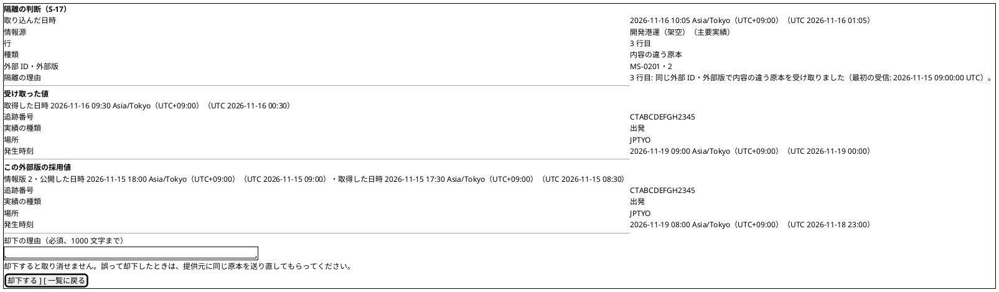
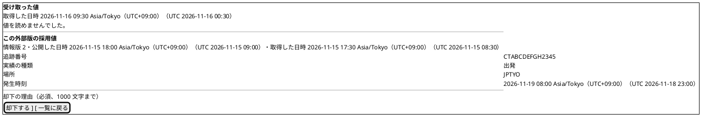
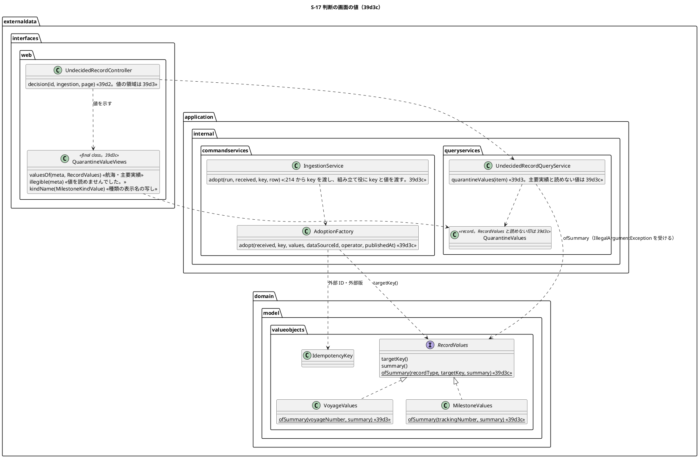

# Bolt 39d3c 計画 - S-17 の判断の画面で主要実績の内容の違う原本の値を比べ、値を読めない隔離も却下で片付けられる

## 基本情報

| 項目 | 内容 |
| :--- | :--- |
| Bolt | 第 39d3c 回（W7 の 19 本目。release_plan :967 の 39d3c の行。Bolt 39d3 の開始準備で 39d3 から縦に分けた 2 本目） |
| 状態 | 承認済み（2026-11-05。推奨のとおり。Recommend 承認の指示による） |
| 予定 | W7（2026-11-16 の週。前倒しで着手できる）。作業は約 4 時間 05 分（Bolt 39d3 の決定 (1) の見積り約 3 時間 05 分に、39d3 の開発レビューから送られた 2 つとコードで確かめて見つかった作業と、2 つの整合性検証の指摘で増えた作業を足し、今のテストで守れる分を引いた。決定 (1)。目安の 4 時間 05 分（T-250）にちょうど収まり、余りはない）。下の「時間の配分と打ち切り」。`check`・`uiTest`・`manualScreenshots`・`demoVideo`・SonarQube・CI とステップごとの承認の待ちを除く |
| アプローチ | アウトサイドイン（S-17 の判断の画面の主要実績の値から。画面の層の受入シナリオ（`@ui`）の Red から入る。release_plan :967 のとおり）。内側（主要実績の要約から値に戻す規則・型で分ける入口・照会のサービスの読めない値の受け方）も足すが、受入条件の中心は主要実績の値と読めない値の見せ方で、値の規則は採用値の要約（MilestoneValues.java :28-32）を写すだけなので、画面から入る。Red は外側（受入シナリオ → controller → 照会のサービス → 値の型）から書き、Green は内側（値の型 → 照会のサービス → 画面 → 受入シナリオ。ステップ 3〜6）の順に通す。画面の Green は、主要実績の値に戻す規則と照会の読めない印がないと書けないため（39d3 も Red を外側から書き、Green を値の列・値の型 → 照会 → 画面の順に通した前例。bolt_39d3_plan.md :402-406）。採用の組み立て役の作り直し（ステップ 7）は振る舞いを変えないリファクタリングで、今の取込のテストを守りにして緑のまま行う |
| 対象 | (1) 主要実績の要約から値に戻す規則 `MilestoneValues.ofSummary` と型で分ける入口 `RecordValues.ofSummary`（知らない原本種別は `IllegalArgumentException`）、(2) 照会のサービスで主要実績の内容の違う原本の値も返し（`QuarantineValues` の値を `RecordValues` に広げる）、読めない値（壊れた要約・知らない原本種別）を例外で落とさず読めない印にして WARN のログに受信記録 ID を残す、(3) 判断の画面の主要実績の値（追跡番号・実績の種類（日本語の名前）・場所・発生時刻）、種類の表示名の写し、読めない値の「値を読めませんでした。」（500 にせず却下を残す）、(4) 値の領域のフラグメントを `externaldata/fragments/` の新しいファイルに移す（39d3 の開発レビュー）、(5) 「取得時刻」と「取得した日時」の語を画面とマニュアルで「取得した日時」にそろえる（39d3 の開発レビュー。【前の決定の変更】(1)）、(6) 上限いっぱいの確かめ（寄港 60 と補助文字を含む 30 文字の航海番号の往復、寄港 60 の判断の画面の幅 320 px）、(7) 採用の組み立て役 `AdoptionFactory` を取込の行でなく受け取った値から作れる形にし、キーを `targetKey()` に寄せる（振る舞いを変えないリファクタリング）、(8) マニュアル 12.2 の主要実績の値と読めない値の文、12 章の冒頭の表（:21）と 12.2 の要約（:196）の「航海の内容の違う原本は…」の直し、付録 B の「値を読めませんでした。」の 1 行、(9) デモの動画（`@demo-bolt-39d3c/compare-milestone`） |
| トレース | US-14 AC4（同一キー・異 payload は既存原本と採用値を上書きせず隔離しデータ責任者へ示す。user_story :574 の AC4 の注）、UC-15 の主成功シナリオ 5（system_usecase :408）・3b（system_usecase :527）、data_model の受信記録・採用値（:1158）、domain_model の判断の画面の値（:342-343）・取込の値と主要実績の値（:354・:358）と受信記録の判断（:1526・:1530）、ui_design の S-17 の判断の画面（:194・:1948・:1996-2007 の画面イメージ・:2039）、ACC-01（WCAG 2.2 AA） |
| GitHub | [#18](https://github.com/k2works/practical-domain-driven-design-in-enterpris-application/issues/18)（US-14。クローズは 39h） |
| SP | 0 |
| 承認ゲート | **ステップごとに止める**（release_plan :967 の「ステップごと（画面）」）。画面（判断の画面の主要実績の値と読めない値。ステップ 5）、新しいファイル（フラグメント `externaldata/fragments/quarantine-values.html` と画面の層の `QuarantineValueViews.java`。ステップ 5）。スキーマ・判断の振る舞い・イベント・監査・認可は変えない（採用は 39d3b）。新しいセキュリティの判断と本番の操作はない |
| 開始準備で決めたこと | 下の (1)〜(10)（初稿。推奨を 1 つに決めて書いた。2 つの整合性検証の指摘を反映した。承認待ち）。【業務の判断】(k) を新しく記録する。【前の決定の変更】(1)〜(3) |

### 開始準備の決定

(1) **範囲と見積り**: release_plan :967 の 39d3c の行（Bolt 39d3 の開始準備の決定 (1) の表で約 3 時間 05 分。bolt_39d3_plan.md :63・:73）に、[39d3 終了報告](bolt_39d3_report.md)の開発レビューから送られた 2 つ（:69 の値の領域のフラグメントの置き場所、:70 の「取得時刻」と「取得した日時」の語）と、コードで確かめて見つかった作業（下の (a)〜(c)）と、2 つの整合性検証の指摘で増えた作業（下の (d)〜(i)）を足し、今のテストで守れる分（下の (j)）を引いて引き直すと、約 4 時間 05 分になる（下の表）。目安（CLAUDE.md の「Bolt は目安 2〜4 時間。半日を超える Bolt は分割する」の 4 時間に、見積りの誤差の 5 分を含めた 4 時間 05 分まで。Bolt 39d3 の決定 (1)、T-250）にちょうど収まるので、分けず、送らない。余りはないので、実装の中で 1 分でも超えそうなときは止めて送る先を諮る（下の「時間の配分と打ち切り」）。

増える理由: (a) 照会の値の型 `QuarantineValues` は 39d3 で計画の `RecordValues` でなく `VoyageValues` で持った（QuarantineValues.java :16・:48。[39d3 終了報告](bolt_39d3_report.md) :80 の計画から変えたこと）ので、主要実績を返すには値の型を `RecordValues` に広げ、画面の層の値の示し方（UndecidedRecordController.java :493 の `ValuesView.of(String, VoyageValues)`）を型で分ける（+5 分）、(b) 主要実績の内容の違う原本を画面で作る前提がない（UI の Steps の情報源は航海だけ。ExternalDataIngestionUiSteps.java :84-92 は `record_type` に `'VOYAGE'` を入れ、:80 の情報源の名前も「（航海）」）ので、承認済みの主要実績の情報源と主要実績のファイルの Steps を足す（+10 分）、(c) 種類の表示名の写しをテストから引けるように、値の示し方（`ValuesView`。UndecidedRecordController.java :483-507）を controller から画面の層の新しいクラスに出す（今の controller は 508 行。前例 TrackingRecordViews.java :27 の `final class`。+5 分）。

2 つの整合性検証の指摘で増える分: (d) ui_design の画面イメージ 2 つ（主要実績の判断の画面と値を読めない画面。下の「画面イメージ」を写す。+5 分）、(e) 受入シナリオの背景「承認済みの航海の情報源がある」（compare_quarantine_values_ui.feature :12）を外して各シナリオに前提を書き、`sourceLabel()`（ExternalDataIngestionUiSteps.java :79-81）を作った情報源の原本種別から決め、機能名（feature :3）を航海に限らない名にする（主要実績の行は今の `MILESTONE_HEADER`（:44-45）と `milestoneLine`（:328-331。:309-313 で使う）を使う。+5 分）、(f) マニュアル 12 章の冒頭の表（12-外部データ.md :21）と 12.2 の要約（:196）の「航海の内容の違う原本は…」の直しと、付録 B に「値を読めませんでした。」の 1 行（付録B-トラブルシューティング.md :222 の値を記録する前の隔離の行の形。+5 分）、(g) 取込のサービスの直す箇所が 2 か所（IngestionService.java :214 の呼び出しと :232-237 の `adopt`。+2 分）、(h) 読めない値の組み合わせ（値の列がない × 知らない原本種別など。行 23）と `QuarantineValues` のコンストラクタの不変条件のテスト（+3 分）、(i) 横断の検証の文書の直し（domain_model :333・:354・:356・:358・:1526 の後・:1702-1703、user_story :574、ui_design :2003-2004。+2 分）と ReceivedValue.java :9 の Javadoc の直し（+1 分）、知らない原本種別をログに書くときの制御文字の置き換え（+2 分）。引く分: (j) 行 19 の主要実績のテストはすでにある（IngestionServiceTest.java :249-255 の主要実績の対象のキー、:1779-1788 の受信記録のキーと採用値のキーの一致。:1763-1776 は航海）ので、足す作業を消す（−5 分）。

| 内訳 | 分 |
| :--- | ---: |
| Bolt 39d3 の決定 (1) の 39d3c（bolt_39d3_plan.md :73。分けて増える分 115、主要実績の値の示し方 25、読めない値 10、上限いっぱいの確かめ 15、採用の組み立て役の作り直し 20） | 185 |
| 39d3 の開発レビュー: 値の領域のフラグメントを新しいファイルに移す（bolt_39d3_report.md :69） | 10 |
| 39d3 の開発レビュー: 「取得した日時」に語をそろえる（bolt_39d3_report.md :70。画面の定数とテスト、マニュアル 12.2、ui_design の 3 か所） | 10 |
| (a) `QuarantineValues` を `RecordValues` に広げ、値の示し方を型で分ける | 5 |
| (b) 主要実績の情報源と主要実績のファイルの UI の Steps | 10 |
| (c) 値の示し方を画面の層の新しいクラスに出す | 5 |
| (d) ui_design の画面イメージ 2 つ（主要実績の判断の画面、値を読めない画面） | 5 |
| (e) 受入シナリオの背景を各シナリオの前提に、`sourceLabel()` を原本種別から、機能名を航海に限らない名に | 5 |
| (f) マニュアル 12 章 :21・:196 の直しと付録 B の 1 行 | 5 |
| (g) 取込のサービスの 2 か所（:214・:232-237） | 2 |
| (h) 読めない値の組み合わせと `QuarantineValues` の不変条件のテスト | 3 |
| (i) 横断の検証の文書の直し・ReceivedValue の Javadoc・ログの制御文字の置き換え | 5 |
| (j) 行 19 の主要実績のテストを足さない（すでにある） | −5 |
| **合計** | **245（約 4 時間 05 分）** |

比べた案: (i) 1 本のまま約 4 時間 05 分（推奨。目安にちょうど収まる）、(ii) 採用の組み立て役の作り直しを 39d3b に戻す（39d3c はステップ 7 の 17 分を引いて約 3 時間 48 分になるが、39d3b が約 4 時間 15 分に戻り目安を超える。bolt_39d3_plan.md :72）、(iii) フラグメントの移動と語をそろえる作業を後に送る（39d3c の主要実績の値でフラグメントの中身が増えるので、移すのは今が最も安い。語は主要実績の同じ値の文にも出るので、今そろえないと文が 2 か所で揺れる）。

(2) **主要実績の要約から値に戻す**: `MilestoneValues.ofSummary(String trackingNumber, String summary)` を足す。要約「種類;場所;発生時刻」（MilestoneValues.java :28-32）を `;` で 3 つに分け、種類は `MilestoneKindValue.valueOf`（MilestoneKindValue.java :10-23 の 6 つの名前）、場所は `Location`（Location.java :16-18。UN/LOCODE でなければ `IllegalArgumentException`）、発生時刻は `RecordValues.summaryTimeOf`（RecordValues.java :54-66。書く形と同じマイクロ秒 6 桁だけを受け、暦にない日付も拒む）で読み、追跡番号は `TrackingNumberValue`（TrackingNumberValue.java :17・:21-23。形が違えば `IllegalArgumentException`）にする。主要実績の発生時刻は必須（MilestoneValues.java :25）なので、空の時刻は `NullPointerException` にせず `IllegalArgumentException` にする（黙って読まない。読めない値として受けるため、例外の型をそろえる）。区切りの数が 3 でなければ `IllegalArgumentException`（前例 VoyageValues.java :100-102）。往復の約束は航海と同じく「取込の値 `v` について `ofSummary(v.targetKey(), v.summary())` が `v` と等しい」（VoyageValues.java :85-88）。

(3) **型で分ける入口**: `RecordValues.ofSummary(String recordType, String targetKey, String summary)` を足す。原本種別（IdempotencyKey.java :11 の `VOYAGE`・`MILESTONE`）で `VoyageValues.ofSummary`（VoyageValues.java :95-109）か `MilestoneValues.ofSummary` を呼び、ほかの原本種別は `IllegalArgumentException`。原本種別は情報源・外部原本の `record_type VARCHAR(50)` で CHECK がない（V20261103100000 :12・:55）ので、表を直に書き換えると知らない原本種別が入りうる。原本種別の名前の集合は取込ファイルの種別 `CsvFileKind`（CsvFileKind.java :9-13。`externaldata.interfaces.file`）にあり、ドメインの値の型からは参照しない（層の規則）。入口がすべての種別を扱うことは、テストで `CsvFileKind.values()` の名前ごとに入口が値を返すことを確かめる（T-240。行 6）。

(4) **照会のサービスで主要実績を返し、読めない値を受ける**: `UndecidedRecordQueryService.quarantineValues`（UndecidedRecordQueryService.java :66-75）の「原本種別が `VOYAGE` のものだけ」（:38-39・:67）を外し、キーのない隔離（`Item` の形式の誤りの印。:67 の `quarantine.keyless()`）だけを受信記録も採用値も引かずに空にする。受け取った値（:79）と採用値（:92）の `VoyageValues.ofSummary` を入口 `RecordValues.ofSummary` に替える。受け取った値の側は判断の画面の `Item` の原本種別（`quarantine.recordType()`。今のとおり `Item` から渡し、取込と情報源を読み直さない）で呼び、採用値の側は採用値の対象の種類（`adopted.targetType().name()`。AdoptedValue.java :27 の `TargetType`、:50-55 の 2 値で、表の CHECK `ck_adopted_value_target_type` がある）で呼ぶ。

- **読めない値**: 入口の `IllegalArgumentException`（`VoyageValuesRejected` も `IllegalArgumentException` の子。VoyageValuesRejected.java :11）だけを受け、その側の値を「読めない」にする。try は入口 `RecordValues.ofSummary` の呼び出しだけを囲む（受信記録・採用値の `findById`・`currentOf` は囲まない。リポジトリが `IllegalArgumentException` を投げても読めない値にせず上げる）。受けるのは受け取った値と採用値のそれぞれで、片方が読めなくても他方は示す。知らない原本種別は受け取った値だけが読めない（採用値の側は対象の種類で呼ぶので読める）。受け取った値の列がない（Bolt 39d3 より前の隔離。:79 の `value == null`）ときは入口を呼ばず、「読めない」より先に「値の列がない」と判定する（知らない原本種別でも値の列がなければ値の列のない文を示す）。ほかの例外（DB の誤りなど）は受けない（500 のまま。読めない値と取り違えない）
- **WARN のログ**: 読めないときは WARN のログに受信記録 ID（採用値の側は採用値 ID と採用値の受信記録 ID）と原本種別と例外の型を残す。知らない原本種別は表を直に書き換えて入った文字列なので、そのまま書かず、改行などの制御文字を置き換えて書く（ログの偽造を防ぐ）。要約の中身と例外の文はログに書かない（例外の文には要約の一部（寄港の要約や時刻の文字列。VoyageValues.java :101、RecordValues.java :64）が入り、取込ファイルから来た値を含む）。外部データのコンテキストにはまだロガーがない（`externaldata` の main に `LoggerFactory` がない）ので、前例（TrackingStartEventHandler.java :36 の `private static final Logger LOG`）の形で足す。テストは logback の `ListAppender` で確かめる（前例 ExternalRecordAuditEventHandlerTest.java :56）
- **値の型**: `QuarantineValues`（QuarantineValues.java :16・:48）の値を `VoyageValues` から `RecordValues` に広げ、受け取った値と採用値のそれぞれに読めない印（`receivedIllegible`、`Adopted.illegible`。T-246 で「illegible」を検索してないことを確かめた。「unreadable」は取込の「取り込めなかった部分」（`IngestFileCommand.UnreadablePart`）の語なので使わない）を足す。採用値の値は読めないときだけ null（:51 の `requireNonNull(values)` を「読めないときだけ null」に直す）。不変条件はコンストラクタで縛る: `receivedIllegible` が真なら `received` は null（読めない印と値の両方を持たない）、`Adopted` は `illegible` が真のときだけ `values` が null。食い違えば `IllegalArgumentException`（テストは行 23。T-244）。`sameValues()`（:27-29）はどちらかが読めなければ偽（値が null なので今の式のまま偽になる。行 23 で示さないことを確かめる）
- **引く数**: 主要実績も航海と同じく、受信記録の `findById` 1 回、`currentOf` 1 回、採用値があればその受信記録の `findById` 1 回（UndecidedRecordQueryService.java :70-71・:81・:89-90）。読めない値でも引く数は変えない（取得した日時と情報版は要約によらず読めるので示す。【業務の判断】(k)）。T-236 のとおり呼び出しの記録で縛る（39d3 の行 13 として置く。前例 UndecidedRecordQueryServiceTest.java :521-558）

(5) **判断の画面の主要実績の値と読めない値**（【業務の判断】(i) の続き。Bolt 39d3 の決定 (7)。bolt_39d3_plan.md :107・:109）:

- 主要実績は `dl` で「追跡番号」「実績の種類」「場所」「発生時刻」を示す（39d3 の決定 (7) の項目に、種類の項目名だけを「実績の種類」に改める。判断の画面の隔離の中身にはすでに「種類」（内容の違う原本などの隔離の種類。decision.html :34）があり、同じ画面で「種類」が 2 つの意味になるため。「実績の種類」は追跡の画面の呼び方（TrackingRecordViews.java :84）とそろう。項目名「発生時刻」は S-13 の欄の名前（tracking/staff/milestones/new.html :48 の「発生時刻（日本時間）」）とそろう）。実績の種類は日本語の名前（下の種類の表示名の写し）、場所は UN/LOCODE、発生時刻は `DateTimeDisplay.staff`（UndecidedRecordController.java :505 と同じ形）
- 航海と主要実績の示し方を 1 つの形にする: 値の示し方 `ValuesView` を「取得した日時の文、`dl` の項目（名前と値の組の並び）、寄港の並び（主要実績は空）、値がないときの文」にする（今は航海番号と寄港の並びだけ。UndecidedRecordController.java :483）。航海は `dl` に「航海番号」の 1 組と寄港の `ol`、主要実績は `dl` に 4 組で `ol` を出さない
- 値を読めない側は、取得した日時の文（採用値は情報版・公開した日時・取得した日時の文。UndecidedRecordController.java :99-101）を示したうえで「値を読めませんでした。」を示す（【業務の判断】(k)）。受け取った値の列がないときは今の値の列のない文（39d3 の行 10）を示し、「値を読めませんでした。」は示さない（決定 (4) の判定の順）。同じ値の文は出さない。却下の欄・取り消せないことの文・「一覧に戻る」は変えない（decision.html :56-68）
- **種類の表示名の写し**: 外部データは追跡の型を参照できない（MilestoneKindValue.java :6-7）ので、追跡の表示名（TrackingRecordViews.java :47-53 の `KIND_NAMES`。private な定数で参照できない）の写しを画面の層に置く。テストは用語集の実績の種類の名前（docs/manual/用語集.md :54 の「集荷・搬入・出発・積替・到着・引渡し」）を `MilestoneKindValue` の値ごとに書き並べ、組の数が `MilestoneKindValue.values()` の数と同じことも確かめる（T-240。行 18）
- **値の示し方の置き場所**: `ValuesView`（UndecidedRecordController.java :483-507）と種類の表示名の写しを、画面の層の新しいクラス `QuarantineValueViews`（`externaldata.interfaces.web`、package-private の `final class`。前例 TrackingRecordViews.java :27。T-246 で同じ単純名がないことを確かめた）に出す。controller は照会の値を渡すだけにする
- 文は画面の層の定数、テンプレートは `th:text`（取込ファイルから来た値を含む。追跡番号は値の列の値）

(6) **値の領域のフラグメントを新しいファイルに移す**（39d3 の開発レビュー。bolt_39d3_report.md :69。【前の決定の変更】(2)）: 今の値の領域は `decision.html` の `main` の外のフラグメント（decision.html :70-83）で、自分のテンプレート名で呼んでいる（:48・:52 の `~{externaldata/undecided-records/decision :: values(…)}`）。前例は別ファイルのフラグメント（`quotation/fragments/quotation.html`・`assigned-route.html`。quotation/transport-requests/detail.html :58 の `~{quotation/fragments/quotation :: details(…)}`）なので、`templates/externaldata/fragments/quarantine-values.html`（新しいファイル。`externaldata/fragments/` はまだない。T-246）の `values(v)` に移し、主要実績の `dl` と読めない値の文もここに書く。航海の HTML の出力は 39d3 と同じにし、controller の今の行（39d3 の行 9〜11・21・22）がそのまま通ることで移動を守る。Bolt 39d3 の決定 (10) の「テンプレートは新しく作らない（decision.html に足す）」（bolt_39d3_plan.md :117）を改める。

(7) **「取得した日時」に語をそろえる**（39d3 の開発レビュー。bolt_39d3_report.md :70 の推奨。【前の決定の変更】(1)）: 判断の画面の見出しの横は「取得した日時」（UndecidedRecordController.java :99・:101）なのに、同じ値の文は「…同じで、取得時刻だけが違います。」（:110）で、利用者の読む語が揺れる。画面とマニュアルの語を「取得した日時」にそろえ、文を「受け取った値はこの外部版の採用値と同じで、取得した日時だけが違います。」にする。直す場所: 画面の定数（UndecidedRecordController.java :110。主要実績にも同じ文を使う）、controller のテストの期待（UndecidedRecordControllerTest.java :1023）、UI の Steps の注記（CompareQuarantineValuesUiSteps.java :27）、マニュアル 12.2 の ②（12-外部データ.md :274）・③ の「（この行の取得時刻）」（:275）・「書き方と取得時刻を含む」（:285）、ui_design の画面の文を写した 3 か所（:194・:1948・:2039）。設計とモデルの文書（data_model・domain_model・user_story :574）の「取得時刻」は受信記録の `acquired_at` の名前としてそのまま残す（利用者の画面の語ではない）。ほかの章のマニュアルの「取得時刻」（08-経路設計.md :74・:91-92、09-追跡管理.md :74）は別の画面の項目名なので、この Bolt では直さない。

(8) **上限いっぱいの確かめ**（Bolt 39d3 の決定 (1) の候補 (i)。bolt_39d3_plan.md :71・:240）: 契約のテスト（`ExternalDataRecordRepositoriesContract`。今は寄港 2 つの航海と主要実績だけ。:822-831）に、寄港 60（`VoyageValues.MAX_PORT_CALLS`。VoyageValues.java :34。要約は最大 3719 文字）の航海と、補助文字を含む 30 文字（コードポイント。VoyageValues.java :25・:123）の航海番号の受信記録の値の往復を、メモリ・H2・PostgreSQL で足す（H2 を広げない判断（ADR-007 :98）の確かめ。T-242。行 5）。受入シナリオに寄港 60 の航海の内容の違う原本の判断の画面が幅 320 px で横スクロールを出さず axe の違反 0 を足す（行 15。今の feature :36 の行 15 は寄港 2 つ）。測るのは往復と幅で、照会の時間は測らない（1 件の照会と索引。上限いっぱいの一覧の計測は 39d4）。

(9) **採用の組み立て役を受け取った値から作れる形にする**（Bolt 39d3 の決定 (1)・(4)・(9)。bolt_39d3_plan.md :72・:241）: 今の組み立て役は取込の行（`IngestedRow`）から値・外部 ID・外部版・取得時刻を読み、キーを値の型で分けて決める（AdoptionFactory.java :51-57 の引数、:60 の `row.acquiredAt()`、:62 の `row.values()`、:65 の `voyage.voyageNumber()`、:76・:96-97 の `row.externalId()`・`row.externalVersion()`、:86 の `trackingNumber.value()`、:104-108 の `row.values().summary()`）。これを `adopt(ReceivedRecord received, IdempotencyKey key, RecordValues values, UUID dataSourceId, AuthenticatedActor operator, Instant publishedAt)` にする。

- 取得時刻は受信記録の `acquiredAt()`（ReceivedRecord.java :43）、取込 ID は受信記録の `ingestionId()`（:40）、外部 ID・外部版は冪等性キー（IdempotencyKey.java :16。外部原本が持つ。ExternalRecord.java :25）から読む。取込のサービスは同じ値を渡す（受信記録の取得時刻は行の取得時刻。IngestionService.java :205。冪等性キーは :190-191 で作った `key`）ので、取込での自動の採用の振る舞いは変わらない
- 対象のキーは `values.targetKey()`（RecordValues.java :30）に寄せ、値の型の分岐はイベントの組み立てだけに残す（DE-12 は寄港の並び、DE-13 は種類・場所・発生時刻を持つので）
- 引数は 6 つ（SonarQube の引数の数の既定の上限 7 に収まる。IngestedRow を渡さない分、39d3b の採用の判断が受け取った値（`RecordValues.ofSummary`）と外部原本の冪等性キーから呼べる）
- 守り: 今の取込のテストがそのまま守る（足すテストはない）。採用値の行（IngestionServiceTest.java :233-246 の主要実績、:283-292 の航海。情報版と公開した時刻を含む）、DE-12・DE-13 の行（:368-406。:374・:397 のイベントの出典（受信記録 ID と取得時刻））、主要実績の採用値の対象のキーが外部 ID でなく追跡番号であること（:249-255）、39d3 の行 19（受信記録のキーと採用値のキーの一致。:1763-1776 の航海、:1779-1788 の主要実績。:1715-1721 はその Javadoc）。主要実績の外部 ID（`MS-0001`）は追跡番号と違うので、キーを外部 ID で作る誤りは :249-255 と :1779-1788 が落とす
- `AdoptionFactory` の Javadoc（:22-27）の「取込の値の型の分岐 1 か所」「公開した時刻は取込の時刻」は、引数で受ける形に合わせて直す。DE-12・DE-13 の `publishedAt` の Javadoc と `EXTERNAL_RECORD_ADOPTED` の Javadoc は 39d3b（bolt_39d3_plan.md :246）

(10) **新しい型の名前**（T-246。`apps/cargo-tracker/src` で `ofSummary`・`illegible`・`QuarantineValueViews`・`quarantine-values`・`externaldata/fragments` を検索し、`VoyageValues.ofSummary` のほかにないことを確かめた。「unreadable」は取込の「取り込めなかった部分」の語（`IngestFileCommand.UnreadablePart`、result.html :31 の `unreadableRegion`）なので避けた。`*Views` の前例は TrackingRecordViews・BookingViews・RoutingCaseViews・QuotationViews など）: 本体 `QuarantineValueViews`（.java）、フラグメント `templates/externaldata/fragments/quarantine-values.html`。足すメソッドは `MilestoneValues.ofSummary`・`RecordValues.ofSummary`、`QuarantineValues.receivedIllegible`・`QuarantineValues.Adopted.illegible`。テストは既存のクラスに `@Nested class Bolt39d3c_…` で足し、契約のテストは名前の頭に `Bolt39d3c_`。受入シナリオは今の `features/ui/compare_quarantine_values_ui.feature` と `CompareQuarantineValuesUiSteps.java` に足す（新しいテストのクラスは作らない）。主要実績の情報源の前提「承認済みの主要実績の情報源がある」は UI の Steps にまだない（同じ名前は ExternalDataIngestionSecurityIntegrationTest.java :484 のメソッド名だけで、Cucumber の手順ではない）ので `ExternalDataIngestionUiSteps` に足す。主要実績のシナリオを同じ feature に置くので、背景「承認済みの航海の情報源がある」（compare_quarantine_values_ui.feature :11-12）を外して各シナリオの前提に書き、機能名（:3 の「…航海の内容の違う原本の…」）を航海に限らない名（「データ責任者が内容の違う原本の受け取った値とこの外部版の採用値を判断の画面で見比べる」）にする。選択肢の名前 `sourceLabel()`（ExternalDataIngestionUiSteps.java :79-81。今は「（航海）」を固定で付ける）は作った情報源の原本種別から決める（航海は「（航海）」、主要実績は「（主要実績）」）。主要実績の行は今の `MILESTONE_HEADER`（:44-45）と `milestoneLine`（:328-331。:309-313 の「主要実績のファイル」で使う）を使い、新しい見出しの定数を作らない

【前の決定の変更】(1): Bolt 39d3 の開始準備の決定 (7) と状態の組み合わせの行 22 で承認した画面の文「受け取った値はこの外部版の採用値と同じで、取得時刻だけが違います。」（bolt_39d3_plan.md :108・:215）を、「受け取った値はこの外部版の採用値と同じで、取得した日時だけが違います。」に改める（決定 (7)。39d3 の開発レビューの推奨。bolt_39d3_report.md :70）。文の出る条件（値が等しく、取得時刻が違う）は変えない。

【前の決定の変更】(2): Bolt 39d3 の開始準備の決定 (10) の「テンプレートは新しく作らない（decision.html に足す）」（bolt_39d3_plan.md :117）を改め、値の領域のフラグメントを新しいファイル `externaldata/fragments/quarantine-values.html` に移す（決定 (6)。39d3 の開発レビュー。bolt_39d3_report.md :69）。

【前の決定の変更】(3): Bolt 39d3 の開始準備の決定 (7) の主要実績の `dl` の項目名「種類」（bolt_39d3_plan.md :107）を「実績の種類」に改める（決定 (5)。整合性検証の指摘。判断の画面の隔離の中身の「種類」（decision.html :34。内容の違う原本などの隔離の種類）と同じ画面で 2 つの意味にならないように、追跡の画面の呼び方（TrackingRecordViews.java :84）にそろえる）。示す値（日本語の名前）と項目の順は変えない。

【前の決定の変更】(4): 外部データのインフラストラクチャ層と画面の層の外の依存の許可リスト（ModularityTest の `外部データのインフラストラクチャ層と画面の層の外は共有カーネルとJavaとSpringにだけ依存する`。Bolt 39・39a2）に `org.slf4j..` を足す。application 層の照会のサービスの WARN のログ（決定 (4)）のため。ステップ 4 の実装で規則に拒まれ、置き場所を動かさず止めて諮った（ModularityTest の Javadoc の「フレームワークの許可は、使う Bolt で、使う層に限って足す」に合わせる）。domain は DomainArchitectureTest が Java の標準とドメイン層と注釈の語彙だけに絞っているので、domain の規則は足さない（2026-11-05、推奨のとおり。Recommend 承認の指示による。human:kakimomokuri）。

新しいファイル（39d3c）: 本体は決定 (10) の 1 個（.java）とフラグメント 1 個（.html）。テストの新しいクラスはない。デモの動画 `docs/assets/demo/bolt-39d3c/compare-milestone.webm`（`demoVideo` が作る）。直すもの: `MilestoneValues`・`RecordValues`（`ofSummary`）、`QuarantineValues`・`UndecidedRecordQueryService`、`UndecidedRecordController`・`decision.html`、`AdoptionFactory`・`IngestionService`（2 か所。:214 の `adopt(run, received, row)` の呼び出しに冪等性キーを足し、:232-237 の `adopt` から組み立て役を新しい引数で呼ぶ）、`ReceivedValue` の Javadoc（ReceivedValue.java :9 の「航海は `VoyageValues#ofSummary` で値に戻せる」を、入口 `RecordValues#ofSummary` で航海も主要実績も値に戻せることに直す）、コードの「39d3c」の注記（下の「設計文書に直す箇所」の最後）、テスト `MilestoneValuesTest`（`MilestoneValues.ofSummary` と入口のテストの置き場所。下の「状態の組み合わせ」の冒頭の段落）・`ExternalDataRecordRepositoriesContract`（行 5）・`UndecidedRecordQueryServiceTest`（`QuarantineValues` の不変条件も。行 23）・`UndecidedRecordControllerTest`・`CompareQuarantineValuesUiSteps`・`ExternalDataIngestionUiSteps`・`compare_quarantine_values_ui.feature`、マニュアル 12 章と付録 B。`IngestionServiceTest` はテストを足さず、:1718 の「39d3c」の注記だけを直す（行 19 は今のテストが守る）。キャプチャは新しく作らない（下の「スコープ」）。

## Bolt ゴール

データ責任者が S-17 の一覧から主要実績の内容の違う原本の「判断する」を開くと、判断の画面で隔離の中身と理由の後に「受け取った値」と「この外部版の採用値」が、航海と同じくそれぞれの取得した日時とともに並び、追跡番号・実績の種類（集荷・搬入・出発・積替・到着・引渡し）・場所・発生時刻を見比べてから却下を決められる。値が同じなら航海と同じ 2 つの文（書き方だけが違う、取得した日時だけが違う）を示す。表を直に書き換えて要約が壊れていたり原本種別を読めなかったりしても、判断の画面は 500 にならず、その側に「値を読めませんでした。」を示し、却下で片付けられる。寄港 60 の航海の判断の画面も幅 320 px で横スクロールなしに読め、上限いっぱいの値が H2 と PostgreSQL で往復する。採用の組み立て役は受け取った値から採用値とイベントを作れる形になり（取込での振る舞いは変わらない）、39d3b の採用の判断がそのまま使える。マニュアル 12.2 が主要実績の値と読めない値の示し方に合い（12 章の冒頭の表と付録 B も）、デモの動画がある。

### 開始準備で確かめたこと

- **release_plan の 39d3c の行**（:967）: 「主要実績の要約から値に戻す規則（`MilestoneValues.ofSummary`）と型で分ける入口（`RecordValues.ofSummary`）、判断の画面の主要実績の追跡番号・種類（日本語の名前。種類の表示名の写し）・場所・発生時刻、読めない値（壊れた要約・知らない原本種別。500 にせず「値を読めませんでした。」を示し、却下を残す）、上限いっぱいの確かめ、採用の組み立て役を受け取った値から作れる形にし、キーを `targetKey()` に寄せる、マニュアル 12.2 の主要実績の値と読めない値の文、デモの動画」と、39d3 の開発レビューからの 2 つ（フラグメントの置き場所、語）。アプローチはアウトサイドイン（S-17 の判断の画面の主要実績の値から）、承認ゲートは「ステップごと（画面）」
- **前の Bolt の申し送り**: bolt_39d3_plan.md :238-241 の 39d3c の 4 行（主要実績の値の示し方、読めない値と 39d3c までの 500、上限いっぱいの確かめ、採用の組み立て役の作り直し）、[39d3 終了報告](bolt_39d3_report.md) :104 の既知の課題（同じ 4 つと、フラグメントの置き場所、語）
- **照会と画面の今の形**: 照会のサービスは原本種別が `VOYAGE` のときだけ値を返す（UndecidedRecordQueryService.java :38-39・:66-75）、受け取った値と採用値を `VoyageValues.ofSummary` で戻し例外を受けない（:79・:92）。値の型は `VoyageValues`（QuarantineValues.java :16・:48）。画面の値の示し方は航海だけ（UndecidedRecordController.java :483-507）、同じ値の文の定数（:107-110）。値の領域のフラグメントは decision.html の `main` の外（:70-83）
- **値の型**: 取込の値は sealed interface（RecordValues.java :17 の `permits VoyageValues, MilestoneValues`）、主要実績の要約は「種類;場所;発生時刻」（MilestoneValues.java :28-32）、主要実績の値はどれも必須（:21-26）、要約の時刻を読む規則（RecordValues.java :54-66）、追跡番号の形（TrackingNumberValue.java :17）、種類の 6 つ（MilestoneKindValue.java :10-23）。値の規則の誤りはどれも `IllegalArgumentException`（Location.java :18、TrackingNumberValue.java :22、VoyageValuesRejected.java :11、RecordValues.java :64）
- **原本種別**: 冪等性キーの原本種別は `VOYAGE`・`MILESTONE`（IdempotencyKey.java :11）、表の列は `VARCHAR(50)` で CHECK がない（V20261103100000 :12・:55）、種別の名前の集合は `CsvFileKind`（CsvFileKind.java :9-13）
- **採用の組み立て役**: 呼び出しは取込のサービスの `adopt`（IngestionService.java :232-237）の 1 か所で、その `adopt` を行の分類の switch（:214）から呼ぶ（直すのはこの 2 か所）。テストから直に呼ぶものはない（`AdoptionFactory` を参照するのは IngestionService.java だけ）。受信記録の取得時刻は行の取得時刻（:205）、冪等性キーは :190-191
- **UI の前提**: 情報源の前提は航海だけ（ExternalDataIngestionUiSteps.java :80・:84-92）。今の受入シナリオは航海の 3 つ（compare_quarantine_values_ui.feature :15-47。デモのタグは :15 の `@demo-bolt-39d3/compare`）。キャプチャ `12-undecided-record-decision` は航海の内容の違う原本（manual_screenshots.feature :262）
- **マニュアル**: 12.2 の画面の説明の表（12-外部データ.md :271-281）、「②〜④ は、航海の内容の違う原本に示されます。主要実績の内容の違う原本には、まだ示されません。」（:283）、却下の手順の 2（:290）、注意・補足の「主要実績の内容の違う原本の値は、まだ判断の画面に示されない」（:360）。12 章の冒頭の表の隔離の判断の行（:21）と 12.2 の要約（:196）は「航海の内容の違う原本は…見比べ」と航海に限っている。付録 B のエラーの表には判断の画面の文の前例（:222 の「この隔離は、受け取った値を記録する前に取り込みました。…」の行。文・画面・意味とどうすればよいか）がある
- **語**: 「取得時刻だけ」の画面の文は UndecidedRecordController.java :110・UndecidedRecordControllerTest.java :1023・12-外部データ.md :274・ui_design :194・:1948・:2039 にある（`取得時刻だけ|取得した日時だけ` の検索。H2ExternalDataRecordRepositoriesTest.java :135 と ExternalDataRecordRepositoriesContract.java :290 の「取得時刻だけがない隔離」はテストの説明の文で、画面の語ではないので直さない）

## 設計の決定

| 項目 | 決定 | 根拠 |
| :--- | :--- | :--- |
| 範囲と見積り | 開始準備の決定 (1)。1 本で約 4 時間 05 分（分けず、送らない。余りはない） | bolt_39d3_plan.md :63・:73、bolt_39d3_report.md :69・:70・:80、QuarantineValues.java :16、ExternalDataIngestionUiSteps.java :84-92、UndecidedRecordController.java :483-507 |
| 主要実績の要約から値に戻す | 決定 (2)。`MilestoneValues.ofSummary`。誤りはどれも `IllegalArgumentException`（空の発生時刻も） | MilestoneValues.java :21-32、RecordValues.java :54-66、TrackingNumberValue.java :17-23、Location.java :16-18 |
| 型で分ける入口 | 決定 (3)。`RecordValues.ofSummary(recordType, targetKey, summary)`。知らない原本種別は `IllegalArgumentException`。全種別はテストで `CsvFileKind` から確かめる | IdempotencyKey.java :11、V20261103100000 :12・:55、CsvFileKind.java :9-13 |
| 照会と読めない値 | 決定 (4)。キーのない隔離だけ空。受け取った値は `Item` の原本種別、採用値は対象の種類で入口を呼ぶ。try は入口の呼び出しだけを囲み、`IllegalArgumentException` だけを受け、側ごとに読めない印（「値の列がない」を先に判定）。不変条件はコンストラクタで縛る。WARN のログ（要約の中身は書かず、知らない原本種別は制御文字を置き換える）。引く数は航海と同じ | UndecidedRecordQueryService.java :66-96、QuarantineValues.java :16-56、AdoptedValue.java :27・:50-55、TrackingStartEventHandler.java :36、ExternalRecordAuditEventHandlerTest.java :56 |
| 判断の画面 | 決定 (5)。主要実績は `dl` の 4 組（「追跡番号」「実績の種類」「場所」「発生時刻」）、航海は `dl` の 1 組と `ol`。読めない側は取得した日時の文と「値を読めませんでした。」。種類の表示名の写しと値の示し方を `QuarantineValueViews` に | UndecidedRecordController.java :99-110・:483-507、TrackingRecordViews.java :27・:47-53・:84、decision.html :34、用語集.md :54、tracking/staff/milestones/new.html :48 |
| フラグメント | 決定 (6)。`externaldata/fragments/quarantine-values.html` に移す（【前の決定の変更】(2)） | decision.html :48・:52・:70-83、quotation/transport-requests/detail.html :58、bolt_39d3_plan.md :117 |
| 語 | 決定 (7)。画面とマニュアルは「取得した日時」（【前の決定の変更】(1)）。モデルの文書の「取得時刻」は残す | UndecidedRecordController.java :99・:101・:110、12-外部データ.md :274・:275・:285、bolt_39d3_report.md :70 |
| 上限いっぱい | 決定 (8)。寄港 60 と補助文字の航海番号の往復（契約）、寄港 60 の幅 320 px（UI） | VoyageValues.java :25・:34・:123、ExternalDataRecordRepositoriesContract.java :822-831、ADR-007 :98 |
| 採用の組み立て役 | 決定 (9)。`adopt(received, key, values, dataSourceId, operator, publishedAt)`。キーは `targetKey()`。振る舞いは変えない | AdoptionFactory.java :51-108、IngestionService.java :190-191・:205・:214・:232-237、ReceivedRecord.java :40・:43、IngestionServiceTest.java :233-246・:249-255・:283-292・:368-406・:1763-1788 |
| 状態遷移・ナビ・スキーマ | 受信記録の判断の状態遷移（domain_model :1530 の節）は変えない（判断を足さない）、ナビと画面遷移も変えない（判断の画面の中身が増えるだけ）、スキーマも変えない（値の列は 39d3）ので、状態遷移図・画面遷移図・ER 図を省く | domain_model :1530 |
| 型の名前 | 決定 (10)（T-246 で検索した） | — |

## ふりかえりと前の Bolt からの引き継ぎ

| 出典 | 内容 | この Bolt での扱い |
| :--- | :--- | :--- |
| W6 の Try T-204・T-212、Bolt 38h の T-227、Bolt 39b の T-233、Bolt 39d・39d2・39d3 の Problem | サブエージェントへの指示の最初に heredoc と標準入力を待つコマンド（`python -`、引数のない `cat >` など）を使わないと書く。39d3 では私が終了処理のコマンドで heredoc つきの `python -I -` を流した（bolt_39d3_report.md :99） | 任せるときの指示の最初に書き、私の側の操作も同じ決まりで行う（ファイルは Write・Edit、検索は Grep）。終了処理のスクリプトを heredoc で作らない |
| Bolt 39d の T-247、Bolt 39d2・39d3 の Try | 決まりを文章の指示ではなく仕組みで守らせる（フック） | W7 の締めで諮る（39d3 の終了報告で根拠が 1 つ増えた）。39d3c では任せる範囲をファイルを Write・Edit で書く作業と読むだけの検索に絞り、Gradle と git を人の側の 1 か所に残す。任せる指示に触らないもの（`.claude/agent-memory`・`.run/`・`apps/cargo-tracker/.claude/`、ほかの作業のテスト）を名前で書く |
| Bolt 39d の T-248 | `git add` は `git status --short` の出力を使わず、ディレクトリか `git add -u` で指定する | 各ステップのコミットで、本体・テストはパッケージのディレクトリ、文書は `docs/` の下のディレクトリで指定する |
| Bolt 39d2b の T-249 | 担当への指示に私の言葉を書くときは「（私の指示）」と出典を付け、計画に人の指示として書き写さない | 初稿は推奨を 1 つに決めて書き、人の承認として書かない（承認は計画の承認の場で更新履歴に書く）。見積りの目安は CLAUDE.md の決まりとして書く |
| Bolt 39d3 の T-250 | 見積りの受け入れは 4 時間 05 分まで（5 分は誤差）とし、超えたら必ず送るか分ける | 決定 (1)。約 4 時間 05 分でちょうど収まる（余りはない）。実装の中で超えそうなら止めて送る先を諮る |
| Bolt 39d3 の T-251 | マニュアルの担当には、用語の定義を計画の【業務の判断】の文から写させる | 用語は足さない（「この外部版の採用値」は 39d3 で用語集にある）。マニュアルの担当には、読めない値の扱いを【業務の判断】(k) の文から、種類の名前を用語集 :54 から写させる。語をそろえる文は決定 (7) の文から写させる |
| Bolt 39d3 の判断と学び | 同じ語が 2 つの意味を持つと読み手は値を取り違える。取得時刻はハッシュに入るが値に入らない（bolt_39d3_report.md :93-94） | 語をそろえる（決定 (7)）。同じ値の文の出る条件（値と取得時刻）は主要実績でも 39d3 と同じにし、主要実績の取得時刻だけが違う原本も文で分ける（行 24） |
| W6 の Try T-217、Bolt 39b2 の Try | 本体を直す前に Red を流し、落ちた理由を記録する。直したテストの一覧を添える | ステップ 2。直す既存のテスト: 照会のサービスと controller の行 12 のパラメーターの主要実績の組（UndecidedRecordQueryServiceTest.java :577、UndecidedRecordControllerTest.java :1167 の「主要実績の内容の違う原本（39d3c まで）, MILESTONE, false」。主要実績は値を引くように変わる）と、その 2 つのテストの名前（UndecidedRecordQueryServiceTest.java :578 の「行12_キーのない隔離と主要実績の内容の違う原本は…」。:576-585。controller の :1168 の名前は主要実績を名乗らないので直さない）、同じ値の文の期待（39d3 の行 22。語）（UndecidedRecordControllerTest.java :1023）、`QuarantineValues` を組み立てるテスト（値の型を広げても `VoyageValues` は `RecordValues` なので型は通る。`Adopted` の null の規則が変わる）。ステップ 2 の開始で `QuarantineValues(` と `SAME_VALUES_BUT_ACQUIRED_AT` を grep して一覧にする |
| W6 の Try T-191 | 環境の前提に設定ファイルの行を添える | スキーマ・設定は変えない。ログは logback の既定の設定で WARN を出す（前例 TrackingStartEventHandler.java :36） |
| W6 の Try T-225・T-213 | push の前に `check` | ステップ 9（`uiTest` も流す） |
| W6 の Try T-182・T-211・T-216 | 状態の組み合わせの表に重複・隔離と出口・誤った入力の行を置く | 下の表。誤った入力（行 7 の壊れた要約、行 23 の読めない値と知らない原本種別）、出口（行 12 のキーのない隔離、行 16 の却下） |
| W6 の Try T-184 | listener は配信まで確かめる | イベントと listener は変えない（組み立て役の作り直しでもイベントの値は変わらないことを行 19 の今の取込のテスト（IngestionServiceTest.java :368-406）で確かめる） |
| W6 の Try T-219 | 変異の対象に単体・統合・契約のテスト | 下の変異の表 |
| W6 の Try T-215・T-222 | Gradle を流す担当を 1 つに、計画の初稿を先にコミット | Gradle は人の側の 1 か所で流す。初稿をコミットしてから実装に入る |
| Bolt 39a2 の T-229 | 時刻の出どころと同時の書き込みの行を置く | 時刻: 39d3c は時刻を取らない。示すのは受信記録の `acquired_at`（39d3 と同じ）と、採用値の公開した時刻。組み立て役の作り直しで取得時刻の出どころを行から受信記録に替えるが同じ値（IngestionService.java :205）。同時の書き込み: 書き込みを足さない |
| Bolt 39a3 の T-230 | 入ることを確かめる行のデータはドメインの規則に合う組み合わせにする | 主要実績の内容の違う原本は、同じ外部 ID・外部版で場所か発生時刻を変えた 2 行を取り込んで作る（追跡番号は `CT` と 12 桁の形。TrackingNumberValue.java :17）。寄港 60 の航海は同じ港・同じ時刻を重ねない（VoyageValues.java :55-61）。情報源は提供元の名前に自分の UUID を含める |
| Bolt 39b の T-231 | `@Transactional` は契約のクラスに付ける | 行 5 を契約のクラス（`ExternalDataRecordRepositoriesContract`）に置く |
| Bolt 39b の T-232・39b2 の T-234・39b3 の T-237 | 本体を直したステップは承認の前に `spotbugsMain`・`checkstyleMain`・`sonar-local:check` | ステップ 3〜7 |
| Bolt 39b2b の T-235 | テストの名前の「行 N_」に Bolt の接頭辞を付けるかを W7 の締めで決める | 39d3 の前例のまま（`@Nested class Bolt39d3c_…`、契約のテストは名前の頭に `Bolt39d3c_`） |
| Bolt 39b2b の T-236 | 「起きないこと」を確かめるテストは呼び出しの記録で確かめる | キーのない隔離で受信記録も採用値も引かない（行 12）、主要実績と読めない値でも引く数が航海と同じ（行 13）を呼び出しの記録で確かめる |
| Bolt 39b3 の T-238 | サブエージェントへの指示は計画の決定を言い換えず計画の行を指す | 任せるときは「開始準備の決定」の番号と「状態の組み合わせ」の行番号を指す |
| Bolt 39b3b の T-239 | 人に諮る選択肢・主張の前提はコードで確かめ、出典の行を添える | 開始準備の決定の前提に出典の行を添えた（値の型の例外、原本種別の列、組み立て役の読む値と取込のサービスの渡す値、照会の引く数、画面の定数、フラグメントの呼び方、UI の前提） |
| Bolt 39b3b の T-240 | 表から作る規則には、全部の行が規則に入ることを確かめるテストを添える | 種類の表示名の写しが `MilestoneKindValue` のすべての値を持つ（行 18）、入口がすべての原本種別（`CsvFileKind`）を扱う（行 6） |
| Bolt 39b4 の T-241・T-242 | 上限いっぱいの入力の行を入れる | 行 5（寄港 60・補助文字の航海番号の往復）、行 15（寄港 60 の幅 320 px） |
| Bolt 39c の T-243 | 状態の数を 0 件にする受入シナリオは計画の時点で controller のテストに下ろす | 読めない値（行 23）は UI で作れない（取込は必ず読める要約を書き、原本種別は情報源から写す）ので controller と照会のサービスのテストに下ろす |
| Bolt 39c2 の T-244 | パラメーターのテストは入力と期待する出力の組み合わせまで縛る | 行 6（主要実績の 6 種類と戻した値、入口の原本種別と戻した型）、行 7（主要実績の壊れた要約の種類と例外）、行 18（種類と名前の組）、行 23（航海・主要実績 × 読めない側と、示す文の組。`QuarantineValues` の読めない印と値の不変条件をコンストラクタで縛る） |
| Bolt 39c3 の T-245 | 並びの規則を足すテストは書く順を逆にしたデータを置く | 並びの規則を足さない（この外部版の採用値の並びは 39d3 の行 8 のまま） |
| Bolt 39c4 の T-246 | 新しい型の名前は同じ単純名がないかを検索してから決める | 開始準備の決定 (10) |
| 画面の Bolt の前例（memory の manual-in-bolt-done-criteria、Bolt 37f2 の T-197） | 振る舞いが変わる Bolt はマニュアルの更新を完了条件に入れる。マニュアルの文を実装と突き合わせる | 完了条件に 12.2 の主要実績の値・読めない値・語の直しと、12 章の冒頭の表・12.2 の要約・付録 B の直しを入れる。ステップ 8 で「追跡番号」「実績の種類」「場所」「発生時刻」・実績の種類の名前・「値を読めませんでした。」・同じ値の 2 つの文を `QuarantineValueViews` と controller の定数とフラグメントに突き合わせる |
| Bolt 39d3 の終了報告の既知の課題 | 39d3c: 主要実績の値、読めない値、上限いっぱい、組み立て役、フラグメント、語（:104） | すべてこの Bolt に入れる（決定 (2)〜(9)）。39d3b の分（却下の欄の見出し、H2 の UUID の比べ方など。:105）は入れない |

## 状態の組み合わせ（行ごとにテストを 1 本。T-182）

行の番号は Bolt 39d3 の計画の番号を引き継ぎ（39d3 の申し送り。bolt_39d3_plan.md :238）、39d3c で確かめる行 5・6・7・12・13・14・15・18・19・22・23 を 39d3 の番号のまま置き、新しく足す行は 24 から振る（行 25 は欠番。初稿の語をそろえる行は、文を直すのが 39d3 の行 22 の期待なので行 22 に寄せた）。主要実績の値に戻す規則と入口は値の型の単体（`MilestoneValuesTest`。入口は `RecordValues` が interface でテストのクラスがないので `MilestoneValuesTest` の `@Nested class Bolt39d3c_型で分ける入口` に置く）、上限いっぱいの往復は契約のテスト（`ExternalDataRecordRepositoriesContract`。メモリ・H2・PostgreSQL）、照会のサービスと `QuarantineValues` の不変条件は単体（`UndecidedRecordQueryServiceTest`。ポートを mock。`QuarantineValues` のテストのクラスはないので、新しいクラスを作らずここに置く）、画面は WebMvc のテスト（`UndecidedRecordControllerTest` の `@Nested class Bolt39d3c_…`。照会と判断のサービスは mock）と画面の層の単体（`QuarantineValueViews` の種類の名前）、組み立て役は取込のサービスの今のテスト（`IngestionServiceTest`。テストを足さない）、画面の通しは `compare_quarantine_values_ui.feature`（幅 320 px、axe）。

| 行 | 状況 | 期待 | 確かめ方 |
| :--- | :--- | :--- | :--- |
| 5 | 上限いっぱいの往復 | 寄港 60（要約 3719 文字）の航海と、補助文字を含む 30 文字（コードポイント）の航海番号の受信記録の値が、受信記録の追記と `findById`・`quarantinedOf` で往復する（H2 を広げない判断の確かめ） | 契約のテスト（メモリ・H2・PostgreSQL） |
| 6 | 主要実績の要約から値に戻す・入口 | 主要実績の 6 種類（`MilestoneKindValue` のすべて）で `MilestoneValues.ofSummary(v.targetKey(), v.summary())` が `v` と等しい。入口 `RecordValues.ofSummary` は `VOYAGE` で `VoyageValues`、`MILESTONE` で `MilestoneValues` を返し、`CsvFileKind.values()` のすべての名前を扱う（T-240）。ほかの原本種別（例 `CONTAINER`、空）は `IllegalArgumentException` | 値の型の単体（パラメーター） |
| 7 | 主要実績の壊れた要約 | 区切りの数が違う・種類の名前がない（`UNKNOWN`）・場所が UN/LOCODE でない・発生時刻が読めない・発生時刻が空・追跡番号の形が違う、の 6 種類で `IllegalArgumentException`（`NullPointerException` にしない） | 値の型の単体（パラメーター） |
| 12 | キーのない隔離 | キーのない隔離は受信記録も採用値も引かずに空（今のまま）。39d3 の行 12 のテストのパラメーターから主要実績の組を外し、名前の「…と主要実績の内容の違う原本は…」を外す（UndecidedRecordQueryServiceTest.java :576-585、UndecidedRecordControllerTest.java :1166-1168） | 照会のサービスの単体（呼び出しの記録。T-236）、controller（今の行） |
| 13 | 引く数（主要実績・読めない値） | 主要実績の内容の違う原本は航海と同じく受信記録の `findById` 1 回・`currentOf` 1 回・採用値の受信記録の `findById` 1 回（採用値がなければ 0 回）を引き、取込と情報源を引かない。読めない値でも引く数は同じ（39d3 の行 13 のテスト UndecidedRecordQueryServiceTest.java :521-558 の形） | 照会のサービスの単体（呼び出しの記録。T-236） |
| 14 | 判断の画面（主要実績） | 隔離の理由の後に「受け取った値」「この外部版の採用値」の見出し、それぞれの取得した日時の文（採用値は情報版・公開した日時・取得した日時）、`dl` に「追跡番号」「実績の種類」（日本語の名前）「場所」「発生時刻」（`DateTimeDisplay.staff` の形）。寄港の並び（`ol`）は出さない | controller（HTML の文字と順）、UI |
| 15 | UI の幅と axe（上限いっぱい） | 寄港 60 の航海の内容の違う原本の判断の画面が幅 320 px で横スクロールを出さず、axe の違反 0。主要実績の判断の画面も幅 320 px で横スクロールを出さない | `compare_quarantine_values_ui.feature` |
| 16 | 却下は今のまま | 主要実績の値の領域と読めない値の文を足しても、判断の画面の却下（理由の欄の誤り・判断済み・PRG）の振る舞いと Tab の順の先（却下の欄）が変わらない | 39d2 の `reject_quarantine_ui.feature`、controller の今の行 |
| 18 | 種類の表示名の写し | `MilestoneKindValue` のすべての値に表示名があり、テストに書き並べた用語集の実績の種類の名前（用語集.md :54。PICKUP 集荷、RECEIPT_AT_ORIGIN 搬入、DEPARTURE 出発、TRANSSHIPMENT 積替、ARRIVAL 到着、DELIVERY 引渡し）と同じ文。書き並べた組の数が `MilestoneKindValue.values()` の数と同じ。追跡の `KIND_NAMES`（TrackingRecordViews.java :47-53）は参照しない | 画面の層の単体（パラメーター。T-240） |
| 19 | 組み立て役の作り直しで振る舞いが変わらない | 取込で採用の行の採用値のキー・要約・情報版・公開した時刻、DE-12・DE-13 の値と出典（受信記録 ID と取得時刻）が今と同じ。受信記録のキーと採用値のキーが航海と主要実績の両方で一致する（主要実績の外部 ID `MS-0001` は追跡番号と違う） | 取込のサービスの今のテストが緑のまま（IngestionServiceTest.java :249-255・:1763-1788 と :233-246・:283-292・:368-406。テストを足さない） |
| 22 | 語をそろえる（航海の同じ値で取得した日時だけが違う） | 航海の同じ値で取得時刻だけが違うときの文が「受け取った値はこの外部版の採用値と同じで、取得した日時だけが違います。」（39d3 の行 22 の期待を直す。UndecidedRecordControllerTest.java :1023）。マニュアル 12.2 の ② の文と一字ずつ一致する | controller（39d3 の行 22 の今のテスト）、ステップ 8 の突き合わせ |
| 23 | 判断の画面（読めない値） | 航海・主要実績のそれぞれで、(a) 受け取った値の要約が壊れている、(b) 採用値の要約が壊れている、(a)・(b) の両側が壊れている、のそれぞれと、(c) 原本種別が `VOYAGE`・`MILESTONE` でない（受け取った値だけが読めない。採用値の側は採用値の対象の種類で入口を呼ぶので読める。AdoptedValue.java :27・:50-55）で 500 にせず、読めない側に取得した日時の文（採用値は情報版・公開した日時・取得した日時）と「値を読めませんでした。」を示し、読める側は値を示す。組み合わせ: 値の列がない × 知らない原本種別（受け取った値の側は値の列のない文、採用値は値を示す）、値の列がない × 採用値の要約が壊れている（受け取った値の側は値の列のない文、採用値の側は「値を読めませんでした。」）、受け取った値が読めない × 採用値がない（受け取った値の側は「値を読めませんでした。」、採用値の側は採用値のないときの文）。「値の列がない」は「読めない」より先に判定する。同じ値の文を出さず、却下の欄を残す。照会のサービスは入口の `IllegalArgumentException` だけを受け（try は入口の呼び出しだけを囲む）、WARN のログに受信記録 ID（採用値の側は採用値 ID と採用値の受信記録 ID）と原本種別（制御文字を置き換えた文字列）と例外の型を残し、要約の中身と例外の文を書かない。ほかの例外は受けない（受信記録の `findById` が `IllegalArgumentException` を投げたら受けずに上がる）。`QuarantineValues` のコンストラクタは `receivedIllegible` が真で `received` があるとき、`Adopted` は `illegible` が真で `values` があるか偽で `values` がないときに `IllegalArgumentException`（T-244） | 照会のサービスの単体（パラメーター: 航海・主要実績 × (a)・(b)・両側、(c)、組み合わせの 3 つ。`ListAppender`。不変条件はコンストラクタを直に呼ぶ）、controller（パラメーター） |
| 24 | 判断の画面（主要実績・同じ値） | 主要実績の受け取った値とこの外部版の採用値が等しく取得時刻も同じなら「受け取った値はこの外部版の採用値と同じです。原本の書き方（引用符・空白など）だけが違います。」、取得時刻が違えば「受け取った値はこの外部版の採用値と同じで、取得した日時だけが違います。」。値が違えば出さない | controller（パラメーター） |
| 26 | フラグメントの移動 | 値の領域は `externaldata/fragments/quarantine-values` の `values(v)` から示され、航海の判断の画面の HTML の文字と順は 39d3 と同じ（39d3 の行 9〜11・21 の controller のテストがそのまま通り、行 22 は語だけを直して通る）。値の領域を出さない判断の画面（キーのない隔離）にフラグメントの中身が出ない | controller（今の行）、UI（今の 3 シナリオ） |
| 27 | UI（主要実績の値を比べる） | 承認済みの主要実績の情報源で、同じ外部 ID・外部版で発生時刻を変えた 2 行を取り込み、内容の違う原本の判断の画面に受け取った値とこの外部版の採用値の追跡番号・実績の種類・場所・発生時刻が並び、axe の違反 0。画面の幅が 320 CSS px でも横スクロールが出ない | `compare_quarantine_values_ui.feature`（`@demo-bolt-39d3c/compare-milestone`。幅 320 CSS px の前提と「横スクロールが出ない」の手順は今の feature :38・:44 のもの） |
| 28 | マニュアルのキャプチャ | `12-undecided-record-decision.png` を撮り直して差分がない（航海の画面は変わらない）。関係のないキャプチャが時刻の画素だけで変わったら戻す。マニュアルの文（主要実績の項目名・実績の種類の名前・「値を読めませんでした。」・語を直した ② の文、12 章の冒頭の表と 12.2 の要約、付録 B の行）が実装と一致する（T-197） | `manual_screenshots.feature`、ステップ 8 の突き合わせ |

## スコープ

### 入れるもの

- 行 5〜7・12〜16・18・19・22〜24・26〜28 のテスト（行 16・19・22・26・28 は今のテストと突き合わせで確かめる。行 25 は欠番）。決定 (2) の `MilestoneValues.ofSummary`、決定 (3) の `RecordValues.ofSummary`、決定 (4) の照会のサービス（主要実績、読めない値、WARN のログ、`QuarantineValues` の型と読めない印と不変条件）、`ReceivedValue` の Javadoc、決定 (5) の判断の画面の主要実績の値・読めない値の文と `QuarantineValueViews`、決定 (6) のフラグメント、決定 (7) の語、決定 (8) の上限いっぱいの確かめ、決定 (9) の採用の組み立て役、受入シナリオと Steps（主要実績の情報源と主要実績のファイル、寄港 60 の航海のファイル、背景を各シナリオの前提に移す、機能名、`sourceLabel()` を原本種別から）、デモのシナリオ（`@demo @demo-bolt-39d3c/compare-milestone`）
- マニュアル: `docs/manual/12-外部データ.md` の 12.2「隔離の判断の画面」の画面の説明の表の ③・④（:275-276。主要実績は「追跡番号」「実績の種類」「場所」「発生時刻」を示すこと、値を読めないときは「値を読めませんでした。」と示されること）、② の文（:274。語）、:283 の「主要実績の内容の違う原本には、まだ示されません。」を消して主要実績にも示すことに直す、:285 の語、却下の手順の 2（:290。主要実績は追跡番号・実績の種類・場所・発生時刻と取得した日時を見比べる）、注意・補足の :360（主要実績の値はまだ出ない）を消し、値を読めないときの文（表を直に書き換えたときなどに起きること、却下はできること、提供元に確かめること）を足す。:359 の「内容の違う原本を採用する…ことは、まだ画面でできません」は 39d3b まで残す。12 章の冒頭の表の隔離の判断の行（:21）と 12.2 の要約（:196）の「航海の内容の違う原本は…見比べ」を、内容の違う原本（航海・主要実績）は見比べられることに直す。`docs/manual/付録B-トラブルシューティング.md` のエラーの表に「値を読めませんでした。」の 1 行を足す（:222 の値を記録する前の隔離の行の形。画面は「隔離の判断（受け取った値・この外部版の採用値）」、意味とどうすればよいかは【業務の判断】(k) の文から写す: 誤りではないこと、読めた側の値と取得した日時で原本のファイルと提供元に確かめ、却下で片付けること、12.2 へのリンク）。新しいキャプチャは作らない（主要実績の判断の画面は航海の画面と同じ並びで、項目名を表で説明できる。キャプチャを増やすと撮り直しの手間が増える）
- 文書: 下の「設計文書に直す箇所」（ステップ 1）

### 入れないもの

- 採用の判断とその後（39d3b）: 採用の POST、`DecisionKind.ADOPTED` の判断、採用値と DE-12・DE-13 の発行、DE-29 の `ADOPTED`、監査の listener の直し、`EXTERNAL_RECORD_ADOPTED` と `publishedAt` の Javadoc の直し、却下の欄の見出し、H2 の UUID の比べ方（bolt_39d3_report.md :105）
- 受け取った値とこの外部版の採用値の違いの強調（39d3 と同じ。業務で問題になったら足す）
- ほかの章のマニュアルと画面の「取得時刻」（08 章・09 章。別の画面の項目名）
- 判断の後に送り直されたときの扱い（39d4）、差異（39h）、判断済みの一覧（AUD-UI-01。W8）
- 判断の画面の照会の時間の計測（1 件の照会と索引。上限いっぱいの一覧の計測は 39d4）

### 申し送り（既知の課題・入れないもの）

| 送り先 | 課題 | 扱い |
| :--- | :--- | :--- |
| 39d3b | 値を読めない隔離（受け取った値が読めない、知らない原本種別）は採用を出さない（【業務の判断】(k)。受け取った値から採用値とイベントを作り直せない） | 39d3b の開始準備で計画に入れる（キーのない隔離と値の列のない隔離は採用を出さない（release_plan :968）に、読めない値の隔離を足す）。採用値の側だけが読めない隔離を採用できるかも 39d3b の開始準備で決める（初稿の【業務の判断】(k) の比べた案 (iv) から移した。受け取った値を読めれば採用値とイベントは作り直せるので、採用を出せる見込み。出さないなら (k) の範囲を広げる） |
| 39d3b | 作り直した採用の組み立て役 `adopt(received, key, values, dataSourceId, operator, publishedAt)` を採用の判断から呼ぶ（受け取った値は `RecordValues.ofSummary(key.recordType(), value.targetKey(), value.summary())`、操作者は判断者、公開した時刻は判断の時刻、情報源 ID は取込から読む） | 39d3b の開始準備で、採用に別の形が要るかを確かめる（bolt_39d3_plan.md :72・:241） |
| 39d3b | 39d3 の申し送りの 39d3b の行のすべて（bolt_39d3_plan.md :242-247）と 39d3 の開発レビューの 2 つ（bolt_39d3_report.md :71-72） | 39d3b の開始準備で計画に入れる |
| W7 の締め | ほかの章の「取得時刻」と「取得した日時」の揺れ（08 章 :74・:91-92、09 章 :74。05 章 :113 は「取得した日時」） | W7 の週の見直しで、画面の語を揃えるかを諮る（推奨は利用者の画面を「取得した日時」にそろえること。08・09 章の画面の項目名を変えるので、別の Bolt にする） |

### 設計文書に直す箇所（ステップ 1）

ステップ 1 の開始で `docs/design`・`docs/requirements`・`docs/adr`・`docs/development/cargo-tracker`（release_plan・development_strategy）を「39d3c」で検索し、39d3c の予定を書いた場所を作ったことに直す。開始準備の検索で挙がった場所は下の各行に名前で書いた（終わった Bolt の計画と終了報告は記録なので直さない）。

- data_model: 受信記録の行（:1158）の「上限いっぱいの往復の確かめは 39d3c」「主要実績の `MilestoneValues.ofSummary` と入口 `RecordValues.ofSummary` は 39d3c」を作ったことに直し、知らない原本種別は入口が `IllegalArgumentException` にすることを足す
- domain_model: 照会のサービスの行（:342）の「原本種別が `VOYAGE` のものだけ（主要実績は 39d3c）」を「キーのない隔離のほかすべて。読めない値は例外を受けて読めない印」に、`QuarantineValues` の行（:343）の「値を読めたかの印は 39d3c で足す」を作ったことに（`receivedIllegible`・`Adopted.illegible`。読めない印が真なら値はない不変条件をコンストラクタで縛る）、取込の値の行（:354。`RecordValues`）に型で分ける入口 `RecordValues.ofSummary(recordType, targetKey, summary)`（原本種別で航海か主要実績の `ofSummary` を呼ぶ。知らない原本種別は `IllegalArgumentException`）を、主要実績の値の行（:358。`MilestoneValues`）に要約から値に戻す `MilestoneValues.ofSummary(trackingNumber, summary)`（要約「種類;場所;発生時刻」を `;` で 3 つに分ける。区切りの数の違い・空の発生時刻も `IllegalArgumentException`。往復の約束は航海と同じ）を足し、航海の値の行（:356）の「主要実績の `MilestoneValues.ofSummary` と型で分ける入口 `RecordValues.ofSummary` は 39d3c」を消す（主要実績と入口の記述は :354・:358 に置く）。受信記録の判断の節の冒頭の段落（:1526。キーのない隔離は却下だけ）の後に「値を読めない隔離は、判断の画面で取得した日時を示したうえで『値を読めませんでした。』と示し、却下だけ。採用できないことは 39d3b（【業務の判断】(k)、台帳 D-98。仮）」を足し、:1530 の「主要実績は 39d3c」を「主要実績は Bolt 39d3c。値を読めないときは 500 にせず示し、却下を残す」に直す。採用の組み立て役は、取込のサービスの行（:333）に「採用の行の採用値とイベント（DE-12・DE-13）は組み立て役 `AdoptionFactory.adopt(received, key, values, dataSourceId, operator, publishedAt)` で作る。取得時刻・取込 ID は受信記録から、外部 ID・外部版は冪等性キーから読み、対象のキーは `values.targetKey()`（Bolt 39d3c）」を足す（今の domain_model には組み立て役の記述がない）。DE-12・DE-13 の行（:1702-1703）の「取り込む行のキーの列（外部版・取得時刻）と情報源から作る」（DE-12）・「取り込む行のキーの列と情報源から作る」（DE-13）の「取り込む行のキーの列」を「受信記録の取得時刻と冪等性キーの外部 ID・外部版」に直す（「と情報源から作る」は残す）（`publishedAt` の Javadoc と「公開した時刻（取込の時刻）」は 39d3b のまま）
- ui_design: S-17 の判断の画面の行（:194）、S-17 の節（:1942・:1948）、画面イメージの後の段落（:2039）の「39d3c」の予定を作ったことに直し、画面の文を写した 3 か所（:194・:1948・:2039）の「取得時刻だけが違います。」を「取得した日時だけが違います。」に直す（決定 (7)）。画面イメージ（:1985-2014）の後に主要実績の判断の画面と読めない値の画面イメージの 2 つを足す（下の「画面イメージ」）。航海の画面イメージのこの外部版の採用値の情報版・公開した日時（:2003）と取得した日時（:2004）は、実装の 1 つの文（UndecidedRecordController.java :101 の `ADOPTED_META`「情報版 %s・公開した日時 %s・取得した日時 %s」）に合わせて 1 行にそろえる。:2039 の主要実績の `dl` の「種類」を「実績の種類」に直す（【前の決定の変更】(3)）。オブジェクトの表（:74）と画面一覧（:142）は 39d3c の名前があるのでそのまま
- test_strategy: 外部データの画面の行（:347）の「主要実績の値・読めない値・上限いっぱい…の確かめは 39d3c」を 39d3c の確かめ方（上の「状態の組み合わせ」の冒頭の段落）に直す
- ADR-004: 「要約から値に戻す」（:139）の「主要実績と型で分ける入口は 39d3c」を作ったことに直し、改訂の経緯に「2026-11-xx（W7、Bolt 39d3c）: 主要実績の要約から値に戻す規則と型で分ける入口を足した」を足す
- ADR-007: 「H2 で広げない受信記録の値の 2 列」（:98）の「契約のテストで確かめる（39d3c）」を確かめたことに直す
- user_story: US-14 AC4 の注（user_story :574）に「値を読めない隔離は取得した日時を示したうえで『値を読めませんでした。』と示し、却下だけ。採用できないことは 39d3b（【業務の判断】(k)、台帳 D-98。仮）」を足す（「主要実績と値を読めないときの示し方は 39d3c」の Bolt の分担はそのまま）
- system_usecase: UC-15 の 5（system_usecase :408）と 3b（:527）は「主要実績は 39d3c」と Bolt の分担を書いた記録で、作ったことと食い違わないのでそのまま
- release_plan: 39d3c の行（:967）に計画へのリンク、【前の決定の変更】(1)〜(3) の注と見積り（約 4 時間 05 分）、39d3b の行（:968）に【業務の判断】(k)（読めない値の隔離は採用を出さない）と作り直した組み立て役の形、業務責任者に確かめる事項の台帳に D-98（【業務の判断】(k)。仮の決定）、W7 の締めの議題に他の章の語の揺れ（申し送りの表）
- development_strategy: W7 の行（:350）は 39d3c の名前があるのでそのまま
- コードの「39d3c」の注記（ステップ 5・7 で `apps/cargo-tracker/src` を「39d3c」で検索して直す。開始準備の検索で挙がったのは UndecidedRecordController.java :43、UndecidedRecordQueryService.java :38・:59、QuarantineValues.java :10、decision.html :43、compare_quarantine_values_ui.feature :7・:36、UndecidedRecordControllerTest.java :1011・:1168、UndecidedRecordQueryServiceTest.java :457・:577、ExternalDataRecordRepositoriesContract.java :823、IngestionServiceTest.java :1718 の 13 か所）

## 設計（この Bolt の範囲）

### 画面イメージ

S-17 の判断の画面（内容の違う原本・主要実績。採用は 39d3b で同じ画面に足す）:

値を読めないとき（例: 受け取った値の要約が壊れている）:

値が同じときの 2 つの文は航海と同じ（取得した日時だけが違うときは「受け取った値はこの外部版の採用値と同じで、取得した日時だけが違います。」。決定 (7)）。値を読めない側があるときは同じ値の文を出さない。受け取った値の列がないときは「値を読めませんでした。」でなく今の値の列のない文を示す（決定 (4) の判定の順）。この 2 つの画面イメージを ui_design の S-17 の画面イメージの後に写す（ステップ 1）。航海の判断の画面は 39d3 と同じ（ui_design :1985-2014）で、寄港 60 でも番号付きの並びのまま幅 320 px で読める。画面イメージの名前・時刻・外部 ID・追跡番号は説明用の架空の値である（ui_design の画面イメージの決まり）。

### クラスと依存

注: フラグメント `templates/externaldata/fragments/quarantine-values.html` の `values(v)` を decision.html の 2 つの領域から呼ぶ（決定 (6)）。メソッドの名前（`valuesOf`・`illegible`・`kindName`）はステップ 5 で T-246 の検索をしてから決める。層の規則（LayerArchitectureTest・ModularityTest・DomainArchitectureTest）が置き場所を拒んだときは置き場所を動かさず止めて諮る（`RecordValues.ofSummary` はドメインの値の型に置き、`CsvFileKind`（interfaces.file）を参照しない）。ER 図は省く（スキーマを変えない）。

## ステップ計画（ステップごとに止める）

- [x] **1. 設計の文書**（data_model・domain_model・ui_design・test_strategy・ADR-004・ADR-007・user_story・release_plan（D-98 を仮の決定として足した）を直した。推奨のとおり承認として記録した。Recommend 承認の指示による）（data_model・domain_model・ui_design（画面イメージ 2 つを足す）・user_story・test_strategy・ADR-004・ADR-007・release_plan（39d3c・39d3b の行、D-98、W7 の締めの議題））: 上の「設計文書に直す箇所」（開始準備の決定 (1)〜(10)、【前の決定の変更】(1)〜(3)、【業務の判断】(k)、台帳 D-98 を反映する）。始めに docs を「39d3c」で検索する（完了の判定: 文書の差分と検索の記録。**承認ゲート**）
- [x] **2. テストの Red（外側から）**（結果: 行 27 の feature は主要実績の判断の画面に「受け取った値」の領域がなく落ちた（CompareQuarantineValuesUiSteps の取得した日時の検査で要素なし）。行 15 の寄港 60 は Steps を足した時点で緑（今の示し方で幅 320 px に収まる確かめ）。controller・画面の層・照会のサービス・値の型のテストは `ofSummary`・読めない印・`QuarantineValueViews` がないことと値の型が `VoyageValues` に狭いことの 36 件のコンパイルエラーで落ちた。行 5 の契約は今の実装で通る確かめ。直した既存のテスト: 照会のサービスの行 12（主要実績の組を外し名前を「行12_キーのない隔離は…」に）、controller の行 12（主要実績の組を外した）、controller の行 22 の文の期待（「取得した日時だけ」）。`QuarantineValues` を組み立てる既存のテストは 3 引数・4 引数の補助のコンストラクタを置いたので直していない）: 行 27・15 の feature の Red（今は主要実績の判断の画面に値の領域がなく、寄港 60 の航海の行を作る Steps がないことで落ちることを確かめる）、続いて行 14・22・23・24・26 の controller、行 18 の画面の層、行 12・13・23 の照会のサービス（`QuarantineValues` の不変条件を含む）、行 6・7 の値の型、行 5 の契約。行 19 はテストを足さず、今の取込のテスト（IngestionServiceTest.java :249-255・:1763-1788 と :233-246・:283-292・:368-406）が作り直しの前に緑であることを確かめる（リファクタリングの守り）。直す既存のテストを一覧にする（T-217。行 12 のパラメーターの主要実績の組 2 か所と照会のサービスの行 12 のテストの名前（:576-585）、行 22 の同じ値の文の期待、`QuarantineValues` を組み立てるテスト）（完了の判定: 期待した理由で落ちる記録。**承認ゲート**（画面の振る舞いの契約））（推奨のとおり承認として記録した。Recommend 承認の指示による）
- [x] **3. 値の型（主要実績の要約から値に戻す・入口・上限いっぱいの往復）**（結果: 行 5〜7 が緑。契約はメモリ・H2・PostgreSQL。テストのコンパイルは全体で通す必要があるため、緑の確かめはステップ 5 の本体を書いた後にまとめて流した）: `MilestoneValues.ofSummary`、`RecordValues.ofSummary`、契約の行 5。行 5〜7 が緑（メモリ・H2・PostgreSQL）（完了の判定: 緑、`spotbugsMain`・`checkstyleMain`・`sonar-local:check`。**承認ゲート**）（推奨のとおり承認として記録した。Recommend 承認の指示による）
- [x] **4. 照会のサービス（主要実績と読めない値）**（結果: 行 12・13・23 の照会のサービスが緑。WARN の制御文字は `_` に置き換える。ロガー `org.slf4j` が ModularityTest の許可リストになく `check` で拒まれたので、【前の決定の変更】(4) で許可リストに足した）: `QuarantineValues` を `RecordValues` と読めない印に、`quarantineValues` の原本種別の絞りを外して入口を呼び（受け取った値は `Item` の原本種別、採用値は対象の種類で。try は入口の呼び出しだけ）、`IllegalArgumentException` を受けて WARN のログ（知らない原本種別は制御文字を置き換える）、`QuarantineValues` のコンストラクタの不変条件、`ReceivedValue` の Javadoc（:9）。行 12・13・23（照会のサービス）が緑（完了の判定: 同上。**承認ゲート**）（推奨のとおり承認として記録した。Recommend 承認の指示による）
- [x] **5. 画面（主要実績の値・読めない値・フラグメント・語）**（結果: 行 14・18・22〜24・26 の controller と画面の層が緑。`spotbugsMain`・`checkstyleMain` が緑。`check` は ModularityTest の 1 件（照会のサービスの WARN のロガー `org.slf4j`）で一度落ち、【前の決定の変更】(4) で許可リストに足して緑（test 4557 件）。`sonar-local:check` は新しい指摘 2 件（テストの S5853・S5778）を直して PASS（新しいコードのカバレッジ 95.9%、重複 0.02%、新しい指摘 0）。整形（spotlessApply）の後に、S-16・S-17 の 5 feature 25 シナリオを axe 込みで流し直して緑）: `QuarantineValueViews`（値の示し方と種類の表示名の写し）、フラグメント `externaldata/fragments/quarantine-values.html`、decision.html の呼び出し、同じ値の文の語、コードの「39d3c」の注記（画面と照会の分）。行 14・16・18・22〜24・26 が緑、39d・39d2・39d2b・39d3 の S-17 と S-16 の UI のシナリオが緑（完了の判定: 緑、`spotbugsMain`・`checkstyleMain`・`sonar-local:check`、`uiTest` と axe 違反 0。**承認ゲート**（画面、新しいファイル））（推奨のとおり承認として記録した。Recommend 承認の指示による）
- [x] **6. 受入シナリオ（主要実績・寄港 60）**（結果: 行 15・27 が axe 込みで緑（compare の feature は 5 シナリオ）。主要実績の幅 320 px はシナリオの最後で幅を変えて確かめた。寄港 60 の内容の違う行は、最初の寄港の到着を 1 日早めた（遅らせると出発より後になる）。整形とステップ 7 の後のコードで流し直して緑）: 背景「承認済みの航海の情報源がある」を外して各シナリオの前提に書き、機能名を航海に限らない名にする、`sourceLabel()` を作った情報源の原本種別から決める、承認済みの主要実績の情報源と主要実績の 2 行のファイルの Steps（今の `MILESTONE_HEADER`・`milestoneLine` を使う）、寄港 60 の航海のファイルの Steps、`@demo-bolt-39d3c/compare-milestone`（決定 (10)）。行 15・27 が緑（完了の判定: `uiTest` と axe 違反 0。**承認ゲート**）（推奨のとおり承認として記録した。Recommend 承認の指示による）
- [x] **7. 採用の組み立て役を受け取った値から作れる形にする**（リファクタリング）（結果: 作り直しの後の `check` で、IngestionServiceTest を含む取込のテストが緑のまま（行 19。テストは足していない）。`spotbugsMain`・`checkstyleMain`・`sonar-local:check` が緑）: `AdoptionFactory.adopt` の引数を決定 (9) の形に、キーを `targetKey()` に、取込のサービスの 2 か所（IngestionService.java :214 の呼び出しに冪等性キーを足し、:232-237 の `adopt` から新しい引数で呼ぶ）、Javadoc、コードの「39d3c」の注記（IngestionServiceTest.java :1718）。行 19 の今の取込のテストが緑のまま（完了の判定: 緑、`spotbugsMain`・`checkstyleMain`・`sonar-local:check`。**承認ゲート**）（推奨のとおり承認として記録した。Recommend 承認の指示による）
- [x] **8. マニュアルとキャプチャ**（12.2 の判断の画面の説明に主要実績の値と読めない値を足し、同じ値の文を「取得した日時だけ」に直した、12 章冒頭と 12.2 の要約、付録 B に「値を読めませんでした。」。キャプチャは並び・文・語が変わらず差分なし（時刻の画素だけの 52 枚を戻した）。QuarantineValueViews とテンプレートの文と一字ずつ一致（T-197）。推奨のとおり承認として記録した。Recommend 承認の指示による）: 12.2 の ②〜④・:283・:285・却下の手順の 2・注意・補足（主要実績の値、値を読めないとき、語）、12 章の冒頭の表（:21）と 12.2 の要約（:196）の「航海の内容の違う原本は…」の直し、付録 B の「値を読めませんでした。」の 1 行（:222 の形）、`manualScreenshots`（行 28。`12-undecided-record-decision.png` に差分がないことを確かめ、時刻の画素だけで変わったキャプチャは戻す）。主要実績の項目名・実績の種類の名前・「値を読めませんでした。」・同じ値の 2 つの文を `QuarantineValueViews` と controller の定数とフラグメントに突き合わせる（T-197）（完了の判定: キャプチャの差分と突き合わせの記録。**承認ゲート**（マニュアル））
- [ ] **9. 品質ゲートと開発レビュー**: 変異、`check`・`uiTest`、その後に SonarQube、開発レビューとその直し。push の前に `check`（T-225）
- [ ] **10. 終了報告**: push して CI とデモ環境の配備を確かめ（デモ環境でデータ責任者でログインし、同じ外部 ID・外部版で発生時刻を変えた主要実績のファイルを 2 度取り込んで、S-17 の判断の画面で受け取った値とこの外部版の採用値を見る）、`demoVideo` で `@demo-bolt-39d3c/compare-milestone` を撮る（新しいファイル）。release_plan（39d3c の行の計画と終了報告のリンク）・開発の索引・mkdocs を直す。【業務の判断】(k) を終了報告の議題の先頭に置く。既知の課題に 39d3b の申し送り（読めない値の隔離は採用を出さない、作り直した組み立て役の呼び方）を書く

### 時間の配分と打ち切り

| # | 目安 | 打ち切り |
| :--- | :--- | :--- |
| 1 | 32 分（39d3 の分けて増える分の 20 分と、語を直す ui_design の 3 か所の 5 分。release_plan の注と D-98 を含む。ui_design の画面イメージ 2 つの 5 分（決定 (1) の (d)）、横断の検証の domain_model・user_story・ui_design の直しの 2 分（(i)）） | — |
| 2 | 18 分（読めない値の組み合わせと `QuarantineValues` の不変条件のテストの 3 分（(h)）を含む） | — |
| 3 | 16 分（`MilestoneValues.ofSummary` と入口とパラメーターのテストの 10 分、契約の行 5（寄港 60・補助文字の航海番号）の 5 分、ReceivedValue の Javadoc の 1 分（(i)）） | 往復しない値（要約の規則で失われる主要実績の値）が見つかったら止めて、要約の規則（data_model :1158）を変えるかを諮る（採用値の要約の契約に触れる） |
| 4 | 12 分（`QuarantineValues` を `RecordValues` に広げる 5 分、例外の受け方と WARN のログの 5 分、知らない原本種別の制御文字の置き換えの 2 分（(i)）） | 入口の例外を受けると DB の誤りまで読めない値にしてしまう形しか取れないときは、止めて受ける範囲を諮る |
| 5 | 35 分（主要実績の `dl` の 10 分、種類の表示名の写しの 5 分、`QuarantineValueViews` に出す 5 分、フラグメントの移動の 10 分、読めない値の文の 3 分、語の定数とテストの 2 分） | 判断の画面の行き先や却下の振る舞いを変える必要が出たら止めて諮る。フラグメントの移動で航海の HTML が 39d3 と変わるなら止めて諮る |
| 6 | 40 分（主要実績の情報源とファイルの Steps の 10 分、寄港 60 の航海のファイルと幅 320 px の 10 分、受入シナリオの例・Steps の土台と予備の 15 分、背景を各シナリオの前提に・`sourceLabel()` を原本種別から・機能名の 5 分（(e)）） | 寄港 60 の判断の画面が幅 320 px で横スクロールを出すときは、示し方（`ol` の文の折り返し）を直す範囲を 10 分で見て、超えるなら止めて諮る |
| 7 | 17 分（作り直しの 20 分から、行 19 の主要実績のテストを足さない 5 分を引き（(j)）、取込のサービスの 2 か所の 2 分（(g)）を足した） | 取込での自動の採用の振る舞い（採用値・イベントの値）が変わるテストが出たら、作り直しを戻して止めて諮る |
| 8 | 25 分（39d3 の分けて増える分の 15 分、読めない値の文の 2 分、語の 3 分、12 章 :21・:196 と付録 B の 1 行の 5 分（(f)）） | — |
| 9 | 30 分（待ちを除く） | — |
| 10 | 20 分（39d3 の分けて増える分の 10 分と、UI のシナリオの流し直しとデモの動画の 10 分。CI と動画の待ちを除く） | — |

合計 245 分（約 4 時間 05 分）。Bolt 39d3 の決定 (1) の 39d3c の 185 分に、39d3 の開発レビューから送られた 2 つ（20 分）とコードで確かめて見つかった作業（(a)〜(c) の 20 分）と、2 つの整合性検証の指摘で増えた作業（(d)〜(i) の 25 分）を足し、今のテストで守れる分（(j) の 5 分）を引いた。目安（CLAUDE.md の「目安 2〜4 時間。半日を超える Bolt は分割する」の 4 時間に、見積りの誤差の 5 分を含める。Bolt 39d3 の決定 (1)、T-250）にちょうど収まり、余りはない。実装の中でさらに増え 4 時間 05 分を超えそうなときは止めて、送る先（推奨はフラグメントの移動を 39d3b の画面の組み立ての見直しと合わせること）を諮る。マニュアルは後に送らない。

## 確認ポイント（計画の承認の場でまとめて確認する。Try T-6）

| # | 確認すること | 場所 | 推奨 |
| :--- | :--- | :--- | :--- |
| 1 | **範囲と見積り** | 開始準備の決定 (1) | 1 本で約 4 時間 05 分。39d3 の開発レビューの 2 つ、(a)〜(c)、2 つの整合性検証の指摘の (d)〜(i) を足し (j) を引いても目安にちょうど収まるので分けず、送らない（余りはない） |
| 2 | **主要実績の要約から値に戻す・入口** | 決定 (2)・(3) | `MilestoneValues.ofSummary`・`RecordValues.ofSummary`。誤りはどれも `IllegalArgumentException`（空の発生時刻も）。入口の全種別は `CsvFileKind` からテストで確かめる |
| 3 | **読めない値**（【業務の判断】(k)） | 決定 (4)・(5) | (k) の見出しのとおり: 値を読めない隔離も、判断の画面で取得した日時（この外部版の採用値は情報版・公開した日時・取得した日時）を示したうえで「値を読めませんでした。」と示し、却下で片付けられる。値を読めない隔離（受け取った値が読めない、原本種別を読めない）は採用できない（39d3b で実装する。台帳 D-98。仮） |
| 4 | **主要実績の示し方**（【前の決定の変更】(3)） | 決定 (5) | `dl` に「追跡番号」「実績の種類」（用語集の名前）「場所」「発生時刻」。種類の項目名は、隔離の中身の「種類」（decision.html :34）と同じ画面で揺れないように「実績の種類」にする（TrackingRecordViews.java :84 の呼び方。39d3 の決定 (7) の「種類」を改める。ui_design :2039 も直す）。値の示し方と種類の表示名の写しを `QuarantineValueViews` に出す（新しいファイル） |
| 5 | **フラグメント**（【前の決定の変更】(2)） | 決定 (6) | `externaldata/fragments/quarantine-values.html` に移す（新しいファイル）。航海の HTML は変えない |
| 6 | **語**（【前の決定の変更】(1)） | 決定 (7) | 画面とマニュアルは「取得した日時」。文は「…同じで、取得した日時だけが違います。」。モデルの文書の「取得時刻」と、ほかの章の「取得時刻」は残す（後者は W7 の締めで諮る） |
| 7 | **上限いっぱい** | 決定 (8) | 寄港 60 と補助文字を含む 30 文字の航海番号の往復（メモリ・H2・PostgreSQL）、寄港 60 の幅 320 px |
| 8 | **採用の組み立て役** | 決定 (9) | `adopt(received, key, values, dataSourceId, operator, publishedAt)`。取得時刻と取込 ID は受信記録、外部 ID・外部版は冪等性キーから。キーは `targetKey()`。振る舞いは変えない（行 19 の今の取込のテストが守る。テストは足さない） |
| 9 | **型の名前** | 決定 (10) | `QuarantineValueViews`、`quarantine-values.html`、`MilestoneValues.ofSummary`・`RecordValues.ofSummary`、`receivedIllegible`・`Adopted.illegible` |
| 10 | **変異** | ステップ 9 | 下の 9 個 |
| 11 | **読めない値の受け方とログ** | 決定 (4) | 受け取った値は `Item` の原本種別、採用値は対象の種類で入口を呼ぶ（知らない原本種別は受け取った値だけが読めない）。try は入口の呼び出しだけを囲み、`IllegalArgumentException` だけを受け、側ごとに読めない印（「値の列がない」を先に判定。読めない印と値の不変条件はコンストラクタで縛る）。同じ値の文は出さない。WARN のログに受信記録 ID・採用値 ID・原本種別（制御文字を置き換える）・例外の型を残し、要約の中身と例外の文は書かない |

### 人に諮ること

推奨を 1 つに決められない判断はない（業務の意味を含む (k) は推奨を 1 つに決め、下の「業務の判断の記録」に置き、台帳 D-98 に仮の決定として載せる（ステップ 1））。新しい本番・セキュリティの判断はない: 認可・CSRF・判断の POST は変えず、画面に足すのは読むだけの領域で、値は `th:text` で示す（取込ファイルから来た値を含む）。新しく足す WARN のログには受信記録 ID・採用値 ID・原本種別と例外の型だけを書き、取込ファイルから来た要約の中身と、要約の一部が入る例外の文を書かない。表を直に書き換えて入りうる知らない原本種別は、改行などの制御文字を置き換えて書く（ログの偽造を防ぐ。決定 (4)）。スキーマは変えない。【前の決定の変更】(1)〜(3) は推奨を 1 つに決められる（(1)・(2) は 39d3 の開発レビューの推奨、(3) は整合性検証の指摘のとおり）ので諮らず、計画の承認で記録する。打ち切りの 6 つ（往復しない値、例外を受ける範囲、判断の振る舞いの変更、フラグメントの移動で航海の HTML が変わる、幅 320 px の示し方、取込の振る舞いの変化）に当たったときは、そのステップで止めて諮る。

### 業務の判断の記録

終了報告の議題の先頭に置き、人が後から見直せるようにする（前例 Bolt 39d の (a)〜(f)、39d2 の (g)、39d2b の (h)、39d3 の (i)・(j)）。39d3c では (k) を新しく記録し、(i)（判断の画面に受け取った値とこの外部版の採用値を取得時刻とともに示す。値を読めないときは画面を壊さずにそう示し、却下を残す）を主要実績と読めない値で実装し、(a)（キーのない隔離は採用できない。値の領域を出さない）を引き継ぐ。

1. 【業務の判断】(k) **値を読めない隔離も、判断の画面で取得した日時（この外部版の採用値は情報版・公開した日時・取得した日時）を示したうえで「値を読めませんでした。」と示し、却下で片付けられる。値を読めない隔離（受け取った値が読めない、原本種別を読めない）は採用できない**（決定 (4)・(5)。台帳 D-98 に仮の決定として載せる。採用できないことは 39d3b で実装する）: 値を読めないのは、取込が今の規則で書いた要約からは起きず、表を直に書き換えたときや知らない原本種別が入ったときと、将来 `MilestoneKindValue` の名前や要約の形を変えたとき（前に書いた要約が新しい規則で読めなくなる）である。データ責任者は、読めた側の値と取得した日時を手がかりに原本のファイルと提供元に確かめ、却下で片付ける。受け取った値を読めなければ採用値とイベントを作り直せない（Bolt 39d の決定 (8) の「要約からの作り直し」。bolt_39d3_plan.md :93）ので、採用は出さない（【業務の判断】(a) のキーのない隔離、Bolt 39d の決定 (8) の値の列のない隔離と同じ扱い）。比べた案: (i) 読めない値の領域ごと出さない（取得した日時と情報版まで隠れ、どの原本かを確かめる手がかりが減る）、(ii) 読めない隔離の判断の画面を 404 にする（却下で片付けられず、判断を待つ一覧に残り続ける）、(iii) 読めない要約の文字列をそのまま示す（表を書き換えた誤りの中身を業務の値のように見せてしまう）。採用値の側だけが読めない隔離を採用できるかは (k) の範囲に入れず、39d3b の開始準備で決める（上の「申し送り」の 39d3b の 1 行目）

打ち切りの 6 つに当たったときは、そのステップで止めて諮る。

### 変異と落ちる見込みのテスト

| # | 変異 | 落ちる見込み |
| :--- | :--- | :--- |
| V1 | `MilestoneValues.ofSummary` で場所と種類の項目の位置を入れ替える | 行 6（値の型の単体） |
| V2 | 入口で `MILESTONE` を `VoyageValues.ofSummary` に渡す | 行 6（値の型の単体） |
| V3 | 入口で知らない原本種別に例外でなく `null` を返す | 行 6（値の型の単体）、行 23 (c)（照会のサービス） |
| V4 | `MilestoneValues.ofSummary` で空の発生時刻を例外にせず `MilestoneValues` のコンストラクタに渡す（`NullPointerException` になる） | 行 7（値の型の単体）、行 23（照会のサービス。`NullPointerException` は受けないので落ちる） |
| V5 | 照会のサービスで入口の例外を受けずに上げる | 行 23（照会のサービス） |
| V6 | 照会のサービスで受け取った値が読めないとき、採用値の側も読めない印にする | 行 23 (a)（照会のサービス。採用値の側は値を示す） |
| V7 | 照会のサービスで受け取った値が読めないとき、読めない印を立てず値の列のない隔離と同じ形（値なし・印なし）にする | 行 23 (a)・(c)（照会のサービスの `receivedIllegible`、controller の「値を読めませんでした。」と値の列のない文の取り違え） |
| V8 | 種類の表示名の写しで「搬入」と「積替」を入れ替える | 行 18（画面の層の単体） |
| V9 | 採用の組み立て役で対象のキーを `targetKey()` でなく冪等性キーの外部 ID にする | 行 19（IngestionServiceTest.java :249-255 の主要実績の採用値の対象のキー、:1779-1788 の受信記録のキーとの一致。主要実績の外部 ID `MS-0001` は追跡番号と違う） |

## 完了条件

- [ ] 上のステップ 1〜10 の完了の判定を満たす（ステップごとの承認を受ける）
- [ ] 行 5〜7・13〜15・18・23・24・27 に、それを名乗るテストがある（既存のテストのクラスでは `@Nested class Bolt39d3c_…` の中、契約のテストは名前の頭に `Bolt39d3c_`）。行 12 は 39d3 の行 12 のテストの名前とパラメーターを直したもの。今のテストと突き合わせで確かめる行 16・19・22・26・28 は名乗るテストを新しく作らない（行 16 は 39d2 の `reject_quarantine_ui.feature` と controller の今の行、行 19 は IngestionServiceTest.java の今の行、行 22 は 39d3 の行 22 のテスト、行 26 は 39d3 の controller の行と今の 3 シナリオ、行 28 は `manual_screenshots.feature` とステップ 8 の突き合わせの記録）
- [ ] 主要実績の要約から値に戻す往復と入口の全種別が値の型のテストで縛られ、上限いっぱいの値の往復がメモリ・H2・PostgreSQL の契約のテストで同じ振る舞い
- [ ] S-17 の主要実績の内容の違う原本の判断の画面に受け取った値とこの外部版の採用値（追跡番号・実績の種類・場所・発生時刻と取得した日時）があり、読めない値は 500 にならず「値を読めませんでした。」と却下の欄がある。寄港 60 の航海と主要実績の判断の画面が幅 320 px で横スクロールがなく axe の違反 0
- [ ] 値の領域が `externaldata/fragments/quarantine-values.html` から示され、航海の判断の画面の HTML が 39d3 と同じ
- [ ] 画面とマニュアル 12.2 の語が「取得した日時」にそろっている
- [ ] 採用の組み立て役が受け取った値・冪等性キーから採用値とイベントを作り、取込での自動の採用の振る舞いが変わらない
- [ ] マニュアル 12.2 の判断の画面の説明・却下の手順・注意・補足、12 章の冒頭の表（:21）と 12.2 の要約（:196）、付録 B の「値を読めませんでした。」の行が実装と合い、キャプチャ `12-undecided-record-decision.png` に差分がない
- [ ] デモの動画（`@demo-bolt-39d3c/compare-milestone`）があり、終了報告のデモ項目からリンクしている
- [ ] `check`・`uiTest` が緑、SonarQube が PASS、CI が緑、デモ環境が新しい版で動く
- [ ] 【業務の判断】(k) が終了報告の議題の先頭にあり、台帳 D-98 がある
- [ ] 39d3b の申し送り（読めない値の隔離は採用を出さない、作り直した組み立て役の呼び方）が release_plan の 39d3b の行と終了報告の既知の課題にある
- [ ] docs と `apps/cargo-tracker/src` に 39d3c の予定のままの記述が残っていない（ステップ 1・5・7 の検索）
- [ ] 終了報告が承認されている

## 更新履歴

| 日付 | 更新内容 | 更新者 |
| :--- | :--- | :--- |
| 2026-11-05 | 初版作成（承認待ち）。開始準備の決定: 1 本で約 3 時間 45 分（39d3 の決定 (1) の約 3 時間 05 分に、39d3 の開発レビューの 2 つと、`QuarantineValues` を広げる・主要実績の UI の Steps・値の示し方を出す作業を足した）、`MilestoneValues.ofSummary` と入口 `RecordValues.ofSummary`、読めない値を例外で落とさず示す（【業務の判断】(k)）、主要実績の `dl` と種類の表示名の写し（`QuarantineValueViews`）、フラグメントを新しいファイルに（【前の決定の変更】(2)）、語を「取得した日時」に（【前の決定の変更】(1)）、上限いっぱいの確かめ、採用の組み立て役を受け取った値と冪等性キーから作る形に。人に諮ることはなし | anthropic/claude-opus-5-5 |
| 2026-11-05 | 2 つの整合性検証の指摘（詳細 中 5・軽 9、横断 中 4・軽 7）を反映した（推奨のとおり。Recommend 承認の指示による）。見積りを約 4 時間 05 分に引き直した（ui_design の画面イメージ 2 つ、受入シナリオの背景・`sourceLabel()`・機能名、マニュアル 12 章 :21・:196 と付録 B、取込のサービスの 2 か所、読めない値の組み合わせと `QuarantineValues` の不変条件、横断の文書の直し・ReceivedValue の Javadoc・ログの制御文字の置き換えを足し、行 19 の主要実績のテストはすでにあるので足す作業を引いた。目安にちょうど収まる）。採用値の側は対象の種類で入口を呼び、知らない原本種別は受け取った値だけが読めないことに、「値の列がない」を「読めない」より先に判定することに、try は入口の呼び出しだけを囲むことにした。引く数を行 13 に、語の変更を行 22 に寄せた（行 25 は欠番）。主要実績の `dl` の「種類」を「実績の種類」に改めた（【前の決定の変更】(3)）。変異 V6・V7 を落とせる変異に替えた。【業務の判断】(k) の比べた案 (iv) を 39d3b の申し送りに移し、確認ポイント 3 を (k) の見出しの範囲にそろえ、読めない値の受け方とログを確認ポイント 11 に分けた。domain_model・user_story・ui_design の直す箇所（ステップ 1）を確定した | anthropic/claude-opus-5-5 |
| 2026-11-05 | 計画を承認した（約 4 時間 05 分。目安の上限で余りがないので、実装の途中で超える見込みになったら止めて送る先を諮る。【業務の判断】(k)、【前の決定の変更】(1)〜(3)。(3) は Bolt 39d3 の決定 (7) で承認した項目名「種類」を「実績の種類」に改めるので前の決定の変更として扱う）。推奨のとおり。Recommend 承認の指示による。human:kakimomokuri | anthropic/claude-opus-5-5、承認 human:kakimomokuri |

## 関連ドキュメント

- [リリース計画](release_plan.md)（W7 の節の 39d3・39d3c・39d3b・39d4 の行、台帳の D-95・D-97）
- [Bolt 39d3 計画](bolt_39d3_plan.md)（開始準備の決定 (1)〜(10)、状態の組み合わせの行の番号、39d3c の申し送り）・[Bolt 39d3 終了報告](bolt_39d3_report.md)（開発レビューの指摘、既知の課題）
- [Bolt 39d 計画](bolt_39d_plan.md)（開始準備の決定 (7)〜(13)、【業務の判断】(a)〜(f)）
- [データモデル](../../design/cargo-tracker/data_model.md)（受信記録・採用値）、[ドメインモデル](../../design/cargo-tracker/domain_model.md)（判断の画面の値、受信記録の判断）、[UI 設計](../../design/cargo-tracker/ui_design.md)（S-17 の判断の画面）、[ADR-004](../../adr/cargo-tracker/004-external-data-ingestion.md)、[ADR-007](../../adr/cargo-tracker/007-postgresql-mybatis-flyway.md)、[ユーザーマニュアル 12 章](../../manual/12-外部データ.md)、[用語集](../../manual/用語集.md)
